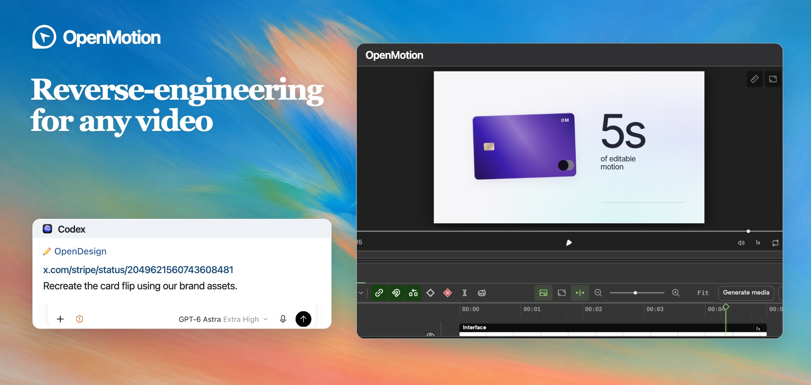
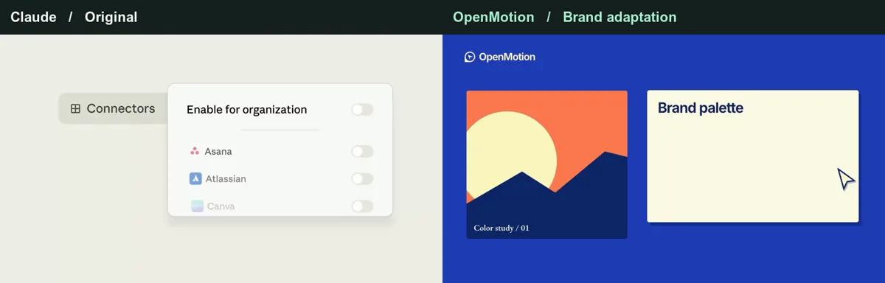
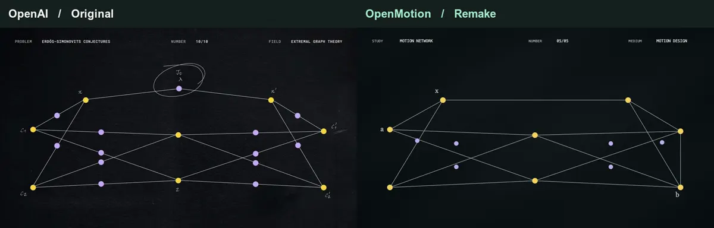
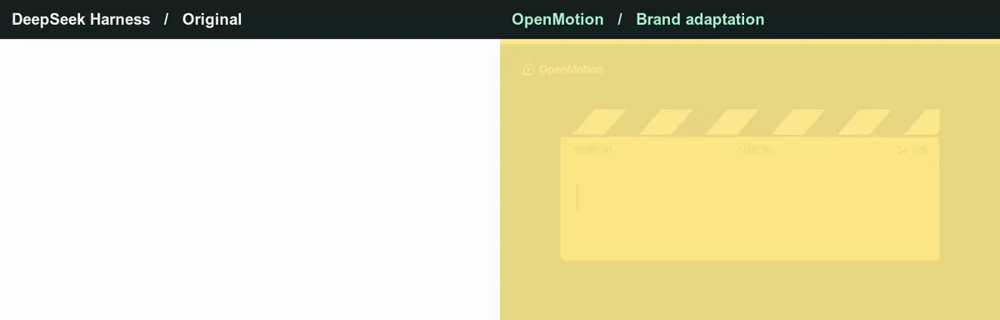
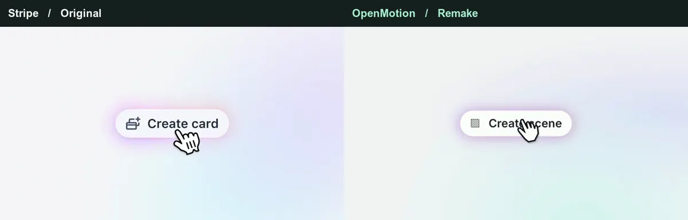
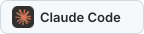
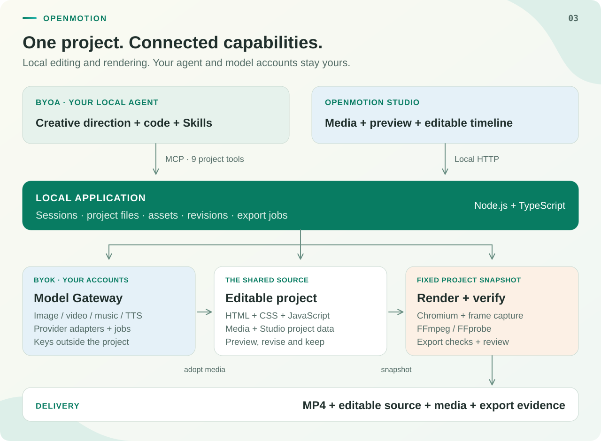

<picture>
  <source media="(max-width: 600px)" srcset="docs/readme/brand-hero.mobile.jpg">
  
</picture>

# OpenMotion · Reverse-engineer brand videos in any agent

Upload a video or paste a social video link. OpenMotion rebuilds the shots, timing and transitions in editable HTML. Swap in your product, logo and copy, fine-tune the cut in Studio, and render an MP4.

<kbd>Open source</kbd> <kbd>Local agent</kbd> <kbd>BYOK</kbd> <kbd>Editable HTML</kbd> <kbd>Motion MD</kbd>

[See the five comparisons](#brand-before-after) · [Quick start](#quick-start) · [简体中文](docs/README.zh-CN.md)

<a id="everyone-can-be-a-creator"></a><a id="creator-video-gallery"></a><a id="motion-gallery"></a><a id="brand-before-after"></a>

## Original vs. OpenMotion

Five synchronized, silent cuts. The original plays on the left and the OpenMotion render on the right. On a phone the original plays above the remake. Open any comparison to watch the MP4.

[Claude](#case-claude) · [OpenAI](#case-openai) · [Kimi](#case-kimi) · [DeepSeek Harness](#case-deepseek) · [Stripe](#case-stripe)

<a id="case-claude"></a>

### Claude · A feature walkthrough

<a href="examples/brand-studies/anthropic/comparison.mp4">
  <picture>
    <source media="(prefers-reduced-motion: reduce)" srcset="examples/brand-studies/anthropic/comparison.jpg">
    <source media="(max-width: 600px)" srcset="examples/brand-studies/anthropic/comparison.mobile.webp">
    
  </picture>
</a>

Watch the switches flip before the settings panel slides away. A hand-drawn circle lands on the headline. In the remake, those switches control a brand kit.

[Original · 00:00–00:05](https://x.com/ClaudeDevs/status/2091953609185657251) · [Full-size MP4](examples/brand-studies/anthropic/comparison.mp4) · [Editable HTML](examples/brand-studies/anthropic/index.html)

<a id="case-openai"></a>

### OpenAI · A brand-film sign-off

<a href="examples/motion-studies/comparison.mp4">
  <picture>
    <source media="(prefers-reduced-motion: reduce)" srcset="examples/motion-studies/comparison.jpg">
    <source media="(max-width: 600px)" srcset="examples/motion-studies/comparison.mobile.webp">
    
  </picture>
</a>

The last points in a dark wireframe give way to a white screen. Compare the cut, the wordmark and the final beat as OpenAI becomes OpenDesign.

[Original · 00:26.50–00:31.50](https://x.com/OpenAI/status/2084352161404920316) · [Full-size MP4](examples/motion-studies/comparison.mp4) · [Editable HTML](examples/motion-studies/index.html)

<a id="case-kimi"></a>

### Kimi · Kinetic typography

<a href="examples/brand-studies/kimi/comparison.mp4">
  <picture>
    <source media="(prefers-reduced-motion: reduce)" srcset="examples/brand-studies/kimi/comparison.jpg">
    <source media="(max-width: 600px)" srcset="examples/brand-studies/kimi/comparison.mobile.webp">
    
  </picture>
</a>

Fine field lines fade as the letters flicker through several forms. The same beats spell out OpenMotion in the remake.

[Original · 00:30.75–00:35.75](https://x.com/Kimi_Moonshot/status/2077521842080817296) · [Full-size MP4](examples/brand-studies/kimi/comparison.mp4) · [Editable HTML](examples/brand-studies/kimi/index.html)

<a id="case-deepseek"></a>

### DeepSeek Harness · A title typed on screen

<a href="examples/brand-studies/deepseek/comparison.mp4">
  <picture>
    <source media="(prefers-reduced-motion: reduce)" srcset="examples/brand-studies/deepseek/comparison.jpg">
    <source media="(max-width: 600px)" srcset="examples/brand-studies/deepseek/comparison.mobile.webp">
    
  </picture>
</a>

In the DeepSeek Harness team’s clip, the cursor types “Creator Mode” before a flash cuts to the closing frame. The remake changes the title and keeps the pause before the flash.

[Original · 01:31.50–01:36.50](https://x.com/DeepSeekHarness/status/2117256196227019194) · [Full-size MP4](examples/brand-studies/deepseek/comparison.mp4) · [Editable HTML](examples/brand-studies/deepseek/index.html)

<a id="case-stripe"></a>

### Stripe · A product reveal

<a href="examples/brand-studies/stripe/comparison.mp4">
  <picture>
    <source media="(prefers-reduced-motion: reduce)" srcset="examples/brand-studies/stripe/comparison.jpg">
    <source media="(max-width: 600px)" srcset="examples/brand-studies/stripe/comparison.mobile.webp">
    
  </picture>
</a>

A click opens a form. The camera pushes in, then a violet card lifts out and flips into place. Stripe’s “2%” becomes “5s” of editable motion.

[Original · 00:21.50–00:26.50](https://x.com/stripe/status/2049621560743608481) · [Full-size MP4](examples/brand-studies/stripe/comparison.mp4) · [Editable HTML](examples/brand-studies/stripe/index.html) · [Motion MD](examples/brand-studies/stripe/MOTION.md)

<a id="ai-video-editing"></a><a id="what-can-you-make"></a><a id="可以用它做什么"></a><a id="presenter-motion"></a>

### What else can you cut?

The studies above start with product footage and brand films. For a presenter, a screen recording or a song, the same project can start with your own material.

| Scenario | What to bring | What you can change |
| --- | --- | --- |
| Presenter-led edits | A recording and transcript | Tighter pauses, captions and cutaways |
| Recuts and revisions | An existing cut and new footage | A new opening, shot order or aspect ratio |
| Product launches and demos | Product screens and a brand kit | An interface reveal paced to each click |
| Viral video recreation | A social clip and your assets | The reference rhythm with a new subject |
| Explainers and tutorials | Screen recording, steps and narration | Callouts and close-ups timed to each step |
| Data stories and charts | Figures, labels and the point to illustrate | Animate a comparison, a trend or a turning point |
| Music and art visuals | A track and a visual motif | Beat-matched type, shapes and transitions |

[Seven example briefs with inputs and prompts](docs/examples.md)

<a id="connect-your-agent"></a><a id="从-agent-接入"></a><a id="use-from-your-agent"></a><a id="quick-start"></a>

## Try it in your local agent

OpenMotion is free and open source. Use the agent you already work in. Bring your own keys at each layer, from the agent itself to image, video, music and speech generation. Providers charge under your own account.

<p>


</p>

Use Node.js 26.11.1, npm and Git. Local rendering also needs Chrome or Chromium, FFmpeg and FFprobe.

```sh
git clone --branch feature/motion https://github.com/nexu-io/html-anything.git openmotion
cd openmotion
npm ci
npm run build:studio
npm start
```

Open **http://localhost:4173** and choose **Connect Agent**. For the Codex plugin, run `bash scripts/install-motion.command` from the checkout in a second terminal. [Agent setup](docs/agent-adapters.md)

To try it without source footage, ask your agent to open a copy of **Product Promo** in Studio and change the closing title to your brand name. [Start from an editable template](skills/motion-template-to-video/SKILL.md)

Try the Stripe cut with this prompt. If your agent cannot fetch the post, attach the video file and use the same timecodes.

> Use OpenMotion to recreate 00:21.50–00:26.50 of https://x.com/stripe/status/2049621560743608481. Keep the timing of the click, push-in and card flip. Use my logo and colors on the card. Show me the editable cut in Studio before rendering the MP4.

<a id="产品界面"></a><a id="product-tour"></a><a id="how-it-works"></a>

## From reference to editable film

OpenMotion is our first full-stack agentic video generator. The agent generates shots as HTML, CSS and JavaScript. You can move a cut in Studio or ask the agent to hold the last frame longer. Both edit the same project that renders the final film.

### Keep the recipe in Motion MD

We designed **Motion MD** so an agent can read a film’s creative decisions alongside its source. A brief records the shot order, timing, transitions and assets you can replace. Our first planned open-source collection covers **100+ brand films**. The Stripe brief is available with its editable project.

[Format and examples](docs/motion-md.md) · [Stripe card reveal · MOTION.md](examples/brand-studies/stripe/MOTION.md)

<a id="model-wall"></a>

### Images, video, music and voice

Open **Model Settings** in Studio to connect a provider. Generate a missing product image, motion clip, soundtrack or voiceover, then place it on the same timeline. The built-in catalog includes these models.

<p>


</p>

[Model gateway and credentials](docs/model-gateway.md)

<details>
<summary>Requested integrations</summary>

These two models are candidates for future integration.

 

</details>

<a id="developer-architecture"></a>

## For developers

Your agent connects over MCP. Studio and the agent share the project source and revision history. The local renderer takes a saved version and exports the MP4.



[Architecture](docs/product/architecture.md) · [MCP tools](docs/mcp-phase1-tools.md) · [Documentation](docs/README.md) · [Contributing](CONTRIBUTING.md)

### Community

[OpenMotion website](https://open-design.ai/openmotion?utm_source=github&utm_medium=referral&utm_campaign=openmotion&utm_content=readme_en) · [OpenDesign Go](https://go.open-design.ai/?utm_source=github&utm_medium=referral&utm_campaign=openmotion&utm_content=readme_en) · [Discord](https://discord.gg/mHAjSMV6gz) · [X @OpenDesignDevs](https://x.com/OpenDesignDevs) · [X @OpenDesignHQ](https://x.com/OpenDesignHQ) · [YouTube](https://www.youtube.com/channel/UChtshixMhvtgBWzoD9R_Qfg)

**Looking for HTML Anything?** [Original editor and installation guide](https://github.com/nexu-io/html-anything/tree/legacy)

<a id="acknowledgements"></a>

## Acknowledgements

The reference excerpts are credited to their publishers above. OpenMotion remakes are independent editable studies. Project code is available under Apache 2.0.

[License](LICENSE) · [Media credits](docs/readme/brand-showcase/README.md) · [Model and agent marks](docs/readme/models/README.md) · [Engine and third-party notices](docs/hyperframes.md) · [Template notices](template-library/NOTICE.md)

<details>
<summary>Projects and media credits</summary>

| Source | Connection |
| --- | --- |
| [OpenDesign](https://github.com/nexu-io/open-design) | UI provenance, resource structure and brand direction; [design system](docs/design-system.md) and [Motion showcase](https://open-design.ai/motion/) |
| [Hyperframes](https://github.com/heygen-com/hyperframes) | HTML-to-video composition, Studio and rendering foundations, pinned to 0.9.7; creator references, external adaptation demonstrations and component source; [engine notes](docs/hyperframes.md), [template notices](template-library/NOTICE.md) and [catalog provenance](docs/template-catalog.md) |
| [MotionGit](https://motiongit.com/) / adunext | Kinetic Tech source packaged as Presenter Tech; [license and attribution](library/templates/presenter-tech/NOTICE.md) |
| [Hypit](https://github.com/hypit-ai/hypit) | Inspiration for agent-led viral-video cloning and editable variants; no runtime imported here |
| [rea-video](https://github.com/JuneYaooo/rea-video) | Reference analysis and case studies for [live-action unboxing](https://github.com/JuneYaooo/rea-video/blob/main/docs/cases/unboxing/report_en.md) and [characters, code and screen footage](https://github.com/JuneYaooo/rea-video/blob/main/docs/cases/dual_role/report_en.md); [showcase attribution](docs/readme/brand-showcase/README.md), no runtime imported here |
| [OpenAI · Codex Originals](https://openai.com/codex-originals/) | External brand-film inspiration; official campaign still and outbound viewing link |
| [DeepSeek Harness](https://github.com/deepseek-ai/deepseek-harness) / [Super-agent prototype](https://github.com/deepseek-ai/dsh-superagent-prototype) | Agent extensibility and continuing-task inspiration; the prototype is separate from OpenMotion's current runtime |
| Claude Motion / CapCut / [ChatCut](https://chatcut.io/docs/what-is-chatcut) / [OpenChatCut](https://github.com/0xsline/OpenChatCut) | Product references for agent-led creation, approachable AI editing and continued revision |
| [OpusClip](https://www.opus.pro/calendar) | Product reference for distribution and [external scheduling](https://www.opus.pro/tools/instagram-reels-scheduler); no built-in connector |
| [GSAP](https://github.com/greensock/GSAP) / [FFmpeg](https://ffmpeg.org/) | Animation and media dependencies with versions retained in [package.json](package.json) and the [runtime lock](scripts/runtime-lock.json) |

</details>
