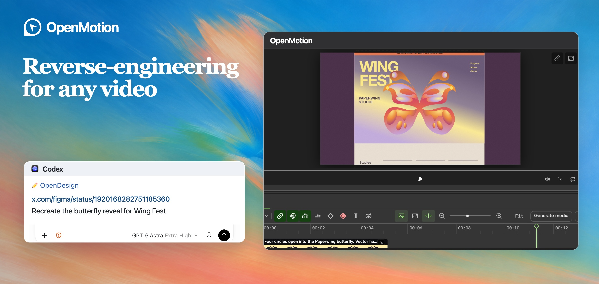
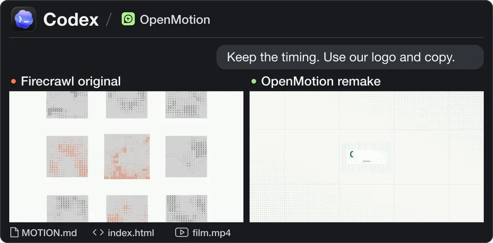
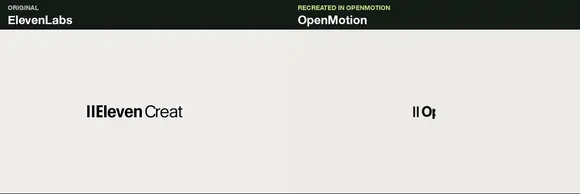
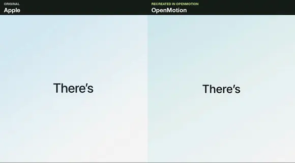
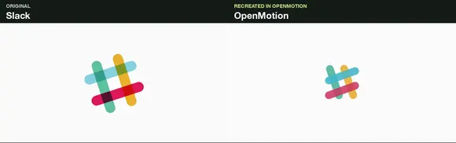
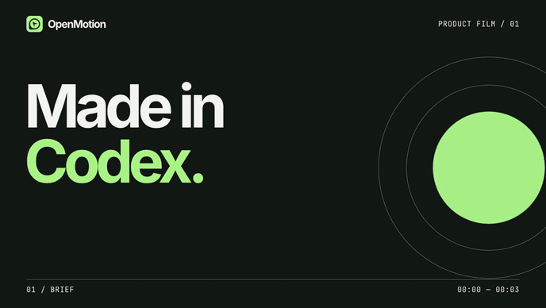
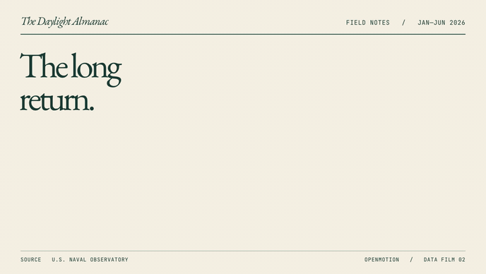
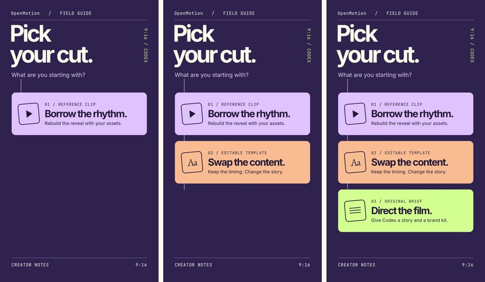
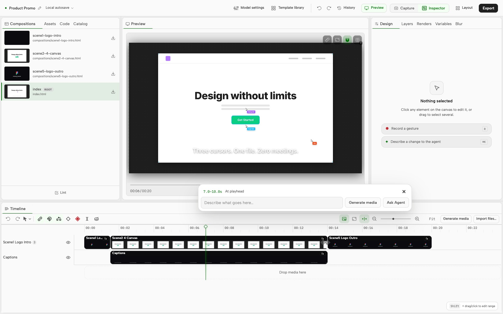
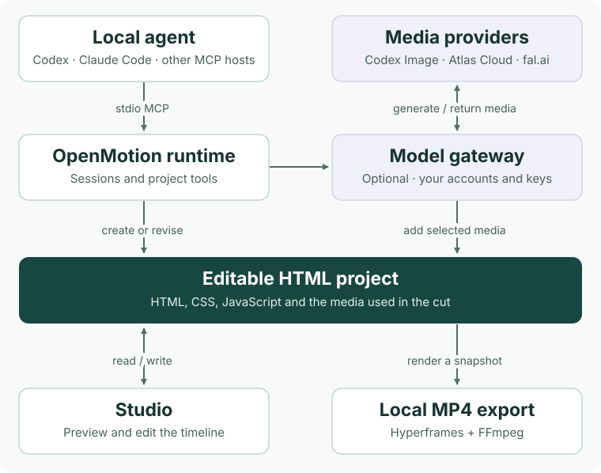

<h1 align="center"><a href="docs/readme/studio-tour.mp4"><picture><source media="(max-width: 640px)" srcset="docs/readme/cover.mobile.jpg" /></picture></a></h1>

<p align="center">Remix any viral video by your agent. Upload a clip or paste a social video link, then bring in your own brand assets.</p>

<p align="center"><strong><a href="#agent-setup">Quickstart</a></strong> · <a href="docs/README.zh-CN.md">简体中文</a></p>

## Make a reference your own

- **The first full-stack agentic video generator.** Our goal is to put generation, editing, and rendering in one open-source workflow. Code your scenes in HTML, edit the timing in Studio, then render the same project to MP4.
- **Fully open source and free to use in your local agent, with BYOK at every layer.** Run OpenMotion directly in Codex, Claude Code, DeepSeek Harness, or WorkBuddy. Use your own API keys for language, image, video, and music models.
- **First open-source release of `MOTION.md` files for 100+ brands.** That’s the scope of our planned collection. We designed [Motion MD](docs/motion-md.md) to record shot order, timing, transitions, and the assets you can replace. Read the [Firecrawl brief](examples/reference-reveal/MOTION.md) in the public preview.
- **Multimodal: images · video · music.** Generate or import the assets you need, line them up with the cuts and beats on one timeline, then export the finished film. [See model options](#bring-your-own-agent-and-keys-byok)

<p align="center"><a href="docs/readme/studio-tour.mp4"><picture>
  <source media="(prefers-reduced-motion: reduce)" srcset="docs/readme/codex-comparison.jpg" />
  
</picture></a></p>

From [Figma Draw’s original film](https://x.com/figma/status/1920168282751185360) to a Wing Fest poster. Play the demo to see the butterfly reveal recreated in Codex.

Watch the original X footage on the left and an editable OpenMotion remake on the right. Each pair plays five seconds at normal speed on the same clock. Open a clip and scrub the reveal frame by frame.

| Original and timecode | Five-second comparison | Editable remake |
| --- | --- | --- |
| [Kimi](https://x.com/Kimi_Moonshot/status/2077521842080817296)<br />00:30.75–00:35.75 | <a href="examples/brand-studies/kimi/comparison.mp4"><picture><source media="(prefers-reduced-motion: reduce)" srcset="examples/brand-studies/kimi/comparison.jpg" /></picture></a> | Magnetic field to wordmark<br />[MP4](examples/brand-studies/kimi/film.mp4) · [Source](examples/brand-studies/kimi/index.html) |
| [DeepSeek](https://x.com/DeepSeekHarness/status/2117256196227019194)<br />01:31.5–01:36.5 | <a href="examples/brand-studies/deepseek/comparison.mp4"><picture><source media="(prefers-reduced-motion: reduce)" srcset="examples/brand-studies/deepseek/comparison.jpg" /></picture></a> | Creator Mode typewriter and flash<br />[MP4](examples/brand-studies/deepseek/film.mp4) · [Source](examples/brand-studies/deepseek/index.html) |
| [OpenAI](https://x.com/OpenAI/status/2084352161404920316)<br />00:26.5–00:31.5 | <a href="examples/motion-studies/comparison.mp4"><picture><source media="(prefers-reduced-motion: reduce)" srcset="examples/motion-studies/comparison.jpg" /></picture></a> | Graph collapses to a brand sign-off<br />[MP4](examples/motion-studies/film.mp4) · [Source](examples/motion-studies/index.html) |
| [Anthropic](https://x.com/ClaudeDevs/status/2091953609185657251)<br />00:00–00:05 | <a href="examples/brand-studies/anthropic/comparison.mp4"><picture><source media="(prefers-reduced-motion: reduce)" srcset="examples/brand-studies/anthropic/comparison.jpg" /></picture></a> | Settings toggles to a circled headline<br />[MP4](examples/brand-studies/anthropic/film.mp4) · [Source](examples/brand-studies/anthropic/index.html) |
| [ElevenLabs](https://x.com/ElevenLabs/status/2069111326987673761)<br />00:50–00:55 | <a href="examples/brand-studies/elevenlabs/comparison.mp4"><picture><source media="(prefers-reduced-motion: reduce)" srcset="examples/brand-studies/elevenlabs/comparison.jpg" /></picture></a> | Rolling wordmark suffixes<br />[MP4](examples/brand-studies/elevenlabs/film.mp4) · [Source](examples/brand-studies/elevenlabs/index.html) |
| [Apple](https://x.com/tim_cook/status/1896589954517701057)<br />00:00.75–00:05.75 | <a href="examples/brand-studies/apple/comparison.mp4"><picture><source media="(prefers-reduced-motion: reduce)" srcset="examples/brand-studies/apple/comparison.jpg" /></picture></a> | A single word folds into a ribbon<br />[MP4](examples/brand-studies/apple/film.mp4) · [Source](examples/brand-studies/apple/index.html) |
| [Slack](https://x.com/SlackHQ/status/1085609385542459393)<br />00:00–00:05 | <a href="examples/brand-studies/slack/comparison.mp4"><picture><source media="(prefers-reduced-motion: reduce)" srcset="examples/brand-studies/slack/comparison.jpg" /></picture></a> | Four colors scatter and regroup<br />[MP4](examples/brand-studies/slack/film.mp4) · [Source](examples/brand-studies/slack/index.html) |

[Explore 100+ brand video references with one-click recreation prompts](#motion-library-and-collections)

To try the Apple shot with your own wordmark, open your brand assets in your agent and paste this prompt.

```text
Use OpenMotion to recreate 00:00.75–00:05.75 of this film.
https://x.com/tim_cook/status/1896589954517701057
Keep the word reveals and fold on the same beats. Replace AIR with CUT.
Open the editable five-second project in Studio and export an MP4.
```

### Presenter-led explainers

In [Kevin Stratvert’s tool demo](https://www.youtube.com/shorts/1fA5j5_5TRY), the presenter cuts from talking to the camera to showing the software. Give your agent your own recording and screen capture so viewers see the feature just as you name it.

> Keep my voice. When I say “export,” cut to my screen recording, circle the Export button, then cut back to me. Keep the highlighted words editable as captions.

The linked short is the reference. Your recording, captions, and screen inserts go into your own project.

## Made with OpenMotion

### Made in Codex · 12-second product launch

[](examples/launch-in-codex/film.mp4)

The brief called for one real product shot. Three seconds of opening type give way to the Studio timeline, then the OpenDesign symbol signs off. To make your own cut, give your agent a screenshot from your repo and the headline from your release notes. [Watch the MP4](examples/launch-in-codex/film.mp4) · [Edit the shots and timing](examples/launch-in-codex/index.html)

### The Long Return · 11-second data story

[](examples/longer-days/film.mp4)

How much more daylight does Reykjavík get than Lisbon on June 1, 2026? Six monthly observations build the chart, then the answer appears: **5 hours 25 minutes**. The two cities share an axis. The figures, month labels and timing are in one editable file. [Watch the MP4](examples/longer-days/film.mp4) · [Edit the chart](examples/longer-days/index.html) · [See the source data](examples/README.md#the-long-return)

### Pick Your Cut · 9-second vertical explainer

[](examples/pick-your-cut/film.mp4)

A reference clip, a template or a blank brief? Three cards enter on successive beats and stay on screen so a viewer can read the final choice on a phone. Replace the cards with the three steps of your own onboarding flow. [Watch the vertical MP4](examples/pick-your-cut/film.mp4) · [Edit the cards](examples/pick-your-cut/index.html)

All three films were exported through the plugin. Each is silent by design. [Get the source, briefs and local render instructions](examples/README.md)

## Agent setup

OpenMotion is an open-source motion design plugin that runs on your computer. Choose an agent that can launch a local MCP server over stdio. Each connection opens the same editable Studio projects.

| Agent | How to connect |
| --- | --- |
| <a href="#start-in-codex"></a> | Install the plugin, then open **Plugins → OpenDesign → Try now**. [Installation steps](#start-in-codex) |
| <a href="docs/agent-adapters.md#codex--claude-code"></a> | Use the local installer with `--host claude` to register the MCP server and install the skills. [Local plugin option](docs/agent-adapters.md#codex--claude-code) |
| <a href="docs/agent-adapters.md#deepseek-harness"></a> | Use `--host deepseek` with a profile that has a model configured. [Harness profile and MCP setup](docs/agent-adapters.md#deepseek-harness) |
| <a href="docs/agent-adapters.md#workbuddy"></a> | Use `--host workbuddy` for custom MCP and skills. Import the generated MCP configuration in WorkBuddy. [Connector setup](docs/agent-adapters.md#workbuddy) |

<details>
<summary>Install with the local installer</summary>

Build the installer from a checkout of the [feature/motion branch](https://github.com/nexu-io/html-anything/tree/feature/motion) using Node.js 22.18+ and npm. This example sets up Claude Code. For another agent, use its host value from the table.

```sh
npm ci
npm run package:npm
npx --yes --package "$PWD/dist/npm-local/openmotion-installer-0.6.2-local.1.tgz" \
  openmotion setup --host claude --manifest "$PWD/dist/npm-local/release.local.json"
```

[Installation options](docs/npm-installation.md#构建与安装)

</details>

To try a reference after installation, open **Template library → Video recreation** in Studio. Search for the brand or shot and use the card’s copy action (一键复刻). Paste the instruction into your agent with your logo, copy or colors. Review the editable project in the Studio timeline, then export the MP4.

Try the bundled **Product Promo** with its own artwork. [How the template demo works](skills/motion-template-to-video/SKILL.md)

### Start in Codex

On macOS or Linux, use Git, Node.js 22.18+ with npm, and a Codex CLI with plugin support. MP4 export also needs Chrome or Chromium and FFmpeg with FFprobe. [Windows setup](docs/test-packages.md)

```sh
git clone --branch feature/motion --single-branch https://github.com/nexu-io/html-anything.git OpenMotion
cd OpenMotion && bash scripts/install-motion.command
```

Keep the checkout on disk. In the Codex desktop app, go to **Plugins → OpenDesign → Try now**. OpenDesign is the display name for the `motion` plugin. Paste your reference link into the composer, or try the bundled example below.

> Use OpenMotion to open a fresh copy of the 20-second Product Promo in Studio and export the MP4.

Then try one edit: **“Hold the closing title two seconds longer. Export another cut.”** You can also drag the clip edge in Studio. Both edit the same project. [Setup and first-demo guide](docs/usage.md#使用)



## System architecture

Your local agent creates a project through MCP and writes the scenes in HTML, CSS, and JavaScript. To hold a title half a second longer, ask the agent to change the code or drag the clip edge in Studio. The renderer takes a snapshot of that same project and exports the MP4.

[](docs/readme/system-architecture.svg)

[Explore the butterfly composition](examples/wing-construction/index.html) · [Product architecture](docs/product/architecture.md) · [Rendering pipeline](docs/hyperframes.md)

### Bring your own agent and keys (BYOK)

Choose your language model in your local agent and use its existing login or API key. To generate media, add your Atlas Cloud or fal.ai key in **Studio → Model settings** and pick a model for each medium. You can also import your own files and edit and render locally without a model key.

| Medium | Built-in model options | Try it in a cut |
| --- | --- | --- |
| Images | Codex Image, Nano Banana 2, FLUX Schnell | Redraw the opening artwork in your brand palette. |
| Video | Seedance 2.0, Wan 2.2 | Generate a cutaway to lead into your screen recording. |
| Music | Suno v4 | Score the moment your product appears. |
| Speech (TTS) | Kokoro | Narrate a new script over the same cut. |

Codex Image uses your local Codex login. Cloud model access and charges depend on your provider account. Add the result you choose to the timeline to keep editing. [Model settings](docs/model-gateway.md) · [Model catalog source](gateway/catalog.ts)

## Motion MD

The opening five seconds of the Firecrawl reference have three distinct beats. The brief pairs each movement with the brand detail you can replace.

| Time | Keep | Swap for your brand |
| --- | --- | --- |
| 0–1.5s | Reveal a large number from left to right. Give its label time to read. | A verified number and a short label from your release notes. |
| 1.5–4s | Let the central mark settle while the outer tiles keep turning. | Your symbol and the inputs or features that belong around it. |
| 4–5s | Follow the same mark into the closing handoff. | The input your customer provides and the result they get. |

[Play the original and the remake together](examples/reference-reveal/comparison.mp4) to check the timing against the three beats above.

Give your agent the Markdown brief along with the project. The brief guides the edit. The HTML, CSS, JavaScript and media supply the animation. [Motion MD v0.1 proposal](docs/motion-md.md) · [Working brief and both exports](examples/reference-reveal/MOTION.md)

## Motion library and collections

In Studio, open **Template library → Video recreation**. Its 136 reference cards group alternate cuts of the same video together. Try **Kimi K3 teaser** or **Reception by ElevenLabs**. Click **一键复刻** on a card to copy its brief, then paste it into your agent with your brand assets. [Browse sample references](docs/collections/README.md) · [How the gallery works](docs/template-catalog.md)

For an editable starting point with its own assets, open one of the **three bundled templates** in Studio.

| [Product Promo · 20s](template-library/product-promo/) | [NYT Graph · 15s](template-library/nyt-graph/) | [Decision Tree · 10s](template-library/decision-tree/) |
| --- | --- | --- |
|  |  |  |
| Swap the headline and end card. | Bring your own figures and labels. | Replace the question and branches. |

We plan to curate collections around brands, recent launches and companies on technology rankings. You can already share a reference with its creator and the moment worth studying, or contribute a remix with its brief, source and rendered preview. [Collections roadmap](docs/collections/README.md) · [Suggest a reference or share a cut](https://github.com/nexu-io/html-anything/issues/new)

### Comparing two cuts

To review a remix today, pause both films on the reveal, check whose brand is on screen, then change one line and render again. **Motion Benchmark / Arena** is a proposal to make comparisons like this repeatable across tools using the same reference and assets. Its scoring method and launch date are still open. [Read the evaluation proposal](docs/motion-md.md#from-specification-to-resource-to-benchmark)

## Build and contribute

<p align="center">
  <a href="https://github.com/nexu-io/html-anything/stargazers"></a>
  <a href="package.json"></a>
  <a href="LICENSE"></a>
</p>

Our goal is to build the best open-source alternative to Claude Motion. OpenMotion includes five creation workflows and nine MCP tools. You can adapt a template, recreate a reference or turn a video into a reusable template folder. To contribute a style, include the original source and creator, your Motion MD, a preview, the editable project and permission to share the assets. [Workflows](docs/skills.md) · [MCP tools](docs/mcp-phase1-tools.md) · [Contributing](CONTRIBUTING.md)

Install from this branch or [build the npm installer locally](docs/npm-installation.md). OpenMotion is licensed under [Apache-2.0](LICENSE) and uses [Hyperframes](https://github.com/heygen-com/hyperframes) for Studio and rendering. The [bundled examples](template-library/NOTICE.md), [Studio](studio/LICENSE) and [fonts](web/design-system/fonts/NOTICES.txt) carry their upstream notices.

## Community

<p align="center">
  <a href="https://open-design.ai/openmotion?utm_source=github&amp;utm_medium=referral&amp;utm_campaign=openmotion&amp;utm_content=readme_en"></a>
  <a href="https://go.open-design.ai/?utm_source=github&amp;utm_medium=referral&amp;utm_campaign=openmotion&amp;utm_content=readme_en"></a>
  <a href="https://discord.gg/mHAjSMV6gz"></a>
  <a href="https://x.com/OpenDesignHQ"></a>
  <a href="https://x.com/OpenDesignDevs"></a>
  <a href="https://www.youtube.com/channel/UChtshixMhvtgBWzoD9R_Qfg"></a>
</p>

[Original HTML Anything editor and installation guide](https://github.com/nexu-io/html-anything/tree/legacy#readme)
