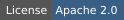
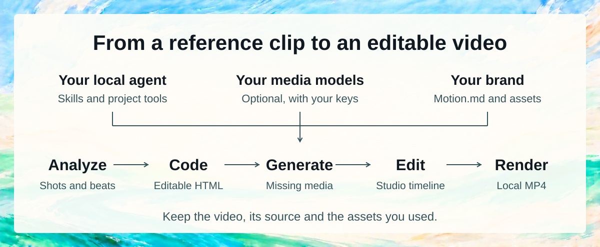
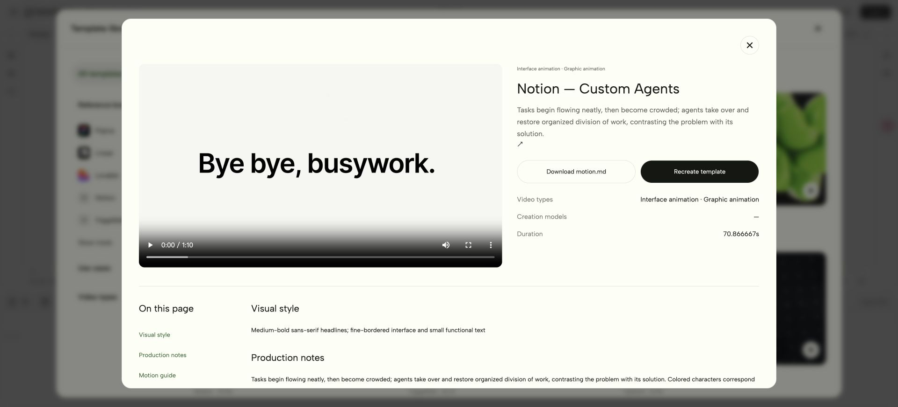
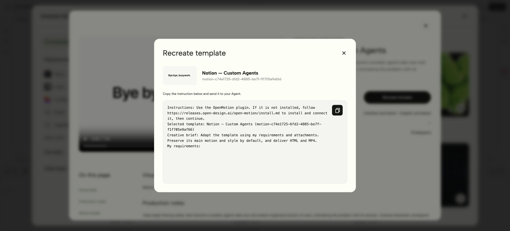

<p align="center"></p>

<p align="center"><strong>Reverse engineering for any video</strong></p>

<p align="center">
  <picture><source media="(max-width: 600px)" srcset="https://releases.open-design.ai/open-motion/media/sha256/730e1d6235820d39ba8adde42810d1165377992136a3b20290ad5d504abb527b.jpg"></picture>
</p>

<p align="center">
  <a href="https://github.com/nexu-io/openmotion"></a>
  <a href="package.json"></a>
  <a href="LICENSE"></a>
  <a href="https://github.com/nexu-io/open-design"></a>
</p>

<p align="center">
  <a href="https://open-design.ai/motion/"></a>
  <a href="https://go.open-design.ai/?utm_source=github&amp;utm_medium=referral&amp;utm_campaign=openmotion&amp;utm_content=readme_en"></a>
  <a href="https://discord.com/invite/M7NnHS9gNa"></a>
  <a href="https://applink.feishu.cn/client/chat/chatter/add_by_link?link_token=b6cs46dc-acb2-48ed-941d-c45642ead841"></a>
  <a href="https://x.com/OpenDesignHQ"></a>
  <a href="https://x.com/OpenDesignDevs"></a>
  <a href="https://www.youtube.com/channel/UChtshixMhvtgBWzoD9R_Qfg"></a>
</p>

<p align="center"><a href="#quick-start">Install</a> · <a href="#agent-wall">Agents</a> · <a href="#showcase">Use cases &amp; remakes</a> · <a href="#features">Why OpenMotion</a> · <a href="#technical-guide">Setup & architecture</a> · <a href="#community">Community</a></p>

<div align="center">

**English** · [简体中文](docs/README.zh-CN.md) · [日本語](docs/README.ja.md)

</div>

# OpenMotion

OpenMotion is **the first full-stack agentic video generator**. Upload a reference video or paste a social video link to **recreate it with your own brand kit and copy**.

- 🎬 **Full-stack video recreation.** Code video with HTML. Your agent breaks down the reference, rebuilds its shots and transitions, and generates missing assets. Edit the timing in Studio and render an MP4 from the same project.
- 🔑 **BYOA — Bring Your Own Agent. BYOK — Bring Your Own Keys.** OpenMotion is free and open source. Recreate videos in [your local agent](#agent-wall) and use your own API keys at every layer.
- 🧩 OpenMotion introduces **Motion.md**, a Markdown format for shot order, timing and transitions. Use it to share how a brand film works, shot by shot.
- 🎛️ **Images, video, music and voice.** Generate artwork with Nano Banana 2, add a shot with Seedance 2.0, score it with Suno v4 and narrate it with Kokoro. [Explore all seven built-in models](#model-wall).

<a id="快速开始"></a> <a id="quick-start"></a>

<a id="start-in-codex"></a>

### Install in your agent

Copy this instruction into your local agent to set up OpenMotion from source:

```text
Read https://github.com/nexu-io/openmotion/blob/main/install.md and follow the instructions to install and connect OpenMotion in the current agent.
```

After setup, the agent opens the local template library and suggests a template. Confirm the choice before creating a project. [Source installation guide](install.md)

### Run the repository locally

Use Git, npm and Node.js 26.11.1:

```sh
git clone --depth 1 https://github.com/nexu-io/openmotion.git
cd openmotion
npm ci
npm run build:studio
npm start
```

Open the actual `studioUrl` or `previewUrl` printed at startup, then choose **Template library**. Studio and MCP read the templates in this checkout. To connect your agent to this same copy, follow [source setup and MCP configuration](#agent-setup). [Clone size and optional media](docs/repository-storage.md)

### Install the published app in your agent

This installs the published npm application and uses its configured online catalog. To use or contribute repository templates, use the local source setup above.

Copy this instruction into your local agent:

```text
Read https://github.com/nexu-io/openmotion/blob/main/docs/install.md and follow the instructions to install and connect OpenMotion in the current agent.
```

After installation, the agent offers a template to try. Confirm the choice before creating a project. [Installation and first-run guide](docs/install.md#installation-success-reply)

<a id="agent-wall"></a>

**22 local agents** · [Choose your agent](#choose-agent)

<p align="center"><a href="#choose-agent"><picture><source media="(max-width: 600px)" srcset="docs/readme/agents/local-agents.mobile.png"></picture></a></p>

<a id="showcase"></a> <a id="brand-before-after"></a> <a id="what-can-you-make"></a>
<a id="use-cases-and-remake-examples"></a>

## 🎞️ Use cases and remake examples

Explore product demos, brand films, talking-head videos and more. The previews below show reference videos.

**[Browse the full template library →](https://open-design.ai/templates/)** — Find more templates, full videos, Motion.md and recreation instructions.

### AI recuts & revisions

<table width="100%">
<tr>
<td width="50%" valign="top">
<picture><source media="(prefers-reduced-motion: reduce)" srcset="docs/readme/live-templates/many-possible-futures.jpg"></picture><br>
<strong>OpenAI · Build a story from multiple scenes</strong><br>
Connect different scenes around one narrative idea, then expand into a broader montage.<br>
<a href="https://open-design.ai/templates/many-possible-futures-motion-design/">View template</a>
</td>
<td width="50%" valign="top">
<picture><source media="(prefers-reduced-motion: reduce)" srcset="docs/readme/live-templates/making-of-window-collage.jpg"></picture><br>
<strong>Anthropic · Recut a making-of collage</strong><br>
Layer clips and screenshots in sequence, keeping the main title readable above them.<br>
<a href="https://open-design.ai/templates/making-of-window-collage-motion-design/">View template</a>
</td>
</tr>
</table>

### Product launches & demos

<table width="100%">
<tr>
<td width="50%" valign="top">
<picture><source media="(prefers-reduced-motion: reduce)" srcset="docs/readme/live-templates/notion-custom-agents.jpg"></picture><br>
<strong>Notion · Show a problem, then the solution</strong><br>
Move from crowded tasks to coordinated agents; adapt the sequence to your own product.<br>
<a href="https://open-design.ai/templates/notion-custom-agents-motion-design/">View template</a>
</td>
<td width="50%" valign="top">
<picture><source media="(prefers-reduced-motion: reduce)" srcset="https://releases.open-design.ai/open-motion/media/sha256/66bc3f14f916a58800562af5b2c8412b2f554f36a435da950faa39ef4b82da96.jpg"></picture><br>
<strong>OpenAI · Turn demand into a product reveal</strong><br>
Build momentum with overlapping requests, then reveal the app in one clear beat.<br>
<a href="https://open-design.ai/templates/demand-becomes-a-desktop-release-motion-design/">View template</a>
</td>
</tr>
</table>

### Brand films & motion

<table width="100%">
<tr>
<td width="50%" valign="top">
<picture><source media="(prefers-reduced-motion: reduce)" srcset="docs/readme/live-templates/a-world-connected-by-computational-fragments.jpg"></picture><br>
<strong>Kimi · Connect worlds through motion</strong><br>
Use code strips, offset slices and transitions to connect a series of brand scenes.<br>
<a href="https://open-design.ai/templates/a-world-connected-by-computational-fragments-motion-design/">View template</a>
</td>
<td width="50%" valign="top">
<picture><source media="(prefers-reduced-motion: reduce)" srcset="docs/readme/live-templates/slack-slack.jpg"></picture><br>
<strong>Slack · Rebuild a brand mark</strong><br>
Break a mark into simple shapes and reassemble it with your own colors and name.<br>
<a href="https://open-design.ai/templates/slack-slack-motion-design/">View template</a>
</td>
</tr>
</table>

### Explainers & tutorials

<table width="100%">
<tr>
<td width="50%" valign="top">
<picture><source media="(prefers-reduced-motion: reduce)" srcset="https://releases.open-design.ai/open-motion/media/sha256/79e74122a92470f1cfe4ce39552b1eacad81bf316514605fef8d64f0c62eea4b.jpg"></picture><br>
<strong>Anthropic · Explain a connected workflow</strong><br>
Follow one question through data, actions and slides, keeping the context visible.<br>
<a href="https://open-design.ai/templates/connected-tools-evidence-chain-motion-design/">View template</a>
</td>
<td width="50%" valign="top">
<picture><source media="(prefers-reduced-motion: reduce)" srcset="docs/readme/live-templates/an-agent-payment-with-human-approval.jpg"></picture><br>
<strong>Stripe · Show an approval step by step</strong><br>
Carry the same request from a conversation to phone confirmation with clear visual continuity.<br>
<a href="https://open-design.ai/templates/an-agent-payment-with-human-approval-motion-design/">View template</a>
</td>
</tr>
</table>

### Data stories & charts

<table width="100%">
<tr>
<td width="50%" valign="top">
<picture><source media="(prefers-reduced-motion: reduce)" srcset="docs/readme/live-templates/mathematics-as-evolving-geometry.jpg"></picture><br>
<strong>OpenAI · Turn complex ideas into diagrams</strong><br>
Transform one geometric diagram into the next using shared points and connecting lines.<br>
<a href="https://open-design.ai/templates/mathematics-as-evolving-geometry-motion-design/">View template</a>
</td>
<td width="50%" valign="top">
<picture><source media="(prefers-reduced-motion: reduce)" srcset="https://releases.open-design.ai/open-motion/media/sha256/be5fc241ac81b90d7e7ded0bf1c90040d2823e6c659420d636722b5935c6e452.jpg"></picture><br>
<strong>Anthropic · Make results progressively visible</strong><br>
Move from an overview to individual findings, then show the action taken for each result.<br>
<a href="https://open-design.ai/templates/scan-to-suggested-fix-motion-design/">View template</a>
</td>
</tr>
</table>

### Music & art visuals

<table width="100%">
<tr>
<td width="50%" valign="top">
<picture><source media="(prefers-reduced-motion: reduce)" srcset="docs/readme/live-templates/controllable-song-composition.jpg"></picture><br>
<strong>ElevenLabs · Visualize a song taking shape</strong><br>
Connect the prompt, sections and tempo to a waveform and the finished piece.<br>
<a href="https://open-design.ai/templates/controllable-song-composition-motion-design/">View template</a>
</td>
<td width="50%" valign="top">
<picture><source media="(prefers-reduced-motion: reduce)" srcset="docs/readme/live-templates/living-waveform-poster.jpg"></picture><br>
<strong>Deezer · Animate a music poster</strong><br>
Keep the headline steady while flowing waves add rhythm around it.<br>
<a href="https://open-design.ai/templates/living-waveform-poster-motion-design/">View template</a>
</td>
</tr>
</table>

<a id="creator-video-gallery"></a> <a id="presenter-motion"></a>

### AI talking-head edits

Build a clear story around a speaker, with readable captions, screen inserts and animated keywords. Use these references to find a style for your own recording.

<table width="100%">
<tr><th colspan="3" align="left">🎓 Teach & explain</th></tr>
<tr>
<td width="33%" valign="top" align="center">
<picture><source media="(prefers-reduced-motion: reduce)" srcset="docs/readme/people/careerwithriya.jpg"></picture><br>
<strong>6 essential skills to transform your career</strong><br>
Numbered points + kinetic keywords<br>
<sub>Reference · @careerwithriya</sub>
</td>
<td width="33%" valign="top" align="center">
<picture><source media="(prefers-reduced-motion: reduce)" srcset="docs/readme/people/dan-martell-tools.jpg"></picture><br>
<strong>What's the best AI tool right now?</strong><br>
Presenter + floating tool cards<br>
<sub>Reference · Dan Martell</sub>
</td>
<td width="33%" valign="top" align="center">
<picture><source media="(prefers-reduced-motion: reduce)" srcset="docs/readme/people/harpercarrollai.jpg"></picture><br>
<strong>10 Days of AI Basics, Day 1</strong><br>
A personal lesson + readable captions<br>
<sub>Reference · @harpercarrollai</sub>
</td>
</tr>
<tr><th colspan="3" align="left">🖥️ Show the workflow</th></tr>
<tr>
<td width="33%" valign="top" align="center">
<picture><source media="(prefers-reduced-motion: reduce)" srcset="docs/readme/people/ali-abdaal-workflow.jpg"></picture><br>
<strong>5 tools I use every day</strong><br>
Desk-side story + workflow inserts<br>
<sub>Reference · Ali Abdaal</sub>
</td>
<td width="33%" valign="top" align="center">
<picture><source media="(prefers-reduced-motion: reduce)" srcset="docs/readme/people/john-tagudin-capso.jpg"></picture><br>
<strong>Tool demo with callouts</strong><br>
Presenter + screens + callouts<br>
<sub>Reference · @john.tagudin</sub>
</td>
<td width="33%" valign="top" align="center">
<picture><source media="(prefers-reduced-motion: reduce)" srcset="docs/readme/people/aiwithsachi.jpg"></picture><br>
<strong>Top 5 plugins to install in Claude</strong><br>
A spoken list + supporting screenshots<br>
<sub>Reference · @aiwithsachi</sub>
</td>
</tr>
<tr><th colspan="3" align="left">🎬 Tell a story, show a product</th></tr>
<tr>
<td width="33%" valign="top" align="center">
<picture><source media="(prefers-reduced-motion: reduce)" srcset="docs/readme/people/khris-sheer-founder.jpg"></picture><br>
<strong>The Founder Experiments, Ep. 1</strong><br>
Founder diary + everyday B-roll<br>
<sub>Reference · @khris.sheer</sub>
</td>
<td width="33%" valign="top" align="center">
<picture><source media="(prefers-reduced-motion: reduce)" srcset="docs/readme/people/ugc-rachelll.jpg"></picture><br>
<strong>AI creator with product</strong><br>
Product story + proof + picture-in-picture<br>
<sub>Reference · @ugc.rachelll</sub>
</td>
<td width="33%" valign="top" align="center">
<picture><source media="(prefers-reduced-motion: reduce)" srcset="docs/readme/people/kevinstratvert.jpg"></picture><br>
<strong>Stop Paying for 5 AI Tools</strong><br>
Product tutorial + live demonstration<br>
<sub>Reference · Kevin Stratvert</sub>
</td>
</tr>
</table>

<a id="features"></a>
<a id="why-openmotion"></a>

## ✨ Why OpenMotion

<a id="what-is-openmotion"></a> <a id="openmotion-是什么"></a> <a id="video-is-code"></a>

### 1. The first full-stack agentic video generator

**Code video with HTML.** OpenMotion uses HTML, CSS and JavaScript to describe scenes, typography, layout, transitions and timing. Recorded footage, generated clips, images, music and voice-over become media inside the composition. The same project opens in Studio and renders to MP4.



**Write it. Watch it. Change it. Render it.** Ask your agent to replace the product, tighten the hook, add a presenter, change the captions or try another ending. It edits the project source; you review the result in the visual editor. Local MCP clients use the project tools, while agents with shell access can follow the Skills and pinned CLI workflow. [Agent setup](#agent-setup) · [Native composition guide](skills/openmotion-production/references/native.md) · [Example HTML project](template-library/product-promo/index.html)

If historical media are unavailable, an Agent restore is refused before changing the project. The editor shows a dismissible error with the affected file paths and confirms that the current project is unchanged.

<a id="studio-in-use"></a>


Review your video, arrange clips and export from the same Studio workspace.

#### What you can change in Studio

| In the Studio | What you can do today |
| --- | --- |
| **Story and timeline** | Import and arrange media; have the agent trim, reorder and revise against a script or confirmed timecodes |
| **Motion and captions** | Author animated type, transitions, callouts, charts and captions around your content |
| **Media and sound** | Import your material and generate images, video, music and TTS voice-over through the built-in model integrations |
| **Image revision** | Generate candidates with a reference-capable image model and adopt a replacement while preserving timing and animation |
| **Preview and versions** | Review in Studio, edit by hand or with your agent, and return to the project for the next revision |
| **Export and source** | Render a fixed version to MP4 and retain the HTML, CSS, JavaScript and media |

> “Keep the reveal we approved. Replace the middle scene with this screen recording, tighten the opening using these timecodes, and hold our final CTA for two more seconds.”

[Projects and versions](docs/project-workspace.md)

<a id="share-an-editable-remake"></a>

#### From a reference clip to an editable remake

1. **Break down the reference.** Pick a sequence. Record its shot order, transitions and sound cues in Motion.md, and mark what you want to replace.
2. **Rebuild the shots.** Your agent rebuilds the HTML scenes using your brand kit, copy and visuals, then arranges them on an editable timeline in Studio.
3. **Compare the cuts.** Watch the same moment in the original and the remake. Adjust the timing, movement and sound, then play the sequence through.
4. **Export and share.** Render the MP4 and keep the HTML source and media. To share a project others can adapt, include its Motion.md, a preview and assets you can redistribute. [Project contribution checklist](library/ENTRY_TEMPLATE.md)

<a id="bring-your-agent-and-keys"></a>

### 2. Free and open source. Use your local agent and bring your own keys.

<a id="choose-agent"></a>

**Choose your agent.** WorkBuddy, Codex, Claude Code and DeepSeek Harness have installation instructions. Other buttons open the shared MCP and CLI setup.

<p>
  <a href="#workbuddy-setup"></a>
  <a href="#agent-setup"></a>
  <a href="#claude-setup"></a>
  <a href="#local-agent-connection"></a>
  <a href="#local-agent-connection"></a>
  <a href="#local-agent-connection"></a>
  <a href="#local-agent-connection"></a>
  <a href="#local-agent-connection"></a>
  <a href="#local-agent-connection"></a>
  <a href="#local-agent-connection"></a>
  <a href="#local-agent-connection"></a>
  <a href="#local-agent-connection"></a>
  <a href="#local-agent-connection"></a>
  <a href="#local-agent-connection"></a>
  <a href="#local-agent-connection"></a>
  <a href="#local-agent-connection"></a>
  <a href="#local-agent-connection"></a>
  <a href="#deepseek-setup"></a>
  <a href="#local-agent-connection"></a>
  <a href="#local-agent-connection"></a>
  <a href="#local-agent-connection"></a>
  <a href="#local-agent-connection"></a>
</p>

| Bring your own… | Make it work for your video |
| --- | --- |
| **🤖 Agent — BYOA** | Connect your existing local agent through Skills and MCP, with CLI access where supported. Keep your preferred client, account and working context. |
| **🔑 Keys — BYOK** | Connect supported media-provider API keys in Model Settings. Choose models for images, video, music and TTS; supported local media integrations can use your existing agent login. |
| **🎨 Brand and material** | Add your logo, fonts, screenshots, camera footage, script and music. Keep identity and approved assets in the Brand Kit section of Motion.md. |
| **🧩 Starting resources** | Browse references, motion components, templates and community Skills. Pick a direction, give the source or reference to your agent, and make it yours. |

**The OpenMotion creation pipeline is open source: Skills, project tools, model integrations, Studio and rendering.** Run it locally, inspect the implementation and extend the parts you need. OpenMotion charges no software subscription or per-render fee for this local workflow. You can also work with your own footage, images and audio without invoking media-generation APIs.

Provider credentials stay in your workspace, separate from the video project. Your agent and media providers bill any subscriptions or usage to your own accounts. [Agent setup and compatibility](docs/agent-adapters.md)

<a id="make-your-motion-language-reusable"></a> <a id="motion-design-community"></a>

### 3. 100+ Motion.md guides for video recreation

OpenMotion introduces **Motion.md**: a Markdown format for shot order, timing, transitions and the assets you can replace. The online library brings reference videos and their motion guides into the same detail page.

The Brand Kit section records your logo, colors, fonts, voice and approved product facts. Keep the reference’s motion and pacing while making the result recognizably yours.


<a id="resources-to-start-from"></a> <a id="motion-gallery"></a>

#### Find a template, then make it yours

Browse by **reference brand, use case and video type**, or search for a specific idea. A template detail page brings together the preview, visual style, production notes and Motion.md download. Choose **Recreate template** in Studio to copy a prompt for your agent.

Reference-only entries start a reconstruction workflow. When editable source is available, your agent can adapt the project directly.


[Browse the template library](https://open-design.ai/templates/)

<a id="all-in-one-studio"></a> <a id="full-video-creation-stack"></a>

<a id="model-wall"></a>

### 4. Multimodal generation: images, video, music and speech

**BYOK makes your multimodal accounts part of the video workflow.** Add your supported provider keys in **Model Settings**, choose your models, and generate images, video, music and speech through the Studio's **Model Gateway**. Preview candidates and adopt the results into the same project your agent and Studio edit. The supported local image path can reuse your existing agent login.

<p>


</p>

| Make what the video needs | Built-in model catalog examples | Bring it into your film |
| --- | --- | --- |
| **🖼️ Images** | Codex Image; Nano Banana 2 via Atlas Cloud; FLUX Schnell via fal.ai | Brand visuals, scene artwork and supporting images; reference-based editing through the supported Codex image path |
| **🎬 Video** | Seedance 2.0 via Atlas Cloud; Wan 2.2 via fal.ai | Generated shots and B-roll to combine with your footage and motion |
| **🎵 Music** | Suno v4 via Atlas Cloud | A soundtrack built around your mood and creative brief |
| **🎙️ TTS / voice-over** | Kokoro via fal.ai | Narration from your approved script, placed alongside the visuals and music |

> “Use the Brand Kit section of our Motion.md and our approved script. Generate artwork for the opening, a video insert, background music and TTS narration. Add the selected results to the recreated project, align the sound and visuals, then show me the full cut.”

[Model catalog](gateway/catalog.ts) · [Provider setup and endpoints](docs/model-gateway.md)

<a id="technical-guide"></a>
<a id="setup-and-technical-documentation"></a>

## 🛠️ Setup and technical documentation

When choosing or replacing media, creation workflows share a [material sourcing policy](skills/openmotion-production/references/materials.md): reuse suitable supplied assets, prefer original sources for established subjects, and create original/supporting visuals as needed. Explicit user constraints and each workflow’s supported scope still apply.

### Install from source

For agent-led installation, use the [installation instruction above](#quick-start). To run from source, follow the steps below.

After a successful Agent-led installation, open the editor's template library in the current conversation, without creating a project. Browse and preview first; choose **Open and edit** to create an independent editable copy. Setup provides a direct library link even before the chat reloads MCP. See the [installation reply rules](docs/install.md#installation-success-reply).

For video playback deliverables, supported MCP Apps hosts can show [per-round progress and version playback](docs/inline-video.md). The integrated host release remains subject to acceptance.

If MCP tools are missing or fail to connect, use the installed [connection diagnosis and recovery guide](docs/npm-installation.md#missing-mcp-tools-or-a-failed-connection) to inspect the actual host configuration and verify the original workspace before continuing.

Use Git, npm and **Node.js 26.11.1**. Source-based preview and export also need Chrome/Chromium and FFmpeg/FFprobe. [Runtime setup](docs/usage.md)

```sh
git clone --depth 1 https://github.com/nexu-io/openmotion.git
cd openmotion
npm ci
npm run build:studio
npm start
```

Full reference videos and optional template archives download through Git LFS only when requested. README images/GIFs and built-in templates remain available directly. See [clone size and optional media downloads](docs/repository-storage.md).

Open the `studioUrl` or `previewUrl` printed by `npm start`, then open **Template library**. Startup reuses a compatible service for the same workspace or selects an available local port. The service keeps running in the background after the launcher exits.

Select a template and choose **Recreate template** to copy the instruction for your agent. Keep projects and credentials outside the checkout; `MOTION_DATA_DIR` selects the workspace.

Source checkouts load templates from `library/templates/catalog/`. The local Studio and MCP use the same files; `openmotion_list_templates` returns a searchable local index, and `openmotion_get_template` returns local guide content and absolute source paths. Imported large images and videos retain existing CMS links; new contribution media can use Git LFS. Local edits appear on the next catalog read.

The plugin root is this checkout: `.codex-plugin/plugin.json` loads its `skills/` and `.mcp.json`, which launches the root `mcp.ts`. Start stdio with `npm run mcp` or use an absolute path in [manual MCP configuration](#manual-mcp). [Local template workflow](docs/template-repository.md#run-from-a-local-clone).

<a id="agent-setup"></a>

#### Bring it into your agent

For Codex with plugin support, run from the checkout:

```sh
bash scripts/install-motion.command
```

<a id="workbuddy-setup"></a>

**WorkBuddy** · Import the OpenMotion connector in WorkBuddy or add its `mcp.json` as a custom MCP server. Ask WorkBuddy to list the available video templates. [WorkBuddy setup](docs/agent-adapters.md#workbuddy)

<a id="claude-setup"></a>

**Claude Code** · Select `--host claude` in the local installer, then run `/mcp` in Claude Code to check the connection. [Local installation guide](docs/npm-installation.md)

<a id="deepseek-setup"></a>

**DeepSeek** · Work with the editable HTML project from the terminal in DeepSeek TUI. For DeepSeek Harness, connect the OpenMotion MCP tools with the Cordis configuration. [DeepSeek Harness setup](docs/agent-adapters.md#deepseek-harness)

The installer uses locally built packages. [Windows test packages](docs/test-packages.md)

Try an online template:

> Use OpenMotion to recreate the template at this detail-page URL with my brand kit and copy. Keep the motion and pacing, then open the editable result in Studio for review.

To start from a video instead, supply your reference and use the [recreation brief](#reverse-engineer-a-video). If your host cannot open Studio beside the conversation, use the returned local project link.

##### Skills, MCP and CLI

The plugin and MCP server are named `openmotion`; Tools, Skills and resources use `openmotion_*`, `openmotion-*` and `openmotion://`. Old Tool/resource names remain compatibility aliases; retired Skill entries are removed. Use `openmotion-*` Skill names and refresh host discovery after upgrading. See [naming and installation compatibility](docs/npm-installation.md#public-names-and-compatibility).

From the checkout, discover and install the five core workflows with the [Skills CLI](https://github.com/vercel-labs/skills):

```sh
npx skills add ./skills --list
npx skills add ./skills --skill openmotion-director openmotion-production openmotion-template-to-video openmotion-recreate openmotion-video-to-template
```

This copies instructions; it does not install the runtime or register MCP. Keep the shared documentation available and connect the app separately, or use the integrated local installer above.

| Skill | Use it for |
| --- | --- |
| [openmotion-recreate](skills/openmotion-recreate/SKILL.md) | Reconstructing a reference video and comparing the result |
| [openmotion-template-to-video](skills/openmotion-template-to-video/SKILL.md) | Adapting an existing editable template |
| [openmotion-director](skills/openmotion-director/SKILL.md) | Original films, narrative, movement, sound and creative review |
| [openmotion-video-to-template](skills/openmotion-video-to-template/SKILL.md) | Producing a portable reusable template |
| [openmotion-production](skills/openmotion-production/SKILL.md) | Scoped edits, preview, checks, troubleshooting and export |

<a id="local-agent-connection"></a>

**Connect a local agent** · Follow the installation guide for your client. Use the configuration below in clients with local stdio MCP support. In a shell-based agent, open the project directory and use the [local engine CLI](skills/openmotion-production/references/native.md) to preview and render the HTML scenes.

<a id="manual-mcp"></a>

```json
{
  "mcpServers": {
    "openmotion": {
      "command": "/absolute/path/to/node",
      "args": ["--experimental-strip-types", "/absolute/openmotion/mcp.ts"],
      "env": { "MOTION_DATA_DIR": "/absolute/openmotion-data" }
    }
  }
}
```

The **twelve public MCP tools** cover template discovery and details, project creation and reading, editing, preview, media import and BYOK generation, export, version restoration and cancellation. Shared workflow and engine guides are available through MCP resources. [Tool contract](docs/mcp-phase1-tools.md)

Find a template with `openmotion_list_templates`, inspect it with `openmotion_get_template`, then create an editable copy with `openmotion_create_project`. [Template catalog](docs/template-catalog.md)

Use `npm start` for the app and `npm run mcp` for stdio. Shell-capable agents can inspect and render with the pinned engine CLI returned by the runtime; managed edits retain project revision checks. [Native authoring](skills/openmotion-production/references/native.md)

<a id="product-tour"></a> <a id="产品界面"></a> <a id="connect-your-agent"></a> <a id="use-from-your-agent"></a> <a id="从-agent-接入"></a> <a id="your-agent-your-studio"></a>

<a id="reverse-engineer-a-video"></a>

### From a reference to an editable project

| Study the reference | Rebuild for your story |
| --- | --- |
| **Hook and narrative** — what appears first, what follows, what earns the reveal | Your promise, product facts and call to action |
| **Shot structure** — framing, camera movement, layers and visual hierarchy | Your UI, footage, logo and supporting images |
| **Motion and pacing** — entrances, transitions, easing and reading holds | The same motion intent, adjusted to your content |
| **Typography and identity** — type hierarchy, color and composition | Your fonts, palette and words, recorded in Motion.md’s Brand Kit section |
| **Sound and rhythm** — speech timing, music cues and emphasis | Your voice, supplied music and sound direction |

Supply the clip and timecodes if your agent cannot open the social link. Start from the reference with the [recreation workflow](skills/openmotion-recreate/SKILL.md), or use the [template workflow](skills/openmotion-template-to-video/SKILL.md) when you already have editable source.

```text
Use OpenMotion to reverse-engineer the attached reference for our brand.

Study: the opening hook, shot order, typography, transitions and sound cues.
Keep: the product reveal and camera rhythm in the selected segment.
Replace: the logo, UI, claims, copy and end card with our supplied materials.
Generate: missing images, video, background music and TTS narration using
our configured models, following our brand and approved script.

Build an editable project. Open it in Studio and compare matching moments
with the reference. Explain any remaining differences. After review,
export an MP4 and retain the source for the next edit.
```

<a id="ai-video-editing"></a> <a id="keep-editing-after-the-remake"></a>

#### Review the template and its Motion.md

Open a template to watch the reference and read its visual style and production notes. Download Motion.md when you want the guide as a reusable file.



#### Send the template to your agent

Choose **Recreate template**, copy the instruction and add your brand kit, copy and creative requirements. Your agent installs or connects OpenMotion if needed, then works from the selected template. Open the resulting project in Studio to review the timing, continue editing and export.



<a id="open-projects-reusable-knowledge"></a> <a id="developer-architecture"></a>

### System architecture

Editing the timeline in Studio and asking your agent to change a shot both update the same HTML project. The local TypeScript service manages media and revisions. A browser-based rendering engine exports the selected version to MP4.

#### How the modules work together


Edits made through the project tools include a revision check so an outdated request cannot overwrite newer work. Generated media enters the project when you select it. Each export uses the version saved when the job starts. The exporter checks the file specifications, and you can play the cut to review the picture, sound and timing.

<details>
<summary>Read the full architecture and roadmap as text</summary>

```text
CREATIVE INPUT
Reference video + brand kit + script + media
                            |
                            v
COMMUNITY KNOWLEDGE
Motion.md + BRANDKIT.md + Skills + templates + components
                            |
              +-------------+------------------+
              v                                v
BYOA: YOUR LOCAL AGENT                OPENMOTION STUDIO
DeepSeek Harness / Codex /            React 19 + TypeScript + Vite
Claude Code / other local hosts       Tailwind CSS + Zustand
Skills + host analysis tools         CodeMirror + Dockview
              |                      media / preview / timeline
              | stdio MCP                      | local HTTP
              | 9 public project tools         |
              +------------------+-------------+
                                 v
LOCAL APPLICATION                 Node.js + TypeScript + node:http
Sessions / project files / assets / revisions / export jobs
              |                                  |
              v                                  v
BYOK: MODEL GATEWAY                   VIDEO AS CODE
Your keys / accounts / model routing  HTML scenes + media + Studio data
Discovery / generation jobs           HTML + CSS + JavaScript + GSAP
              |                                  ^
              v                                  |
MODEL ADAPTERS                                   |
Codex Image / Atlas Cloud / fal.ai               |
Images / Video / Music / TTS                     |
              |                                  |
              v                                  |
Generated candidates -> preview / select -> adopt into the project
                                                 |
                                                 v
RENDER AND VERIFY
Selected project version -> HTML render engine + Chromium -> FFmpeg / FFprobe
                                                 |
                                                 v
DELIVERY TODAY
MP4 + editable source + media + version and export evidence
                                                 |
                          .----------------------'
                          v
COMING: PUBLISH TO EVERY PLATFORM
Platform connectors -> release review -> scheduling -> performance feedback
                          |
                          v
COMING: KNOWLEDGE FEEDBACK
Version-linked outcomes -> team memory / RAG -> evaluated Skill improvements
```

</details>

BYOA keeps the agent in your existing client; BYOK connects your supported model accounts. Studio and the local service manage the editable work, while provider credentials remain outside project files. The public phase-one MCP surface contains **twelve tools: nine project tools, two template catalog tools and one BYOK media-use tool**. Configure provider keys in Studio, then use `openmotion_media_use` for model discovery and media generation through the local Gateway service. Keys remain in the service; the public MCP contract does not include publishing.

#### Stack and source map

| Layer | Technology | Start reading |
| --- | --- | --- |
| **Studio and editor UI** | React 19, TypeScript 5.9, Vite 6, Tailwind CSS 4, Zustand, CodeMirror and Dockview | [Studio source](studio/src/) · [Motion app](studio/src/motion/MotionApp.tsx) · [Editor development](docs/editor-fork.md) |
| **Application runtime** | Node.js 26.11.1 in CI, native HTTP, TypeScript execution and local files/JSON | [server.ts](server.ts) · [workspace.ts](workspace.ts) · [Session architecture](docs/session-architecture.md) |
| **Agent integration** | Local stdio MCP, five core Skills and generated host adapters | [mcp.ts](mcp.ts) · [phase1.ts](phase1.ts) · [Adapter generation](scripts/export-adapters.ts) |
| **Multimodal generation** | Codex media adapter, Atlas Cloud predictions, fal.ai queue integration and persisted generation jobs | [Gateway service](gateway/service.ts) · [Provider adapters](gateway/providers.ts) · [Model catalog](gateway/catalog.ts) |
| **Composition and motion** | HTML/CSS/JS, GSAP, a pinned composition engine and native timeline/history | [Engine integration](hyperframes.ts) · [Template source](template-library/) · [Version adapter](phase1-versions.ts) |
| **Rendering and media** | Chromium, Puppeteer Core, FFmpeg and FFprobe | [Render service](server.ts) · [Export verifier](scripts/verify-export.ts) · [Native runtime lock](scripts/runtime-lock.json) |
| **Creative knowledge** | Markdown, source packages, presets and comparison evidence | [Motion.md](docs/motion-md.md) · [Core Skills](skills/) · [Community Library](library/README.md) |
| **Validation and packaging** | Node test runner, Vitest, Studio checks, npm lockfiles and explicit distribution lists | [Tests](tests/) · [Studio tests](studio/tests/) · [CI](.github/workflows/ci.yml) · [Distribution](scripts/distribution.ts) |
| **Publishing and learning — Coming** | Platform adapters, scheduling, version-linked feedback and retrieval; implementation still to be designed | [Studio vision](docs/product/studio-vision.md) |

Dependency pins live in [package.json](package.json), [package-lock.json](package-lock.json) and the [runtime lock](scripts/runtime-lock.json). Models and third-party libraries retain their own terms; the application is Apache-2.0.

#### Choose a layer and build with us

| If you work on… | A useful contribution | Entry point |
| --- | --- | --- |
| **Frontend and interaction** | Improve timeline editing, media generation controls, accessibility or preview behavior | [Studio](studio/src/) · [Media generator](studio/src/motion/MediaGenerator.tsx) |
| **AI and model infrastructure** | Add a provider adapter or model preset using the shared job and media flow | [Gateway design](docs/product/media-generation-design.md) · [Provider adapters](gateway/providers.ts) |
| **Agents and developer tools** | Improve a host adapter, Skill, resource guide or project-tool workflow | [Agent adapters](docs/agent-adapters.md) · [MCP contract](docs/mcp-phase1-tools.md) |
| **Motion and creative coding** | Share a component, native template or Motion.md package with an actual remix | [Components](library/components/README.md) · [Entry checklist](library/ENTRY_TEMPLATE.md) |
| **Video and rendering** | Improve export reliability, media handling or reproducible validation | [Engine notes](docs/hyperframes.md) · [Export verifier](scripts/verify-export.ts) |
| **Social publishing** | Help design the Coming connector layer: account access, release review, scheduling and version mapping | [Publishing direction](docs/product/studio-vision.md) · [Discuss a proposal](https://github.com/nexu-io/openmotion/issues) |

Start with the [local setup](#quick-start), choose one layer, and follow [CONTRIBUTING.md](CONTRIBUTING.md) and [AGENTS.md](AGENTS.md). Keep user projects and credentials outside the checkout and preserve dependency pins and upstream licenses.

[Product architecture](docs/product/architecture.md) · [Studio development](studio/README.md) · [Model Gateway](docs/model-gateway.md) · [Contribution guide](CONTRIBUTING.md)

<a id="one-video-more-places-to-share"></a> <a id="publish-to-every-platform"></a>

<a id="super-motion-video-agent"></a> <a id="status--roadmap"></a> <a id="当前状态与路线图"></a> <a id="roadmap"></a>

### Platform versions and publishing

Make a separate composition for each aspect ratio, review the cut in Studio and export an MP4 for manual upload.

| Version to request | What to adapt |
| --- | --- |
| **Portrait short** — for destinations such as Reels, Shorts, TikTok or Xiaohongshu | Hook, large readable type, framing and the placement of captions |
| **Landscape film** — for a product page, launch or YouTube video | UI detail, wider compositions and time to explain |
| **Square feed cut** — for a social campaign | A compact composition, headline and clear closing message |

Channel connections, scheduled publishing and performance feedback are planned.

#### Studio roadmap and collaboration concept

| Area | Available today | Direction |
| --- | --- | --- |
| **Recreate and edit** | Agent-led reference reconstruction, template adaptation, editable projects and MP4 export | More evaluated recreation cases and repeatable comparisons |
| **Brand and knowledge** | Motion.md with its Brand Kit section, Skills and source packages | Personal/team memory, RAG and evaluated Skill improvements |
| **People and agents** | Handoffs on the same local project | Timeline comments, shared review and collaborative editing |
| **Multimodal creation** | Built-in image, video, music and TTS integrations; generation, candidate selection and timeline adoption | Integrated search across footage, images, voices, music and Avatar services |
| **Publish to every platform — Coming** | Authored aspect-ratio variants and MP4 handoff | Platform connectors, release review, scheduling, automatic reframing and social presets |
| **Feedback** | Human review and saved project versions | Version-linked performance data and recurring production tasks |


*Concept preview of planned collaboration. No release date announced.* [Studio vision](docs/product/studio-vision.md) · [Knowledge and feedback](docs/product/studio-vision.md#knowledge-and-feedback)

<a id="社区共建"></a> <a id="community"></a>

## 🤝 Share the video. Share how you made it.

Share a remake, a reusable template or a Motion.md that captures the rhythm of a film. Include the reference and your editable project so another creator can try the same cut with their own footage.

| Contribution | What to include |
| --- | --- |
| **A recreation** | Reference and creator, your brief, editable project, preview, comparison and remaining differences |
| **A template or component** | Working source, editable choices, assets, preview and attribution |
| **A Skill or design system** | The method, keep/change rules and an example of what you actually ran |
| **Brand Kit content for Motion.md** | Identity, accurate product facts and approved assets within the creative specification |
| **Agent support or editor improvements** | A focused change with reproducible validation |

[Library entry checklist](library/ENTRY_TEMPLATE.md) · [Contribute](CONTRIBUTING.md) · [Report an issue](https://github.com/nexu-io/openmotion/issues) · [Contributors](https://github.com/nexu-io/openmotion/graphs/contributors) · [Media kit](docs/media-kit.md)

The dedicated OpenMotion site is coming to `open-design.ai/openmotion`.

[Motion showcase](https://open-design.ai/motion/) · [OpenDesign Go](https://go.open-design.ai/?utm_source=github&utm_medium=referral&utm_campaign=openmotion&utm_content=readme_en) · [Discord](https://discord.com/invite/M7NnHS9gNa) · [Feishu](https://applink.feishu.cn/client/chat/chatter/add_by_link?link_token=b6cs46dc-acb2-48ed-941d-c45642ead841) · [X @OpenDesignDevs](https://x.com/OpenDesignDevs) · [X @OpenDesignHQ](https://x.com/OpenDesignHQ) · [YouTube](https://www.youtube.com/channel/UChtshixMhvtgBWzoD9R_Qfg)

[**Star OpenMotion on GitHub**](https://github.com/nexu-io/openmotion)

[](https://github.com/nexu-io/openmotion)

<a id="acknowledgements"></a>

### Acknowledgements

The template previews come from the current online catalog. Detail pages identify the reference brand; [preview sources and hashes](docs/readme/live-templates/manifest.json) record the assets used here. [Agent and model marks](docs/readme/models/README.md)

OpenMotion is licensed under [Apache-2.0](LICENSE). Third-party code, templates, media and fonts retain their own licenses and attribution.

| Source | Connection |
| --- | --- |
| [OpenDesign](https://github.com/nexu-io/open-design) | UI provenance, resource structure and brand direction; [design system](docs/design-system.md) and [Motion showcase](https://open-design.ai/motion/) |
| [Hyperframes](https://github.com/heygen-com/hyperframes) | HTML-to-video composition, Studio and rendering foundations, pinned to 0.9.7; creator references, external adaptation demonstrations and component source; [engine notes](docs/hyperframes.md), [template notices](template-library/NOTICE.md) and [catalog provenance](docs/template-catalog.md) |
| [MotionGit](https://motiongit.com/) / adunext | Kinetic Tech source packaged as Presenter Tech; [license and attribution](library/templates/presenter-tech/NOTICE.md) |
| [Hypit](https://github.com/hypit-ai/hypit) | Inspiration for agent-led viral-video cloning and editable variants; no runtime imported here |
| [rea-video](https://github.com/JuneYaooo/rea-video) | Reference analysis and case studies for [live-action unboxing](https://github.com/JuneYaooo/rea-video/blob/main/docs/cases/unboxing/report_en.md) and [characters, code and screen footage](https://github.com/JuneYaooo/rea-video/blob/main/docs/cases/dual_role/report_en.md); [showcase attribution](docs/readme/brand-showcase/README.md), no runtime imported here |
| [OpenAI · Codex Originals](https://openai.com/codex-originals/) | External brand-film inspiration; official campaign still and outbound viewing link |
| [DeepSeek Harness](https://github.com/deepseek-ai/deepseek-harness) / [Super-agent prototype](https://github.com/deepseek-ai/dsh-superagent-prototype) | Agent extensibility and continuing-task inspiration; the prototype is separate from OpenMotion's current runtime |
| Claude Motion / CapCut / [ChatCut](https://chatcut.io/docs/what-is-chatcut) / [OpenChatCut](https://github.com/0xsline/OpenChatCut) | Product references for agent-led creation, approachable AI editing and continued revision |
| [OpusClip](https://www.opus.pro/calendar) | Product reference for distribution and [external scheduling](https://www.opus.pro/tools/instagram-reels-scheduler); no built-in connector |
| [GSAP](https://github.com/greensock/GSAP) / [FFmpeg](https://ffmpeg.org/) | Animation and media dependencies with versions retained in [package.json](package.json) and the [runtime lock](scripts/runtime-lock.json) |

[Asset sources](docs/readme/ASSETS.md) · [Additional showcase sources](docs/readme/brand-showcase/README.md) · [Font notices](web/design-system/fonts/NOTICES.txt) · [Studio license](studio/LICENSE)

The former HTML Anything application is preserved on the [`legacy` branch](https://github.com/nexu-io/openmotion/tree/legacy). See the [repository migration guide](docs/repository-migration.md) for the active branch and distribution boundaries.
