<p align="center"></p>

<p align="center"><strong>Reverse engineering for any video</strong></p>

<p align="center">
  <a href="docs/readme/media/presenter-caption-remake.mp4"><picture><source media="(max-width: 600px)" srcset="docs/readme/brand-hero.mobile.jpg">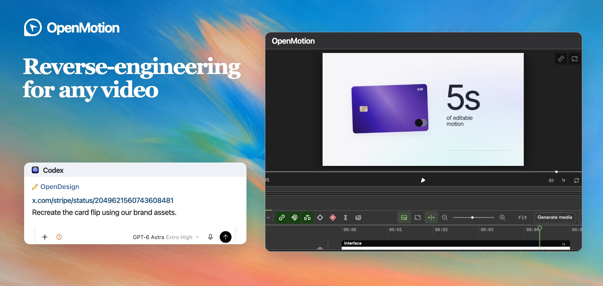</picture></a>
</p>

<p align="center">
  <a href="https://github.com/nexu-io/html-anything"></a>
  <a href="package.json"></a>
  <a href="LICENSE"></a>
  <a href="https://github.com/nexu-io/open-design"></a>
</p>

<p align="center">
  <a href="https://open-design.ai/motion/?utm_source=github&amp;utm_medium=referral&amp;utm_campaign=openmotion&amp;utm_content=readme_en"></a>
  <a href="https://go.open-design.ai/?utm_source=github&amp;utm_medium=referral&amp;utm_campaign=openmotion&amp;utm_content=readme_en"></a>
  <a href="https://discord.gg/mHAjSMV6gz"></a>
  <a href="https://x.com/OpenDesignHQ"></a>
  <a href="https://x.com/OpenDesignDevs"></a>
  <a href="https://www.youtube.com/channel/UChtshixMhvtgBWzoD9R_Qfg"></a>
</p>

<p align="center"><a href="#agent-wall">Agents</a> · <a href="#showcase">Use cases &amp; remakes</a> · <a href="#features">Why OpenMotion</a> · <a href="#technical-guide">Setup & architecture</a> · <a href="#community">Community</a></p>

<div align="center">

**English** · [简体中文](docs/README.zh-CN.md) · [日本語](docs/README.ja.md)

</div>

# OpenMotion

OpenMotion is **the first full-stack agentic video generator**. Upload a reference video or paste a social video link to **recreate it with your own brand kit (logo, colors and fonts) and copy**.

- 🎬 **Full-stack video recreation.** Code video with HTML. Your agent breaks down the reference, rebuilds its shots and transitions, and generates missing assets. Edit the timing in Studio and render an MP4 from the same project.
- 🔑 **BYOA — Bring Your Own Agent. BYOK — Bring Your Own Keys.** OpenMotion is free and open source. Recreate videos in [your local agent](#agent-wall) and use your own API keys at every layer.
- 🧩 OpenMotion introduces **Motion.md**, a Markdown format for shot order, timing and transitions. Use it to share how a brand film works, shot by shot.
- 🎛️ **Images, video, music and voice.** Generate artwork with Nano Banana 2, add a shot with Seedance 2.0, score it with Suno v4 and narrate it with Kokoro. [Explore all seven built-in models](#model-wall).

<a id="agent-wall"></a>

**22 local agents** · [Choose your agent](#choose-agent)

<p align="center"><a href="#choose-agent"><picture><source media="(max-width: 600px)" srcset="docs/readme/agents/local-agents.mobile.png"></picture></a></p>

<a id="showcase"></a> <a id="what-can-you-make"></a>
<a id="use-cases-and-remake-examples"></a>

## 🎞️ Use cases and remake examples

<a id="可以用它做什么"></a>

<a id="everyone-can-be-a-creator"></a> <a id="everyone-can-be-an-ai-video-editor-everyone-can-be-a-creator"></a> <a id="人人都是自媒体"></a> <a id="creator-video-gallery"></a> <a id="presenter-motion"></a>

### AI talking-head edits

Edit around the speaker’s voice, with captions and screen inserts that follow the explanation.

<table width="100%">
<tr><th colspan="3" align="left">🎓 Teach & explain</th></tr>
<tr>
<td width="33%" valign="top" align="center">
<a href="library/skills/presenter-story/assets/careerwithriya-reference.mp4"><picture><source media="(prefers-reduced-motion: reduce)" srcset="docs/readme/people/careerwithriya.jpg"></picture></a><br>
<strong>6 essential skills to transform your career</strong><br>
Numbered points + kinetic keywords<br>
<sub>Reference · <a href="https://www.instagram.com/reel/Ddd57MBszhc/">@careerwithriya</a></sub>
</td>
<td width="33%" valign="top" align="center">
<a href="docs/readme/media/dan-martell-tools-reference.mp4"><picture><source media="(prefers-reduced-motion: reduce)" srcset="docs/readme/people/dan-martell-tools.jpg">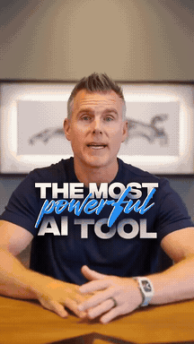</picture></a><br>
<strong>What's the best AI tool right now?</strong><br>
Presenter + floating tool cards<br>
<sub>Reference · <a href="https://www.youtube.com/shorts/mk1zJd9Rm4c">Dan Martell</a></sub>
</td>
<td width="33%" valign="top" align="center">
<a href="docs/readme/media/harpercarrollai-reference.mp4"><picture><source media="(prefers-reduced-motion: reduce)" srcset="docs/readme/people/harpercarrollai.jpg"></picture></a><br>
<strong>10 Days of AI Basics, Day 1</strong><br>
A personal lesson + readable captions<br>
<sub>Reference · <a href="https://www.instagram.com/reel/C4eNPF3PdpG/">@harpercarrollai</a></sub>
</td>
</tr>
<tr><th colspan="3" align="left">🖥️ Show the workflow</th></tr>
<tr>
<td width="33%" valign="top" align="center">
<a href="library/skills/presenter-story/assets/ali-abdaal-workflow-reference.mp4"><picture><source media="(prefers-reduced-motion: reduce)" srcset="docs/readme/people/ali-abdaal-workflow.jpg"></picture></a><br>
<strong>5 tools I use every day</strong><br>
Desk-side story + workflow inserts<br>
<sub>Reference · Ali Abdaal</sub>
</td>
<td width="33%" valign="top" align="center">
<a href="library/skills/presenter-story/assets/john-tagudin-capso-reference.mp4"><picture><source media="(prefers-reduced-motion: reduce)" srcset="docs/readme/people/john-tagudin-capso.jpg">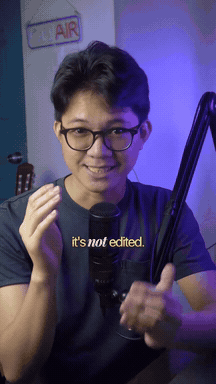</picture></a><br>
<strong>Tool demo with callouts</strong><br>
Presenter + screens + callouts<br>
<sub>Reference · <a href="https://www.tiktok.com/@john.tagudin/video/7524883942328126728">@john.tagudin</a></sub>
</td>
<td width="33%" valign="top" align="center">
<a href="docs/readme/media/aiwithsachi-reference.mp4"><picture><source media="(prefers-reduced-motion: reduce)" srcset="docs/readme/people/aiwithsachi.jpg">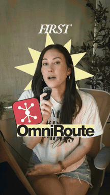</picture></a><br>
<strong>Top 5 plugins to install in Claude</strong><br>
A spoken list + supporting screenshots<br>
<sub>Reference · <a href="https://www.instagram.com/reel/Dc7G9Pxu_1O/">@aiwithsachi</a></sub>
</td>
</tr>
<tr><th colspan="3" align="left">🎬 Tell a story, show a product</th></tr>
<tr>
<td width="33%" valign="top" align="center">
<a href="docs/readme/media/khris-sheer-founder-reference.mp4"><picture><source media="(prefers-reduced-motion: reduce)" srcset="docs/readme/people/khris-sheer-founder.jpg">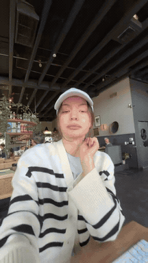</picture></a><br>
<strong>The Founder Experiments, Ep. 1</strong><br>
Founder diary + everyday B-roll<br>
<sub>Reference · <a href="https://www.tiktok.com/@khris.sheer/video/7491715587895430402">@khris.sheer</a></sub>
</td>
<td width="33%" valign="top" align="center">
<a href="docs/readme/media/ugc-rachelll-reference.mp4"><picture><source media="(prefers-reduced-motion: reduce)" srcset="docs/readme/people/ugc-rachelll.jpg"></picture></a><br>
<strong>AI creator with product</strong><br>
Product story + proof + picture-in-picture<br>
<sub>Reference · <a href="https://www.tiktok.com/@ugc.rachelll/video/7616996050066345246">@ugc.rachelll</a></sub>
</td>
<td width="33%" valign="top" align="center">
<a href="docs/readme/media/kevinstratvert-reference.mp4"><picture><source media="(prefers-reduced-motion: reduce)" srcset="docs/readme/people/kevinstratvert.jpg">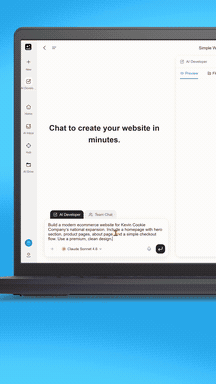</picture></a><br>
<strong>Stop Paying for 5 AI Tools</strong><br>
Product tutorial + live demonstration<br>
<sub>Reference · <a href="https://www.youtube.com/shorts/1fA5j5_5TRY">Kevin Stratvert</a></sub>
</td>
</tr>
<tr><th colspan="3" align="left">Original → external adaptation</th></tr>
<tr>
<td colspan="1" width="33%" align="center" valign="top">
<a href="library/skills/presenter-story/assets/careerwithriya-result.mp4"><picture><source media="(prefers-reduced-motion: reduce)" srcset="docs/readme/people/careerwithriya-comparison.jpg">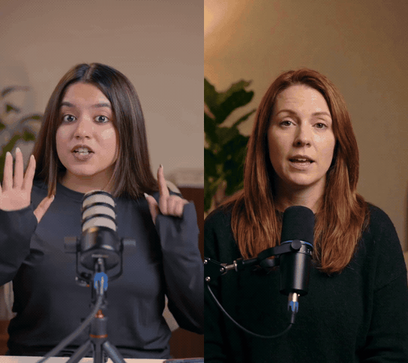</picture></a><br>
<strong>Career advice → video-production explainer</strong><br>
Numbered ideas and proof cards follow the new presenter’s explanation.<br>
<sub><a href="library/skills/presenter-story/references/presenter-listicle/MOTION_DESIGN.md">Motion.md</a> · <a href="library/skills/presenter-story/SKILL.md">Skill</a> · <a href="library/skills/presenter-story/assets/careerwithriya-reference.mp4">Original</a> · <a href="library/skills/presenter-story/assets/careerwithriya-result.mp4">Full adaptation</a></sub>
</td>
<td colspan="1" width="33%" align="center" valign="top">
<a href="library/skills/presenter-story/assets/ali-abdaal-workflow-result.mp4"><picture><source media="(prefers-reduced-motion: reduce)" srcset="docs/readme/people/ali-abdaal-workflow-comparison.jpg">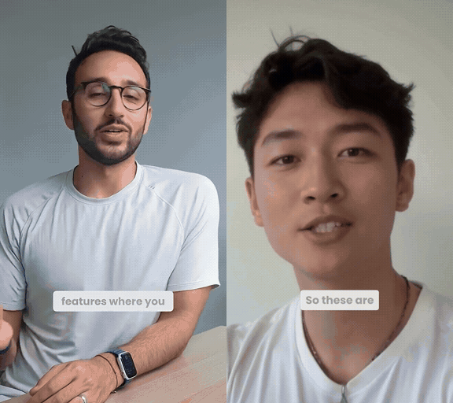</picture></a><br>
<strong>Everyday tools → a design-workspace story</strong><br>
Screen inserts follow the speaker through a different workflow.<br>
<sub><a href="library/skills/presenter-story/references/workflow-demo/MOTION_DESIGN.md">Motion.md</a> · <a href="library/skills/presenter-story/SKILL.md">Skill</a> · <a href="library/skills/presenter-story/assets/ali-abdaal-workflow-reference.mp4">Original</a> · <a href="library/skills/presenter-story/assets/ali-abdaal-workflow-result.mp4">Full adaptation</a></sub>
</td>
<td colspan="1" width="33%" align="center" valign="top">
<a href="library/skills/presenter-story/assets/john-tagudin-capso-result.mp4"><picture><source media="(prefers-reduced-motion: reduce)" srcset="docs/readme/people/john-tagudin-capso-comparison.jpg">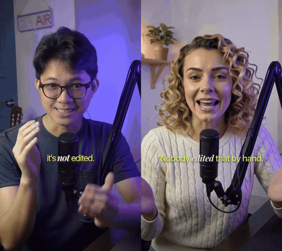</picture></a><br>
<strong>Tool demo → video-editor walkthrough</strong><br>
Picture-in-picture and callouts turn a tool demo into an editing walkthrough.<br>
<sub><a href="library/skills/presenter-story/references/product-walkthrough/MOTION_DESIGN.md">Motion.md</a> · <a href="library/skills/presenter-story/SKILL.md">Skill</a> · <a href="library/skills/presenter-story/assets/john-tagudin-capso-reference.mp4">Original</a> · <a href="library/skills/presenter-story/assets/john-tagudin-capso-result.mp4">Full adaptation</a></sub>
</td>
</tr>
</table>

### AI recuts & revisions

Give a folder of clips and photos a beginning, a turning point and an ending.

<table width="100%">
<tr>
<td colspan="1" width="100%" align="center" valign="top">
<a href="docs/readme/media/hundred-days-story-reference.mp4"><picture>
<source media="(prefers-reduced-motion: reduce)" srcset="docs/readme/examples/story-recut.jpg">
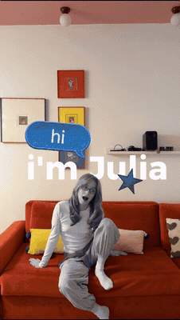
</picture></a><br>
<strong>100 days in photos</strong><br>
Stickers and photo cards mark time in a personal video diary.<br>
<sub><a href="https://www.instagram.com/reel/Dd6vHlQgpok/">Original</a></sub>
</td>
</tr>
</table>

<a id="brand-before-after"></a> <a id="brand-film-gallery"></a>

### Product launches & demos

Build a reveal around the moment your product comes into view.

In the five-second comparisons, the original is on the left and the OpenMotion remake on the right (top and bottom on mobile).

<table width="100%">
<tr>
<td colspan="2" width="100%" align="center" valign="top">
<div id="case-stripe"><a href="examples/brand-studies/stripe/comparison.mp4"><picture><source media="(max-width: 600px) and (prefers-reduced-motion: no-preference)" srcset="examples/brand-studies/stripe/comparison.mobile.webp"><source media="(prefers-reduced-motion: reduce)" srcset="examples/brand-studies/stripe/comparison.jpg">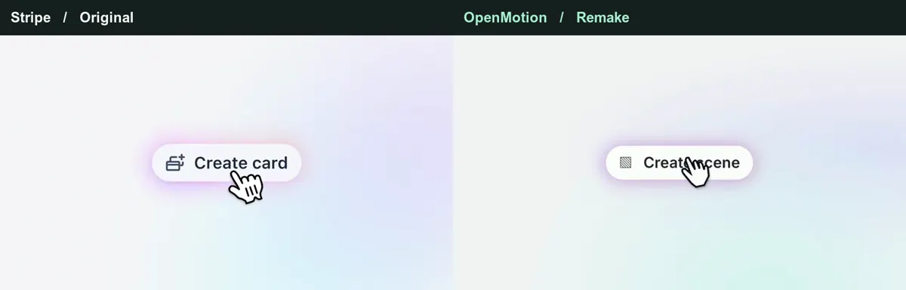</picture></a></div><br>
<strong>Stripe · Card flip → film frame</strong><br>
The remake keeps Stripe’s flip and reveals an illustrated film frame.<br>
<sub><a href="examples/brand-studies/stripe/comparison.mp4">Full size</a> · <a href="examples/brand-studies/stripe/comparison.mobile.mp4">Portrait MP4</a> · <a href="https://x.com/stripe/status/2049621560743608481">Original 00:21.50–00:26.50</a> · <a href="examples/brand-studies/stripe/index.html">HTML</a> · <a href="examples/brand-studies/stripe/MOTION.md">Motion.md</a></sub>
</td>
</tr>
<tr><th colspan="2" align="left">Original films</th></tr>
<tr>
<td width="50%" valign="top">
<a href="docs/readme/media/remix-kimi-k3-reference.mp4"><picture><source media="(prefers-reduced-motion: reduce)" srcset="web/catalog/covers/ac6e14a0fadb5893534e6438.jpg"></picture></a><br>
<strong>Kimi · K3 teaser</strong><br>
Your next release, distilled into a short, memorable teaser.<br>
<sub>Reference · @Kimi_Moonshot</sub>
</td>
<td width="50%" valign="top">
<a href="docs/readme/media/remix-elevenlabs-reception-reference.mp4"><picture><source media="(prefers-reduced-motion: reduce)" srcset="web/catalog/covers/bc4b8b4398d66159acd35890.jpg">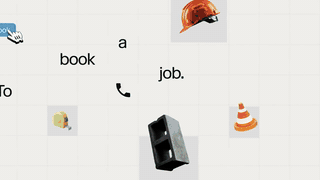</picture></a><br>
<strong>ElevenLabs · Reception</strong><br>
Introduce a new product with a focused launch story.<br>
<sub>Reference · @ElevenLabs</sub>
</td>
</tr>
<tr>
<td width="50%" valign="top" align="center">
<a href="docs/readme/brand-showcase/rea-unboxing.mp4"><picture><source media="(prefers-reduced-motion: reduce)" srcset="docs/readme/brand-showcase/rea-unboxing.jpg"></picture></a><br>
<strong>A real product, a tactile story</strong><br>
Study close-ups, hand movement and the reveal; film your own product.<br>
<sub>Live footage · product unboxing</sub>
</td>
<td width="50%" valign="top" align="center">
<a href="docs/readme/brand-showcase/rea-dual-role.mp4"><picture><source media="(prefers-reduced-motion: reduce)" srcset="docs/readme/brand-showcase/rea-dual-role.jpg">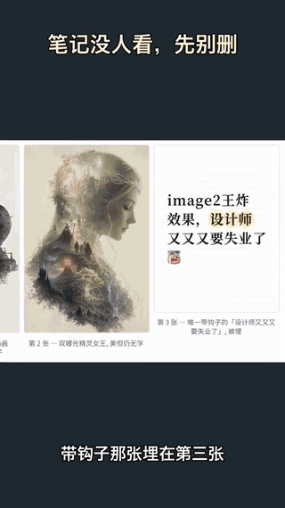</picture></a><br>
<strong>Characters meet the interface</strong><br>
Combine a character-led hook with UI motion and screen footage.<br>
<sub>AI characters + code + screen recording</sub>
</td>
</tr>
</table>

<a id="see-the-motion-survive-a-new-brand"></a>

### Viral video recreation

Keep the timing of a reference clip and change what happens on screen.

<table width="100%">
<tr>
<td colspan="2" width="100%" align="center" valign="top">
<div id="case-openai"><a href="examples/motion-studies/comparison.mp4"><picture><source media="(max-width: 600px) and (prefers-reduced-motion: no-preference)" srcset="examples/motion-studies/comparison.mobile.webp"><source media="(prefers-reduced-motion: reduce)" srcset="examples/motion-studies/comparison.jpg">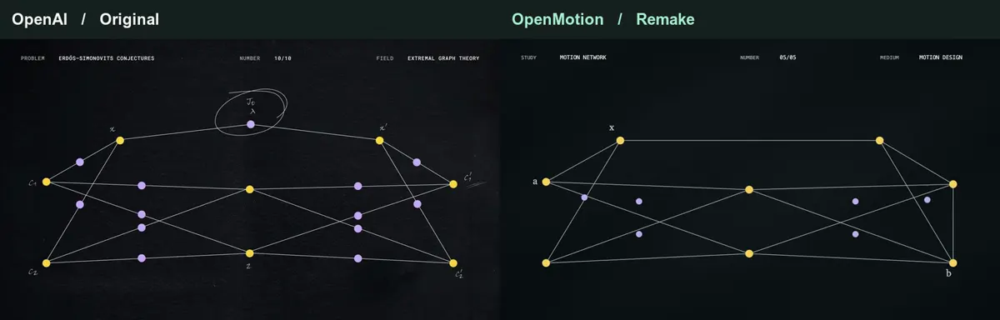</picture></a></div><br>
<strong>OpenAI · Wireframe → edit timeline</strong><br>
Five colored clips collapse into an edit point. The cut and wordmark resolve on the original beat.<br>
<sub><a href="examples/motion-studies/comparison.mp4">Full size</a> · <a href="examples/motion-studies/comparison.mobile.mp4">Portrait MP4</a> · <a href="https://x.com/OpenAI/status/2084352161404920316">Original 00:26.50–00:31.50</a> · <a href="examples/motion-studies/signoff.html">HTML</a></sub>
</td>
</tr>
<tr>
<td colspan="2" width="100%" align="center" valign="top">
<div id="case-deepseek"><a href="examples/brand-studies/deepseek/comparison.mp4"><picture><source media="(max-width: 600px) and (prefers-reduced-motion: no-preference)" srcset="examples/brand-studies/deepseek/comparison.mobile.webp"><source media="(prefers-reduced-motion: reduce)" srcset="examples/brand-studies/deepseek/comparison.jpg">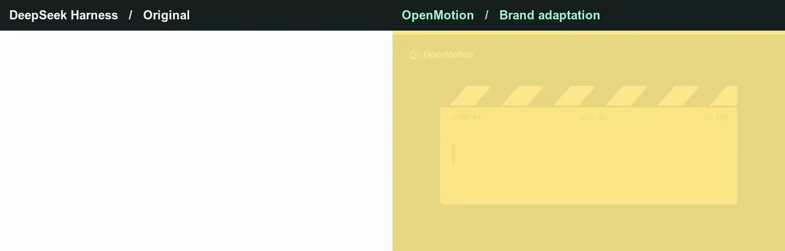</picture></a></div><br>
<strong>DeepSeek Harness · Terminal → film slate</strong><br>
The cursor types on a film slate. A warm flash carries the last keystroke into the end card.<br>
<sub><a href="examples/brand-studies/deepseek/comparison.mp4">Full size</a> · <a href="examples/brand-studies/deepseek/comparison.mobile.mp4">Portrait MP4</a> · <a href="https://x.com/DeepSeekHarness/status/2117256196227019194">Original 01:31.50–01:36.50</a> · <a href="examples/brand-studies/deepseek/index.html">HTML</a></sub>
</td>
</tr>
<tr><th colspan="2" align="left">Editable studies · original and adaptation from the same project</th></tr>
<tr>
<td colspan="1" width="50%" align="center" valign="top">
<a href="library/skills/motion-design-remix/previews/wireframe-portal-title.mp4"><picture><source media="(prefers-reduced-motion: reduce)" srcset="library/skills/motion-design-remix/previews/wireframe-portal-title.jpg"></picture></a><br>
<strong>Wireframe portal · BREAKTHROUGH → OPENMOTION</strong><br>
Keep: Portal timing, dimensional lettering and camera push. Replace: Title, subtitle and the 3D phrase.<br>
<sub><a href="library/skills/motion-design-remix/references/wireframe-portal-title/MOTION_DESIGN.md">Motion.md</a> · <a href="library/skills/motion-design-remix/SKILL.md">Skill</a> · <a href="library/skills/motion-design-remix/presets/wireframe-portal-title.json">Content preset</a> · <a href="library/skills/motion-design-remix/previews/wireframe-portal-title.mp4">MP4</a></sub>
</td>
<td colspan="1" width="50%" align="center" valign="top">
<a href="library/skills/motion-design-remix/previews/canopy-part-title.mp4"><picture><source media="(prefers-reduced-motion: reduce)" srcset="library/skills/motion-design-remix/previews/canopy-part-title.jpg"></picture></a><br>
<strong>Canopy typography · Understory → OpenMotion</strong><br>
Keep: Leaf sweeps, depth, occlusion and reading holds. Replace: Two brand headlines.<br>
<sub><a href="library/skills/motion-design-remix/references/canopy-part-title/MOTION_DESIGN.md">Motion.md</a> · <a href="library/skills/motion-design-remix/SKILL.md">Skill</a> · <a href="library/skills/motion-design-remix/presets/canopy-part-title.json">Content preset</a> · <a href="library/skills/motion-design-remix/previews/canopy-part-title.mp4">MP4</a></sub>
</td>
</tr>
<tr>
<td colspan="1" width="50%" align="center" valign="top">
<a href="library/skills/motion-design-remix/previews/ui-3d-reveal.mp4"><picture><source media="(prefers-reduced-motion: reduce)" srcset="library/skills/motion-design-remix/previews/ui-3d-reveal.jpg">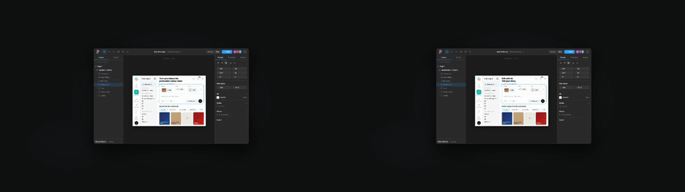</picture></a><br>
<strong>Interface reveal · Product tour → AI editing story</strong><br>
Keep: Tilted canvas, depth hierarchy and continuous camera. Replace: Hero headline, document and community copy.<br>
<sub><a href="library/skills/motion-design-remix/references/ui-3d-reveal/MOTION_DESIGN.md">Motion.md</a> · <a href="library/skills/motion-design-remix/SKILL.md">Skill</a> · <a href="library/skills/motion-design-remix/presets/ui-3d-reveal.json">Content preset</a> · <a href="library/skills/motion-design-remix/previews/ui-3d-reveal.mp4">MP4</a></sub>
</td>
<td colspan="1" width="50%" align="center" valign="top">
<a href="library/skills/motion-design-remix/previews/code-3d-extrude.mp4"><picture><source media="(prefers-reduced-motion: reduce)" srcset="library/skills/motion-design-remix/previews/code-3d-extrude.jpg">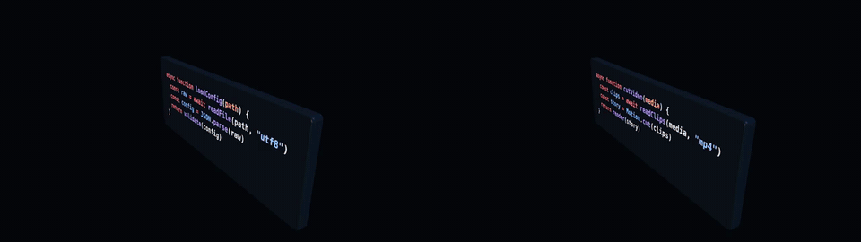</picture></a><br>
<strong>Dimensional code · loadConfig() → cutVideo()</strong><br>
Keep: Extruded slab, syntax colors and the camera move. Replace: Function, variables and displayed calls.<br>
<sub><a href="library/skills/motion-design-remix/references/code-3d-extrude/MOTION_DESIGN.md">Motion.md</a> · <a href="library/skills/motion-design-remix/SKILL.md">Skill</a> · <a href="library/skills/motion-design-remix/presets/code-3d-extrude.json">Content preset</a> · <a href="library/skills/motion-design-remix/previews/code-3d-extrude.mp4">MP4</a></sub>
</td>
</tr>
<tr>
<td colspan="1" width="50%" align="center" valign="top">
<a href="library/skills/motion-design-remix/previews/code-particle-assemble.mp4"><picture><source media="(prefers-reduced-motion: reduce)" srcset="library/skills/motion-design-remix/previews/code-particle-assemble.jpg">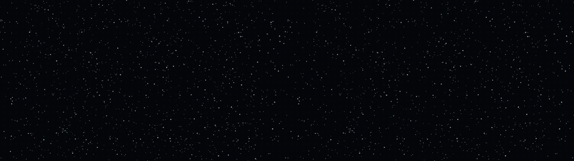</picture></a><br>
<strong>Particle assembly · parse / optimize / emit → select / trim / render</strong><br>
Keep: Seeded particle motion and assembly rhythm. Replace: Pipeline name and steps.<br>
<sub><a href="library/skills/motion-design-remix/references/code-particle-assemble/MOTION_DESIGN.md">Motion.md</a> · <a href="library/skills/motion-design-remix/SKILL.md">Skill</a> · <a href="library/skills/motion-design-remix/presets/code-particle-assemble.json">Content preset</a> · <a href="library/skills/motion-design-remix/previews/code-particle-assemble.mp4">MP4</a></sub>
</td>
<td colspan="1" width="50%" align="center" valign="top">
<a href="library/skills/motion-design-remix/previews/liquid-glass-widgets.mp4"><picture><source media="(prefers-reduced-motion: reduce)" srcset="library/skills/motion-design-remix/previews/liquid-glass-widgets.jpg">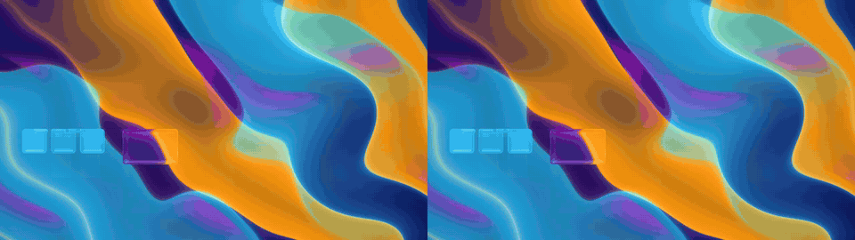</picture></a><br>
<strong>Glass information cards · Device widgets → creator workspace</strong><br>
Keep: Glass treatment, card hierarchy, stagger and meters. Replace: Labels, units and feature story.<br>
<sub><a href="library/skills/motion-design-remix/references/liquid-glass-widgets/MOTION_DESIGN.md">Motion.md</a> · <a href="library/skills/motion-design-remix/SKILL.md">Skill</a> · <a href="library/skills/motion-design-remix/presets/liquid-glass-widgets.json">Content preset</a> · <a href="library/skills/motion-design-remix/previews/liquid-glass-widgets.mp4">MP4</a></sub>
</td>
</tr>
</table>

### Explainers & tutorials

Guide the viewer through a task with a close-up, a highlight and a clear next step.

<table width="100%">
<tr>
<td colspan="2" width="100%" align="center" valign="top">
<div id="case-claude"><a href="examples/brand-studies/anthropic/comparison.mp4"><picture><source media="(max-width: 600px) and (prefers-reduced-motion: no-preference)" srcset="examples/brand-studies/anthropic/comparison.mobile.webp"><source media="(prefers-reduced-motion: reduce)" srcset="examples/brand-studies/anthropic/comparison.jpg">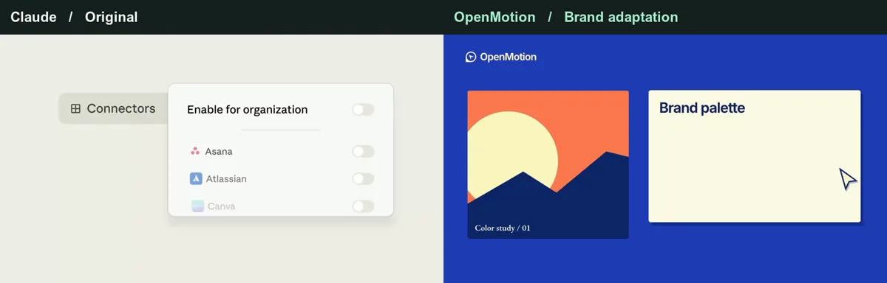</picture></a></div><br>
<strong>Claude · Settings → color palette</strong><br>
The remake uses the same switch and drawn circle to reveal a color palette.<br>
<sub><a href="examples/brand-studies/anthropic/comparison.mp4">Full size</a> · <a href="examples/brand-studies/anthropic/comparison.mobile.mp4">Portrait MP4</a> · <a href="https://x.com/ClaudeDevs/status/2091953609185657251">Original 00:00–00:05</a> · <a href="examples/brand-studies/anthropic/index.html">HTML</a></sub>
</td>
</tr>
</table>

### Data stories & charts

Animate a comparison so the viewer can follow how the values change.

<table width="100%">
<tr>
<td colspan="1" width="100%" align="center" valign="top">
<a href="docs/readme/media/M1128-clip.mp4"><picture>
<source media="(prefers-reduced-motion: reduce)" srcset="docs/readme/examples/data-story.jpg">
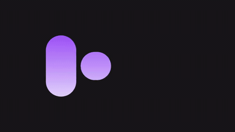
</picture></a><br>
<strong>Animated comparison bars</strong><br>
The values stay visible as the bars change height.<br>
<sub><a href="https://x.com/Vintage_god/status/2106817967967056165">Original</a></sub>
</td>
</tr>
</table>

### Music & art visuals

Give a track a visual motif that returns on the beat.

<table width="100%">
<tr>
<td colspan="2" width="100%" align="center" valign="top">
<div id="case-kimi"><a href="examples/brand-studies/kimi/comparison.mp4"><picture><source media="(max-width: 600px) and (prefers-reduced-motion: no-preference)" srcset="examples/brand-studies/kimi/comparison.mobile.webp"><source media="(prefers-reduced-motion: reduce)" srcset="examples/brand-studies/kimi/comparison.jpg"></picture></a></div><br>
<strong>Kimi · Magnetic field → vinyl grooves</strong><br>
The rotating field becomes a vinyl record; the title lands on its sleeve.<br>
<sub><a href="examples/brand-studies/kimi/comparison.mp4">Full size</a> · <a href="examples/brand-studies/kimi/comparison.mobile.mp4">Portrait MP4</a> · <a href="https://x.com/Kimi_Moonshot/status/2077521842080817296">Original 00:30.75–00:35.75</a> · <a href="examples/brand-studies/kimi/index.html">HTML</a></sub>
</td>
</tr>
</table>

[Get agent prompts for all seven use cases](docs/examples.md)

<a id="features"></a>
<a id="why-openmotion"></a>

## ✨ Why OpenMotion

<a id="what-is-openmotion"></a> <a id="openmotion-是什么"></a> <a id="video-is-code"></a>

### 1. The first full-stack agentic video generator

**Code video with HTML.** OpenMotion uses HTML, CSS and JavaScript to describe scenes, typography, layout, transitions and timing. Recorded footage, generated clips, images, music and voice-over become media inside the composition. The same project opens in Studio and renders to MP4.


**Write it. Watch it. Change it. Render it.** Ask your agent to replace the product, tighten the hook, add a presenter, change the captions or try another ending. It edits the project source; you review the result in the visual editor. Local MCP clients use the project tools, while agents with shell access can follow the Skills and pinned CLI workflow. [Agent setup](#agent-setup) · [Native composition guide](skills/motion-production/references/native.md) · [Example HTML project](template-library/product-promo/index.html)

If historical media are unavailable, an Agent restore is refused before changing the project. The editor shows a dismissible error with the affected file paths and confirms that the current project is unchanged.

#### What you can change in Studio

| In the Studio | What you can do today |
| --- | --- |
| **Story and timeline** | Import and arrange media; have the agent trim, reorder and revise against a script or confirmed timecodes |
| **Motion and captions** | Author animated type, transitions, callouts, charts and captions around your content |
| **Media and sound** | Import your material and generate images, video, music and TTS voice-over through the built-in model integrations |
| **Image revision** | Generate candidates with a reference-capable image model and adopt a replacement while preserving timing and animation |
| **Preview and versions** | Review in Studio, edit by hand or with your agent, and return to the project for the next revision |
| **Export and source** | Render a fixed version to MP4 and retain the HTML, CSS, JavaScript and media |

> “Keep the reveal we approved. Replace the middle scene with this screen recording, tighten the opening using these timecodes, and hold our final CTA for two more seconds.”

[Projects and versions](docs/project-workspace.md)

<a id="share-an-editable-remake"></a>

#### From a reference clip to an editable remake

1. **Break down the reference.** Pick a sequence. Record its shot order, transitions and sound cues in Motion.md, and mark what you want to replace.
2. **Rebuild the shots.** Your agent rebuilds the HTML scenes using your brand kit, copy and visuals, then arranges them on an editable timeline in Studio.
3. **Compare the cuts.** Watch the same moment in the original and the remake. Adjust the timing, movement and sound, then play the sequence through.
4. **Export and share.** Render the MP4 and keep the HTML source and media. To share a project others can adapt, include its Motion.md, a preview and assets you can redistribute. [Project contribution checklist](library/ENTRY_TEMPLATE.md)

<a id="bring-your-agent-and-keys"></a>

### 2. Free and open source. Use your local agent and bring your own keys.

<a id="choose-agent"></a>

**Choose your agent.** WorkBuddy, Codex, Claude Code and DeepSeek Harness have installation instructions. Other buttons open the shared MCP and CLI setup.

<p>
  <a href="#workbuddy-setup"></a>
  <a href="#agent-setup"></a>
  <a href="#claude-setup"></a>
  <a href="#local-agent-connection"></a>
  <a href="#local-agent-connection"></a>
  <a href="#local-agent-connection"></a>
  <a href="#local-agent-connection"></a>
  <a href="#local-agent-connection"></a>
  <a href="#local-agent-connection"></a>
  <a href="#local-agent-connection"></a>
  <a href="#local-agent-connection"></a>
  <a href="#local-agent-connection"></a>
  <a href="#local-agent-connection"></a>
  <a href="#local-agent-connection"></a>
  <a href="#local-agent-connection"></a>
  <a href="#local-agent-connection"></a>
  <a href="#local-agent-connection"></a>
  <a href="#deepseek-setup"></a>
  <a href="#local-agent-connection"></a>
  <a href="#local-agent-connection"></a>
  <a href="#local-agent-connection"></a>
  <a href="#local-agent-connection"></a>
</p>

| Bring your own… | Make it work for your video |
| --- | --- |
| **🤖 Agent — BYOA** | Connect your existing local agent through Skills and MCP, with CLI access where supported. Keep your preferred client, account and working context. |
| **🔑 Keys — BYOK** | Connect supported media-provider API keys in Model Settings. Choose models for images, video, music and TTS; supported local media integrations can use your existing agent login. |
| **🎨 Brand and material** | Add your logo, fonts, screenshots, camera footage, script and music. Keep identity and approved assets in the Brand Kit section of Motion.md. |
| **🧩 Starting resources** | Browse references, motion components, templates and community Skills. Pick a direction, give the source or reference to your agent, and make it yours. |

**The OpenMotion creation pipeline is open source: Skills, project tools, model integrations, Studio and rendering.** Run it locally, inspect the implementation and extend the parts you need. OpenMotion charges no software subscription or per-render fee for this local workflow. You can also work with your own footage, images and audio without invoking media-generation APIs.

Provider credentials stay in your workspace, separate from the video project. Your agent and media providers bill any subscriptions or usage to your own accounts. [Agent setup and compatibility](docs/agent-adapters.md)

<a id="make-your-motion-language-reusable"></a> <a id="motion-design-community"></a>

### 3. 100+ Motion.md brand film studies + 890+ creative resources

OpenMotion introduces **Motion.md**. The first open-source collection breaks down brand films shot by shot, recording timing, transitions and the assets you can replace. In the [Stripe example](examples/brand-studies/stripe/MOTION.md), the flip stays on the same beat while a payment card becomes a film frame.

The Brand Kit section holds the logo, palette, type, voice and approved product facts. Story, motion, sound and review notes describe what should survive a change of brand. Give the file to your agent alongside your assets when starting a new cut.


<a id="resources-to-start-from"></a>

#### Resources for your Motion.md

Explore **42 full-length reference films and 393 motion clips** for shot timing and transitions. When you’re ready to build a scene in HTML, the Studio library also includes **210 blocks, 238 components and 8 code examples**.

| What you want to do | Where to start |
| --- | --- |
| Give your agent a production workflow | [Five core Skills](docs/skills.md) cover direction, recreation, template adaptation, template creation and editing through export. [Motion Design Remix](library/skills/motion-design-remix/SKILL.md) includes six editable studies. [Presenter Story](library/skills/presenter-story/SKILL.md) has three recipes for speech-led videos. |
| Reuse a title, transition or interface reveal | [Motion components](library/components/README.md) include source and timing notes. Try the [title reveal](library/components/title-reveal/README.md) with your own copy and entrance timing. |
| Give your agent brand and motion rules | Use the [Brandkit Skill](library/skills/brandkit/SKILL.md) to collect [logos, voice and product facts](library/brandkits/openmotion/BRANDKIT.md) for the Brand Kit section of Motion.md. [Ink & Water](library/design-systems/ink-water/MOTION_DESIGN.md) shows how to write a reusable visual and motion style. |

##### Editable Studio templates

OpenMotion also ships three editable projects. In Studio, choose one under **Templates → Ready to edit** to create your own copy.

| [Product Promo · 20s](template-library/product-promo/) | [NYT Graph · 15s](template-library/nyt-graph/) | [Decision Tree · 10s](template-library/decision-tree/) |
| --- | --- | --- |
| [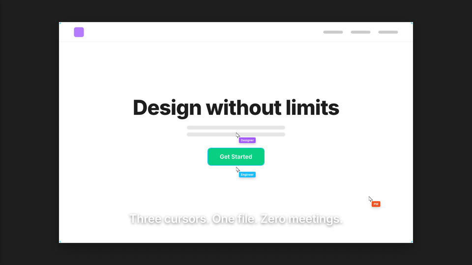](template-library/product-promo/) | [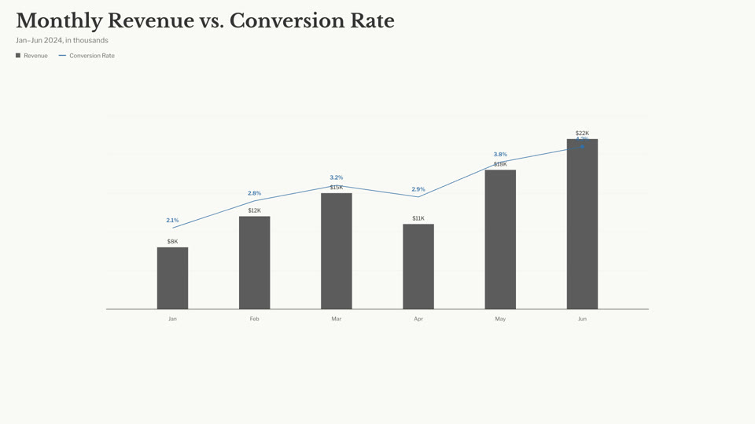](template-library/nyt-graph/) | [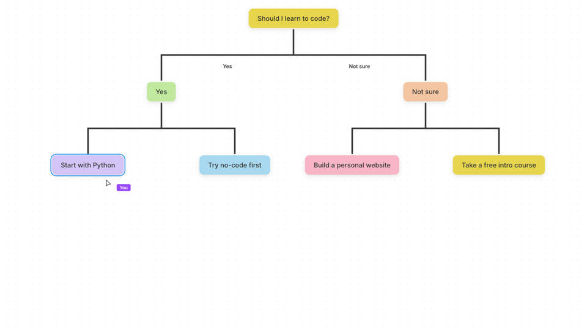](template-library/decision-tree/) |
| Swap in your product screenshots, headline and end card. | Replace the figures, units and annotations. | Change the question, branches and reveal order. |

For a presenter-led video with screen demonstrations, the [Presenter Tech template package](library/templates/presenter-tech/README.md) includes its own local runner.

<a id="motion-gallery"></a>

##### Reference films and motion components

Select a preview to watch the clip. Entries marked “View component” also link to their HTML source.

<table>
<tr><th colspan="3" align="left">Reusable motion components</th></tr>
<tr>
<td width="33%" valign="top">
<a href="docs/readme/media/app-showcase.mp4"><picture><source media="(prefers-reduced-motion: reduce)" srcset="web/catalog/covers/51a2d141e18e608cc11b9256.jpg">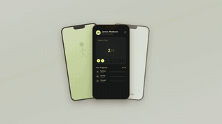</picture></a><br>
<strong>App Showcase</strong><br>
<sub>Component · <a href="library/components/showcase/app-showcase/index.html">View component</a></sub>
</td>
<td width="33%" valign="top">
<a href="docs/readme/media/glass-shard-title.mp4"><picture><source media="(prefers-reduced-motion: reduce)" srcset="web/catalog/covers/10cceacc02d415247d58f562.jpg"></picture></a><br>
<strong>Glass Shard Title</strong><br>
<sub>Component · <a href="library/components/showcase/glass-shard-title/index.html">View component</a></sub>
</td>
<td width="33%" valign="top">
<a href="docs/readme/media/nyc-paris-flight.mp4"><picture><source media="(prefers-reduced-motion: reduce)" srcset="web/catalog/covers/aeafb2433c37f2f7d8c87619.jpg">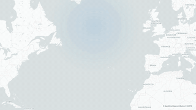</picture></a><br>
<strong>NYC Paris Flight</strong><br>
<sub>Component · <a href="library/components/showcase/nyc-paris-flight/index.html">View component</a></sub>
</td>
</tr>
<tr><th colspan="3" align="left">Product and brand films</th></tr>
<tr>
<td width="33%" valign="top">
<a href="docs/readme/media/jake-pond-reference.mp4"><picture><source media="(prefers-reduced-motion: reduce)" srcset="web/catalog/covers/66ac2f8b58e55670971ae70c.jpg">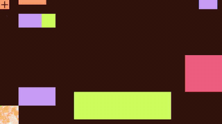</picture></a><br>
<strong>Pond: a new Linux OS</strong><br>
<sub>Reference · @bflycomputer</sub>
</td>
<td width="33%" valign="top">
<a href="docs/readme/media/remix-cyera-reference.mp4"><picture><source media="(prefers-reduced-motion: reduce)" srcset="web/catalog/covers/8884a707a92d0cc52d3363b7.jpg">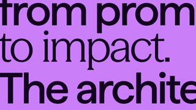</picture></a><br>
<strong>Cyera brand video</strong><br>
<sub>Reference · Cyera</sub>
</td>
<td width="33%" valign="top">
<a href="docs/readme/media/remix-glyph-reference.mp4"><picture><source media="(prefers-reduced-motion: reduce)" srcset="web/catalog/covers/4bfe08db4d486970494eff3b.jpg">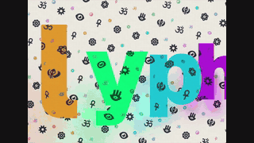</picture></a><br>
<strong>Glyph: GPU typography for the web</strong><br>
<sub>Reference · @pmndrs</sub>
</td>
</tr>
<tr><th colspan="3" align="left">Light and loops</th></tr>
<tr>
<td width="33%" valign="top">
<a href="docs/readme/media/remix-iskra-light-reference.mp4"><picture><source media="(prefers-reduced-motion: reduce)" srcset="web/catalog/covers/75cfbe06267768838d145fa4.jpg">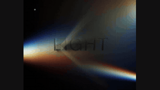</picture></a><br>
<strong>Iskra Light</strong><br>
<sub>Reference · @world_is_web</sub>
</td>
<td width="33%" valign="top">
<a href="docs/readme/media/remix-linear-loops-reference.mp4"><picture><source media="(prefers-reduced-motion: reduce)" srcset="web/catalog/covers/17cf5075b3f4b49c7d3e9201.jpg">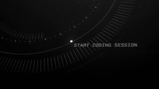</picture></a><br>
<strong>Linear Loops</strong><br>
<sub>Reference · @linear</sub>
</td>
<td width="33%" valign="top">
<a href="docs/readme/media/aurora.mp4"><picture><source media="(prefers-reduced-motion: reduce)" srcset="web/catalog/covers/5aefe7c9a916a38777443b36.jpg">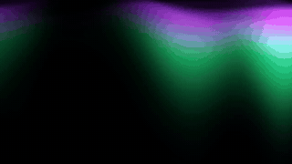</picture></a><br>
<strong>Aurora</strong><br>
<sub>Component · <a href="library/components/showcase/aurora/index.html">View component</a></sub>
</td>
</tr>
</table>

[Browse all 18 library picks](docs/collections/README.md#catalog-picks) · [Media sources and reuse](docs/readme/RESOURCES.md)

[Six editable studies](docs/motion-design-examples.md) · [Motion.md format](docs/motion-md.md)

<a id="all-in-one-studio"></a> <a id="full-video-creation-stack"></a>

<a id="model-wall"></a>

### 4. Multimodal generation: images, video, music and speech

**BYOK makes your multimodal accounts part of the video workflow.** Add your supported provider keys in **Model Settings**, choose your models, and generate images, video, music and speech through the Studio's **Model Gateway**. Preview candidates and adopt the results into the same project your agent and Studio edit. The supported local image path can reuse your existing agent login.

<p>


</p>

| Make what the video needs | Built-in model catalog examples | Bring it into your film |
| --- | --- | --- |
| **🖼️ Images** | Codex Image; Nano Banana 2 via Atlas Cloud; FLUX Schnell via fal.ai | Brand visuals, scene artwork and supporting images; reference-based editing through the supported Codex image path |
| **🎬 Video** | Seedance 2.0 via Atlas Cloud; Wan 2.2 via fal.ai | Generated shots and B-roll to combine with your footage and motion |
| **🎵 Music** | Suno v4 via Atlas Cloud | A soundtrack built around your mood and creative brief |
| **🎙️ TTS / voice-over** | Kokoro via fal.ai | Narration from your approved script, placed alongside the visuals and music |

> “Use the Brand Kit section of our Motion.md and our approved script. Generate artwork for the opening, a video insert, background music and TTS narration. Add the selected results to the recreated project, align the sound and visuals, then show me the full cut.”

[Model catalog](gateway/catalog.ts) · [Provider setup and endpoints](docs/model-gateway.md)

<a id="technical-guide"></a>
<a id="setup-and-technical-documentation"></a>

## 🛠️ Setup and technical documentation

<a id="快速开始"></a> <a id="quick-start"></a>

<a id="start-in-codex"></a>

### Quick start

For any successful Agent-led installation, follow the [installation reply rules and examples](docs/install.md#installation-success-reply) in the current conversation; setup provides real template summaries. Invite before creation and preserve the accepted template.

For a packaged install, give your agent the [test installation guide](https://releases.open-design.ai/open-motion/dev/install.md). It pins the package version and walks through isolated setup. To run from source, follow the steps below.

If MCP tools are missing or fail to connect, use the installed [connection diagnosis and recovery guide](docs/npm-installation.md#missing-mcp-tools-or-a-failed-connection) to inspect the actual host configuration and verify the original workspace before continuing.

Use Git, npm and **Node.js 26.11.1**. Source-based preview and export also need Chrome/Chromium and FFmpeg/FFprobe. [Runtime setup](docs/usage.md)

```sh
git clone --branch feature/motion https://github.com/nexu-io/html-anything.git openmotion
cd openmotion
npm ci
npm run build:studio
npm start
```

Open **http://localhost:4173**. Choose **Templates → Ready to edit**, open **Product Promo**, and use **Connect Agent** for your preferred client. Keep projects and credentials outside the checkout; `MOTION_DATA_DIR` selects the workspace.

<a id="agent-setup"></a>

#### Bring it into your agent

For Codex with plugin support, run from the checkout:

```sh
bash scripts/install-motion.command
```

<a id="workbuddy-setup"></a>

**WorkBuddy** · Import the OpenMotion connector in WorkBuddy or add its `mcp.json` as a custom MCP server. Ask WorkBuddy to list the available video templates. [WorkBuddy setup](docs/agent-adapters.md#workbuddy)

<a id="claude-setup"></a>

**Claude Code** · Select `--host claude` in the local installer, then run `/mcp` in Claude Code to check the connection. [Local installation guide](docs/npm-installation.md)

<a id="deepseek-setup"></a>

**DeepSeek** · Work with the editable HTML project from the terminal in DeepSeek TUI. For DeepSeek Harness, connect the OpenMotion MCP tools with the Cordis configuration. [DeepSeek Harness setup](docs/agent-adapters.md#deepseek-harness)

The installer uses locally built packages. [Windows test packages](docs/test-packages.md)

Try the included template first:

> Use OpenMotion to open a fresh copy of the 20-second Product Promo in Studio and export an MP4. Keep the editable project.

Then make it yours:

> Keep the structure and animation. Replace the logo, screenshots, headline and end card with my supplied brand materials. Show the new cut, then hold the final title two seconds longer.

To start from a video instead, supply your reference and use the [recreation brief](#reverse-engineer-a-video). If your host cannot open Studio beside the conversation, use the returned local project link.

New test npm builds embed **DEV** template defaults; stable packages embed **prod**. Existing published versions keep their original defaults. The environment is stored in the package, so Studio and MCP agree without setup-only environment variables. Use isolated test host, application and data directories. See [test installation and template configuration](docs/npm-installation.md#test-template-data-dev) and the [test publication manual](docs/release-workflows.md).

##### Skills, MCP and CLI

From the checkout, discover and install the five core workflows with the [Skills CLI](https://github.com/vercel-labs/skills):

```sh
npx skills add ./skills --list
npx skills add ./skills --skill motion-director motion-production motion-template-to-video motion-recreate motion-video-to-template
```

This copies instructions; it does not install the runtime or register MCP. Keep the shared documentation available and connect the app separately, or use the integrated local installer above.

| Skill | Use it for |
| --- | --- |
| [motion-recreate](skills/motion-recreate/SKILL.md) | Reconstructing a reference video and comparing the result |
| [motion-template-to-video](skills/motion-template-to-video/SKILL.md) | Adapting an existing editable template |
| [motion-director](skills/motion-director/SKILL.md) | Original films, narrative, movement, sound and creative review |
| [motion-video-to-template](skills/motion-video-to-template/SKILL.md) | Producing a portable reusable template |
| [motion-production](skills/motion-production/SKILL.md) | Scoped edits, preview, checks, troubleshooting and export |

<a id="local-agent-connection"></a>

**Connect a local agent** · Open **Connect Agent** in Studio to copy the launch command for your workspace. Use the configuration below in clients with local stdio MCP support. In a shell-based agent, open the project directory and use the [local engine CLI](skills/motion-production/references/native.md) to preview and render the HTML scenes.

<a id="manual-mcp"></a>

```json
{
  "mcpServers": {
    "openmotion": {
      "command": "/absolute/path/to/node",
      "args": ["--experimental-strip-types", "/absolute/openmotion/mcp.ts"],
      "env": { "MOTION_DATA_DIR": "/absolute/openmotion-data" }
    }
  }
}
```

The **eleven public MCP tools** cover template discovery and details, project creation and reading, editing, preview, media import, export, version restoration and cancellation. Shared workflow and engine guides are available through MCP resources. [Tool contract](docs/mcp-phase1-tools.md)

Find a template with `motion_list_templates`, inspect it with `motion_get_template`, then create an editable copy with `motion_create_project`. [Template catalog](docs/template-catalog.md)

Use `npm start` for the app and `npm run mcp` for stdio. Shell-capable agents can inspect and render with the pinned engine CLI returned by the runtime; managed edits retain project revision checks. [Native authoring](skills/motion-production/references/native.md)

<a id="product-tour"></a> <a id="产品界面"></a> <a id="connect-your-agent"></a> <a id="use-from-your-agent"></a> <a id="从-agent-接入"></a> <a id="your-agent-your-studio"></a>

<a id="reverse-engineer-a-video"></a>

### From a reference to an editable project

| Study the reference | Rebuild for your story |
| --- | --- |
| **Hook and narrative** — what appears first, what follows, what earns the reveal | Your promise, product facts and call to action |
| **Shot structure** — framing, camera movement, layers and visual hierarchy | Your UI, footage, logo and supporting images |
| **Motion and pacing** — entrances, transitions, easing and reading holds | The same motion intent, adjusted to your content |
| **Typography and identity** — type hierarchy, color and composition | Your fonts, palette and words, recorded in Motion.md’s Brand Kit section |
| **Sound and rhythm** — speech timing, music cues and emphasis | Your voice, supplied music and sound direction |

Supply the clip and timecodes if your agent cannot open the social link. Start from the reference with the [recreation workflow](skills/motion-recreate/SKILL.md), or use the [template workflow](skills/motion-template-to-video/SKILL.md) when you already have editable source.

```text
Use OpenMotion to reverse-engineer the attached reference for our brand.

Study: the opening hook, shot order, typography, transitions and sound cues.
Keep: the product reveal and camera rhythm in the selected segment.
Replace: the logo, UI, claims, copy and end card with our supplied materials.
Generate: missing images, video, background music and TTS narration using
our configured models, following our brand and approved script.

Build an editable project. Open it in Studio and compare matching moments
with the reference. Explain any remaining differences. After review,
export an MP4 and retain the source for the next edit.
```

<a id="ai-video-editing"></a> <a id="keep-editing-after-the-remake"></a>

#### Start in your agent

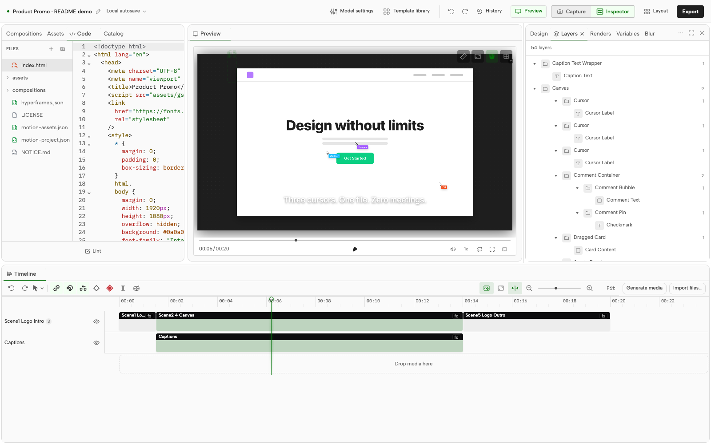

#### Start in Studio

Browse references, open a template or bring in your recordings. Choose **Connect Agent**, follow the workspace-specific instructions and give the agent your brief. Review its edits on the same timeline and make hands-on adjustments whenever you want.

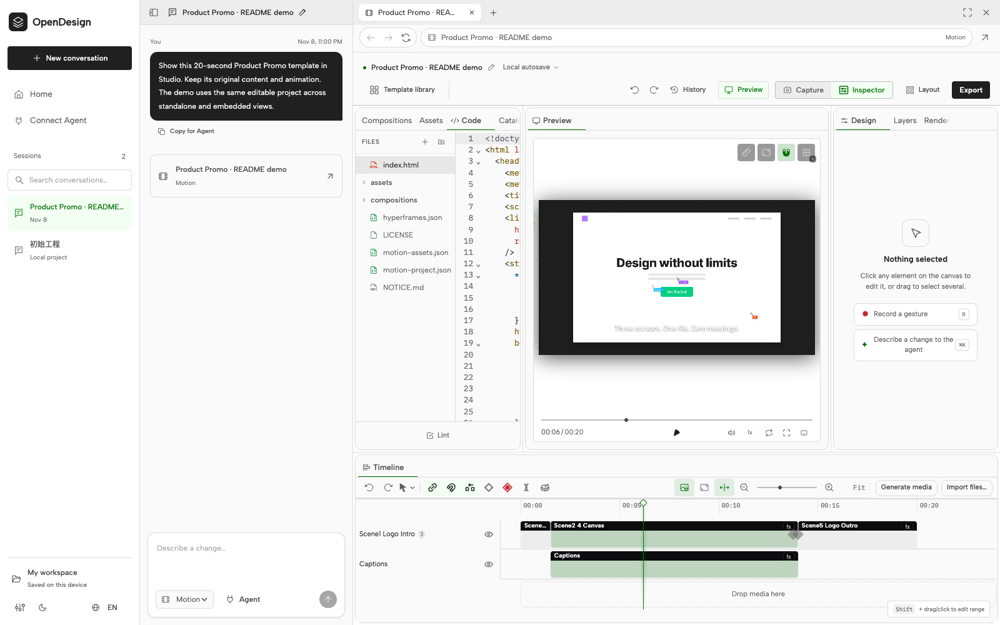

#### Connect your agent to a template

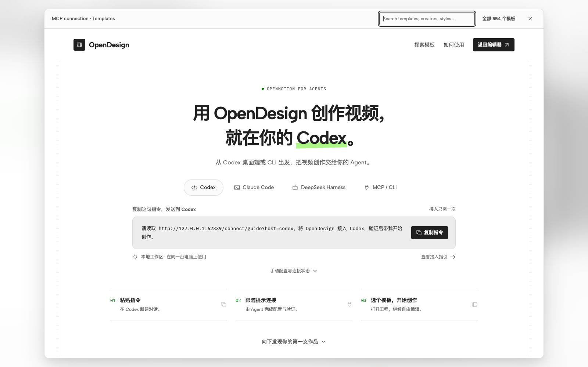

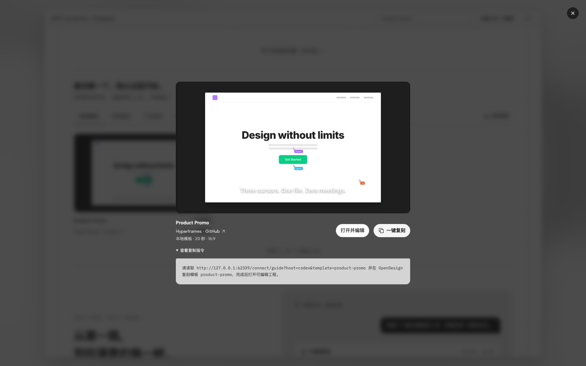

**Preview → copy the instruction → paste into your agent with your brand assets.** A bundled template opens as an editable copy; an external reference starts a reconstruction task. [Full product tour](docs/product-tour.md)

Both entry paths use the same local application and project. The agent runs in its own client; Studio stores the brief and editable work. [How the connection works](docs/session-architecture.md)

<a id="open-projects-reusable-knowledge"></a> <a id="developer-architecture"></a>

### System architecture

Editing the timeline in Studio and asking your agent to change a shot both update the same HTML project. The local TypeScript service manages media and revisions. A browser-based rendering engine exports the selected version to MP4.

#### How the modules work together


Edits made through the project tools include a revision check so an outdated request cannot overwrite newer work. Generated media enters the project when you select it. Each export uses the version saved when the job starts. The exporter checks the file specifications, and you can play the cut to review the picture, sound and timing.

<details>
<summary>Read the full architecture and roadmap as text</summary>

```text
CREATIVE INPUT
Reference video + footage + script + brand assets
                            |
                            v
COMMUNITY KNOWLEDGE
Motion.md + BRANDKIT.md + Skills + templates + components
                            |
              +-------------+------------------+
              v                                v
BYOA: YOUR LOCAL AGENT                OPENMOTION STUDIO
DeepSeek Harness / Codex /            React 19 + TypeScript + Vite
Claude Code / other local hosts       Tailwind CSS + Zustand
Skills + host analysis tools         CodeMirror + Dockview
              |                      media / preview / timeline
              | stdio MCP                      | local HTTP
              | 9 public project tools         |
              +------------------+-------------+
                                 v
LOCAL APPLICATION                 Node.js + TypeScript + node:http
Sessions / project files / assets / revisions / export jobs
              |                                  |
              v                                  v
BYOK: MODEL GATEWAY                   VIDEO AS CODE
Your keys / accounts / model routing  HTML scenes + media + Studio data
Discovery / generation jobs           HTML + CSS + JavaScript + GSAP
              |                                  ^
              v                                  |
MODEL ADAPTERS                                   |
Codex Image / Atlas Cloud / fal.ai               |
Images / Video / Music / TTS                     |
              |                                  |
              v                                  |
Generated candidates -> preview / select -> adopt into the project
                                                 |
                                                 v
RENDER AND VERIFY
Selected project version -> HTML render engine + Chromium -> FFmpeg / FFprobe
                                                 |
                                                 v
DELIVERY TODAY
MP4 + editable source + media + version and export evidence
                                                 |
                          .----------------------'
                          v
COMING: PUBLISH TO EVERY PLATFORM
Platform connectors -> release review -> scheduling -> performance feedback
                          |
                          v
COMING: KNOWLEDGE FEEDBACK
Version-linked outcomes -> team memory / RAG -> evaluated Skill improvements
```

</details>

BYOA keeps the agent in your existing client; BYOK connects your supported model accounts. Studio and the local service manage the editable work, while provider credentials remain outside project files. The public phase-one MCP surface contains **eleven tools: nine project tools and two template catalog tools**. Model generation is available through Studio and the local Gateway service; the diagram does not add generation or publishing tools to that public MCP contract.

#### Stack and source map

| Layer | Technology | Start reading |
| --- | --- | --- |
| **Studio and editor UI** | React 19, TypeScript 5.9, Vite 6, Tailwind CSS 4, Zustand, CodeMirror and Dockview | [Studio source](studio/src/) · [Motion app](studio/src/motion/MotionApp.tsx) · [Editor development](docs/editor-fork.md) |
| **Application runtime** | Node.js 26.11.1 in CI, native HTTP, TypeScript execution and local files/JSON | [server.ts](server.ts) · [workspace.ts](workspace.ts) · [Session architecture](docs/session-architecture.md) |
| **Agent integration** | Local stdio MCP, five core Skills and generated host adapters | [mcp.ts](mcp.ts) · [phase1.ts](phase1.ts) · [Adapter generation](scripts/export-adapters.ts) |
| **Multimodal generation** | Codex media adapter, Atlas Cloud predictions, fal.ai queue integration and persisted generation jobs | [Gateway service](gateway/service.ts) · [Provider adapters](gateway/providers.ts) · [Model catalog](gateway/catalog.ts) |
| **Composition and motion** | HTML/CSS/JS, GSAP, a pinned composition engine and native timeline/history | [Engine integration](hyperframes.ts) · [Template source](template-library/) · [Version adapter](phase1-versions.ts) |
| **Rendering and media** | Chromium, Puppeteer Core, FFmpeg and FFprobe | [Render service](server.ts) · [Export verifier](scripts/verify-export.ts) · [Native runtime lock](scripts/runtime-lock.json) |
| **Creative knowledge** | Markdown, source packages, presets and comparison evidence | [Motion.md](docs/motion-md.md) · [Core Skills](skills/) · [Community Library](library/README.md) |
| **Validation and packaging** | Node test runner, Vitest, Studio checks, npm lockfiles and explicit distribution lists | [Tests](tests/) · [Studio tests](studio/tests/) · [CI](.github/workflows/ci.yml) · [Distribution](scripts/distribution.ts) |
| **Publishing and learning — Coming** | Platform adapters, scheduling, version-linked feedback and retrieval; implementation still to be designed | [Studio vision](docs/product/studio-vision.md) |

Dependency pins live in [package.json](package.json), [package-lock.json](package-lock.json) and the [runtime lock](scripts/runtime-lock.json). Models and third-party libraries retain their own terms; the application is Apache-2.0.

#### Choose a layer and build with us

| If you work on… | A useful contribution | Entry point |
| --- | --- | --- |
| **Frontend and interaction** | Improve timeline editing, media generation controls, accessibility or preview behavior | [Studio](studio/src/) · [Media generator](studio/src/motion/MediaGenerator.tsx) |
| **AI and model infrastructure** | Add a provider adapter or model preset using the shared job and media flow | [Gateway design](docs/product/media-generation-design.md) · [Provider adapters](gateway/providers.ts) |
| **Agents and developer tools** | Improve a host adapter, Skill, resource guide or project-tool workflow | [Agent adapters](docs/agent-adapters.md) · [MCP contract](docs/mcp-phase1-tools.md) |
| **Motion and creative coding** | Share a component, native template or Motion.md package with an actual remix | [Components](library/components/README.md) · [Entry checklist](library/ENTRY_TEMPLATE.md) |
| **Video and rendering** | Improve export reliability, media handling or reproducible validation | [Engine notes](docs/hyperframes.md) · [Export verifier](scripts/verify-export.ts) |
| **Social publishing** | Help design the Coming connector layer: account access, release review, scheduling and version mapping | [Publishing direction](docs/product/studio-vision.md) · [Discuss a proposal](https://github.com/nexu-io/html-anything/issues) |

Start with the [local setup](#quick-start), choose one layer, and follow [CONTRIBUTING.md](CONTRIBUTING.md) and [AGENTS.md](AGENTS.md). Keep user projects and credentials outside the checkout and preserve dependency pins and upstream licenses.

[Product architecture](docs/product/architecture.md) · [Studio development](studio/README.md) · [Model Gateway](docs/model-gateway.md) · [Contribution guide](CONTRIBUTING.md)

<a id="one-video-more-places-to-share"></a> <a id="publish-to-every-platform"></a>

<a id="super-motion-video-agent"></a> <a id="status--roadmap"></a> <a id="当前状态与路线图"></a> <a id="roadmap"></a>

### Platform versions and publishing

Make a separate composition for each aspect ratio, review the cut in Studio and export an MP4 for manual upload.

| Version to request | What to adapt |
| --- | --- |
| **Portrait short** — for destinations such as Reels, Shorts, TikTok or Xiaohongshu | Hook, large readable type, framing and the placement of captions |
| **Landscape film** — for a product page, launch or YouTube video | UI detail, wider compositions and time to explain |
| **Square feed cut** — for a social campaign | A compact composition, headline and clear closing message |

Channel connections, scheduled publishing and performance feedback are planned.

#### Studio roadmap and collaboration concept

| Area | Available today | Direction |
| --- | --- | --- |
| **Recreate and edit** | Agent-led reference reconstruction, template adaptation, editable projects and MP4 export | More evaluated recreation cases and repeatable comparisons |
| **Brand and knowledge** | Motion.md with its Brand Kit section, Skills and source packages | Personal/team memory, RAG and evaluated Skill improvements |
| **People and agents** | Handoffs on the same local project | Timeline comments, shared review and collaborative editing |
| **Multimodal creation** | Built-in image, video, music and TTS integrations; generation, candidate selection and timeline adoption | Integrated search across footage, images, voices, music and Avatar services |
| **Publish to every platform — Coming** | Authored aspect-ratio variants and MP4 handoff | Platform connectors, release review, scheduling, automatic reframing and social presets |
| **Feedback** | Human review and saved project versions | Version-linked performance data and recurring production tasks |

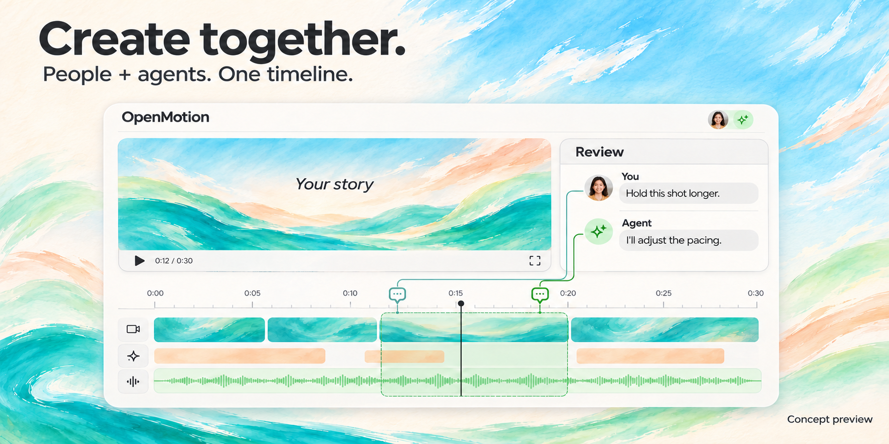

*Concept preview of planned collaboration. No release date announced.* [Studio vision](docs/product/studio-vision.md) · [Knowledge and feedback](docs/product/studio-vision.md#knowledge-and-feedback)

<a id="社区共建"></a> <a id="community"></a>

## 🤝 Share the video. Share how you made it.

Share a remake, a reusable template or a Motion.md that captures the rhythm of a film. Include the reference and your editable project so another creator can try the same cut with their own footage.

| Contribution | What to include |
| --- | --- |
| **A recreation** | Reference and creator, your brief, editable project, preview, comparison and remaining differences |
| **A template or component** | Working source, editable choices, assets, preview and attribution |
| **A Skill or design system** | The method, keep/change rules and an example of what you actually ran |
| **Brand Kit content for Motion.md** | Identity, accurate product facts and approved assets within the creative specification |
| **Agent support or editor improvements** | A focused change with reproducible validation |

[Library entry checklist](library/ENTRY_TEMPLATE.md) · [Contribute](CONTRIBUTING.md) · [Report an issue](https://github.com/nexu-io/html-anything/issues) · [Contributors](https://github.com/nexu-io/html-anything/graphs/contributors) · [Media kit](docs/media-kit.md)

The dedicated OpenMotion site is coming to `open-design.ai/openmotion`.

[Motion showcase](https://open-design.ai/motion/?utm_source=github&utm_medium=referral&utm_campaign=openmotion&utm_content=readme_en) · [OpenDesign Go](https://go.open-design.ai/?utm_source=github&utm_medium=referral&utm_campaign=openmotion&utm_content=readme_en) · [Discord](https://discord.gg/mHAjSMV6gz) · [X @OpenDesignDevs](https://x.com/OpenDesignDevs) · [X @OpenDesignHQ](https://x.com/OpenDesignHQ) · [YouTube](https://www.youtube.com/channel/UChtshixMhvtgBWzoD9R_Qfg)

[**Star OpenMotion on GitHub**](https://github.com/nexu-io/html-anything)

[](https://github.com/nexu-io/html-anything)

<a id="acknowledgements"></a>

### Acknowledgements

Original brand-film excerpts are credited in the comparisons. [Agent and model marks](docs/readme/models/README.md)

OpenMotion is licensed under [Apache-2.0](LICENSE). Third-party code, templates, media and fonts retain their own licenses and attribution.

| Source | Connection |
| --- | --- |
| [OpenDesign](https://github.com/nexu-io/open-design) | UI provenance, resource structure and brand direction; [design system](docs/design-system.md) and [Motion showcase](https://open-design.ai/motion/) |
| [Hyperframes](https://github.com/heygen-com/hyperframes) | HTML-to-video composition, Studio and rendering foundations, pinned to 0.9.7; creator references, external adaptation demonstrations and component source; [engine notes](docs/hyperframes.md), [template notices](template-library/NOTICE.md) and [catalog provenance](docs/template-catalog.md) |
| [MotionGit](https://motiongit.com/) / adunext | Kinetic Tech source packaged as Presenter Tech; [license and attribution](library/templates/presenter-tech/NOTICE.md) |
| [Hypit](https://github.com/hypit-ai/hypit) | Inspiration for agent-led viral-video cloning and editable variants; no runtime imported here |
| [rea-video](https://github.com/JuneYaooo/rea-video) | Reference analysis and case studies for [live-action unboxing](https://github.com/JuneYaooo/rea-video/blob/main/docs/cases/unboxing/report_en.md) and [characters, code and screen footage](https://github.com/JuneYaooo/rea-video/blob/main/docs/cases/dual_role/report_en.md); [showcase attribution](docs/readme/brand-showcase/README.md), no runtime imported here |
| [OpenAI · Codex Originals](https://openai.com/codex-originals/) | External brand-film inspiration; official campaign still and outbound viewing link |
| [DeepSeek Harness](https://github.com/deepseek-ai/deepseek-harness) / [Super-agent prototype](https://github.com/deepseek-ai/dsh-superagent-prototype) | Agent extensibility and continuing-task inspiration; the prototype is separate from OpenMotion's current runtime |
| Claude Motion / CapCut / [ChatCut](https://chatcut.io/docs/what-is-chatcut) / [OpenChatCut](https://github.com/0xsline/OpenChatCut) | Product references for agent-led creation, approachable AI editing and continued revision |
| [OpusClip](https://www.opus.pro/calendar) | Product reference for distribution and [external scheduling](https://www.opus.pro/tools/instagram-reels-scheduler); no built-in connector |
| [GSAP](https://github.com/greensock/GSAP) / [FFmpeg](https://ffmpeg.org/) | Animation and media dependencies with versions retained in [package.json](package.json) and the [runtime lock](scripts/runtime-lock.json) |

[Asset sources](docs/readme/ASSETS.md) · [Additional showcase sources](docs/readme/brand-showcase/README.md) · [Font notices](web/design-system/fonts/NOTICES.txt) · [Studio license](studio/LICENSE)

The former HTML Anything application is preserved on the [`legacy` branch](https://github.com/nexu-io/html-anything/tree/legacy). See the [repository migration guide](docs/repository-migration.md) for the active branch and distribution boundaries.
