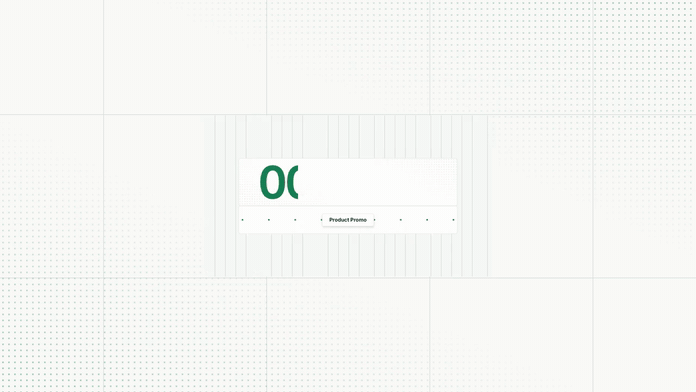

<h1 align="center">OpenMotion — Make brand videos in Codex</h1>

<p align="center">Reverse-engineer the motion in videos from tech brands. Recreate it with your own logo, screenshots and copy.<br />
Keep the editable project and export an MP4.</p>

<p align="center"><strong><a href="#start-in-codex">Try the 20-second demo in Codex</a></strong> · <a href="#make-a-reference-your-own">Watch a 5-second remix</a> · <a href="examples/reference-reveal/MOTION.md">Read its Motion MD</a> · <a href="docs/collections/README.md">Find a reference</a></p>

<p align="center"><a href="docs/README.zh-CN.md">简体中文</a> · <a href="https://github.com/nexu-io/html-anything/tree/legacy#readme">Original HTML Anything editor &amp; installation guide</a></p>

<p align="center"></p>

OpenMotion is an open-source motion design plugin for Codex. Our goal is to build the best open-source alternative to Claude Motion. You can start with a brand film, a product walkthrough or a launch video. Pick one shot. What moves first? When does the product come into view? How long does the audience get to read the headline? **Motion MD** is our draft Markdown format for recording those decisions so another team can recreate the motion with its own assets.

## Make a reference your own

**One number. A ring of icons. A handoff.** In a five-second Firecrawl launch excerpt, “1,000,000 Developers” gives way to a ring of company marks around the flame. We borrowed that sequence for OpenMotion. Our number is the runtime of the bundled Product Promo template, our center mark is OpenDesign’s, and the surrounding tiles name the things you bring into a motion project. [Watch @ericciarla’s reference](https://static.heygen.ai/hyperframes-oss/desktop/moments/v5/M945/clip.mp4) · [Creator’s original post](https://x.com/ericciarla/status/2093375835679977570)

[](examples/reference-reveal/film.mp4)

[Play our cut with sound](examples/reference-reveal/film.mp4) · [Read its Motion MD](examples/reference-reveal/MOTION.md) · [Open the editable HTML](examples/reference-reveal/index.html)

**Does the style survive a new brief?** We kept the same project and changed the opening from “00:00:20 · Product Promo” to “00:00:15 · NYT Graph”. At 0.8s you can read the new title. At 2.65s the cards are in the same orbit. Both versions run for five seconds. [Watch the second cut](examples/reference-reveal/graph-cut.mp4)

## Made with OpenMotion

### Made in Codex · 12-second product launch

[](examples/launch-in-codex/film.mp4)

The brief called for one real product shot. Three seconds of opening type give way to the Studio timeline, then the OpenDesign symbol signs off. To make your own cut, give Codex a screenshot from your repo and the headline from your release notes. [Watch the MP4](examples/launch-in-codex/film.mp4) · [Edit the shots and timing](examples/launch-in-codex/index.html)

### The Long Return · 11-second data story

[](examples/longer-days/film.mp4)

How much more daylight does Reykjavík get than Lisbon on June 1, 2026? Six monthly observations build the chart, then the answer appears: **5 hours 25 minutes**. The two cities share an axis. The figures, month labels and timing are in one editable file. [Watch the MP4](examples/longer-days/film.mp4) · [Edit the chart](examples/longer-days/index.html) · [See the source data](examples/README.md#the-long-return)

### Pick Your Cut · 9-second vertical explainer

[](examples/pick-your-cut/film.mp4)

A reference clip, a template or a blank brief? Three cards enter on successive beats and stay on screen so a viewer can read the final choice on a phone. Replace the cards with the three steps of your own onboarding flow. [Watch the vertical MP4](examples/pick-your-cut/film.mp4) · [Edit the cards](examples/pick-your-cut/index.html)

All three films were exported through the plugin. Each is silent by design. [Get the source, briefs and local render instructions](examples/README.md)

## Start in Codex

Try the bundled **Product Promo** with its own artwork. [How the template demo works](skills/motion-template-to-video/SKILL.md)

On macOS or Linux, use Git, Node.js 22.18+ with npm, and a Codex CLI with plugin support. MP4 export also needs Chrome or Chromium and FFmpeg with FFprobe. [Windows setup](docs/test-packages.md)

```sh
git clone --branch feature/motion --single-branch https://github.com/nexu-io/html-anything.git OpenMotion
cd OpenMotion && bash scripts/install-motion.command
```

Keep the checkout on disk. Once installed, open Codex and ask:

> Use OpenMotion to open a fresh copy of the 20-second Product Promo in Studio and export the MP4.

Then try one edit: **“Hold the closing title two seconds longer. Export another cut.”** You can also drag the clip edge in Studio. Both edit the same project. [Setup and first-demo guide](docs/usage.md#使用) · [Other agent setups](docs/npm-installation.md)


## Bring your own project

| What you have | What to ask Codex for | What you can change next |
| --- | --- | --- |
| A reference clip and brand assets | “Keep the cut from the headline to the UI. Use our screenshot and type.” | Compare the two cuts and adjust where the reveal lands. [Recreate a reference](skills/motion-recreate/SKILL.md) |
| A template you already like | “Use the Product Promo timing. Replace the opening copy and the end card.” | Keep a fresh copy of the template for the next campaign. [Adapt a template](skills/motion-template-to-video/SKILL.md) |
| Release notes and a folder of screenshots | “Show the problem, demo the new feature, then hold on the release date.” | Review the shot sequence with Codex and refine the cut in Studio. [Direct an original film](skills/motion-director/SKILL.md) |

## Motion MD

A useful motion brief names both the creative decision and what a teammate may change. Here’s the direction behind the five-second remix:

| Time | Keep | Swap for your brand |
| --- | --- | --- |
| 0–1.5s | Reveal a large number from left to right. Give its label time to read. | A verified number and a short label from your release notes. |
| 1.5–4s | Let the central mark settle while the outer tiles keep turning. | Your symbol and the inputs or features that belong around it. |
| 4–5s | Follow the same mark into the closing handoff. | The input your customer provides and the result they get. |

Give the Markdown file explicitly to Codex with the project. The brief guides the edit. The HTML, CSS, JavaScript and media supply the animation. [Motion MD v0.1 proposal](docs/motion-md.md) · [Working brief and both exports](examples/reference-reveal/MOTION.md)

## Motion library and collections

Start with a shot you want to borrow. Watch the 12-second Pond OS introduction for a product reveal, or the 32-second Firecrawl Free Keyless launch for the balance between a promise and a demo. The credited index is on GitHub. The Studio catalog also contains **891 external references and registry items**. On a gallery card, the remix action copies an instruction. Paste it into Codex alongside your brand assets. [Browse the references](docs/collections/README.md) · [How the gallery works](docs/usage.md)

For an editable starting point with its own assets, open one of the **three bundled templates** in Studio.

| [Product Promo · 20s](template-library/product-promo/) | [NYT Graph · 15s](template-library/nyt-graph/) | [Decision Tree · 10s](template-library/decision-tree/) |
| --- | --- | --- |
|  |  |  |
| Swap the headline and end card. | Bring your own figures and labels. | Replace the question and branches. |

We plan to curate collections around brands, recent launches and companies on technology rankings. You can already share a reference with its creator and the moment worth studying, or contribute a remix with its brief, source and rendered preview. [Collections roadmap](docs/collections/README.md) · [Suggest a reference or share a cut](https://github.com/nexu-io/html-anything/issues/new)

### Comparing two cuts

To review a remix today, pause both films on the reveal, check whose brand is on screen, then change one line and render again. **Motion Benchmark / Arena** is a proposal to make comparisons like this repeatable across tools using the same reference and assets. Its scoring method and launch date are still open. [Read the evaluation proposal](docs/motion-md.md#from-specification-to-resource-to-benchmark)

## Build and contribute

OpenMotion includes five creation workflows and nine MCP tools. You can adapt a template, recreate a reference or turn a video into a reusable template folder. To contribute a style, include the original source and creator, your Motion MD, a preview, the editable project and permission to share the assets. [Workflows](docs/skills.md) · [MCP tools](docs/mcp-phase1-tools.md) · [Contributing](CONTRIBUTING.md)

Install from this branch or [build the npm installer locally](docs/npm-installation.md). OpenMotion is licensed under [Apache-2.0](LICENSE) and uses [Hyperframes](https://github.com/heygen-com/hyperframes) for Studio and rendering. The [bundled examples](template-library/NOTICE.md), [Studio](studio/LICENSE) and [fonts](web/design-system/fonts/NOTICES.txt) carry their upstream notices.
