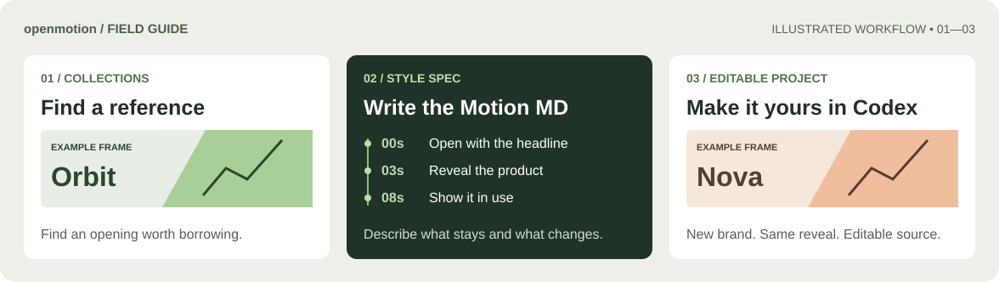
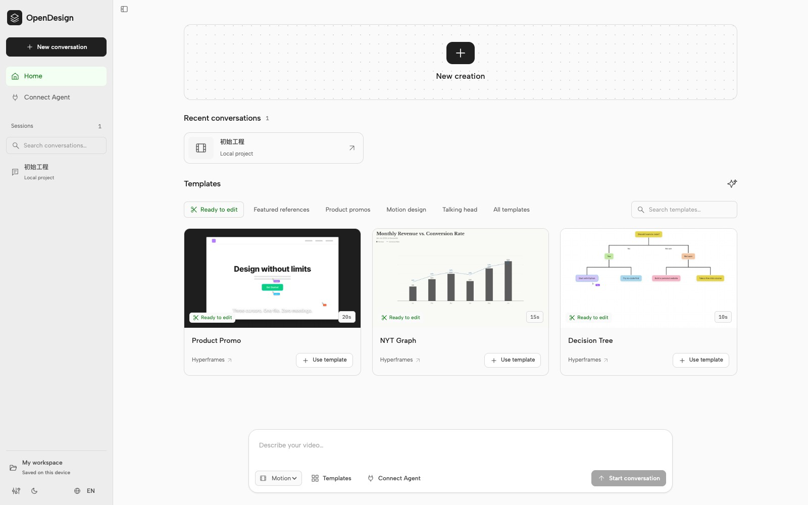

**English** · [简体中文](docs/README.zh-CN.md)

<h1> openmotion</h1>

**We're building the best open-source alternative to Claude Motion.** Find a product film whose rhythm fits your launch. Use **Motion MD** to describe what you want to keep, then give Codex your own screenshots and copy. You get a video for your brand and a project you can edit again.

**[Read Motion MD](docs/motion-md.md)** · **[Browse the Motion library & collections](docs/collections/README.md)** · **[Start in Codex](#start-in-codex)**



## Motion MD

**Motion MD is openmotion's first proposal for a reusable motion style specification.** A still image can tell you what a launch film looks like. To make another film in that style, you also need to know when the product appears, how the camera moves and how long the viewer has to read each line. Motion MD puts those decisions in plain Markdown.

For example, a team adapting a 20-second product reveal might give Codex this excerpt:

```markdown
## Timing
0–3s: Show the problem. 3–8s: Reveal the product.
8–16s: Demonstrate two benefits. 16–20s: Hold the closing CTA.

## Keep / replace
Keep the continuous canvas and the pause after each reveal.
Replace the logo, screenshots, benefit copy and closing CTA with ours.
```

[Read the v0.1 proposal](docs/motion-md.md) · [Open the full example](docs/examples/product-launch.MOTION.md)


**Use it today:** give the file explicitly to your Agent. The draft describes creative intent; the editable project is still HTML, CSS, JavaScript and media. There is no automatic Motion MD importer or validator.

## Motion library and collections

**[Browse the resource index →](docs/collections/README.md)** Start with a film, see who made it, and choose a reference or an editable project. Try [a product reveal](template-library/product-promo/), [an editorial chart](template-library/nyt-graph/) or [a branching explainer](template-library/decision-tree/). All three open as independent projects in Studio. [OpenDesign's public Motion showcase](https://open-design.ai/motion/) has more examples to watch.

| A collection to explore | What it helps you find |
| --- | --- |
| **One brand, several launches** | How a company changes its opening, typography and product reveal across releases. |
| **Companies on a technology ranking** | How teams on the same list, such as an a16z consumer AI ranking, tell different product stories. |
| **Recently funded companies** | A monthly selection of launch films from companies that announced funding in 2026. |

These are the editorial directions for the **planned public collections site**. The index and Studio catalog are available now. Studio and Agent tools share the published Prism template catalog plus three bundled examples. The older 891-entry reference snapshot remains available to legacy tooling. A listed video is a reference; a verified template also needs editable source, a preview and a successful edit and render.



## Make the reference your own

| [Product Promo · 20s](template-library/product-promo/) | [NYT Graph · 15s](template-library/nyt-graph/) | [Decision Tree · 10s](template-library/decision-tree/) |
| --- | --- | --- |
|  |  |  |

These frames come from the bundled [Hyperframes examples](template-library/NOTICE.md). Pick a template and ask Codex:

> Keep the opening and the pace of the reveal. Use our logo and the product screenshots in this repo. Hold the second screen long enough to read the new headline. Give me the editable project and an MP4.

The gallery's **one-click recreate** action copies the selected reference and instructions for your Agent. A bundled or Prism template opens directly; external footage needs analysis and reconstruction. In Studio you can change the text, timing, layout and assets, or ask your Agent to make the same edit. Imported footage stays a clip.


After each editing turn, the Agent requests the latest preview in the same chat without switching chats. If you are elsewhere, it stays queued until you return; only an explicit show-now request permits switching back. Actual visibility and the latest content are checked separately; explicit background requests skip presentation. See [multi-turn editing](skills/motion-production/references/native.md#continuing-edits) for host capability limits.

## Start in Codex

For a packaged test installation, give your Agent the [test installation instructions](https://releases.open-design.ai/open-motion/dev/install.md). They pin an exact npm version and describe isolated setup and native preparation. To reproduce a particular version, use `https://releases.open-design.ai/open-motion/dev/<exact-version>/install.md`; see the [current delivery record and limitations](docs/release-guide.md#published-test-candidate-064-test6). Software test versions default to the production template environment.

For source development, clone this public repository at `feature/motion` and open the checkout in Codex. You'll need Git, Node.js **22.18+** with npm, and a Codex CLI that supports plugins. MP4 export also requires Chrome/Chromium and FFmpeg/FFprobe. See [Windows test packages](docs/test-packages.md) for that installation path.

Paste this into a Codex conversation:

```text
From this checkout, install openmotion with bash scripts/install-motion.command.
Once installation succeeds, ask whether I'd like the 20-second Product Promo demo.
If I accept, open an independent editable project and deliver its MP4.
```

After you accept, the Agent follows the [template-to-video workflow](skills/motion-template-to-video/SKILL.md). If your host cannot open the editor beside the conversation, use the returned local project link. [Installation and first-demo guide (Chinese)](docs/usage.md#使用) · [Other Agent adapters](docs/agent-adapters.md)

**Bring more media when you need it.** The Studio model gateway accepts requests for images, video or audio through configured providers; you choose which results to place in your project. Providers use your own accounts and may charge for generation. [Verified capabilities](docs/model-gateway.md) · [Public MCP tools](docs/mcp-phase1-tools.md)

Media panels open beside the triggering button or timeline selection and adjust to scrolling and available space. The empty-timeline guide hides during generation and after insertion; it returns when the panel closes without an insertion or when undo leaves the timeline empty. [Editor interaction details](docs/product/media-generation-design.md#时间轴交互规则及原因)

## MCP and lightweight installation

The [Motion application npm package](docs/npm-installation.md), published as [@openmotion/app](https://www.npmjs.com/package/@openmotion/app), includes the application and default manifest alongside its installer. It installs eleven MCP Tools and five Skills for Codex, Claude Code, DeepSeek Harness or WorkBuddy without adjacent files; locked npm dependencies and native tools are prepared separately. Maintainers can build a test with `npm run package:npm -- dist/npm-test 0.6.4-test.1`. [Test/stable acceptance](docs/release-guide.md) and isolated DEV template instructions are documented. Complete platform ZIPs remain a backup.

The five entries are [motion-production](skills/motion-production/SKILL.md), [motion-director](skills/motion-director/SKILL.md), [motion-template-to-video](skills/motion-template-to-video/SKILL.md), [motion-recreate](skills/motion-recreate/SKILL.md), and [motion-video-to-template](skills/motion-video-to-template/SKILL.md). Reference recreation is implemented. Product UI follows the [OpenDesign visual system](docs/design-system.md); video artwork keeps its own styles.

## Usage data and privacy

OpenMotion collects feature usage, safe error categories, device information and coarse country/region/timezone by default. Prompts and project contents are excluded; raw IP addresses are discarded after GeoIP enrichment. Turn collection off in **Privacy settings → Share usage data**, or set `OPENMOTION_TELEMETRY=0` / `DO_NOT_TRACK=1` when launching the MCP. The saved preference covers MCP and Studio and survives restarts. See [tracking and user controls](tracking/README.md).

## What's next

**Motion Benchmark / Arena** is a proposed way to compare recreations: give each workflow the same reference and brand assets, then inspect the outputs for timing, brand fidelity and editability. The method and public leaderboard are still under discussion.

To contribute a style, include the reference and its creator, the Motion MD, a preview, editable source and asset permissions. [Contribution guide](AGENTS.md) · [Documentation](docs/README.md)

**Credits & release status.** openmotion uses [Hyperframes](https://github.com/heygen-com/hyperframes) for native compositions, the Studio foundation and rendering. Its [editor](studio/LICENSE) and [bundled examples](template-library/LICENSE) retain their upstream Apache-2.0 licenses. This public repository is licensed under [Apache-2.0](LICENSE); bundled components and fonts retain their notices. Development targets [`feature/motion`](https://github.com/nexu-io/html-anything/tree/feature/motion); the former HTML Anything application remains on `main` and is preserved on [`legacy`](https://github.com/nexu-io/html-anything/tree/legacy). A test npm version is available; no stable version has been published. See the [repository workflow](docs/repository-migration.md).

Multiple local conversations can keep different projects open through one native Studio service. Each preview stays bound to its project; same-project writes still use revision checks. See [shared editor](docs/shared-editor.md).

## Published template catalog

Studio and MCP read the same disk-cached Prism catalog. `motion_list_templates({})` returns a local JSONL index path, total and catalog version; the Agent searches that file with its own shell tools. `motion_get_template({templateId})` reads one template and its editing guide. `motion_create_project` with `projectType=template` downloads its files into a new editable project.

`npm run dev` reads DEV content. Standard packages read production; `npm run package:phase1 -- --template-env=dev` creates a separate DEV ZIP. The environment is stored in the package, so GUI and MCP agree without extra host configuration. `MOTION_TEMPLATE_ENV` can override it for debugging. DEV uses a separate default workspace and cache; environments never fall back to each other. See [catalog configuration and build commands](docs/template-catalog.md).
