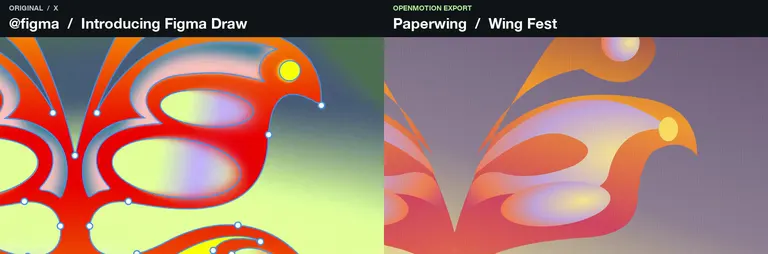
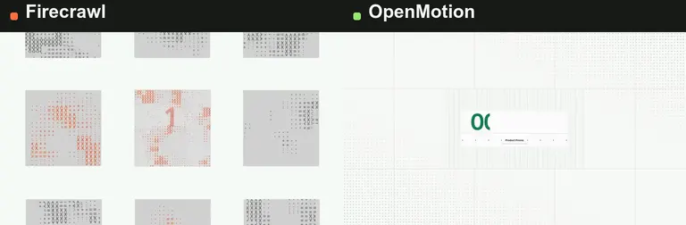

<h1 align="center">OpenMotion — Reverse-engineer a video in Codex.<br />
Recreate it for your brand.</h1>

<p align="center">
  <a href="https://github.com/nexu-io/html-anything/stargazers"></a>
  <a href="package.json"></a>
  <a href="LICENSE"></a>
</p>

<p align="center">Bring an X or YouTube link, or pick from <strong><a href="#motion-library-and-collections">100+ one-click video recreation templates</a></strong>, including brand films from Figma, Linear and Firecrawl. Recreate the shots in Codex with your logo, screenshots and copy. Export an MP4 and keep the editable project.</p>

<p align="center">This release includes our <strong><a href="examples/reference-reveal/MOTION.md">open-source MOTION.md breakdown of Firecrawl’s launch film</a></strong>. It maps a five-second shot from the number reveal to the orbit and closing logo, with cues you can reuse in Codex.</p>

<p align="center"><strong><a href="docs/readme/studio-tour.mp4">Watch the 15-second demo</a></strong> · <strong><a href="#start-in-codex">Try it in Codex</a></strong></p>

<p align="center">
  <a href="https://open-design.ai/openmotion?utm_source=github&amp;utm_medium=referral&amp;utm_campaign=openmotion&amp;utm_content=readme_en"></a>
  <a href="https://go.open-design.ai/?utm_source=github&amp;utm_medium=referral&amp;utm_campaign=openmotion&amp;utm_content=readme_en"></a>
  <a href="https://discord.gg/mHAjSMV6gz"></a>
  <a href="https://x.com/OpenDesignHQ"></a>
  <a href="https://x.com/OpenDesignDevs"></a>
  <a href="https://www.youtube.com/channel/UChtshixMhvtgBWzoD9R_Qfg"></a>
</p>

<p align="center"><a href="docs/readme/studio-tour.mp4"><picture>
  <source media="(prefers-reduced-motion: reduce)" srcset="docs/readme/codex-comparison.jpg" />
  
</picture></a></p>

<p align="center"><a href="https://x.com/OpenAI/status/2084352161404920316">Open the original X post</a> · <a href="examples/reference-reveal/comparison.mp4">Firecrawl original vs. remake · 5s</a> · <a href="#make-a-reference-your-own">Compare the three brands</a></p>

<p align="center"><a href="docs/README.zh-CN.md">简体中文</a> · <a href="docs/collections/README.md">Find a reference</a> · <a href="https://github.com/nexu-io/html-anything/tree/legacy#readme">Original HTML Anything editor &amp; installation guide</a></p>

OpenMotion is an open-source motion design plugin for Codex. Our goal is to build the best open-source alternative to Claude Motion. You can start with a brand film, a product walkthrough or a launch video. Pick one shot. What moves first? When does the product come into view? How long does the audience get to read the headline? **Motion MD** is our draft Markdown format for recording those decisions so another team can recreate the motion with its own assets.

## Make a reference your own

Each comparison runs for five seconds. The left pane plays footage from the credited X post. The right pane plays the independent OpenMotion export. The two run at normal speed on one clock, with audio from the remake. Open a comparison to pause or scrub both sides.

### Figma Draw → Paperwing

<p><a href="examples/wing-construction/comparison.mp4"><picture>
  <source media="(prefers-reduced-motion: reduce)" srcset="examples/wing-construction/comparison.jpg" />
  
</picture></a></p>

At **00:38–00:43** in *Introducing Figma Draw*, the camera moves from the butterfly’s fill controls to the full *Nature Fest* poster. In the remake, the same pullback reveals *Wing Fest* for Paperwing, a demo brand. Pause at **4.75s** to see both posters.

[Watch in sync](examples/wing-construction/comparison.mp4) · [12-second Paperwing export](examples/wing-construction/film.mp4) · [Editable source](examples/wing-construction/index.html) · [Original by @figma](https://x.com/figma/status/1920168282751185360)

### OpenAI → OpenDesign

<p><a href="examples/motion-studies/comparison.mp4"><picture>
  <source media="(prefers-reduced-motion: reduce)" srcset="examples/motion-studies/comparison.jpg" />
  
</picture></a></p>

The closing passage of OpenAI’s research film (**00:26.5–00:31.5**) collapses a graph into a colored dot. At **2.04s** in the comparison, both cuts switch to white. Each types its brand name and ends on its own symbol.

[Watch in sync](examples/motion-studies/comparison.mp4) · [32-second OpenDesign export](examples/motion-studies/film.mp4) · [Editable source](examples/motion-studies/index.html) · [Original by @OpenAI](https://x.com/OpenAI/status/2084352161404920316)

### Firecrawl → OpenMotion

<p><a href="examples/reference-reveal/comparison.mp4"><picture>
  <source media="(prefers-reduced-motion: reduce)" srcset="examples/reference-reveal/comparison.jpg" />
  
</picture></a></p>

Firecrawl co-founder Eric Ciarla posted the 32-second *Firecrawl Free Keyless* launch film on X. Its **00:21–00:26** passage opens with the developer count. OpenMotion uses the 20-second runtime of its bundled demo. Pause at **2.65s** to see company marks orbit the flame on the left and project assets orbit the OpenDesign symbol on the right.

[Watch in sync](examples/reference-reveal/comparison.mp4) · [Remake MP4](examples/reference-reveal/film.mp4) · [Editable source](examples/reference-reveal/index.html) · [Original by @ericciarla](https://x.com/ericciarla/status/2093375835679977570)

**Does the style survive a new brief?** We kept the same project and changed the opening from “00:00:20 · Product Promo” to “00:00:15 · NYT Graph”. At 0.8s you can read the new title. At 2.65s the cards are in the same orbit. Both versions run for five seconds. [Watch the second cut](examples/reference-reveal/graph-cut.mp4)

To try this shot after installation, open the folder with your logo and copy in Codex and paste the following prompt.

```text
Use OpenMotion to recreate 00:21–00:26 of this launch film for our brand.
https://x.com/ericciarla/status/2093375835679977570
Open with our headline, then bring our logo into the center on the same beat.
Keep the project editable and export an MP4.
```

## Made with OpenMotion

### Made in Codex · 12-second product launch

[](examples/launch-in-codex/film.mp4)

The brief called for one real product shot. Three seconds of opening type give way to the Studio timeline, then the OpenDesign symbol signs off. To make your own cut, give Codex a screenshot from your repo and the headline from your release notes. [Watch the MP4](examples/launch-in-codex/film.mp4) · [Edit the shots and timing](examples/launch-in-codex/index.html)

### The Long Return · 11-second data story

[](examples/longer-days/film.mp4)

How much more daylight does Reykjavík get than Lisbon on June 1, 2026? Six monthly observations build the chart, then the answer appears: **5 hours 25 minutes**. The two cities share an axis. The figures, month labels and timing are in one editable file. [Watch the MP4](examples/longer-days/film.mp4) · [Edit the chart](examples/longer-days/index.html) · [See the source data](examples/README.md#the-long-return)

### Pick Your Cut · 9-second vertical explainer

[](examples/pick-your-cut/film.mp4)

A reference clip, a template or a blank brief? Three cards enter on successive beats and stay on screen so a viewer can read the final choice on a phone. Replace the cards with the three steps of your own onboarding flow. [Watch the vertical MP4](examples/pick-your-cut/film.mp4) · [Edit the cards](examples/pick-your-cut/index.html)

All three films were exported through the plugin. Each is silent by design. [Get the source, briefs and local render instructions](examples/README.md)

## Start in Codex

To try a reference after installation, open **Template library → Video recreation** in Studio. Search for the brand or shot and use the card’s copy action (一键复刻). Paste the instruction into Codex with your logo, copy or colors. Review the editable project in the Studio timeline, then export the MP4.

Try the bundled **Product Promo** with its own artwork. [How the template demo works](skills/motion-template-to-video/SKILL.md)

On macOS or Linux, use Git, Node.js 22.18+ with npm, and a Codex CLI with plugin support. MP4 export also needs Chrome or Chromium and FFmpeg with FFprobe. [Windows setup](docs/test-packages.md)

```sh
git clone --branch feature/motion --single-branch https://github.com/nexu-io/html-anything.git OpenMotion
cd OpenMotion && bash scripts/install-motion.command
```

Keep the checkout on disk. In the Codex desktop app, go to **Plugins → OpenDesign → Try now**. OpenDesign is the display name for the `motion` plugin. Paste your reference link into the composer, or try the bundled example below.

> Use OpenMotion to open a fresh copy of the 20-second Product Promo in Studio and export the MP4.

Then try one edit: **“Hold the closing title two seconds longer. Export another cut.”** You can also drag the clip edge in Studio. Both edit the same project. [Setup and first-demo guide](docs/usage.md#使用) · [Other agent setups](docs/npm-installation.md)


## Bring your own project

You can start with assets already in your project. For generated images, video or audio, Studio’s model settings let you configure your own Atlas Cloud or fal.ai key and choose a model for each media type. [Model settings](docs/model-gateway.md)

| What you have | What to ask Codex for | What you can change next |
| --- | --- | --- |
| A reference clip and brand assets | “Keep the cut from the headline to the UI. Use our screenshot and type.” | Compare the two cuts and adjust where the reveal lands. [Recreate a reference](skills/motion-recreate/SKILL.md) |
| A template you already like | “Use the Product Promo timing. Replace the opening copy and the end card.” | Keep a fresh copy of the template for the next campaign. [Adapt a template](skills/motion-template-to-video/SKILL.md) |
| Release notes and a folder of screenshots | “Show the problem, demo the new feature, then hold on the release date.” | Review the shot sequence with Codex and refine the cut in Studio. [Direct an original film](skills/motion-director/SKILL.md) |

## Motion MD

A useful motion brief names both the creative decision and what a teammate may change. Here’s the direction behind the five-second remix:

| Time | Keep | Swap for your brand |
| --- | --- | --- |
| 0–1.5s | Reveal a large number from left to right. Give its label time to read. | A verified number and a short label from your release notes. |
| 1.5–4s | Let the central mark settle while the outer tiles keep turning. | Your symbol and the inputs or features that belong around it. |
| 4–5s | Follow the same mark into the closing handoff. | The input your customer provides and the result they get. |

Give the Markdown file explicitly to Codex with the project. The brief guides the edit. The HTML, CSS, JavaScript and media supply the animation. [Motion MD v0.1 proposal](docs/motion-md.md) · [Working brief and both exports](examples/reference-reveal/MOTION.md)

## Motion library and collections

In Studio, open **Template library → Video recreation**. Its 136 reference cards group alternate cuts of the same video together. Try **Figma Draw**, **Linear Loops** or **Firecrawl Free Keyless**. Click **一键复刻** on a card to copy its brief, then paste it into Codex with your brand assets. [Browse sample references](docs/collections/README.md) · [How the gallery works](docs/template-catalog.md)

For a typography transition, search for `hf-moment-M1147`. Figma turns a stream of “made in @figma” posts into stickers that snap into its logo. The catalog recorded **36 million views** for the original post in its November 3, 2026 snapshot. [Watch Figma’s original](https://x.com/figma/status/2001715747505233980)

For an editable starting point with its own assets, open one of the **three bundled templates** in Studio.

| [Product Promo · 20s](template-library/product-promo/) | [NYT Graph · 15s](template-library/nyt-graph/) | [Decision Tree · 10s](template-library/decision-tree/) |
| --- | --- | --- |
|  |  |  |
| Swap the headline and end card. | Bring your own figures and labels. | Replace the question and branches. |

We plan to curate collections around brands, recent launches and companies on technology rankings. You can already share a reference with its creator and the moment worth studying, or contribute a remix with its brief, source and rendered preview. [Collections roadmap](docs/collections/README.md) · [Suggest a reference or share a cut](https://github.com/nexu-io/html-anything/issues/new)

### Comparing two cuts

To review a remix today, pause both films on the reveal, check whose brand is on screen, then change one line and render again. **Motion Benchmark / Arena** is a proposal to make comparisons like this repeatable across tools using the same reference and assets. Its scoring method and launch date are still open. [Read the evaluation proposal](docs/motion-md.md#from-specification-to-resource-to-benchmark)

## Build and contribute

OpenMotion includes five creation workflows and nine MCP tools. You can adapt a template, recreate a reference or turn a video into a reusable template folder. To contribute a style, include the original source and creator, your Motion MD, a preview, the editable project and permission to share the assets. [Workflows](docs/skills.md) · [MCP tools](docs/mcp-phase1-tools.md) · [Contributing](CONTRIBUTING.md)

Install from this branch or [build the npm installer locally](docs/npm-installation.md). OpenMotion is licensed under [Apache-2.0](LICENSE) and uses [Hyperframes](https://github.com/heygen-com/hyperframes) for Studio and rendering. The [bundled examples](template-library/NOTICE.md), [Studio](studio/LICENSE) and [fonts](web/design-system/fonts/NOTICES.txt) carry their upstream notices.
