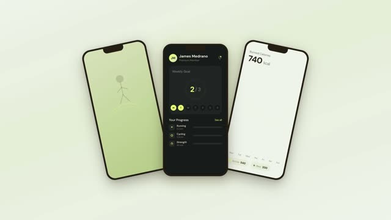
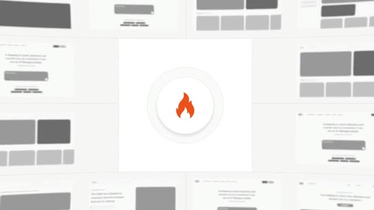
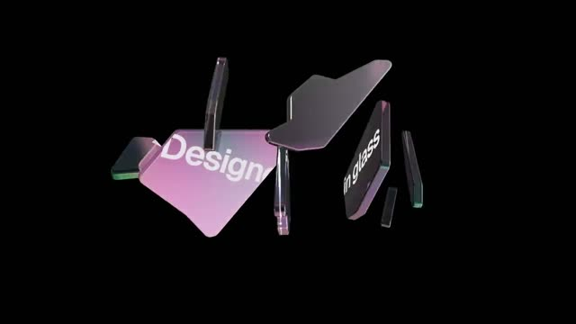
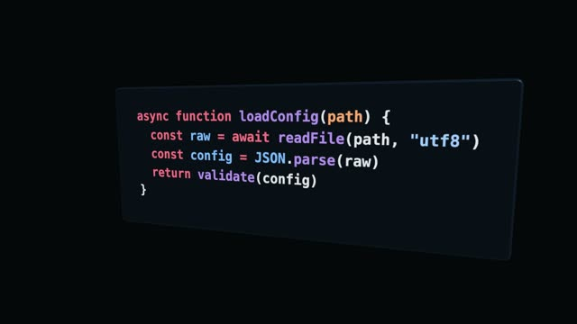
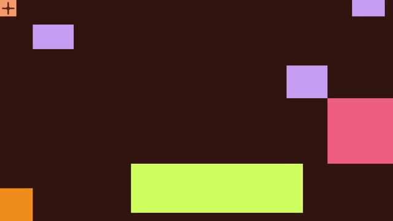

**English** · [简体中文](docs/README.zh-CN.md)

<h1 align="center">OpenMotion</h1>

<p align="center"><strong>The All-in-One AI-native Studio for AI Cut &amp; Motion.</strong><br/>Cut with AI. Tell your story. Everyone can be a creator.<br/>The AI-native, open-source CapCut alternative.<br/>The open-source Claude Motion alternative.</p>

<p align="center">
  <a href="#ai-video-editing">✂️ AI Cut</a> ·
  <a href="#quick-start">Get started</a> ·
  <a href="#connect-your-agent">Connect your agent</a> ·
  <a href="#use-from-your-agent">Use in your agent</a><br/>
  <a href="#all-in-one-studio">All-in-One Studio</a> ·
  <a href="#super-motion-video-agent">Super Motion Video Agent</a> ·
  <a href="#product-tour">Product tour</a><br/>
  <a href="docs/motion-md.md">Motion Design MD</a> ·
  <a href="library/README.md">Resources & templates</a> ·
  <a href="#community">Community</a> ·
  <a href="LICENSE">Apache 2.0</a>
</p>


[Animated cover GIF](docs/readme/cover-motion.gif) · [GitHub social preview](docs/readme/social-preview.jpg)

<a id="what-is-openmotion"></a>

## 🎬 What is OpenMotion?

**OpenMotion is an All-in-One AI-native Studio for AI Cut & Motion — an open-source CapCut alternative built around an editable timeline.** Tell your AI how you want to cut: what to keep, what to remove, how to tell the story, and where captions, music and motion belong. Your agent edits the project from your material, script or confirmed timecodes; you preview, refine and export it in Studio.

**AI editing is the core. Creation and expression are the purpose.** Bring inspiration, footage, brand assets, agents and multimodal models into one creative workflow. Tell your story, generate what is missing, refine the cut and keep the editable work. Claude Motion informs the motion-creation direction.

Today, OpenMotion brings project sessions, template discovery, media management, model generation, timeline editing and MP4 export together. Our all-in-one vision extends that Studio into a collaborative space that understands you and your team, manages publishing and recurring work, and turns feedback into reusable creative knowledge.

**Two ways in. One editable project.**

- **Start in OpenMotion → [connect your agent](#connect-your-agent).** Open Studio, bring your material and connect Codex, Claude Code or another supported client for AI editing.
- **Start in your agent → [use OpenMotion](#use-from-your-agent).** Add **Skills, MCP and CLI** to your existing workflow; let the agent create, edit, preview and export, with Studio available for hands-on refinement.

<a id="all-in-one-studio"></a>

## 🌐 All-in-One Studio — from inspiration to your next story

**One creative home for discovering, making, sharing and learning.** The product journey spans the whole lifecycle; the status column distinguishes today's tools from what comes next.

| Part of your creative day | What belongs in the Studio | Status |
| --- | --- | --- |
| **Discover inspiration** | Browse templates and references, find a direction, search for material and collect ideas. | Catalog search and reference browsing today; integrated media-service search is coming. |
| **Collect & manage assets** | Upload footage, organize images, voice and music, and keep sources with the project. | Project media import, previews and file operations today; a shared team asset library is coming. |
| **Generate what is missing** | Use agents to plan the work and configured multimodal models to produce images, video, voice and music. | External agent workflow and Studio Model Gateway today. |
| **Tell the story & cut** | Shape the narrative, arrange the timeline, refine sound and motion, replace images and adapt the edit. | Editable projects and AI-assisted revisions today; automatic content selection and platform adaptation are coming. |
| **Create together** | Edit with people and agents; discuss moments, comment on the timeline and review changes. | Shared local project handoffs today; collaborative comments and review are coming. |
| **Deliver & operate** | Export versions, manage publication, track production tasks and schedule recurring work. | MP4 export and generation/export job status today; publishing management and creative-task automation are coming. |
| **Learn & improve** | Bring back performance and review data; retrieve brand knowledge, refine preferences and turn proven methods into Skills. | Explicit Brandkits, Motion MD and Skills today; analytics feedback, persistent memory and RAG are coming. |

[Full product vision and capability map](docs/product/studio-vision.md) · [Current architecture](docs/product/architecture.md)

<a id="super-motion-video-agent"></a>

## 🧠 Introducing our Super Motion Video Agent concept

**A creative agent that carries a story through its entire lifecycle.** This is OpenMotion's proposed agent experience: understand the creator, organize the work, coordinate tools and models, keep the project editable, and bring lessons into the next creation.

- **Understand:** use the brief, audience, personal voice, team preferences and Brandkit to frame the story.
- **Plan:** turn the goal into research, material, script, edit, review and delivery tasks.
- **Create:** select Skills and agent-ready templates; coordinate search and multimodal models; make changes on the shared timeline.
- **Collaborate:** work with people, resolve review feedback and keep project context across revisions.
- **Improve:** connect published versions to outcomes, retrieve relevant knowledge and propose better Skills for future work.

Inspired by [DeepSeek Harness](https://github.com/deepseek-ai/deepseek-harness) and the [Super-agent research prototype](https://github.com/deepseek-ai/dsh-superagent-prototype), we apply the idea of continuing, task-oriented agent work to video and motion. **Super Motion Video Agent is our product concept and roadmap, not a shipped autonomous runtime.** Today, your connected agent uses OpenMotion's Skills, project tools and Studio; persistent orchestration, publishing feedback and learning remain planned. [Design and status](docs/product/studio-vision.md#super-motion-video-agent)

<a id="ai-video-editing"></a>

## ✂️ AI Cut — your story, on an AI-native timeline

**Say how the video should be cut, in your own voice.** Place and rearrange your material on the timeline; work with an agent on selection, trimming, captions, transitions and sound. Every revision becomes part of a project you can inspect and keep refining.

| Around the timeline | What you can do today | Direction we are building toward |
| --- | --- | --- |
| **✂️ Intelligent cuts & story organization** | Import and arrange media; ask the agent to cut specified passages, reshape pacing and follow your tone, script or confirmed timecodes. | Automatic content selection, irrelevant-passage detection and destination-aware reframing. |
| **✨ Media generation & search** | Generate images, video, music and voice through configured models in Studio. Edit a selected image with a reference-capable model, compare candidates and replace it while keeping its timing and animation. | Integrated search across footage, images, voices, music and Avatar services, alongside generation. |
| **📤 Multiplatform input & output** | Combine supported local media with scripts, captions and agent-accessible references; author different compositions and export MP4 with editable source. | Broader platform-link parsing and import, automatic format adaptation and platform export presets. |

The right-hand column is product direction. Provider accounts and model capabilities determine available generation; reference retrieval and media analysis depend on the connected agent's tools. [Current media controls](docs/model-gateway.md) · [Roadmap](#status--roadmap)

1. **Bring your material.** Footage, recordings and screen captures, plus your script, timecodes, references and brand assets.
2. **Describe the cut.** Ask the agent to tighten passages against a script or confirmed timecodes, rearrange clips, add supporting visuals and adjust captions, music and motion.
3. **Watch and revise.** Preview in Studio, adjust the timeline yourself or request another change, then export MP4 with the editable source.

> Use this recording and timed transcript to make a 30-second clip. Lead with the main point, remove the repeated passages I marked, and add product footage, captions and my supplied music. Show me the preview, then revise it from my feedback.

<a id="everyone-can-be-a-creator"></a>

## 🌱 Everyone can be an AI video editor. Everyone can be a creator.

**If you have something to say, you can start creating.** Individuals, teachers and small teams can use AI to shape their material, find the story and revise the cut. OpenMotion aims to make AI editing accessible to everyone, so more people can share knowledge, express their views and build their own publishing practice.

Recreate the structure and pacing of a viral reference, edit your own talking-head footage, explain a product and bring your work to Xiaohongshu, X / Twitter, Instagram or YouTube. Better expression and a repeatable creative process help you pursue an audience; reach still depends on the content, audience and platform.

<a id="what-can-you-make"></a>

## 🎞️ What can you make?

| Your next AI edit | Start with | Create and refine |
| --- | --- | --- |
| **AI talking-head edits** | Recorded footage, a script or timed captions | Cut confirmed passages, lead with the main point, tighten repetition and add captions, supporting footage and music. |
| **AI recuts & revisions** | Existing clips, screen recordings and a change request | Reshape the story and pacing; make versions with different durations and compositions. |
| **Product launches & demos** | Screenshots, a product brief and brand assets | Product reveals, feature tours and launch films. |
| **Viral video recreation** | A reference link and your own brand or footage | Study the hook, pacing and visual structure; rebuild an editable version. |
| **Explainers & tutorials** | A script, a workflow or a complex idea | Step-by-step stories, diagrams and annotated scenes. |
| **Data stories & charts** | Numbers, labels and the point you want to make | Animated charts, comparisons and visual explanations. |
| **Music & art visuals** | An audio track, artwork and a creative direction | Typography, graphic sequences and movement timed to sound. |

| [Product Promo · 20s](template-library/product-promo/) | [NYT Graph · 15s](template-library/nyt-graph/) | [Decision Tree · 10s](template-library/decision-tree/) |
| --- | --- | --- |
|  |  |  |

Three bundled, editable [examples](template-library/NOTICE.md) to start from. Replace the content, adjust the pacing and make them your own.

<a id="input--process--output"></a>

## 🔄 Input → Process → Output

**Bring your material → cut with AI → share your story.** The same project carries the entire lifecycle, from the first brief to the next recut.

```text
INPUT     Gather footage, recordings, links, scripts and brand assets
PROCESS   Set the story → arrange a rough cut → refine media, motion and sound
          → preview in Studio → give feedback → revise the same timeline ↺
OUTPUT    Render MP4 + keep editable source → adapt the next version
```

**The project holds the work. The agent applies your intent. The timeline gives you control.** Before a change, the agent reads the current project and revision; after it, you can review and refine the result. Export captures a fixed version, while the source remains available for the next edit.

| Stage | What goes in or comes out | How it works today |
| --- | --- | --- |
| **Input · Local media** | Existing videos, recordings, talking-head footage, screen captures, images and brand assets | Import supported local media into the project and retain its source. |
| **Input · Online references** | YouTube, X / Twitter videos and other reference material | Give the link to an agent with the necessary browsing and media tools, or supply an accessible local file. |
| **Input · Text & subtitles** | A prompt, a script, Markdown, SRT / VTT | The agent reads text and timecodes to author scenes, clips and captions; text files can live with the project. |
| **Process · AI editing & design** | Select takes, remove irrelevant material, reshape pacing, add text and motion transitions | The agent edits against a script or confirmed timecodes; preview and refine the work in Studio. |
| **Process · Sound & media** | Music, voice-over, supporting video and images | Import existing media, or generate assets in Studio's gateway with a configured model, then place selected results on the timeline. |
| **Output · Film & source** | MP4 plus editable HTML/CSS/JS and media | Render a fixed project version at its chosen dimensions and frame rate, check the file and keep the source. |

**Make versions for your destination.** Ask the agent to adapt the composition for portrait, landscape or square MP4s for Xiaohongshu, X / Twitter, Instagram and YouTube. Check each platform's current upload specifications before publishing; there are no built-in platform presets or publishing integrations today. Online retrieval, transcription and automatic filler detection require host tools or supplied captions; a reference URL is not an in-app downloader.

## Why OpenMotion?

- **Turn editing intent into project changes.** Describe a cut, reorder, pacing change or sound cue. Let your agent edit the project, then preview and fine-tune it in Studio.
- **Use the agent you already work with.** Connect through local MCP and reusable Skills; keep your existing agent account and workflow.
- **Carry your motion language forward.** Record brand, pacing, movement and sound in a readable `MOTION_DESIGN.md` for the next video.
- **Start with a reference or template.** Explore hundreds of catalog resources, trace their sources and open the bundled editable examples.
- **Keep the source.** Projects use HTML, CSS, JavaScript and media. Preview locally, export MP4 and return to the editable work later.

<a id="product-tour"></a>

## 🖥️ Product tour

**Workspace & library.** Start with a brief or template, revisit a session and connect your agent.


**AI edits & the timeline.** Review your agent’s cut, refine scenes, assets and timing, then export.


**One workflow, several surfaces:** the workspace holds sessions and projects; the library helps you choose a starting point; Studio gives you compositions, assets, code, preview and a timeline. The model gateway can generate image, video and audio assets through configured providers, ready for you to select and place in the edit.

Screenshots show the existing Studio 0.6.1 demo workspace and retain its original labels. [Image sources](docs/readme/ASSETS.md) · [Editor guide](studio/README.md) · [Media generation](docs/model-gateway.md)

<a id="your-app-your-agent"></a>
<a id="connect-your-agent"></a>

## 🔌 Connect your agent to OpenMotion

**Start in the app. Bring your preferred AI editor.** Studio is a standalone workspace for your projects, media and timeline.

1. [Start OpenMotion](#quick-start), open a template or an existing project, and choose **Connect Agent**.
2. Select your client and follow the connection instructions for the current workspace.
3. Give that agent your project context and editing request. Preview its changes in Studio, adjust the timeline and continue the same edit.

The supported connection paths are:

| Agent / client | Connection |
| --- | --- |
| **Codex** | Local plugin or MCP + Skills setup. |
| **Claude Code** | Local plugin or MCP + Skills setup. |
| **DeepSeek Harness** | Harness adapter or MCP + Skills setup. |
| **WorkBuddy** | MCP + Skills configuration is generated; desktop creation and playback validation are pending. |
| **Other local MCP clients** | Manual stdio configuration; UI and shell capabilities depend on the host. |

Today, the connected agent runs in its own client. Studio stores the brief and editable work; it does not include an embedded chat-agent runner. [Agent adapters](docs/agent-adapters.md) · [Session architecture](docs/session-architecture.md)

<a id="motion-design-md--motion_designmd"></a>

## 🎨 Motion Design MD — `MOTION_DESIGN.md`

**Give your videos a reusable motion language.** Motion MD describes how a film behaves: when the product appears, how the viewer's attention moves, how long a headline holds, and where sound supports the story. Keep those decisions with your brand assets so the next video can build on them.

```markdown
# Product launch — Motion Design

## Brand
Use our logo, type, palette and product screenshots.

## Story & timing
0–3s: Establish the problem. 3–8s: Reveal the product.
8–16s: Demonstrate two benefits. 16–20s: Hold the CTA.

## Motion & sound
Keep the continuous canvas and a readable pause after each reveal.
Align the main reveal with the music; leave space for the closing line.

## Keep / replace
Keep the reveal order. Replace the logo, screenshots, copy and CTA.
```

**Motion MD is a v0.1 proposal.** Save your brief as `MOTION_DESIGN.md` and explicitly give it to the agent. The filename is a convention, with no automatic importer or validator; existing `MOTION.md` examples remain valid creative context. The project itself stays editable HTML/CSS/JS and media.

[Read the proposal](docs/motion-md.md) · [Use the full example](docs/examples/product-launch.MOTION.md)

<a id="creative-memory"></a>

## 📚 A creative space that grows with you — is coming

**Your voice. Your team's knowledge. Your brand, carried forward.** The long-term Studio brings project history, reviewed preferences, brand rules, feedback and reusable Skills together so an agent can retrieve the right context for the next brief.

```text
AVAILABLE TODAY
  Brief + brand → create → preview → revise → project version + MP4

PLANNED · is coming
  Published version + performance + review feedback
        ↓
  Evidence linked to the project, platform and time window
        ↓
  Personal / team knowledge → retrieve relevant context with RAG
        ↓
  Propose a Skill or preference update → evaluate → save a version
        ↓
  The next brief starts with better context
```

The planned loop connects **publishing and recurring tasks**, **version-linked performance data**, **personal and team memory**, and **RAG — retrieving relevant knowledge when it is needed**. Accepted methods can become Skills; useful compositions can become templates; brand and motion choices stay reusable through Brandkits and `MOTION_DESIGN.md`. Improvement is evaluated against the next creative task, not assumed from collecting more data.

Today, you explicitly supply those documents and preserve editable projects. Automated publishing, analytics ingestion, persistent preference memory, RAG and automatic Skill distillation are roadmap capabilities. [Knowledge and feedback design](docs/product/studio-vision.md#knowledge-and-feedback)

<a id="resources-templates--community-work"></a>

## 🧩 Resources, templates & community work


**An open [OpenMotion Library](library/README.md), from day one.** One home for creative methods, editable work and design systems you can learn from:

| Reuse a… | Directory & first entries |
| --- | --- |
| **🧠 Skill** | [`library/skills/`](library/skills/) · [Brandkit preparation](library/skills/brandkit/SKILL.md). |
| **🎞️ Template** | [`library/templates/`](library/templates/README.md) · Three existing editable project starting points. |
| **🧩 Motion component** | [`library/components/`](library/components/README.md) · A title-reveal recipe and external component references. |
| **🎨 Motion design system** | [`library/design-systems/`](library/design-systems/) · [Ink & Water / `MOTION_DESIGN.md`](library/design-systems/ink-water/MOTION_DESIGN.md). |
| **💼 Brandkit** | [`library/brandkits/`](library/brandkits/) · [OpenMotion facts, identity and assets](library/brandkits/openmotion/BRANDKIT.md). |

Choose the files and explicitly give them to your agent with your material. The library is browsable and open to contributions today; automatic import and a marketplace are not implemented. The five core production Skills stay in `skills/`. [Contribute an entry](library/ENTRY_TEMPLATE.md)

### Templates made for agents

**A template carries editable structure and instructions an agent can use.** Choose a starting point, supply your Brandkit and story, then ask the agent to recreate, personalize and refine it. The community can contribute the source, editable choices, Motion MD, preview and provenance together.

> Use the Product Promo template with my Brandkit. Tell this story in my voice, replace the assets and copy, adjust the pacing, then show a preview and refine it from my feedback.

The current gallery's one-click action prepares the agent handoff; the connected agent performs the work. Automatic discovery, installation and personalized optimization across the community library are coming. [Template entry points](library/templates/README.md)

### See the work in the catalog

**A library to learn from, adapt and contribute to.** The current catalog contains **894 resources: 3 bundled editable templates and 891 external references and registry items**. Browse product promos, motion design, talking-head references and reusable elements, with original authors and sources where available.

<table>
<tr>
<td width="33%" valign="top"><a href="https://raw.githubusercontent.com/heygen-com/hyperframes/main/registry/blocks/app-showcase/registry-item.json"></a><br/><sub><b>App Showcase</b> · Hyperframes</sub></td>
<td width="33%" valign="top"><a href="https://static.heygen.ai/hyperframes-oss/desktop/viral-clone/remix-firecrawl-reference.mp4"></a><br/><sub><b>Firecrawl Free Keyless</b> · @ericciarla</sub></td>
<td width="33%" valign="top"><a href="https://raw.githubusercontent.com/heygen-com/hyperframes/main/registry/blocks/glass-shard-title/registry-item.json"></a><br/><sub><b>Glass Shard Title</b> · Hyperframes</sub></td>
</tr>
<tr>
<td width="33%" valign="top"><a href="https://raw.githubusercontent.com/heygen-com/hyperframes/main/registry/blocks/code-3d-extrude/registry-item.json"></a><br/><sub><b>Code 3D Extrude</b> · Hyperframes</sub></td>
<td width="33%" valign="top"><a href="https://raw.githubusercontent.com/heygen-com/hyperframes/main/registry/blocks/chrome-orb/registry-item.json"></a><br/><sub><b>Chrome Orb</b> · Hyperframes</sub></td>
<td width="33%" valign="top"><a href="https://static.heygen.ai/hyperframes-oss/desktop/viral-clone/jake-pond-reference.mp4"></a><br/><sub><b>Pond: a new Linux OS</b> · @bflycomputer</sub></td>
</tr>
</table>

Actual reference and registry previews from the catalog. Click through to the original source; these are resource examples, not additional bundled templates.

| Explore | What you get |
| --- | --- |
| [Motion resource index](docs/collections/README.md) | Selected films, source attribution and editable starting points. |
| [Bundled templates](template-library/) | Product Promo, NYT Graph and Decision Tree, each with native source and a preview. |
| Studio's template library | Search, previews and instructions for adapting a template or recreating a reference. |
| [OpenDesign Motion showcase](https://open-design.ai/motion/) | More examples to watch and learn from. |
| [Motion MD](docs/motion-md.md) | A way to share the creative decisions behind a style. |

A reference is something to study; an editable template includes source you can change. The gallery's **one-click recreate** action copies a reference and instructions for your agent. Bundled templates open directly; external footage needs analysis and reconstruction. [Catalog coverage and provenance](docs/template-catalog.md)

## Philosophy & architecture

**The Studio is the creative home; the Super Motion Video Agent is the orchestration vision; the timeline and project hold the work.** Multimodal models produce assets, reusable knowledge guides decisions, and the planned feedback loop connects one creation to the next. [Target architecture and status](docs/product/studio-vision.md)

1. **Everyone can edit with AI.** Start from the material and message people already have. Let AI carry out cuts and revisions so more people can keep creating their own work.
2. **People and agents share the work.** Conversation, visual editing and source changes converge on the same editable project.
3. **Make creative knowledge reusable.** Motion MD carries intent, Skills carry methods, and templates carry working implementations.
4. **Keep the work open.** Preserve source, provenance and versions. The Apache 2.0 application can be inspected, adapted and extended.

**Two entry paths converge on one project:** Studio → Connect Agent → your client; or your client → Skills / MCP / CLI → OpenMotion. The connected client runs the agent; the local application owns project state.

**Current production architecture.** The project and timeline hold the work; model results enter it through explicit adoption.

```text
OpenMotion Studio                      Your agent client
media · preview · timeline             Skills · Brandkit · Motion MD
          | HTTP                                | stdio MCP
          +------------------+------------------+
                             v
                  Local application (Node.js)
                  sessions · files · revisions
                             |
                  Editable project + media
                  HTML · CSS · JS · compositions
                             |
                  Fixed revision snapshot
                             |
                  Render + technical checks
                             |
                  MP4 + editable source

MEDIA PATH
  Studio → Model Gateway → multimodal models → candidate files
         → explicit adoption → the same editable project
```

| Layer | Responsibility and technology |
| --- | --- |
| **Creative methods** | The Library supplies Brandkits, design systems and component recipes; five Motion Skills guide direction, template use, recreation, review and delivery; Motion MD records reusable intent. |
| **Standalone app** | React / TypeScript Studio provides sessions, a library, preview, media controls and a timeline. |
| **Agent access** | Local stdio MCP exposes nine project tools and guide resources; shell-capable hosts can call the pinned CLI. |
| **Project & versions** | A Node.js service manages HTML/CSS/JS, media, revisions and content versions, with conflict checks. |
| **Media generation** | Model Gateway manages provider configuration and asset jobs; selected results are adopted into the project. |
| **Render & deliver** | Native compositions and GSAP power motion; fixed snapshots export to MP4 with FFmpeg / FFprobe technical checks. |

### Why the work stays editable

- **Revision-aware changes:** the agent reads the current project and revision before writing; a conflict requires a fresh read instead of applying stale content.
- **Generation and adoption are separate:** models produce candidate files; selecting and adopting a result changes the timeline. Image replacement preserves timing and animation.
- **Exports use fixed snapshots:** rendering and technical checks target a specific project version; the editable source remains available for the next revision.
- **Methods and artifacts stay distinct:** Skills describe methods, Motion MD / Brandkits provide context, and the project stores the result. Planned RAG retrieves relevant knowledge for that work.

[Full architecture](docs/product/architecture.md) · [Projects and versions](docs/project-workspace.md) · [Model gateway](docs/model-gateway.md) · [MCP contract](docs/mcp-phase1-tools.md)

<a id="quick-start"></a>

## 🚀 Quick start

### Run the standalone app

Use Git and **Node.js 26.11.1**, the version pinned in [CI](.github/workflows/ci.yml), with npm. Source-based preview and export also need Chrome/Chromium and FFmpeg/FFprobe; see the [setup guide](docs/usage.md) for runtime paths.

```sh
git clone --branch feature/motion https://github.com/nexu-io/html-anything.git openmotion
cd openmotion
npm ci
npm run build:studio
npm start
```

Open **http://localhost:4173**. Choose **Templates → Ready to edit**, open a bundled example and try changing its text and timing. Use **Connect Agent** to add your preferred client.

Projects and credentials belong outside the checkout; set `MOTION_DATA_DIR` to choose a workspace location. The [local npm installer](docs/npm-installation.md) can prepare pinned native tools on supported targets. The npm package is not publicly published yet. [Windows test packages](docs/test-packages.md) · [Repository and branch guide](docs/repository-migration.md)

<a id="start-in-codex"></a>

### Install for Codex

From the checkout, with a Codex CLI that supports plugins:

```sh
bash scripts/install-motion.command
```

Then ask your agent:

> Use the Product Promo template to create an independent 20-second project. Open it in Studio and deliver an MP4. Keep the editable project so we can revise it next.

For a branded version, add your logo, screenshots and copy. If the host cannot open Studio beside the conversation, use the returned local project link. [Installation and first-demo guide](docs/usage.md#使用)

<a id="use-from-your-agent"></a>

## 🤖 Use OpenMotion inside your agent

**Start in Codex, Claude Code or another compatible client. Bring OpenMotion into that workflow.** Install the creative Skills and connect the local MCP server; use the CLI for shell-based authoring when needed. Ask your agent to create or reopen a project, make the cut, open a preview and export. You can enter Studio at any point to refine the same project.

Skills describe **how to work**; MCP provides **project tools and guides**; the CLI supports **native authoring and rendering**. Both entry directions use the same local application. [Starting from the app instead?](#connect-your-agent)

### Skills — the creative workflow

Discover the local Skills with the [Skills CLI](https://github.com/vercel-labs/skills). From the checkout:

```sh
npx skills add ./skills --list
npx skills add ./skills --skill motion-director motion-production motion-template-to-video motion-recreate motion-video-to-template
```

Select your agent in the installer. Install all five together to preserve their shared references. This installs workflow instructions; connect the app through MCP for project tools and the pinned engine guide. Keep the source checkout available for shared documentation. For an integrated app, MCP and Skills installation, use the [host setup guide](docs/npm-installation.md).

| Skill | Use it for |
| --- | --- |
| [motion-director](skills/motion-director/SKILL.md) | Original films, story, movement, sound direction and creative review. |
| [motion-template-to-video](skills/motion-template-to-video/SKILL.md) | Making a video from an existing editable template. |
| [motion-recreate](skills/motion-recreate/SKILL.md) | Rebuilding a reference as an editable film and comparing the result. |
| [motion-video-to-template](skills/motion-video-to-template/SKILL.md) | Turning a video into a reusable template. |
| [motion-production](skills/motion-production/SKILL.md) | Scoped edits, previews, technical checks, troubleshooting and export. |

### MCP — the shared project

Use **Connect Agent** in the app for workspace-specific configuration, or configure a local stdio client with absolute paths:

```json
{
  "mcpServers": {
    "openmotion": {
      "command": "/absolute/path/to/node",
      "args": ["--experimental-strip-types", "/absolute/openmotion/mcp.ts"],
      "env": { "MOTION_DATA_DIR": "/absolute/openmotion-data" }
    }
  }
}
```

The **nine public tools** cover project creation and reading, editing, preview, media import, export, version restoration and cancellation. Skills and engine guidance are also available as MCP resources. [Tool contract](docs/mcp-phase1-tools.md) · [Per-agent setup](docs/agent-adapters.md)

### CLI — local execution

Use `npm start` for the app and `npm run mcp` for the stdio server. Agents with shell access can also use the bundled, pinned engine CLI for `lint`, `timeline`, `info` and other native commands; use the `hyperframesCli` path returned by the runtime. Managed-project edits go through MCP's version checks. [CLI and native-authoring guide](skills/motion-production/references/native.md)

<a id="for-creators-media--their-agents"></a>

## 📣 For creators, media & their agents

Give this README and the [media fact sheet](docs/media-kit.md) to your agent to make a demo, article, review or launch story. The fact sheet includes reusable copy, image sources, capability status and a reproducible demo route.

```text
Read the OpenMotion README and docs/media-kit.md.
Create a 30-second product introduction and an accompanying article.
Lead with the All-in-One AI-native Studio and “Cut with AI. Everyone can be
a creator.” Introduce our Super Motion Video Agent concept and the planned
publishing → feedback → knowledge → Skill improvement loop. Explain the AI-native
CapCut positioning, centered on the AI-native timeline, and the open-source
Claude Motion reference. Explain both directions: connect your agent in
OpenMotion, or use OpenMotion inside your agent through Skills / MCP / CLI.
Use Input → Process → Output. Show an editing request, the agent’s actual
project changes, and Studio preview and revision. Then show how Motion MD
and templates make editing knowledge reusable. Use the supplied
cover and screenshots, and credit reference creators.
Separate current capabilities from direction. Demonstrate only what
you actually ran. If OpenMotion is connected, deliver an editable
project and MP4; include source links in the article.
```

<a id="status--roadmap"></a>

## 🗺️ Status & roadmap

| Surface | Today |
| --- | --- |
| Standalone Studio, local projects, visual editing and MP4 export | Implemented; validate installation and actual output on your target environment. |
| Super Motion Video Agent, publishing automation and knowledge feedback | Product concept / is coming; persistent orchestration, analytics ingestion and RAG are planned. |
| Agent access | Five core Skills and nine public MCP tools; host capabilities are documented separately. |
| OpenMotion Library | Five collections with first entries, selected and supplied to an agent manually. |
| `MOTION_DESIGN.md` | A v0.1 creative convention; no automatic importer or validator. |

### 🫶 People + agents, creating together — is coming

**An AI-native space for video creation and editing.** People and agents will work together on the same video project, from the first cut to motion design and the final review.


- **Edit together.** Shape the story, cut clips and create motion in one shared project.
- **Comment on the timeline.** Attach feedback to specific moments and ranges, discuss changes with your agent and keep review context beside the work.
- **Review and iterate together.** Turn comments into revisions, review the result and keep refining the same creative workspace.

*is coming · Generated concept preview of a planned collaboration experience; no release date announced.*

Directions to build with the community, without committed release dates:

- [ ] Super Motion Video Agent: persistent creative-task planning, execution and review.
- [ ] Publishing management, recurring production tasks and event-triggered automation.
- [ ] Version-linked performance feedback, personal/team memory, RAG and evaluated Skill improvements.
- [ ] Shared team asset libraries and agent-ready community template installation.
- [ ] Automatic content selection, irrelevant-passage detection and destination-aware reframing.
- [ ] Integrated footage, image, voice, music and Avatar service search.
- [ ] Broader platform-link parsing and media import.
- [ ] More editable templates, motion components, Brandkits and design systems.
- [ ] Library search, previews and explicit import.
- [ ] Compare several video versions from the same brief.
- [ ] Social-format, caption and export presets.
- [ ] Motion Benchmark / Arena with public tasks and evaluation methods.

<a id="community"></a>

## 🤝 Community

Share the work and the method behind it. Use [Issues](https://github.com/nexu-io/html-anything/issues) for requests, bugs and reproducible examples, and the [OpenDesign Discord](https://discord.gg/mHAjSMV6gz) to talk with other creators. [Library](library/README.md) · [Documentation](docs/README.md)

### Contribute one folder

| Want to contribute… | Where | A useful first contribution |
| --- | --- | --- |
| **A Skill** | [`library/skills/`](library/skills/) | `SKILL.md`, trigger examples and instructions you actually used. |
| **A template / component** | [`library/templates/`](library/templates/README.md) / [`library/components/`](library/components/README.md) | Source or a recipe, editable choices, preview, attribution and checks. |
| **A design system / Brandkit** | [`library/design-systems/`](library/design-systems/) / [`library/brandkits/`](library/brandkits/) | `MOTION_DESIGN.md` or `BRANDKIT.md`, references, brand facts and asset permissions. |
| **Agent support** | [`shared/integration.ts`](shared/integration.ts) · [Adapter guide](docs/agent-adapters.md) | A focused configuration or host compatibility improvement with validation. |
| **Editor polish** | [`studio/src/motion/`](studio/src/motion/) | One reproducible interaction issue and its fix. |
| **Translations & docs** | This README, [中文](docs/README.zh-CN.md) and the relevant guide | Keep both languages and actual entry points in sync. |

Read [AGENTS.md](AGENTS.md) and [Contributing](CONTRIBUTING.md), pick one scope, and include sources, the actual change and validation in your PR. Agents follow the same process. A reference with a cover is not a verified editable template.

### Contributors

Thank you to everyone contributing code, documentation, Skills, design systems, films and useful feedback. The wall below represents this GitHub repository, including its HTML Anything history.

[](https://github.com/nexu-io/html-anything/graphs/contributors)

[All contributors](https://github.com/nexu-io/html-anything/graphs/contributors) · [Start contributing](CONTRIBUTING.md)


## References & lineage

What informed the product, and where the connection lives in this repository.

| Source | Role here & repository entry |
| --- | --- |
| [OpenDesign](https://github.com/nexu-io/open-design) / [website](https://open-design.ai/) | UI design-system source, resource/contribution structure and painterly brand direction. See [UI provenance](docs/design-system.md), [Brandkit](library/brandkits/openmotion/BRANDKIT.md) and [Library](library/README.md). |
| [HTML Anything](https://github.com/nexu-io/html-anything/tree/legacy) | Repository lineage; a reference for text architecture, contribution paths and attribution tables. Its former `next/` architecture stays on the historical branch; see the [migration guide](docs/repository-migration.md). |
| **Claude Motion / CapCut** | Product references for agent-led video creation and approachable editing; not claims of feature parity or code provenance. |
| [DeepSeek Harness](https://github.com/deepseek-ai/deepseek-harness) / [Super-agent prototype](https://github.com/deepseek-ai/dsh-superagent-prototype) | Reference for extensible agent capabilities and continuing task-oriented work. The Super-agent repository is research code; OpenMotion's proposed [Super Motion Video Agent](docs/product/studio-vision.md#super-motion-video-agent) imports no runtime from it. |
| [OpenChatCut](https://github.com/0xsline/OpenChatCut) | Conceptual reference for a continuously editable project and the AI editing lifecycle. Adapted in [AI Cut](#ai-video-editing) and [Input → Process → Output](#input--process--output); this documentation change imports no OpenChatCut code. |
| [ChatCut](https://chatcut.io/docs/what-is-chatcut) | Product inspiration for agent-to-editor work and talking-head / creator scenarios. |
| [Hyperframes](https://github.com/heygen-com/hyperframes) | Thanks for the native composition, Studio, rendering foundations and resources. See [Studio](studio/README.md), [engine notes](docs/hyperframes.md), [template notices](template-library/NOTICE.md) and [catalog provenance](docs/template-catalog.md). |
| [GSAP](https://github.com/greensock/GSAP) / [FFmpeg](https://ffmpeg.org/) | Animation timing and media rendering/checking dependencies; pinned in [package.json](package.json) and the [runtime lock](scripts/runtime-lock.json). |

Original resources retain their authors, sources and terms. Product inspiration, runtime dependencies and third-party works are identified separately.

<a id="license--credits"></a>

## ⚖️ License & credits

OpenMotion is licensed under [Apache-2.0](LICENSE).

Upstream editor, template, font and media licenses and attribution are preserved. See the references above and [asset notes](docs/readme/ASSETS.md).

Active development uses [`feature/motion`](https://github.com/nexu-io/html-anything/tree/feature/motion). The former HTML Anything application remains on `main` and is preserved on [`legacy`](https://github.com/nexu-io/html-anything/tree/legacy). See the [migration guide](docs/repository-migration.md) for branch and distribution status.
