**English** · [简体中文](docs/README.zh-CN.md)

<h1 align="center">OpenMotion</h1>

<p align="center"><strong>The AI-native, open-source CapCut alternative.</strong><br/>The All-in-One AI-native Studio for AI editing &amp; Motion.<br/>Edit videos with your agent. Tell your story. Everyone can be a creator.<br/>The open-source Claude Motion alternative.</p>

<p align="center">
  <a href="#ai-video-editing">✂️ AI editing</a> ·
  <a href="#quick-start">Get started</a> ·
  <a href="#connect-your-agent">Connect your agent</a> ·
  <a href="#use-from-your-agent">Use in your agent</a><br/>
  <a href="#all-in-one-studio">All-in-One Studio</a> ·
  <a href="#super-motion-video-agent">Super Motion Video Agent</a> ·
  <a href="#product-tour">Product tour</a><br/>
  <a href="docs/motion-md.md">Motion Design MD</a> ·
  <a href="library/README.md">Resources & templates</a> ·
  <a href="#community">Community</a> ·
  <a href="LICENSE">Apache 2.0</a>
</p>

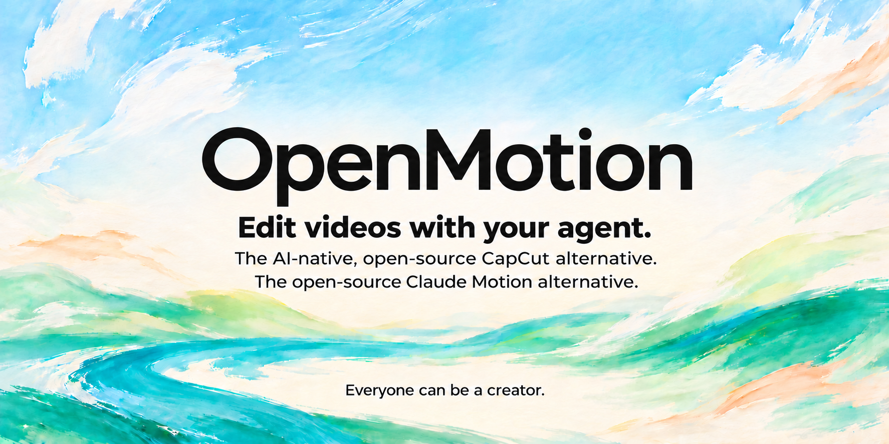

[Animated cover GIF](docs/readme/cover-motion.gif) · [GitHub social preview](docs/readme/social-preview.jpg)

<a id="what-is-openmotion"></a>

## 🎬 What is OpenMotion?

**OpenMotion is an All-in-One AI-native Studio for AI editing & Motion — an open-source CapCut alternative built around an editable timeline.** Tell your AI how you want to edit: what to keep, what to remove, how to tell the story, and where captions, music and motion belong. Your agent edits the project from your material, script or confirmed timecodes; you preview, refine and export it in Studio.

**AI editing is the core. Creation and expression are the purpose.** Bring inspiration, footage, brand assets, agents and multimodal models into one creative workflow. Tell your story, generate what is missing, refine the cut and keep the editable work. Claude Motion informs the motion-creation direction.

Today, OpenMotion brings project sessions, template discovery, media management, model generation, timeline editing and MP4 export together. Our all-in-one vision extends that Studio into a collaborative space that understands you and your team, manages publishing and recurring work, and turns feedback into reusable creative knowledge.

**Two ways in. One editable project.**

- **Start in OpenMotion → [connect your agent](#connect-your-agent).** Open Studio, bring your material and connect Codex, Claude Code or another supported client for AI editing.
- **Start in your agent → [use OpenMotion](#use-from-your-agent).** Add **Skills, MCP and CLI** to your existing workflow; let the agent create, edit, preview and export, with Studio available for hands-on refinement.

<a id="all-in-one-studio"></a>

## 🌐 All-in-One Studio — from inspiration to your next story

**One creative home for discovering, making, sharing and learning.** The product journey spans the whole lifecycle; the status column distinguishes today's tools from what comes next.

| Part of your creative day | What belongs in the Studio | Status |
| --- | --- | --- |
| **Discover inspiration** | Browse templates and references, find a direction, search for material and collect ideas. | Catalog search and reference browsing today; integrated media-service search is coming. |
| **Collect & manage assets** | Upload footage, organize images, voice and music, and keep sources with the project. | Project media import, previews and file operations today; a shared team asset library is coming. |
| **Generate what is missing** | Use agents to plan the work and configured multimodal models to produce images, video, voice and music. | External agent workflow and Studio Model Gateway today. |
| **Tell the story & cut** | Shape the narrative, arrange the timeline, refine sound and motion, replace images and adapt the edit. | Editable projects and AI-assisted revisions today; automatic content selection and platform adaptation are coming. |
| **Create together** | Edit with people and agents; discuss moments, comment on the timeline and review changes. | Shared local project handoffs today; collaborative comments and review are coming. |
| **Deliver & operate** | Export versions, manage publication, track production tasks and schedule recurring work. | MP4 export and generation/export job status today; publishing management and creative-task automation are coming. |
| **Learn & improve** | Bring back performance and review data; retrieve brand knowledge, refine preferences and turn proven methods into Skills. | Explicit Brandkits, Motion MD and Skills today; analytics feedback, persistent memory and RAG are coming. |

[Full product vision and capability map](docs/product/studio-vision.md) · [Current architecture](docs/product/architecture.md)

<a id="super-motion-video-agent"></a>

## 🧠 Introducing our Super Motion Video Agent concept

**A creative agent that carries a story through its entire lifecycle.** This is OpenMotion's proposed agent experience: understand the creator, organize the work, coordinate tools and models, keep the project editable, and bring lessons into the next creation.

- **Understand:** use the brief, audience, personal voice, team preferences and Brandkit to frame the story.
- **Plan:** turn the goal into research, material, script, edit, review and delivery tasks.
- **Create:** select Skills and agent-ready templates; coordinate search and multimodal models; make changes on the shared timeline.
- **Collaborate:** work with people, resolve review feedback and keep project context across revisions.
- **Improve:** connect published versions to outcomes, retrieve relevant knowledge and propose better Skills for future work.

Inspired by [DeepSeek Harness](https://github.com/deepseek-ai/deepseek-harness) and the [Super-agent research prototype](https://github.com/deepseek-ai/dsh-superagent-prototype), we apply the idea of continuing, task-oriented agent work to video and motion. **Super Motion Video Agent is our product concept and roadmap, not a shipped autonomous runtime.** Today, your connected agent uses OpenMotion's Skills, project tools and Studio; persistent orchestration, publishing feedback and learning remain planned. [Design and status](docs/product/studio-vision.md#super-motion-video-agent)

<a id="ai-video-editing"></a>

## ✂️ AI editing — your story, on an AI-native timeline

**Say how the video should be cut, in your own voice.** Place and rearrange your material on the timeline; work with an agent on selection, trimming, captions, transitions and sound. Every revision becomes part of a project you can inspect and keep refining.

| Around the timeline | What you can do today | Direction we are building toward |
| --- | --- | --- |
| **✂️ Intelligent cuts & story organization** | Import and arrange media; ask the agent to cut specified passages, reshape pacing and follow your tone, script or confirmed timecodes. | Automatic content selection, irrelevant-passage detection and destination-aware reframing. |
| **✨ Media generation & search** | Generate images, video, music and voice through configured models in Studio. Edit a selected image with a reference-capable model, compare candidates and replace it while keeping its timing and animation. | Integrated search across footage, images, voices, music and Avatar services, alongside generation. |
| **📤 Multiplatform input & output** | Combine supported local media with scripts, captions and agent-accessible references; author different compositions and export MP4 with editable source. | Broader platform-link parsing and import, automatic format adaptation and platform export presets. |

The right-hand column is product direction. Provider accounts and model capabilities determine available generation; reference retrieval and media analysis depend on the connected agent's tools. [Current media controls](docs/model-gateway.md) · [Roadmap](#status--roadmap)

1. **Bring your material.** Footage, recordings and screen captures, plus your script, timecodes, references and brand assets.
2. **Describe the cut.** Ask the agent to tighten passages against a script or confirmed timecodes, rearrange clips, add supporting visuals and adjust captions, music and motion.
3. **Watch and revise.** Preview in Studio, adjust the timeline yourself or request another change, then export MP4 with the editable source.

> Use this recording and timed transcript to make a 30-second clip. Lead with the main point, remove the repeated passages I marked, and add product footage, captions and my supplied music. Show me the preview, then revise it from my feedback.

<a id="everyone-can-be-a-creator"></a>

## 🌱 Everyone can be an AI video editor. Everyone can be a creator.

**If you have something to say, you can start creating.** Individuals, teachers and small teams can use AI to shape their material, find the story and revise the cut. OpenMotion aims to make AI editing accessible to everyone, so more people can share knowledge, express their views and build their own publishing practice.

Recreate the structure and pacing of a viral reference, edit your own talking-head footage, explain a product and bring your work to Xiaohongshu, X / Twitter, Instagram or YouTube. Better expression and a repeatable creative process help you pursue an audience; reach still depends on the content, audience and platform.

<a id="what-can-you-make"></a>

## 🎞️ What can you make?

**See the idea. Make it yours.** Seven scenarios, each with a creative brief you can hand to your agent. These animated excerpts are external works selected from the resource catalog; click to watch the full reference, then start with your own material and brand.

<table>
<tr>
<td width="50%" valign="top">
<strong>01 · AI talking-head edits</strong><br>
Three minutes of footage. One sharp story.
<p align="center">
<a href="library/skills/presenter-story/assets/ali-abdaal-workflow-reference.mp4"><picture>
<source media="(prefers-reduced-motion: reduce)" srcset="docs/readme/examples/talking-head.jpg">

</picture></a>
</p>
<sub>Reference · <a href="library/skills/presenter-story/assets/ali-abdaal-workflow-reference.mp4">Ali Abdaal · 5 tools I use every day</a></sub><br><br>
<strong>Start with</strong> · Your recording + transcript / timecodes<br>
<strong>Make it yours</strong> · A clear hook, tighter speech, captions and well-timed B-roll.<br><br>
<a href="docs/examples.md#talking-head">Copy the creative brief →</a> · <a href="docs/readme/examples/talking-head.jpg">Still preview</a>
</td>
<td width="50%" valign="top">
<strong>02 · AI recuts & revisions</strong><br>
Scattered clips become a 100-day story.
<p align="center">
<a href="docs/readme/media/hundred-days-story-reference.mp4"><picture>
<source media="(prefers-reduced-motion: reduce)" srcset="docs/readme/examples/story-recut.jpg">

</picture></a>
</p>
<sub>Reference · <a href="https://www.instagram.com/reel/Dd6vHlQgpok/">100 days with stickers and photo cards · Hyperframes catalog</a></sub><br><br>
<strong>Start with</strong> · Your clips, photos, voice-over and story outline<br>
<strong>Make it yours</strong> · A personal montage with photo cutouts, chapter beats and a new pace.<br><br>
<a href="docs/examples.md#story-recut">Copy the creative brief →</a> · <a href="docs/readme/examples/story-recut.jpg">Still preview</a>
</td>
</tr>
<tr>
<td width="50%" valign="top">
<strong>03 · Product launches & demos</strong><br>
Make the feature the hero.
<p align="center">
<a href="docs/readme/media/jake-figma-draw-reference.mp4"><picture>
<source media="(prefers-reduced-motion: reduce)" srcset="docs/readme/examples/product-launch.jpg">
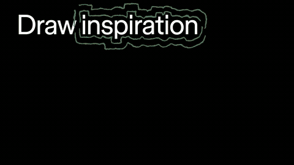
</picture></a>
</p>
<sub>Reference · <a href="docs/readme/media/jake-figma-draw-reference.mp4">Figma Draw · @figma</a></sub><br><br>
<strong>Start with</strong> · Product screens + feature brief + Brandkit<br>
<strong>Make it yours</strong> · A feature reveal, a focused UI demonstration and a memorable finish.<br><br>
<a href="docs/examples.md#product-launch">Copy the creative brief →</a> · <a href="docs/readme/examples/product-launch.jpg">Still preview</a>
</td>
<td width="50%" valign="top">
<strong>04 · Viral video recreation</strong><br>
Remix the rhythm. Make it yours.
<p align="center">
<a href="docs/readme/media/jake-lovable-reference.mp4"><picture>
<source media="(prefers-reduced-motion: reduce)" srcset="docs/readme/examples/viral-remix.jpg">
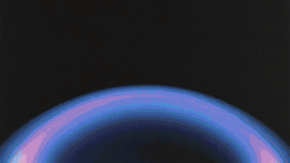
</picture></a>
</p>
<sub>Reference · <a href="docs/readme/media/jake-lovable-reference.mp4">Lovable: Aesthetics Update · @lovable_dev</a></sub><br><br>
<strong>Start with</strong> · A reference + your copy, visuals and brand<br>
<strong>Make it yours</strong> · A new editable cut built around the hook, typography and visual rhythm.<br><br>
<a href="docs/examples.md#viral-remix">Copy the creative brief →</a> · <a href="docs/readme/examples/viral-remix.jpg">Still preview</a>
</td>
</tr>
<tr>
<td width="50%" valign="top">
<strong>05 · Explainers & tutorials</strong><br>
One workflow. Three clear steps.
<p align="center">
<a href="docs/readme/media/remix-authorize-once-reference.mp4"><picture>
<source media="(prefers-reduced-motion: reduce)" srcset="docs/readme/examples/explainer.jpg">
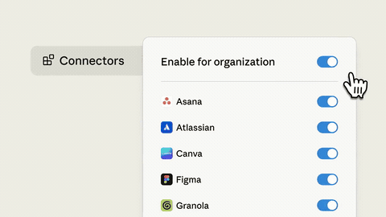
</picture></a>
</p>
<sub>Reference · <a href="docs/readme/media/remix-authorize-once-reference.mp4">Authorize Once, Everyone Connected · Hyperframes catalog</a></sub><br><br>
<strong>Start with</strong> · Your workflow + script + accurate UI captures<br>
<strong>Make it yours</strong> · A guided sequence with one idea per scene and purposeful callouts.<br><br>
<a href="docs/examples.md#explainer">Copy the creative brief →</a> · <a href="docs/readme/examples/explainer.jpg">Still preview</a>
</td>
<td width="50%" valign="top">
<strong>06 · Data stories & charts</strong><br>
Give every number a point.
<p align="center">
<a href="docs/readme/media/M1128-clip.mp4"><picture>
<source media="(prefers-reduced-motion: reduce)" srcset="docs/readme/examples/data-story.jpg">

</picture></a>
</p>
<sub>Reference · <a href="https://x.com/Vintage_god/status/2106817967967056165">Animated comparison bars · @Vintage_god</a></sub><br><br>
<strong>Start with</strong> · Your data, units, source and conclusion<br>
<strong>Make it yours</strong> · A legible chart reveal with animated values and one clear comparison.<br><br>
<a href="docs/examples.md#data-story">Copy the creative brief →</a> · <a href="docs/readme/examples/data-story.jpg">Still preview</a>
</td>
</tr>
<tr>
<td colspan="2" valign="top">
<strong>07 · Music & art visuals</strong><br>
Give your track a visual identity.
<p align="center">
<a href="docs/readme/media/M1139-clip.mp4"><picture>
<source media="(prefers-reduced-motion: reduce)" srcset="docs/readme/examples/music-visual.jpg">

</picture></a>
</p>
<sub>Reference · <a href="https://x.com/GoogleAI/status/2024154215182926027">Lyria 3 visual sequence · @GoogleAI</a></sub><br><br>
<strong>Start with</strong> · Your audio + mood + beat markers / cue points<br>
<strong>Make it yours</strong> · Layered color, kinetic type and a visual sequence timed to your track.<br><br>
<a href="docs/examples.md#music-visual">Copy the creative brief →</a> · <a href="docs/readme/examples/music-visual.jpg">Still preview</a>
</td>
</tr>
</table>

These references illustrate creative directions; they are not OpenMotion-generated acceptance demos. For an editable starting project, open one of the [three bundled templates](library/templates/README.md). [Example briefs and workflow](docs/examples.md) · [Sources and excerpt records](docs/readme/ASSETS.md#creative-examples)

<a id="input--process--output"></a>

## 🔄 Input → Process → Output

**Bring your material → edit with AI → share your story.** The same project carries the entire lifecycle, from the first brief to the next recut.

```text
INPUT     Gather footage, recordings, links, scripts and brand assets
PROCESS   Set the story → arrange a rough cut → refine media, motion and sound
          → preview in Studio → give feedback → revise the same timeline ↺
OUTPUT    Render MP4 + keep editable source → adapt the next version
```

**The project holds the work. The agent applies your intent. The timeline gives you control.** Before a change, the agent reads the current project and revision; after it, you can review and refine the result. Export captures a fixed version, while the source remains available for the next edit.

| Stage | What goes in or comes out | How it works today |
| --- | --- | --- |
| **Input · Local media** | Existing videos, recordings, talking-head footage, screen captures, images and brand assets | Import supported local media into the project and retain its source. |
| **Input · Online references** | YouTube, X / Twitter videos and other reference material | Give the link to an agent with the necessary browsing and media tools, or supply an accessible local file. |
| **Input · Text & subtitles** | A prompt, a script, Markdown, SRT / VTT | The agent reads text and timecodes to author scenes, clips and captions; text files can live with the project. |
| **Process · AI editing & design** | Select takes, remove irrelevant material, reshape pacing, add text and motion transitions | The agent edits against a script or confirmed timecodes; preview and refine the work in Studio. |
| **Process · Sound & media** | Music, voice-over, supporting video and images | Import existing media, or generate assets in Studio's gateway with a configured model, then place selected results on the timeline. |
| **Output · Film & source** | MP4 plus editable HTML/CSS/JS and media | Render a fixed project version at its chosen dimensions and frame rate, check the file and keep the source. |

**Make versions for your destination.** Ask the agent to adapt the composition for portrait, landscape or square MP4s for Xiaohongshu, X / Twitter, Instagram and YouTube. Check each platform's current upload specifications before publishing; there are no built-in platform presets or publishing integrations today. Online retrieval, transcription and automatic filler detection require host tools or supplied captions; a reference URL is not an in-app downloader.

## Why OpenMotion?

- **Turn editing intent into project changes.** Describe a cut, reorder, pacing change or sound cue. Let your agent edit the project, then preview and fine-tune it in Studio.
- **Use the agent you already work with.** Connect through local MCP and reusable Skills; keep your existing agent account and workflow.
- **Carry your motion language forward.** Record brand, pacing, movement and sound in a readable `MOTION_DESIGN.md` for the next video.
- **Start with a reference or template.** Explore hundreds of catalog resources, trace their sources and open the bundled editable examples.
- **Keep the source.** Projects use HTML, CSS, JavaScript and media. Preview locally, export MP4 and return to the editable work later.

<a id="product-tour"></a>

## 🖥️ Product tour

**One template, three ways to work.** Follow the bundled **Product Promo** through an embedded editor, the standalone workspace and a terminal workflow. Then see how to connect an agent and hand it one specific template.

| Start here | What the demo shows |
| --- | --- |
| [Codex](#demo-codex) | The embedded editor returned to a host: source, preview, layers and timeline. |
| [Standalone Studio](#demo-standalone) | Sessions, the saved request and the same editable project. |
| [Claude Code + CLI](#demo-claude-code) | Loaded production Skills and real CLI project checks. |
| [Template → Agent](#demo-template-handoff) | Connect Agent, preview one template and copy its precise handoff. |

<a id="demo-codex"></a>

### 1. Codex · an editable preview beside your conversation

Ask Codex to open the project's preview, then inspect and refine the source and timeline. **This capture shows the real `embed=1` editor used by hosts such as Codex; it does not include the Codex desktop shell.** Opening it inside a panel depends on the host's browser capability.


<a id="demo-standalone"></a>

### 2. Standalone · your full creative workspace

Open Studio directly. Keep the request and project in one session, work with source and media, scrub the timeline and return for another revision. **Copy for Agent** carries the request into your connected client.


<a id="demo-claude-code"></a>

### 3. Claude Code · Skills, MCP and CLI in your terminal

Load the [Claude Code adapter](docs/agent-adapters.md#codex--claude-code) and open `/skills`. Choose **motion-template-to-video** for an existing editable template; choose **motion-recreate** for reconstruction from a reference video.

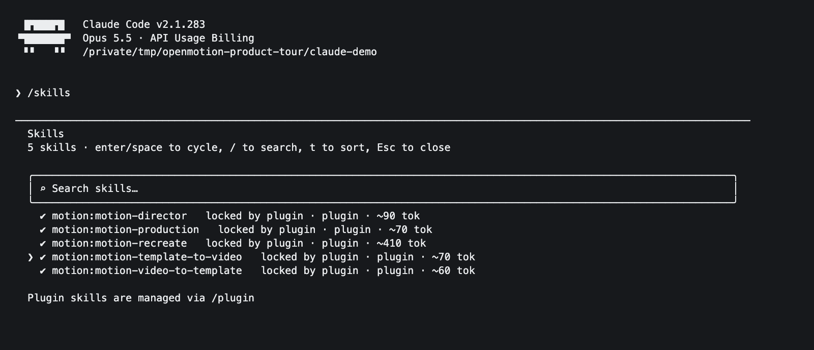

The pinned CLI can inspect the same project: **1920 × 1080, 20 seconds, three graphic scenes and a caption track; lint reports zero errors and warnings.** These are actual CLI results. The terminal captures verify local Skill loading and project checks; they do not show a completed model-driven adaptation.

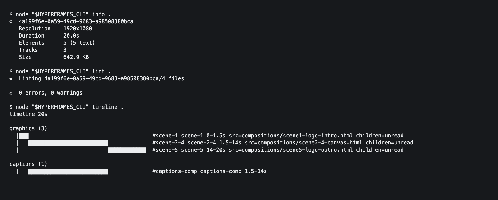

<a id="demo-template-handoff"></a>

### Connect once → give your agent one template

**Connect Agent.** Select Codex, Claude Code or another local client and copy the connection instruction generated for your workspace.


**Preview → one-click copy → paste into your agent.** Search for **Product Promo**, open its preview and expand the copy instruction. It includes the exact `product-promo` ID and a guide URL for the selected client. The bundled template opens as an editable copy; an external video reference requires the agent to analyze and rebuild it.


After pasting the generated instruction, add your changes, for example:

> Use this Product Promo template for my product. Keep the 20-second structure and animation; replace the copy and assets with the material I provide. Open the editable preview so I can review it before export.

Use the link generated by **your running workspace**; the loopback address in a screenshot belongs to the demonstration. [Reproduce the tour](docs/product-tour.md) · [Image sources and capture scope](docs/readme/ASSETS.md#product-tour-captures) · [Editor guide](studio/README.md)

<a id="your-app-your-agent"></a>
<a id="connect-your-agent"></a>

## 🔌 Connect your agent to OpenMotion

**Start in the app. Bring your preferred AI editor.** Studio is a standalone workspace for your projects, media and timeline.

1. [Start OpenMotion](#quick-start), open a template or an existing project, and choose **Connect Agent**.
2. Select your client and follow the connection instructions for the current workspace.
3. Give that agent your project context and editing request. Preview its changes in Studio, adjust the timeline and continue the same edit.

The supported connection paths are:

| Agent / client | Connection |
| --- | --- |
| **Codex** | Local plugin or MCP + Skills setup. |
| **Claude Code** | Local plugin or MCP + Skills setup. |
| **DeepSeek Harness** | Harness adapter or MCP + Skills setup. |
| **WorkBuddy** | MCP + Skills configuration is generated; desktop creation and playback validation are pending. |
| **Other local MCP clients** | Manual stdio configuration; UI and shell capabilities depend on the host. |

Today, the connected agent runs in its own client. Studio stores the brief and editable work; it does not include an embedded chat-agent runner. [Agent adapters](docs/agent-adapters.md) · [Session architecture](docs/session-architecture.md)

<a id="motion-design-md--motion_designmd"></a>

## 🎨 Motion Design MD — `MOTION_DESIGN.md`

**Clone the motion. Tell your story.** Turn the creative structure of a reference video into a reusable **Motion Design Skill package**: keep its camera moves, transitions, rhythm and visual hierarchy; replace the topic, copy, product and brand with yours. A good remake can become a community asset that another creator can fork, adapt and improve.

```text
Reference video  →  Motion Design Skill package  +  Your content
                         │
                         ├─ MOTION_DESIGN.md   creative rules + invariants
                         ├─ SKILL.md           adaptation + review method
                         ├─ source + assets    editable implementation
                         └─ presets + evidence content slots + actual results
                         │
                         ▼
                  Agent → editable timeline → your new video
```

**Motion MD carries the design; the Skill carries the method; the project carries the implementation.** It describes story beats, framing, timing, easing, camera, typography, sound, replaceable inputs and what must survive a content change. [Architecture and complete authoring guide](docs/motion-md.md).

<a id="presenter-motion"></a>

### 🎙️ Real people. Real stories. Motion that helps.

Talking-head videos, tutorials and product walkthroughs belong here too. **Keep the human delivery and story rhythm; reuse the captions, screenshots, picture-in-picture and motion with your own recording, topic and brand.**

These three pairs are **reference / upstream-remix demonstrations from the existing Hyperframes catalog**. Each side is a silent excerpt, not a synchronized fidelity test or a new OpenMotion output. Each pair links to an Agent-ready design recipe for making and reviewing your own adaptation.

#### Teach with a face, a keyword and a visual example

**Career advice → video-production explainer**

<table>
<tr><th width="50%">Reference · @careerwithriya</th><th width="50%">Upstream remix · Hyperframes</th></tr>
<tr><td colspan="2" align="center"><picture><source media="(prefers-reduced-motion: reduce)" srcset="docs/readme/people/careerwithriya-comparison.jpg"></picture></td></tr>
</table>

**Reuse:** Numbered ideas, presenter-led delivery and proof cards. **Make it yours:** Creator, spoken topic, keywords and supporting examples.

[MOTION_DESIGN.md](library/skills/presenter-story/references/presenter-listicle/MOTION_DESIGN.md) · [Skill](library/skills/presenter-story/SKILL.md) · [Original](library/skills/presenter-story/assets/careerwithriya-reference.mp4) · [Full upstream remix](library/skills/presenter-story/assets/careerwithriya-result.mp4)

#### Show the workflow while you tell the story

**Everyday tools → a design-workspace story**

<table>
<tr><th width="50%">Reference · Ali Abdaal</th><th width="50%">Upstream remix · Hyperframes</th></tr>
<tr><td colspan="2" align="center"><picture><source media="(prefers-reduced-motion: reduce)" srcset="docs/readme/people/ali-abdaal-workflow-comparison.jpg"></picture></td></tr>
</table>

**Reuse:** Presenter / screen rhythm, quiet captions and readable inserts. **Make it yours:** Your recording, your workflow and your screen captures.

[MOTION_DESIGN.md](library/skills/presenter-story/references/workflow-demo/MOTION_DESIGN.md) · [Skill](library/skills/presenter-story/SKILL.md) · [Original](library/skills/presenter-story/assets/ali-abdaal-workflow-reference.mp4) · [Full upstream remix](library/skills/presenter-story/assets/ali-abdaal-workflow-result.mp4)

#### Put the presenter and the product in one story

**Tool demo → video-editor walkthrough**

<table>
<tr><th width="50%">Reference · @john.tagudin</th><th width="50%">Upstream remix · Hyperframes</th></tr>
<tr><td colspan="2" align="center"><picture><source media="(prefers-reduced-motion: reduce)" srcset="docs/readme/people/john-tagudin-capso-comparison.jpg"></picture></td></tr>
</table>

**Reuse:** Hook, picture-in-picture, callouts and a visible result. **Make it yours:** Product, presenter, demonstration and closing message.

[MOTION_DESIGN.md](library/skills/presenter-story/references/product-walkthrough/MOTION_DESIGN.md) · [Skill](library/skills/presenter-story/SKILL.md) · [Original](library/skills/presenter-story/assets/john-tagudin-capso-reference.mp4) · [Full upstream remix](library/skills/presenter-story/assets/john-tagudin-capso-result.mp4)

> Use my camera and screen recordings with this structure. Keep my voice, edit around the actual speech and align captions. Use screenshots, picture-in-picture and motion to explain each point. Show a preview with sound, then deliver the editable project and MP4.

### 🎞️ Same motion language. A different story.

Six real, synchronized **source-template adaptations** from resources already represented in our catalog. Left: the source with its original content. Right: the same implementation with a new brief applied through the example package. Both sides are rendered at matching timestamps; previews are silent excerpts. They demonstrate content reuse, not blind reconstruction of arbitrary viral videos. [Source, inputs and evidence](docs/motion-design-examples.md).

### Wireframe portal · BREAKTHROUGH → OPENMOTION

<table>
<tr><th width="50%">Reference · original content</th><th width="50%">Remix · Skill package adaptation</th></tr>
<tr><td colspan="2"><a href="library/skills/motion-design-remix/previews/wireframe-portal-title.mp4"><picture><source media="(prefers-reduced-motion: reduce)" srcset="library/skills/motion-design-remix/previews/wireframe-portal-title.jpg"></picture></a></td></tr>
</table>

**Keep: Portal timing, dimensional lettering and camera push.** **Replace: Title, subtitle and the 3D phrase.**

[MOTION_DESIGN.md](library/skills/motion-design-remix/references/wireframe-portal-title/MOTION_DESIGN.md) · [Skill](library/skills/motion-design-remix/SKILL.md) · [Content preset](library/skills/motion-design-remix/presets/wireframe-portal-title.json) · [MP4](library/skills/motion-design-remix/previews/wireframe-portal-title.mp4)

### Canopy typography · Understory → OpenMotion

<table>
<tr><th width="50%">Reference · original content</th><th width="50%">Remix · Skill package adaptation</th></tr>
<tr><td colspan="2"><a href="library/skills/motion-design-remix/previews/canopy-part-title.mp4"><picture><source media="(prefers-reduced-motion: reduce)" srcset="library/skills/motion-design-remix/previews/canopy-part-title.jpg"></picture></a></td></tr>
</table>

**Keep: Leaf sweeps, depth, occlusion and reading holds.** **Replace: Two brand headlines.**

[MOTION_DESIGN.md](library/skills/motion-design-remix/references/canopy-part-title/MOTION_DESIGN.md) · [Skill](library/skills/motion-design-remix/SKILL.md) · [Content preset](library/skills/motion-design-remix/presets/canopy-part-title.json) · [MP4](library/skills/motion-design-remix/previews/canopy-part-title.mp4)

### Interface reveal · Product tour → AI editing story

<table>
<tr><th width="50%">Reference · original content</th><th width="50%">Remix · Skill package adaptation</th></tr>
<tr><td colspan="2"><a href="library/skills/motion-design-remix/previews/ui-3d-reveal.mp4"><picture><source media="(prefers-reduced-motion: reduce)" srcset="library/skills/motion-design-remix/previews/ui-3d-reveal.jpg"></picture></a></td></tr>
</table>

**Keep: Tilted canvas, depth hierarchy and continuous camera.** **Replace: Hero headline, document and community copy.**

[MOTION_DESIGN.md](library/skills/motion-design-remix/references/ui-3d-reveal/MOTION_DESIGN.md) · [Skill](library/skills/motion-design-remix/SKILL.md) · [Content preset](library/skills/motion-design-remix/presets/ui-3d-reveal.json) · [MP4](library/skills/motion-design-remix/previews/ui-3d-reveal.mp4)

### Dimensional code · loadConfig() → cutVideo()

<table>
<tr><th width="50%">Reference · original content</th><th width="50%">Remix · Skill package adaptation</th></tr>
<tr><td colspan="2"><a href="library/skills/motion-design-remix/previews/code-3d-extrude.mp4"><picture><source media="(prefers-reduced-motion: reduce)" srcset="library/skills/motion-design-remix/previews/code-3d-extrude.jpg"></picture></a></td></tr>
</table>

**Keep: Extruded slab, syntax colors and the camera move.** **Replace: Function, variables and displayed calls.**

[MOTION_DESIGN.md](library/skills/motion-design-remix/references/code-3d-extrude/MOTION_DESIGN.md) · [Skill](library/skills/motion-design-remix/SKILL.md) · [Content preset](library/skills/motion-design-remix/presets/code-3d-extrude.json) · [MP4](library/skills/motion-design-remix/previews/code-3d-extrude.mp4)

### Particle assembly · parse / optimize / emit → select / trim / render

<table>
<tr><th width="50%">Reference · original content</th><th width="50%">Remix · Skill package adaptation</th></tr>
<tr><td colspan="2"><a href="library/skills/motion-design-remix/previews/code-particle-assemble.mp4"><picture><source media="(prefers-reduced-motion: reduce)" srcset="library/skills/motion-design-remix/previews/code-particle-assemble.jpg"></picture></a></td></tr>
</table>

**Keep: Seeded particle motion and assembly rhythm.** **Replace: Pipeline name and steps.**

[MOTION_DESIGN.md](library/skills/motion-design-remix/references/code-particle-assemble/MOTION_DESIGN.md) · [Skill](library/skills/motion-design-remix/SKILL.md) · [Content preset](library/skills/motion-design-remix/presets/code-particle-assemble.json) · [MP4](library/skills/motion-design-remix/previews/code-particle-assemble.mp4)

### Glass information cards · Device widgets → creator workspace

<table>
<tr><th width="50%">Reference · original content</th><th width="50%">Remix · Skill package adaptation</th></tr>
<tr><td colspan="2"><a href="library/skills/motion-design-remix/previews/liquid-glass-widgets.mp4"><picture><source media="(prefers-reduced-motion: reduce)" srcset="library/skills/motion-design-remix/previews/liquid-glass-widgets.jpg"></picture></a></td></tr>
</table>

**Keep: Glass treatment, card hierarchy, stagger and meters.** **Replace: Labels, units and feature story.**

[MOTION_DESIGN.md](library/skills/motion-design-remix/references/liquid-glass-widgets/MOTION_DESIGN.md) · [Skill](library/skills/motion-design-remix/SKILL.md) · [Content preset](library/skills/motion-design-remix/presets/liquid-glass-widgets.json) · [MP4](library/skills/motion-design-remix/previews/liquid-glass-widgets.mp4)

### 📦 Give the package to your Agent

> Read this Motion Design Skill package. Keep the selected reference's story rhythm, framing and transitions. Use my recordings, measured speech timing, copy and brand. Deliver a matching-time comparison, the editable project and MP4; record any differences that remain.

[Get the example Skill](library/skills/motion-design-remix/SKILL.md) · [Six detailed walkthroughs](docs/motion-design-examples.md) · [Contribute a motion language](library/ENTRY_TEMPLATE.md)

**Today:** `MOTION_DESIGN.md` is a v0.1 writing convention supplied explicitly to an Agent. The example package includes pinned source, six profiles and an executable replacement helper; no automatic Markdown importer or `.motion` compatibility is implied. With video-only references, use `motion-recreate` to rebuild and review the work first; `motion-video-to-template` keeps its existing `TEMPLATE.md` handoff. [How the layers fit](docs/motion-md.md).

<a id="creative-memory"></a>

## 📚 A creative space that grows with you — is coming

**Your voice. Your team's knowledge. Your brand, carried forward.** The long-term Studio brings project history, reviewed preferences, brand rules, feedback and reusable Skills together so an agent can retrieve the right context for the next brief.

```text
AVAILABLE TODAY
  Brief + brand → create → preview → revise → project version + MP4

PLANNED · is coming
  Published version + performance + review feedback
        ↓
  Evidence linked to the project, platform and time window
        ↓
  Personal / team knowledge → retrieve relevant context with RAG
        ↓
  Propose a Skill or preference update → evaluate → save a version
        ↓
  The next brief starts with better context
```

The planned loop connects **publishing and recurring tasks**, **version-linked performance data**, **personal and team memory**, and **RAG — retrieving relevant knowledge when it is needed**. Accepted methods can become Skills; useful compositions can become templates; brand and motion choices stay reusable through Brandkits and `MOTION_DESIGN.md`. Improvement is evaluated against the next creative task, not assumed from collecting more data.

Today, you explicitly supply those documents and preserve editable projects. Automated publishing, analytics ingestion, persistent preference memory, RAG and automatic Skill distillation are roadmap capabilities. [Knowledge and feedback design](docs/product/studio-vision.md#knowledge-and-feedback)

<a id="resources-templates--community-work"></a>

## 🧩 Resources, templates & community work

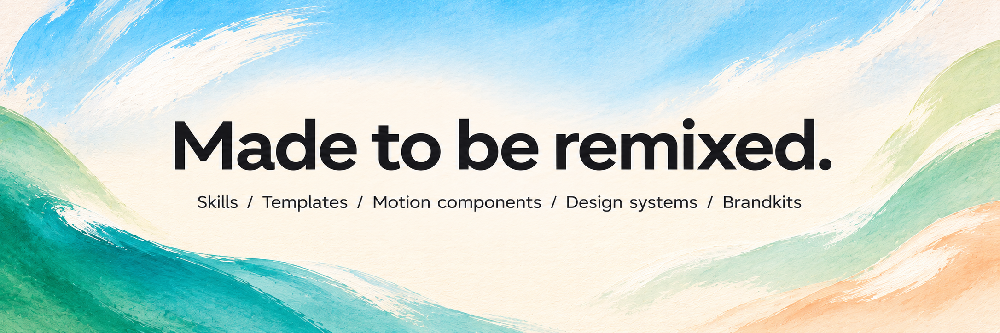

**An open [OpenMotion Library](library/README.md), from day one.** One home for creative methods, editable work and design systems you can learn from:

| Reuse a… | Directory & first entries |
| --- | --- |
| **🧠 Skill** | [`library/skills/`](library/skills/) · [Presenter Story](library/skills/presenter-story/SKILL.md) · [Motion Design Remix](library/skills/motion-design-remix/SKILL.md) · [Brandkit preparation](library/skills/brandkit/SKILL.md). |
| **🎞️ Template** | [`library/templates/`](library/templates/README.md) · Three Studio starting points + the [Presenter Tech package](library/templates/presenter-tech/README.md). |
| **🧩 Motion component** | [`library/components/`](library/components/README.md) · A title-reveal recipe and external component references. |
| **🎨 Motion design system** | [`library/design-systems/`](library/design-systems/) · [Ink & Water / `MOTION_DESIGN.md`](library/design-systems/ink-water/MOTION_DESIGN.md). |
| **💼 Brandkit** | [`library/brandkits/`](library/brandkits/) · [OpenMotion facts, identity and assets](library/brandkits/openmotion/BRANDKIT.md). |

Choose the files and explicitly give them to your agent with your material. The library is browsable and open to contributions today; automatic import and a marketplace are not implemented. The five core production Skills stay in `skills/`. [Contribute an entry](library/ENTRY_TEMPLATE.md)

### Templates made for agents

**A template carries editable structure and instructions an agent can use.** Choose a starting point, supply your Brandkit and story, then ask the agent to recreate, personalize and refine it. The community can contribute the source, editable choices, Motion MD, preview and provenance together.

> Use the Product Promo template with my Brandkit. Tell this story in my voice, replace the assets and copy, adjust the pacing, then show a preview and refine it from my feedback.

The current gallery's one-click action prepares the agent handoff; the connected agent performs the work. Automatic discovery, installation and personalized optimization across the community library are coming. [Template entry points](library/templates/README.md)

<a id="creator-video-gallery"></a>

### 🎥 People, speech and motion — start with real videos

**Nine presenter-led references already in the catalog.** Explore lessons, screen demonstrations, founder stories and UGC product videos. Every card moves; click for the full video and search its title in Studio to find the original entry.

<table>
<tr><th colspan="3" align="left">🎓 Teach & explain</th></tr>
<tr>
<td width="33%" valign="top" align="center">
<a href="library/skills/presenter-story/assets/careerwithriya-reference.mp4"><picture><source media="(prefers-reduced-motion: reduce)" srcset="docs/readme/people/careerwithriya.jpg"></picture></a><br>
<strong>6 essential skills to transform your career</strong><br>
Numbered points + kinetic keywords<br>
<sub>Reference · <a href="https://www.instagram.com/reel/Ddd57MBszhc/">@careerwithriya</a></sub>
</td>
<td width="33%" valign="top" align="center">
<a href="docs/readme/media/dan-martell-tools-reference.mp4"><picture><source media="(prefers-reduced-motion: reduce)" srcset="docs/readme/people/dan-martell-tools.jpg"></picture></a><br>
<strong>What's the best AI tool right now?</strong><br>
Presenter + floating tool cards<br>
<sub>Reference · <a href="https://www.youtube.com/shorts/mk1zJd9Rm4c">Dan Martell</a></sub>
</td>
<td width="33%" valign="top" align="center">
<a href="docs/readme/media/harpercarrollai-reference.mp4"><picture><source media="(prefers-reduced-motion: reduce)" srcset="docs/readme/people/harpercarrollai.jpg"></picture></a><br>
<strong>10 Days of AI Basics, Day 1</strong><br>
A personal lesson + readable captions<br>
<sub>Reference · <a href="https://www.instagram.com/reel/C4eNPF3PdpG/">@harpercarrollai</a></sub>
</td>
</tr>
<tr><th colspan="3" align="left">🖥️ Show the workflow</th></tr>
<tr>
<td width="33%" valign="top" align="center">
<a href="library/skills/presenter-story/assets/ali-abdaal-workflow-reference.mp4"><picture><source media="(prefers-reduced-motion: reduce)" srcset="docs/readme/people/ali-abdaal-workflow.jpg"></picture></a><br>
<strong>5 tools I use every day</strong><br>
Desk-side story + workflow inserts<br>
<sub>Reference · <a href="library/skills/presenter-story/assets/ali-abdaal-workflow-reference.mp4">Ali Abdaal</a></sub>
</td>
<td width="33%" valign="top" align="center">
<a href="library/skills/presenter-story/assets/john-tagudin-capso-reference.mp4"><picture><source media="(prefers-reduced-motion: reduce)" srcset="docs/readme/people/john-tagudin-capso.jpg"></picture></a><br>
<strong>Tool demo with callouts</strong><br>
Presenter + screens + callouts<br>
<sub>Reference · <a href="https://www.tiktok.com/@john.tagudin/video/7524883942328126728">@john.tagudin</a></sub>
</td>
<td width="33%" valign="top" align="center">
<a href="docs/readme/media/aiwithsachi-reference.mp4"><picture><source media="(prefers-reduced-motion: reduce)" srcset="docs/readme/people/aiwithsachi.jpg"></picture></a><br>
<strong>Top 5 plugins to install in Claude</strong><br>
A spoken list + supporting screenshots<br>
<sub>Reference · <a href="https://www.instagram.com/reel/Dc7G9Pxu_1O/">@aiwithsachi</a></sub>
</td>
</tr>
<tr><th colspan="3" align="left">🎬 Tell a story, show a product</th></tr>
<tr>
<td width="33%" valign="top" align="center">
<a href="docs/readme/media/khris-sheer-founder-reference.mp4"><picture><source media="(prefers-reduced-motion: reduce)" srcset="docs/readme/people/khris-sheer-founder.jpg"></picture></a><br>
<strong>The Founder Experiments, Ep. 1</strong><br>
Founder diary + everyday B-roll<br>
<sub>Reference · <a href="https://www.tiktok.com/@khris.sheer/video/7491715587895430402">@khris.sheer</a></sub>
</td>
<td width="33%" valign="top" align="center">
<a href="docs/readme/media/ugc-rachelll-reference.mp4"><picture><source media="(prefers-reduced-motion: reduce)" srcset="docs/readme/people/ugc-rachelll.jpg"></picture></a><br>
<strong>AI creator with product</strong><br>
Product story + proof + picture-in-picture<br>
<sub>Reference · <a href="https://www.tiktok.com/@ugc.rachelll/video/7616996050066345246">@ugc.rachelll</a></sub>
</td>
<td width="33%" valign="top" align="center">
<a href="docs/readme/media/kevinstratvert-reference.mp4"><picture><source media="(prefers-reduced-motion: reduce)" srcset="docs/readme/people/kevinstratvert.jpg"></picture></a><br>
<strong>Stop Paying for 5 AI Tools</strong><br>
Product tutorial + live demonstration<br>
<sub>Reference · <a href="https://www.youtube.com/shorts/1fA5j5_5TRY">Kevin Stratvert</a></sub>
</td>
</tr>
</table>

These are external creators’ works and editing references, not bundled editable templates. Choose one, add the [Presenter Story Skill](library/skills/presenter-story/SKILL.md) and your own recordings, then give the brief to your agent.

#### 🎙️ Presenter Tech · a template for your next explainer

<a href="library/templates/presenter-tech/README.md"><picture><source media="(prefers-reduced-motion: reduce)" srcset="docs/readme/people/motiongit-kinetic.jpg">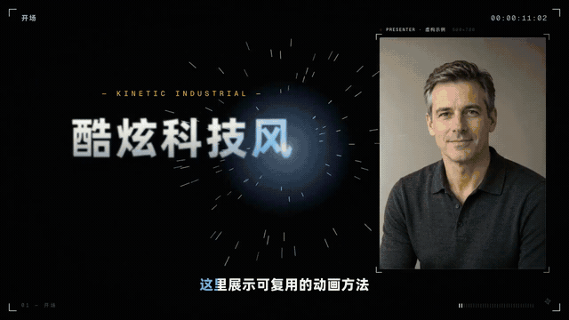</picture></a>

**Presenter-led stories × metallic type × animated explanations.** Bring your recording, copy, screenshots and captions. Editable source, parameters, fonts, sound recipes and a local runner are packaged in OpenMotion Library, ready for your Agent to adapt using the production guide. **1920 × 1080 · 60 fps · landscape.**

[Get the template package](library/templates/presenter-tech/presenter-tech.motion) · [Production guide](library/templates/presenter-tech/TEMPLATE.md) · [MOTION_DESIGN.md](library/templates/presenter-tech/MOTION_DESIGN.md)

<a id="motion-gallery"></a>

### See the work in the catalog

**18 animated picks. Find a style, then make it yours.** Explore launch films, kinetic type, glass and light, spatial motion and generative visuals. Click an animation for the full video; find the same title in Studio’s library to hand it to your agent.

**The resources live here.** Full reference films, before/after videos, GIFs, template source, browser scripts and fonts used by this page and its example guides have local entries. [Resource inventory and reuse](docs/readme/RESOURCES.md).

**A library to learn from, adapt and contribute to.** The current catalog contains **894 resources: 3 bundled editable templates and 891 external references and registry items**, with original authors and sources where available.

<table>
<tr><th colspan="3" align="left">📱 Product & interface</th></tr>
<tr>
<td width="33%" valign="top">
<a href="docs/readme/media/app-showcase.mp4"><picture><source media="(prefers-reduced-motion: reduce)" srcset="web/catalog/covers/51a2d141e18e608cc11b9256.jpg"></picture></a><br>
<strong>App Showcase</strong><br>
<sub>Component · <a href="library/components/showcase/README.md">Hyperframes</a></sub>
</td>
<td width="33%" valign="top">
<a href="docs/readme/media/remix-firecrawl-reference.mp4"><picture><source media="(prefers-reduced-motion: reduce)" srcset="web/catalog/covers/02f9ae975461fe6290062d7f.jpg">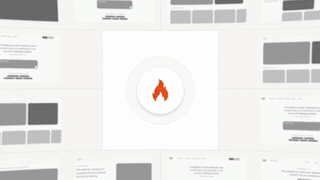</picture></a><br>
<strong>Firecrawl Free Keyless</strong><br>
<sub>Reference · <a href="docs/readme/media/remix-firecrawl-reference.mp4">@ericciarla</a></sub>
</td>
<td width="33%" valign="top">
<a href="library/skills/motion-design-remix/assets/ui-3d-reveal/reference.mp4"><picture><source media="(prefers-reduced-motion: reduce)" srcset="web/catalog/covers/c13d0082838675f088ecadcd.jpg"></picture></a><br>
<strong>3D UI Reveal</strong><br>
<sub>Component · <a href="library/skills/motion-design-remix/references/ui-3d-reveal/MOTION_DESIGN.md">Hyperframes</a></sub>
</td>
</tr>
<tr><th colspan="3" align="left">🚀 Brand & launch films</th></tr>
<tr>
<td width="33%" valign="top">
<a href="docs/readme/media/jake-pond-reference.mp4"><picture><source media="(prefers-reduced-motion: reduce)" srcset="web/catalog/covers/66ac2f8b58e55670971ae70c.jpg"></picture></a><br>
<strong>Pond: a new Linux OS</strong><br>
<sub>Reference · <a href="docs/readme/media/jake-pond-reference.mp4">@bflycomputer</a></sub>
</td>
<td width="33%" valign="top">
<a href="docs/readme/media/remix-kimi-k3-reference.mp4"><picture><source media="(prefers-reduced-motion: reduce)" srcset="web/catalog/covers/ac6e14a0fadb5893534e6438.jpg"></picture></a><br>
<strong>Kimi K3 teaser</strong><br>
<sub>Reference · <a href="docs/readme/media/remix-kimi-k3-reference.mp4">@Kimi_Moonshot</a></sub>
</td>
<td width="33%" valign="top">
<a href="docs/readme/media/remix-elevenlabs-reception-reference.mp4"><picture><source media="(prefers-reduced-motion: reduce)" srcset="web/catalog/covers/bc4b8b4398d66159acd35890.jpg"></picture></a><br>
<strong>Reception by ElevenLabs</strong><br>
<sub>Reference · <a href="docs/readme/media/remix-elevenlabs-reception-reference.mp4">@ElevenLabs</a></sub>
</td>
</tr>
<tr><th colspan="3" align="left">✍️ Kinetic typography</th></tr>
<tr>
<td width="33%" valign="top">
<a href="docs/readme/media/glass-shard-title.mp4"><picture><source media="(prefers-reduced-motion: reduce)" srcset="web/catalog/covers/10cceacc02d415247d58f562.jpg"></picture></a><br>
<strong>Glass Shard Title</strong><br>
<sub>Component · <a href="library/components/showcase/README.md">Hyperframes</a></sub>
</td>
<td width="33%" valign="top">
<a href="library/skills/motion-design-remix/assets/canopy-part-title/reference.mp4"><picture><source media="(prefers-reduced-motion: reduce)" srcset="web/catalog/covers/998dd6bb8358592c15f727d6.jpg"></picture></a><br>
<strong>Canopy Part Title</strong><br>
<sub>Component · <a href="library/skills/motion-design-remix/references/canopy-part-title/MOTION_DESIGN.md">Hyperframes</a></sub>
</td>
<td width="33%" valign="top">
<a href="library/skills/motion-design-remix/assets/wireframe-portal-title/reference.mp4"><picture><source media="(prefers-reduced-motion: reduce)" srcset="web/catalog/covers/4d03231a69d147a38f993578.jpg"></picture></a><br>
<strong>Wireframe Portal Title</strong><br>
<sub>Component · <a href="library/skills/motion-design-remix/references/wireframe-portal-title/MOTION_DESIGN.md">Hyperframes</a></sub>
</td>
</tr>
<tr><th colspan="3" align="left">💎 Light, glass & 3D worlds</th></tr>
<tr>
<td width="33%" valign="top">
<a href="docs/readme/media/remix-iskra-light-reference.mp4"><picture><source media="(prefers-reduced-motion: reduce)" srcset="web/catalog/covers/75cfbe06267768838d145fa4.jpg"></picture></a><br>
<strong>Iskra Light</strong><br>
<sub>Reference · <a href="docs/readme/media/remix-iskra-light-reference.mp4">@world_is_web</a></sub>
</td>
<td width="33%" valign="top">
<a href="library/skills/motion-design-remix/assets/liquid-glass-widgets/reference.mp4"><picture><source media="(prefers-reduced-motion: reduce)" srcset="web/catalog/covers/553a1464d8037293b7debca8.jpg"></picture></a><br>
<strong>Liquid Glass Widgets</strong><br>
<sub>Component · <a href="library/skills/motion-design-remix/references/liquid-glass-widgets/MOTION_DESIGN.md">Hyperframes</a></sub>
</td>
<td width="33%" valign="top">
<a href="docs/readme/media/remix-cyera-reference.mp4"><picture><source media="(prefers-reduced-motion: reduce)" srcset="web/catalog/covers/8884a707a92d0cc52d3363b7.jpg"></picture></a><br>
<strong>Cyera brand video</strong><br>
<sub>Reference · <a href="docs/readme/media/remix-cyera-reference.mp4">Cyera</a></sub>
</td>
</tr>
<tr><th colspan="3" align="left">🧭 Depth & camera motion</th></tr>
<tr>
<td width="33%" valign="top">
<a href="library/skills/motion-design-remix/assets/code-3d-extrude/reference.mp4"><picture><source media="(prefers-reduced-motion: reduce)" srcset="web/catalog/covers/0a5c7158bbecd6e47055bef9.jpg"></picture></a><br>
<strong>Code 3D Extrude</strong><br>
<sub>Component · <a href="library/skills/motion-design-remix/references/code-3d-extrude/MOTION_DESIGN.md">Hyperframes</a></sub>
</td>
<td width="33%" valign="top">
<a href="docs/readme/media/remix-glyph-reference.mp4"><picture><source media="(prefers-reduced-motion: reduce)" srcset="web/catalog/covers/4bfe08db4d486970494eff3b.jpg"></picture></a><br>
<strong>Glyph: GPU typography for the web</strong><br>
<sub>Reference · <a href="docs/readme/media/remix-glyph-reference.mp4">@pmndrs</a></sub>
</td>
<td width="33%" valign="top">
<a href="docs/readme/media/nyc-paris-flight.mp4"><picture><source media="(prefers-reduced-motion: reduce)" srcset="web/catalog/covers/aeafb2433c37f2f7d8c87619.jpg"></picture></a><br>
<strong>NYC Paris Flight</strong><br>
<sub>Component · <a href="library/components/showcase/README.md">Hyperframes</a></sub>
</td>
</tr>
<tr><th colspan="3" align="left">✨ Generative visuals</th></tr>
<tr>
<td width="33%" valign="top">
<a href="docs/readme/media/aurora.mp4"><picture><source media="(prefers-reduced-motion: reduce)" srcset="web/catalog/covers/5aefe7c9a916a38777443b36.jpg"></picture></a><br>
<strong>Aurora</strong><br>
<sub>Component · <a href="library/components/showcase/README.md">Hyperframes</a></sub>
</td>
<td width="33%" valign="top">
<a href="docs/readme/media/remix-linear-loops-reference.mp4"><picture><source media="(prefers-reduced-motion: reduce)" srcset="web/catalog/covers/17cf5075b3f4b49c7d3e9201.jpg"></picture></a><br>
<strong>Linear Loops</strong><br>
<sub>Reference · <a href="docs/readme/media/remix-linear-loops-reference.mp4">@linear</a></sub>
</td>
<td width="33%" valign="top">
<a href="library/skills/motion-design-remix/assets/code-particle-assemble/reference.mp4"><picture><source media="(prefers-reduced-motion: reduce)" srcset="web/catalog/covers/8ff121deb9403f7a99ac52b3.jpg"></picture></a><br>
<strong>Code Particle Assemble</strong><br>
<sub>Component · <a href="library/skills/motion-design-remix/references/code-particle-assemble/MOTION_DESIGN.md">Hyperframes</a></sub>
</td>
</tr>
</table>

Animated excerpts from the catalog’s original videos, preserving their imagery and normal playback speed. These show external references and components, not additional bundled templates. [Sources and excerpt records](docs/readme/ASSETS.md#catalog-preview-grid)

| Explore | What you get |
| --- | --- |
| [Motion resource index](docs/collections/README.md) | Selected films, source attribution and editable starting points. |
| [Bundled templates](template-library/) | Product Promo, NYT Graph and Decision Tree, each with native source and a preview. |
| Studio's template library | Search, previews and instructions for adapting a template or recreating a reference. |
| [OpenDesign Motion showcase](https://open-design.ai/motion/) | More examples to watch and learn from. |
| [Motion MD](docs/motion-md.md) | A way to share the creative decisions behind a style. |

A reference is something to study; an editable template includes source you can change. The gallery's **one-click recreate** action copies a reference and instructions for your agent. Bundled templates open directly; external footage needs analysis and reconstruction. [Catalog coverage and provenance](docs/template-catalog.md)

## Philosophy & architecture

**The Studio is the creative home; the Super Motion Video Agent is the orchestration vision; the timeline and project hold the work.** Multimodal models produce assets, reusable knowledge guides decisions, and the planned feedback loop connects one creation to the next. [Target architecture and status](docs/product/studio-vision.md)

1. **Everyone can edit with AI.** Start from the material and message people already have. Let AI carry out cuts and revisions so more people can keep creating their own work.
2. **People and agents share the work.** Conversation, visual editing and source changes converge on the same editable project.
3. **Make creative knowledge reusable.** Motion MD carries intent, Skills carry methods, and templates carry working implementations.
4. **Keep the work open.** Preserve source, provenance and versions. The Apache 2.0 application can be inspected, adapted and extended.

**Two entry paths converge on one project:** Studio → Connect Agent → your client; or your client → Skills / MCP / CLI → OpenMotion. The connected client runs the agent; the local application owns project state.

**Current production architecture.** The project and timeline hold the work; model results enter it through explicit adoption.

```text
OpenMotion Studio                      Your agent client
media · preview · timeline             Skills · Brandkit · Motion MD
          | HTTP                                | stdio MCP
          +------------------+------------------+
                             v
                  Local application (Node.js)
                  sessions · files · revisions
                             |
                  Editable project + media
                  HTML · CSS · JS · compositions
                             |
                  Fixed revision snapshot
                             |
                  Render + technical checks
                             |
                  MP4 + editable source

MEDIA PATH
  Studio → Model Gateway → multimodal models → candidate files
         → explicit adoption → the same editable project
```

| Layer | Responsibility and technology |
| --- | --- |
| **Creative methods** | The Library supplies Brandkits, design systems and component recipes; five Motion Skills guide direction, template use, recreation, review and delivery; Motion MD records reusable intent. |
| **Standalone app** | React / TypeScript Studio provides sessions, a library, preview, media controls and a timeline. |
| **Agent access** | Local stdio MCP exposes nine project tools and guide resources; shell-capable hosts can call the pinned CLI. |
| **Project & versions** | A Node.js service manages HTML/CSS/JS, media, revisions and content versions, with conflict checks. |
| **Media generation** | Model Gateway manages provider configuration and asset jobs; selected results are adopted into the project. |
| **Render & deliver** | Native compositions and GSAP power motion; fixed snapshots export to MP4 with FFmpeg / FFprobe technical checks. |

### Why the work stays editable

- **Revision-aware changes:** the agent reads the current project and revision before writing; a conflict requires a fresh read instead of applying stale content.
- **Generation and adoption are separate:** models produce candidate files; selecting and adopting a result changes the timeline. Image replacement preserves timing and animation.
- **Exports use fixed snapshots:** rendering and technical checks target a specific project version; the editable source remains available for the next revision.
- **Methods and artifacts stay distinct:** Skills describe methods, Motion MD / Brandkits provide context, and the project stores the result. Planned RAG retrieves relevant knowledge for that work.

[Full architecture](docs/product/architecture.md) · [Projects and versions](docs/project-workspace.md) · [Model gateway](docs/model-gateway.md) · [MCP contract](docs/mcp-phase1-tools.md)

<a id="quick-start"></a>

## 🚀 Quick start

### Run the standalone app

Use Git and **Node.js 26.11.1**, the version pinned in [CI](.github/workflows/ci.yml), with npm. Source-based preview and export also need Chrome/Chromium and FFmpeg/FFprobe; see the [setup guide](docs/usage.md) for runtime paths.

```sh
git clone --branch feature/motion https://github.com/nexu-io/html-anything.git openmotion
cd openmotion
npm ci
npm run build:studio
npm start
```

Open **http://localhost:4173**. Choose **Templates → Ready to edit**, open a bundled example and try changing its text and timing. Use **Connect Agent** to add your preferred client.

Projects and credentials belong outside the checkout; set `MOTION_DATA_DIR` to choose a workspace location. The [local npm installer](docs/npm-installation.md) can prepare pinned native tools on supported targets. The npm package is not publicly published yet. [Windows test packages](docs/test-packages.md) · [Repository and branch guide](docs/repository-migration.md)

<a id="start-in-codex"></a>

### Install for Codex

From the checkout, with a Codex CLI that supports plugins:

```sh
bash scripts/install-motion.command
```

Then ask your agent:

> Use the Product Promo template to create an independent 20-second project. Open it in Studio and deliver an MP4. Keep the editable project so we can revise it next.

For a branded version, add your logo, screenshots and copy. If the host cannot open Studio beside the conversation, use the returned local project link. [Installation and first-demo guide](docs/usage.md#使用)

<a id="use-from-your-agent"></a>

## 🤖 Use OpenMotion inside your agent

**Start in Codex, Claude Code or another compatible client. Bring OpenMotion into that workflow.** Install the creative Skills and connect the local MCP server; use the CLI for shell-based authoring when needed. Ask your agent to create or reopen a project, make the cut, open a preview and export. You can enter Studio at any point to refine the same project.

Skills describe **how to work**; MCP provides **project tools and guides**; the CLI supports **native authoring and rendering**. Both entry directions use the same local application. [Starting from the app instead?](#connect-your-agent)

### Skills — the creative workflow

Discover the local Skills with the [Skills CLI](https://github.com/vercel-labs/skills). From the checkout:

```sh
npx skills add ./skills --list
npx skills add ./skills --skill motion-director motion-production motion-template-to-video motion-recreate motion-video-to-template
```

Select your agent in the installer. Install all five together to preserve their shared references. This installs workflow instructions; connect the app through MCP for project tools and the pinned engine guide. Keep the source checkout available for shared documentation. For an integrated app, MCP and Skills installation, use the [host setup guide](docs/npm-installation.md).

| Skill | Use it for |
| --- | --- |
| [motion-director](skills/motion-director/SKILL.md) | Original films, story, movement, sound direction and creative review. |
| [motion-template-to-video](skills/motion-template-to-video/SKILL.md) | Making a video from an existing editable template. |
| [motion-recreate](skills/motion-recreate/SKILL.md) | Rebuilding a reference as an editable film and comparing the result. |
| [motion-video-to-template](skills/motion-video-to-template/SKILL.md) | Turning a video into a reusable template. |
| [motion-production](skills/motion-production/SKILL.md) | Scoped edits, previews, technical checks, troubleshooting and export. |

### MCP — the shared project

Use **Connect Agent** in the app for workspace-specific configuration, or configure a local stdio client with absolute paths:

```json
{
  "mcpServers": {
    "openmotion": {
      "command": "/absolute/path/to/node",
      "args": ["--experimental-strip-types", "/absolute/openmotion/mcp.ts"],
      "env": { "MOTION_DATA_DIR": "/absolute/openmotion-data" }
    }
  }
}
```

The **nine public tools** cover project creation and reading, editing, preview, media import, export, version restoration and cancellation. Skills and engine guidance are also available as MCP resources. [Tool contract](docs/mcp-phase1-tools.md) · [Per-agent setup](docs/agent-adapters.md)

### CLI — local execution

Use `npm start` for the app and `npm run mcp` for the stdio server. Agents with shell access can also use the bundled, pinned engine CLI for `lint`, `timeline`, `info` and other native commands; use the `hyperframesCli` path returned by the runtime. Managed-project edits go through MCP's version checks. [CLI and native-authoring guide](skills/motion-production/references/native.md)

<a id="for-creators-media--their-agents"></a>

## 📣 For creators, media & their agents

Give this README and the [media fact sheet](docs/media-kit.md) to your agent to make a demo, article, review or launch story. The fact sheet includes reusable copy, image sources, capability status and a reproducible demo route.

```text
Read the OpenMotion README and docs/media-kit.md.
Create a 30-second product introduction and an accompanying article.
Lead with the All-in-One AI-native Studio and “Edit videos with your agent. Everyone can be
a creator.” Introduce our Super Motion Video Agent concept and the planned
publishing → feedback → knowledge → Skill improvement loop. Explain the AI-native
CapCut positioning, centered on the AI-native timeline, and the open-source
Claude Motion reference. Explain both directions: connect your agent in
OpenMotion, or use OpenMotion inside your agent through Skills / MCP / CLI.
Use Input → Process → Output. Show an editing request, the agent’s actual
project changes, and Studio preview and revision. Then show how Motion MD
and templates make editing knowledge reusable. Use the supplied
cover and screenshots, and credit reference creators.
Separate current capabilities from direction. Demonstrate only what
you actually ran. If OpenMotion is connected, deliver an editable
project and MP4; include source links in the article.
```

<a id="status--roadmap"></a>

## 🗺️ Status & roadmap

| Surface | Today |
| --- | --- |
| Standalone Studio, local projects, visual editing and MP4 export | Implemented; validate installation and actual output on your target environment. |
| Super Motion Video Agent, publishing automation and knowledge feedback | Product concept / is coming; persistent orchestration, analytics ingestion and RAG are planned. |
| Agent access | Five core Skills and nine public MCP tools; host capabilities are documented separately. |
| OpenMotion Library | Five collections with first entries, selected and supplied to an agent manually. |
| `MOTION_DESIGN.md` | A v0.1 creative convention; no automatic importer or validator. |

### 🫶 People + agents, creating together — is coming

**An AI-native space for video creation and editing.** People and agents will work together on the same video project, from the first cut to motion design and the final review.

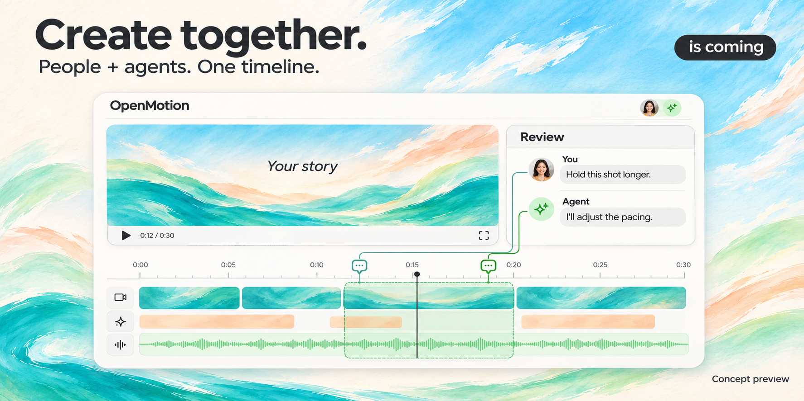

- **Edit together.** Shape the story, cut clips and create motion in one shared project.
- **Comment on the timeline.** Attach feedback to specific moments and ranges, discuss changes with your agent and keep review context beside the work.
- **Review and iterate together.** Turn comments into revisions, review the result and keep refining the same creative workspace.

*is coming · Generated concept preview of a planned collaboration experience; no release date announced.*

Directions to build with the community, without committed release dates:

- [ ] Super Motion Video Agent: persistent creative-task planning, execution and review.
- [ ] Publishing management, recurring production tasks and event-triggered automation.
- [ ] Version-linked performance feedback, personal/team memory, RAG and evaluated Skill improvements.
- [ ] Shared team asset libraries and agent-ready community template installation.
- [ ] Automatic content selection, irrelevant-passage detection and destination-aware reframing.
- [ ] Integrated footage, image, voice, music and Avatar service search.
- [ ] Broader platform-link parsing and media import.
- [ ] More editable templates, motion components, Brandkits and design systems.
- [ ] Library search, previews and explicit import.
- [ ] Compare several video versions from the same brief.
- [ ] Social-format, caption and export presets.
- [ ] Motion Benchmark / Arena with public tasks and evaluation methods.

<a id="stay-tuned"></a>

## ⭐ Stay tuned with us

**Star OpenMotion and help more people discover AI editing.** Keep the project close, follow its progress and bring your next idea to the community.

[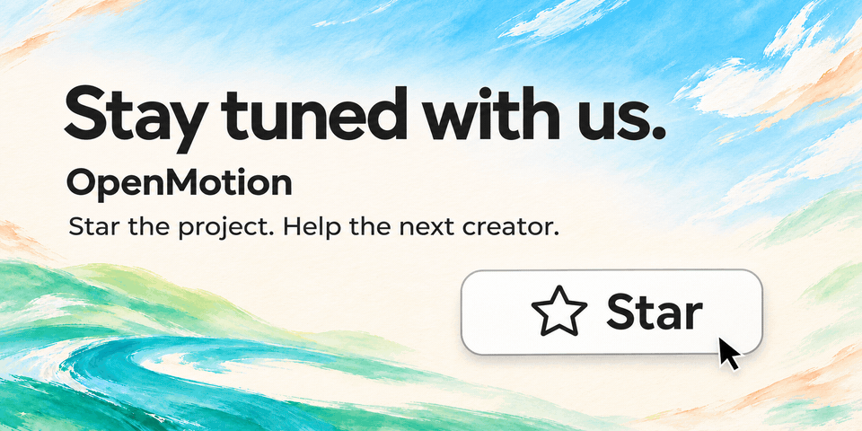](https://github.com/nexu-io/html-anything)

[⭐ Star on GitHub](https://github.com/nexu-io/html-anything) · [Roadmap](#status--roadmap) · [Join the community](#community)

For release notifications, choose **Watch → Custom → Releases** on the repository. [GitHub notification settings](https://docs.github.com/en/subscriptions-and-notifications/get-started/configuring-notifications).

<a id="community"></a>

## 🤝 Community

Share the work and the method behind it. Use [Issues](https://github.com/nexu-io/html-anything/issues) for requests, bugs and reproducible examples, and the [OpenDesign Discord](https://discord.gg/mHAjSMV6gz) to talk with other creators. [Library](library/README.md) · [Documentation](docs/README.md)

### Contribute one folder

| Want to contribute… | Where | A useful first contribution |
| --- | --- | --- |
| **A Skill** | [`library/skills/`](library/skills/) | `SKILL.md`, trigger examples and instructions you actually used. |
| **A template / component** | [`library/templates/`](library/templates/README.md) / [`library/components/`](library/components/README.md) | Source or a recipe, editable choices, preview, attribution and checks. |
| **A design system / Brandkit** | [`library/design-systems/`](library/design-systems/) / [`library/brandkits/`](library/brandkits/) | `MOTION_DESIGN.md` or `BRANDKIT.md`, references, brand facts and asset permissions. |
| **Agent support** | [`shared/integration.ts`](shared/integration.ts) · [Adapter guide](docs/agent-adapters.md) | A focused configuration or host compatibility improvement with validation. |
| **Editor polish** | [`studio/src/motion/`](studio/src/motion/) | One reproducible interaction issue and its fix. |
| **Translations & docs** | This README, [中文](docs/README.zh-CN.md) and the relevant guide | Keep both languages and actual entry points in sync. |

Read [AGENTS.md](AGENTS.md) and [Contributing](CONTRIBUTING.md), pick one scope, and include sources, the actual change and validation in your PR. Agents follow the same process. A reference with a cover is not a verified editable template.

### Contributors

Thank you to everyone contributing code, documentation, Skills, design systems, films and useful feedback. The local avatar snapshot below represents this GitHub repository as of 2026-11-09, including its HTML Anything history.

<p>
<a href="https://github.com/joeylee12629-star"></a>
<a href="https://github.com/pftom"></a>
<a href="https://github.com/wuwangzhang1216"></a>
<a href="https://github.com/TuYv">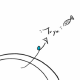</a>
<a href="https://github.com/chasel34"></a>
<a href="https://github.com/C1-BA-B1-F3"></a>
<a href="https://github.com/ttoyekk1a"></a>
<a href="https://github.com/kokiainet"></a>
<a href="https://github.com/fredkwok-it"></a>
<a href="https://github.com/jhinzzz"></a>
<a href="https://github.com/cszhouwei"></a>
<a href="https://github.com/tackcrypto1031"></a>
<a href="https://github.com/fix2015"></a>
<a href="https://github.com/ZhongXiandou"></a>
<a href="https://github.com/PerishCode">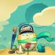</a>
<a href="https://github.com/octo-patch"></a>
<a href="https://github.com/mrcfps"></a>
<a href="https://github.com/Link-990"></a>
<a href="https://github.com/lxyAK"></a>
<a href="https://github.com/GHX5T-SOL"></a>
<a href="https://github.com/FaintFlower"></a>
<a href="https://github.com/chenmofei"></a>
<a href="https://github.com/aaronjmars"></a>
</p>

[All contributors](https://github.com/nexu-io/html-anything/graphs/contributors) · [Start contributing](CONTRIBUTING.md)

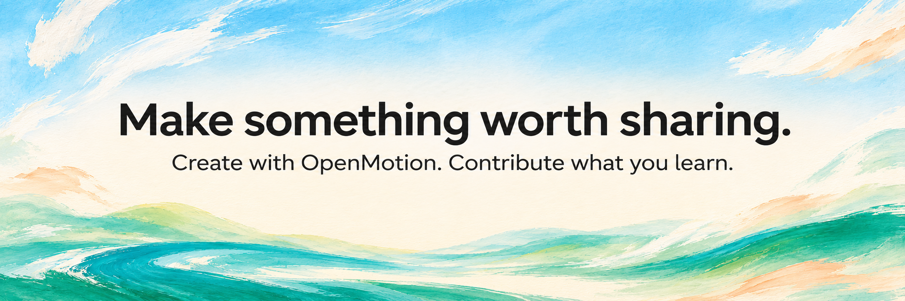

## References & lineage

What informed the product, and where the connection lives in this repository.

| Source | Role here & repository entry |
| --- | --- |
| [OpenDesign](https://github.com/nexu-io/open-design) / [website](https://open-design.ai/) | UI design-system source, resource/contribution structure and painterly brand direction. See [UI provenance](docs/design-system.md), [Brandkit](library/brandkits/openmotion/BRANDKIT.md) and [Library](library/README.md). |
| [Hypit](https://github.com/hypit-ai/hypit) | Reference for content-variant comparisons and the Stay tuned / Star invitation; see [Motion Design examples](docs/motion-design-examples.md). |
| [MotionGit](https://motiongit.com/) / [format](https://motiongit.com/spec) / [source collaboration](https://motiongit.com/git) | Thanks to MotionGit / adunext for Kinetic Tech, now packaged as [Presenter Tech](library/templates/presenter-tech/README.md) in the Library. Original demo attribution, MIT copyright and third-party terms: [NOTICE](library/templates/presenter-tech/NOTICE.md). Its package layering also informs Motion MD; general Studio `.motion` importing is not implemented. |
| [rea-video](https://github.com/JuneYaooo/rea-video) | Reference for shot-by-shot analysis and synchronized original/remake comparisons; no runtime is imported. |
| [HTML Anything](https://github.com/nexu-io/html-anything/tree/legacy) | Repository lineage; a reference for text architecture, contribution paths and attribution tables. Its former `next/` architecture stays on the historical branch; see the [migration guide](docs/repository-migration.md). |
| **Claude Motion / CapCut** | Product references for agent-led video creation and approachable editing; not claims of feature parity or code provenance. |
| [DeepSeek Harness](https://github.com/deepseek-ai/deepseek-harness) / [Super-agent prototype](https://github.com/deepseek-ai/dsh-superagent-prototype) | Reference for extensible agent capabilities and continuing task-oriented work. The Super-agent repository is research code; OpenMotion's proposed [Super Motion Video Agent](docs/product/studio-vision.md#super-motion-video-agent) imports no runtime from it. |
| [OpenChatCut](https://github.com/0xsline/OpenChatCut) | Conceptual reference for a continuously editable project and the AI editing lifecycle. Adapted in [AI editing](#ai-video-editing) and [Input → Process → Output](#input--process--output); this documentation change imports no OpenChatCut code. |
| [ChatCut](https://chatcut.io/docs/what-is-chatcut) | Product inspiration for agent-to-editor work and talking-head / creator scenarios. |
| [Hyperframes](https://github.com/heygen-com/hyperframes) | Thanks for the native composition, Studio, rendering foundations and resources. See [Studio](studio/README.md), [engine notes](docs/hyperframes.md), [template notices](template-library/NOTICE.md) and [catalog provenance](docs/template-catalog.md). |
| [GSAP](https://github.com/greensock/GSAP) / [FFmpeg](https://ffmpeg.org/) | Animation timing and media rendering/checking dependencies; pinned in [package.json](package.json) and the [runtime lock](scripts/runtime-lock.json). |

Original resources retain their authors, sources and terms. Product inspiration, runtime dependencies and third-party works are identified separately.

<a id="license--credits"></a>

## ⚖️ License & credits

OpenMotion is licensed under [Apache-2.0](LICENSE).

Upstream editor, template, font and media licenses and attribution are preserved. See the references above and [asset notes](docs/readme/ASSETS.md).

Active development uses [`feature/motion`](https://github.com/nexu-io/html-anything/tree/feature/motion). The former HTML Anything application remains on `main` and is preserved on [`legacy`](https://github.com/nexu-io/html-anything/tree/legacy). See the [migration guide](docs/repository-migration.md) for branch and distribution status.
