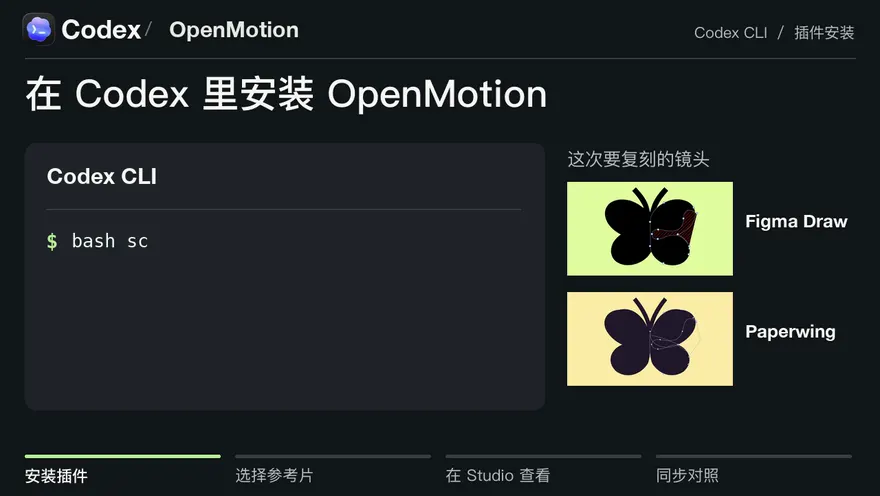

# OpenMotion · 在 Codex 里逆向拆解视频，为自己的品牌复刻动效

把喜欢的科技品牌片链接贴进 Codex，用自己的 Logo、产品截图和文案，复刻它的镜头节奏、文字动画和转场。导出 MP4 后，工程还能接着改。

**[看 5 秒原片与复刻对照](examples/reference-reveal/comparison.mp4)** · **[在 Codex 里试用](docs/README.zh-CN.md#在-codex-里开始)**

<a href="examples/reference-reveal/comparison.mp4"><picture>
  <source media="(prefers-reduced-motion: reduce)" srcset="docs/readme/codex-comparison.zh-CN.jpg" />
  
</picture></a>

Codex 会话示意 · [Firecrawl 原片作者 @ericciarla](https://x.com/ericciarla/status/2093375835679977570) · [OpenMotion 分镜拆解](examples/reference-reveal/MOTION.zh-CN.md)

[阅读完整中文 README](docs/README.zh-CN.md) · [原 HTML Anything 编辑器与安装说明](https://github.com/nexu-io/html-anything/blob/legacy/README.zh-CN.md) · [English](README.md)
