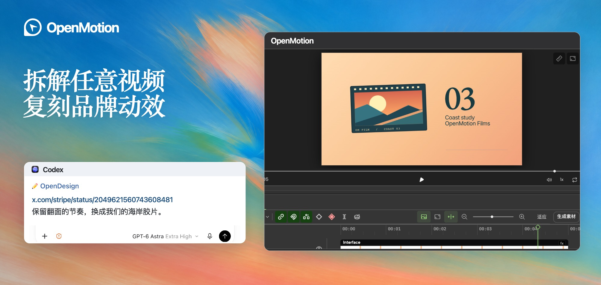
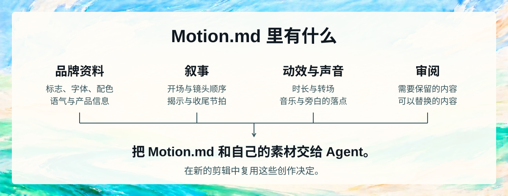

<p align="center"></p>

<p align="center"><strong>拆解并复刻任何视频</strong></p>

<p align="center">
  <a href="docs/readme/media/presenter-caption-remake.mp4"><picture><source media="(max-width: 600px)" srcset="docs/readme/brand-hero.mobile.zh-CN.jpg"></picture></a>
</p>

<p align="center">
  <a href="https://github.com/nexu-io/html-anything"></a>
  <a href="package.json"></a>
  <a href="LICENSE"></a>
  <a href="https://github.com/nexu-io/open-design"></a>
</p>

<p align="center">
  <a href="https://open-design.ai/motion/?utm_source=github&amp;utm_medium=referral&amp;utm_campaign=openmotion&amp;utm_content=readme_zh"></a>
  <a href="https://go.open-design.ai/?utm_source=github&amp;utm_medium=referral&amp;utm_campaign=openmotion&amp;utm_content=readme_zh"></a>
  <a href="https://discord.gg/mHAjSMV6gz"></a>
  <a href="https://x.com/OpenDesignHQ"></a>
  <a href="https://x.com/OpenDesignDevs"></a>
  <a href="https://www.youtube.com/channel/UChtshixMhvtgBWzoD9R_Qfg"></a>
</p>

<p align="center"><a href="#agent-wall">支持的 Agent</a> · <a href="#showcase">使用场景与复刻效果示例</a> · <a href="#features">为什么选择 OpenMotion</a> · <a href="#technical-guide">安装与技术文档</a> · <a href="#community">社区与贡献</a></p>

<div align="center">

[English](README.md) · **简体中文** · [日本語](docs/README.ja.md)

</div>

# OpenMotion

OpenMotion 是 **首个全栈 Agentic 视频生成器**。上传参考视频或粘贴社交平台上的视频链接，就能**用自己的品牌视觉规范（Logo、配色、字体等）和文案复刻原片**。

- 🎬 **全栈视频复刻。** Agent 拆解参考片，用 HTML 重建镜头和转场，并生成缺少的素材。你可以在同一工程里用 Studio 调整剪辑节奏，再渲染导出 MP4。
- 🔑 **BYOA（自带 Agent）与 BYOK（自带 API 密钥）。** OpenMotion 开源免费。直接在[常用的本地 Agent](#agent-wall) 里复刻视频，每一层都能用自己的 API 密钥。
- 🧩 OpenMotion 首次定义了 **Motion.md**，用 Markdown 记录镜头顺序、时长和转场。品牌宣传片的拆解可以随工程一起分享。
- 🎛️ **图片、视频、音乐和语音。** 用 Nano Banana 2 生成图片、Seedance 2.0 补镜头、Suno v4 配乐、Kokoro 加旁白，再放进同一条时间轴。[查看 7 个内置模型](#model-wall)

<a id="agent-wall"></a>

**22 个本地 Agent** · [选择你的 Agent](#choose-agent)

<p align="center"><a href="#choose-agent"><picture><source media="(max-width: 600px)" srcset="docs/readme/agents/local-agents.mobile.png"></picture></a></p>

<a id="showcase"></a> <a id="用-openmotion-可以做什么"></a>
<a id="使用场景与复刻效果示例"></a>

## 🎞️ 使用场景与复刻效果示例

<a id="可以用它做什么"></a> <a id="what-can-you-make"></a>

<a id="everyone-can-be-a-creator"></a> <a id="everyone-can-be-an-ai-video-editor-everyone-can-be-a-creator"></a> <a id="人人都是自媒体"></a> <a id="creator-video-gallery"></a> <a id="presenter-motion"></a>

### AI 口播剪辑

围绕出镜人的讲述剪辑，让字幕和屏幕演示跟上讲解节奏。

<table width="100%">
<tr><th colspan="3" align="left">🎓 教学与讲解</th></tr>
<tr>
<td width="33%" valign="top" align="center">
<a href="library/skills/presenter-story/assets/careerwithriya-reference.mp4"><picture><source media="(prefers-reduced-motion: reduce)" srcset="docs/readme/people/careerwithriya.jpg"></picture></a><br>
<strong>改变职业生涯的 6 项关键技能</strong><br>
编号要点 + 动态关键词<br>
<sub>参考 · <a href="https://www.instagram.com/reel/Ddd57MBszhc/">@careerwithriya</a></sub>
</td>
<td width="33%" valign="top" align="center">
<a href="docs/readme/media/dan-martell-tools-reference.mp4"><picture><source media="(prefers-reduced-motion: reduce)" srcset="docs/readme/people/dan-martell-tools.jpg"></picture></a><br>
<strong>现在最好的 AI 工具是什么？</strong><br>
出镜讲解 + 悬浮工具卡片<br>
<sub>参考 · <a href="https://www.youtube.com/shorts/mk1zJd9Rm4c">Dan Martell</a></sub>
</td>
<td width="33%" valign="top" align="center">
<a href="docs/readme/media/harpercarrollai-reference.mp4"><picture><source media="(prefers-reduced-motion: reduce)" srcset="docs/readme/people/harpercarrollai.jpg"></picture></a><br>
<strong>10 天 AI 基础，第 1 天</strong><br>
个人讲解 + 清晰字幕<br>
<sub>参考 · <a href="https://www.instagram.com/reel/C4eNPF3PdpG/">@harpercarrollai</a></sub>
</td>
</tr>
<tr><th colspan="3" align="left">🖥️ 展示工作流</th></tr>
<tr>
<td width="33%" valign="top" align="center">
<a href="library/skills/presenter-story/assets/ali-abdaal-workflow-reference.mp4"><picture><source media="(prefers-reduced-motion: reduce)" srcset="docs/readme/people/ali-abdaal-workflow.jpg"></picture></a><br>
<strong>我每天使用的 5 个工具</strong><br>
桌边讲述 + 工作流插画面<br>
<sub>参考 · Ali Abdaal</sub>
</td>
<td width="33%" valign="top" align="center">
<a href="library/skills/presenter-story/assets/john-tagudin-capso-reference.mp4"><picture><source media="(prefers-reduced-motion: reduce)" srcset="docs/readme/people/john-tagudin-capso.jpg"></picture></a><br>
<strong>带重点标注的工具演示</strong><br>
真人 + 屏幕 + 标注<br>
<sub>参考 · <a href="https://www.tiktok.com/@john.tagudin/video/7524883942328126728">@john.tagudin</a></sub>
</td>
<td width="33%" valign="top" align="center">
<a href="docs/readme/media/aiwithsachi-reference.mp4"><picture><source media="(prefers-reduced-motion: reduce)" srcset="docs/readme/people/aiwithsachi.jpg"></picture></a><br>
<strong>值得安装的 5 个 Claude 插件</strong><br>
口述清单 + 说明截图<br>
<sub>参考 · <a href="https://www.instagram.com/reel/Dc7G9Pxu_1O/">@aiwithsachi</a></sub>
</td>
</tr>
<tr><th colspan="3" align="left">🎬 讲故事，展示产品</th></tr>
<tr>
<td width="33%" valign="top" align="center">
<a href="docs/readme/media/khris-sheer-founder-reference.mp4"><picture><source media="(prefers-reduced-motion: reduce)" srcset="docs/readme/people/khris-sheer-founder.jpg"></picture></a><br>
<strong>创始人实验，第 1 集</strong><br>
创始人日记 + 日常补充镜头<br>
<sub>参考 · <a href="https://www.tiktok.com/@khris.sheer/video/7491715587895430402">@khris.sheer</a></sub>
</td>
<td width="33%" valign="top" align="center">
<a href="docs/readme/media/ugc-rachelll-reference.mp4"><picture><source media="(prefers-reduced-motion: reduce)" srcset="docs/readme/people/ugc-rachelll.jpg"></picture></a><br>
<strong>AI 创作者与产品</strong><br>
产品故事 + 证据 + 画中画<br>
<sub>参考 · <a href="https://www.tiktok.com/@ugc.rachelll/video/7616996050066345246">@ugc.rachelll</a></sub>
</td>
<td width="33%" valign="top" align="center">
<a href="docs/readme/media/kevinstratvert-reference.mp4"><picture><source media="(prefers-reduced-motion: reduce)" srcset="docs/readme/people/kevinstratvert.jpg"></picture></a><br>
<strong>别再为 5 个 AI 工具付费</strong><br>
产品教程 + 实际演示<br>
<sub>参考 · <a href="https://www.youtube.com/shorts/1fA5j5_5TRY">Kevin Stratvert</a></sub>
</td>
</tr>
<tr><th colspan="3" align="left">原片 → 外部改编</th></tr>
<tr>
<td colspan="1" width="33%" align="center" valign="top">
<a href="library/skills/presenter-story/assets/careerwithriya-result.mp4"><picture><source media="(prefers-reduced-motion: reduce)" srcset="docs/readme/people/careerwithriya-comparison.jpg"></picture></a><br>
<strong>职业建议 → 视频制作讲解</strong><br>
换一位出镜人，用编号和例证卡串起新的讲解内容。<br>
<sub><a href="library/skills/presenter-story/references/presenter-listicle/MOTION_DESIGN.md">Motion.md</a> · <a href="library/skills/presenter-story/SKILL.md">Skill</a> · <a href="library/skills/presenter-story/assets/careerwithriya-reference.mp4">原片</a> · <a href="library/skills/presenter-story/assets/careerwithriya-result.mp4">完整改编</a></sub>
</td>
<td colspan="1" width="33%" align="center" valign="top">
<a href="library/skills/presenter-story/assets/ali-abdaal-workflow-result.mp4"><picture><source media="(prefers-reduced-motion: reduce)" srcset="docs/readme/people/ali-abdaal-workflow-comparison.jpg"></picture></a><br>
<strong>日常工具 → 设计工作空间的故事</strong><br>
沿用真人与屏幕交替的节奏，演示另一套工作流。<br>
<sub><a href="library/skills/presenter-story/references/workflow-demo/MOTION_DESIGN.md">Motion.md</a> · <a href="library/skills/presenter-story/SKILL.md">Skill</a> · <a href="library/skills/presenter-story/assets/ali-abdaal-workflow-reference.mp4">原片</a> · <a href="library/skills/presenter-story/assets/ali-abdaal-workflow-result.mp4">完整改编</a></sub>
</td>
<td colspan="1" width="33%" align="center" valign="top">
<a href="library/skills/presenter-story/assets/john-tagudin-capso-result.mp4"><picture><source media="(prefers-reduced-motion: reduce)" srcset="docs/readme/people/john-tagudin-capso-comparison.jpg"></picture></a><br>
<strong>工具演示 → 视频编辑器导览</strong><br>
沿用画中画和标注，把工具演示改成视频剪辑教程。<br>
<sub><a href="library/skills/presenter-story/references/product-walkthrough/MOTION_DESIGN.md">Motion.md</a> · <a href="library/skills/presenter-story/SKILL.md">Skill</a> · <a href="library/skills/presenter-story/assets/john-tagudin-capso-reference.mp4">原片</a> · <a href="library/skills/presenter-story/assets/john-tagudin-capso-result.mp4">完整改编</a></sub>
</td>
</tr>
</table>

### AI 重剪与改稿

把零散的照片和视频剪成一个有起承转合的故事。

<table width="100%">
<tr>
<td colspan="1" width="100%" align="center" valign="top">
<a href="docs/readme/media/hundred-days-story-reference.mp4"><picture>
<source media="(prefers-reduced-motion: reduce)" srcset="docs/readme/examples/story-recut.jpg">

</picture></a><br>
<strong>用照片讲述 100 天</strong><br>
用贴纸和照片卡标记时间，把生活片段串成一支日记短片。<br>
<sub><a href="https://www.instagram.com/reel/Dd6vHlQgpok/">原片</a></sub>
</td>
</tr>
</table>

<a id="brand-before-after"></a> <a id="brand-film-gallery"></a>

### 产品发布与演示

围绕产品第一次亮相的瞬间，安排镜头和转场。

五秒对照中，左边是原片，右边是 OpenMotion 复刻；手机上是上方原片、下方复刻。

<table width="100%">
<tr>
<td colspan="2" width="100%" align="center" valign="top">
<div id="case-stripe"><a href="examples/brand-studies/stripe/comparison.mp4"><picture><source media="(max-width: 600px) and (prefers-reduced-motion: no-preference)" srcset="examples/brand-studies/stripe/comparison.mobile.webp"><source media="(prefers-reduced-motion: reduce)" srcset="examples/brand-studies/stripe/comparison.jpg"></picture></a></div><br>
<strong>Stripe · 银行卡翻转 → 海岸胶片</strong><br>
沿用 Stripe 的卡片翻转节奏，把落点换成一帧电影插画。<br>
<sub><a href="examples/brand-studies/stripe/comparison.mp4">横屏大图</a> · <a href="examples/brand-studies/stripe/comparison.mobile.mp4">竖屏 MP4</a> · <a href="https://x.com/stripe/status/2049621560743608481">原片 00:21.50–00:26.50</a> · <a href="examples/brand-studies/stripe/index.html">HTML</a> · <a href="examples/brand-studies/stripe/MOTION.md">Motion.md</a></sub>
</td>
</tr>
<tr><th colspan="2" align="left">参考原片</th></tr>
<tr>
<td width="50%" valign="top">
<a href="docs/readme/media/remix-kimi-k3-reference.mp4"><picture><source media="(prefers-reduced-motion: reduce)" srcset="web/catalog/covers/ac6e14a0fadb5893534e6438.jpg"></picture></a><br>
<strong>Kimi · K3 teaser</strong><br>
把下一次发布浓缩成简短、难忘的预告。<br>
<sub>参考 · @Kimi_Moonshot</sub>
</td>
<td width="50%" valign="top">
<a href="docs/readme/media/remix-elevenlabs-reception-reference.mp4"><picture><source media="(prefers-reduced-motion: reduce)" srcset="web/catalog/covers/bc4b8b4398d66159acd35890.jpg"></picture></a><br>
<strong>ElevenLabs · Reception</strong><br>
用聚焦的发布故事介绍新产品。<br>
<sub>参考 · @ElevenLabs</sub>
</td>
</tr>
<tr>
<td width="50%" valign="top" align="center">
<a href="docs/readme/brand-showcase/rea-unboxing.mp4"><picture><source media="(prefers-reduced-motion: reduce)" srcset="docs/readme/brand-showcase/rea-unboxing.jpg"></picture></a><br>
<strong>真实产品，有触感的故事</strong><br>
研究特写、手部动作和揭示方式，拍摄自己的产品。<br>
<sub>实拍 · 产品开箱</sub>
</td>
<td width="50%" valign="top" align="center">
<a href="docs/readme/brand-showcase/rea-dual-role.mp4"><picture><source media="(prefers-reduced-motion: reduce)" srcset="docs/readme/brand-showcase/rea-dual-role.jpg"></picture></a><br>
<strong>角色与界面相遇</strong><br>
把角色驱动的开头与界面动效、屏幕录制组合起来。<br>
<sub>AI 角色 + 代码 + 屏幕录制</sub>
</td>
</tr>
</table>

<a id="see-the-motion-survive-a-new-brand"></a>

### 热门视频复刻

沿用参考片的剪辑节奏，用自己的画面和文案重做同一段。

<table width="100%">
<tr>
<td colspan="2" width="100%" align="center" valign="top">
<div id="case-openai"><a href="examples/motion-studies/comparison.mp4"><picture><source media="(max-width: 600px) and (prefers-reduced-motion: no-preference)" srcset="examples/motion-studies/comparison.mobile.webp"><source media="(prefers-reduced-motion: reduce)" srcset="examples/motion-studies/comparison.jpg"></picture></a></div><br>
<strong>OpenAI · 线框节点 → 剪辑轨道</strong><br>
五段彩色剪辑轨道收成一个切点，沿用原片切底、出字、落标的三拍。<br>
<sub><a href="examples/motion-studies/comparison.mp4">横屏大图</a> · <a href="examples/motion-studies/comparison.mobile.mp4">竖屏 MP4</a> · <a href="https://x.com/OpenAI/status/2084352161404920316">原片 00:26.50–00:31.50</a> · <a href="examples/motion-studies/signoff.html">HTML</a></sub>
</td>
</tr>
<tr>
<td colspan="2" width="100%" align="center" valign="top">
<div id="case-deepseek"><a href="examples/brand-studies/deepseek/comparison.mp4"><picture><source media="(max-width: 600px) and (prefers-reduced-motion: no-preference)" srcset="examples/brand-studies/deepseek/comparison.mobile.webp"><source media="(prefers-reduced-motion: reduce)" srcset="examples/brand-studies/deepseek/comparison.jpg"></picture></a></div><br>
<strong>DeepSeek Harness · 终端打字 → 片场打板</strong><br>
光标改在片场打板上逐字输入，最后一键和片尾之间保留停顿与闪切。<br>
<sub><a href="examples/brand-studies/deepseek/comparison.mp4">横屏大图</a> · <a href="examples/brand-studies/deepseek/comparison.mobile.mp4">竖屏 MP4</a> · <a href="https://x.com/DeepSeekHarness/status/2117256196227019194">原片 01:31.50–01:36.50</a> · <a href="examples/brand-studies/deepseek/index.html">HTML</a></sub>
</td>
</tr>
<tr><th colspan="2" align="left">可编辑动效 · 同一工程的原版与改编</th></tr>
<tr>
<td colspan="1" width="50%" align="center" valign="top">
<a href="library/skills/motion-design-remix/previews/wireframe-portal-title.mp4"><picture><source media="(prefers-reduced-motion: reduce)" srcset="library/skills/motion-design-remix/previews/wireframe-portal-title.jpg"></picture></a><br>
<strong>线框传送门 · BREAKTHROUGH → OPENMOTION</strong><br>
保留：传送门时序、立体字和镜头推进。 替换：标题、副标题和三维短语。<br>
<sub><a href="library/skills/motion-design-remix/references/wireframe-portal-title/MOTION_DESIGN.md">Motion.md</a> · <a href="library/skills/motion-design-remix/SKILL.md">Skill</a> · <a href="library/skills/motion-design-remix/presets/wireframe-portal-title.json">内容预设</a> · <a href="library/skills/motion-design-remix/previews/wireframe-portal-title.mp4">MP4</a></sub>
</td>
<td colspan="1" width="50%" align="center" valign="top">
<a href="library/skills/motion-design-remix/previews/canopy-part-title.mp4"><picture><source media="(prefers-reduced-motion: reduce)" srcset="library/skills/motion-design-remix/previews/canopy-part-title.jpg"></picture></a><br>
<strong>树冠字体 · Understory → OpenMotion</strong><br>
保留：叶片扫过、纵深、遮挡和阅读停留。 替换：两条品牌标题。<br>
<sub><a href="library/skills/motion-design-remix/references/canopy-part-title/MOTION_DESIGN.md">Motion.md</a> · <a href="library/skills/motion-design-remix/SKILL.md">Skill</a> · <a href="library/skills/motion-design-remix/presets/canopy-part-title.json">内容预设</a> · <a href="library/skills/motion-design-remix/previews/canopy-part-title.mp4">MP4</a></sub>
</td>
</tr>
<tr>
<td colspan="1" width="50%" align="center" valign="top">
<a href="library/skills/motion-design-remix/previews/ui-3d-reveal.mp4"><picture><source media="(prefers-reduced-motion: reduce)" srcset="library/skills/motion-design-remix/previews/ui-3d-reveal.jpg"></picture></a><br>
<strong>界面揭示 · 产品导览 → AI 剪辑故事</strong><br>
保留：倾斜画布、纵深层级和连续镜头。 替换：主标题、文档和社区文案。<br>
<sub><a href="library/skills/motion-design-remix/references/ui-3d-reveal/MOTION_DESIGN.md">Motion.md</a> · <a href="library/skills/motion-design-remix/SKILL.md">Skill</a> · <a href="library/skills/motion-design-remix/presets/ui-3d-reveal.json">内容预设</a> · <a href="library/skills/motion-design-remix/previews/ui-3d-reveal.mp4">MP4</a></sub>
</td>
<td colspan="1" width="50%" align="center" valign="top">
<a href="library/skills/motion-design-remix/previews/code-3d-extrude.mp4"><picture><source media="(prefers-reduced-motion: reduce)" srcset="library/skills/motion-design-remix/previews/code-3d-extrude.jpg"></picture></a><br>
<strong>立体代码 · loadConfig() → cutVideo()</strong><br>
保留：挤出板层、语法配色和镜头运动。 替换：函数、变量和展示的调用。<br>
<sub><a href="library/skills/motion-design-remix/references/code-3d-extrude/MOTION_DESIGN.md">Motion.md</a> · <a href="library/skills/motion-design-remix/SKILL.md">Skill</a> · <a href="library/skills/motion-design-remix/presets/code-3d-extrude.json">内容预设</a> · <a href="library/skills/motion-design-remix/previews/code-3d-extrude.mp4">MP4</a></sub>
</td>
</tr>
<tr>
<td colspan="1" width="50%" align="center" valign="top">
<a href="library/skills/motion-design-remix/previews/code-particle-assemble.mp4"><picture><source media="(prefers-reduced-motion: reduce)" srcset="library/skills/motion-design-remix/previews/code-particle-assemble.jpg"></picture></a><br>
<strong>粒子组装 · parse / optimize / emit → select / trim / render</strong><br>
保留：固定种子的粒子运动和组装节奏。 替换：流程名称与步骤。<br>
<sub><a href="library/skills/motion-design-remix/references/code-particle-assemble/MOTION_DESIGN.md">Motion.md</a> · <a href="library/skills/motion-design-remix/SKILL.md">Skill</a> · <a href="library/skills/motion-design-remix/presets/code-particle-assemble.json">内容预设</a> · <a href="library/skills/motion-design-remix/previews/code-particle-assemble.mp4">MP4</a></sub>
</td>
<td colspan="1" width="50%" align="center" valign="top">
<a href="library/skills/motion-design-remix/previews/liquid-glass-widgets.mp4"><picture><source media="(prefers-reduced-motion: reduce)" srcset="library/skills/motion-design-remix/previews/liquid-glass-widgets.jpg"></picture></a><br>
<strong>玻璃信息卡 · 设备组件 → 创作者工作区</strong><br>
保留：玻璃质感、卡片层级、错峰入场与仪表。 替换：标签、单位和功能叙事。<br>
<sub><a href="library/skills/motion-design-remix/references/liquid-glass-widgets/MOTION_DESIGN.md">Motion.md</a> · <a href="library/skills/motion-design-remix/SKILL.md">Skill</a> · <a href="library/skills/motion-design-remix/presets/liquid-glass-widgets.json">内容预设</a> · <a href="library/skills/motion-design-remix/previews/liquid-glass-widgets.mp4">MP4</a></sub>
</td>
</tr>
</table>

### 讲解与教程

用局部特写和标注，让观众在每一步都知道该看哪里。

<table width="100%">
<tr>
<td colspan="2" width="100%" align="center" valign="top">
<div id="case-claude"><a href="examples/brand-studies/anthropic/comparison.mp4"><picture><source media="(max-width: 600px) and (prefers-reduced-motion: no-preference)" srcset="examples/brand-studies/anthropic/comparison.mobile.webp"><source media="(prefers-reduced-motion: reduce)" srcset="examples/brand-studies/anthropic/comparison.jpg"></picture></a></div><br>
<strong>Claude · 设置面板 → 品牌调色板</strong><br>
沿用开关和手绘圆圈的节奏，把原来的设置界面换成选色面板。<br>
<sub><a href="examples/brand-studies/anthropic/comparison.mp4">横屏大图</a> · <a href="examples/brand-studies/anthropic/comparison.mobile.mp4">竖屏 MP4</a> · <a href="https://x.com/ClaudeDevs/status/2091953609185657251">原片 00:00–00:05</a> · <a href="examples/brand-studies/anthropic/index.html">HTML</a></sub>
</td>
</tr>
</table>

### 数据故事与图表

让观众跟着图表的变化，看清不同数值之间的差距。

<table width="100%">
<tr>
<td colspan="1" width="100%" align="center" valign="top">
<a href="docs/readme/media/M1128-clip.mp4"><picture>
<source media="(prefers-reduced-motion: reduce)" srcset="docs/readme/examples/data-story.jpg">

</picture></a><br>
<strong>动态对比柱形图</strong><br>
柱形高度变化时，数值始终清晰可读。<br>
<sub><a href="https://x.com/Vintage_god/status/2106817967967056165">原片</a></sub>
</td>
</tr>
</table>

### 音乐与艺术视觉

为一段音乐设计一个随节拍反复出现的视觉主题。

<table width="100%">
<tr>
<td colspan="2" width="100%" align="center" valign="top">
<div id="case-kimi"><a href="examples/brand-studies/kimi/comparison.mp4"><picture><source media="(max-width: 600px) and (prefers-reduced-motion: no-preference)" srcset="examples/brand-studies/kimi/comparison.mobile.webp"><source media="(prefers-reduced-motion: reduce)" srcset="examples/brand-studies/kimi/comparison.jpg"></picture></a></div><br>
<strong>Kimi · 磁力线 → 黑胶唱片</strong><br>
旋转的磁场变成唱片纹路，片名落在唱片封套上。<br>
<sub><a href="examples/brand-studies/kimi/comparison.mp4">横屏大图</a> · <a href="examples/brand-studies/kimi/comparison.mobile.mp4">竖屏 MP4</a> · <a href="https://x.com/Kimi_Moonshot/status/2077521842080817296">原片 00:30.75–00:35.75</a> · <a href="examples/brand-studies/kimi/index.html">HTML</a></sub>
</td>
</tr>
</table>

[获取七个场景的 Agent 提示词](docs/examples.zh-CN.md)

<a id="features"></a>
<a id="为什么选择-openmotion"></a>

## ✨ 为什么选择 OpenMotion

<a id="what-is-openmotion"></a> <a id="openmotion-是什么"></a> <a id="video-is-code"></a>

### 1. 首个全栈 Agentic 视频生成器

**用 HTML 写视频。** OpenMotion 用 HTML、CSS、JavaScript 描述场景、字体、布局、转场和时间。实拍、生成片段、图片、音乐和旁白作为合成素材，同一工程可在 Studio 打开并渲染为 MP4。


**编写、观看、修改、渲染。** 让 Agent 替换产品、精简开头、加入真人、修改字幕或尝试新结尾。它修改工程源码，你在可视化编辑器中审阅。本地 MCP 客户端使用工程工具，具备 shell 的 Agent 还可遵循 Skills 和固定版本 CLI 工作流。[Agent 配置](#agent-setup) · [原生合成指南](skills/motion-production/references/native.md) · [HTML 示例工程](template-library/product-promo/index.html)

#### 在 Studio 里可以改什么

| Studio 中 | 当前可以做什么 |
| --- | --- |
| **故事与时间轴** | 导入、排列素材，让 Agent 按脚本或确认的时间码精简、重排和改稿 |
| **动效与字幕** | 围绕内容编写动态文字、转场、标注、图表和字幕 |
| **素材与声音** | 导入素材，通过内置模型集成生成图片、视频、音乐和 TTS 旁白 |
| **图片修改** | 用支持参考图的模型生成候选，采用替换时保留时间和动画 |
| **预览与版本** | 在 Studio 审阅，手动或让 Agent 修改，保留工程供后续迭代 |
| **导出与源码** | 将固定版本渲染为 MP4，保留 HTML、CSS、JavaScript 和素材 |

> “保留已确认的揭示效果。中间场景换成这段屏幕录制，按这些时间码精简开头，最后的 CTA 多停留两秒。”

[工程与版本](docs/project-workspace.md)

<a id="分享可编辑的复刻工程"></a>

#### 从参考片到可编辑的复刻工程

1. **拆解参考片。** 选一段想复刻的镜头，用 Motion.md 记下镜头顺序、转场和声音落点，标出要换成自己品牌的部分。
2. **重建镜头。** Agent 按你的品牌视觉规范，结合文案和产品画面重建 HTML 场景，在 Studio 里排成一条可编辑的时间轴。
3. **对照审片。** 在同一时间点比较原片与复刻结果，微调镜头时长、动作和声音，再播放整段确认节奏。
4. **导出和分享。** 渲染 MP4，保留 HTML 源码和素材。要让其他人改编，可以把 Motion.md、预览和可分享的素材随工程一起提交。[工程提交清单](library/ENTRY_TEMPLATE.md)

<a id="bring-your-agent-and-keys"></a>

### 2. 完全开源免费，在本地 Agent 直接用，每一层都支持 BYOK

<a id="choose-agent"></a>

**选择你的 Agent。** WorkBuddy、Codex、Claude Code 和 DeepSeek Harness 可直接查看安装步骤。其他按钮打开通用的 MCP 和 CLI 接入说明。

<p>
  <a href="#workbuddy-setup"></a>
  <a href="#agent-setup"></a>
  <a href="#claude-setup"></a>
  <a href="#local-agent-connection"></a>
  <a href="#local-agent-connection"></a>
  <a href="#local-agent-connection"></a>
  <a href="#local-agent-connection"></a>
  <a href="#local-agent-connection"></a>
  <a href="#local-agent-connection"></a>
  <a href="#local-agent-connection"></a>
  <a href="#local-agent-connection"></a>
  <a href="#local-agent-connection"></a>
  <a href="#local-agent-connection"></a>
  <a href="#local-agent-connection"></a>
  <a href="#local-agent-connection"></a>
  <a href="#local-agent-connection"></a>
  <a href="#local-agent-connection"></a>
  <a href="#deepseek-setup"></a>
  <a href="#local-agent-connection"></a>
  <a href="#local-agent-connection"></a>
  <a href="#local-agent-connection"></a>
  <a href="#local-agent-connection"></a>
</p>

| 自带什么 | 如何用于视频 |
| --- | --- |
| **🤖 Agent — BYOA** | 通过 Skills 和 MCP 连接现有本地 Agent，受支持时也可使用 CLI。保留惯用客户端、账号和工作上下文。 |
| **🔑 Key — BYOK** | 在 Model Settings 配置受支持的媒体 API 密钥，选择图片、视频、音乐和 TTS 模型；受支持的本地媒体集成可使用已有 Agent 登录。 |
| **🎨 品牌与素材** | 加入标志、字体、截图、实拍、脚本和音乐，在 Motion.md 的 Brand Kit 章节记录品牌信息和获准使用的素材。 |
| **🧩 起步资源** | 浏览参考、动效组件、模板和社区 Skills，选择方向，把源码或参考交给 Agent，做成自己的作品。 |

**OpenMotion 创作流程全部开源：Skills、工程工具、模型集成、Studio 和渲染。** 本地运行、检查实现、按需扩展。这条本地工作流不收软件订阅或单次渲染费，也可以只用自己的视频、图片和声音，不调用生成 API。

供应商凭据保存在工作区配置中。Agent 订阅和第三方模型调用按各自的规则计费。 [各 Agent 接入方式与验证状态](docs/agent-adapters.md)

<a id="make-your-motion-language-reusable"></a> <a id="motion-design-community"></a>

### 3. 100 多份品牌宣传片 Motion.md + 890 多项创作资源

OpenMotion 首次定义了 **Motion.md**。首批开源的品牌宣传片拆解用 Markdown 记录镜头顺序、时长、转场，以及哪些素材可以换成自己的。[Stripe 示例](examples/brand-studies/stripe/MOTION.md) 记录了翻面的时机：把支付卡换成胶片画框，动作仍然落在同一拍。

Brand Kit 章节收录 Logo、配色、字体、语气和已确认的产品信息。叙事、动效、声音和审阅规则说明换品牌时要保留哪些创作决定。开新片时，把这份文件和自己的素材一起交给 Agent。



<a id="resources-to-start-from"></a>

#### 编写 Motion.md 时可用的资源

选镜头、找转场时，可以从 **42 支完整参考片和 393 段动效**里找灵感。要用 HTML 搭建画面，Studio 资源库还收录了 **210 个区块、238 个组件和 8 个代码示例**。

| 创作时需要什么 | 可用资源 |
| --- | --- |
| 让 Agent 按一套方法制作视频 | [五个核心制作 Skills](docs/skills.md)涵盖导演、复刻、模板改编、模板制作和剪辑导出。[动效改编 Skill](library/skills/motion-design-remix/SKILL.md) 附六个可编辑示例，[真人讲述 Skill](library/skills/presenter-story/SKILL.md) 提供三种口播编排方式。 |
| 复用一个标题、转场或界面揭示 | [动效组件](library/components/README.md)包含可单独取用的源码与时序说明。[标题入场示例](library/components/title-reveal/README.md)展示如何替换文案和调整入场时间。 |
| 把品牌和动效规则交给 Agent | 用 [Brandkit Skill](library/skills/brandkit/SKILL.md) 整理品牌资料，把 [Logo、语气和产品信息](library/brandkits/openmotion/BRANDKIT.md)写进 Motion.md 的 Brand Kit 章节。[Ink & Water](library/design-systems/ink-water/MOTION_DESIGN.md) 展示了一套可复用的视觉与动效规则。 |

##### 可直接编辑的 Studio 模板

OpenMotion 另附三个可编辑工程。在 Studio 的 **Templates → Ready to edit** 中选择模板，就能创建自己的副本。

| [Product Promo · 20 秒](template-library/product-promo/) | [NYT Graph · 15 秒](template-library/nyt-graph/) | [Decision Tree · 10 秒](template-library/decision-tree/) |
| --- | --- | --- |
| [](template-library/product-promo/) | [](template-library/nyt-graph/) | [](template-library/decision-tree/) |
| 换上产品截图、标题和片尾文案。 | 换成自己的数据、单位和注释。 | 换掉问题和分支，调整答案出现的顺序。 |

需要把真人讲述和屏幕演示剪在一起时，可以使用带本地运行工具的 [Presenter Tech 模板包](library/templates/presenter-tech/README.md)。

<a id="motion-gallery"></a>

##### 精选参考片与动效组件

点击预览即可观看片段。标有「查看组件」的条目还可以打开 HTML 源码。

<table>
<tr><th colspan="3" align="left">可复用的动效组件</th></tr>
<tr>
<td width="33%" valign="top">
<a href="docs/readme/media/app-showcase.mp4"><picture><source media="(prefers-reduced-motion: reduce)" srcset="web/catalog/covers/51a2d141e18e608cc11b9256.jpg"></picture></a><br>
<strong>App Showcase</strong><br>
<sub>组件 · <a href="library/components/showcase/app-showcase/index.html">查看组件</a></sub>
</td>
<td width="33%" valign="top">
<a href="docs/readme/media/glass-shard-title.mp4"><picture><source media="(prefers-reduced-motion: reduce)" srcset="web/catalog/covers/10cceacc02d415247d58f562.jpg"></picture></a><br>
<strong>Glass Shard Title</strong><br>
<sub>组件 · <a href="library/components/showcase/glass-shard-title/index.html">查看组件</a></sub>
</td>
<td width="33%" valign="top">
<a href="docs/readme/media/nyc-paris-flight.mp4"><picture><source media="(prefers-reduced-motion: reduce)" srcset="web/catalog/covers/aeafb2433c37f2f7d8c87619.jpg"></picture></a><br>
<strong>NYC Paris Flight</strong><br>
<sub>组件 · <a href="library/components/showcase/nyc-paris-flight/index.html">查看组件</a></sub>
</td>
</tr>
<tr><th colspan="3" align="left">产品与品牌参考片</th></tr>
<tr>
<td width="33%" valign="top">
<a href="docs/readme/media/jake-pond-reference.mp4"><picture><source media="(prefers-reduced-motion: reduce)" srcset="web/catalog/covers/66ac2f8b58e55670971ae70c.jpg"></picture></a><br>
<strong>Pond: a new Linux OS</strong><br>
<sub>参考 · @bflycomputer</sub>
</td>
<td width="33%" valign="top">
<a href="docs/readme/media/remix-cyera-reference.mp4"><picture><source media="(prefers-reduced-motion: reduce)" srcset="web/catalog/covers/8884a707a92d0cc52d3363b7.jpg"></picture></a><br>
<strong>Cyera brand video</strong><br>
<sub>参考 · Cyera</sub>
</td>
<td width="33%" valign="top">
<a href="docs/readme/media/remix-glyph-reference.mp4"><picture><source media="(prefers-reduced-motion: reduce)" srcset="web/catalog/covers/4bfe08db4d486970494eff3b.jpg"></picture></a><br>
<strong>Glyph: GPU typography for the web</strong><br>
<sub>参考 · @pmndrs</sub>
</td>
</tr>
<tr><th colspan="3" align="left">光影与循环动效</th></tr>
<tr>
<td width="33%" valign="top">
<a href="docs/readme/media/remix-iskra-light-reference.mp4"><picture><source media="(prefers-reduced-motion: reduce)" srcset="web/catalog/covers/75cfbe06267768838d145fa4.jpg"></picture></a><br>
<strong>Iskra Light</strong><br>
<sub>参考 · @world_is_web</sub>
</td>
<td width="33%" valign="top">
<a href="docs/readme/media/remix-linear-loops-reference.mp4"><picture><source media="(prefers-reduced-motion: reduce)" srcset="web/catalog/covers/17cf5075b3f4b49c7d3e9201.jpg"></picture></a><br>
<strong>Linear Loops</strong><br>
<sub>参考 · @linear</sub>
</td>
<td width="33%" valign="top">
<a href="docs/readme/media/aurora.mp4"><picture><source media="(prefers-reduced-motion: reduce)" srcset="web/catalog/covers/5aefe7c9a916a38777443b36.jpg"></picture></a><br>
<strong>Aurora</strong><br>
<sub>组件 · <a href="library/components/showcase/aurora/index.html">查看组件</a></sub>
</td>
</tr>
</table>

[浏览全部 18 项精选资源](docs/collections/README.zh-CN.md#catalog-picks) · [查看素材来源与使用说明](docs/readme/RESOURCES.md)

[六个可编辑示例](docs/motion-design-examples.zh-CN.md) · [Motion.md 格式说明](docs/motion-md.zh-CN.md)

<a id="all-in-one-studio"></a> <a id="full-video-creation-stack"></a>

<a id="model-wall"></a>

### 4. 多模态生成：图片、视频、音乐与语音

**BYOK 将你的多模态账号接入视频工作流。** 在 **Model Settings** 添加受支持的 Key、选择模型，通过 Studio 的 **Model Gateway** 生成图片、视频、音乐和语音。预览候选并采用到同一工程。受支持的本地图片路径可复用已有 Agent 登录。

<p>


</p>

| 视频所需素材 | 内置模型目录示例 | 如何用于影片 |
| --- | --- | --- |
| **🖼️ 图片** | Codex Image；Atlas Cloud 的 Nano Banana 2；fal.ai 的 FLUX Schnell | 品牌视觉、场景美术、辅助图片；受支持的 Codex 图片路径可基于参考图编辑 |
| **🎬 视频** | Atlas Cloud 的 Seedance 2.0；fal.ai 的 Wan 2.2 | 生成镜头和 B-roll，与实拍及动效组合 |
| **🎵 音乐** | Atlas Cloud 的 Suno v4 | 根据情绪和创作简报生成配乐 |
| **🎙️ TTS / 旁白** | fal.ai 的 Kokoro | 根据已确认脚本生成旁白，编排到画面和音乐中 |

> “使用 Motion.md 中的 Brand Kit 和已确认脚本，生成开场美术、插入视频、背景音乐和 TTS。把选中的结果加入重建工程，对齐声画，再展示完整剪辑。”

[内置模型目录](gateway/catalog.ts) · [供应商配置与端点注册](docs/model-gateway.md)

<a id="technical-guide"></a>
<a id="安装与技术文档"></a>

## 🛠️ 安装与技术文档

<a id="快速开始"></a> <a id="quick-start"></a>

<a id="start-in-codex"></a>

### 快速开始

任何 Agent 入口安装成功后，都应在当前对话按 [安装回复规则与示例](docs/install.md#installation-success-reply) 发出体验邀请。安装结果附带真实模板摘要；用户接受后才按所选模板创建工程。

安装测试版时，把[安装指南](https://releases.open-design.ai/open-motion/dev/install.md)交给你的 Agent，按指南指定的版本在独立环境中安装。从源码运行可使用下面的步骤。

#### 运行 OpenMotion

**从免费本地创作全栈开始。** 连接自己的 Agent、打开内置模板或导入实拍，用本地应用渲染。需要生成新素材时，在 Model Settings 加入受支持的媒体 Key。

准备 Git、npm 和 **Node.js 26.11.1**。从源码预览和导出还需要 Chrome/Chromium 和 FFmpeg/FFprobe。[运行环境配置](docs/usage.md)

```sh
git clone --branch feature/motion https://github.com/nexu-io/html-anything.git openmotion
cd openmotion
npm ci
npm run build:studio
npm start
```

在浏览器中打开 <http://localhost:4173>。选择 **Templates → Ready to edit**，打开 **Product Promo**，用 **Connect Agent** 连接客户端。工程与凭据保存在代码仓库之外；用 `MOTION_DATA_DIR` 选择工作区。

<a id="agent-setup"></a>

#### 接入你的 Agent

支持插件的 Codex 可在 checkout 中运行：

```sh
bash scripts/install-motion.command
```

<a id="workbuddy-setup"></a>

**WorkBuddy** · 在 WorkBuddy 中导入 OpenMotion Connector，或将它提供的 `mcp.json` 添加为自定义 MCP，然后让 WorkBuddy 列出可用的视频模板。[WorkBuddy 接入说明](docs/agent-adapters.md#workbuddy)

<a id="claude-setup"></a>

**Claude Code** · 在本机安装器中选择 `--host claude`，然后在 Claude Code 中运行 `/mcp` 检查 OpenMotion 是否已连接。[本地安装器](docs/npm-installation.md)

<a id="deepseek-setup"></a>

**DeepSeek** · 在 DeepSeek TUI 中可从终端操作可编辑的 HTML 工程。使用 DeepSeek Harness 时，可通过 Cordis 配置连接 OpenMotion 的 MCP 工具。[DeepSeek Harness 配置](docs/agent-adapters.md#deepseek-harness)

本地安装器使用本地构建的包。[Windows 测试包](docs/test-packages.md)

先尝试内置模板：

> 使用 OpenMotion 在 Studio 打开一份新的 20 秒 Product Promo 副本，导出 MP4，并保留可编辑工程。

然后改成你的作品：

> 保留结构与动画，用我提供的品牌素材替换标志、截图、主标题和片尾。展示新剪辑，然后让最后标题多停留两秒。

要从视频开始，请提供参考并使用[复刻简报](#reverse-engineer-a-video)。宿主无法在对话旁打开 Studio 时，可使用返回的本地工程链接。

也可以直接试一次品牌复刻。

> 用 OpenMotion 拆解 https://x.com/stripe/status/2049621560743608481 的 00:21.50–00:26.50。保留点击、推镜和翻面的节奏，把银行卡换成展示我产品的胶片。请在 Studio 里打开成片。

##### Skills、MCP 与 CLI

在 checkout 中发现并安装五个核心工作流，使用 [Skills CLI](https://github.com/vercel-labs/skills):

```sh
npx skills add ./skills --list
npx skills add ./skills --skill motion-director motion-production motion-template-to-video motion-recreate motion-video-to-template
```

这只复制指引，不安装运行时或注册 MCP。保持共享文档可用并单独连接应用，或使用上面的一体化本地安装器。

| Skill | 用途 |
| --- | --- |
| [motion-recreate](skills/motion-recreate/SKILL.md) | 重建参考视频并对比结果 |
| [motion-template-to-video](skills/motion-template-to-video/SKILL.md) | 改编已有可编辑模板 |
| [motion-director](skills/motion-director/SKILL.md) | 原创影片、叙事、动作、声音与创作审片 |
| [motion-video-to-template](skills/motion-video-to-template/SKILL.md) | 制作便携的可复用模板 |
| [motion-production](skills/motion-production/SKILL.md) | 范围明确的修改、预览、检查、排错和导出 |

<a id="local-agent-connection"></a>

**连接其他本地 Agent** · 在 Studio 中打开 **Connect Agent**，复制当前工作区的启动命令。支持 stdio MCP 的客户端可以使用下方配置。对于通过终端工作的 Agent，打开工程目录，用[本机引擎 CLI](skills/motion-production/references/native.md) 预览和渲染 HTML 场景。

<a id="manual-mcp"></a>

```json
{
  "mcpServers": {
    "openmotion": {
      "command": "/absolute/path/to/node",
      "args": ["--experimental-strip-types", "/absolute/openmotion/mcp.ts"],
      "env": { "MOTION_DATA_DIR": "/absolute/openmotion-data" }
    }
  }
}
```

**十一个公开 MCP 工具**覆盖模板发现与详情、工程创建、读取、编辑、预览、媒体导入、导出、版本恢复与取消。共享工作流和引擎指引通过 MCP resources 提供。[工具契约](docs/mcp-phase1-tools.md)

用 `motion_list_templates` 查找模板，`motion_get_template` 查看详情，再用 `motion_create_project` 创建可编辑副本。[模板目录](docs/template-catalog.md)

使用 `npm start` 启动应用，使用 `npm run mcp` 启动 stdio。具备 shell 的 Agent 可使用运行时返回的固定版本引擎 CLI 检查和渲染；托管修改仍遵守工程 revision 校验。[原生创作](skills/motion-production/references/native.md)

<a id="product-tour"></a> <a id="产品界面"></a> <a id="connect-your-agent"></a> <a id="use-from-your-agent"></a> <a id="从-agent-接入"></a> <a id="your-agent-your-studio"></a>

<a id="reverse-engineer-a-video"></a>

### 从参考视频到可编辑工程

| 研究参考 | 为你的故事重建 |
| --- | --- |
| **开头与叙事** — 先出现什么，如何铺垫，何时揭示 | 你的承诺、产品事实与行动号召 |
| **镜头结构** — 构图、镜头运动、图层与视觉层级 | 你的界面、实拍、标志和辅助图片 |
| **动效与节奏** — 入场、转场、缓动与阅读停留 | 按你的内容调整相同的运动意图 |
| **字体与身份** — 字体层级、配色与构图 | 你的字体、色板、文案和 Brandkit |
| **声音与节拍** — 语音时序、配乐提示与重音 | 你的声音、音乐素材与声音方向 |

如果 Agent 无法打开社媒链接，可以提供本地视频和时间码。只有原片时使用[参考片复刻流程](skills/motion-recreate/SKILL.md)，手里已有可编辑源码时使用[模板流程](skills/motion-template-to-video/SKILL.md)。

```text
用 OpenMotion 为我们的品牌重建附件参考视频。

研究：开头、镜头顺序、字体、转场和声音提示。
保留：选定片段的产品揭示方式与镜头节奏。
替换：用提供的素材替换标志、界面、主张、文案和片尾。
生成：遵循品牌与已确认脚本，通过已配置模型生成缺少的
图片、视频、背景音乐和 TTS 旁白。

创建可编辑工程，在 Studio 打开并对比参考的对应时刻。
解释剩余差异。审阅后导出 MP4，保留源码供后续修改。
```

<a id="ai-video-editing"></a> <a id="keep-editing-after-the-remake"></a>

#### 从 Agent 开始

把参考和品牌简报交给 DeepSeek Harness、Codex、Claude Code 或 WorkBuddy，让它重建视频、打开预览、修改并导出。继续使用原有账号和工作方式。


#### 从 Studio 开始

浏览参考、打开模板或导入录制素材，选择 **Connect Agent**，按工作区说明连接客户端并提交简报。在同一时间轴审阅修改，也可以随时手动调整。


#### 连接 Agent 并打开模板


**预览 → 复制指令 → 连同品牌素材粘贴给 Agent。** 内置模板创建可编辑副本；外部参考启动重建任务。[完整产品演示](docs/product-tour.md)

两种入口使用同一本地应用和工程。Agent 在外部客户端运行，Studio 保存简报与可编辑作品。[连接原理](docs/session-architecture.md)

<a id="open-projects-reusable-knowledge"></a> <a id="developer-architecture"></a>

### 系统架构

在 Studio 调整时间轴，或让 Agent 修改镜头，编辑的都是同一份 HTML 工程。TypeScript 本地服务管理素材和版本，浏览器渲染引擎把选定版本导出为 MP4。

#### 各模块如何协同


Agent 通过工程工具写入时会核对版本，避免旧请求覆盖刚完成的修改。生成的素材由你选定后加入工程。每次导出都使用发起导出时的版本，之后的编辑留给下一版。导出器检查文件规格，画面、声音和节奏可以通过播放成片确认。

<details>
<summary>查看完整架构与路线图文字说明</summary>

```text
创作输入
参考视频 + 实拍 + 脚本 + 品牌素材
                 ↓
社区知识
Motion.md + BRANDKIT.md + Skills + 模板 + 组件
                 ↓
BYOA：本地 Agent                       OPENMOTION STUDIO
DeepSeek Harness / Codex / Claude Code  React 19 + TypeScript + Vite
其他本地宿主、Skills 与宿主分析工具     Tailwind CSS + Zustand
                 |                     CodeMirror + Dockview
          stdio MCP                    素材 / 预览 / 时间轴
          9 个公开工程工具             本地 HTTP
                 └──────────┬──────────┘
                            ↓
本地应用：Node.js + TypeScript + node:http
会话 / 工程文件 / 素材 / revision / 导出任务
                 ↓                         ↓
BYOK：MODEL GATEWAY                    视频即代码
你的 Key / 账号 / 模型路由             HTML 场景 + 素材 + Studio 数据
发现 / 生成任务                       HTML + CSS + JavaScript + GSAP
                 ↓                         ↑
模型适配器                                 |
Codex Image / Atlas Cloud / fal.ai          |
图片 / 视频 / 音乐 / TTS                   |
                 ↓                         |
生成候选 → 预览 / 选择 → 显式采用到工程 ────┘
                            ↓
渲染与验证
选定的工程版本 → HTML 引擎 + Chromium → FFmpeg / FFprobe
                            ↓
当前交付
MP4 + 可编辑源码 + 素材 + 版本和导出证据
                            ↓
规划中：多平台发布
平台连接器 → 发布审阅 → 排期 → 表现反馈
                            ↓
规划中：知识反馈
版本关联结果 → 团队记忆 / RAG → 经评估的 Skill 改进
```

</details>

BYOA 让 Agent 留在已有客户端，BYOK 连接受支持的模型账号。Studio 与本地服务管理工程，供应商凭据独立保存。一期公开 MCP 包含**十一个工具：九个工程工具与两个模板目录工具**；模型生成经 Studio 和本地 Gateway 使用，架构图不意味着公开 MCP 新增了生成或发布工具。

#### 技术栈与源码索引

| 层次 | 技术 | 阅读入口 |
| --- | --- | --- |
| **Studio 与编辑器界面** | React 19、TypeScript 5.9、Vite 6、Tailwind CSS 4、Zustand、CodeMirror、Dockview | [Studio 源码](studio/src) · [Motion 应用](studio/src/motion/MotionApp.tsx) · [编辑器开发](docs/editor-fork.md) |
| **应用运行时** | CI 固定 Node.js 26.11.1，原生 HTTP、TypeScript 执行和本地文件/JSON | [server.ts](server.ts) · [workspace.ts](workspace.ts) · [会话架构](docs/session-architecture.md) |
| **Agent 接入** | 本地 stdio MCP、五个核心 Skills 和生成的宿主适配器 | [mcp.ts](mcp.ts) · [phase1.ts](phase1.ts) · [适配器生成](scripts/export-adapters.ts) |
| **多模态生成** | Codex 媒体适配器、Atlas Cloud predictions、fal.ai 队列集成与持久化生成任务 | [Gateway 服务](gateway/service.ts) · [供应商适配器](gateway/providers.ts) · [模型目录](gateway/catalog.ts) |
| **合成与动效** | HTML/CSS/JS、GSAP、固定版本合成引擎与原生时间轴/历史 | [引擎集成](hyperframes.ts) · [模板源码](template-library) · [版本适配器](phase1-versions.ts) |
| **渲染与媒体** | Chromium、Puppeteer Core、FFmpeg、FFprobe | [渲染服务](server.ts) · [导出校验器](scripts/verify-export.ts) · [原生运行时锁定](scripts/runtime-lock.json) |
| **创作知识** | Markdown、源码包、预设和对比证据 | [Motion.md](docs/motion-md.zh-CN.md) · [核心 Skills](skills) · [社区资源库](library/README.zh-CN.md) |
| **验证与打包** | Node 测试运行器、Vitest、Studio 检查、npm 锁文件和显式分发清单 | [测试](tests) · [Studio 测试](studio/tests) · [CI](.github/workflows/ci.yml) · [分发](scripts/distribution.ts) |
| **发布与学习 — 规划中** | 平台适配器、排期、版本关联反馈与检索，实现仍待设计 | [Studio 蓝图](docs/product/studio-vision.md) |

依赖锁定在 [package.json](package.json)、[package-lock.json](package-lock.json) 和[运行时锁文件](scripts/runtime-lock.json)中。模型和第三方库保留各自条款；应用采用 Apache-2.0。

#### 选择一层，一起建设

| 你的方向 | 可贡献的内容 | 入口 |
| --- | --- | --- |
| **前端与交互** | 改进时间轴、媒体生成控件、无障碍或预览行为 | [Studio](studio/src) · [媒体生成器](studio/src/motion/MediaGenerator.tsx) |
| **AI 与模型基础设施** | 沿用共享任务与媒体流程，新增供应商适配器或模型预设 | [Gateway 设计](docs/product/media-generation-design.md) · [供应商适配器](gateway/providers.ts) |
| **Agent 与开发工具** | 改进宿主适配器、Skill、资源指引或工程工具流程 | [Agent 适配器](docs/agent-adapters.md) · [MCP 契约](docs/mcp-phase1-tools.md) |
| **动效与创意编程** | 分享组件、原生模板或带真实改编的 Motion.md 包 | [组件](library/components/README.md) · [条目清单](library/ENTRY_TEMPLATE.md) |
| **视频与渲染** | 改进导出可靠性、媒体处理或可复现验证 | [引擎说明](docs/hyperframes.md) · [导出校验器](scripts/verify-export.ts) |
| **社交发布** | 设计规划中的连接器层：账号访问、发布审阅、排期和版本映射 | [发布方向](docs/product/studio-vision.md) · [讨论提案](https://github.com/nexu-io/html-anything/issues) |

从[本地安装](#quick-start)开始，选择一层，遵循 [CONTRIBUTING.md](CONTRIBUTING.md) 和 [AGENTS.md](AGENTS.md)。工程与凭据放在 checkout 外，保留依赖锁定与上游许可。

[产品架构](docs/product/architecture.md) · [Studio 开发](studio/README.md) · [Model Gateway](docs/model-gateway.md) · [贡献指南](CONTRIBUTING.md)

<a id="one-video-more-places-to-share"></a> <a id="publish-to-every-platform"></a>

<a id="super-motion-video-agent"></a> <a id="status--roadmap"></a> <a id="当前状态与路线图"></a> <a id="roadmap"></a>

### 多画幅交付与发布

为每种画幅调整构图，在 Studio 逐版审阅，再导出 MP4 上传到对应平台。

| 请求的版本 | 需要调整什么 |
| --- | --- |
| **竖屏短视频** — Reels、Shorts、TikTok、小红书等 | 开头、大号易读文字、构图和字幕位置 |
| **横屏影片** — 产品页、发布或 YouTube | 界面细节、更宽构图与解释时间 |
| **方形信息流** — 社交活动 | 紧凑构图、标题与清楚的结尾信息 |

渠道账号连接、定时发布和成片表现回流仍在规划中。

#### Studio 路线图与协作概念图

| 领域 | 当前可用 | 方向 |
| --- | --- | --- |
| **重建与剪辑** | Agent 引导重建、模板改编、可编辑工程和 MP4 导出 | 更多经评估的重建案例和可复现对比 |
| **品牌与知识** | 显式使用 Brandkit、Motion.md、Skills 和源码包 | 个人/团队记忆、RAG 和经评估的 Skill 改进 |
| **人与 Agent** | 同一本地工程交接 | 时间轴评论、共同审阅和协作编辑 |
| **多模态创作** | 内置图片、视频、音乐和 TTS 集成；生成、选候选、采用到时间轴 | 跨视频、图片、声音、音乐和 Avatar 服务的综合搜索 |
| **多平台发布 — 规划中** | 手动编排不同画幅，交付 MP4 | 平台连接器、发布审阅、排期、自动画幅重构与社交预设 |
| **反馈** | 人工审阅和保存工程版本 | 版本关联表现数据与周期制作任务 |


*协作概念图：在时间轴上标注“这个镜头多留一拍”，Agent 据此调整节奏。此功能仍在规划中。* [Studio 蓝图](docs/product/studio-vision.md) · [知识与反馈](docs/product/studio-vision.md#knowledge-and-feedback)

<a id="社区共建"></a> <a id="community"></a>

<a id="社区"></a>

## 🤝 分享作品与制作方法

欢迎分享你复刻的视频、可复用的模板，或记录镜头节奏的 Motion.md。把参考片和成片放在一起，附上可编辑工程，其他人就能沿用你的剪辑节奏，换上自己的素材。

| 贡献类型 | 应包含 |
| --- | --- |
| **复刻作品** | 参考与作者、简报、工程、预览、对比和剩余差异 |
| **模板或组件** | 可运行源码、可编辑项、素材、预览和署名 |
| **Skill 或设计体系** | 方法、保持/修改规则、实际执行示例 |
| **Brandkit** | 品牌身份、准确产品事实和可分享素材 |
| **Agent 支持或编辑器改进** | 范围聚焦且可复现验证的变更 |

[资源提交清单](library/ENTRY_TEMPLATE.md) · [参与贡献](CONTRIBUTING.md) · [反馈问题](https://github.com/nexu-io/html-anything/issues) · [贡献者](https://github.com/nexu-io/html-anything/graphs/contributors) · [媒体资料](docs/media-kit.md)

OpenMotion 独立官网将上线于 `open-design.ai/openmotion`。

[OpenDesign 动效展示](https://open-design.ai/motion/?utm_source=github&utm_medium=referral&utm_campaign=openmotion&utm_content=readme_zh) · [OpenDesign Go](https://go.open-design.ai/?utm_source=github&utm_medium=referral&utm_campaign=openmotion&utm_content=readme_zh) · [Discord](https://discord.gg/mHAjSMV6gz) · [X @OpenDesignDevs](https://x.com/OpenDesignDevs) · [X @OpenDesignHQ](https://x.com/OpenDesignHQ) · [YouTube](https://www.youtube.com/channel/UChtshixMhvtgBWzoD9R_Qfg)

[**在 GitHub 上给 OpenMotion 点个 Star**](https://github.com/nexu-io/html-anything)

[](https://github.com/nexu-io/html-anything)

<a id="acknowledgements"></a>

### 致谢

品牌原片的发布者及时间码见对照区。 [Agent 与模型标志](docs/readme/models/README.md)

OpenMotion 采用 [Apache-2.0](LICENSE)许可。第三方代码、模板、媒体和字体保留各自许可证和署名。

| 来源 | 关联 |
| --- | --- |
| [OpenDesign](https://github.com/nexu-io/open-design) | 界面来源、资源结构和品牌方向；[设计体系](docs/design-system.md) 和 [Motion 展示](https://open-design.ai/motion/) |
| [Hyperframes](https://github.com/heygen-com/hyperframes) | HTML 视频合成、Studio 和渲染基础，固定为 0.9.7；创作者参考、外部改编演示与组件源码；[引擎说明](docs/hyperframes.md)、[模板声明](template-library/NOTICE.md) 和[目录来源](docs/template-catalog.md) |
| [MotionGit](https://motiongit.com/) / adunext | Kinetic Tech 源码以 Presenter Tech 打包；[许可与署名](library/templates/presenter-tech/NOTICE.md) |
| [Hypit](https://github.com/hypit-ai/hypit) | Agent 主导热门视频复刻与可编辑版本的灵感来源；未引入运行时 |
| [rea-video](https://github.com/JuneYaooo/rea-video) | 参考分析与案例研究：[实拍开箱](https://github.com/JuneYaooo/rea-video/blob/main/docs/cases/unboxing/report_en.md) 及[角色、代码和屏幕录制](https://github.com/JuneYaooo/rea-video/blob/main/docs/cases/dual_role/report_en.md)；[展示素材署名](docs/readme/brand-showcase/README.md)，未引入运行时 |
| [OpenAI · Codex Originals](https://openai.com/codex-originals/) | 外部品牌影片参考；官方活动静帧与站外观看链接 |
| [DeepSeek Harness](https://github.com/deepseek-ai/deepseek-harness) / [Super-agent 原型](https://github.com/deepseek-ai/dsh-superagent-prototype) | Agent 可扩展性与持续任务的参考；该原型独立于 OpenMotion 当前运行时 |
| Claude Motion / CapCut / [ChatCut](https://chatcut.io/docs/what-is-chatcut) / [OpenChatCut](https://github.com/0xsline/OpenChatCut) | Agent 创作、易用 AI 剪辑与持续改稿的产品参考 |
| [OpusClip](https://www.opus.pro/calendar) | 分发与[外部排期](https://www.opus.pro/tools/instagram-reels-scheduler)的产品参考；无内置连接器 |
| [GSAP](https://github.com/greensock/GSAP) / [FFmpeg](https://ffmpeg.org/) | 动画与媒体依赖，版本保留在 [package.json](package.json) 和[运行时锁文件](scripts/runtime-lock.json) |

[素材来源](docs/readme/ASSETS.md) · [其他展示素材来源](docs/readme/brand-showcase/README.md) · [字体声明](web/design-system/fonts/NOTICES.txt) · [Studio 许可证](studio/LICENSE)

原 HTML Anything 应用保留在 [`legacy` 分支](https://github.com/nexu-io/html-anything/tree/legacy)。当前分支与分发边界参见[仓库迁移指南](docs/repository-migration.md) 。
