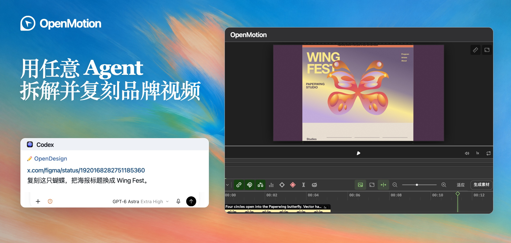

<h1 align="center"><a href="docs/readme/studio-tour.zh-CN.mp4"><picture><source media="(max-width: 640px)" srcset="docs/readme/cover.mobile.zh-CN.jpg" /></picture></a></h1>

用你的 Agent 复刻任意热门视频。上传视频或粘贴社媒链接，换成自己的品牌素材。

<strong><a href="docs/README.zh-CN.md#接入你的-agent">开始使用</a></strong> · <a href="docs/README.zh-CN.md">完整中文版</a> · <a href="README.md">English</a>

## 复刻案例

- **首个全栈 Agentic 视频生成器。** 我们的目标是把生成、编辑和渲染放进同一套工作流：用 HTML 编写镜头，在 Studio 里改画面和节奏，从这份工程直接渲染出 MP4。
- **完全开源免费，在本地 Agent 里直接用，每一层都支持 BYOK。** 支持 Codex、Claude Code、DeepSeek Harness 和 WorkBuddy。从语言模型到图片、视频和音乐生成，都可以使用自己的 API Key。
- **首次开源 100+ 个品牌的 `MOTION.md`** 是首发合集的目标。我们定义了 [Motion MD](docs/motion-md.zh-CN.md)，用 Markdown 记录分镜、节奏、转场和可替换的品牌素材。当前公开预览可读 [Firecrawl 五秒样例](examples/reference-reveal/MOTION.zh-CN.md)。
- **多模态：图片 · 视频 · 音乐。** 生成或导入需要的素材，放到同一条时间轴上对齐镜头和节拍，再一起导出。[查看可选模型](docs/README.zh-CN.md#自带-agent-和模型密钥byok)

<a href="docs/readme/studio-tour.zh-CN.mp4"><picture>
  <source media="(prefers-reduced-motion: reduce)" srcset="docs/readme/codex-comparison.zh-CN.jpg" />
  
</picture></a>

从[Figma Draw 原片](https://x.com/figma/status/1920168282751185360)到 Wing Fest 蝴蝶海报。点开演示，看 Codex 如何复刻这段动效。

[查看七个品牌的 5 秒对照](docs/README.zh-CN.md#复用参考片的拍法) · [浏览 100+ 个一键复刻参考](docs/README.zh-CN.md#motion-资源库与主题合集)

也可以从自己的口播录像开始，把字幕、关键词和录屏对齐到说话的节奏。[查看口播示例](docs/README.zh-CN.md#真人口播加动效) · [查看系统架构图](docs/README.zh-CN.md#系统架构)

## 项目与社区

  
  
  

  
  
  
  
  
  

[原 HTML Anything 编辑器与安装说明](https://github.com/nexu-io/html-anything/blob/legacy/README.zh-CN.md)
