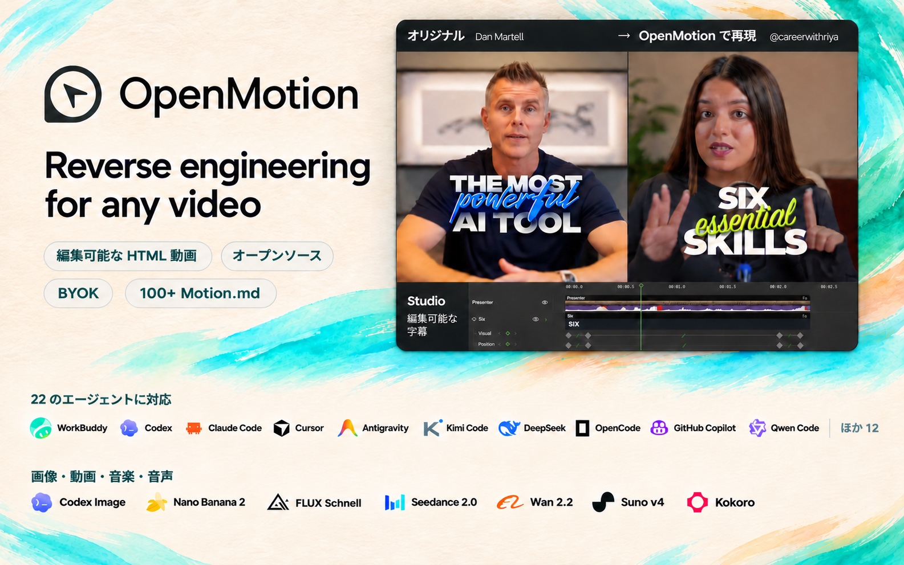
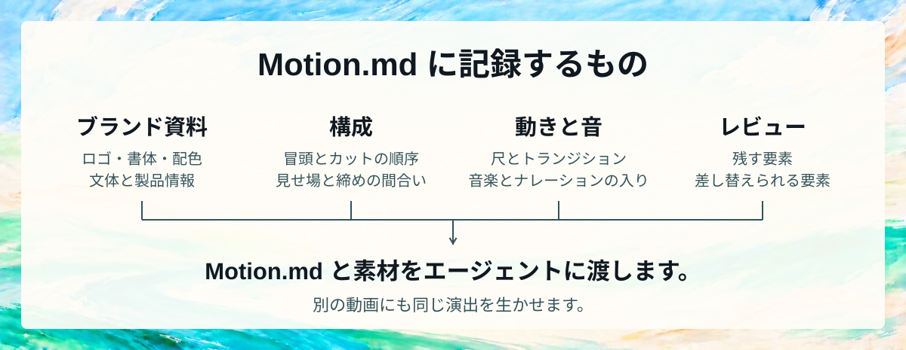

<p align="center"></p>

<p align="center"><strong>あらゆる動画を分析・再現</strong></p>

<p align="center">
  <a href="readme/media/presenter-caption-remake.mp4"><picture><source media="(max-width: 600px)" srcset="readme/brand-hero.mobile.ja.jpg"></picture></a>
</p>

<p align="center">
  <a href="https://github.com/nexu-io/html-anything"></a>
  <a href="../package.json"></a>
  <a href="../LICENSE"></a>
  <a href="https://github.com/nexu-io/open-design"></a>
</p>

<p align="center">
  <a href="https://open-design.ai/motion/?utm_source=github&amp;utm_medium=referral&amp;utm_campaign=openmotion&amp;utm_content=readme_ja"></a>
  <a href="https://go.open-design.ai/?utm_source=github&amp;utm_medium=referral&amp;utm_campaign=openmotion&amp;utm_content=readme_ja"></a>
  <a href="https://discord.gg/mHAjSMV6gz"></a>
  <a href="https://x.com/OpenDesignHQ"></a>
  <a href="https://x.com/OpenDesignDevs"></a>
  <a href="https://www.youtube.com/channel/UChtshixMhvtgBWzoD9R_Qfg"></a>
</p>

<p align="center"><a href="#agent-wall">対応エージェント</a> · <a href="#showcase">用途と再現例</a> · <a href="#features">OpenMotion の特長</a> · <a href="#technical-guide">セットアップと技術資料</a> · <a href="#community">コミュニティ・貢献</a></p>

<div align="center">

[English](../README.md) · [简体中文](README.zh-CN.md) · **日本語**

</div>

# OpenMotion

OpenMotion は、**エージェントが動画制作の全工程を担う初のフルスタック動画生成ツール**です。参考動画をアップロードするか SNS の動画リンクを貼り付けると、**自分のブランドキット（ロゴ・配色・書体など）とコピーで元の演出を再現できます**。

- 🎬 **動画の分析から再現・書き出しまで。** エージェントが参考動画を分析し、カットとトランジションを HTML で組み直し、足りない素材を生成します。同じプロジェクトを Studio で開き、間合いを調整して MP4 に書き出せます。
- 🔑 **BYOA（自分のエージェント）と BYOK（自分の API キー）。** OpenMotion は無料のオープンソースソフトウェアです。[使い慣れたローカルエージェント](#agent-wall)で動画を再現し、各工程に自分の API キーを使えます。
- 🧩 **Motion.md** は、OpenMotion が定義した Markdown 形式です。カットの順番、尺、トランジションを記録し、ブランド動画の演出をプロジェクトと一緒に共有できます。
- 🎛️ **画像・動画・音楽・音声。** Nano Banana 2 で画像を、Seedance 2.0 で追加カットを作り、Suno v4 の音楽と Kokoro のナレーションを同じタイムラインに配置できます。[内蔵の全 7 モデル](#model-wall)

<a id="agent-wall"></a>

**22 種類のローカルエージェントに対応** · [エージェントを選ぶ](#choose-agent)

<p align="center"><a href="#choose-agent"><picture><source media="(max-width: 600px)" srcset="readme/agents/local-agents.mobile.png"></picture></a></p>

<a id="showcase"></a> <a id="用-openmotion-可以做什么"></a>
<a id="使用场景与复刻效果示例"></a>

## 🎞️ 用途と再現例

<a id="可以用它做什么"></a> <a id="what-can-you-make"></a>

<a id="everyone-can-be-a-creator"></a> <a id="everyone-can-be-an-ai-video-editor-everyone-can-be-a-creator"></a> <a id="人人都是自媒体"></a> <a id="creator-video-gallery"></a> <a id="presenter-motion"></a>

### AI でトーク動画を編集

話し手の言葉に合わせて字幕と画面デモを切り替え、説明の流れを作ります。

<table width="100%">
<tr><th colspan="3" align="left">🎓 教える・解説する</th></tr>
<tr>
<td width="33%" valign="top" align="center">
<a href="../library/skills/presenter-story/assets/careerwithriya-reference.mp4"><picture><source media="(prefers-reduced-motion: reduce)" srcset="readme/people/careerwithriya.jpg"></picture></a><br>
<strong>キャリアを変える 6 つの必須スキル</strong><br>
番号付きの要点 + 動くキーワード<br>
<sub>参考動画 · <a href="https://www.instagram.com/reel/Ddd57MBszhc/">@careerwithriya</a></sub>
</td>
<td width="33%" valign="top" align="center">
<a href="readme/media/dan-martell-tools-reference.mp4"><picture><source media="(prefers-reduced-motion: reduce)" srcset="readme/people/dan-martell-tools.jpg"></picture></a><br>
<strong>今、最も優れた AI ツールは？</strong><br>
話し手 + 浮かぶツールカード<br>
<sub>参考動画 · <a href="https://www.youtube.com/shorts/mk1zJd9Rm4c">Dan Martell</a></sub>
</td>
<td width="33%" valign="top" align="center">
<a href="readme/media/harpercarrollai-reference.mp4"><picture><source media="(prefers-reduced-motion: reduce)" srcset="readme/people/harpercarrollai.jpg"></picture></a><br>
<strong>10 日間の AI 基礎・1 日目</strong><br>
個人のレッスン + 読みやすい字幕<br>
<sub>参考動画 · <a href="https://www.instagram.com/reel/C4eNPF3PdpG/">@harpercarrollai</a></sub>
</td>
</tr>
<tr><th colspan="3" align="left">🖥️ ワークフローを見せる</th></tr>
<tr>
<td width="33%" valign="top" align="center">
<a href="../library/skills/presenter-story/assets/ali-abdaal-workflow-reference.mp4"><picture><source media="(prefers-reduced-motion: reduce)" srcset="readme/people/ali-abdaal-workflow.jpg"></picture></a><br>
<strong>毎日使う 5 つのツール</strong><br>
デスクでの語り + 作業画面<br>
<sub>参考動画 · Ali Abdaal</sub>
</td>
<td width="33%" valign="top" align="center">
<a href="../library/skills/presenter-story/assets/john-tagudin-capso-reference.mp4"><picture><source media="(prefers-reduced-motion: reduce)" srcset="readme/people/john-tagudin-capso.jpg"></picture></a><br>
<strong>注釈付きのツールデモ</strong><br>
話し手 + 画面 + 注釈<br>
<sub>参考動画 · <a href="https://www.tiktok.com/@john.tagudin/video/7524883942328126728">@john.tagudin</a></sub>
</td>
<td width="33%" valign="top" align="center">
<a href="readme/media/aiwithsachi-reference.mp4"><picture><source media="(prefers-reduced-motion: reduce)" srcset="readme/people/aiwithsachi.jpg"></picture></a><br>
<strong>Claude に入れたい 5 つのプラグイン</strong><br>
口頭でのリスト + 補足スクリーンショット<br>
<sub>参考動画 · <a href="https://www.instagram.com/reel/Dc7G9Pxu_1O/">@aiwithsachi</a></sub>
</td>
</tr>
<tr><th colspan="3" align="left">🎬 物語と製品を伝える</th></tr>
<tr>
<td width="33%" valign="top" align="center">
<a href="readme/media/khris-sheer-founder-reference.mp4"><picture><source media="(prefers-reduced-motion: reduce)" srcset="readme/people/khris-sheer-founder.jpg"></picture></a><br>
<strong>創業者の実験・第 1 話</strong><br>
創業者の日記 + 日常の B ロール<br>
<sub>参考動画 · <a href="https://www.tiktok.com/@khris.sheer/video/7491715587895430402">@khris.sheer</a></sub>
</td>
<td width="33%" valign="top" align="center">
<a href="readme/media/ugc-rachelll-reference.mp4"><picture><source media="(prefers-reduced-motion: reduce)" srcset="readme/people/ugc-rachelll.jpg"></picture></a><br>
<strong>AI クリエイターと製品</strong><br>
製品の物語 + 根拠 + ピクチャーインピクチャー<br>
<sub>参考動画 · <a href="https://www.tiktok.com/@ugc.rachelll/video/7616996050066345246">@ugc.rachelll</a></sub>
</td>
<td width="33%" valign="top" align="center">
<a href="readme/media/kevinstratvert-reference.mp4"><picture><source media="(prefers-reduced-motion: reduce)" srcset="readme/people/kevinstratvert.jpg"></picture></a><br>
<strong>5 つの AI ツールへの支払いをやめよう</strong><br>
製品チュートリアル + 実演<br>
<sub>参考動画 · <a href="https://www.youtube.com/shorts/1fA5j5_5TRY">Kevin Stratvert</a></sub>
</td>
</tr>
<tr><th colspan="3" align="left">元動画 → 外部クリエイターによるアレンジ</th></tr>
<tr>
<td colspan="1" width="33%" align="center" valign="top">
<a href="../library/skills/presenter-story/assets/careerwithriya-result.mp4"><picture><source media="(prefers-reduced-motion: reduce)" srcset="readme/people/careerwithriya-comparison.jpg"></picture></a><br>
<strong>キャリアのアドバイス → 動画制作の解説</strong><br>
出演者を替え、番号付きの要点と具体例を示すカードで、新しい解説を組み立てます。<br>
<sub><a href="../library/skills/presenter-story/references/presenter-listicle/MOTION_DESIGN.md">Motion.md</a> · <a href="../library/skills/presenter-story/SKILL.md">Skill</a> · <a href="../library/skills/presenter-story/assets/careerwithriya-reference.mp4">元動画</a> · <a href="../library/skills/presenter-story/assets/careerwithriya-result.mp4">アレンジの全編</a></sub>
</td>
<td colspan="1" width="33%" align="center" valign="top">
<a href="../library/skills/presenter-story/assets/ali-abdaal-workflow-result.mp4"><picture><source media="(prefers-reduced-motion: reduce)" srcset="readme/people/ali-abdaal-workflow-comparison.jpg"></picture></a><br>
<strong>日常のツール → デザインの仕事場</strong><br>
話し手と画面を交互に映すリズムを生かして、別の作業手順を紹介します。<br>
<sub><a href="../library/skills/presenter-story/references/workflow-demo/MOTION_DESIGN.md">Motion.md</a> · <a href="../library/skills/presenter-story/SKILL.md">Skill</a> · <a href="../library/skills/presenter-story/assets/ali-abdaal-workflow-reference.mp4">元動画</a> · <a href="../library/skills/presenter-story/assets/ali-abdaal-workflow-result.mp4">アレンジの全編</a></sub>
</td>
<td colspan="1" width="33%" align="center" valign="top">
<a href="../library/skills/presenter-story/assets/john-tagudin-capso-result.mp4"><picture><source media="(prefers-reduced-motion: reduce)" srcset="readme/people/john-tagudin-capso-comparison.jpg"></picture></a><br>
<strong>ツールのデモ → 動画エディターの使い方</strong><br>
ワイプと注釈を生かし、ツールのデモを動画編集のチュートリアルに作り替えます。<br>
<sub><a href="../library/skills/presenter-story/references/product-walkthrough/MOTION_DESIGN.md">Motion.md</a> · <a href="../library/skills/presenter-story/SKILL.md">Skill</a> · <a href="../library/skills/presenter-story/assets/john-tagudin-capso-reference.mp4">元動画</a> · <a href="../library/skills/presenter-story/assets/john-tagudin-capso-result.mp4">アレンジの全編</a></sub>
</td>
</tr>
</table>

### AI で再編集・構成を変更

撮りためた写真と短い動画を、始まりと結末のある一本にまとめます。

<table width="100%">
<tr>
<td colspan="1" width="100%" align="center" valign="top">
<a href="readme/media/hundred-days-story-reference.mp4"><picture>
<source media="(prefers-reduced-motion: reduce)" srcset="readme/examples/story-recut.jpg">

</picture></a><br>
<strong>写真でつづる 100 日間</strong><br>
ステッカーと写真カードを日付の目印にして、日常の断片を日記のような短編にまとめます。<br>
<sub><a href="https://www.instagram.com/reel/Dd6vHlQgpok/">元動画</a></sub>
</td>
</tr>
</table>

<a id="brand-before-after"></a> <a id="brand-film-gallery"></a>

### 製品発表とデモ

初めて製品が姿を見せる瞬間に合わせ、カットと画面の切り替えを組み立てます。

5 秒間の比較映像では、左が元動画、右が OpenMotion による再現です。スマートフォンでは上下に並び、元動画が上に表示されます。

<table width="100%">
<tr>
<td colspan="2" width="100%" align="center" valign="top">
<div id="case-stripe"><a href="../examples/brand-studies/stripe/comparison.mp4"><picture><source media="(max-width: 600px) and (prefers-reduced-motion: no-preference)" srcset="../examples/brand-studies/stripe/comparison.mobile.webp"><source media="(prefers-reduced-motion: reduce)" srcset="../examples/brand-studies/stripe/comparison.jpg"></picture></a></div><br>
<strong>Stripe · カードの反転 → 海辺のフィルム</strong><br>
Stripe のカードが裏返るタイミングに合わせ、着地する絵を海辺のイラストに替えました。<br>
<sub><a href="../examples/brand-studies/stripe/comparison.mp4">横画面で見る</a> · <a href="../examples/brand-studies/stripe/comparison.mobile.mp4">縦画面の MP4</a> · <a href="https://x.com/stripe/status/2049621560743608481">元動画 00:21.50–00:26.50</a> · <a href="../examples/brand-studies/stripe/index.html">HTML</a> · <a href="../examples/brand-studies/stripe/MOTION.md">Motion.md</a></sub>
</td>
</tr>
<tr><th colspan="2" align="left">参考動画</th></tr>
<tr>
<td width="50%" valign="top">
<a href="readme/media/remix-kimi-k3-reference.mp4"><picture><source media="(prefers-reduced-motion: reduce)" srcset="../web/catalog/covers/ac6e14a0fadb5893534e6438.jpg"></picture></a><br>
<strong>Kimi · K3 teaser</strong><br>
次のリリースを短く印象的な予告に。<br>
<sub>参考動画 · @Kimi_Moonshot</sub>
</td>
<td width="50%" valign="top">
<a href="readme/media/remix-elevenlabs-reception-reference.mp4"><picture><source media="(prefers-reduced-motion: reduce)" srcset="../web/catalog/covers/bc4b8b4398d66159acd35890.jpg"></picture></a><br>
<strong>ElevenLabs · Reception</strong><br>
焦点を絞った発表動画で新製品を紹介。<br>
<sub>参考動画 · @ElevenLabs</sub>
</td>
</tr>
<tr>
<td width="50%" valign="top" align="center">
<a href="readme/brand-showcase/rea-unboxing.mp4"><picture><source media="(prefers-reduced-motion: reduce)" srcset="readme/brand-showcase/rea-unboxing.jpg"></picture></a><br>
<strong>実物の製品、手触りのある物語</strong><br>
接写、手の動き、見せ方を研究し、自分の製品を撮影。<br>
<sub>実写 · 製品の開封</sub>
</td>
<td width="50%" valign="top" align="center">
<a href="readme/brand-showcase/rea-dual-role.mp4"><picture><source media="(prefers-reduced-motion: reduce)" srcset="readme/brand-showcase/rea-dual-role.jpg"></picture></a><br>
<strong>キャラクターと UI の出会い</strong><br>
キャラクターによる導入を UI の動きと画面録画に組み合わせる。<br>
<sub>AI キャラクター + コード + 画面録画</sub>
</td>
</tr>
</table>

<a id="see-the-motion-survive-a-new-brand"></a>

### 話題の動画を再現

参考動画のカットの間合いを生かし、自分の映像とコピーで同じ場面を作り直します。

<table width="100%">
<tr>
<td colspan="2" width="100%" align="center" valign="top">
<div id="case-openai"><a href="../examples/motion-studies/comparison.mp4"><picture><source media="(max-width: 600px) and (prefers-reduced-motion: no-preference)" srcset="../examples/motion-studies/comparison.mobile.webp"><source media="(prefers-reduced-motion: reduce)" srcset="../examples/motion-studies/comparison.jpg"></picture></a></div><br>
<strong>OpenAI · ワイヤーフレームの節点 → 編集トラック</strong><br>
5 本のカラートラックが一つの編集点に集まります。背景の切り替え、文字の登場、ロゴの表示という元動画の三拍を再現しました。<br>
<sub><a href="../examples/motion-studies/comparison.mp4">横画面で見る</a> · <a href="../examples/motion-studies/comparison.mobile.mp4">縦画面の MP4</a> · <a href="https://x.com/OpenAI/status/2084352161404920316">元動画 00:26.50–00:31.50</a> · <a href="../examples/motion-studies/signoff.html">HTML</a></sub>
</td>
</tr>
<tr>
<td colspan="2" width="100%" align="center" valign="top">
<div id="case-deepseek"><a href="../examples/brand-studies/deepseek/comparison.mp4"><picture><source media="(max-width: 600px) and (prefers-reduced-motion: no-preference)" srcset="../examples/brand-studies/deepseek/comparison.mobile.webp"><source media="(prefers-reduced-motion: reduce)" srcset="../examples/brand-studies/deepseek/comparison.jpg"></picture></a></div><br>
<strong>DeepSeek Harness · ターミナル入力 → 撮影用カチンコ</strong><br>
カチンコに一文字ずつ文字が現れます。最後の打鍵からエンディングまでの間と、一瞬のフラッシュを残しました。<br>
<sub><a href="../examples/brand-studies/deepseek/comparison.mp4">横画面で見る</a> · <a href="../examples/brand-studies/deepseek/comparison.mobile.mp4">縦画面の MP4</a> · <a href="https://x.com/DeepSeekHarness/status/2117256196227019194">元動画 01:31.50–01:36.50</a> · <a href="../examples/brand-studies/deepseek/index.html">HTML</a></sub>
</td>
</tr>
<tr><th colspan="2" align="left">編集可能なモーション · 同じプロジェクトの原版とアレンジ</th></tr>
<tr>
<td colspan="1" width="50%" align="center" valign="top">
<a href="../library/skills/motion-design-remix/previews/wireframe-portal-title.mp4"><picture><source media="(prefers-reduced-motion: reduce)" srcset="../library/skills/motion-design-remix/previews/wireframe-portal-title.jpg"></picture></a><br>
<strong>ワイヤーフレームのポータル · BREAKTHROUGH → OPENMOTION</strong><br>
ポータルが開くタイミング、立体文字、カメラの寄りを残し、見出し、副題、立体文字のフレーズを替えました。<br>
<sub><a href="../library/skills/motion-design-remix/references/wireframe-portal-title/MOTION_DESIGN.md">Motion.md</a> · <a href="../library/skills/motion-design-remix/SKILL.md">Skill</a> · <a href="../library/skills/motion-design-remix/presets/wireframe-portal-title.json">コンテンツのプリセット</a> · <a href="../library/skills/motion-design-remix/previews/wireframe-portal-title.mp4">MP4</a></sub>
</td>
<td colspan="1" width="50%" align="center" valign="top">
<a href="../library/skills/motion-design-remix/previews/canopy-part-title.mp4"><picture><source media="(prefers-reduced-motion: reduce)" srcset="../library/skills/motion-design-remix/previews/canopy-part-title.jpg"></picture></a><br>
<strong>木の葉と文字 · Understory → OpenMotion</strong><br>
葉が横切る動きと奥行き、文字が隠れてから読めるようになるまでの間を残し、二つの見出しを替えました。<br>
<sub><a href="../library/skills/motion-design-remix/references/canopy-part-title/MOTION_DESIGN.md">Motion.md</a> · <a href="../library/skills/motion-design-remix/SKILL.md">Skill</a> · <a href="../library/skills/motion-design-remix/presets/canopy-part-title.json">コンテンツのプリセット</a> · <a href="../library/skills/motion-design-remix/previews/canopy-part-title.mp4">MP4</a></sub>
</td>
</tr>
<tr>
<td colspan="1" width="50%" align="center" valign="top">
<a href="../library/skills/motion-design-remix/previews/ui-3d-reveal.mp4"><picture><source media="(prefers-reduced-motion: reduce)" srcset="../library/skills/motion-design-remix/previews/ui-3d-reveal.jpg"></picture></a><br>
<strong>UI の登場シーン · 製品ツアー → AI 編集の紹介</strong><br>
傾いたキャンバス、重なりの奥行き、連続したカメラ移動を生かし、見出しとドキュメント、コミュニティの紹介文を替えました。<br>
<sub><a href="../library/skills/motion-design-remix/references/ui-3d-reveal/MOTION_DESIGN.md">Motion.md</a> · <a href="../library/skills/motion-design-remix/SKILL.md">Skill</a> · <a href="../library/skills/motion-design-remix/presets/ui-3d-reveal.json">コンテンツのプリセット</a> · <a href="../library/skills/motion-design-remix/previews/ui-3d-reveal.mp4">MP4</a></sub>
</td>
<td colspan="1" width="50%" align="center" valign="top">
<a href="../library/skills/motion-design-remix/previews/code-3d-extrude.mp4"><picture><source media="(prefers-reduced-motion: reduce)" srcset="../library/skills/motion-design-remix/previews/code-3d-extrude.jpg"></picture></a><br>
<strong>立体コード · loadConfig() → cutVideo()</strong><br>
押し出したコードの層、構文の配色、カメラの動きはそのままに、関数、変数、呼び出し例を替えました。<br>
<sub><a href="../library/skills/motion-design-remix/references/code-3d-extrude/MOTION_DESIGN.md">Motion.md</a> · <a href="../library/skills/motion-design-remix/SKILL.md">Skill</a> · <a href="../library/skills/motion-design-remix/presets/code-3d-extrude.json">コンテンツのプリセット</a> · <a href="../library/skills/motion-design-remix/previews/code-3d-extrude.mp4">MP4</a></sub>
</td>
</tr>
<tr>
<td colspan="1" width="50%" align="center" valign="top">
<a href="../library/skills/motion-design-remix/previews/code-particle-assemble.mp4"><picture><source media="(prefers-reduced-motion: reduce)" srcset="../library/skills/motion-design-remix/previews/code-particle-assemble.jpg"></picture></a><br>
<strong>粒子の組み立て · parse / optimize / emit → select / trim / render</strong><br>
同じ乱数シードによる粒子の軌道と集まるタイミングを生かし、工程名と手順を替えました。<br>
<sub><a href="../library/skills/motion-design-remix/references/code-particle-assemble/MOTION_DESIGN.md">Motion.md</a> · <a href="../library/skills/motion-design-remix/SKILL.md">Skill</a> · <a href="../library/skills/motion-design-remix/presets/code-particle-assemble.json">コンテンツのプリセット</a> · <a href="../library/skills/motion-design-remix/previews/code-particle-assemble.mp4">MP4</a></sub>
</td>
<td colspan="1" width="50%" align="center" valign="top">
<a href="../library/skills/motion-design-remix/previews/liquid-glass-widgets.mp4"><picture><source media="(prefers-reduced-motion: reduce)" srcset="../library/skills/motion-design-remix/previews/liquid-glass-widgets.jpg"></picture></a><br>
<strong>ガラス調の情報カード · デバイス部品 → クリエイターの仕事場</strong><br>
ガラスの質感、カードの重なり、順番に現れる動きとメーターを残し、ラベル、単位、紹介する機能を替えました。<br>
<sub><a href="../library/skills/motion-design-remix/references/liquid-glass-widgets/MOTION_DESIGN.md">Motion.md</a> · <a href="../library/skills/motion-design-remix/SKILL.md">Skill</a> · <a href="../library/skills/motion-design-remix/presets/liquid-glass-widgets.json">コンテンツのプリセット</a> · <a href="../library/skills/motion-design-remix/previews/liquid-glass-widgets.mp4">MP4</a></sub>
</td>
</tr>
</table>

### 解説とチュートリアル

クローズアップと注釈を使い、手順ごとに注目してほしい場所を示します。

<table width="100%">
<tr>
<td colspan="2" width="100%" align="center" valign="top">
<div id="case-claude"><a href="../examples/brand-studies/anthropic/comparison.mp4"><picture><source media="(max-width: 600px) and (prefers-reduced-motion: no-preference)" srcset="../examples/brand-studies/anthropic/comparison.mobile.webp"><source media="(prefers-reduced-motion: reduce)" srcset="../examples/brand-studies/anthropic/comparison.jpg"></picture></a></div><br>
<strong>Claude · 設定画面 → ブランドのカラーパレット</strong><br>
スイッチの切り替えと手描きの丸が現れるタイミングを生かし、設定画面を色の選択パネルに替えました。<br>
<sub><a href="../examples/brand-studies/anthropic/comparison.mp4">横画面で見る</a> · <a href="../examples/brand-studies/anthropic/comparison.mobile.mp4">縦画面の MP4</a> · <a href="https://x.com/ClaudeDevs/status/2091953609185657251">元動画 00:00–00:05</a> · <a href="../examples/brand-studies/anthropic/index.html">HTML</a></sub>
</td>
</tr>
</table>

### データとグラフで伝える

グラフが変化する様子を追いながら、数値の差を読み取れます。

<table width="100%">
<tr>
<td colspan="1" width="100%" align="center" valign="top">
<a href="readme/media/M1128-clip.mp4"><picture>
<source media="(prefers-reduced-motion: reduce)" srcset="readme/examples/data-story.jpg">

</picture></a><br>
<strong>比較できる動く棒グラフ</strong><br>
棒の高さが変わる間も、それぞれの値を読み取れます。<br>
<sub><a href="https://x.com/Vintage_god/status/2106817967967056165">元動画</a></sub>
</td>
</tr>
</table>

### 音楽と映像表現

曲のビートに合わせて繰り返す映像のモチーフを作ります。

<table width="100%">
<tr>
<td colspan="2" width="100%" align="center" valign="top">
<div id="case-kimi"><a href="../examples/brand-studies/kimi/comparison.mp4"><picture><source media="(max-width: 600px) and (prefers-reduced-motion: no-preference)" srcset="../examples/brand-studies/kimi/comparison.mobile.webp"><source media="(prefers-reduced-motion: reduce)" srcset="../examples/brand-studies/kimi/comparison.jpg"></picture></a></div><br>
<strong>Kimi · 磁力線 → レコード盤</strong><br>
回転する磁場をレコードの溝に置き換え、ジャケットにタイトルを表示します。<br>
<sub><a href="../examples/brand-studies/kimi/comparison.mp4">横画面で見る</a> · <a href="../examples/brand-studies/kimi/comparison.mobile.mp4">縦画面の MP4</a> · <a href="https://x.com/Kimi_Moonshot/status/2077521842080817296">元動画 00:30.75–00:35.75</a> · <a href="../examples/brand-studies/kimi/index.html">HTML</a></sub>
</td>
</tr>
</table>

[7 つの用途別エージェント用プロンプト](examples.md)

<a id="features"></a>
<a id="为什么选择-openmotion"></a>

## ✨ OpenMotion の特長

<a id="what-is-openmotion"></a> <a id="openmotion-是什么"></a> <a id="video-is-code"></a>

### 1. エージェントが動画制作の全工程を担う初のフルスタック動画生成ツール

**HTML で動画を書く。** シーン、書体、レイアウト、トランジションとそのタイミングを HTML、CSS、JavaScript で記述します。実写、生成したクリップ、画像、音楽、ナレーションを組み合わせ、同じプロジェクトを Studio で開いて MP4 に書き出せます。


**書いて、観て、直して、書き出す。** 製品を差し替える、冒頭を詰める、出演者を加える、字幕や結末を変える。エージェントがソースを編集し、結果をエディターで確認できます。ローカルの MCP クライアントはプロジェクト用ツールを使用します。シェルを使えるエージェントでは Skills と指定バージョンの CLI も利用できます。[接続設定](#agent-setup) · [ネイティブ合成ガイド](../skills/motion-production/references/native.md) · [HTML の作例](../template-library/product-promo/index.html)

#### Studio で編集できるもの

| Studio の機能 | 今できること |
| --- | --- |
| **物語とタイムライン** | 素材の読み込み・配置、台本や確定タイムコードに基づく切り詰め・並べ替え・修正 |
| **動きと字幕** | 内容に合わせた動く文字、トランジション、注釈、図表、字幕 |
| **素材と音** | 手元の素材の読み込み、内蔵モデル連携での画像・動画・音楽・TTS 生成 |
| **画像の修正** | 参考画像対応モデルで候補を生成し、時間と動きを保ったまま差し替え |
| **プレビューと版** | Studio で確認し、手動またはエージェントで編集。次の修正にも同じプロジェクトを使用 |
| **出力とソース** | 固定版を MP4 にレンダリングし、HTML、CSS、JavaScript、素材を保存 |

> 「承認済みの見せ方は維持。中盤をこの画面録画に替え、指定タイムコードで導入を短くし、最後の CTA を 2 秒長くしてください。」

[プロジェクトとバージョン管理](project-workspace.md)

<a id="分享可编辑的复刻工程"></a>

#### 参考動画から編集可能なプロジェクトへ

1. **参考動画を分析する。** 再現したい場面を選び、カットの順序、トランジション、音が入る位置を Motion.md に記録します。自分のブランドに合わせて替える部分も明記します。
2. **カットを組み直す。** エージェントがブランドキットに沿って、コピーや製品の画像・動画を使った HTML シーンを再構築し、Studio のタイムラインに並べます。
3. **同じ時点で見比べる。** 元動画と再現版を同じ時点で比較し、尺、動き、音を調整します。最後に通して再生し、全体のテンポを確認します。
4. **書き出して共有する。** MP4 を書き出し、HTML ソースと素材を保存します。ほかの人がアレンジできるよう、Motion.md、プレビュー、共有可能な素材をプロジェクトに添えます。[提出時のチェックリスト](../library/ENTRY_TEMPLATE.md)

<a id="bring-your-agent-and-keys"></a>

### 2. 無料・オープンソース。ローカルエージェントで使え、各工程で BYOK に対応

<a id="choose-agent"></a>

**エージェントを選んでください。** WorkBuddy、Codex、Claude Code、DeepSeek Harness には個別のセットアップ手順があります。それ以外のボタンからは MCP と CLI の共通接続手順を開けます。

<p>
  <a href="#workbuddy-setup"></a>
  <a href="#agent-setup"></a>
  <a href="#claude-setup"></a>
  <a href="#local-agent-connection"></a>
  <a href="#local-agent-connection"></a>
  <a href="#local-agent-connection"></a>
  <a href="#local-agent-connection"></a>
  <a href="#local-agent-connection"></a>
  <a href="#local-agent-connection"></a>
  <a href="#local-agent-connection"></a>
  <a href="#local-agent-connection"></a>
  <a href="#local-agent-connection"></a>
  <a href="#local-agent-connection"></a>
  <a href="#local-agent-connection"></a>
  <a href="#local-agent-connection"></a>
  <a href="#local-agent-connection"></a>
  <a href="#local-agent-connection"></a>
  <a href="#deepseek-setup"></a>
  <a href="#local-agent-connection"></a>
  <a href="#local-agent-connection"></a>
  <a href="#local-agent-connection"></a>
  <a href="#local-agent-connection"></a>
</p>

| 持ち込むもの | 動画への活かし方 |
| --- | --- |
| **🤖 エージェント — BYOA** | Skills と MCP、対応環境では CLI で接続。いつものクライアント、アカウント、作業文脈を使えます。 |
| **🔑 キー — BYOK** | Model Settings に対応するメディア API キーを設定し、画像、動画、音楽、TTS のモデルを選択。対応するローカル連携ではエージェントの既存ログインを利用できます。 |
| **🎨 ブランドと素材** | ロゴ、書体、スクリーンショット、実写、台本、音楽を用意します。ブランド情報と使用許可のある素材を Motion.md の Brand Kit 欄に記録します。 |
| **🧩 制作の出発点** | 参考、モーション部品、テンプレート、コミュニティ Skills から方向を選び、ソースや参考をエージェントへ渡します。 |

**Skills、プロジェクトツール、モデル連携、Studio、レンダリングの制作パイプラインはオープンソースです。** ローカルで動かし、実装を確認・拡張できます。このローカル工程にソフトの月額料金やレンダリングごとの料金はありません。生成 API を使わず、手持ちの映像・画像・音声だけでも制作できます。

認証情報はワークスペースの設定に保存します。エージェントの契約や外部モデルの利用料は各提供元の規定に従います。[エージェント別の接続方法と検証状況](agent-adapters.md)

<a id="make-your-motion-language-reusable"></a> <a id="motion-design-community"></a>

### 3. ブランド動画の Motion.md が 100 本以上、制作リソースが 890 件以上

OpenMotion が定義した **Motion.md** は動画の演出を記述する Markdown 形式です。公開されたブランド動画の分析資料には、各カットの順番、尺、トランジション、差し替え可能な素材が記載されています。[Stripe の例](../examples/brand-studies/stripe/MOTION.md)では、カードを映画のフィルム枠に置き換えても同じ拍で反転するよう、動きのタイミングを指定しています。

Brand Kit 欄にはロゴ、配色、書体、文体、確認済みの製品情報をまとめます。構成、動き、音、レビューの指針を記しておけば、ブランドを替えても残したい演出が伝わります。新しい動画を作るときに、このファイルを素材と一緒にエージェントに渡してください。



<a id="resources-to-start-from"></a>

#### Motion.md を書くときに使える資料

カットやトランジションを探すときは、**42 本の参考動画と 393 点のモーション**を参照できます。HTML で画面を組み立てるために、Studio のライブラリには **210 個のブロック、238 個のコンポーネント、8 個のコード例**もあります。

| 作りたいもの | 利用できる資料 |
| --- | --- |
| エージェントに制作手順を渡す | [5 つの制作 Skills](skills.md)は演出、再現、テンプレートの応用・作成、編集と書き出しを扱います。[モーションのアレンジ用 Skill](../library/skills/motion-design-remix/SKILL.md)には編集可能な 6 例が、[トーク動画用 Skill](../library/skills/presenter-story/SKILL.md)には 3 種類の構成例があります。 |
| タイトル、トランジション、UI の登場演出を再利用する | [モーションコンポーネント](../library/components/README.md)には個別に使えるソースとタイミングの説明があります。[タイトルの登場例](../library/components/title-reveal/README.md)でコピーと表示開始時刻の変更を試せます。 |
| ブランドと動きのルールを渡す | [Brandkit Skill](../library/skills/brandkit/SKILL.md)で資料を整理し、[ロゴ、文体、製品情報](../library/brandkits/openmotion/BRANDKIT.md)を Motion.md の Brand Kit 欄にまとめます。[Ink & Water](../library/design-systems/ink-water/MOTION_DESIGN.md)は、再利用できるビジュアルと動きのルールの作例です。 |

##### すぐに編集できる Studio テンプレート

3 つの編集可能なプロジェクトを同梱しています。Studio の **Templates → Ready to edit** でテンプレートを選ぶと、自分用のコピーが作成されます。

| [Product Promo · 20 秒](../template-library/product-promo/) | [NYT Graph · 15 秒](../template-library/nyt-graph/) | [Decision Tree · 10 秒](../template-library/decision-tree/) |
| --- | --- | --- |
| [](../template-library/product-promo/) | [](../template-library/nyt-graph/) | [](../template-library/decision-tree/) |
| 製品画面、タイトル、締めのコピーを替えられます。 | 自分のデータ、単位、注釈を使えます。 | 質問や分岐を書き換え、回答の表示順を調整できます。 |

トーク動画と画面デモを組み合わせるには、ローカルで実行できる [Presenter Tech テンプレート](../library/templates/presenter-tech/README.md)も使えます。

<a id="motion-gallery"></a>

##### 参考動画とモーションコンポーネント

プレビューを選ぶとクリップを再生できます。「コンポーネントを見る」からは HTML ソースも開けます。

<table>
<tr><th colspan="3" align="left">再利用できるモーションコンポーネント</th></tr>
<tr>
<td width="33%" valign="top">
<a href="readme/media/app-showcase.mp4"><picture><source media="(prefers-reduced-motion: reduce)" srcset="../web/catalog/covers/51a2d141e18e608cc11b9256.jpg"></picture></a><br>
<strong>App Showcase</strong><br>
<sub>コンポーネント · <a href="../library/components/showcase/app-showcase/index.html">コンポーネントを見る</a></sub>
</td>
<td width="33%" valign="top">
<a href="readme/media/glass-shard-title.mp4"><picture><source media="(prefers-reduced-motion: reduce)" srcset="../web/catalog/covers/10cceacc02d415247d58f562.jpg"></picture></a><br>
<strong>Glass Shard Title</strong><br>
<sub>コンポーネント · <a href="../library/components/showcase/glass-shard-title/index.html">コンポーネントを見る</a></sub>
</td>
<td width="33%" valign="top">
<a href="readme/media/nyc-paris-flight.mp4"><picture><source media="(prefers-reduced-motion: reduce)" srcset="../web/catalog/covers/aeafb2433c37f2f7d8c87619.jpg"></picture></a><br>
<strong>NYC Paris Flight</strong><br>
<sub>コンポーネント · <a href="../library/components/showcase/nyc-paris-flight/index.html">コンポーネントを見る</a></sub>
</td>
</tr>
<tr><th colspan="3" align="left">製品・ブランドの参考動画</th></tr>
<tr>
<td width="33%" valign="top">
<a href="readme/media/jake-pond-reference.mp4"><picture><source media="(prefers-reduced-motion: reduce)" srcset="../web/catalog/covers/66ac2f8b58e55670971ae70c.jpg"></picture></a><br>
<strong>Pond: a new Linux OS</strong><br>
<sub>参考動画 · @bflycomputer</sub>
</td>
<td width="33%" valign="top">
<a href="readme/media/remix-cyera-reference.mp4"><picture><source media="(prefers-reduced-motion: reduce)" srcset="../web/catalog/covers/8884a707a92d0cc52d3363b7.jpg"></picture></a><br>
<strong>Cyera brand video</strong><br>
<sub>参考動画 · Cyera</sub>
</td>
<td width="33%" valign="top">
<a href="readme/media/remix-glyph-reference.mp4"><picture><source media="(prefers-reduced-motion: reduce)" srcset="../web/catalog/covers/4bfe08db4d486970494eff3b.jpg"></picture></a><br>
<strong>Glyph: GPU typography for the web</strong><br>
<sub>参考動画 · @pmndrs</sub>
</td>
</tr>
<tr><th colspan="3" align="left">光と影、ループの演出</th></tr>
<tr>
<td width="33%" valign="top">
<a href="readme/media/remix-iskra-light-reference.mp4"><picture><source media="(prefers-reduced-motion: reduce)" srcset="../web/catalog/covers/75cfbe06267768838d145fa4.jpg"></picture></a><br>
<strong>Iskra Light</strong><br>
<sub>参考動画 · @world_is_web</sub>
</td>
<td width="33%" valign="top">
<a href="readme/media/remix-linear-loops-reference.mp4"><picture><source media="(prefers-reduced-motion: reduce)" srcset="../web/catalog/covers/17cf5075b3f4b49c7d3e9201.jpg"></picture></a><br>
<strong>Linear Loops</strong><br>
<sub>参考動画 · @linear</sub>
</td>
<td width="33%" valign="top">
<a href="readme/media/aurora.mp4"><picture><source media="(prefers-reduced-motion: reduce)" srcset="../web/catalog/covers/5aefe7c9a916a38777443b36.jpg"></picture></a><br>
<strong>Aurora</strong><br>
<sub>コンポーネント · <a href="../library/components/showcase/aurora/index.html">コンポーネントを見る</a></sub>
</td>
</tr>
</table>

[厳選した 18 件のリソース](collections/README.md#catalog-picks) · [素材の出典と利用方法](readme/RESOURCES.md)

[編集できる 6 つの作例](motion-design-examples.md) · [Motion.md の書式](motion-md.md)

<a id="all-in-one-studio"></a> <a id="full-video-creation-stack"></a>

<a id="model-wall"></a>

### 4. 画像・動画・音楽・音声を生成

**BYOK で、自分のモデルアカウントを動画制作に使えます。** **Model Settings** で対応する API キーを登録し、モデルを選んでください。Studio の **Model Gateway** で画像、動画、音楽、音声を生成し、プレビューした候補を同じプロジェクトに取り込めます。対応するローカル画像生成では、既存のエージェントのログイン情報も利用できます。

<p>


</p>

| 必要な素材 | 内蔵モデルカタログの例 | 動画への用途 |
| --- | --- | --- |
| **🖼️ 画像** | Codex Image、Atlas Cloud の Nano Banana 2、fal.ai の FLUX Schnell | ブランド画像、シーンの絵、補助画像。対応する Codex 画像経路で参考画像を用いた編集 |
| **🎬 動画** | Atlas Cloud の Seedance 2.0、fal.ai の Wan 2.2 | 撮影素材やモーションと組み合わせるショット、B ロール |
| **🎵 音楽** | Atlas Cloud の Suno v4 | 雰囲気と企画に合ったサウンドトラック |
| **🎙️ TTS / ナレーション** | fal.ai の Kokoro | 承認済み台本から音声を生成し、映像・音楽と配置 |

> 「Motion.md の Brand Kit と確定済みの台本を使って、冒頭のビジュアル、挿入カット、BGM、ナレーションを生成してください。選んだ素材をプロジェクトに入れ、音と映像を合わせてから全編を見せてください。」

[内蔵モデル一覧](../gateway/catalog.ts) · [プロバイダー設定とエンドポイントの登録](model-gateway.md)

<a id="technical-guide"></a>
<a id="安装与技术文档"></a>

## 🛠️ セットアップと技術資料

リンク先の詳しい技術資料には、英語または中国語のものがあります。

<a id="快速开始"></a> <a id="quick-start"></a>

<a id="start-in-codex"></a>

### クイックスタート

テスト版をインストールするには、[インストールガイド](https://releases.open-design.ai/open-motion/dev/install.md)をエージェントに渡してください。指定されたバージョンを独立した環境にセットアップできます。ソースから起動する手順は次のとおりです。

#### OpenMotion を起動する

**無料のローカル制作環境から。** 自分のエージェントを接続し、同梱テンプレートや撮影素材を使ってローカルでレンダリング。新しい素材を生成するときは Model Settings に対応キーを追加します。

Git、npm、**Node.js 26.11.1** を用意してください。ソースからのプレビューと書き出しには Chrome または Chromium と、FFmpeg・FFprobe も必要です。[実行環境の設定](usage.md)

```sh
git clone --branch feature/motion https://github.com/nexu-io/html-anything.git openmotion
cd openmotion
npm ci
npm run build:studio
npm start
```

**http://localhost:4173** を開き、**Templates → Ready to edit** から **Product Promo** を選び、**Connect Agent** で接続します。プロジェクトと認証情報はチェックアウトの外へ。 `MOTION_DATA_DIR` でワークスペースを選びます。

<a id="agent-setup"></a>

#### エージェントを接続する

プラグイン対応 Codex では、チェックアウトから実行：

```sh
bash scripts/install-motion.command
```

<a id="workbuddy-setup"></a>

**WorkBuddy** · OpenMotion Connector をインポートするか、付属の `mcp.json` をカスタム MCP として追加します。WorkBuddy に利用可能な動画テンプレートを一覧表示させてください。[WorkBuddy の設定手順](agent-adapters.md#workbuddy)

<a id="claude-setup"></a>

**Claude Code** · ローカルインストーラーで `--host claude` を選び、Claude Code で `/mcp` を実行して接続を確認します。[ローカルインストーラー](npm-installation.md)

<a id="deepseek-setup"></a>

**DeepSeek** · DeepSeek TUI ではターミナルから HTML プロジェクトを編集できます。DeepSeek Harness では Cordis を使って OpenMotion の MCP ツールに接続できます。[DeepSeek Harness の設定](agent-adapters.md#deepseek-harness)

インストーラーはローカルでビルドしたパッケージを使います。[Windows 用テストパッケージ](test-packages.md)

まず同梱テンプレートで試します：

> OpenMotion で 20 秒の Product Promo の新しいコピーを Studio に開き、MP4 を出力してください。編集可能なプロジェクトも残してください。

次に自分の作品へ：

> 構成とアニメーションを保ち、ロゴ、画面、見出し、エンドカードを提供したブランド素材に替えてください。新しい編集を見せ、最後のタイトルを 2 秒長くしてください。

動画から始める場合は、参考と[再構築ブリーフ](#reverse-engineer-a-video)を渡してください。ホストが会話の横に Studio を開けない場合は、返されたローカルプロジェクトのリンクを使います。

ブランド動画の再現も試せます。

> OpenMotion で https://x.com/stripe/status/2049621560743608481 の 00:21.50–00:26.50 を分析してください。クリック、カメラの寄り、反転の間合いを生かし、カードを自社製品が映るフィルムに置き換えて、Studio で開いてください。

##### Skills、MCP、CLI

チェックアウトから [Skills CLI](https://github.com/vercel-labs/skills) を使い、5 つの基本ワークフローを確認・インストールできます：

```sh
npx skills add ./skills --list
npx skills add ./skills --skill motion-director motion-production motion-template-to-video motion-recreate motion-video-to-template
```

これは指示書をコピーするだけで、ランタイムのインストールや MCP 登録はしません。共有文書を使える状態にしてアプリを別途接続するか、上記の統合インストーラーを使ってください。

| Skill | 用途 |
| --- | --- |
| [motion-recreate](../skills/motion-recreate/SKILL.md) | 参考動画の再構築と結果の比較 |
| [motion-template-to-video](../skills/motion-template-to-video/SKILL.md) | 既存の編集可能なテンプレートの改編 |
| [motion-director](../skills/motion-director/SKILL.md) | オリジナル動画、物語、動き、音、創作レビュー |
| [motion-video-to-template](../skills/motion-video-to-template/SKILL.md) | 持ち運べる再利用テンプレートの制作 |
| [motion-production](../skills/motion-production/SKILL.md) | 範囲を定めた編集、プレビュー、検査、問題解決、出力 |

<a id="local-agent-connection"></a>

**そのほかのローカルエージェントを接続する** · Studio の **Connect Agent** からワークスペースの起動コマンドをコピーします。stdio MCP 対応のクライアントには下記の設定を使えます。ターミナルを使うエージェントでは、プロジェクトのディレクトリを開き、[ローカルエンジンの CLI](../skills/motion-production/references/native.md) で HTML シーンをプレビュー・レンダリングできます。

<a id="manual-mcp"></a>

```json
{
  "mcpServers": {
    "openmotion": {
      "command": "/absolute/path/to/node",
      "args": ["--experimental-strip-types", "/absolute/openmotion/mcp.ts"],
      "env": { "MOTION_DATA_DIR": "/absolute/openmotion-data" }
    }
  }
}
```

**公開 MCP ツール 11 個**で、テンプレート検索・詳細取得、作成、読み取り、編集、プレビュー、素材の読み込み、出力、版の復元、キャンセルを扱います。共通の手順とエンジンガイドは MCP resources から取得できます。[ツール契約](mcp-phase1-tools.md)

`motion_list_templates` でテンプレートを探し、`motion_get_template` で詳細を確認します。`motion_create_project` で編集用のコピーを作成できます。[テンプレート一覧](template-catalog.md)

アプリには `npm start` 、stdio には `npm run mcp` を使用します。シェル対応エージェントは実行環境が返す固定版エンジン CLI で検査・レンダリング可能。管理対象の編集には revision 検査を適用します。[ネイティブ制作](../skills/motion-production/references/native.md)

<a id="product-tour"></a> <a id="产品界面"></a> <a id="connect-your-agent"></a> <a id="use-from-your-agent"></a> <a id="从-agent-接入"></a> <a id="your-agent-your-studio"></a>

<a id="reverse-engineer-a-video"></a>

### 参考動画を編集可能なプロジェクトにする

| 参考から読み解くもの | 自分の物語に置き換えるもの |
| --- | --- |
| **導入と物語** — 順序、展開、見せ場への積み上げ | 自分の約束、製品の事実、行動喚起 |
| **ショット構成** — 画角、カメラ、レイヤー、視覚階層 | 自社 UI、映像、ロゴ、補助画像 |
| **動きとテンポ** — 登場、切り替え、緩急、読む時間 | 動きの意図を保ち、内容に合わせて調整 |
| **文字とブランド** — 文字階層、色、構図 | 自分の書体、配色、原稿、Brandkit |
| **音とリズム** — 発話のタイミング、音楽の合図、強調 | 自分の声、用意した音楽、音の演出 |

エージェントが SNS のリンクを開けない場合は、ローカルの動画ファイルとタイムコードを渡してください。元動画だけがある場合は[参考動画の再現手順](../skills/motion-recreate/SKILL.md)、編集可能なソースがある場合は[テンプレートの手順](../skills/motion-template-to-video/SKILL.md)を使います。

```text
OpenMotion で添付の参考動画を自社ブランド向けに再構築してください。

分析：冒頭、ショットの順序、文字、トランジション、音の合図。
維持：選択区間の製品の見せ方とカメラのテンポ。
変更：ロゴ、UI、訴求、原稿、エンドカードを提供素材へ。
生成：ブランドと承認済み台本に従い、設定済みモデルで不足する
画像、動画、BGM、TTS ナレーションを用意。

編集可能なプロジェクトを Studio で開き、参考と同時点を比較。
残る差分を説明し、確認後に MP4 を出力して次の編集用にソースを保存。
```

<a id="ai-video-editing"></a> <a id="keep-editing-after-the-remake"></a>

#### エージェントから始める

DeepSeek Harness、Codex、Claude Code または WorkBuddy に参考動画とブランドの要件を渡し、再現、プレビュー、修正、書き出しを依頼します。いつものアカウントと作業環境をそのまま使えます。


#### Studio から始める

参考を見て、テンプレートを開くか録画を読み込みます。**Connect Agent** のワークスペース別手順に従い、企画を渡してください。同じタイムラインで変更を確認し、いつでも手動調整できます。


#### エージェントを接続してテンプレートを開く


**プレビュー → 指示をコピー → ブランド素材と一緒にエージェントへ。** 同梱テンプレートは編集可能なコピーを開き、外部参考は再構築タスクを開始します。[製品デモ全体](product-tour.md)

どちらの入口も同じローカルアプリとプロジェクトを使用。エージェントは自身のクライアントで動き、Studio が企画と編集可能な作品を保存します。[接続の仕組み](session-architecture.md)

<a id="open-projects-reusable-knowledge"></a> <a id="developer-architecture"></a>

### システム構成

Studio でタイムラインを調整するときも、エージェントがカットを直すときも、編集対象は同じ HTML プロジェクトです。ローカルの TypeScript サービスが素材とバージョンを管理し、ブラウザーベースのエンジンが選んだバージョンを MP4 に書き出します。

#### モジュール間の連携


エージェントは書き込み前にバージョンを確認するので、古いリクエストが直前の変更を上書きすることを防げます。生成した素材は選んだものだけがプロジェクトに入ります。書き出しには開始時点のバージョンを使い、その後の編集は次の版に反映されます。ファイル仕様は書き出し時に検証され、映像と音、間合いは再生して確認できます。

<details>
<summary>全体設計とロードマップをテキストで読む</summary>

```text
制作の入力
参考動画 + 撮影素材 + 台本 + ブランド素材
                 ↓
コミュニティの知識
Motion.md + BRANDKIT.md + Skills + テンプレート + 部品
                 ↓
BYOA：ローカルエージェント              OPENMOTION STUDIO
DeepSeek Harness / Codex / Claude Code  React 19 + TypeScript + Vite
他のホスト、Skills、ホストの分析ツール  Tailwind CSS + Zustand
                 |                     CodeMirror + Dockview
            stdio MCP                  素材 / プレビュー / タイムライン
            プロジェクトツール 9 個             ローカル HTTP
                 └──────────┬──────────┘
                            ↓
ローカルアプリ：Node.js + TypeScript + node:http
会話 / プロジェクトファイル / 素材 / revision / 出力ジョブ
                 ↓                         ↓
BYOK：MODEL GATEWAY                    動画をコードで
キー / アカウント / モデルルーティング HTML シーン + 素材 + Studio データ
探索 / 生成ジョブ                     HTML + CSS + JavaScript + GSAP
                 ↓                         ↑
モデルアダプター                             |
Codex Image / Atlas Cloud / fal.ai          |
画像 / 動画 / 音楽 / TTS                      |
                 ↓                         |
生成候補 → プレビュー / 選択 → 明示的に採用 ──┘
                            ↓
レンダリングと検証
選択したバージョン → HTML エンジンと Chromium → FFmpeg / FFprobe
                            ↓
現在の納品物
MP4 + 編集可能なソース + 素材 + 版と出力の検証記録
                            ↓
計画中：各プラットフォームへ公開
接続機能 → 公開確認 → 予約 → 成績のフィードバック
                            ↓
計画中：知識のフィードバック
版に結びつく結果 → チームの記憶 / RAG → 評価済み Skill 改善
```

</details>

BYOA は既存クライアントを使い、BYOK は対応するモデルアカウントを接続します。Studio とローカルサービスが作品を管理し、認証情報はプロジェクト外へ。第 1 段階の公開 MCP は**プロジェクト用 9 個とテンプレートカタログ用 2 個、合計 11 個のツール**です。モデル生成は Studio とローカル Gateway から利用し、この図は生成・公開ツールを公開 MCP に追加するものではありません。

#### 技術スタックとソースの索引

| 層 | 技術 | ソースの入口 |
| --- | --- | --- |
| **Studio と編集 UI** | React 19、TypeScript 5.9、Vite 6、Tailwind CSS 4、Zustand、CodeMirror、Dockview | [Studio ソース](../studio/src) · [Motion アプリ](../studio/src/motion/MotionApp.tsx) · [エディター開発](editor-fork.md) |
| **アプリ実行環境** | CI で Node.js 26.11.1、ネイティブ HTTP、TypeScript 実行、ローカルファイル/JSON | [server.ts](../server.ts) · [workspace.ts](../workspace.ts) · [セッション設計](session-architecture.md) |
| **エージェント接続** | ローカル stdio MCP、5 つの基本 Skills、生成したホストアダプター | [mcp.ts](../mcp.ts) · [phase1.ts](../phase1.ts) · [アダプター生成](../scripts/export-adapters.ts) |
| **マルチモーダル生成** | Codex メディアアダプター、Atlas Cloud predictions、fal.ai キュー連携、永続化した生成ジョブ | [Gateway サービス](../gateway/service.ts) · [提供元アダプター](../gateway/providers.ts) · [モデルカタログ](../gateway/catalog.ts) |
| **合成と動き** | HTML/CSS/JS、GSAP、固定版の合成エンジン、ネイティブのタイムライン/履歴 | [エンジン連携](../hyperframes.ts) · [テンプレートソース](../template-library) · [版管理アダプター](../phase1-versions.ts) |
| **レンダリングとメディア** | Chromium、Puppeteer Core、FFmpeg、FFprobe | [レンダリングサービス](../server.ts) · [出力検証器](../scripts/verify-export.ts) · [ネイティブ実行環境のロック](../scripts/runtime-lock.json) |
| **制作の知識** | Markdown、ソースパッケージ、プリセット、比較記録 | [Motion.md](motion-md.md) · [基本 Skills](../skills) · [コミュニティ Library](../library/README.md) |
| **検証とパッケージ** | Node テスト、Vitest、Studio 検査、npm ロックファイル、明示的な配布一覧 | [テスト](../tests) · [Studio テスト](../studio/tests) · [CI](../.github/workflows/ci.yml) · [配布](../scripts/distribution.ts) |
| **公開と学習 — 計画中** | プラットフォームアダプター、予約、版に関連するフィードバックと検索。実装設計は今後 | [Studio の構想](product/studio-vision.md) |

依存関係の固定は [package.json](../package.json)、[package-lock.json](../package-lock.json) と[実行環境のロック](../scripts/runtime-lock.json)にあります。モデルと第三者ライブラリは各自の条件を保ち、アプリは Apache-2.0 です。

#### 開発に参加する

| 得意分野 | 役立つ貢献 | 入口 |
| --- | --- | --- |
| **フロントエンドと操作** | タイムライン、素材生成 UI、アクセシビリティ、プレビューの改善 | [Studio](../studio/src) · [メディア生成 UI](../studio/src/motion/MediaGenerator.tsx) |
| **AI とモデル基盤** | 共通のジョブ・素材フローで提供元アダプターやモデルプリセットを追加 | [Gateway 設計](product/media-generation-design.md) · [提供元アダプター](../gateway/providers.ts) |
| **エージェントと開発ツール** | ホストアダプター、Skill、リソースガイド、プロジェクト操作の改善 | [エージェントアダプター](agent-adapters.md) · [MCP 契約](mcp-phase1-tools.md) |
| **動きとクリエイティブコード** | 実際の改編を添えた部品、ネイティブテンプレート、Motion.md パッケージ | [部品](../library/components/README.md) · [登録チェックリスト](../library/ENTRY_TEMPLATE.md) |
| **動画とレンダリング** | 出力の信頼性、メディア処理、再現可能な検証の改善 | [エンジンの説明](hyperframes.md) · [出力検証器](../scripts/verify-export.ts) |
| **SNS 公開** | 計画中の接続層を設計：アカウント利用、公開確認、予約、版の対応付け | [公開の方向性](product/studio-vision.md) · [提案を議論する](https://github.com/nexu-io/html-anything/issues) |

[ローカル設定](#quick-start)から始め、担当する層を選び、[CONTRIBUTING.md](../CONTRIBUTING.md) と [AGENTS.md](../AGENTS.md)に従ってください。プロジェクトと認証情報はチェックアウト外に置き、固定バージョンと上流ライセンスを維持します。

[製品アーキテクチャ](product/architecture.md) · [Studio 開発](../studio/README.md) · [Model Gateway](model-gateway.md) · [貢献ガイド](../CONTRIBUTING.md)

<a id="one-video-more-places-to-share"></a> <a id="publish-to-every-platform"></a>

<a id="super-motion-video-agent"></a> <a id="status--roadmap"></a> <a id="当前状态与路线图"></a> <a id="roadmap"></a>

### 画面比率ごとの書き出しと公開

画面比率ごとに構図を整え、Studio で各版を確認して MP4 を書き出し、対象のプラットフォームへアップロードします。

| 依頼する版 | 調整するもの |
| --- | --- |
| **縦のショート** — Reels、Shorts、TikTok、小紅書など | 導入、大きく読みやすい文字、画角、字幕位置 |
| **横の動画** — 製品ページ、発表、YouTube | UI の細部、広い構図、説明する時間 |
| **正方形のフィード版** — SNS キャンペーン | コンパクトな構図、見出し、明快な締め |

配信アカウントとの連携、予約投稿、公開後の成果のフィードバックは計画中です。

#### Studio のロードマップと共同編集の構想

| 分野 | 今できること | 今後の方向 |
| --- | --- | --- |
| **再構築と編集** | エージェントによる参考再構築、テンプレート改編、編集可能なプロジェクト、MP4 出力 | 評価済み事例と再現可能な比較の拡充 |
| **ブランドと知識** | 明示的な Brandkit、Motion.md、Skills、ソースパッケージ | 個人/チームの記憶、RAG、評価済み Skill 改善 |
| **人とエージェント** | 同じローカルプロジェクトの引き継ぎ | タイムラインのコメント、共同レビュー、共同編集 |
| **マルチモーダル制作** | 画像・動画・音楽・TTS の連携、生成、候補選択、タイムラインへの採用 | 映像、画像、声、音楽、Avatar サービスの横断検索 |
| **各プラットフォームへの公開 — 計画中** | 画面比率別の制作と MP4 の引き渡し | 接続機能、公開確認、予約、自動リフレーム、SNS プリセット |
| **フィードバック** | 人によるレビュー、保存したプロジェクトの版 | 版ごとの成績、定期的な制作タスク |


*共同編集の構想。タイムラインに「このカットをもう少し長く」とコメントすると、エージェントが間合いを調整します。計画中の機能です。* [Studio の構想](product/studio-vision.md) · [知識とフィードバック](product/studio-vision.md#knowledge-and-feedback)

<a id="社区共建"></a> <a id="community"></a>

<a id="社区"></a>

## 🤝 作品と制作手順を共有する

再現した動画、再利用できるテンプレート、カットの間合いを記録した Motion.md を共有してください。元動画と完成版を並べ、編集可能なプロジェクトを添えると、ほかの人も同じリズムを自分の素材で試せます。

| 貢献するもの | 含めるもの |
| --- | --- |
| **再構築作品** | 参考と作者、企画、プロジェクト、プレビュー、比較、残る差分 |
| **テンプレートや部品** | 動くソース、変更項目、素材、プレビュー、クレジット |
| **Skill やデザインシステム** | 方法、維持/変更の規則、実際に実行した作例 |
| **Brandkit** | ブランド、正確な製品情報、共有できる素材 |
| **エージェント対応や編集機能の改善** | 焦点を絞った変更と再現可能な検証 |

[リソース提出時のチェックリスト](../library/ENTRY_TEMPLATE.md) · [貢献ガイド](../CONTRIBUTING.md) · [問題を報告](https://github.com/nexu-io/html-anything/issues) · [コントリビューター](https://github.com/nexu-io/html-anything/graphs/contributors) · [メディア向け資料](media-kit.md)

OpenMotion の専用サイトは `open-design.ai/openmotion` に開設予定です。

[OpenDesign の動画ギャラリー](https://open-design.ai/motion/?utm_source=github&utm_medium=referral&utm_campaign=openmotion&utm_content=readme_ja) · [OpenDesign Go](https://go.open-design.ai/?utm_source=github&utm_medium=referral&utm_campaign=openmotion&utm_content=readme_ja) · [Discord](https://discord.gg/mHAjSMV6gz) · [X @OpenDesignDevs](https://x.com/OpenDesignDevs) · [X @OpenDesignHQ](https://x.com/OpenDesignHQ) · [YouTube](https://www.youtube.com/channel/UChtshixMhvtgBWzoD9R_Qfg)

[**GitHub で OpenMotion にスターを付ける**](https://github.com/nexu-io/html-anything)

[](https://github.com/nexu-io/html-anything)

<a id="acknowledgements"></a>

### 謝辞

ブランド動画の制作者と該当箇所のタイムコードは各比較映像に添えています。[エージェントとモデルのロゴ](readme/models/README.md)

OpenMotion のライセンスは [Apache-2.0](../LICENSE)です。第三者のコード、テンプレート、素材、フォントは元のライセンスとクレジットを保ちます。

| 出典 | 関係 |
| --- | --- |
| [OpenDesign](https://github.com/nexu-io/open-design) | UI の由来、リソース構成、ブランドの方針。[デザインシステム](design-system.md) と [Motion ショーケース](https://open-design.ai/motion/) |
| [Hyperframes](https://github.com/heygen-com/hyperframes) | HTML 動画合成、Studio、レンダリングの基盤（0.9.7 固定）。制作者の参考、外部改編デモ、部品ソース。[エンジンの説明](hyperframes.md)、[テンプレートの告知](../template-library/NOTICE.md) と[カタログの出典](template-catalog.md) |
| [MotionGit](https://motiongit.com/) / adunext | Kinetic Tech ソースを Presenter Tech として収録。[ライセンスとクレジット](../library/templates/presenter-tech/NOTICE.md) |
| [Hypit](https://github.com/hypit-ai/hypit) | エージェントによる話題の動画の再構築と編集可能な派生版の着想。ランタイムの導入なし |
| [rea-video](https://github.com/JuneYaooo/rea-video) | 参考の分析と事例研究：[実写の開封](https://github.com/JuneYaooo/rea-video/blob/main/docs/cases/unboxing/report_en.md) と[キャラクター、コード、画面録画](https://github.com/JuneYaooo/rea-video/blob/main/docs/cases/dual_role/report_en.md)。[展示素材のクレジット](readme/brand-showcase/README.md)。ランタイムの導入なし |
| [OpenAI · Codex Originals](https://openai.com/codex-originals/) | 外部のブランド動画の参考。公式キャンペーン静止画と外部視聴リンク |
| [DeepSeek Harness](https://github.com/deepseek-ai/deepseek-harness) / [Super-agent プロトタイプ](https://github.com/deepseek-ai/dsh-superagent-prototype) | エージェント拡張性と継続タスクの着想。プロトタイプは現行 OpenMotion ランタイムとは別 |
| Claude Motion / CapCut / [ChatCut](https://chatcut.io/docs/what-is-chatcut) / [OpenChatCut](https://github.com/0xsline/OpenChatCut) | エージェント制作、使いやすい AI 編集、継続的な修正の製品参考 |
| [OpusClip](https://www.opus.pro/calendar) | 配信と[外部の予約公開](https://www.opus.pro/tools/instagram-reels-scheduler)の製品参考。内蔵コネクターなし |
| [GSAP](https://github.com/greensock/GSAP) / [FFmpeg](https://ffmpeg.org/) | 動画とメディアの依存ライブラリ。バージョンは [package.json](../package.json) と[実行環境のロック](../scripts/runtime-lock.json) |

[素材の出典](readme/ASSETS.md) · [その他の展示素材の出典](readme/brand-showcase/README.md) · [フォントのライセンス](../web/design-system/fonts/NOTICES.txt) · [Studio のライセンス](../studio/LICENSE)

旧 HTML Anything アプリは [`legacy` ブランチ](https://github.com/nexu-io/html-anything/tree/legacy)に保存されています。現在のブランチと配布範囲は[リポジトリ移行ガイド](repository-migration.md) を参照してください。
