[English](../README.md) · [简体中文](README.zh-CN.md) · **日本語** · [한국어](README.ko.md)

<h1 align="center">OpenMotion</h1>

<p align="center"><strong>あらゆる動画をリバースエンジニアリング</strong><br/>
あなたのローカルエージェントが <strong>フルスタックの動画クリエイターに。</strong><br/>
<strong>BYOA — 自分のエージェントを。BYOK — 自分の API キーを。</strong><br/>
HTML で動画を記述。生成、編集、レンダリングまで。オープンソースで無料。<br/>
画像 · 動画 · 音楽 · TTS · 890 件以上のカタログリソース<br/>
あなたのブランドの作品に。 <strong>あらゆるプラットフォームへ公開 — 計画中。</strong></p>

<p align="center">
  <a href="#reverse-engineer-a-video">🔍 仕組み</a> ·
  <a href="#creator-video-gallery">🎙️ 人物の動画</a> ·
  <a href="#brand-film-gallery">🎬 ブランド動画</a> ·
  <a href="#video-is-code">💻 動画をコードで</a> ·
  <a href="#bring-your-agent-and-keys">🔑 BYOA / BYOK</a> ·
  <a href="#quick-start">🚀 はじめる</a> ·
  <a href="#publish-to-every-platform">📤 公開 · 計画中</a><br/>
  <a href="#full-video-creation-stack">🎛️ 動画制作の全工程</a> ·
  <a href="#your-agent-your-studio">Studio とエージェント</a> ·
  <a href="#motion-design-community">Motion MD とコミュニティ</a> ·
  <a href="#what-can-you-make">作例</a> ·
  <a href="#resources-to-start-from">ライブラリ</a> ·
  <a href="#developer-architecture">アーキテクチャ</a> ·
  <a href="#community">コミュニティ</a> ·
  <a href="../LICENSE">Apache 2.0</a>
</p>

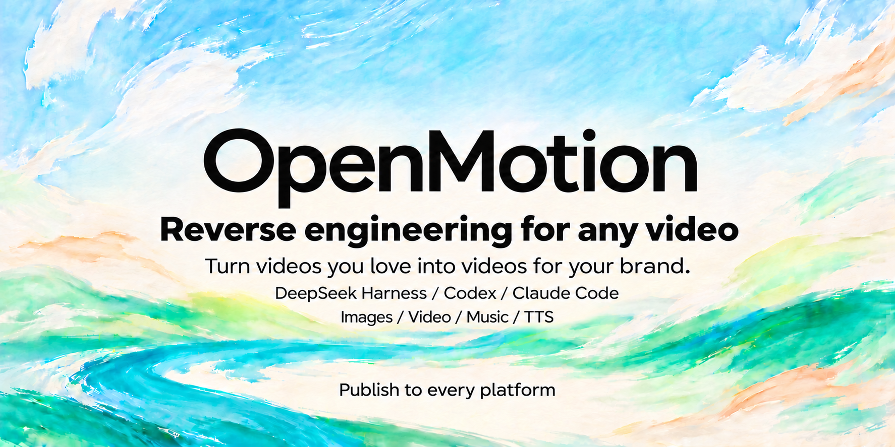

**目を引く発表動画、心地よいテンポの製品紹介、複雑な話をわかりやすく伝えるクリエイター。** その参考動画を、ロゴ、画面、映像素材、原稿とともにエージェントへ。OpenMotion は参考を分析し、構成を編集可能なプロジェクトとして再構築して、あなたの物語にする手順を提供します。

**話題の動画を再構築し、あなたのブランドの作品に。** ローカルエージェントを**フルスタックの動画クリエイター**にします。参考を分析し、**HTML、CSS、JavaScript** で表現し、対応する自分の API キーで不足素材を生成。同じ Studio で編集・レンダリングし、いつものエージェントとアカウントでソース、素材、完成動画を手元に残せます。

**🔑 BYOA + BYOK。🧩 890 件以上のリソース。👐 オープンソースで無料。** 参考から MP4 までを制作ソフトが支えます。エージェントの契約や外部モデル/API の料金は各提供元によります。[エージェントとキーを持ち込む](#bring-your-agent-and-keys) · [ライブラリを見る](#resources-to-start-from)

**分析、制作、公開。** 構造を読み解き、内蔵のマルチモーダル連携で素材を補い、編集可能なタイムラインにまとめます。**マルチプラットフォーム公開は計画中**。完成動画を視聴者へ届ける工程に広げていきます。

> 「この発表動画を私たちのブランド向けに再構築してください。見せ方、カメラの動き、テンポを保ち、製品、画面、原稿は私たちのものに。設定済みモデルで不足する映像、音楽、ナレーションを生成し、比較を見せてから編集可能なプロジェクトと MP4 を渡してください。」

**動画 → 分析・再構築 → コードでブランド化 → 生成・編集・レンダリング → 各プラットフォームへ公開（計画中）。**

<a id="everyone-can-be-a-creator"></a>
<a id="everyone-can-be-an-ai-video-editor-everyone-can-be-a-creator"></a>
<a id="人人都是自媒体"></a>
<a id="creator-video-gallery"></a>

## 🎥 人から始める。見たくなる動画を作る。

**顔、声、物語。それを伝える動き。** 講義、画面デモ、創業者の物語、製品動画など、9 本の参考から構成を学び、自分の録画で作ってみましょう。プレビューをクリックすると全編を見られます。

<table>
<tr><th colspan="3" align="left">🎓 教える・解説する</th></tr>
<tr>
<td width="33%" valign="top" align="center">
<a href="../library/skills/presenter-story/assets/careerwithriya-reference.mp4"><picture><source media="(prefers-reduced-motion: reduce)" srcset="readme/people/careerwithriya.jpg">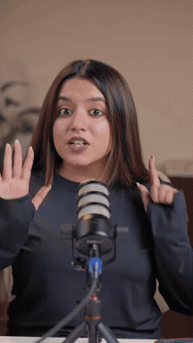</picture></a><br>
<strong>キャリアを変える 6 つの必須スキル</strong><br>
番号付きの要点 + 動くキーワード<br>
<sub>参考 · <a href="https://www.instagram.com/reel/Ddd57MBszhc/">@careerwithriya</a></sub>
</td>
<td width="33%" valign="top" align="center">
<a href="readme/media/dan-martell-tools-reference.mp4"><picture><source media="(prefers-reduced-motion: reduce)" srcset="readme/people/dan-martell-tools.jpg">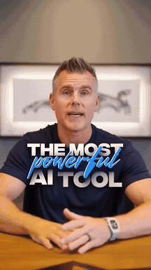</picture></a><br>
<strong>今、最も優れた AI ツールは？</strong><br>
話し手 + 浮かぶツールカード<br>
<sub>参考 · <a href="https://www.youtube.com/shorts/mk1zJd9Rm4c">Dan Martell</a></sub>
</td>
<td width="33%" valign="top" align="center">
<a href="readme/media/harpercarrollai-reference.mp4"><picture><source media="(prefers-reduced-motion: reduce)" srcset="readme/people/harpercarrollai.jpg"></picture></a><br>
<strong>10 日間の AI 基礎・1 日目</strong><br>
個人のレッスン + 読みやすい字幕<br>
<sub>参考 · <a href="https://www.instagram.com/reel/C4eNPF3PdpG/">@harpercarrollai</a></sub>
</td>
</tr>
<tr><th colspan="3" align="left">🖥️ ワークフローを見せる</th></tr>
<tr>
<td width="33%" valign="top" align="center">
<a href="../library/skills/presenter-story/assets/ali-abdaal-workflow-reference.mp4"><picture><source media="(prefers-reduced-motion: reduce)" srcset="readme/people/ali-abdaal-workflow.jpg"></picture></a><br>
<strong>毎日使う 5 つのツール</strong><br>
デスクでの語り + 作業画面<br>
<sub>参考 · <a href="../library/skills/presenter-story/assets/ali-abdaal-workflow-reference.mp4">Ali Abdaal</a></sub>
</td>
<td width="33%" valign="top" align="center">
<a href="../library/skills/presenter-story/assets/john-tagudin-capso-reference.mp4"><picture><source media="(prefers-reduced-motion: reduce)" srcset="readme/people/john-tagudin-capso.jpg">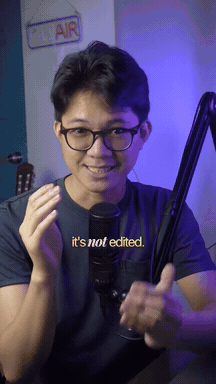</picture></a><br>
<strong>注釈付きのツールデモ</strong><br>
話し手 + 画面 + 注釈<br>
<sub>参考 · <a href="https://www.tiktok.com/@john.tagudin/video/7524883942328126728">@john.tagudin</a></sub>
</td>
<td width="33%" valign="top" align="center">
<a href="readme/media/aiwithsachi-reference.mp4"><picture><source media="(prefers-reduced-motion: reduce)" srcset="readme/people/aiwithsachi.jpg">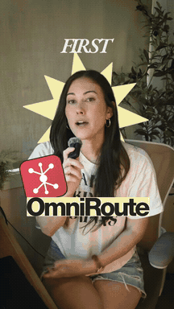</picture></a><br>
<strong>Claude に入れたい 5 つのプラグイン</strong><br>
口頭でのリスト + 補足スクリーンショット<br>
<sub>参考 · <a href="https://www.instagram.com/reel/Dc7G9Pxu_1O/">@aiwithsachi</a></sub>
</td>
</tr>
<tr><th colspan="3" align="left">🎬 物語と製品を伝える</th></tr>
<tr>
<td width="33%" valign="top" align="center">
<a href="readme/media/khris-sheer-founder-reference.mp4"><picture><source media="(prefers-reduced-motion: reduce)" srcset="readme/people/khris-sheer-founder.jpg">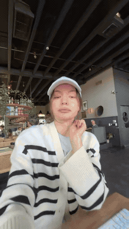</picture></a><br>
<strong>創業者の実験・第 1 話</strong><br>
創業者の日記 + 日常の B ロール<br>
<sub>参考 · <a href="https://www.tiktok.com/@khris.sheer/video/7491715587895430402">@khris.sheer</a></sub>
</td>
<td width="33%" valign="top" align="center">
<a href="readme/media/ugc-rachelll-reference.mp4"><picture><source media="(prefers-reduced-motion: reduce)" srcset="readme/people/ugc-rachelll.jpg">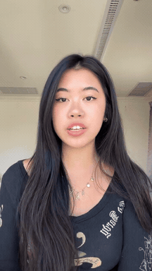</picture></a><br>
<strong>AI クリエイターと製品</strong><br>
製品の物語 + 根拠 + ピクチャーインピクチャー<br>
<sub>参考 · <a href="https://www.tiktok.com/@ugc.rachelll/video/7616996050066345246">@ugc.rachelll</a></sub>
</td>
<td width="33%" valign="top" align="center">
<a href="readme/media/kevinstratvert-reference.mp4"><picture><source media="(prefers-reduced-motion: reduce)" srcset="readme/people/kevinstratvert.jpg">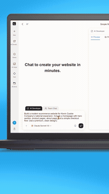</picture></a><br>
<strong>5 つの AI ツールへの支払いをやめよう</strong><br>
製品チュートリアル + 実演<br>
<sub>参考 · <a href="https://www.youtube.com/shorts/1fA5j5_5TRY">Kevin Stratvert</a></sub>
</td>
</tr>
</table>

**この方向で自分の動画を：** 自分の話し手、物語、製品で。導入、字幕のテンポ、画面の見せ方を参考に、素材に合わせた構成をエージェントに依頼します。[Presenter Story Skill](../library/skills/presenter-story/SKILL.md) · [参考作品のクレジット](readme/media/manifest.json)

### 🎙️ 次の話し手主導の解説動画

<a href="../library/templates/presenter-tech/README.md"><picture><source media="(prefers-reduced-motion: reduce)" srcset="readme/people/motiongit-kinetic.jpg">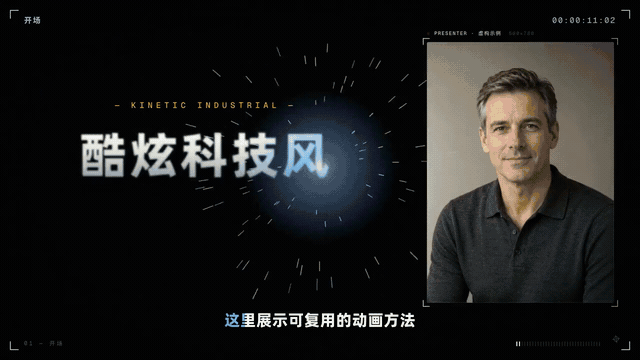</picture></a>

**話し手の物語 × 金属的な文字 × アニメーション解説。** 録画、原稿、画面、字幕を用意してください。編集可能なソース、パラメーター、フォント、音のレシピ、ローカルランナーを Library に収録。制作ガイドに沿ってエージェントが調整できます。**1920 × 1080 · 60 fps · 横向き。**

[テンプレートを入手](../library/templates/presenter-tech/presenter-tech.motion) · [制作ガイド](../library/templates/presenter-tech/TEMPLATE.md) · [MOTION_DESIGN.md](../library/templates/presenter-tech/MOTION_DESIGN.md)

<a id="brand-film-gallery"></a>

## 🚀 自分も作りたかった発表動画を研究する

**Lovable、Kimi、Firecrawl、Figma、ElevenLabs、Codex。** 好きな表現を参考に、自分の製品の動画を作りましょう。以下は参考作品で、各説明は次の制作に向けた提案です。

<table>
<tr>
<td width="50%" valign="top" align="center">
<a href="readme/media/jake-lovable-reference.mp4"><picture><source media="(prefers-reduced-motion: reduce)" srcset="readme/examples/viral-remix.jpg">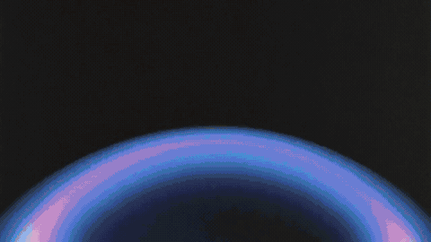</picture></a><br>
<strong>Lovable · Aesthetics Update</strong><br>
自信のある製品の見せ方で、次のデザイン更新を紹介。<br>
<sub>参考 · @lovable_dev</sub>
</td>
<td width="50%" valign="top" align="center">
<a href="readme/media/remix-kimi-k3-reference.mp4"><picture><source media="(prefers-reduced-motion: reduce)" srcset="../web/catalog/covers/ac6e14a0fadb5893534e6438.jpg"></picture></a><br>
<strong>Kimi · K3 teaser</strong><br>
次のリリースを短く印象的な予告に。<br>
<sub>参考 · @Kimi_Moonshot</sub>
</td>
</tr>
<tr>
<td width="50%" valign="top" align="center">
<a href="readme/media/remix-firecrawl-reference.mp4"><picture><source media="(prefers-reduced-motion: reduce)" srcset="../web/catalog/covers/02f9ae975461fe6290062d7f.jpg">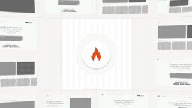</picture></a><br>
<strong>Firecrawl · Free Keyless</strong><br>
開発者向け機能を、伝わる製品ストーリーに。<br>
<sub>参考 · @ericciarla</sub>
</td>
<td width="50%" valign="top" align="center">
<a href="https://openai.com/codex-originals/">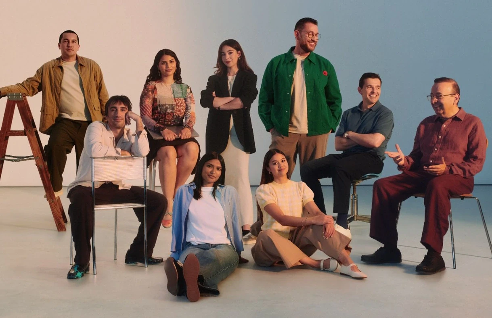</a><br>
<strong>OpenAI · Codex Originals</strong><br>
製品で何かを作る人を物語の中心に。<br>
<sub><a href="https://openai.com/codex-originals/">公式キャンペーンを見る ↗</a> · OpenAI · キャンペーン静止画</sub>
</td>
</tr>
<tr>
<td width="50%" valign="top" align="center">
<a href="readme/media/jake-figma-draw-reference.mp4"><picture><source media="(prefers-reduced-motion: reduce)" srcset="readme/examples/product-launch.jpg">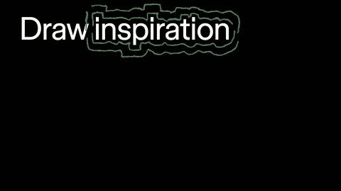</picture></a><br>
<strong>Figma · Draw</strong><br>
製品が可能にすることを動きで伝える。<br>
<sub>参考 · @figma</sub>
</td>
<td width="50%" valign="top" align="center">
<a href="readme/media/remix-elevenlabs-reception-reference.mp4"><picture><source media="(prefers-reduced-motion: reduce)" srcset="../web/catalog/covers/bc4b8b4398d66159acd35890.jpg"></picture></a><br>
<strong>ElevenLabs · Reception</strong><br>
焦点を絞った発表動画で新製品を紹介。<br>
<sub>参考 · @ElevenLabs</sub>
</td>
</tr>
</table>

> 「この方向で私たちのブランドの発表動画を作ってください。自社 UI、言葉、ブランド表現を使い、テンポと明快な見せ方を活かして、製品に合う新しい構成を提案してください。」

上記は制作者を明記した外部の参考作品です。OpenMotion はそれを自分の作品へ展開する手順を提供します。[動画の出典](readme/media/manifest.json) · [その他の展示素材の出典](readme/brand-showcase/README.md)

<a id="what-is-openmotion"></a>
<a id="openmotion-是什么"></a>
<a id="video-is-code"></a>

## 💻 動画はコード。HTML がキャンバス。

**コードを書けるローカルエージェントを、動画制作の全工程へ。** HTML、CSS、JavaScript でシーン、文字、配置、トランジション、時間を記述します。録画、生成動画、画像、音楽、ナレーションを組み込み、同じプロジェクトを Studio で開いて MP4 にレンダリングできます。

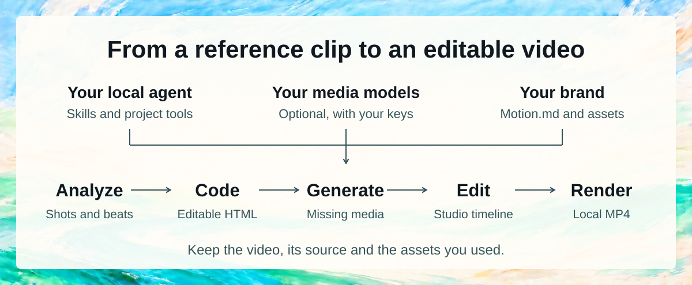

**書いて、見て、変えて、レンダリング。** 製品の差し替え、導入の短縮、話し手の追加、字幕や結末の変更を依頼します。エージェントがソースを編集し、あなたが画面で確認。ローカル MCP クライアントはプロジェクトツールを、シェル対応エージェントは Skills と固定版 CLI も使えます。[エージェント設定](#your-agent-your-studio) · [ネイティブ制作ガイド](../skills/motion-production/references/native.md) · [HTML サンプルプロジェクト](../template-library/product-promo/index.html)

**🎯 初めての 100 万再生を目指して。** 見たくなる導入を研究し、構造を読み解いて自分のブランドで表現しましょう。冒頭、話し手、製品の見せ方を試し、ソースを残して次の編集へつなげます。

<a id="bring-your-agent-and-keys"></a>

## 🔑 BYOA + BYOK。自分のエージェント、キー、動画。

**いつもの知能に、動画制作の一式を。** ローカルのコーディングエージェントが、要件の理解、シーン設計、動画コード、素材配置、編集の修正、最終レンダリングの依頼まで担います。

| 持ち込むもの | 動画への活かし方 |
| --- | --- |
| **🤖 エージェント — BYOA** | Skills と MCP、対応環境では CLI で接続。いつものクライアント、アカウント、作業文脈を使えます。 |
| **🔑 キー — BYOK** | Model Settings に対応するメディア API キーを設定し、画像、動画、音楽、TTS のモデルを選択。対応するローカル連携ではエージェントの既存ログインを利用できます。 |
| **🎨 ブランドと素材** | ロゴ、フォント、画面、撮影素材、台本、音楽を追加。Brandkit と Motion MD を再利用し、次の編集にも一貫性を保ちます。 |
| **🧩 制作の出発点** | 参考、モーション部品、テンプレート、コミュニティ Skills から方向を選び、ソースや参考をエージェントへ渡します。 |

### 一人のクリエイターが全工程を担う

**理解 → 演出 → コード → 生成 → 編集 → レンダリング。** エージェントが企画とコードを、Model Gateway が設定済みアカウントでの素材生成を担当。Studio でソース、素材、タイムラインをまとめ、同じプロジェクトを確認・修正してローカル MP4 を作ります。

**動画をコードで作り、改善し続ける。** HTML/CSS/JS と素材を編集して導入、話し手、ブランド、結末を変更。プロジェクトは確認・版管理・継続編集できる普通のソースファイルです。

### オープンソースの制作ソフトを無料で

**Skills、プロジェクトツール、モデル連携、Studio、レンダリングの制作パイプラインはオープンソースです。** ローカルで動かし、実装を確認・拡張できます。このローカル工程にソフトの月額料金やレンダリングごとの料金はありません。生成 API を使わず、手持ちの映像・画像・音声だけでも制作できます。

エージェントやモデル提供元の契約・利用料は別です。BYOA / BYOK は自分のアクセス権を使う方式で、第三者のクレジットを含まず、独自モデルをオープンソース化するものでもありません。認証情報は動画プロジェクトと別のワークスペース設定に保存します。[ライセンス](../LICENSE) · [エージェント設定](agent-adapters.md) · [モデル設定](model-gateway.md)

> 「ローカルエージェントと設定済みメディアモデルで制作してください。Library の参考を選び、HTML/CSS/JS で自社ブランド向けに構成を再構築。不足素材だけを生成し、編集可能なプロジェクトを見せ、確認後に MP4 をレンダリングしてソースを残してください。」

<a id="reverse-engineer-a-video"></a>

## 🔍 動画を再構築し、あなたのブランドの作品に

導入、UI の見せ方、アニメーション解説、最後のロゴなど、研究したい瞬間から。エージェントが、確認・変更できる制作上の判断に分解します。

| 参考から読み解くもの | 自分の物語に置き換えるもの |
| --- | --- |
| **導入と物語** — 順序、展開、見せ場への積み上げ | 自分の約束、製品の事実、行動喚起 |
| **ショット構成** — 画角、カメラ、レイヤー、視覚階層 | 自社 UI、映像、ロゴ、補助画像 |
| **動きとテンポ** — 登場、切り替え、緩急、読む時間 | 動きの意図を保ち、内容に合わせて調整 |
| **文字とブランド** — 文字階層、色、構図 | 自分の書体、配色、原稿、Brandkit |
| **音とリズム** — 発話のタイミング、音楽の合図、強調 | 自分の声、用意した音楽、音の演出 |

1. **参考とブランドを用意。** 動画またはアクセス可能なリンク、対象区間、ロゴ、原稿、画面や録画を渡します。[Brandkit](../library/brandkits/openmotion/BRANDKIT.md) でブランドと製品の事実をまとめます。
2. **何が効いているかを分析。** ショット、時間、動き、音、維持したい要素を特定し、Motion MD に記録します。
3. **コードで再構築。** 動画の参考には `motion-recreate`を使用。編集可能なソースがある場合はテンプレートの手順を使います。HTML/CSS/JS でシーン、動き、時間を記述し、映像・音声を素材として配置。自分の内容を使い、不足する画像、動画、音楽、TTS を内蔵連携で生成します。
4. **比較して磨く。** 参考と再構築動画の同じ時点を確認。見せ方、読む時間、構図、音を見直し、同じ Studio プロジェクトで修正します。
5. **視聴者に届ける準備。** MP4 を出力し、プロジェクトを残して、承認したブランドと動きのルールを次の動画へ。連携型のマルチプラットフォーム公開は**計画中**です。

```text
OpenMotion で添付の参考動画を自社ブランド向けに再構築してください。

分析：冒頭、ショットの順序、文字、トランジション、音の合図。
維持：選択区間の製品の見せ方とカメラのテンポ。
変更：ロゴ、UI、訴求、原稿、エンドカードを提供素材へ。
生成：ブランドと承認済み台本に従い、設定済みモデルで不足する
画像、動画、BGM、TTS ナレーションを用意。

編集可能なプロジェクトを Studio で開き、参考と同時点を比較。
残る差分を説明し、確認後に MP4 を出力して次の編集用にソースを保存。
```

参考の取得やメディア分析はホストのツールに依存します。必要に応じてローカル動画とタイムコードを用意し、自作または利用許諾済みの素材と参考のクレジットを使ってください。[再構築ワークフロー](../skills/motion-recreate/SKILL.md) · [参考コレクション](collections/README.md)

<a id="all-in-one-studio"></a>
<a id="full-video-creation-stack"></a>

## 🎛️ 動画制作の全工程をオープンソースで

**参考とブランドの企画から、編集可能な完成動画まで。** 制作手順、モデル連携、素材管理、タイムライン、モーションエンジン、レンダリングを一つにまとめます。手元の素材から始め、不足分を生成し、エージェントと仕上げます。

### ✨ 画像・動画・音楽・TTS の連携を内蔵

**BYOK で自分のマルチモーダルアカウントを制作へ。** **Model Settings** に対応キーを追加し、モデルを選び、Studio の **Model Gateway** から画像・動画・音楽・音声を生成します。候補を確認して同じプロジェクトへ採用。対応するローカル画像生成は既存のエージェントログインを利用できます。

| 必要な素材 | 内蔵モデルカタログの例 | 動画への用途 |
| --- | --- | --- |
| **🖼️ 画像** | Codex Image、Atlas Cloud の Nano Banana 2、fal.ai の FLUX Schnell | ブランド画像、シーンの絵、補助画像。対応する Codex 画像経路で参考画像を用いた編集 |
| **🎬 動画** | Atlas Cloud の Seedance 2.0、fal.ai の Wan 2.2 | 撮影素材やモーションと組み合わせるショット、B ロール |
| **🎵 音楽** | Atlas Cloud の Suno v4 | 雰囲気と企画に合ったサウンドトラック |
| **🎙️ TTS / ナレーション** | fal.ai の Kokoro | 承認済み台本から音声を生成し、映像・音楽と配置 |

これらは同梱の[ソース](../gateway/catalog.ts)にあるカタログ項目です。対応アカウントやキーを接続してください。利用可否、必要パラメーター、料金は提供元によります。モデル探索と明示的なエンドポイント登録にも対応します。[モデル設定と生成](model-gateway.md)

> 「Brandkit と承認済み台本で、冒頭の絵、挿入動画、BGM、TTS を生成してください。選んだ結果を再構築プロジェクトへ追加し、映像と音を合わせて全編を見せてください。」

### 🛠️ 制作意図から完成動画へ

| 工程 | OpenMotion がまとめるもの |
| --- | --- |
| **理解・演出** | 参考の再構築、制作 Skills、Brandkit、Motion MD、エージェントの分析ツール |
| **生成・管理** | マルチモーダルアダプター、モデル選択、生成ジョブ、候補プレビュー、素材 |
| **編集・アニメーション** | タイムライン、HTML/CSS/JS 合成、文字、トランジション、字幕、音の配置 |
| **確認・改善** | Studio プレビュー、手動調整、エージェントによる修正、プロジェクトの版 |
| **レンダリング・納品** | 固定版のレンダリング、技術検証、MP4 と編集可能なソース |
| **公開・学習 — 計画中** | プラットフォーム連携、公開予約、動画の版と結びつくフィードバック |

**実行し、調べ、拡張する。** アプリと連携コードはオープンソース。第三者のモデルやサービスには各自のライセンスと利用条件があります。次の編集に必要なソース、素材、制作判断はプロジェクトに残ります。

```text
参考 + 自分のブランド + エージェント
                 ↓
            理解・再構築
                 ↓
     画像 + 動画 + 音楽 + TTS
                 ↓
     編集可能な Studio プロジェクト
                 ↓
 確認 → 修正 → レンダリング → MP4 + ソース
                 ↓
    各プラットフォームへ公開 · 計画中
```

[アーキテクチャを見る](product/architecture.md) · [Model Gateway](model-gateway.md) · [アプリを拡張する](../CONTRIBUTING.md)

<a id="product-tour"></a>
<a id="产品界面"></a>
<a id="connect-your-agent"></a>
<a id="use-from-your-agent"></a>
<a id="从-agent-接入"></a>
<a id="your-agent-your-studio"></a>

## 🖥️ BYOA：ローカルエージェントが動画制作の全工程を

**自分のエージェントに動画制作の全工程を。** Skills が方法を、MCP がツールを、Studio が確認と調整の画面を提供します。エージェントは元のクライアントとアカウントを使い、OpenMotion がローカルの編集・レンダリングアプリを動かします。

| エージェント / クライアント | 接続方法 |
| --- | --- |
| **DeepSeek Harness** | ローカル MCP + Skills、または生成した Harness アダプター |
| **Codex** | ローカルプラグインまたは MCP + Skills。対応ホストでは Studio Viewer も利用可能 |
| **Claude Code** | ローカルプラグインまたは MCP + Skills、ローカル作業用 CLI |
| **WorkBuddy** | MCP + Skills 設定を生成。デスクトップでの制作・再生検証は未完了 |
| **その他のローカル MCP クライアント** | stdio を手動設定。メディア、シェル、Viewer の機能はホストによる |

[各エージェントの設定](agent-adapters.md) · [統合ローカルインストーラー](npm-installation.md) · [クイックスタート](#quick-start)

### エージェントから始める

DeepSeek Harness、Codex、Claude Code に参考とブランドの企画を渡し、再構築、プレビュー、修正、書き出しを依頼。既存のアカウントと作業方法を使い続けられます。

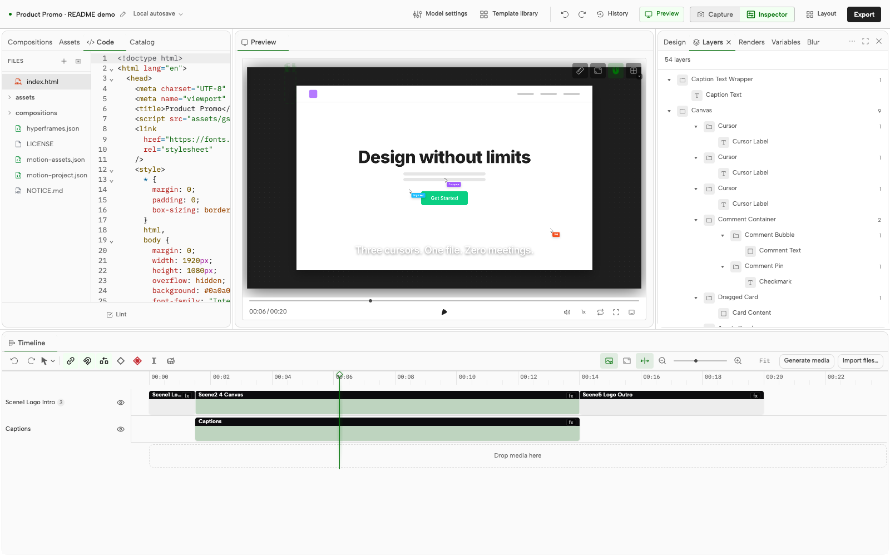

*このデモは Codex ホスト用に用意した Studio Viewer を示します。[収録範囲](product-tour.md) で実際に確認した内容を参照してください。*

### Studio から始める

参考を見て、テンプレートを開くか録画を読み込みます。**Connect Agent** のワークスペース別手順に従い、企画を渡してください。同じタイムラインで変更を確認し、いつでも手動調整できます。

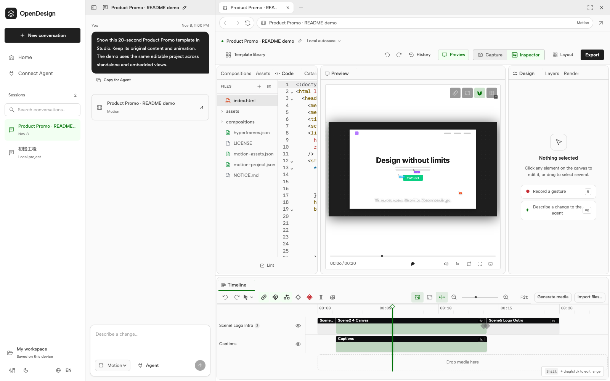

<details>
<summary>Claude Code とテンプレートの引き継ぎを見る</summary>

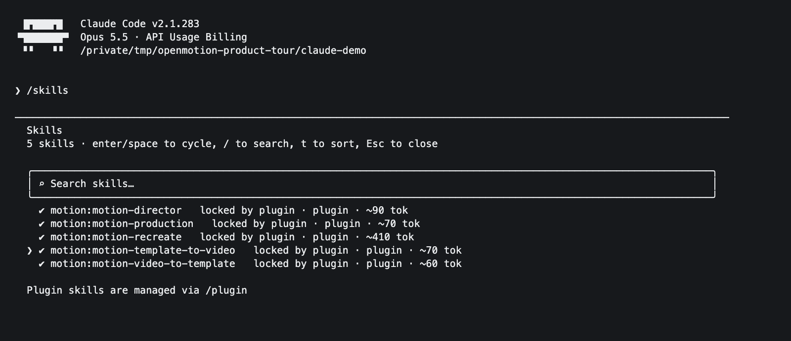

端末の収録はローカル Skill の読み込みを示します。[CLI 検査](readme/product-tour/cli-checks.png) はプロジェクト検査を示すもので、モデルによる再構築完了の証拠ではありません。

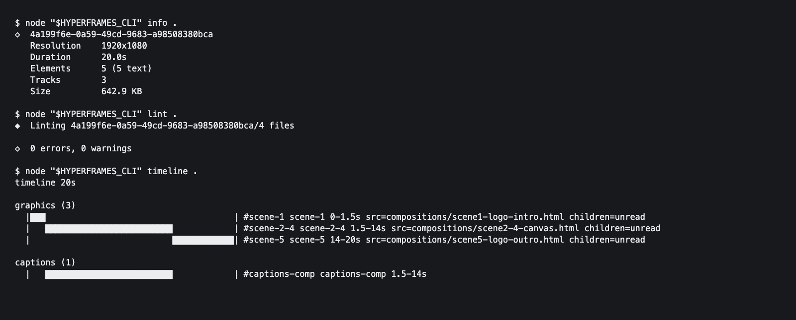

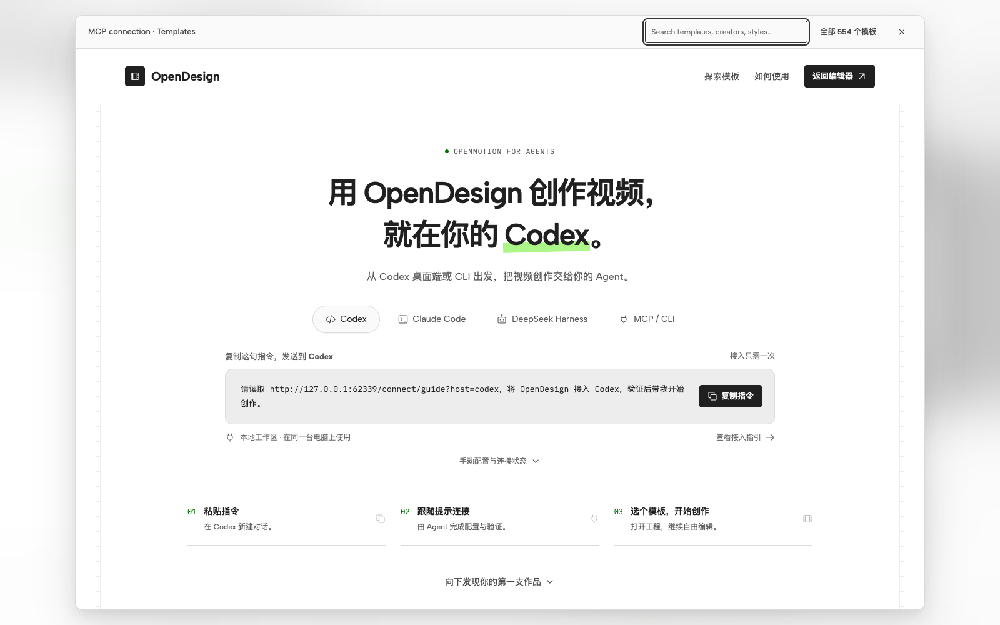

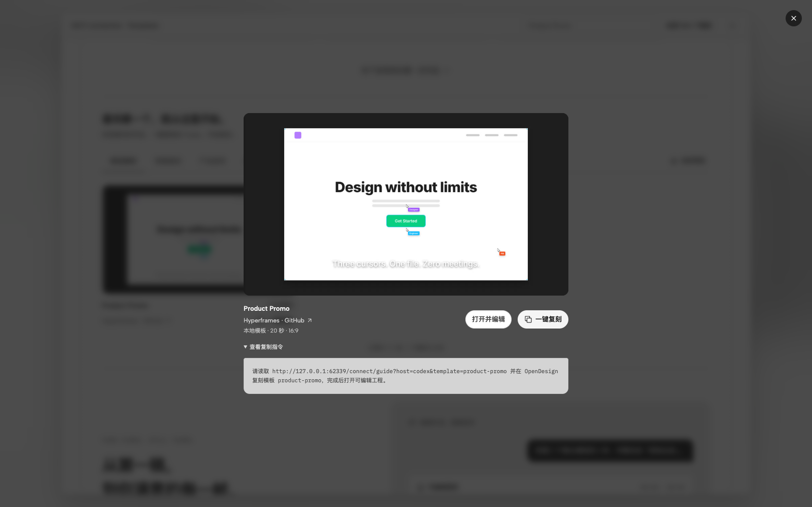

**プレビュー → 指示をコピー → ブランド素材と一緒にエージェントへ。** 同梱テンプレートは編集可能なコピーを開き、外部参考は再構築タスクを開始します。[製品デモ全体](product-tour.md)

</details>

どちらの入口も同じローカルアプリとプロジェクトを使用。エージェントは自身のクライアントで動き、Studio が企画と編集可能な作品を保存します。[接続の仕組み](session-architecture.md)

<a id="ai-video-editing"></a>
<a id="keep-editing-after-the-remake"></a>

## ✂️ 再構築のあとも編集を続ける

**最初の再構築は、自分の動画の始まり。** 導入を締め、画面を替え、解説を足し、終わりを長くしたり、別の視聴者向けに編集できます。

**AI 編集と Motion のための All-in-One AI-native Studio。** 初稿から最終レンダリングまで、人とエージェントが同じ編集可能なタイムラインで作業します。

| Studio の機能 | 今できること |
| --- | --- |
| **物語とタイムライン** | 素材の読み込み・配置、台本や確定タイムコードに基づく切り詰め・並べ替え・修正 |
| **動きと字幕** | 内容に合わせた動く文字、トランジション、注釈、図表、字幕 |
| **素材と音** | 手元の素材の読み込み、内蔵モデル連携での画像・動画・音楽・TTS 生成 |
| **画像の修正** | 参考画像対応モデルで候補を生成し、時間と動きを保ったまま差し替え |
| **プレビューと版** | Studio で確認し、手動またはエージェントで編集。次の修正にも同じプロジェクトを使用 |
| **出力とソース** | 固定版を MP4 にレンダリングし、HTML、CSS、JavaScript、素材を保存 |

> 「承認済みの見せ方は維持。中盤をこの画面録画に替え、指定タイムコードで導入を短くし、最後の CTA を 2 秒長くしてください。」

モデルの可用性は提供元の設定によります。自動音声理解、内容選択、投稿先に応じた自動リフレームは別機能であり、タイムライン編集だけでは提供されません。[メディア操作](model-gateway.md) · [プロジェクトと版](project-workspace.md)

<a id="presenter-motion"></a>

### 🎙️ 人の声、物語、伝えるための動き

トーク動画、チュートリアル、製品紹介にも。**人の語りと物語のテンポを保ち、自分の録画、テーマ、ブランドで字幕、画面、ピクチャーインピクチャー、動きを再利用します。**

<details>
<summary><strong>3 つの話し手中心の作例と Motion MD レシピを見る</strong></summary>

各ペアは原作と外部の改編作品の無音抜粋です。自分の録画の方向性を探し、リンク先の設計レシピをエージェントへの指針にしてください。

#### 顔、キーワード、視覚的な例で教える

**キャリアの助言 → 動画制作の解説**

<table>
<tr><th width="50%">参考 · @careerwithriya</th><th width="50%">改編 · 外部の作例</th></tr>
<tr><td colspan="2" align="center"><picture><source media="(prefers-reduced-motion: reduce)" srcset="readme/people/careerwithriya-comparison.jpg">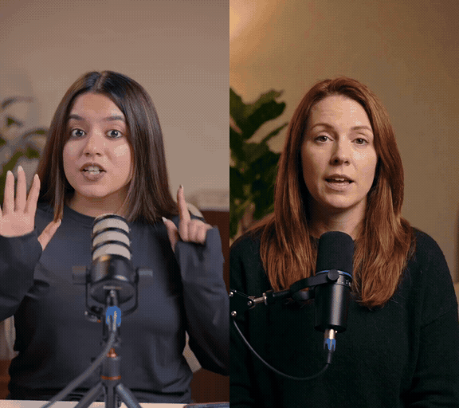</picture></td></tr>
</table>

**再利用：** 番号付きの論点、話し手の語り、根拠のカード。**変更：** 出演者、話題、キーワード、補足例。

[MOTION_DESIGN.md](../library/skills/presenter-story/references/presenter-listicle/MOTION_DESIGN.md) · [Skill](../library/skills/presenter-story/SKILL.md) · [原作](../library/skills/presenter-story/assets/careerwithriya-reference.mp4) · [改編全編](../library/skills/presenter-story/assets/careerwithriya-result.mp4)

#### 語りながらワークフローを見せる

**日常のツール → デザイン作業場の物語**

<table>
<tr><th width="50%">参考 · Ali Abdaal</th><th width="50%">改編 · 外部の作例</th></tr>
<tr><td colspan="2" align="center"><picture><source media="(prefers-reduced-motion: reduce)" srcset="readme/people/ali-abdaal-workflow-comparison.jpg">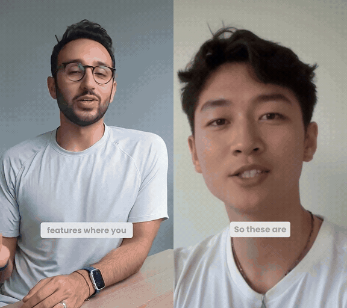</picture></td></tr>
</table>

**再利用：** 話し手と画面のリズム、控えめな字幕、読みやすい挿入画面。**変更：** 自分の録画、手順、画面。

[MOTION_DESIGN.md](../library/skills/presenter-story/references/workflow-demo/MOTION_DESIGN.md) · [Skill](../library/skills/presenter-story/SKILL.md) · [原作](../library/skills/presenter-story/assets/ali-abdaal-workflow-reference.mp4) · [改編全編](../library/skills/presenter-story/assets/ali-abdaal-workflow-result.mp4)

#### 話し手と製品を一つの物語に

**ツールデモ → 動画エディターの紹介**

<table>
<tr><th width="50%">参考 · @john.tagudin</th><th width="50%">改編 · 外部の作例</th></tr>
<tr><td colspan="2" align="center"><picture><source media="(prefers-reduced-motion: reduce)" srcset="readme/people/john-tagudin-capso-comparison.jpg">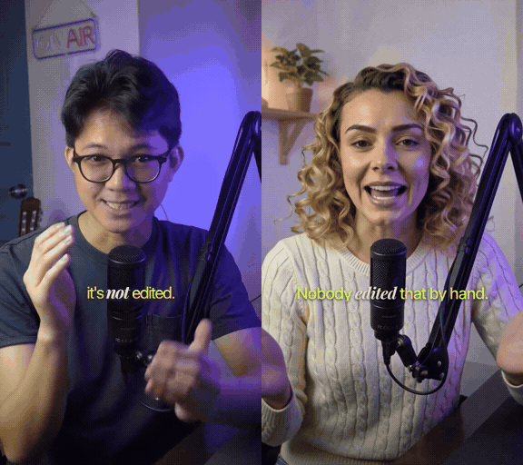</picture></td></tr>
</table>

**再利用：** 導入、ピクチャーインピクチャー、注釈、見える成果。**変更：** 製品、話し手、実演、締めの言葉。

[MOTION_DESIGN.md](../library/skills/presenter-story/references/product-walkthrough/MOTION_DESIGN.md) · [Skill](../library/skills/presenter-story/SKILL.md) · [原作](../library/skills/presenter-story/assets/john-tagudin-capso-reference.mp4) · [改編全編](../library/skills/presenter-story/assets/john-tagudin-capso-result.mp4)

> この構成で自分の撮影と画面録画を使ってください。声を保ち、実際の発話に沿って編集し字幕を合わせます。画面、ピクチャーインピクチャー、動きで要点を説明。音付きプレビューの後、編集可能なプロジェクトと MP4 を渡してください。


</details>

**誰もがクリエイターに。** 伝えたいことから始め、参考で構成を具体化し、自分の声を中心に置きましょう。

<a id="可以用它做什么"></a>
<a id="what-can-you-make"></a>

## 🎞️ 何を作れる？

**アイデアを見つけ、自分の作品に。** 7 つの用途に、それぞれエージェントへ渡せる企画があります。動く抜粋はカタログの外部作品です。クリックして全編を見て、自分の素材とブランドで始めてください。

<table>
<tr>
<td width="50%" valign="top">
<strong>01 · AI トーク動画編集</strong><br>
3 分の素材から、伝わる一つの物語へ。
<p align="center">
<a href="../library/skills/presenter-story/assets/ali-abdaal-workflow-reference.mp4"><picture>
<source media="(prefers-reduced-motion: reduce)" srcset="readme/examples/talking-head.jpg">

</picture></a>
</p>
<sub>参考 · <a href="../library/skills/presenter-story/assets/ali-abdaal-workflow-reference.mp4">Ali Abdaal · 毎日使う 5 つのツール</a></sub><br><br>
<strong>用意するもの</strong> · 自分の録画 + 文字起こし / タイムコード<br>
<strong>自分の作品にする</strong> · 明快な導入、引き締まった語り、字幕、適切な B ロール。<br><br>
<a href="examples.md#talking-head">制作ブリーフをコピー →</a> · <a href="readme/examples/talking-head.jpg">静止画プレビュー</a>
</td>
<td width="50%" valign="top">
<strong>02 · AI 再編集と修正</strong><br>
ばらばらの映像を 100 日の物語に。
<p align="center">
<a href="readme/media/hundred-days-story-reference.mp4"><picture>
<source media="(prefers-reduced-motion: reduce)" srcset="readme/examples/story-recut.jpg">
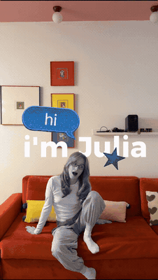
</picture></a>
</p>
<sub>参考 · <a href="https://www.instagram.com/reel/Dd6vHlQgpok/">ステッカーと写真カードで描く 100 日</a></sub><br><br>
<strong>用意するもの</strong> · クリップ、写真、ナレーション、物語の概要<br>
<strong>自分の作品にする</strong> · 写真の切り抜き、章立て、新たなテンポで個人のモンタージュに。<br><br>
<a href="examples.md#story-recut">制作ブリーフをコピー →</a> · <a href="readme/examples/story-recut.jpg">静止画プレビュー</a>
</td>
</tr>
<tr>
<td width="50%" valign="top">
<strong>03 · 製品発表とデモ</strong><br>
機能を主役に。
<p align="center">
<a href="readme/media/jake-figma-draw-reference.mp4"><picture>
<source media="(prefers-reduced-motion: reduce)" srcset="readme/examples/product-launch.jpg">

</picture></a>
</p>
<sub>参考 · <a href="readme/media/jake-figma-draw-reference.mp4">Figma Draw · @figma</a></sub><br><br>
<strong>用意するもの</strong> · 製品画面 + 機能の説明 + Brandkit<br>
<strong>自分の作品にする</strong> · 機能の登場、焦点を絞った UI デモ、印象に残る締め。<br><br>
<a href="examples.md#product-launch">制作ブリーフをコピー →</a> · <a href="readme/examples/product-launch.jpg">静止画プレビュー</a>
</td>
<td width="50%" valign="top">
<strong>04 · 話題の動画を再構築</strong><br>
リズムを活かし、自分の作品に。
<p align="center">
<a href="readme/media/jake-lovable-reference.mp4"><picture>
<source media="(prefers-reduced-motion: reduce)" srcset="readme/examples/viral-remix.jpg">

</picture></a>
</p>
<sub>参考 · <a href="readme/media/jake-lovable-reference.mp4">Lovable: Aesthetics Update · @lovable_dev</a></sub><br><br>
<strong>用意するもの</strong> · 参考動画 + 自分の原稿、画像、ブランド<br>
<strong>自分の作品にする</strong> · 導入、文字、視覚的リズムを軸に、新たな編集可能な動画へ。<br><br>
<a href="examples.md#viral-remix">制作ブリーフをコピー →</a> · <a href="readme/examples/viral-remix.jpg">静止画プレビュー</a>
</td>
</tr>
<tr>
<td width="50%" valign="top">
<strong>05 · 解説とチュートリアル</strong><br>
一つの手順を、明快な 3 ステップで。
<p align="center">
<a href="readme/media/remix-authorize-once-reference.mp4"><picture>
<source media="(prefers-reduced-motion: reduce)" srcset="readme/examples/explainer.jpg">
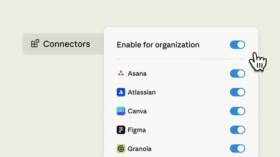
</picture></a>
</p>
<sub>参考 · <a href="readme/media/remix-authorize-once-reference.mp4">一度の認証で、みんなにつながる</a></sub><br><br>
<strong>用意するもの</strong> · 手順 + 台本 + 正確な UI 画像<br>
<strong>自分の作品にする</strong> · 一場面一つの要点と、意図のある注釈で案内。<br><br>
<a href="examples.md#explainer">制作ブリーフをコピー →</a> · <a href="readme/examples/explainer.jpg">静止画プレビュー</a>
</td>
<td width="50%" valign="top">
<strong>06 · データの物語と図表</strong><br>
数字に伝える意味を。
<p align="center">
<a href="readme/media/M1128-clip.mp4"><picture>
<source media="(prefers-reduced-motion: reduce)" srcset="readme/examples/data-story.jpg">
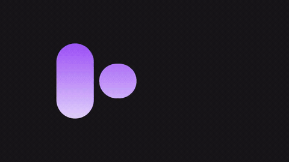
</picture></a>
</p>
<sub>参考 · <a href="https://x.com/Vintage_god/status/2106817967967056165">動く比較棒グラフ · @Vintage_god</a></sub><br><br>
<strong>用意するもの</strong> · データ、単位、出典、結論<br>
<strong>自分の作品にする</strong> · 読みやすい図表、動く数値、明快な比較。<br><br>
<a href="examples.md#data-story">制作ブリーフをコピー →</a> · <a href="readme/examples/data-story.jpg">静止画プレビュー</a>
</td>
</tr>
<tr>
<td colspan="2" valign="top">
<strong>07 · 音楽とアート映像</strong><br>
音楽に固有のビジュアルを。
<p align="center">
<a href="readme/media/M1139-clip.mp4"><picture>
<source media="(prefers-reduced-motion: reduce)" srcset="readme/examples/music-visual.jpg">
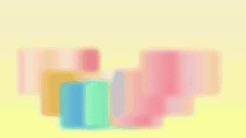
</picture></a>
</p>
<sub>参考 · <a href="https://x.com/GoogleAI/status/2024154215182926027">Lyria 3 の映像シーケンス · @GoogleAI</a></sub><br><br>
<strong>用意するもの</strong> · 音源 + 雰囲気 + 拍のマーカー / キューポイント<br>
<strong>自分の作品にする</strong> · 色の重なり、動く文字、音楽に合わせた映像の流れ。<br><br>
<a href="examples.md#music-visual">制作ブリーフをコピー →</a> · <a href="readme/examples/music-visual.jpg">静止画プレビュー</a>
</td>
</tr>
</table>

これらは制作の方向性を示す参考で、OpenMotion が生成した検証用デモではありません。編集可能な出発点には、[3 つの同梱テンプレート](../library/templates/README.md)のいずれかを開いてください。[企画例と手順](examples.md) · [出典と抜粋の記録](readme/ASSETS.md#creative-examples)

<a id="make-your-motion-language-reusable"></a>
<a id="motion-design-community"></a>

## 🎨 Motion Design MD — 技法を共有するコミュニティ

**一度分析し、動きの言語を共有し、次の作り手へ。** `MOTION_DESIGN.md` は、このコミュニティの中心となる Markdown 規約の提案です。動画の動き、その理由、新しいブランドへの適用方法を読める形で残します。

会話の中の制作判断を、人とエージェントが読んでレビュー・改善できるファイルへ。デザイナーが動きを記し、開発者が実装し、別の作り手が新しい物語へ応用します。**完成動画と、その作り方を共有します。**

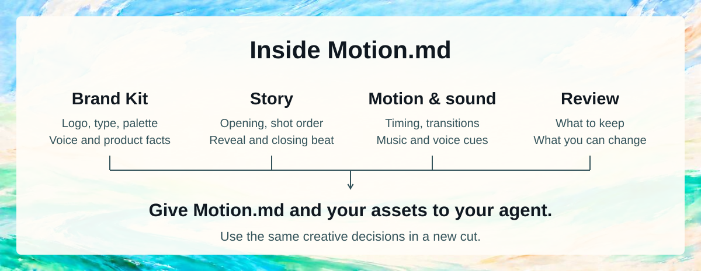

<details>
<summary>制作パッケージをテキストで読む</summary>

```text
参考 + 自分のブランド
          ↓
理解 → 再構築 → 比較 → 修正
          ↓
再利用できる制作パッケージ
  BRANDKIT.md       ブランド、製品情報、承認素材
  MOTION_DESIGN.md  物語、動き、時間、音、維持/変更の規則
  SKILL.md          改編・レビューの方法
  ソース + 素材    編集可能な実装
  プリセット + 検証記録  置換入力と実際の比較
          ↓
エージェント → 次の編集可能な動画
```

</details>

**Brandkit はブランド、Motion MD は設計、Skill は方法、プロジェクトは実装を担います。** 最初の書き出しの後も使え、他の人が確認・フォーク・改善できる形になります。

| 現在の Library のリソース | 得られるもの |
| --- | --- |
| [OpenMotion Brandkit](../library/brandkits/openmotion/BRANDKIT.md) | ブランドの事実、見た目、語り口、素材の例 |
| [Ink & Water](../library/design-systems/ink-water/MOTION_DESIGN.md) | 再利用できるモーションの設計方針 |
| [Motion Design Remix](../library/skills/motion-design-remix/SKILL.md) | 6 つのソース例：ワイヤーフレーム、樹冠の文字、UI 登場、立体コード、粒子集合、ガラスカード |
| [Presenter Story](../library/skills/presenter-story/SKILL.md) | 語りを軸にした動画の設計レシピ 3 種 |

`MOTION_DESIGN.md` は、エージェントへ明示的に渡す **v0.1 の記述規約**です。自動インポーターや検証器はありません。ソース改編パッケージには 6 種の置換ヘルパーがあり、動画のみの再構築には `motion-recreate`を使います。持ち運べるテンプレートが必要な場合、 `motion-video-to-template` が既定の `TEMPLATE.md` 引き継ぎ形式を提供します。[Motion MD ガイド](motion-md.md) · [全 6 作例](motion-design-examples.md)

### 🌱 自分の改編を、次の作り手の出発点に

```text
参考を研究 → ブランド向けに再構築 → 実際の結果を比較
                                      ↓
                      GitHub に制作パッケージを公開
                  Motion MD + ソース + プレビュー + 出典
                                      ↓
                        フォーク → ブランド変更 → 確認
                                      ↓
                        改善と新しい実例を共有
```

1. **設計を書く。** 参考、物語の節目、時間、構図、カメラ、文字、音、内容を替えても維持する判断を記録。
2. **動く形にする。** 編集可能なソースと許諾済み素材、置換入力、プレビュー・レンダリングの手順を同梱。
3. **結果を見せる。** 参考と改編、必要に応じた同時点比較、実施した検査、残る差分を共有。
4. **貢献し、改編する。** 完結したフォルダーを PR で提案。フォーク、ブランド変更、新たな作例による改善につなげます。

| あなたの貢献 | コミュニティに残るもの |
| --- | --- |
| **モーションデザイン** | 文書化された視覚言語、ショットの文法、音の方針 |
| **クリエイティブコーディング** | 編集可能な実装、部品、再利用できる動作 |
| **ブランドと物語** | 新しい企画、実際の改編、別の内容でも設計が機能する証拠 |
| **エージェントの手順** | 再構築、改編、比較、レビューを導く Skills |
| **調査と評価** | 出典付きの参考、再現できる比較、ベンチマーク課題の提案 |

[Motion Design Remix](../library/skills/motion-design-remix/SKILL.md)、[Presenter Story](../library/skills/presenter-story/SKILL.md) または [Ink & Water](../library/design-systems/ink-water/MOTION_DESIGN.md)から始めてください。[リソース登録チェックリスト](../library/ENTRY_TEMPLATE.md)を使い、[GitHub](https://github.com/nexu-io/html-anything/issues) で共有し、[Discord](https://discord.gg/mHAjSMV6gz)へ。Git での貢献と明示的な再利用は今すぐ可能です。マーケットプレイス、Motion Benchmark / Arena は将来の方向性です。

<a id="see-the-motion-survive-a-new-brand"></a>

## 🧪 動画の裏側にある編集可能な動きを探る

**カメラ、タイトル、製品の見せ方が気に入ったら、発想を残して物語を変える。** 6 つの編集可能なソース研究に、Motion MD、Skill、内容プリセットを収録しています。[ソース、入力、検証記録](motion-design-examples.md).

<details>
<summary><strong>文字、UI、コード、粒子、ガラスの 6 つのソース研究を開く</strong></summary>

ペアのプレビューは同じ実装からレンダリングした無音抜粋で、元の内容と改編を同じ時点で比較します。

### ワイヤーフレームのポータル · BREAKTHROUGH → OPENMOTION

<table>
<tr><th width="50%">参考 · 元の内容</th><th width="50%">改編 · Skill パッケージでの変更</th></tr>
<tr><td colspan="2"><a href="../library/skills/motion-design-remix/previews/wireframe-portal-title.mp4"><picture><source media="(prefers-reduced-motion: reduce)" srcset="../library/skills/motion-design-remix/previews/wireframe-portal-title.jpg"></picture></a></td></tr>
</table>

**維持：ポータルのタイミング、立体文字、カメラの前進。** **変更：タイトル、副題、3D フレーズ。**

[MOTION_DESIGN.md](../library/skills/motion-design-remix/references/wireframe-portal-title/MOTION_DESIGN.md) · [Skill](../library/skills/motion-design-remix/SKILL.md) · [内容プリセット](../library/skills/motion-design-remix/presets/wireframe-portal-title.json) · [MP4](../library/skills/motion-design-remix/previews/wireframe-portal-title.mp4)

### 樹冠のタイポグラフィ · Understory → OpenMotion

<table>
<tr><th width="50%">参考 · 元の内容</th><th width="50%">改編 · Skill パッケージでの変更</th></tr>
<tr><td colspan="2"><a href="../library/skills/motion-design-remix/previews/canopy-part-title.mp4"><picture><source media="(prefers-reduced-motion: reduce)" srcset="../library/skills/motion-design-remix/previews/canopy-part-title.jpg"></picture></a></td></tr>
</table>

**維持：葉の動き、奥行き、遮蔽、読む時間。** **変更：2 つのブランド見出し。**

[MOTION_DESIGN.md](../library/skills/motion-design-remix/references/canopy-part-title/MOTION_DESIGN.md) · [Skill](../library/skills/motion-design-remix/SKILL.md) · [内容プリセット](../library/skills/motion-design-remix/presets/canopy-part-title.json) · [MP4](../library/skills/motion-design-remix/previews/canopy-part-title.mp4)

### UI の登場 · 製品ツアー → AI 編集の物語

<table>
<tr><th width="50%">参考 · 元の内容</th><th width="50%">改編 · Skill パッケージでの変更</th></tr>
<tr><td colspan="2"><a href="../library/skills/motion-design-remix/previews/ui-3d-reveal.mp4"><picture><source media="(prefers-reduced-motion: reduce)" srcset="../library/skills/motion-design-remix/previews/ui-3d-reveal.jpg">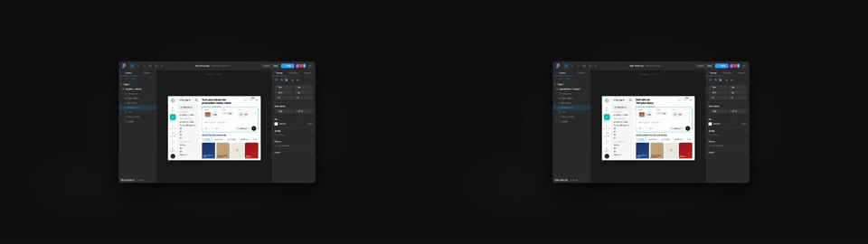</picture></a></td></tr>
</table>

**維持：傾いたキャンバス、奥行きの階層、連続したカメラ。** **変更：大見出し、文書、コミュニティの文言。**

[MOTION_DESIGN.md](../library/skills/motion-design-remix/references/ui-3d-reveal/MOTION_DESIGN.md) · [Skill](../library/skills/motion-design-remix/SKILL.md) · [内容プリセット](../library/skills/motion-design-remix/presets/ui-3d-reveal.json) · [MP4](../library/skills/motion-design-remix/previews/ui-3d-reveal.mp4)

### 立体コード · loadConfig() → cutVideo()

<table>
<tr><th width="50%">参考 · 元の内容</th><th width="50%">改編 · Skill パッケージでの変更</th></tr>
<tr><td colspan="2"><a href="../library/skills/motion-design-remix/previews/code-3d-extrude.mp4"><picture><source media="(prefers-reduced-motion: reduce)" srcset="../library/skills/motion-design-remix/previews/code-3d-extrude.jpg">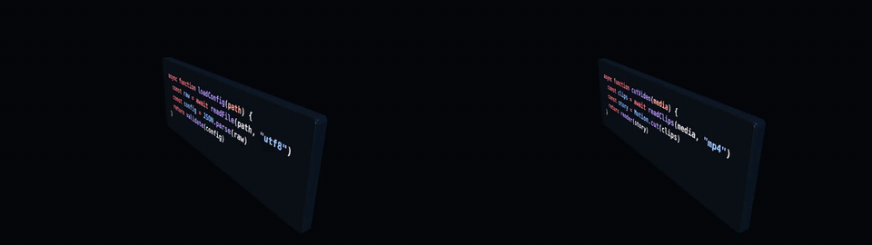</picture></a></td></tr>
</table>

**維持：押し出した板、構文の色、カメラの動き。** **変更：関数、変数、表示する呼び出し。**

[MOTION_DESIGN.md](../library/skills/motion-design-remix/references/code-3d-extrude/MOTION_DESIGN.md) · [Skill](../library/skills/motion-design-remix/SKILL.md) · [内容プリセット](../library/skills/motion-design-remix/presets/code-3d-extrude.json) · [MP4](../library/skills/motion-design-remix/previews/code-3d-extrude.mp4)

### 粒子の集合 · parse / optimize / emit → select / trim / render

<table>
<tr><th width="50%">参考 · 元の内容</th><th width="50%">改編 · Skill パッケージでの変更</th></tr>
<tr><td colspan="2"><a href="../library/skills/motion-design-remix/previews/code-particle-assemble.mp4"><picture><source media="(prefers-reduced-motion: reduce)" srcset="../library/skills/motion-design-remix/previews/code-particle-assemble.jpg">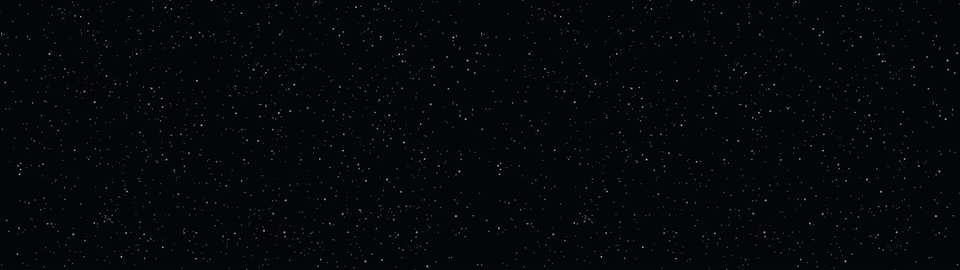</picture></a></td></tr>
</table>

**維持：シード固定の粒子運動と集合のテンポ。** **変更：処理の名前と手順。**

[MOTION_DESIGN.md](../library/skills/motion-design-remix/references/code-particle-assemble/MOTION_DESIGN.md) · [Skill](../library/skills/motion-design-remix/SKILL.md) · [内容プリセット](../library/skills/motion-design-remix/presets/code-particle-assemble.json) · [MP4](../library/skills/motion-design-remix/previews/code-particle-assemble.mp4)

### ガラスの情報カード · 機器ウィジェット → 制作ワークスペース

<table>
<tr><th width="50%">参考 · 元の内容</th><th width="50%">改編 · Skill パッケージでの変更</th></tr>
<tr><td colspan="2"><a href="../library/skills/motion-design-remix/previews/liquid-glass-widgets.mp4"><picture><source media="(prefers-reduced-motion: reduce)" srcset="../library/skills/motion-design-remix/previews/liquid-glass-widgets.jpg">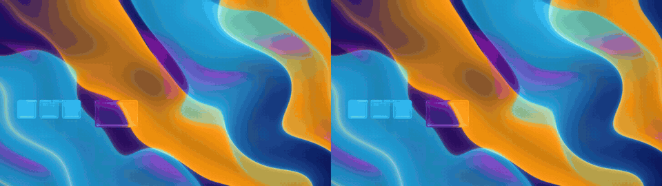</picture></a></td></tr>
</table>

**維持：ガラス表現、カード階層、時間差、メーター。** **変更：ラベル、単位、機能の物語。**

[MOTION_DESIGN.md](../library/skills/motion-design-remix/references/liquid-glass-widgets/MOTION_DESIGN.md) · [Skill](../library/skills/motion-design-remix/SKILL.md) · [内容プリセット](../library/skills/motion-design-remix/presets/liquid-glass-widgets.json) · [MP4](../library/skills/motion-design-remix/previews/liquid-glass-widgets.mp4)

動画しかない参考には、別の[再構築ワークフロー](../skills/motion-recreate/SKILL.md) で作り直して比較します。再現度は選んだ参考と制作要件に照らして確認します。

</details>

<a id="one-video-more-places-to-share"></a>
<a id="publish-to-every-platform"></a>

## 📤 あらゆるプラットフォームへ公開 — 計画中

**動画を読み解き、ブランドの作品にして、視聴者へ。** 参考、ブランド制作、マルチモーダル生成、編集、レンダリング、配信をつなぎ、承認済み作品を複数チャネルで公開することを目指します。

**計画中：** 公開アカウントを接続し、投稿先別の動画と文章を用意して、確認後に一か所から公開・予約。「あらゆるプラットフォーム」は製品の方向性で、対応先は接続機能の実装・検証後に発表します。

### 投稿先別の動画は今すぐ作れる

承認済みの動画を各チャネル向けに展開。編集可能なプロジェクトで、ブランドと動きを保ちながら導入、長さ、配置、締めの言葉を変更できます。

> 「承認済みの動画から 9:16 のショート、16:9 の製品発表、正方形のフィード版を作ってください。文字と UI を各画面に合わせ、ブランドと見せ場を維持し、各版を確認させてください。」

| 依頼する版 | 調整するもの |
| --- | --- |
| **縦のショート** — Reels、Shorts、TikTok、小紅書など | 導入、大きく読みやすい文字、画角、字幕位置 |
| **横の動画** — 製品ページ、発表、YouTube | UI の細部、広い構図、説明する時間 |
| **正方形のフィード版** — SNS キャンペーン | コンパクトな構図、見出し、明快な締め |

これらは制作依頼の例で、内蔵の書き出しプリセットではありません。エージェントが構図を調整し、投稿先の現行要件に照らして各出力を確認します。

**今できること：** 各版を作り、MP4 を出力して、自分で公開するか予約ツールへアップロード。公開は別工程で、OpenMotion 内のアカウント連携と予約は計画中です。

### 公開サービスとの連携 — 計画中

| 計画している工程 | 目指す体験 |
| --- | --- |
| **チャネルを接続** | ブランドのアカウントと投稿先を選択 |
| **公開を準備** | 投稿先別に動画、表紙、字幕、投稿文を用意 |
| **確認して公開** | 完成版を承認して公開・予約 |
| **結果から学ぶ** | 成績を公開した正確な版に結びつけ、次の制作へ |

```text
現在
分析 → ブランド化 → 生成 → 編集 → レンダリング → MP4
                                                 ↓
                                  手動アップロード / 外部予約ツール

計画中 · 各プラットフォームへ公開
承認済みの版 → 公開連携 → 予約 → 成績のフィードバック
      ↑                              |
      +──────── 次の動画を改善 ────────+
```

**着想から配信まで、一つの制作手順に。** 今の制作基盤は参考の再構築、マルチモーダル生成、編集、レンダリングです。アプリ内公開、予約、自動リフレーム、分析データ取り込みは**計画中**。[現在の機能範囲](product/architecture.md) · [公開とフィードバックの方向性](product/studio-vision.md)

<a id="resources-to-start-from"></a>

## 🧩 890 件以上のリソースから、自分の方向を見つける

**全工程を担うクリエイターに、制作のライブラリを。** 参考動画、動きの断片、コード例、ブロック、部品に、コミュニティ Skills、編集可能なテンプレート、デザインシステム、Brandkit を組み合わせます。

発見用カタログは **891 件**：**全編の参考動画 42 本**、**モーションの断片 393 件**、**ブロック 210 件**、**部品 238 件**、**作例 8 件**。視聴用の参考とコードが含まれ、すぐ開ける Studio プロジェクトは別に記載します。[リソース索引](collections/README.md)

**5 種のリソースが制作を支えます。** Skills は方法、テンプレートは出発点、部品は再利用できる動き、デザインシステムは一貫性、Brandkit はブランドを担います。**5 つの基本制作 Skills**、**3 つのネイティブ Studio テンプレート**、**Presenter Tech**、**6 つの動きの研究**、**3 つの話し手のレシピ**から始め、学びを共有してください。

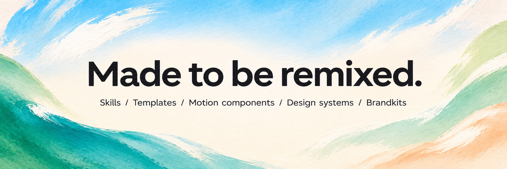

| 分類 | ここから始める |
| --- | --- |
| **Skills** | [Brandkit、Motion Design Remix、Presenter Story](../library/skills) |
| **テンプレート** | [3 つのネイティブプロジェクト](../library/templates/README.md) と [Presenter Tech パッケージ](../library/templates/presenter-tech/README.md) |
| **モーション部品** | [タイトル、UI の登場などの再利用要素](../library/components/README.md) |
| **デザインシステム** | [動きの規則と視覚の方針](../library/design-systems) |
| **Brandkit** | [ブランド、事実、承認済み素材](../library/brandkits) |

### 編集可能な出発点を開く

| [Product Promo · 20 秒](../template-library/product-promo) | [NYT Graph · 15 秒](../template-library/nyt-graph) | [Decision Tree · 10 秒](../template-library/decision-tree) |
| --- | --- | --- |
|  | 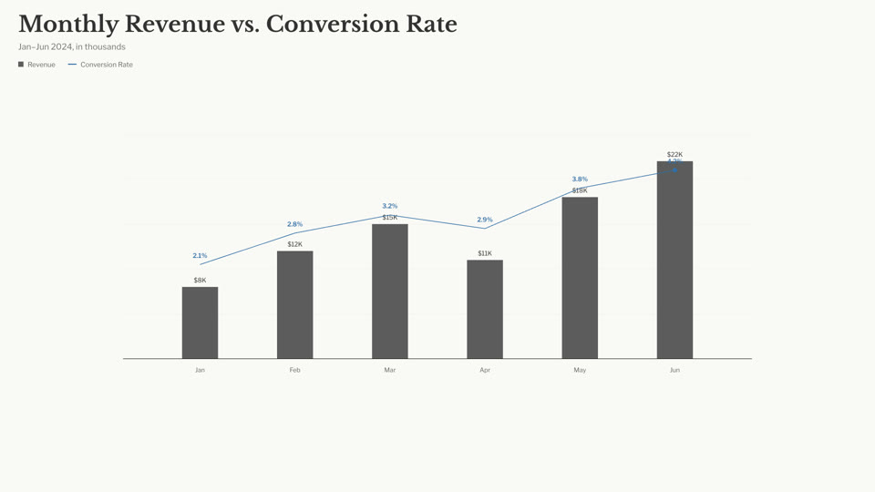 | 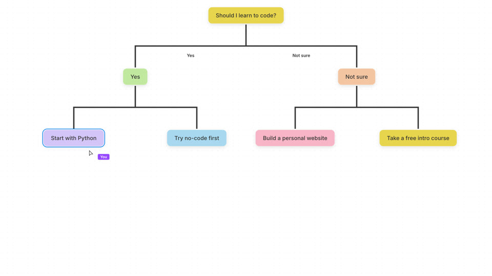 |
| 自分の見出し、製品、エンドカード | 自分の数値、単位、比較 | 自分の問い、分岐、答え |

### 🎬 撮影、生成キャラクター、コード

優れた動画は複数の制作方法を組み合わせられます。これらの外部事例は、撮影・生成・コード表現の使い分けを考える参考です。

<table>
<tr>
<td width="50%" valign="top" align="center">
<a href="readme/brand-showcase/rea-unboxing.mp4"><picture><source media="(prefers-reduced-motion: reduce)" srcset="readme/brand-showcase/rea-unboxing.jpg">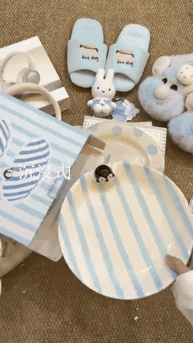</picture></a><br>
<strong>実物の製品、手触りのある物語</strong><br>
接写、手の動き、見せ方を研究し、自分の製品を撮影。<br>
<sub>実写 · 製品の開封</sub>
</td>
<td width="50%" valign="top" align="center">
<a href="readme/brand-showcase/rea-dual-role.mp4"><picture><source media="(prefers-reduced-motion: reduce)" srcset="readme/brand-showcase/rea-dual-role.jpg">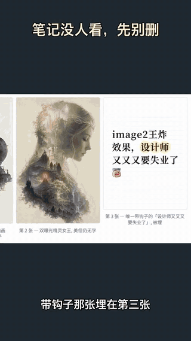</picture></a><br>
<strong>キャラクターと UI の出会い</strong><br>
キャラクターによる導入を UI の動きと画面録画に組み合わせる。<br>
<sub>AI キャラクター + コード + 画面録画</sub>
</td>
</tr>
</table>

[制作の全工程を見る](#full-video-creation-stack)

<a id="motion-gallery"></a>

### カタログの作品を見る

**18 の動く作例から、自分のスタイルへ。** 発表動画、動く文字、ガラスと光、空間の動き、生成映像を探索。クリックで全編を見て、Studio の同名項目をエージェントへ渡せます。

**リソースはここにあります。** このページと作例ガイドの全編参考、比較動画、GIF、テンプレートソース、ブラウザースクリプト、フォントにはローカルの収録先があります。[リソース一覧と再利用](readme/RESOURCES.md).

**学び、改編し、貢献できるライブラリ。** 現在は **894 件：同梱の編集可能なテンプレート 3 件と、外部参考・レジストリー項目 891 件**を収録し、判明する作者と出典を付記しています。

<table>
<tr><th colspan="3" align="left">📱 製品と UI</th></tr>
<tr>
<td width="33%" valign="top">
<a href="readme/media/app-showcase.mp4"><picture><source media="(prefers-reduced-motion: reduce)" srcset="../web/catalog/covers/51a2d141e18e608cc11b9256.jpg"></picture></a><br>
<strong>App Showcase</strong><br>
<sub>部品 · <a href="../library/components/showcase/README.md">部品を見る</a></sub>
</td>
<td width="33%" valign="top">
<a href="readme/media/remix-firecrawl-reference.mp4"><picture><source media="(prefers-reduced-motion: reduce)" srcset="../web/catalog/covers/02f9ae975461fe6290062d7f.jpg"></picture></a><br>
<strong>Firecrawl Free Keyless</strong><br>
<sub>参考 · <a href="readme/media/remix-firecrawl-reference.mp4">@ericciarla</a></sub>
</td>
<td width="33%" valign="top">
<a href="../library/skills/motion-design-remix/assets/ui-3d-reveal/reference.mp4"><picture><source media="(prefers-reduced-motion: reduce)" srcset="../web/catalog/covers/c13d0082838675f088ecadcd.jpg"></picture></a><br>
<strong>3D UI Reveal</strong><br>
<sub>部品 · <a href="../library/skills/motion-design-remix/references/ui-3d-reveal/MOTION_DESIGN.md">部品を見る</a></sub>
</td>
</tr>
<tr><th colspan="3" align="left">🚀 ブランドと発表動画</th></tr>
<tr>
<td width="33%" valign="top">
<a href="readme/media/jake-pond-reference.mp4"><picture><source media="(prefers-reduced-motion: reduce)" srcset="../web/catalog/covers/66ac2f8b58e55670971ae70c.jpg"></picture></a><br>
<strong>Pond: a new Linux OS</strong><br>
<sub>参考 · <a href="readme/media/jake-pond-reference.mp4">@bflycomputer</a></sub>
</td>
<td width="33%" valign="top">
<a href="readme/media/remix-kimi-k3-reference.mp4"><picture><source media="(prefers-reduced-motion: reduce)" srcset="../web/catalog/covers/ac6e14a0fadb5893534e6438.jpg"></picture></a><br>
<strong>Kimi K3 teaser</strong><br>
<sub>参考 · <a href="readme/media/remix-kimi-k3-reference.mp4">@Kimi_Moonshot</a></sub>
</td>
<td width="33%" valign="top">
<a href="readme/media/remix-elevenlabs-reception-reference.mp4"><picture><source media="(prefers-reduced-motion: reduce)" srcset="../web/catalog/covers/bc4b8b4398d66159acd35890.jpg"></picture></a><br>
<strong>Reception by ElevenLabs</strong><br>
<sub>参考 · <a href="readme/media/remix-elevenlabs-reception-reference.mp4">@ElevenLabs</a></sub>
</td>
</tr>
<tr><th colspan="3" align="left">✍️ 動くタイポグラフィ</th></tr>
<tr>
<td width="33%" valign="top">
<a href="readme/media/glass-shard-title.mp4"><picture><source media="(prefers-reduced-motion: reduce)" srcset="../web/catalog/covers/10cceacc02d415247d58f562.jpg"></picture></a><br>
<strong>Glass Shard Title</strong><br>
<sub>部品 · <a href="../library/components/showcase/README.md">部品を見る</a></sub>
</td>
<td width="33%" valign="top">
<a href="../library/skills/motion-design-remix/assets/canopy-part-title/reference.mp4"><picture><source media="(prefers-reduced-motion: reduce)" srcset="../web/catalog/covers/998dd6bb8358592c15f727d6.jpg"></picture></a><br>
<strong>Canopy Part Title</strong><br>
<sub>部品 · <a href="../library/skills/motion-design-remix/references/canopy-part-title/MOTION_DESIGN.md">部品を見る</a></sub>
</td>
<td width="33%" valign="top">
<a href="../library/skills/motion-design-remix/assets/wireframe-portal-title/reference.mp4"><picture><source media="(prefers-reduced-motion: reduce)" srcset="../web/catalog/covers/4d03231a69d147a38f993578.jpg"></picture></a><br>
<strong>Wireframe Portal Title</strong><br>
<sub>部品 · <a href="../library/skills/motion-design-remix/references/wireframe-portal-title/MOTION_DESIGN.md">部品を見る</a></sub>
</td>
</tr>
<tr><th colspan="3" align="left">💎 光、ガラス、3D の世界</th></tr>
<tr>
<td width="33%" valign="top">
<a href="readme/media/remix-iskra-light-reference.mp4"><picture><source media="(prefers-reduced-motion: reduce)" srcset="../web/catalog/covers/75cfbe06267768838d145fa4.jpg"></picture></a><br>
<strong>Iskra Light</strong><br>
<sub>参考 · <a href="readme/media/remix-iskra-light-reference.mp4">@world_is_web</a></sub>
</td>
<td width="33%" valign="top">
<a href="../library/skills/motion-design-remix/assets/liquid-glass-widgets/reference.mp4"><picture><source media="(prefers-reduced-motion: reduce)" srcset="../web/catalog/covers/553a1464d8037293b7debca8.jpg"></picture></a><br>
<strong>Liquid Glass Widgets</strong><br>
<sub>部品 · <a href="../library/skills/motion-design-remix/references/liquid-glass-widgets/MOTION_DESIGN.md">部品を見る</a></sub>
</td>
<td width="33%" valign="top">
<a href="readme/media/remix-cyera-reference.mp4"><picture><source media="(prefers-reduced-motion: reduce)" srcset="../web/catalog/covers/8884a707a92d0cc52d3363b7.jpg"></picture></a><br>
<strong>Cyera brand video</strong><br>
<sub>参考 · <a href="readme/media/remix-cyera-reference.mp4">Cyera</a></sub>
</td>
</tr>
<tr><th colspan="3" align="left">🧭 奥行きとカメラの動き</th></tr>
<tr>
<td width="33%" valign="top">
<a href="../library/skills/motion-design-remix/assets/code-3d-extrude/reference.mp4"><picture><source media="(prefers-reduced-motion: reduce)" srcset="../web/catalog/covers/0a5c7158bbecd6e47055bef9.jpg"></picture></a><br>
<strong>Code 3D Extrude</strong><br>
<sub>部品 · <a href="../library/skills/motion-design-remix/references/code-3d-extrude/MOTION_DESIGN.md">部品を見る</a></sub>
</td>
<td width="33%" valign="top">
<a href="readme/media/remix-glyph-reference.mp4"><picture><source media="(prefers-reduced-motion: reduce)" srcset="../web/catalog/covers/4bfe08db4d486970494eff3b.jpg"></picture></a><br>
<strong>Glyph: GPU typography for the web</strong><br>
<sub>参考 · <a href="readme/media/remix-glyph-reference.mp4">@pmndrs</a></sub>
</td>
<td width="33%" valign="top">
<a href="readme/media/nyc-paris-flight.mp4"><picture><source media="(prefers-reduced-motion: reduce)" srcset="../web/catalog/covers/aeafb2433c37f2f7d8c87619.jpg"></picture></a><br>
<strong>NYC Paris Flight</strong><br>
<sub>部品 · <a href="../library/components/showcase/README.md">部品を見る</a></sub>
</td>
</tr>
<tr><th colspan="3" align="left">✨ 生成ビジュアル</th></tr>
<tr>
<td width="33%" valign="top">
<a href="readme/media/aurora.mp4"><picture><source media="(prefers-reduced-motion: reduce)" srcset="../web/catalog/covers/5aefe7c9a916a38777443b36.jpg"></picture></a><br>
<strong>Aurora</strong><br>
<sub>部品 · <a href="../library/components/showcase/README.md">部品を見る</a></sub>
</td>
<td width="33%" valign="top">
<a href="readme/media/remix-linear-loops-reference.mp4"><picture><source media="(prefers-reduced-motion: reduce)" srcset="../web/catalog/covers/17cf5075b3f4b49c7d3e9201.jpg"></picture></a><br>
<strong>Linear Loops</strong><br>
<sub>参考 · <a href="readme/media/remix-linear-loops-reference.mp4">@linear</a></sub>
</td>
<td width="33%" valign="top">
<a href="../library/skills/motion-design-remix/assets/code-particle-assemble/reference.mp4"><picture><source media="(prefers-reduced-motion: reduce)" srcset="../web/catalog/covers/8ff121deb9403f7a99ac52b3.jpg"></picture></a><br>
<strong>Code Particle Assemble</strong><br>
<sub>部品 · <a href="../library/skills/motion-design-remix/references/code-particle-assemble/MOTION_DESIGN.md">部品を見る</a></sub>
</td>
</tr>
</table>

カタログの原動画から、映像と通常の速度を保った抜粋です。外部参考や部品であり、同梱テンプレートの追加ではありません。[出典と抜粋の記録](readme/ASSETS.md#catalog-preview-grid)

| 探索先 | 得られるもの |
| --- | --- |
| [Motion リソース索引](collections/README.md) | 選んだ動画、出典、編集可能な出発点。 |
| [同梱テンプレート](../template-library) | Product Promo、NYT Graph、Decision Tree。各ネイティブソースとプレビュー付き。 |
| Studio のテンプレート一覧 | 検索、プレビュー、テンプレート改編・参考再構築の指示。 |
| [Motion MD](motion-md.md) | スタイルを支える制作判断を共有する方法。 |

参考は研究の対象、編集可能なテンプレートは変更できるソース付きです。ギャラリーの**ワンクリック再構築**は参考と指示をコピーします。同梱テンプレートは直接開けますが、外部映像は分析・再構築が必要です。[カタログの範囲と出典](template-catalog.md)

<a id="快速开始"></a>
<a id="quick-start"></a>

## 🚀 はじめる

### OpenMotion を起動

**無料のローカル制作環境から。** 自分のエージェントを接続し、同梱テンプレートや撮影素材を使ってローカルでレンダリング。新しい素材を生成するときは Model Settings に対応キーを追加します。

Git、npm と、[CI](../.github/workflows/ci.yml)で固定された **Node.js 26.11.1** を使います。ソースからのプレビューと出力には Chrome/Chromium、FFmpeg/FFprobe も必要です。[実行環境の設定](usage.md)

```sh
git clone --branch feature/motion https://github.com/nexu-io/html-anything.git openmotion
cd openmotion
npm ci
npm run build:studio
npm start
```

**http://localhost:4173** を開き、**Templates → Ready to edit** から **Product Promo** を選び、**Connect Agent** で接続します。プロジェクトと認証情報はチェックアウトの外へ。 `MOTION_DATA_DIR` でワークスペースを選びます。

### エージェントに接続する

プラグイン対応 Codex では、チェックアウトから実行：

```sh
bash scripts/install-motion.command
```

DeepSeek Harness、Claude Code などは[エージェントアダプターガイド](agent-adapters.md) または[ローカル MCP + Skills インストーラー](npm-installation.md)を参照。npm パッケージは未公開で、ガイドはローカルビルドの成果物を使います。[Windows テストパッケージ](test-packages.md)

まず同梱テンプレートで試します：

> OpenMotion で 20 秒の Product Promo の新しいコピーを Studio に開き、MP4 を出力してください。編集可能なプロジェクトも残してください。

次に自分の作品へ：

> 構成とアニメーションを保ち、ロゴ、画面、見出し、エンドカードを提供したブランド素材に替えてください。新しい編集を見せ、最後のタイトルを 2 秒長くしてください。

動画から始める場合は、参考と[再構築ブリーフ](#reverse-engineer-a-video)を渡してください。ホストが会話の横に Studio を開けない場合は、返されたローカルプロジェクトのリンクを使います。

<details>
<summary>Skills、MCP、CLI</summary>

チェックアウトから [Skills CLI](https://github.com/vercel-labs/skills) を使い、5 つの基本ワークフローを確認・インストールできます：

```sh
npx skills add ./skills --list
npx skills add ./skills --skill motion-director motion-production motion-template-to-video motion-recreate motion-video-to-template
```

これは指示書をコピーするだけで、ランタイムのインストールや MCP 登録はしません。共有文書を使える状態にしてアプリを別途接続するか、上記の統合インストーラーを使ってください。

| Skill | 用途 |
| --- | --- |
| [motion-recreate](../skills/motion-recreate/SKILL.md) | 参考動画の再構築と結果の比較 |
| [motion-template-to-video](../skills/motion-template-to-video/SKILL.md) | 既存の編集可能なテンプレートの改編 |
| [motion-director](../skills/motion-director/SKILL.md) | オリジナル動画、物語、動き、音、創作レビュー |
| [motion-video-to-template](../skills/motion-video-to-template/SKILL.md) | 持ち運べる再利用テンプレートの制作 |
| [motion-production](../skills/motion-production/SKILL.md) | 範囲を定めた編集、プレビュー、検査、問題解決、出力 |

**Connect Agent** でワークスペース専用の設定を取得できます。ローカル stdio クライアントの手動設定では絶対パスを使います：

```json
{
  "mcpServers": {
    "openmotion": {
      "command": "/absolute/path/to/node",
      "args": ["--experimental-strip-types", "/absolute/openmotion/mcp.ts"],
      "env": { "MOTION_DATA_DIR": "/absolute/openmotion-data" }
    }
  }
}
```

**公開 MCP ツール 9 個**で、作成、読み取り、編集、プレビュー、素材の読み込み、出力、版の復元、キャンセルを扱います。共通の手順とエンジンガイドは MCP resources から取得できます。[ツール契約](mcp-phase1-tools.md)

アプリには `npm start` 、stdio には `npm run mcp` を使用します。シェル対応エージェントは実行環境が返す固定版エンジン CLI で検査・レンダリング可能。管理対象の編集には revision 検査を適用します。[ネイティブ制作](../skills/motion-production/references/native.md)

</details>

<a id="open-projects-reusable-knowledge"></a>
<a id="developer-architecture"></a>

## 🛠️ 作り手のために。開発者にも開かれた設計。

**HTML は編集可能なソース、MP4 はレンダリングした納品物。** TypeScript アプリ、React Studio、エージェントの手順、マルチモーダル生成アダプター、ブラウザーベースの合成・レンダリングエンジンを組み合わせます。プロジェクトが人とエージェントの共通の作品です。

### モジュールの連携

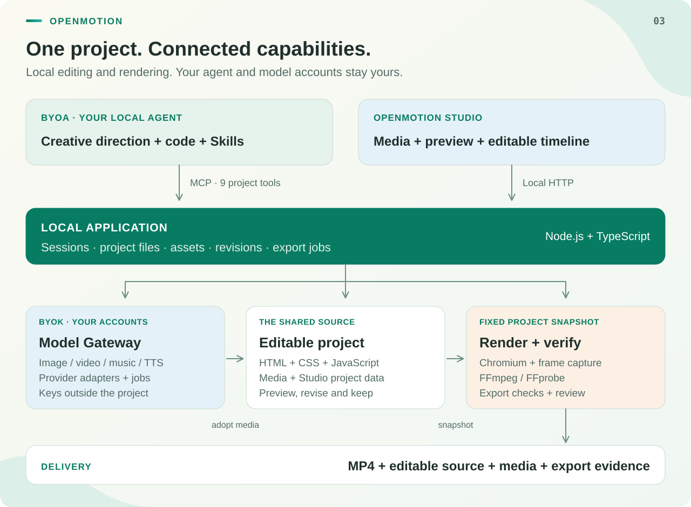

<details>
<summary>全体設計とロードマップをテキストで読む</summary>

```text
制作の入力
参考動画 + 撮影素材 + 台本 + ブランド素材
                   ↓
コミュニティの知識
MOTION_DESIGN.md + BRANDKIT.md + Skills + テンプレート + 部品
                   ↓
BYOA：ローカルエージェント              OPENMOTION STUDIO
DeepSeek Harness / Codex / Claude Code  React 19 + TypeScript + Vite
他のホスト、Skills、ホストの分析ツール  Tailwind CSS + Zustand
                   |                   CodeMirror + Dockview
            stdio MCP                  素材 / プレビュー / タイムライン
            公開ツール 9 個             ローカル HTTP
                   └────────┬──────────┘
                            ↓
ローカルアプリ：Node.js + TypeScript + node:http
会話 / プロジェクトファイル / 素材 / revision / 出力ジョブ
                   ↓                         ↓
BYOK：MODEL GATEWAY                    動画をコードで
キー / アカウント / モデルルーティング HTML シーン + 素材 + Studio データ
探索 / 生成ジョブ                     HTML + CSS + JavaScript + GSAP
                   ↓                         ↑
モデルアダプター                             |
Codex Image / Atlas Cloud / fal.ai            |
画像 / 動画 / 音楽 / TTS                      |
                   ↓                         |
生成候補 → プレビュー / 選択 → 明示的に採用 ──┘
                            ↓
レンダリングと検証
固定スナップショット → HTML エンジン + Chromium → FFmpeg / FFprobe
                            ↓
現在の納品物
MP4 + 編集可能なソース + 素材 + 版と出力の検証記録
                            ↓
計画中：各プラットフォームへ公開
接続機能 → 公開確認 → 予約 → 成績のフィードバック
                            ↓
計画中：知識のフィードバック
版に結びつく結果 → チームの記憶 / RAG → 評価済み Skill 改善
```

</details>

BYOA は既存クライアントを使い、BYOK は対応するモデルアカウントを接続します。Studio とローカルサービスが作品を管理し、認証情報はプロジェクト外へ。第 1 段階の公開 MCP は**プロジェクトツール 9 個**です。モデル生成は Studio とローカル Gateway から利用し、この図は生成・公開ツールを公開 MCP に追加するものではありません。

図は[依存ライブラリ不要の小さなスクリプト](readme/diagrams/generate.py)から生成した、編集可能な SVG です。

### 技術スタックとソース案内

| 層 | 技術 | ソースの入口 |
| --- | --- | --- |
| **Studio と編集 UI** | React 19、TypeScript 5.9、Vite 6、Tailwind CSS 4、Zustand、CodeMirror、Dockview | [Studio ソース](../studio/src) · [Motion アプリ](../studio/src/motion/MotionApp.tsx) · [エディター開発](editor-fork.md) |
| **アプリ実行環境** | CI で Node.js 26.11.1、ネイティブ HTTP、TypeScript 実行、ローカルファイル/JSON | [server.ts](../server.ts) · [workspace.ts](../workspace.ts) · [セッション設計](session-architecture.md) |
| **エージェント接続** | ローカル stdio MCP、5 つの基本 Skills、生成したホストアダプター | [mcp.ts](../mcp.ts) · [phase1.ts](../phase1.ts) · [アダプター生成](../scripts/export-adapters.ts) |
| **マルチモーダル生成** | Codex メディアアダプター、Atlas Cloud predictions、fal.ai キュー連携、永続化した生成ジョブ | [Gateway サービス](../gateway/service.ts) · [提供元アダプター](../gateway/providers.ts) · [モデルカタログ](../gateway/catalog.ts) |
| **合成と動き** | HTML/CSS/JS、GSAP、固定版の合成エンジン、ネイティブのタイムライン/履歴 | [エンジン連携](../hyperframes.ts) · [テンプレートソース](../template-library) · [版管理アダプター](../phase1-versions.ts) |
| **レンダリングとメディア** | Chromium、Puppeteer Core、FFmpeg、FFprobe | [レンダリングサービス](../server.ts) · [出力検証器](../scripts/verify-export.ts) · [ネイティブ実行環境のロック](../scripts/runtime-lock.json) |
| **制作の知識** | Markdown、ソースパッケージ、プリセット、比較記録 | [Motion MD](motion-md.md) · [基本 Skills](../skills) · [コミュニティ Library](../library/README.md) |
| **検証とパッケージ** | Node テスト、Vitest、Studio 検査、npm ロックファイル、明示的な配布一覧 | [テスト](../tests) · [Studio テスト](../studio/tests) · [CI](../.github/workflows/ci.yml) · [配布](../scripts/distribution.ts) |
| **公開と学習 — 計画中** | プラットフォームアダプター、予約、版に関連するフィードバックと検索。実装設計は今後 | [Studio の構想](product/studio-vision.md) |

依存関係の固定は [package.json](../package.json)、[package-lock.json](../package-lock.json) と[実行環境のロック](../scripts/runtime-lock.json)にあります。モデルと第三者ライブラリは各自の条件を保ち、アプリは Apache-2.0 です。

### 得意な層から一緒に作る

| 得意分野 | 役立つ貢献 | 入口 |
| --- | --- | --- |
| **フロントエンドと操作** | タイムライン、素材生成 UI、アクセシビリティ、プレビューの改善 | [Studio](../studio/src) · [メディア生成 UI](../studio/src/motion/MediaGenerator.tsx) |
| **AI とモデル基盤** | 共通のジョブ・素材フローで提供元アダプターやモデルプリセットを追加 | [Gateway 設計](product/media-generation-design.md) · [提供元アダプター](../gateway/providers.ts) |
| **エージェントと開発ツール** | ホストアダプター、Skill、リソースガイド、プロジェクト操作の改善 | [エージェントアダプター](agent-adapters.md) · [MCP 契約](mcp-phase1-tools.md) |
| **動きとクリエイティブコード** | 実際の改編を添えた部品、ネイティブテンプレート、Motion MD パッケージ | [部品](../library/components/README.md) · [登録チェックリスト](../library/ENTRY_TEMPLATE.md) |
| **動画とレンダリング** | 出力の信頼性、メディア処理、再現可能な検証の改善 | [エンジンの説明](hyperframes.md) · [出力検証器](../scripts/verify-export.ts) |
| **SNS 公開** | 計画中の接続層を設計：アカウント利用、公開確認、予約、版の対応付け | [公開の方向性](product/studio-vision.md) · [提案を議論する](https://github.com/nexu-io/html-anything/issues) |

[ローカル設定](#quick-start)から始め、担当する層を選び、[CONTRIBUTING.md](../CONTRIBUTING.md) と [AGENTS.md](../AGENTS.md)に従ってください。プロジェクトと認証情報はチェックアウト外に置き、固定バージョンと上流ライセンスを維持します。

**設計上の約束：** 人とエージェントが同じプロジェクトを使い、revision 検査で古い状態からの変更を防ぎ、生成候補は明示的に採用し、固定スナップショットから出力します。技術、見た目、音、実際の再生は別々に検証します。

[製品アーキテクチャ](product/architecture.md) · [Studio 開発](../studio/README.md) · [Model Gateway](model-gateway.md) · [貢献ガイド](../CONTRIBUTING.md)

<a id="super-motion-video-agent"></a>
<a id="status--roadmap"></a>
<a id="当前状态与路线图"></a>
<a id="roadmap"></a>

## 🗺️ 一度の改編から、継続する制作へ

Studio の大きな構想は、発見、制作、協働、公開、学習です。**Super Motion Video Agent** は企画、ツール、修正をまたいで仕事を進める概念。現在は接続したエージェントがローカル Skills、MCP、Studio を使い、常駐型の自律編成は計画中です。

| 分野 | 今できること | 今後の方向 |
| --- | --- | --- |
| **再構築と編集** | エージェントによる参考再構築、テンプレート改編、編集可能なプロジェクト、MP4 出力 | 評価済み事例と再現可能な比較の拡充 |
| **ブランドと知識** | 明示的な Brandkit、Motion MD、Skills、ソースパッケージ | 個人/チームの記憶、RAG、評価済み Skill 改善 |
| **人とエージェント** | 同じローカルプロジェクトの引き継ぎ | タイムラインのコメント、共同レビュー、共同編集 |
| **マルチモーダル制作** | 画像・動画・音楽・TTS の連携、生成、候補選択、タイムラインへの採用 | 映像、画像、声、音楽、Avatar サービスの横断検索 |
| **各プラットフォームへの公開 — 計画中** | 画面比率別の制作と MP4 の引き渡し | 接続機能、公開確認、予約、自動リフレーム、SNS プリセット |
| **フィードバック** | 人によるレビュー、保存したプロジェクトの版 | 版ごとの成績、定期的な制作タスク |

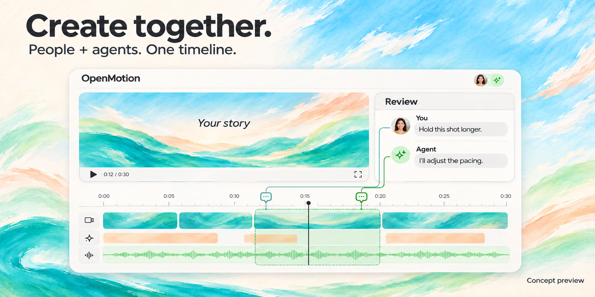

*計画中の協働体験のコンセプト。公開日は未発表です。* [Studio の構想](product/studio-vision.md) · [知識とフィードバック](product/studio-vision.md#knowledge-and-feedback)

<a id="社区共建"></a>
<a id="community"></a>

## 🤝 動画も、その作り方も共有する

**参考、改編、再利用できる動きの言語を一つ持ち寄ってください。** [Motion Design MD コミュニティ](#motion-design-community) で、次の作り手が自分の作品を作れるよう、判断とソースを共有しましょう。

| 貢献するもの | 含めるもの |
| --- | --- |
| **再構築作品** | 参考と作者、企画、プロジェクト、プレビュー、比較、残る差分 |
| **テンプレートや部品** | 動くソース、変更項目、素材、プレビュー、クレジット |
| **Skill やデザインシステム** | 方法、維持/変更の規則、実際に実行した作例 |
| **Brandkit** | ブランド、正確な製品情報、共有できる素材 |
| **エージェント対応や編集機能の改善** | 焦点を絞った変更と再現可能な検証 |

[Library 登録チェックリスト](../library/ENTRY_TEMPLATE.md) · [貢献ガイド](../CONTRIBUTING.md) · [リポジトリの規則](../AGENTS.md) · [貢献者一覧](https://github.com/nexu-io/html-anything/graphs/contributors)

[Issue を開く](https://github.com/nexu-io/html-anything/issues) · [Discord に参加](https://discord.gg/mHAjSMV6gz) · [ドキュメント](README.md)

制作者・メディアの方へ：参考、提供ブランド、Studio での変更、実際の結果を示してください。レンダリングしたデモ、製品コンセプト、外部参考は区別します。[メディア向け情報と素材](media-kit.md)

[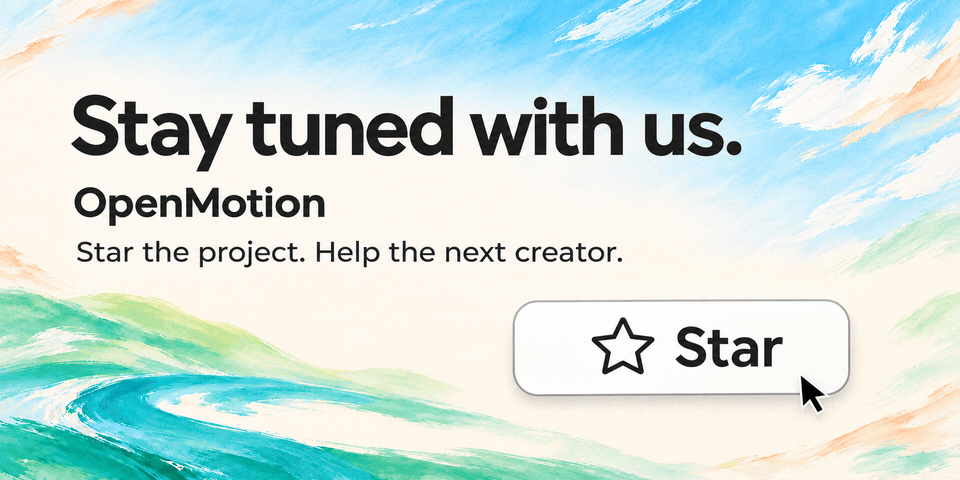](https://github.com/nexu-io/html-anything)

**OpenMotion を Star して、研究したい動画を見つけ、次は自分の作品を。**

<a id="acknowledgements"></a>

## 🙏 謝辞 / Acknowledgements


OpenMotion のライセンスは [Apache-2.0](../LICENSE)です。第三者のコード、テンプレート、素材、フォントは元のライセンスとクレジットを保ちます。

| 出典 | 関係 |
| --- | --- |
| [OpenDesign](https://github.com/nexu-io/open-design) | UI の由来、リソース構成、ブランドの方針。[デザインシステム](design-system.md) と [Motion ショーケース](https://open-design.ai/motion/) |
| [Hyperframes](https://github.com/heygen-com/hyperframes) | HTML 動画合成、Studio、レンダリングの基盤（0.9.7 固定）。制作者の参考、外部改編デモ、部品ソース。[エンジンの説明](hyperframes.md)、[テンプレートの告知](../template-library/NOTICE.md) と[カタログの出典](template-catalog.md) |
| [MotionGit](https://motiongit.com/) / adunext | Kinetic Tech ソースを Presenter Tech として収録。[ライセンスとクレジット](../library/templates/presenter-tech/NOTICE.md) |
| [Hypit](https://github.com/hypit-ai/hypit) | エージェントによる話題の動画の再構築と編集可能な派生版の着想。ランタイムの導入なし |
| [rea-video](https://github.com/JuneYaooo/rea-video) | 参考の分析と事例研究：[実写の開封](https://github.com/JuneYaooo/rea-video/blob/main/docs/cases/unboxing/report_en.md) と[キャラクター、コード、画面録画](https://github.com/JuneYaooo/rea-video/blob/main/docs/cases/dual_role/report_en.md)。[展示素材のクレジット](readme/brand-showcase/README.md)。ランタイムの導入なし |
| [OpenAI · Codex Originals](https://openai.com/codex-originals/) | 外部のブランド動画の参考。公式キャンペーン静止画と外部視聴リンク |
| [DeepSeek Harness](https://github.com/deepseek-ai/deepseek-harness) / [Super-agent プロトタイプ](https://github.com/deepseek-ai/dsh-superagent-prototype) | エージェント拡張性と継続タスクの着想。プロトタイプは現行 OpenMotion ランタイムとは別 |
| Claude Motion / CapCut / [ChatCut](https://chatcut.io/docs/what-is-chatcut) / [OpenChatCut](https://github.com/0xsline/OpenChatCut) | エージェント制作、使いやすい AI 編集、継続的な修正の製品参考 |
| [OpusClip](https://www.opus.pro/calendar) | 配信と[外部の予約公開](https://www.opus.pro/tools/instagram-reels-scheduler)の製品参考。内蔵コネクターなし |
| [GSAP](https://github.com/greensock/GSAP) / [FFmpeg](https://ffmpeg.org/) | 動画とメディアの依存ライブラリ。バージョンは [package.json](../package.json) と[実行環境のロック](../scripts/runtime-lock.json) |

[素材の出典](readme/ASSETS.md) · [その他の展示素材の出典](readme/brand-showcase/README.md) · [表紙とプロンプト](readme/reverse-engineering-cover.md) · [フォントの告知](../web/design-system/fonts/NOTICES.txt) · [Studio ライセンス](../studio/LICENSE)

旧 HTML Anything アプリは [`legacy` ブランチ](https://github.com/nexu-io/html-anything/tree/legacy)に保存されています。現在のブランチと配布範囲は[リポジトリ移行ガイド](repository-migration.md) を参照してください。
