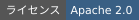
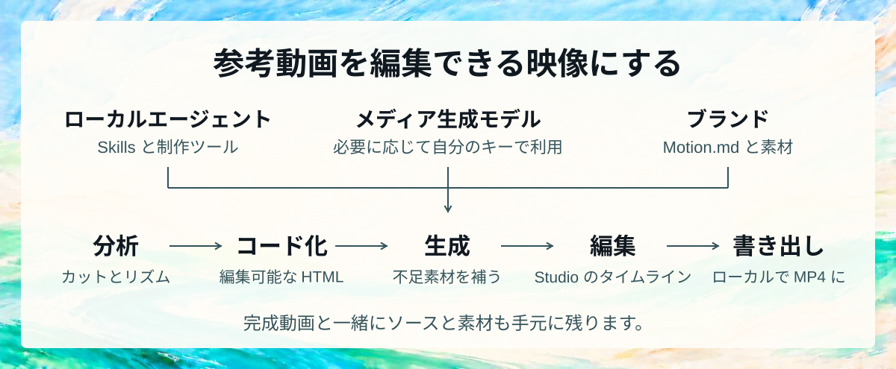
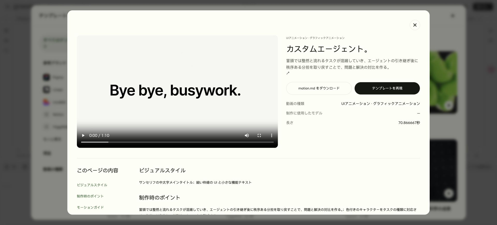
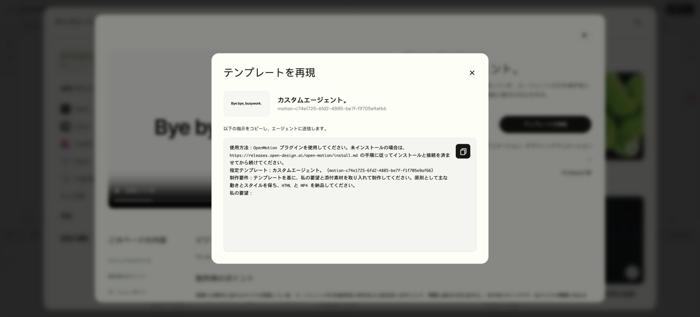
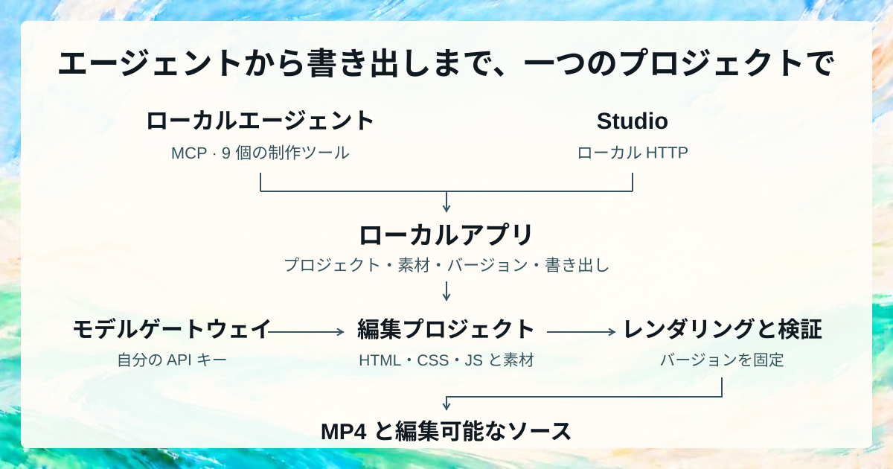

<p align="center"></p>

<p align="center"><strong>あらゆる動画を分析・再現</strong></p>

<p align="center">
  <picture><source media="(max-width: 600px)" srcset="https://releases.open-design.ai/open-motion/media/sha256/1b567187bc527cc99f8ef2c91c41c9adf5fa91fa9bbc5f8e2f579ad9c7837a46.jpg"></picture>
</p>

<p align="center">
  <a href="https://github.com/nexu-io/openmotion"></a>
  <a href="../package.json"></a>
  <a href="../LICENSE"></a>
  <a href="https://github.com/nexu-io/open-design"></a>
</p>

<p align="center">
  <a href="https://open-design.ai/motion/"></a>
  <a href="https://go.open-design.ai/?utm_source=github&amp;utm_medium=referral&amp;utm_campaign=openmotion&amp;utm_content=readme_ja"></a>
  <a href="https://discord.com/invite/M7NnHS9gNa"></a>
  <a href="https://applink.feishu.cn/client/chat/chatter/add_by_link?link_token=b6cs46dc-acb2-48ed-941d-c45642ead841"></a>
  <a href="https://x.com/OpenDesignHQ"></a>
  <a href="https://x.com/OpenDesignDevs"></a>
  <a href="https://www.youtube.com/channel/UChtshixMhvtgBWzoD9R_Qfg"></a>
</p>

<p align="center"><a href="#quick-start">インストール</a> · <a href="#agent-wall">対応エージェント</a> · <a href="#showcase">用途と再現例</a> · <a href="#features">OpenMotion の特長</a> · <a href="#technical-guide">セットアップと技術資料</a> · <a href="#community">コミュニティ・貢献</a></p>

<div align="center">

[English](../README.md) · [简体中文](README.zh-CN.md) · **日本語**

</div>

# OpenMotion

OpenMotion は、**エージェントが動画制作の全工程を担う初のフルスタック動画生成ツール**です。参考動画をアップロードするか SNS の動画リンクを貼り付けると、**自分のブランドキットとコピーで元の演出を再現できます**。

- 🎬 **動画の分析から再現・書き出しまで。** エージェントが参考動画を分析し、カットとトランジションを HTML で組み直し、足りない素材を生成します。同じプロジェクトを Studio で開き、間合いを調整して MP4 に書き出せます。
- 🔑 **BYOA（自分のエージェント）と BYOK（自分の API キー）。** OpenMotion は無料のオープンソースソフトウェアです。[使い慣れたローカルエージェント](#agent-wall)で動画を再現し、各工程に自分の API キーを使えます。
- 🧩 **Motion.md** は、OpenMotion が定義した Markdown 形式です。カットの順番、尺、トランジションを記録し、ブランド動画の演出をプロジェクトと一緒に共有できます。
- 🎛️ **画像・動画・音楽・音声。** Nano Banana 2 で画像を、Seedance 2.0 で追加カットを作り、Suno v4 の音楽と Kokoro のナレーションを同じタイムラインに配置できます。[内蔵の全 7 モデル](#model-wall)

<a id="快速开始"></a> <a id="quick-start"></a>

<a id="start-in-codex"></a>

### エージェントでインストール

次の指示をコピーしてローカルエージェントに送り、OpenMotion をソースからセットアップします：

```text
https://github.com/nexu-io/openmotion/blob/main/install.md を読み、手順に従って現在のエージェントに OpenMotion をインストールして接続してください。
```

セットアップ後、エージェントがローカルのテンプレートライブラリを開き、テンプレートを提案します。選択を確認してからプロジェクトを作成します。[ソースインストールガイド](../install.md)

### リポジトリをローカルで起動する

Git、npm、Node.js 26.11.1 が必要です：

```sh
git clone --depth 1 https://github.com/nexu-io/openmotion.git
cd openmotion
npm ci
npm run build:studio
npm start
```

起動時に表示される実際の `studioUrl` または `previewUrl` を開き、**テンプレートライブラリ**を選択します。Studio と MCP はこのチェックアウトのテンプレートを読み込みます。同じソースにエージェントを接続するには、[ソースと MCP の設定](#agent-setup)を参照してください。[クローン容量と任意のメディア](repository-storage.md)

### 公開済みアプリをエージェントにインストール

この方法は公開済みの npm アプリをインストールし、その設定済みオンラインカタログを使用します。リポジトリのテンプレートを使う場合や貢献する場合は、上記のソース起動手順を使用してください。

次の指示をコピーしてローカルエージェントに送ると、インストールを開始できます：

```text
https://github.com/nexu-io/openmotion/blob/main/docs/install.md を読み、手順に従って現在のエージェントに OpenMotion をインストールして接続してください。
```

インストール後、エージェントが試せるテンプレートを提案します。選択を確認してからプロジェクトを作成します。[インストールと初回利用ガイド](install.md#installation-success-reply)

<a id="agent-wall"></a>

**22 種類のローカルエージェントに対応** · [エージェントを選ぶ](#choose-agent)

<p align="center"><a href="#choose-agent"><picture><source media="(max-width: 600px)" srcset="readme/agents/local-agents.mobile.png"></picture></a></p>

<a id="showcase"></a> <a id="brand-before-after"></a> <a id="用-openmotion-可以做什么"></a>
<a id="使用场景与复刻效果示例"></a>

## 🎞️ 用途と再現例

製品デモ、ブランド動画、トーク動画などから制作の参考を探せます。以下のプレビューは参考動画です。

**[テンプレートライブラリをすべて見る →](https://open-design.ai/templates/)** — さらに多くのテンプレート、動画全編、Motion.md、再現用の指示を確認できます。

### AI で再編集・構成を変更

<table width="100%">
<tr>
<td width="50%" valign="top">
<picture><source media="(prefers-reduced-motion: reduce)" srcset="readme/live-templates/many-possible-futures.jpg"></picture><br>
<strong>OpenAI · 複数の場面をひとつの物語に</strong><br>
ひとつのテーマで場面をつなぎ、多彩なモンタージュへ展開。<br>
<a href="https://open-design.ai/templates/many-possible-futures-motion-design/">テンプレートを見る</a>
</td>
<td width="50%" valign="top">
<picture><source media="(prefers-reduced-motion: reduce)" srcset="readme/live-templates/making-of-window-collage.jpg"></picture><br>
<strong>Anthropic · 制作過程をコラージュで再編集</strong><br>
クリップや画面を順に重ね、主タイトルの読みやすさを保つ。<br>
<a href="https://open-design.ai/templates/making-of-window-collage-motion-design/">テンプレートを見る</a>
</td>
</tr>
</table>

### 製品発表とデモ

<table width="100%">
<tr>
<td width="50%" valign="top">
<picture><source media="(prefers-reduced-motion: reduce)" srcset="readme/live-templates/notion-custom-agents.jpg"></picture><br>
<strong>Notion · 課題から解決へ</strong><br>
積み重なるタスクが整理される流れを、自分の製品の機能に置き換える。<br>
<a href="https://open-design.ai/templates/notion-custom-agents-motion-design/">テンプレートを見る</a>
</td>
<td width="50%" valign="top">
<picture><source media="(prefers-reduced-motion: reduce)" srcset="https://releases.open-design.ai/open-motion/media/sha256/66bc3f14f916a58800562af5b2c8412b2f554f36a435da950faa39ef4b82da96.jpg"></picture><br>
<strong>OpenAI · ユーザーの声から製品発表へ</strong><br>
重なるリクエストで期待を高め、ひとつの明確な動きでアプリを見せる。<br>
<a href="https://open-design.ai/templates/demand-becomes-a-desktop-release-motion-design/">テンプレートを見る</a>
</td>
</tr>
</table>

### ブランド動画とモーション

<table width="100%">
<tr>
<td width="50%" valign="top">
<picture><source media="(prefers-reduced-motion: reduce)" srcset="readme/live-templates/a-world-connected-by-computational-fragments.jpg"></picture><br>
<strong>Kimi · モーションで世界をつなぐ</strong><br>
コードの帯、ずれた断片、トランジションでブランドの場面をつなぐ。<br>
<a href="https://open-design.ai/templates/a-world-connected-by-computational-fragments-motion-design/">テンプレートを見る</a>
</td>
<td width="50%" valign="top">
<picture><source media="(prefers-reduced-motion: reduce)" srcset="readme/live-templates/slack-slack.jpg"></picture><br>
<strong>Slack · ブランドマークを分解・再構成</strong><br>
マークを単純な形に分解し、自分の色と名前で組み直す。<br>
<a href="https://open-design.ai/templates/slack-slack-motion-design/">テンプレートを見る</a>
</td>
</tr>
</table>

### 解説とチュートリアル

<table width="100%">
<tr>
<td width="50%" valign="top">
<picture><source media="(prefers-reduced-motion: reduce)" srcset="https://releases.open-design.ai/open-motion/media/sha256/79e74122a92470f1cfe4ce39552b1eacad81bf316514605fef8d64f0c62eea4b.jpg"></picture><br>
<strong>Anthropic · ツールをまたぐ流れを説明</strong><br>
ひとつの問いをデータ、操作、スライドまで追い、文脈を保つ。<br>
<a href="https://open-design.ai/templates/connected-tools-evidence-chain-motion-design/">テンプレートを見る</a>
</td>
<td width="50%" valign="top">
<picture><source media="(prefers-reduced-motion: reduce)" srcset="readme/live-templates/an-agent-payment-with-human-approval.jpg"></picture><br>
<strong>Stripe · 承認の流れを順に見せる</strong><br>
同じ依頼を会話からスマートフォンの確認画面まで一貫して見せる。<br>
<a href="https://open-design.ai/templates/an-agent-payment-with-human-approval-motion-design/">テンプレートを見る</a>
</td>
</tr>
</table>

### データとグラフで伝える

<table width="100%">
<tr>
<td width="50%" valign="top">
<picture><source media="(prefers-reduced-motion: reduce)" srcset="readme/live-templates/mathematics-as-evolving-geometry.jpg"></picture><br>
<strong>OpenAI · 複雑な概念を図で伝える</strong><br>
共通の点と線を使い、幾何学的な図から次の図へ変形させる。<br>
<a href="https://open-design.ai/templates/mathematics-as-evolving-geometry-motion-design/">テンプレートを見る</a>
</td>
<td width="50%" valign="top">
<picture><source media="(prefers-reduced-motion: reduce)" srcset="https://releases.open-design.ai/open-motion/media/sha256/be5fc241ac81b90d7e7ded0bf1c90040d2823e6c659420d636722b5935c6e452.jpg"></picture><br>
<strong>Anthropic · 結果を段階的に見せる</strong><br>
全体像から個々の発見へ進み、それぞれの結果に対する操作を示す。<br>
<a href="https://open-design.ai/templates/scan-to-suggested-fix-motion-design/">テンプレートを見る</a>
</td>
</tr>
</table>

### 音楽と映像表現

<table width="100%">
<tr>
<td width="50%" valign="top">
<picture><source media="(prefers-reduced-motion: reduce)" srcset="readme/live-templates/controllable-song-composition.jpg"></picture><br>
<strong>ElevenLabs · 曲ができる過程を可視化</strong><br>
プロンプト、構成、テンポを波形と完成した曲につなげる。<br>
<a href="https://open-design.ai/templates/controllable-song-composition-motion-design/">テンプレートを見る</a>
</td>
<td width="50%" valign="top">
<picture><source media="(prefers-reduced-motion: reduce)" srcset="readme/live-templates/living-waveform-poster.jpg"></picture><br>
<strong>Deezer · 音楽ポスターに動きを</strong><br>
タイトルを固定し、周囲の流れる波形でリズムを表現する。<br>
<a href="https://open-design.ai/templates/living-waveform-poster-motion-design/">テンプレートを見る</a>
</td>
</tr>
</table>

<a id="creator-video-gallery"></a> <a id="presenter-motion"></a>

### AI でトーク動画を編集

話し手を中心に、読みやすい字幕、画面の挿入、キーワードのアニメーションで要点を伝えます。自分の収録動画に合う表現を見つけてください。

<table width="100%">
<tr><th colspan="3" align="left">🎓 教える・解説する</th></tr>
<tr>
<td width="33%" valign="top" align="center">
<picture><source media="(prefers-reduced-motion: reduce)" srcset="readme/people/careerwithriya.jpg"></picture><br>
<strong>キャリアを変える 6 つの必須スキル</strong><br>
番号付きの要点 + 動くキーワード<br>
<sub>参考動画 · @careerwithriya</sub>
</td>
<td width="33%" valign="top" align="center">
<picture><source media="(prefers-reduced-motion: reduce)" srcset="readme/people/dan-martell-tools.jpg"></picture><br>
<strong>今、最も優れた AI ツールは？</strong><br>
話し手 + 浮かぶツールカード<br>
<sub>参考動画 · Dan Martell</sub>
</td>
<td width="33%" valign="top" align="center">
<picture><source media="(prefers-reduced-motion: reduce)" srcset="readme/people/harpercarrollai.jpg"></picture><br>
<strong>10 日間の AI 基礎・1 日目</strong><br>
個人のレッスン + 読みやすい字幕<br>
<sub>参考動画 · @harpercarrollai</sub>
</td>
</tr>
<tr><th colspan="3" align="left">🖥️ ワークフローを見せる</th></tr>
<tr>
<td width="33%" valign="top" align="center">
<picture><source media="(prefers-reduced-motion: reduce)" srcset="readme/people/ali-abdaal-workflow.jpg"></picture><br>
<strong>毎日使う 5 つのツール</strong><br>
デスクでの語り + 作業画面<br>
<sub>参考動画 · Ali Abdaal</sub>
</td>
<td width="33%" valign="top" align="center">
<picture><source media="(prefers-reduced-motion: reduce)" srcset="readme/people/john-tagudin-capso.jpg"></picture><br>
<strong>注釈付きのツールデモ</strong><br>
話し手 + 画面 + 注釈<br>
<sub>参考動画 · @john.tagudin</sub>
</td>
<td width="33%" valign="top" align="center">
<picture><source media="(prefers-reduced-motion: reduce)" srcset="readme/people/aiwithsachi.jpg"></picture><br>
<strong>Claude に入れたい 5 つのプラグイン</strong><br>
口頭でのリスト + 補足スクリーンショット<br>
<sub>参考動画 · @aiwithsachi</sub>
</td>
</tr>
<tr><th colspan="3" align="left">🎬 物語と製品を伝える</th></tr>
<tr>
<td width="33%" valign="top" align="center">
<picture><source media="(prefers-reduced-motion: reduce)" srcset="readme/people/khris-sheer-founder.jpg"></picture><br>
<strong>創業者の実験・第 1 話</strong><br>
創業者の日記 + 日常の B ロール<br>
<sub>参考動画 · @khris.sheer</sub>
</td>
<td width="33%" valign="top" align="center">
<picture><source media="(prefers-reduced-motion: reduce)" srcset="readme/people/ugc-rachelll.jpg"></picture><br>
<strong>AI クリエイターと製品</strong><br>
製品の物語 + 根拠 + ピクチャーインピクチャー<br>
<sub>参考動画 · @ugc.rachelll</sub>
</td>
<td width="33%" valign="top" align="center">
<picture><source media="(prefers-reduced-motion: reduce)" srcset="readme/people/kevinstratvert.jpg"></picture><br>
<strong>5 つの AI ツールへの支払いをやめよう</strong><br>
製品チュートリアル + 実演<br>
<sub>参考動画 · Kevin Stratvert</sub>
</td>
</tr>
</table>

<a id="features"></a>
<a id="为什么选择-openmotion"></a>

## ✨ OpenMotion の特長

<a id="what-is-openmotion"></a> <a id="openmotion-是什么"></a> <a id="video-is-code"></a>

### 1. エージェントが動画制作の全工程を担う初のフルスタック動画生成ツール

**HTML で動画を書く。** シーン、書体、レイアウト、トランジションとそのタイミングを HTML、CSS、JavaScript で記述します。実写、生成したクリップ、画像、音楽、ナレーションを組み合わせ、同じプロジェクトを Studio で開いて MP4 に書き出せます。



**書いて、観て、直して、書き出す。** 製品を差し替える、冒頭を詰める、出演者を加える、字幕や結末を変える。エージェントがソースを編集し、結果をエディターで確認できます。ローカルの MCP クライアントはプロジェクト用ツールを使用します。シェルを使えるエージェントでは Skills と指定バージョンの CLI も利用できます。[接続設定](#agent-setup) · [ネイティブ合成ガイド](../skills/openmotion-production/references/native.md) · [HTML の作例](../template-library/product-promo/index.html)

<a id="studio-in-use"></a>


同じ Studio ワークスペースで動画を確認し、クリップを配置して書き出せます。

#### Studio で編集できるもの

| Studio の機能 | 今できること |
| --- | --- |
| **物語とタイムライン** | 素材の読み込み・配置、台本や確定タイムコードに基づく切り詰め・並べ替え・修正 |
| **動きと字幕** | 内容に合わせた動く文字、トランジション、注釈、図表、字幕 |
| **素材と音** | 手元の素材の読み込み、内蔵モデル連携での画像・動画・音楽・TTS 生成 |
| **画像の修正** | 参考画像対応モデルで候補を生成し、時間と動きを保ったまま差し替え |
| **プレビューと版** | Studio で確認し、手動またはエージェントで編集。次の修正にも同じプロジェクトを使用 |
| **出力とソース** | 固定版を MP4 にレンダリングし、HTML、CSS、JavaScript、素材を保存 |

> 「承認済みの見せ方は維持。中盤をこの画面録画に替え、指定タイムコードで導入を短くし、最後の CTA を 2 秒長くしてください。」

[プロジェクトとバージョン管理](project-workspace.md)

<a id="分享可编辑的复刻工程"></a>

#### 参考動画から編集可能なプロジェクトへ

1. **参考動画を分析する。** 再現したい場面を選び、カットの順序、トランジション、音が入る位置を Motion.md に記録します。自分のブランドに合わせて替える部分も明記します。
2. **カットを組み直す。** エージェントがブランドキットに沿って、コピーや製品の画像・動画を使った HTML シーンを再構築し、Studio のタイムラインに並べます。
3. **同じ時点で見比べる。** 元動画と再現版を同じ時点で比較し、尺、動き、音を調整します。最後に通して再生し、全体のテンポを確認します。
4. **書き出して共有する。** MP4 を書き出し、HTML ソースと素材を保存します。ほかの人がアレンジできるよう、Motion.md、プレビュー、共有可能な素材をプロジェクトに添えます。[提出時のチェックリスト](../library/ENTRY_TEMPLATE.md)

<a id="bring-your-agent-and-keys"></a>

### 2. 無料・オープンソース。ローカルエージェントで使え、各工程で BYOK に対応

<a id="choose-agent"></a>

**エージェントを選んでください。** WorkBuddy、Codex、Claude Code、DeepSeek Harness には個別のセットアップ手順があります。それ以外のボタンからは MCP と CLI の共通接続手順を開けます。

<p>
  <a href="#workbuddy-setup"></a>
  <a href="#agent-setup"></a>
  <a href="#claude-setup"></a>
  <a href="#local-agent-connection"></a>
  <a href="#local-agent-connection"></a>
  <a href="#local-agent-connection"></a>
  <a href="#local-agent-connection"></a>
  <a href="#local-agent-connection"></a>
  <a href="#local-agent-connection"></a>
  <a href="#local-agent-connection"></a>
  <a href="#local-agent-connection"></a>
  <a href="#local-agent-connection"></a>
  <a href="#local-agent-connection"></a>
  <a href="#local-agent-connection"></a>
  <a href="#local-agent-connection"></a>
  <a href="#local-agent-connection"></a>
  <a href="#local-agent-connection"></a>
  <a href="#deepseek-setup"></a>
  <a href="#local-agent-connection"></a>
  <a href="#local-agent-connection"></a>
  <a href="#local-agent-connection"></a>
  <a href="#local-agent-connection"></a>
</p>

| 持ち込むもの | 動画への活かし方 |
| --- | --- |
| **🤖 エージェント — BYOA** | Skills と MCP、対応環境では CLI で接続。いつものクライアント、アカウント、作業文脈を使えます。 |
| **🔑 キー — BYOK** | Model Settings に対応するメディア API キーを設定し、画像、動画、音楽、TTS のモデルを選択。対応するローカル連携ではエージェントの既存ログインを利用できます。 |
| **🎨 ブランドと素材** | ロゴ、書体、スクリーンショット、実写、台本、音楽を用意します。ブランド情報と使用許可のある素材を Motion.md の Brand Kit 欄に記録します。 |
| **🧩 制作の出発点** | 参考、モーション部品、テンプレート、コミュニティ Skills から方向を選び、ソースや参考をエージェントへ渡します。 |

**Skills、プロジェクトツール、モデル連携、Studio、レンダリングの制作パイプラインはオープンソースです。** ローカルで動かし、実装を確認・拡張できます。このローカル工程にソフトの月額料金やレンダリングごとの料金はありません。生成 API を使わず、手持ちの映像・画像・音声だけでも制作できます。

認証情報はワークスペースの設定に保存します。エージェントの契約や外部モデルの利用料は各提供元の規定に従います。[エージェント別の接続方法と検証状況](agent-adapters.md)

<a id="make-your-motion-language-reusable"></a> <a id="motion-design-community"></a>

### 3. 100 本以上の Motion.md で動画を再現

OpenMotion が提案する **Motion.md** は、ショットの順序、長さ、トランジション、置き換え可能な素材を Markdown で記録する形式です。オンラインライブラリでは、参考動画とモーションガイドを同じ詳細ページで確認できます。

Brand Kit セクションには、ロゴ、配色、フォント、語り口、確認済みの製品情報を記録します。参考動画の動きやテンポを保ちながら、自分のブランドを表現できます。


<a id="resources-to-start-from"></a> <a id="motion-gallery"></a>

#### テンプレートを選び、自分の内容に置き換える

**参考ブランド、用途、動画タイプ**で絞り込むか、キーワードで検索できます。詳細ページにはプレビュー、スタイル、制作の要点、Motion.md のダウンロードがまとまっています。Studio の**テンプレートを再現**からエージェント向けの指示をコピーできます。

参考動画のみの項目は再現ワークフローで制作します。編集可能なソースが付属する項目は、そのプロジェクトを直接アレンジできます。


[オンラインテンプレート一覧](https://open-design.ai/templates/)

<a id="all-in-one-studio"></a> <a id="full-video-creation-stack"></a>

<a id="model-wall"></a>

### 4. 画像・動画・音楽・音声を生成

**BYOK で、自分のモデルアカウントを動画制作に使えます。** **Model Settings** で対応する API キーを登録し、モデルを選んでください。Studio の **Model Gateway** で画像、動画、音楽、音声を生成し、プレビューした候補を同じプロジェクトに取り込めます。対応するローカル画像生成では、既存のエージェントのログイン情報も利用できます。

<p>


</p>

| 必要な素材 | 内蔵モデルカタログの例 | 動画への用途 |
| --- | --- | --- |
| **🖼️ 画像** | Codex Image、Atlas Cloud の Nano Banana 2、fal.ai の FLUX Schnell | ブランド画像、シーンの絵、補助画像。対応する Codex 画像経路で参考画像を用いた編集 |
| **🎬 動画** | Atlas Cloud の Seedance 2.0、fal.ai の Wan 2.2 | 撮影素材やモーションと組み合わせるショット、B ロール |
| **🎵 音楽** | Atlas Cloud の Suno v4 | 雰囲気と企画に合ったサウンドトラック |
| **🎙️ TTS / ナレーション** | fal.ai の Kokoro | 承認済み台本から音声を生成し、映像・音楽と配置 |

> 「Motion.md の Brand Kit と確定済みの台本を使って、冒頭のビジュアル、挿入カット、BGM、ナレーションを生成してください。選んだ素材をプロジェクトに入れ、音と映像を合わせてから全編を見せてください。」

[内蔵モデル一覧](../gateway/catalog.ts) · [プロバイダー設定とエンドポイントの登録](model-gateway.md)

<a id="technical-guide"></a>
<a id="安装与技术文档"></a>

## 🛠️ セットアップと技術資料

リンク先の詳しい技術資料には、英語または中国語のものがあります。

### ソースからインストール

エージェントでのインストールには[上の指示](#quick-start)を使ってください。ソースから起動する手順は次のとおりです。

#### OpenMotion を起動する

**無料のローカル制作環境から。** 自分のエージェントを接続し、同梱テンプレートや撮影素材を使ってローカルでレンダリング。新しい素材を生成するときは Model Settings に対応キーを追加します。

Git、npm、**Node.js 26.11.1** を用意してください。ソースからのプレビューと書き出しには Chrome または Chromium と、FFmpeg・FFprobe も必要です。[実行環境の設定](usage.md)

```sh
git clone --depth 1 https://github.com/nexu-io/openmotion.git openmotion
cd openmotion
npm ci
npm run build:studio
npm start
```

**http://localhost:4173** を開き、**テンプレートライブラリ**からテンプレートを選びます。**テンプレートを再現**を押すと、エージェントに送る指示をコピーできます。プロジェクトと認証情報はコードとは別に保存され、`MOTION_DATA_DIR` でワークスペースを選べます。

<a id="agent-setup"></a>

#### エージェントを接続する

プラグイン対応 Codex では、チェックアウトから実行：

```sh
bash scripts/install-motion.command
```

<a id="workbuddy-setup"></a>

**WorkBuddy** · OpenMotion Connector をインポートするか、付属の `mcp.json` をカスタム MCP として追加します。WorkBuddy に利用可能な動画テンプレートを一覧表示させてください。[WorkBuddy の設定手順](agent-adapters.md#workbuddy)

<a id="claude-setup"></a>

**Claude Code** · ローカルインストーラーで `--host claude` を選び、Claude Code で `/mcp` を実行して接続を確認します。[ローカルインストーラー](npm-installation.md)

<a id="deepseek-setup"></a>

**DeepSeek** · DeepSeek TUI ではターミナルから HTML プロジェクトを編集できます。DeepSeek Harness では Cordis を使って OpenMotion の MCP ツールに接続できます。[DeepSeek Harness の設定](agent-adapters.md#deepseek-harness)

インストーラーはローカルでビルドしたパッケージを使います。[Windows 用テストパッケージ](test-packages.md)

オンラインテンプレートで試します：

> OpenMotion で、このテンプレート詳細ページの動画を自分の Brand Kit と文案で再現してください。動きとテンポを生かし、確認用に編集可能なプロジェクトを Studio で開いてください。

動画から始める場合は、参考と[再構築ブリーフ](#reverse-engineer-a-video)を渡してください。ホストが会話の横に Studio を開けない場合は、返されたローカルプロジェクトのリンクを使います。

##### Skills、MCP、CLI

プラグインと MCP サーバーの名前は `openmotion` です。Tools、Skills、リソースはそれぞれ `openmotion_*`、`openmotion-*`、`openmotion://` を使います。旧 Tool・リソース名は互換エイリアスとして残ります。旧 Skill エントリは削除されました。`openmotion-*` を使用し、更新後にホストの Skill 一覧を再読み込みしてください。[名称とインストールの互換性](npm-installation.md#public-names-and-compatibility)

チェックアウトから [Skills CLI](https://github.com/vercel-labs/skills) を使い、5 つの基本ワークフローを確認・インストールできます：

```sh
npx skills add ./skills --list
npx skills add ./skills --skill openmotion-director openmotion-production openmotion-template-to-video openmotion-recreate openmotion-video-to-template
```

これは指示書をコピーするだけで、ランタイムのインストールや MCP 登録はしません。共有文書を使える状態にしてアプリを別途接続するか、上記の統合インストーラーを使ってください。

| Skill | 用途 |
| --- | --- |
| [openmotion-recreate](../skills/openmotion-recreate/SKILL.md) | 参考動画の再構築と結果の比較 |
| [openmotion-template-to-video](../skills/openmotion-template-to-video/SKILL.md) | 既存の編集可能なテンプレートの改編 |
| [openmotion-director](../skills/openmotion-director/SKILL.md) | オリジナル動画、物語、動き、音、創作レビュー |
| [openmotion-video-to-template](../skills/openmotion-video-to-template/SKILL.md) | 持ち運べる再利用テンプレートの制作 |
| [openmotion-production](../skills/openmotion-production/SKILL.md) | 範囲を定めた編集、プレビュー、検査、問題解決、出力 |

<a id="local-agent-connection"></a>

**そのほかのローカルエージェントを接続する** · 公式インストールガイドに従い、クライアントに接続します。stdio MCP 対応のクライアントには下記の設定を使えます。ターミナルを使うエージェントでは、プロジェクトのディレクトリを開き、[ローカルエンジンの CLI](../skills/openmotion-production/references/native.md) で HTML シーンをプレビュー・レンダリングできます。

<a id="manual-mcp"></a>

```json
{
  "mcpServers": {
    "openmotion": {
      "command": "/absolute/path/to/node",
      "args": ["--experimental-strip-types", "/absolute/openmotion/mcp.ts"],
      "env": { "MOTION_DATA_DIR": "/absolute/openmotion-data" }
    }
  }
}
```

**公開 MCP ツール 11 個**で、テンプレート検索・詳細取得、作成、読み取り、編集、プレビュー、素材の読み込み、出力、版の復元、キャンセルを扱います。共通の手順とエンジンガイドは MCP resources から取得できます。[ツール契約](mcp-phase1-tools.md)

`openmotion_list_templates` でテンプレートを探し、`openmotion_get_template` で詳細を確認します。`openmotion_create_project` で編集用のコピーを作成できます。[テンプレート一覧](template-catalog.md)

アプリには `npm start` 、stdio には `npm run mcp` を使用します。シェル対応エージェントは実行環境が返す固定版エンジン CLI で検査・レンダリング可能。管理対象の編集には revision 検査を適用します。[ネイティブ制作](../skills/openmotion-production/references/native.md)

<a id="product-tour"></a> <a id="产品界面"></a> <a id="connect-your-agent"></a> <a id="use-from-your-agent"></a> <a id="从-agent-接入"></a> <a id="your-agent-your-studio"></a>

<a id="reverse-engineer-a-video"></a>

### 参考動画を編集可能なプロジェクトにする

| 参考から読み解くもの | 自分の物語に置き換えるもの |
| --- | --- |
| **導入と物語** — 順序、展開、見せ場への積み上げ | 自分の約束、製品の事実、行動喚起 |
| **ショット構成** — 画角、カメラ、レイヤー、視覚階層 | 自社 UI、映像、ロゴ、補助画像 |
| **動きとテンポ** — 登場、切り替え、緩急、読む時間 | 動きの意図を保ち、内容に合わせて調整 |
| **文字とブランド** — 文字階層、色、構図 | 自分の書体、配色、原稿、Brandkit |
| **音とリズム** — 発話のタイミング、音楽の合図、強調 | 自分の声、用意した音楽、音の演出 |

エージェントが SNS のリンクを開けない場合は、ローカルの動画ファイルとタイムコードを渡してください。元動画だけがある場合は[参考動画の再現手順](../skills/openmotion-recreate/SKILL.md)、編集可能なソースがある場合は[テンプレートの手順](../skills/openmotion-template-to-video/SKILL.md)を使います。

```text
OpenMotion で添付の参考動画を自社ブランド向けに再構築してください。

分析：冒頭、ショットの順序、文字、トランジション、音の合図。
維持：選択区間の製品の見せ方とカメラのテンポ。
変更：ロゴ、UI、訴求、原稿、エンドカードを提供素材へ。
生成：ブランドと承認済み台本に従い、設定済みモデルで不足する
画像、動画、BGM、TTS ナレーションを用意。

編集可能なプロジェクトを Studio で開き、参考と同時点を比較。
残る差分を説明し、確認後に MP4 を出力して次の編集用にソースを保存。
```

<a id="ai-video-editing"></a> <a id="keep-editing-after-the-remake"></a>

#### テンプレートと Motion.md を確認する

テンプレートを開くと、参考動画、ビジュアルスタイル、制作の要点を確認できます。ガイドをファイルとして再利用する場合は Motion.md をダウンロードします。



#### テンプレートをエージェントに渡す

**テンプレートを再現**を選び、指示をコピーして Brand Kit、文章、制作要件を追加します。必要に応じてエージェントが OpenMotion をインストール・接続し、選んだテンプレートをもとに制作します。完成したプロジェクトを Studio で開き、テンポの確認、編集、書き出しを行えます。



<a id="open-projects-reusable-knowledge"></a> <a id="developer-architecture"></a>

### システム構成

Studio でタイムラインを調整するときも、エージェントがカットを直すときも、編集対象は同じ HTML プロジェクトです。ローカルの TypeScript サービスが素材とバージョンを管理し、ブラウザーベースのエンジンが選んだバージョンを MP4 に書き出します。

#### モジュール間の連携



エージェントは書き込み前にバージョンを確認するので、古いリクエストが直前の変更を上書きすることを防げます。生成した素材は選んだものだけがプロジェクトに入ります。書き出しには開始時点のバージョンを使い、その後の編集は次の版に反映されます。ファイル仕様は書き出し時に検証され、映像と音、間合いは再生して確認できます。

<details>
<summary>全体設計とロードマップをテキストで読む</summary>

```text
制作の入力
参考動画 + 撮影素材 + 台本 + ブランド素材
                 ↓
コミュニティの知識
Motion.md + BRANDKIT.md + Skills + テンプレート + 部品
                 ↓
BYOA：ローカルエージェント              OPENMOTION STUDIO
DeepSeek Harness / Codex / Claude Code  React 19 + TypeScript + Vite
他のホスト、Skills、ホストの分析ツール  Tailwind CSS + Zustand
                 |                     CodeMirror + Dockview
            stdio MCP                  素材 / プレビュー / タイムライン
            プロジェクトツール 9 個             ローカル HTTP
                 └──────────┬──────────┘
                            ↓
ローカルアプリ：Node.js + TypeScript + node:http
会話 / プロジェクトファイル / 素材 / revision / 出力ジョブ
                 ↓                         ↓
BYOK：MODEL GATEWAY                    動画をコードで
キー / アカウント / モデルルーティング HTML シーン + 素材 + Studio データ
探索 / 生成ジョブ                     HTML + CSS + JavaScript + GSAP
                 ↓                         ↑
モデルアダプター                             |
Codex Image / Atlas Cloud / fal.ai          |
画像 / 動画 / 音楽 / TTS                      |
                 ↓                         |
生成候補 → プレビュー / 選択 → 明示的に採用 ──┘
                            ↓
レンダリングと検証
選択したバージョン → HTML エンジンと Chromium → FFmpeg / FFprobe
                            ↓
現在の納品物
MP4 + 編集可能なソース + 素材 + 版と出力の検証記録
                            ↓
計画中：各プラットフォームへ公開
接続機能 → 公開確認 → 予約 → 成績のフィードバック
                            ↓
計画中：知識のフィードバック
版に結びつく結果 → チームの記憶 / RAG → 評価済み Skill 改善
```

</details>

BYOA は既存クライアントを使い、BYOK は対応するモデルアカウントを接続します。Studio とローカルサービスが作品を管理し、認証情報はプロジェクト外へ。第 1 段階の公開 MCP は**プロジェクト用 9 個とテンプレートカタログ用 2 個、合計 11 個のツール**です。モデル生成は Studio とローカル Gateway から利用し、この図は生成・公開ツールを公開 MCP に追加するものではありません。

#### 技術スタックとソースの索引

| 層 | 技術 | ソースの入口 |
| --- | --- | --- |
| **Studio と編集 UI** | React 19、TypeScript 5.9、Vite 6、Tailwind CSS 4、Zustand、CodeMirror、Dockview | [Studio ソース](../studio/src) · [Motion アプリ](../studio/src/motion/MotionApp.tsx) · [エディター開発](editor-fork.md) |
| **アプリ実行環境** | CI で Node.js 26.11.1、ネイティブ HTTP、TypeScript 実行、ローカルファイル/JSON | [server.ts](../server.ts) · [workspace.ts](../workspace.ts) · [セッション設計](session-architecture.md) |
| **エージェント接続** | ローカル stdio MCP、5 つの基本 Skills、生成したホストアダプター | [mcp.ts](../mcp.ts) · [phase1.ts](../phase1.ts) · [アダプター生成](../scripts/export-adapters.ts) |
| **マルチモーダル生成** | Codex メディアアダプター、Atlas Cloud predictions、fal.ai キュー連携、永続化した生成ジョブ | [Gateway サービス](../gateway/service.ts) · [提供元アダプター](../gateway/providers.ts) · [モデルカタログ](../gateway/catalog.ts) |
| **合成と動き** | HTML/CSS/JS、GSAP、固定版の合成エンジン、ネイティブのタイムライン/履歴 | [エンジン連携](../hyperframes.ts) · [テンプレートソース](../template-library) · [版管理アダプター](../phase1-versions.ts) |
| **レンダリングとメディア** | Chromium、Puppeteer Core、FFmpeg、FFprobe | [レンダリングサービス](../server.ts) · [出力検証器](../scripts/verify-export.ts) · [ネイティブ実行環境のロック](../scripts/runtime-lock.json) |
| **制作の知識** | Markdown、ソースパッケージ、プリセット、比較記録 | [Motion.md](motion-md.md) · [基本 Skills](../skills) · [コミュニティ Library](../library/README.md) |
| **検証とパッケージ** | Node テスト、Vitest、Studio 検査、npm ロックファイル、明示的な配布一覧 | [テスト](../tests) · [Studio テスト](../studio/tests) · [CI](../.github/workflows/ci.yml) · [配布](../scripts/distribution.ts) |
| **公開と学習 — 計画中** | プラットフォームアダプター、予約、版に関連するフィードバックと検索。実装設計は今後 | [Studio の構想](product/studio-vision.md) |

依存関係の固定は [package.json](../package.json)、[package-lock.json](../package-lock.json) と[実行環境のロック](../scripts/runtime-lock.json)にあります。モデルと第三者ライブラリは各自の条件を保ち、アプリは Apache-2.0 です。

#### 開発に参加する

| 得意分野 | 役立つ貢献 | 入口 |
| --- | --- | --- |
| **フロントエンドと操作** | タイムライン、素材生成 UI、アクセシビリティ、プレビューの改善 | [Studio](../studio/src) · [メディア生成 UI](../studio/src/motion/MediaGenerator.tsx) |
| **AI とモデル基盤** | 共通のジョブ・素材フローで提供元アダプターやモデルプリセットを追加 | [Gateway 設計](product/media-generation-design.md) · [提供元アダプター](../gateway/providers.ts) |
| **エージェントと開発ツール** | ホストアダプター、Skill、リソースガイド、プロジェクト操作の改善 | [エージェントアダプター](agent-adapters.md) · [MCP 契約](mcp-phase1-tools.md) |
| **動きとクリエイティブコード** | 実際の改編を添えた部品、ネイティブテンプレート、Motion.md パッケージ | [部品](../library/components/README.md) · [登録チェックリスト](../library/ENTRY_TEMPLATE.md) |
| **動画とレンダリング** | 出力の信頼性、メディア処理、再現可能な検証の改善 | [エンジンの説明](hyperframes.md) · [出力検証器](../scripts/verify-export.ts) |
| **SNS 公開** | 計画中の接続層を設計：アカウント利用、公開確認、予約、版の対応付け | [公開の方向性](product/studio-vision.md) · [提案を議論する](https://github.com/nexu-io/openmotion/issues) |

[ローカル設定](#quick-start)から始め、担当する層を選び、[CONTRIBUTING.md](../CONTRIBUTING.md) と [AGENTS.md](../AGENTS.md)に従ってください。プロジェクトと認証情報はチェックアウト外に置き、固定バージョンと上流ライセンスを維持します。

[製品アーキテクチャ](product/architecture.md) · [Studio 開発](../studio/README.md) · [Model Gateway](model-gateway.md) · [貢献ガイド](../CONTRIBUTING.md)

<a id="one-video-more-places-to-share"></a> <a id="publish-to-every-platform"></a>

<a id="super-motion-video-agent"></a> <a id="status--roadmap"></a> <a id="当前状态与路线图"></a> <a id="roadmap"></a>

### 画面比率ごとの書き出しと公開

画面比率ごとに構図を整え、Studio で各版を確認して MP4 を書き出し、対象のプラットフォームへアップロードします。

| 依頼する版 | 調整するもの |
| --- | --- |
| **縦のショート** — Reels、Shorts、TikTok、小紅書など | 導入、大きく読みやすい文字、画角、字幕位置 |
| **横の動画** — 製品ページ、発表、YouTube | UI の細部、広い構図、説明する時間 |
| **正方形のフィード版** — SNS キャンペーン | コンパクトな構図、見出し、明快な締め |

配信アカウントとの連携、予約投稿、公開後の成果のフィードバックは計画中です。

#### Studio のロードマップと共同編集の構想

| 分野 | 今できること | 今後の方向 |
| --- | --- | --- |
| **再構築と編集** | エージェントによる参考再構築、テンプレート改編、編集可能なプロジェクト、MP4 出力 | 評価済み事例と再現可能な比較の拡充 |
| **ブランドと知識** | 明示的な Brandkit、Motion.md、Skills、ソースパッケージ | 個人/チームの記憶、RAG、評価済み Skill 改善 |
| **人とエージェント** | 同じローカルプロジェクトの引き継ぎ | タイムラインのコメント、共同レビュー、共同編集 |
| **マルチモーダル制作** | 画像・動画・音楽・TTS の連携、生成、候補選択、タイムラインへの採用 | 映像、画像、声、音楽、Avatar サービスの横断検索 |
| **各プラットフォームへの公開 — 計画中** | 画面比率別の制作と MP4 の引き渡し | 接続機能、公開確認、予約、自動リフレーム、SNS プリセット |
| **フィードバック** | 人によるレビュー、保存したプロジェクトの版 | 版ごとの成績、定期的な制作タスク |


*共同編集の構想。タイムラインに「このカットをもう少し長く」とコメントすると、エージェントが間合いを調整します。計画中の機能です。* [Studio の構想](product/studio-vision.md) · [知識とフィードバック](product/studio-vision.md#knowledge-and-feedback)

<a id="社区共建"></a> <a id="community"></a>

<a id="社区"></a>

## 🤝 作品と制作手順を共有する

再現した動画、再利用できるテンプレート、カットの間合いを記録した Motion.md を共有してください。元動画と完成版を並べ、編集可能なプロジェクトを添えると、ほかの人も同じリズムを自分の素材で試せます。

| 貢献するもの | 含めるもの |
| --- | --- |
| **再構築作品** | 参考と作者、企画、プロジェクト、プレビュー、比較、残る差分 |
| **テンプレートや部品** | 動くソース、変更項目、素材、プレビュー、クレジット |
| **Skill やデザインシステム** | 方法、維持/変更の規則、実際に実行した作例 |
| **Brandkit** | ブランド、正確な製品情報、共有できる素材 |
| **エージェント対応や編集機能の改善** | 焦点を絞った変更と再現可能な検証 |

[リソース提出時のチェックリスト](../library/ENTRY_TEMPLATE.md) · [貢献ガイド](../CONTRIBUTING.md) · [問題を報告](https://github.com/nexu-io/openmotion/issues) · [コントリビューター](https://github.com/nexu-io/openmotion/graphs/contributors) · [メディア向け資料](media-kit.md)

OpenMotion の専用サイトは `open-design.ai/openmotion` に開設予定です。

[OpenDesign の動画ギャラリー](https://open-design.ai/motion/) · [OpenDesign Go](https://go.open-design.ai/?utm_source=github&utm_medium=referral&utm_campaign=openmotion&utm_content=readme_ja) · [Discord](https://discord.com/invite/M7NnHS9gNa) · [Feishu](https://applink.feishu.cn/client/chat/chatter/add_by_link?link_token=b6cs46dc-acb2-48ed-941d-c45642ead841) · [X @OpenDesignDevs](https://x.com/OpenDesignDevs) · [X @OpenDesignHQ](https://x.com/OpenDesignHQ) · [YouTube](https://www.youtube.com/channel/UChtshixMhvtgBWzoD9R_Qfg)

[**GitHub で OpenMotion にスターを付ける**](https://github.com/nexu-io/openmotion)

[](https://github.com/nexu-io/openmotion)

<a id="acknowledgements"></a>

### 謝辞

ブランド動画の制作者と該当箇所のタイムコードは各比較映像に添えています。[エージェントとモデルのロゴ](readme/models/README.md)

OpenMotion のライセンスは [Apache-2.0](../LICENSE)です。第三者のコード、テンプレート、素材、フォントは元のライセンスとクレジットを保ちます。

| 出典 | 関係 |
| --- | --- |
| [OpenDesign](https://github.com/nexu-io/open-design) | UI の由来、リソース構成、ブランドの方針。[デザインシステム](design-system.md) と [Motion ショーケース](https://open-design.ai/motion/) |
| [Hyperframes](https://github.com/heygen-com/hyperframes) | HTML 動画合成、Studio、レンダリングの基盤（0.9.7 固定）。制作者の参考、外部改編デモ、部品ソース。[エンジンの説明](hyperframes.md)、[テンプレートの告知](../template-library/NOTICE.md) と[カタログの出典](template-catalog.md) |
| [MotionGit](https://motiongit.com/) / adunext | Kinetic Tech ソースを Presenter Tech として収録。[ライセンスとクレジット](../library/templates/presenter-tech/NOTICE.md) |
| [Hypit](https://github.com/hypit-ai/hypit) | エージェントによる話題の動画の再構築と編集可能な派生版の着想。ランタイムの導入なし |
| [rea-video](https://github.com/JuneYaooo/rea-video) | 参考の分析と事例研究：[実写の開封](https://github.com/JuneYaooo/rea-video/blob/main/docs/cases/unboxing/report_en.md) と[キャラクター、コード、画面録画](https://github.com/JuneYaooo/rea-video/blob/main/docs/cases/dual_role/report_en.md)。[展示素材のクレジット](readme/brand-showcase/README.md)。ランタイムの導入なし |
| [OpenAI · Codex Originals](https://openai.com/codex-originals/) | 外部のブランド動画の参考。公式キャンペーン静止画と外部視聴リンク |
| [DeepSeek Harness](https://github.com/deepseek-ai/deepseek-harness) / [Super-agent プロトタイプ](https://github.com/deepseek-ai/dsh-superagent-prototype) | エージェント拡張性と継続タスクの着想。プロトタイプは現行 OpenMotion ランタイムとは別 |
| Claude Motion / CapCut / [ChatCut](https://chatcut.io/docs/what-is-chatcut) / [OpenChatCut](https://github.com/0xsline/OpenChatCut) | エージェント制作、使いやすい AI 編集、継続的な修正の製品参考 |
| [OpusClip](https://www.opus.pro/calendar) | 配信と[外部の予約公開](https://www.opus.pro/tools/instagram-reels-scheduler)の製品参考。内蔵コネクターなし |
| [GSAP](https://github.com/greensock/GSAP) / [FFmpeg](https://ffmpeg.org/) | 動画とメディアの依存ライブラリ。バージョンは [package.json](../package.json) と[実行環境のロック](../scripts/runtime-lock.json) |

[素材の出典](readme/ASSETS.md) · [その他の展示素材の出典](readme/brand-showcase/README.md) · [フォントのライセンス](../web/design-system/fonts/NOTICES.txt) · [Studio のライセンス](../studio/LICENSE)

旧 HTML Anything アプリは [`legacy` ブランチ](https://github.com/nexu-io/openmotion/tree/legacy)に保存されています。現在のブランチと配布範囲は[リポジトリ移行ガイド](repository-migration.md) を参照してください。
