[English](../README.md) · [简体中文](README.zh-CN.md) · [日本語](README.ja.md) · **한국어**

<h1 align="center">OpenMotion</h1>

<p align="center"><strong>어떤 영상이든 역설계</strong><br/>
내 로컬 에이전트를 <strong>풀스택 영상 크리에이터로.</strong><br/>
<strong>BYOA — 내 에이전트로. BYOK — 내 API 키로.</strong><br/>
HTML로 영상을 작성하고 생성·편집·렌더링하세요. 무료 오픈 소스 소프트웨어입니다.<br/>
이미지 · 영상 · 음악 · TTS · 890개 이상의 카탈로그 리소스<br/>
내 브랜드의 작품으로 만드세요. <strong>모든 플랫폼에 게시 — 계획 중.</strong></p>

<p align="center">
  <a href="#reverse-engineer-a-video">🔍 작동 방식</a> ·
  <a href="#creator-video-gallery">🎙️ 인물 영상</a> ·
  <a href="#brand-film-gallery">🎬 브랜드 영상</a> ·
  <a href="#video-is-code">💻 영상은 코드</a> ·
  <a href="#bring-your-agent-and-keys">🔑 BYOA / BYOK</a> ·
  <a href="#quick-start">🚀 시작하기</a> ·
  <a href="#publish-to-every-platform">📤 게시 · 계획 중</a><br/>
  <a href="#full-video-creation-stack">🎛️ 영상 제작 전체 과정</a> ·
  <a href="#your-agent-your-studio">Studio와 에이전트</a> ·
  <a href="#motion-design-community">Motion.md와 커뮤니티</a> ·
  <a href="#what-can-you-make">예제</a> ·
  <a href="#resources-to-start-from">라이브러리</a> ·
  <a href="#developer-architecture">아키텍처</a> ·
  <a href="#community">커뮤니티</a> ·
  <a href="../LICENSE">Apache 2.0</a>
</p>

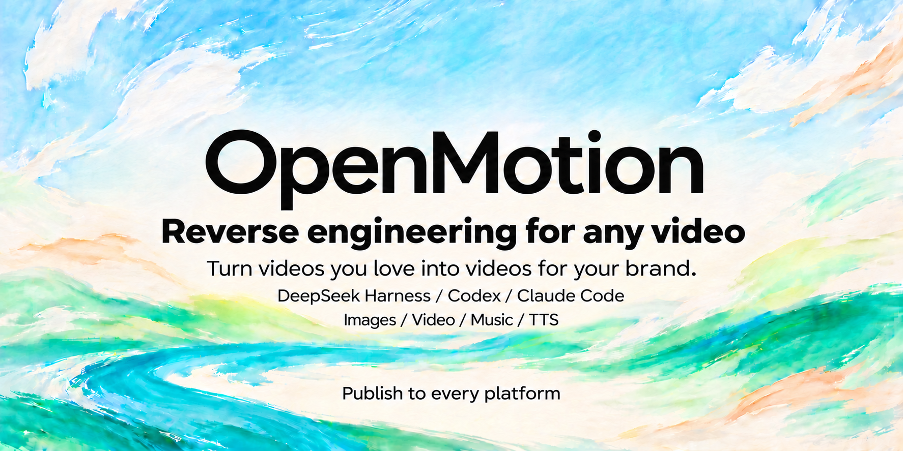

**눈길을 끄는 출시 영상, 리듬이 정확한 제품 공개, 복잡한 이야기를 쉽게 풀어내는 크리에이터.** 참고 영상과 로고, 스크린샷, 촬영본, 문구를 에이전트에 전달하세요. OpenMotion은 참고 영상을 분석하고 구조를 편집 가능한 프로젝트로 재구성해 내 이야기를 만드는 작업 흐름을 제공합니다.

**인기 영상을 역설계해 내 브랜드의 작품으로 만드세요.** 로컬 에이전트가 **풀스택 영상 크리에이터**가 됩니다. 참고 영상을 분석하고 **HTML, CSS, JavaScript**로 구현하며, 지원되는 내 API 키로 부족한 소재를 생성하고 하나의 Studio에서 편집·렌더링합니다. 기존 에이전트와 계정을 사용하고 소스, 소재, 완성 영상을 보관하세요.

**🔑 BYOA + BYOK. 🧩 890개 이상의 리소스. 👐 무료 오픈 소스.** 참고 영상부터 MP4까지 제작 과정을 지원합니다. 에이전트 구독 및 외부 모델/API 이용료는 선택한 제공업체의 조건을 따릅니다. [에이전트와 키 가져오기](#bring-your-agent-and-keys) · [라이브러리 둘러보기](#resources-to-start-from)

**분석하고, 만들고, 게시하세요.** 역설계로 창작 구조를 파악하고 내장 멀티모달 모델 연동으로 소재를 보충한 뒤 편집 가능한 타임라인에 조합합니다. **멀티플랫폼 게시는 계획 중**이며 완성 영상과 시청자를 연결할 예정입니다.

> “이 출시 영상을 우리 브랜드에 맞게 재구성하세요. 공개 방식, 카메라 움직임, 리듬을 유지하고 우리 제품, 스크린샷, 문구를 사용하세요. 설정된 모델로 부족한 비주얼, 음악, 내레이션을 생성하세요. 비교 결과를 보여준 뒤 편집 가능한 프로젝트와 MP4를 전달하세요.”

**어떤 영상이든 → 역설계 → 코드로 브랜드 반영 → 생성·편집·렌더링 → 멀티플랫폼 게시(계획 중).**

<a id="everyone-can-be-a-creator"></a>
<a id="everyone-can-be-an-ai-video-editor-everyone-can-be-a-creator"></a>
<a id="人人都是自媒体"></a>
<a id="creator-video-gallery"></a>

## 🎥 사람으로 시작해 볼 만한 영상을 만드세요

**얼굴, 목소리, 이야기, 그리고 전달력을 높이는 모션.** 강의, 화면 시연, 창업자 이야기, 제품 영상 등 9개 참고 사례에서 구조를 골라 내 촬영본에 적용하세요. 미리보기를 클릭하면 전체 영상을 볼 수 있습니다.

<table>
<tr><th colspan="3" align="left">🎓 교육과 설명</th></tr>
<tr>
<td width="33%" valign="top" align="center">
<a href="../library/skills/presenter-story/assets/careerwithriya-reference.mp4"><picture><source media="(prefers-reduced-motion: reduce)" srcset="readme/people/careerwithriya.jpg">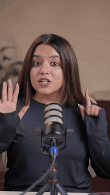</picture></a><br>
<strong>커리어를 바꾸는 핵심 역량 6가지</strong><br>
번호로 정리한 요점 + 움직이는 키워드<br>
<sub>참고 · <a href="https://www.instagram.com/reel/Ddd57MBszhc/">@careerwithriya</a></sub>
</td>
<td width="33%" valign="top" align="center">
<a href="readme/media/dan-martell-tools-reference.mp4"><picture><source media="(prefers-reduced-motion: reduce)" srcset="readme/people/dan-martell-tools.jpg">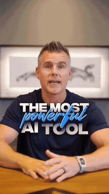</picture></a><br>
<strong>지금 가장 좋은 AI 도구는?</strong><br>
발표자 + 떠 있는 도구 카드<br>
<sub>참고 · <a href="https://www.youtube.com/shorts/mk1zJd9Rm4c">Dan Martell</a></sub>
</td>
<td width="33%" valign="top" align="center">
<a href="readme/media/harpercarrollai-reference.mp4"><picture><source media="(prefers-reduced-motion: reduce)" srcset="readme/people/harpercarrollai.jpg"></picture></a><br>
<strong>10일간의 AI 기초, 1일 차</strong><br>
개인 강의 + 읽기 쉬운 자막<br>
<sub>참고 · <a href="https://www.instagram.com/reel/C4eNPF3PdpG/">@harpercarrollai</a></sub>
</td>
</tr>
<tr><th colspan="3" align="left">🖥️ 작업 흐름 보여주기</th></tr>
<tr>
<td width="33%" valign="top" align="center">
<a href="../library/skills/presenter-story/assets/ali-abdaal-workflow-reference.mp4"><picture><source media="(prefers-reduced-motion: reduce)" srcset="readme/people/ali-abdaal-workflow.jpg">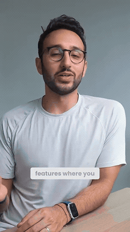</picture></a><br>
<strong>매일 사용하는 도구 5가지</strong><br>
책상에서의 이야기 + 작업 화면 삽입<br>
<sub>참고 · <a href="../library/skills/presenter-story/assets/ali-abdaal-workflow-reference.mp4">Ali Abdaal</a></sub>
</td>
<td width="33%" valign="top" align="center">
<a href="../library/skills/presenter-story/assets/john-tagudin-capso-reference.mp4"><picture><source media="(prefers-reduced-motion: reduce)" srcset="readme/people/john-tagudin-capso.jpg">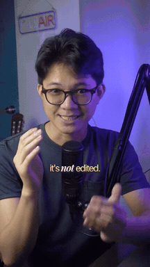</picture></a><br>
<strong>강조 표시가 있는 도구 시연</strong><br>
발표자 + 화면 + 강조 표시<br>
<sub>참고 · <a href="https://www.tiktok.com/@john.tagudin/video/7524883942328126728">@john.tagudin</a></sub>
</td>
<td width="33%" valign="top" align="center">
<a href="readme/media/aiwithsachi-reference.mp4"><picture><source media="(prefers-reduced-motion: reduce)" srcset="readme/people/aiwithsachi.jpg">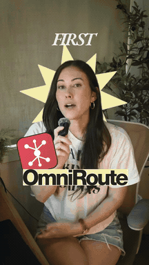</picture></a><br>
<strong>Claude에 설치할 플러그인 5가지</strong><br>
말로 소개하는 목록 + 보조 스크린샷<br>
<sub>참고 · <a href="https://www.instagram.com/reel/Dc7G9Pxu_1O/">@aiwithsachi</a></sub>
</td>
</tr>
<tr><th colspan="3" align="left">🎬 이야기와 제품 보여주기</th></tr>
<tr>
<td width="33%" valign="top" align="center">
<a href="readme/media/khris-sheer-founder-reference.mp4"><picture><source media="(prefers-reduced-motion: reduce)" srcset="readme/people/khris-sheer-founder.jpg">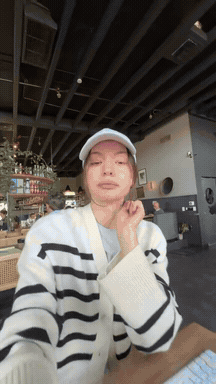</picture></a><br>
<strong>창업자 실험, 1화</strong><br>
창업자 일기 + 일상 B롤<br>
<sub>참고 · <a href="https://www.tiktok.com/@khris.sheer/video/7491715587895430402">@khris.sheer</a></sub>
</td>
<td width="33%" valign="top" align="center">
<a href="readme/media/ugc-rachelll-reference.mp4"><picture><source media="(prefers-reduced-motion: reduce)" srcset="readme/people/ugc-rachelll.jpg">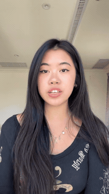</picture></a><br>
<strong>AI 크리에이터와 제품</strong><br>
제품 이야기 + 근거 + PIP<br>
<sub>참고 · <a href="https://www.tiktok.com/@ugc.rachelll/video/7616996050066345246">@ugc.rachelll</a></sub>
</td>
<td width="33%" valign="top" align="center">
<a href="readme/media/kevinstratvert-reference.mp4"><picture><source media="(prefers-reduced-motion: reduce)" srcset="readme/people/kevinstratvert.jpg">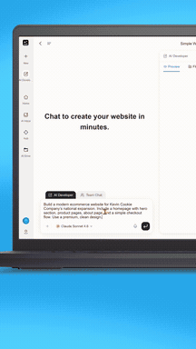</picture></a><br>
<strong>AI 도구 5개에 돈 쓰지 마세요</strong><br>
제품 튜토리얼 + 실제 시연<br>
<sub>참고 · <a href="https://www.youtube.com/shorts/1fA5j5_5TRY">Kevin Stratvert</a></sub>
</td>
</tr>
</table>

**이 방향으로 내 영상을 만드세요:** 내 발표자, 이야기, 제품으로 시작하세요. 도입부, 자막 리듬, 화면 공개 방식을 참고해 내 소재에 맞게 조정하도록 요청하세요. [Presenter Story Skill](../library/skills/presenter-story/SKILL.md) · [참고 출처](readme/media/manifest.json)

### 🎙️ 다음 발표자 중심 설명 영상

<a href="../library/templates/presenter-tech/README.md"><picture><source media="(prefers-reduced-motion: reduce)" srcset="readme/people/motiongit-kinetic.jpg">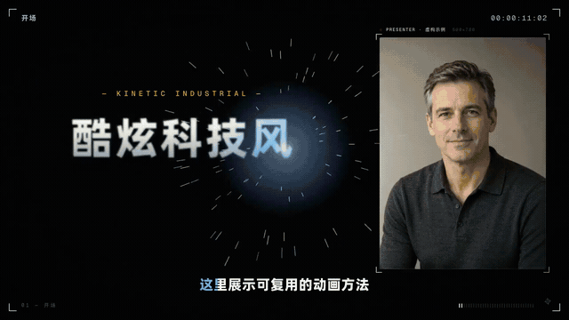</picture></a>

**발표자의 이야기 × 금속 질감 글자 × 애니메이션 설명.** 촬영본, 문구, 스크린샷, 자막을 가져오세요. 편집 가능한 소스, 매개변수, 글꼴, 사운드 레시피, 로컬 실행기가 Library에 포함되어 있어 에이전트가 제작 가이드에 따라 수정할 수 있습니다. **1920 × 1080 · 60 fps · 가로형.**

[템플릿 패키지 받기](../library/templates/presenter-tech/presenter-tech.motion) · [제작 가이드](../library/templates/presenter-tech/TEMPLATE.md) · [Motion.md](../library/templates/presenter-tech/MOTION_DESIGN.md)

<a id="brand-film-gallery"></a>

## 🚀 직접 만들고 싶었던 출시 영상을 살펴보세요

**Lovable, Kimi, Firecrawl, Figma, ElevenLabs, Codex.** 좋은 참고 사례에서 원하는 느낌을 골라 내 제품을 중심으로 영상을 만드세요. 아래 영상은 참고 작품이며 설명은 다음 영상의 제작 방향입니다.

<table>
<tr>
<td width="50%" valign="top" align="center">
<a href="readme/media/jake-lovable-reference.mp4"><picture><source media="(prefers-reduced-motion: reduce)" srcset="readme/examples/viral-remix.jpg">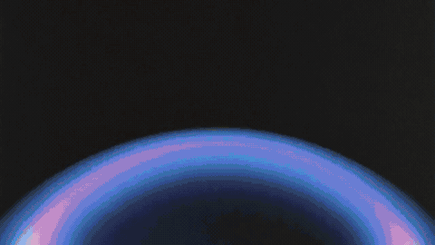</picture></a><br>
<strong>Lovable · Aesthetics Update</strong><br>
자신감 있는 제품 공개로 다음 디자인 업데이트를 소개하세요.<br>
<sub>참고 · @lovable_dev</sub>
</td>
<td width="50%" valign="top" align="center">
<a href="readme/media/remix-kimi-k3-reference.mp4"><picture><source media="(prefers-reduced-motion: reduce)" srcset="../web/catalog/covers/ac6e14a0fadb5893534e6438.jpg"></picture></a><br>
<strong>Kimi · K3 teaser</strong><br>
다음 출시를 짧고 기억에 남는 티저로 담으세요.<br>
<sub>참고 · @Kimi_Moonshot</sub>
</td>
</tr>
<tr>
<td width="50%" valign="top" align="center">
<a href="readme/media/remix-firecrawl-reference.mp4"><picture><source media="(prefers-reduced-motion: reduce)" srcset="../web/catalog/covers/02f9ae975461fe6290062d7f.jpg">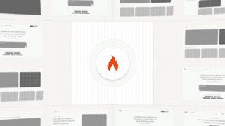</picture></a><br>
<strong>Firecrawl · Free Keyless</strong><br>
개발자 기능을 명확하고 시각적인 제품 이야기로 만드세요.<br>
<sub>참고 · @ericciarla</sub>
</td>
<td width="50%" valign="top" align="center">
<a href="https://openai.com/codex-originals/">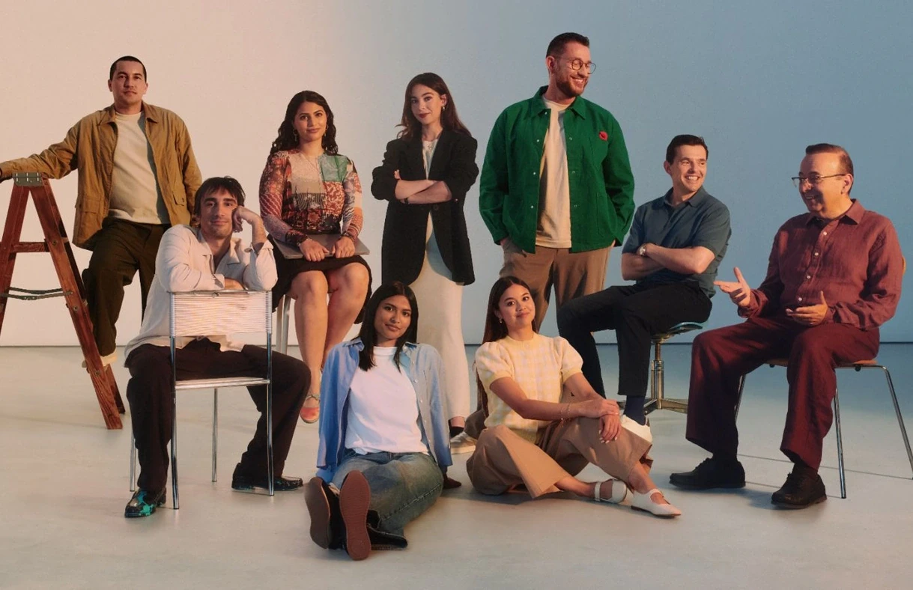</a><br>
<strong>OpenAI · Codex Originals</strong><br>
내 제품으로 무언가를 만드는 사람을 이야기의 중심에 두세요.<br>
<sub><a href="https://openai.com/codex-originals/">공식 캠페인 보기 ↗</a> · OpenAI · 캠페인 스틸</sub>
</td>
</tr>
<tr>
<td width="50%" valign="top" align="center">
<a href="readme/media/jake-figma-draw-reference.mp4"><picture><source media="(prefers-reduced-motion: reduce)" srcset="readme/examples/product-launch.jpg">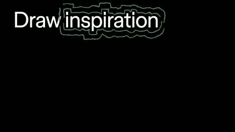</picture></a><br>
<strong>Figma · Draw</strong><br>
제품이 가능하게 하는 일을 모션으로 보여주세요.<br>
<sub>참고 · @figma</sub>
</td>
<td width="50%" valign="top" align="center">
<a href="readme/media/remix-elevenlabs-reception-reference.mp4"><picture><source media="(prefers-reduced-motion: reduce)" srcset="../web/catalog/covers/bc4b8b4398d66159acd35890.jpg"></picture></a><br>
<strong>ElevenLabs · Reception</strong><br>
핵심에 집중한 출시 이야기로 신제품을 소개하세요.<br>
<sub>참고 · @ElevenLabs</sub>
</td>
</tr>
</table>

> “이 방향으로 우리 브랜드의 출시 영상을 만드세요. 우리 UI, 문구, 브랜드 정체성을 사용하세요. 속도감과 명확한 공개 방식을 살리면서 제품에 맞는 새로운 장면 구성을 제안하세요.”

위 영상은 제작자를 명시한 외부 참고 작품입니다. OpenMotion은 이를 내 작품으로 재구성하는 작업 흐름을 제공합니다. [영상 출처](readme/media/manifest.json) · [추가 쇼케이스 출처](readme/brand-showcase/README.md)

<a id="what-is-openmotion"></a>
<a id="openmotion-是什么"></a>
<a id="video-is-code"></a>

## 💻 영상은 코드, HTML은 캔버스

**코드를 작성하는 로컬 에이전트를 영상 제작 전체 과정에 활용하세요.** HTML, CSS, JavaScript로 장면, 글자, 레이아웃, 전환, 타이밍을 표현합니다. 촬영본, 생성 클립, 이미지, 음악, 내레이션을 컴포지션에 넣고 동일한 프로젝트를 Studio에서 열어 MP4로 렌더링합니다.

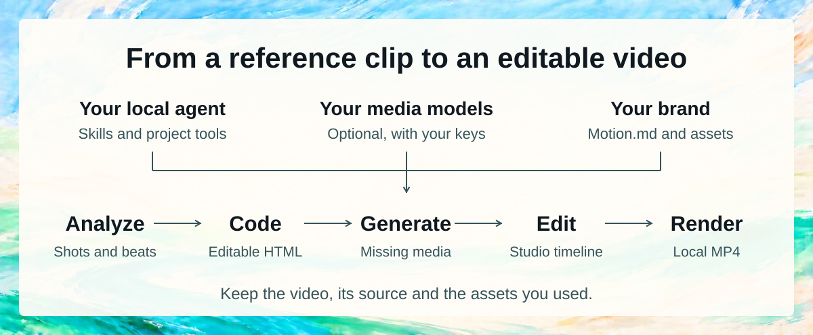

**작성하고, 보고, 수정하고, 렌더링하세요.** 제품 교체, 도입부 단축, 발표자 추가, 자막 변경, 새로운 결말을 요청하세요. 에이전트는 소스를 수정하고 사용자는 시각적 편집기에서 검토합니다. 로컬 MCP 클라이언트는 프로젝트 도구를, 셸 지원 에이전트는 Skills와 고정 버전 CLI도 사용할 수 있습니다. [에이전트 설정](#your-agent-your-studio) · [네이티브 제작 가이드](../skills/motion-production/references/native.md) · [HTML 예제 프로젝트](../template-library/product-promo/index.html)

**🎯 첫 100만 조회 영상을 목표로.** 흥미로운 도입부와 구조를 분석해 브랜드의 메시지를 담으세요. 새로운 시작, 다른 발표자, 더 선명한 제품 공개를 시도하고 소스를 보관해 다음 버전을 개선하세요.

<a id="bring-your-agent-and-keys"></a>

## 🔑 BYOA + BYOK. 내 에이전트, 내 키, 내 영상.

**기존 에이전트에 영상 제작 기능을 더하세요.** 로컬 코딩 에이전트가 요구사항 해석, 장면 계획, 영상 코드 작성, 소재 배치, 편집 수정, 최종 렌더링 요청까지 맡습니다.

| 가져올 것 | 영상에 활용하는 방법 |
| --- | --- |
| **🤖 에이전트 — BYOA** | Skills와 MCP로 기존 로컬 에이전트를 연결하고 지원되는 경우 CLI도 사용합니다. 익숙한 클라이언트, 계정, 작업 맥락을 유지합니다. |
| **🔑 키 — BYOK** | Model Settings에 지원되는 미디어 API 키를 추가하고 이미지·영상·음악·TTS 모델을 선택합니다. 지원되는 로컬 미디어 연동은 기존 에이전트 로그인을 사용합니다. |
| **🎨 브랜드와 소재** | 로고, 글꼴, 스크린샷, 촬영본, 대본, 음악을 추가합니다. Brandkit과 Motion.md를 재사용해 후속 버전의 일관성을 유지합니다. |
| **🧩 시작 리소스** | 참고 영상, 모션 컴포넌트, 템플릿, 커뮤니티 Skills에서 방향을 골라 소스나 참고 자료를 에이전트에 전달하세요. |

### 하나의 크리에이터가 전체 과정을

**이해 → 연출 → 코딩 → 생성 → 편집 → 렌더링.** 에이전트가 기획과 코드를, Model Gateway가 설정된 계정으로 소재 생성을 담당합니다. Studio에서 소스·소재·타임라인을 모아 같은 프로젝트를 검토·수정하고 로컬 MP4를 렌더링합니다.

**코드로 만들고 계속 개선하세요.** HTML/CSS/JS와 소재를 수정해 도입부, 발표자, 브랜드, 결말을 바꾸세요. 프로젝트는 검토하고 버전 관리하며 계속 편집할 수 있는 일반 소스 파일입니다.

### 무료 오픈 소스 제작 소프트웨어

**Skills, 프로젝트 도구, 모델 연동, Studio, 렌더링까지 제작 파이프라인이 오픈 소스입니다.** 로컬에서 실행하고 구현을 확인하며 확장하세요. 이 로컬 작업 흐름에는 소프트웨어 구독료나 렌더링 건별 요금이 없습니다. 생성 API 없이 보유한 영상·이미지·오디오만으로도 작업할 수 있습니다.

에이전트나 모델 제공업체는 구독료 또는 사용료를 부과할 수 있습니다. BYOA / BYOK는 내 접근 권한을 사용하며 타사 크레딧을 포함하거나 독점 모델을 오픈 소스로 바꾸지 않습니다. 인증 정보는 영상 프로젝트와 분리된 작업 공간 설정에 저장됩니다. [라이선스](../LICENSE) · [에이전트 설정](agent-adapters.md) · [모델 설정](model-gateway.md)

> “내 로컬 에이전트와 설정된 미디어 모델로 영상을 제작하세요. Library에서 참고 작품을 찾아 HTML/CSS/JS로 우리 브랜드에 맞게 구조를 재구성하고 부족한 소재만 생성하세요. 편집 가능한 프로젝트를 보여주고 검토 후 MP4를 렌더링하며 소스를 보관하세요.”

<a id="reverse-engineer-a-video"></a>

## 🔍 어떤 영상이든 역설계해 내 브랜드의 작품으로

도입부, UI 공개, 애니메이션 설명, 마지막 브랜드 로고처럼 분석할 순간을 고르세요. 에이전트가 이를 검토하고 바꿀 수 있는 제작 결정으로 분해합니다.

| 참고에서 분석할 것 | 내 이야기에 맞게 재구성할 것 |
| --- | --- |
| **도입부와 서사** — 등장 순서, 전개, 공개를 위한 준비 | 내 약속, 제품 사실, 행동 유도 |
| **장면 구조** — 구도, 카메라 움직임, 레이어, 시각적 계층 | 내 UI, 촬영본, 로고, 보조 이미지 |
| **모션과 리듬** — 등장, 전환, 이징, 읽는 시간 | 움직임의 의도를 유지하며 내용에 맞게 조정 |
| **타이포그래피와 정체성** — 글자 계층, 색상, 구도 | 내 글꼴, 팔레트, 문구, Brandkit |
| **소리와 박자** — 발화 타이밍, 음악 신호, 강조 | 내 목소리, 제공한 음악, 사운드 방향 |

1. **참고 자료와 브랜드를 준비하세요.** 영상 또는 접근 가능한 링크, 분석 구간, 로고, 문구, 스크린샷, 촬영본을 제공합니다. [Brandkit](../library/brandkits/openmotion/BRANDKIT.md) 으로 브랜드 정체성과 제품 사실을 모읍니다.
2. **효과적인 요소를 분석하세요.** 장면, 타이밍, 움직임, 소리, 유지할 요소를 파악하고 Motion.md에 기록합니다.
3. **코드로 영상을 재구성하세요.** 영상 참고에는 `motion-recreate`를 사용하고, 편집 가능한 소스가 있으면 템플릿 경로를 사용합니다. HTML/CSS/JS로 장면·모션·시간을 표현하고 촬영본과 소리를 소재로 배치합니다. 내 콘텐츠를 사용하고 부족한 이미지·영상·음악·TTS는 내장 모델 연동으로 생성합니다.
4. **비교하고 다듬으세요.** 참고와 재구성 영상의 같은 시점을 비교하며 공개 방식, 읽는 시간, 구도, 소리를 확인하고 같은 Studio 프로젝트에서 수정합니다.
5. **시청자에게 전달할 준비를 하세요.** MP4 버전을 내보내고 프로젝트를 보관하며 승인된 브랜드·모션 규칙을 다음 영상에 적용합니다. 연동형 멀티플랫폼 게시는 **계획 중**입니다.

```text
OpenMotion으로 첨부한 참고 영상을 우리 브랜드에 맞게 재구성하세요.

분석: 도입부, 장면 순서, 글자, 전환, 사운드 신호.
유지: 선택한 구간의 제품 공개 방식과 카메라 리듬.
교체: 로고, UI, 주장, 문구, 엔드 카드를 제공한 소재로 변경.
생성: 브랜드와 승인된 대본에 따라 설정된 모델로 부족한
이미지, 영상, 배경 음악, TTS 내레이션을 제작.

편집 가능한 프로젝트를 Studio에서 열고 참고 영상과 같은 시점을 비교하세요.
남은 차이를 설명하고 검토 후 MP4를 내보내며 다음 편집을 위해 소스를 보관하세요.
```

참고 자료 확보와 미디어 분석은 호스트 도구에 따라 달라집니다. 필요하면 로컬 영상과 타임코드를 제공하고 소유하거나 허가받은 소재를 사용하며 참고 출처를 유지하세요. [재구성 작업 흐름](../skills/motion-recreate/SKILL.md) · [참고 모음](collections/README.md)

<a id="all-in-one-studio"></a>
<a id="full-video-creation-stack"></a>

## 🎛️ 오픈 소스 영상 제작 풀스택

**참고 자료와 브랜드 기획부터 완전한 편집 가능 영상까지.** 창작 과정, 모델 연동, 소재 관리, 타임라인, 모션 엔진, 렌더링을 하나로 연결합니다. 보유한 소재로 시작하고 부족한 부분을 생성하며 에이전트와 다듬으세요.

### ✨ 이미지·영상·음악·TTS 연동 내장

**BYOK로 내 멀티모달 계정을 제작 과정에 연결하세요.** **Model Settings**에 지원 키를 추가하고 모델을 선택한 뒤 Studio의 **Model Gateway**로 이미지·영상·음악·음성을 생성합니다. 후보를 미리 보고 같은 프로젝트에 채택하세요. 지원되는 로컬 이미지 경로는 기존 에이전트 로그인을 사용합니다.

| 필요한 소재 | 내장 모델 카탈로그 예시 | 영상에 활용 |
| --- | --- | --- |
| **🖼️ 이미지** | Codex Image, Atlas Cloud의 Nano Banana 2, fal.ai의 FLUX Schnell | 브랜드 비주얼, 장면 아트, 보조 이미지. 지원되는 Codex 이미지 경로의 참조 기반 편집 |
| **🎬 영상** | Atlas Cloud의 Seedance 2.0, fal.ai의 Wan 2.2 | 촬영본·모션과 조합할 생성 장면과 B롤 |
| **🎵 음악** | Atlas Cloud의 Suno v4 | 분위기와 기획에 맞는 사운드트랙 |
| **🎙️ TTS / 내레이션** | fal.ai의 Kokoro | 승인된 대본으로 생성한 음성을 영상·음악과 배치 |

이 항목은 동봉된 [소스](../gateway/catalog.ts)의 카탈로그 항목입니다. 지원되는 내 계정이나 키를 연결하세요. 가용성, 필수 매개변수, 비용은 제공업체에 따라 달라집니다. 모델 탐색과 명시적 엔드포인트 등록도 지원합니다. [모델 설정과 생성](model-gateway.md)

> “우리 Brandkit과 승인된 대본으로 오프닝 아트, 삽입 영상, 배경 음악, TTS를 생성하세요. 선택한 결과를 재구성 프로젝트에 추가하고 소리와 영상을 맞춘 뒤 전체 편집본을 보여주세요.”

### 🛠️ 창작 의도에서 완성 영상까지

| 제작 단계 | OpenMotion이 연결하는 기능 |
| --- | --- |
| **이해와 연출** | 참고 재구성, 창작 Skills, Brandkit, Motion.md, 에이전트 분석 도구 |
| **생성과 관리** | 멀티모달 어댑터, 모델 선택, 생성 작업, 후보 미리보기, 프로젝트 미디어 |
| **편집과 애니메이션** | 시각적 타임라인, HTML/CSS/JS 컴포지션, 글자, 전환, 자막, 사운드 배치 |
| **검토와 반복** | Studio 미리보기, 직접 조정, 에이전트 수정, 프로젝트 버전 |
| **렌더링과 전달** | 고정 버전 렌더링, 기술적 내보내기 검사, MP4와 편집 가능한 소스 |
| **게시와 학습 — 계획 중** | 플랫폼 연결, 게시 예약, 영상 버전과 연결된 피드백 |

**실행하고, 살펴보고, 확장하세요.** 앱과 연동 코드는 오픈 소스이며 타사 모델·서비스는 각자의 라이선스와 접근 조건을 유지합니다. 다음 편집에 필요한 소스, 소재, 창작 결정을 프로젝트에 보관합니다.

```text
참고 + 내 브랜드 + 내 에이전트
             ↓
        이해와 재구성
             ↓
 이미지 + 영상 + 음악 + TTS
             ↓
 편집 가능한 Studio 프로젝트
             ↓
 검토 → 수정 → 렌더링 → MP4 + 소스
             ↓
     멀티플랫폼 게시 · 계획 중
```

[아키텍처 살펴보기](product/architecture.md) · [Model Gateway](model-gateway.md) · [앱 확장하기](../CONTRIBUTING.md)

<a id="product-tour"></a>
<a id="产品界面"></a>
<a id="connect-your-agent"></a>
<a id="use-from-your-agent"></a>
<a id="从-agent-接入"></a>
<a id="your-agent-your-studio"></a>

## 🖥️ BYOA: 로컬 에이전트를 풀스택 영상 크리에이터로

**내 에이전트에 전체 영상 작업 흐름을 연결하세요.** Skills는 제작 방법을, MCP는 프로젝트 도구를, Studio는 확인과 조정 화면을 제공합니다. 에이전트는 기존 클라이언트와 계정을 사용하고 OpenMotion은 로컬 편집·렌더링 앱을 실행합니다.

| 에이전트 / 클라이언트 | 연결 방법 |
| --- | --- |
| **DeepSeek Harness** | 로컬 MCP + Skills 설정 또는 생성한 Harness 어댑터 |
| **Codex** | 로컬 플러그인 또는 MCP + Skills. 지원 호스트에서는 Studio Viewer 사용 가능 |
| **Claude Code** | 로컬 플러그인 또는 MCP + Skills, 로컬 작업용 CLI |
| **WorkBuddy** | MCP + Skills 설정 생성. 데스크톱 제작·재생 검증은 아직 미완료 |
| **기타 로컬 MCP 클라이언트** | stdio 수동 설정. 미디어, 셸, Viewer 기능은 호스트에 따라 다름 |

[에이전트별 설정](agent-adapters.md) · [통합 로컬 설치기](npm-installation.md) · [빠른 시작](#quick-start)

### 에이전트에서 시작하기

DeepSeek Harness, Codex, Claude Code에 참고 영상과 브랜드 기획을 전달하고 재구성, 미리보기, 수정, 내보내기를 요청하세요. 기존 계정과 작업 방식을 그대로 사용합니다.

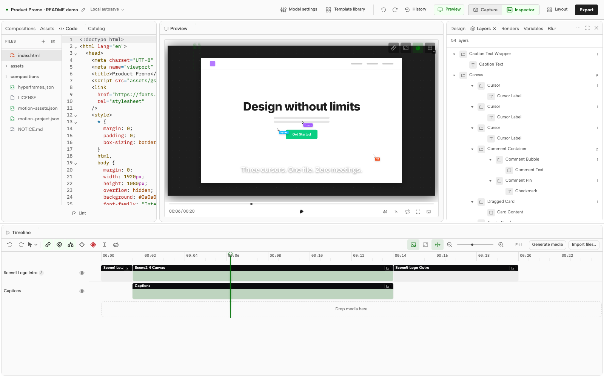

*기존 데모는 Codex 호스트용 Studio Viewer를 보여줍니다. [촬영 범위](product-tour.md) 에서 실제로 시연한 내용을 확인하세요.*

### Studio에서 시작하기

참고 자료를 살펴보고 템플릿을 열거나 촬영본을 가져오세요. **Connect Agent**를 선택해 작업 공간별 안내에 따라 연결하고 기획을 전달합니다. 같은 타임라인에서 수정 사항을 검토하고 언제든 직접 조정하세요.

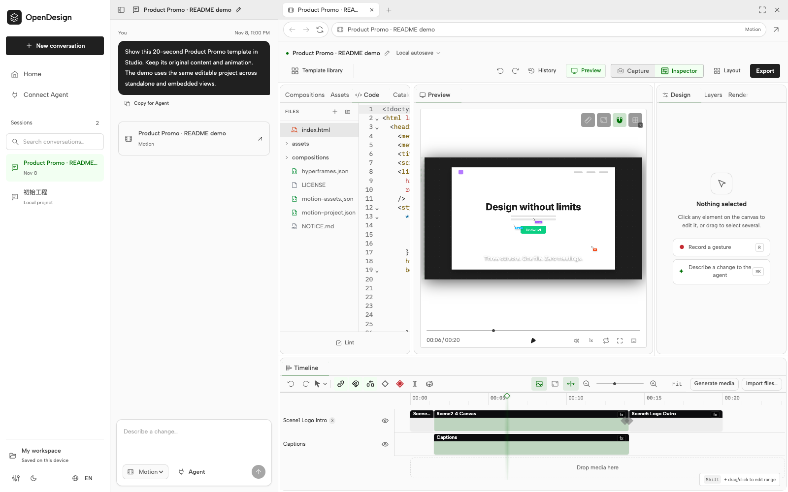

<details>
<summary>Claude Code와 템플릿 전달 보기</summary>

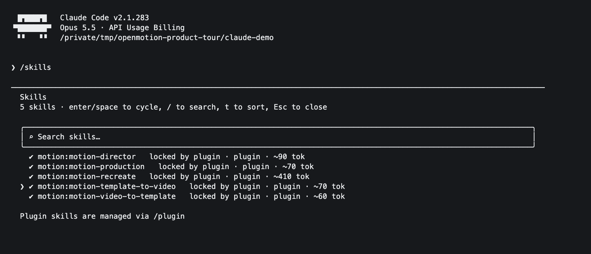

터미널 캡처는 로컬 Skill 로드를 보여줍니다. [CLI 검사](readme/product-tour/cli-checks.png) 는 프로젝트 검사를 보여주며 모델 주도의 재구성 완료를 입증하지는 않습니다.

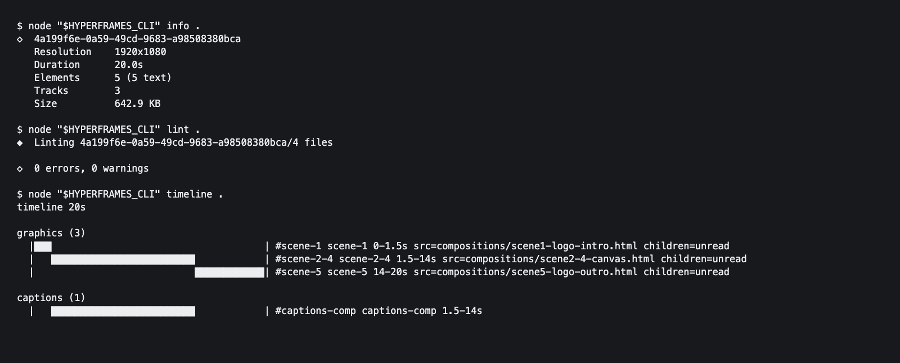

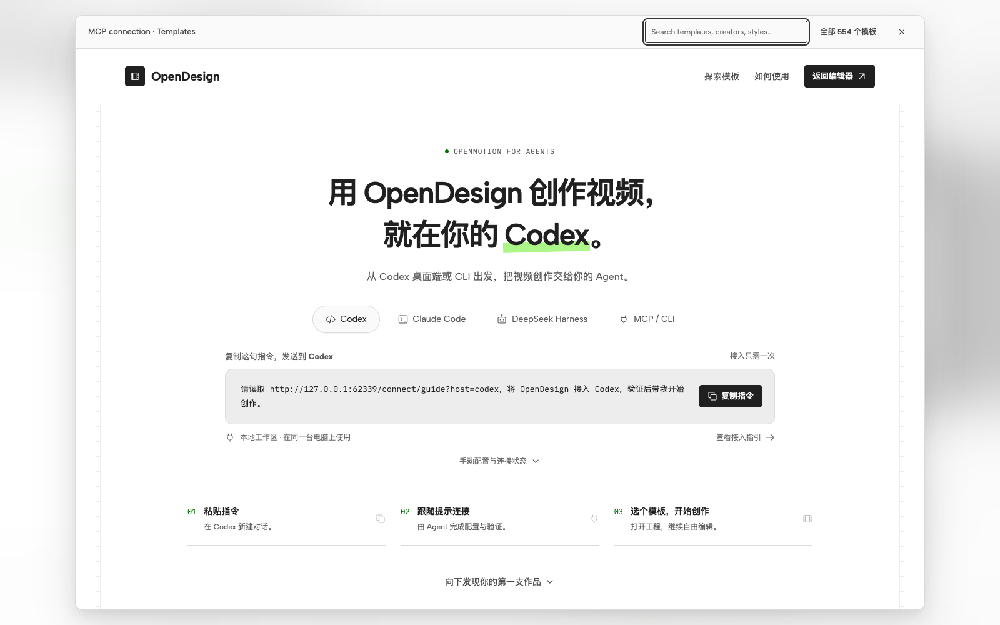

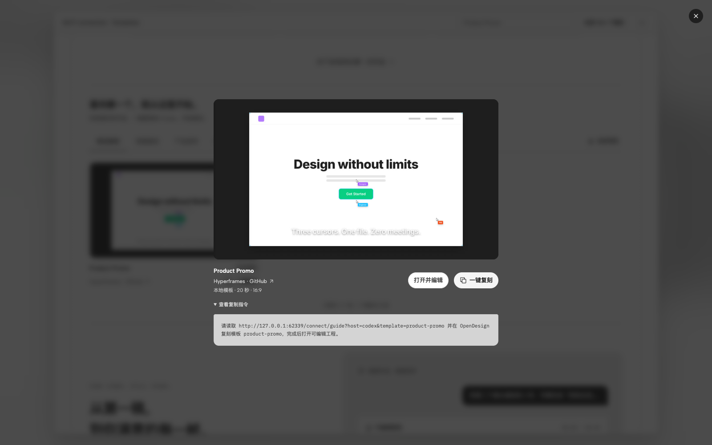

**미리보기 → 지침 복사 → 브랜드 소재와 함께 에이전트에 전달.** 내장 템플릿은 편집 가능한 복사본으로 열리고 외부 참고는 재구성 작업을 시작합니다. [전체 제품 데모](product-tour.md)

</details>

두 진입점은 같은 로컬 앱과 프로젝트를 사용합니다. 에이전트는 자체 클라이언트에서 실행되고 Studio는 기획과 편집 가능한 작품을 저장합니다. [연결 방식](session-architecture.md)

<a id="ai-video-editing"></a>
<a id="keep-editing-after-the-remake"></a>

## ✂️ 재구성 이후에도 계속 편집하기

**첫 재구성은 내 영상의 시작입니다.** 도입부를 다듬고, 화면을 교체하고, 설명을 넣고, 엔드 카드를 늘리거나 다른 시청자용 버전을 만드세요.

**AI 편집과 Motion을 위한 All-in-One AI-native Studio.** 첫 편집부터 최종 렌더링까지 사람과 에이전트가 같은 편집 가능한 타임라인에서 작업합니다.

| Studio 기능 | 현재 가능한 작업 |
| --- | --- |
| **이야기와 타임라인** | 소재 가져오기·배치, 대본이나 확인된 타임코드에 따른 자르기·재정렬·수정 |
| **모션과 자막** | 콘텐츠에 맞는 움직이는 글자, 전환, 강조 표시, 차트, 자막 |
| **소재와 소리** | 내 소재 가져오기, 내장 모델 연동으로 이미지·영상·음악·TTS 생성 |
| **이미지 수정** | 참조 이미지 지원 모델로 후보를 생성하고 시간·애니메이션을 유지해 교체 |
| **미리보기와 버전** | Studio에서 검토하고 직접 또는 에이전트로 편집하며 다음 수정에도 같은 프로젝트 사용 |
| **내보내기와 소스** | 고정 버전을 MP4로 렌더링하고 HTML, CSS, JavaScript, 소재 보관 |

> “승인된 공개 방식은 유지하세요. 중간 장면을 이 화면 녹화로 교체하고 지정한 타임코드로 도입부를 줄이며 마지막 CTA를 2초 더 유지하세요.”

모델 가용성은 제공업체 설정에 따라 달라집니다. 자동 음성 이해, 내용 선택, 플랫폼에 맞는 자동 리프레이밍은 별개 기능이며 타임라인 편집에 포함되는 것은 아닙니다. [미디어 제어](model-gateway.md) · [프로젝트와 버전](project-workspace.md)

<a id="presenter-motion"></a>

### 🎙️ 사람, 진짜 이야기, 전달을 돕는 모션

토킹헤드, 튜토리얼, 제품 설명 영상에도 적용됩니다. **사람의 전달 방식과 이야기 리듬을 유지하며 내 촬영본, 주제, 브랜드로 자막·스크린샷·PIP·모션을 재사용하세요.**

<details>
<summary><strong>발표자 중심 각색 3종과 Motion.md 레시피 보기</strong></summary>

아래 쌍은 원본 참고 영상과 외부 각색 작품의 무음 발췌입니다. 내 촬영본에 맞는 방향을 찾고 연결된 디자인 레시피로 에이전트를 안내하세요.

#### 얼굴, 키워드, 시각적 예시로 설명하기

**커리어 조언 → 영상 제작 설명**

<table>
<tr><th width="50%">참고 · @careerwithriya</th><th width="50%">각색 · 외부 예시</th></tr>
<tr><td colspan="2" align="center"><picture><source media="(prefers-reduced-motion: reduce)" srcset="readme/people/careerwithriya-comparison.jpg">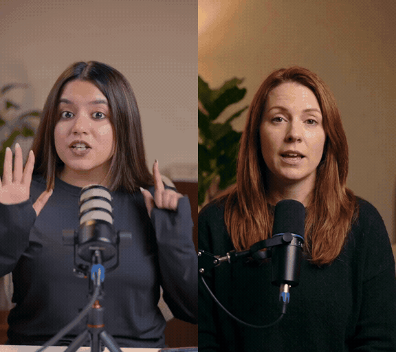</picture></td></tr>
</table>

**재사용:** 번호로 정리한 생각, 발표자의 설명, 근거 카드. **교체:** 크리에이터, 말할 주제, 키워드, 보조 예시.

[Motion.md](../library/skills/presenter-story/references/presenter-listicle/MOTION_DESIGN.md) · [Skill](../library/skills/presenter-story/SKILL.md) · [원본](../library/skills/presenter-story/assets/careerwithriya-reference.mp4) · [전체 각색본](../library/skills/presenter-story/assets/careerwithriya-result.mp4)

#### 이야기를 하며 작업 흐름 보여주기

**일상 도구 → 디자인 작업 공간 이야기**

<table>
<tr><th width="50%">참고 · Ali Abdaal</th><th width="50%">각색 · 외부 예시</th></tr>
<tr><td colspan="2" align="center"><picture><source media="(prefers-reduced-motion: reduce)" srcset="readme/people/ali-abdaal-workflow-comparison.jpg">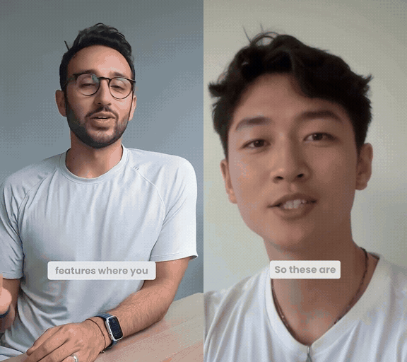</picture></td></tr>
</table>

**재사용:** 발표자와 화면의 리듬, 절제된 자막, 읽기 쉬운 삽입 화면. **교체:** 내 촬영본, 작업 흐름, 화면 캡처.

[Motion.md](../library/skills/presenter-story/references/workflow-demo/MOTION_DESIGN.md) · [Skill](../library/skills/presenter-story/SKILL.md) · [원본](../library/skills/presenter-story/assets/ali-abdaal-workflow-reference.mp4) · [전체 각색본](../library/skills/presenter-story/assets/ali-abdaal-workflow-result.mp4)

#### 발표자와 제품을 하나의 이야기로

**도구 시연 → 영상 편집기 둘러보기**

<table>
<tr><th width="50%">참고 · @john.tagudin</th><th width="50%">각색 · 외부 예시</th></tr>
<tr><td colspan="2" align="center"><picture><source media="(prefers-reduced-motion: reduce)" srcset="readme/people/john-tagudin-capso-comparison.jpg">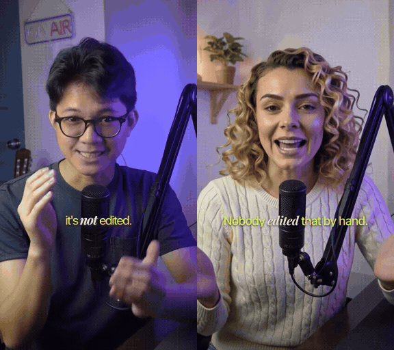</picture></td></tr>
</table>

**재사용:** 도입부, PIP, 강조 표시, 눈에 보이는 결과. **교체:** 제품, 발표자, 시연, 마무리 메시지.

[Motion.md](../library/skills/presenter-story/references/product-walkthrough/MOTION_DESIGN.md) · [Skill](../library/skills/presenter-story/SKILL.md) · [원본](../library/skills/presenter-story/assets/john-tagudin-capso-reference.mp4) · [전체 각색본](../library/skills/presenter-story/assets/john-tagudin-capso-result.mp4)

> 이 구조에 내 촬영본과 화면 녹화를 사용하세요. 내 목소리를 유지하고 실제 발화에 맞춰 편집하며 자막을 정렬하세요. 스크린샷, PIP, 모션으로 요점을 설명하세요. 소리 있는 미리보기를 보여준 뒤 편집 가능한 프로젝트와 MP4를 전달하세요.


</details>

**누구나 크리에이터가 될 수 있습니다.** 전하고 싶은 이야기에서 시작하고 참고 자료로 구조를 구체화하며 내 목소리를 중심에 두세요.

<a id="可以用它做什么"></a>
<a id="what-can-you-make"></a>

## 🎞️ 무엇을 만들 수 있나요?

**아이디어를 보고 내 작품으로 만드세요.** 7가지 시나리오마다 에이전트에 전달할 기획이 있습니다. 움직이는 발췌는 카탈로그의 외부 작품입니다. 전체 참고 영상을 확인하고 내 소재와 브랜드로 시작하세요.

<table>
<tr>
<td width="50%" valign="top">
<strong>01 · AI 토킹헤드 편집</strong><br>
3분의 촬영본을 하나의 선명한 이야기로.
<p align="center">
<a href="../library/skills/presenter-story/assets/ali-abdaal-workflow-reference.mp4"><picture>
<source media="(prefers-reduced-motion: reduce)" srcset="readme/examples/talking-head.jpg">

</picture></a>
</p>
<sub>참고 · <a href="../library/skills/presenter-story/assets/ali-abdaal-workflow-reference.mp4">Ali Abdaal · 매일 사용하는 도구 5가지</a></sub><br><br>
<strong>시작할 소재</strong> · 내 촬영본 + 녹취록 / 타임코드<br>
<strong>내 작품으로 만들기</strong> · 명확한 도입부, 간결한 말, 자막, 적절한 B롤.<br><br>
<a href="examples.md#talking-head">제작 기획 복사 →</a> · <a href="readme/examples/talking-head.jpg">정지 이미지 보기</a>
</td>
<td width="50%" valign="top">
<strong>02 · AI 재편집과 수정</strong><br>
흩어진 클립을 100일의 이야기로.
<p align="center">
<a href="readme/media/hundred-days-story-reference.mp4"><picture>
<source media="(prefers-reduced-motion: reduce)" srcset="readme/examples/story-recut.jpg">
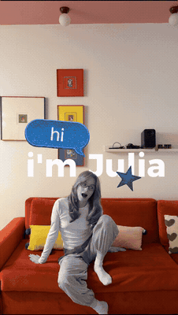
</picture></a>
</p>
<sub>참고 · <a href="https://www.instagram.com/reel/Dd6vHlQgpok/">스티커와 포토 카드로 담은 100일</a></sub><br><br>
<strong>시작할 소재</strong> · 내 클립, 사진, 내레이션, 이야기 개요<br>
<strong>내 작품으로 만들기</strong> · 사진 오려내기, 챕터 구분, 새로운 리듬의 개인 몽타주.<br><br>
<a href="examples.md#story-recut">제작 기획 복사 →</a> · <a href="readme/examples/story-recut.jpg">정지 이미지 보기</a>
</td>
</tr>
<tr>
<td width="50%" valign="top">
<strong>03 · 제품 출시와 시연</strong><br>
기능을 주인공으로.
<p align="center">
<a href="readme/media/jake-figma-draw-reference.mp4"><picture>
<source media="(prefers-reduced-motion: reduce)" srcset="readme/examples/product-launch.jpg">

</picture></a>
</p>
<sub>참고 · <a href="readme/media/jake-figma-draw-reference.mp4">Figma Draw · @figma</a></sub><br><br>
<strong>시작할 소재</strong> · 제품 화면 + 기능 기획 + Brandkit<br>
<strong>내 작품으로 만들기</strong> · 기능 공개, 집중된 UI 시연, 기억에 남는 마무리.<br><br>
<a href="examples.md#product-launch">제작 기획 복사 →</a> · <a href="readme/examples/product-launch.jpg">정지 이미지 보기</a>
</td>
<td width="50%" valign="top">
<strong>04 · 인기 영상 재구성</strong><br>
리듬을 재구성해 내 작품으로.
<p align="center">
<a href="readme/media/jake-lovable-reference.mp4"><picture>
<source media="(prefers-reduced-motion: reduce)" srcset="readme/examples/viral-remix.jpg">

</picture></a>
</p>
<sub>참고 · <a href="readme/media/jake-lovable-reference.mp4">Lovable: Aesthetics Update · @lovable_dev</a></sub><br><br>
<strong>시작할 소재</strong> · 참고 영상 + 내 문구, 비주얼, 브랜드<br>
<strong>내 작품으로 만들기</strong> · 도입부, 타이포그래피, 시각적 리듬 중심의 새 편집 가능 영상.<br><br>
<a href="examples.md#viral-remix">제작 기획 복사 →</a> · <a href="readme/examples/viral-remix.jpg">정지 이미지 보기</a>
</td>
</tr>
<tr>
<td width="50%" valign="top">
<strong>05 · 설명과 튜토리얼</strong><br>
하나의 작업 흐름을 명확한 세 단계로.
<p align="center">
<a href="readme/media/remix-authorize-once-reference.mp4"><picture>
<source media="(prefers-reduced-motion: reduce)" srcset="readme/examples/explainer.jpg">
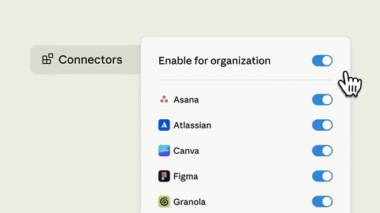
</picture></a>
</p>
<sub>참고 · <a href="readme/media/remix-authorize-once-reference.mp4">한 번 인증하고 모두 연결</a></sub><br><br>
<strong>시작할 소재</strong> · 내 작업 흐름 + 대본 + 정확한 UI 캡처<br>
<strong>내 작품으로 만들기</strong> · 장면마다 하나의 요점과 목적 있는 강조 표시로 안내.<br><br>
<a href="examples.md#explainer">제작 기획 복사 →</a> · <a href="readme/examples/explainer.jpg">정지 이미지 보기</a>
</td>
<td width="50%" valign="top">
<strong>06 · 데이터 이야기와 차트</strong><br>
숫자마다 의미를 담으세요.
<p align="center">
<a href="readme/media/M1128-clip.mp4"><picture>
<source media="(prefers-reduced-motion: reduce)" srcset="readme/examples/data-story.jpg">
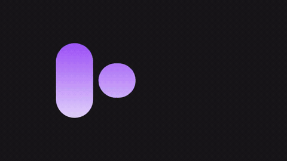
</picture></a>
</p>
<sub>참고 · <a href="https://x.com/Vintage_god/status/2106817967967056165">움직이는 비교 막대 차트 · @Vintage_god</a></sub><br><br>
<strong>시작할 소재</strong> · 내 데이터, 단위, 출처, 결론<br>
<strong>내 작품으로 만들기</strong> · 읽기 쉬운 차트 공개, 움직이는 값, 명확한 비교.<br><br>
<a href="examples.md#data-story">제작 기획 복사 →</a> · <a href="readme/examples/data-story.jpg">정지 이미지 보기</a>
</td>
</tr>
<tr>
<td colspan="2" valign="top">
<strong>07 · 음악과 예술 비주얼</strong><br>
음악에 시각적 정체성을 주세요.
<p align="center">
<a href="readme/media/M1139-clip.mp4"><picture>
<source media="(prefers-reduced-motion: reduce)" srcset="readme/examples/music-visual.jpg">
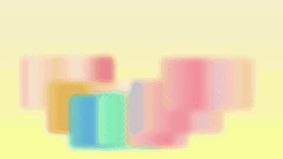
</picture></a>
</p>
<sub>참고 · <a href="https://x.com/GoogleAI/status/2024154215182926027">Lyria 3 비주얼 시퀀스 · @GoogleAI</a></sub><br><br>
<strong>시작할 소재</strong> · 내 오디오 + 분위기 + 비트 마커 / 큐 포인트<br>
<strong>내 작품으로 만들기</strong> · 색상 레이어, 움직이는 글자, 음악에 맞춘 비주얼 시퀀스.<br><br>
<a href="examples.md#music-visual">제작 기획 복사 →</a> · <a href="readme/examples/music-visual.jpg">정지 이미지 보기</a>
</td>
</tr>
</table>

이 참고 사례는 제작 방향을 보여주며 OpenMotion이 생성한 검증 데모가 아닙니다. 편집 가능한 프로젝트로 시작하려면 [내장 템플릿 3종](../library/templates/README.md)중 하나를 여세요. [예제 기획과 작업 흐름](examples.md) · [출처와 발췌 기록](readme/ASSETS.md#creative-examples)

<a id="make-your-motion-language-reusable"></a>
<a id="motion-design-community"></a>

## 🎨 Motion.md — 제작 기법을 나누는 커뮤니티

**한 번 분석하고 모션 언어를 공유해 다음 크리에이터가 이어가게 하세요.** `Motion.md` 는 커뮤니티의 핵심 Markdown 규약 제안입니다. 영상의 움직임, 효과적인 이유, 새 브랜드에 적용하는 방법을 읽을 수 있는 형태로 기록합니다.

대화 속 창작 결정을 사람과 에이전트가 읽고 검토하고 개선할 수 있는 파일로 옮기세요. 디자이너가 모션을 설명하고 개발자가 구현하며 다른 크리에이터가 새 이야기에 적용합니다. **완성 영상과 제작 방법을 함께 공유합니다.**

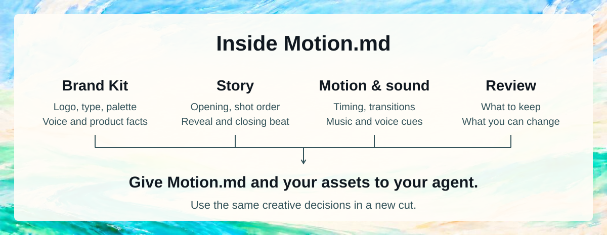

<details>
<summary>창작 패키지 텍스트 보기</summary>

```text
참고 + 내 브랜드
       ↓
이해 → 재구성 → 비교 → 수정
       ↓
재사용 가능한 창작 패키지
  BRANDKIT.md       정체성, 제품 사실, 승인 소재
  Motion.md  서사, 모션, 타이밍, 소리, 유지/변경 규칙
  SKILL.md          각색·검토 방법
  소스 + 소재      편집 가능한 구현
  프리셋 + 근거    교체 입력과 실제 비교
       ↓
내 에이전트 → 다음 편집 가능 영상
```

</details>

**Brandkit은 정체성, Motion.md는 디자인, Skill은 방법, 프로젝트는 구현을 담습니다.** 첫 내보내기 이후에도 재사용하고 커뮤니티에서 검토·포크·개선할 수 있습니다.

| 현재 Library 리소스 | 제공 내용 |
| --- | --- |
| [OpenMotion Brandkit](../library/brandkits/openmotion/BRANDKIT.md) | 브랜드 사실, 정체성, 말투, 소재의 예시 |
| [Ink & Water](../library/design-systems/ink-water/MOTION_DESIGN.md) | 재사용 가능한 모션 디자인 방향 |
| [Motion Design Remix](../library/skills/motion-design-remix/SKILL.md) | 소스 프로필 6종: 와이어프레임 제목, 나뭇잎 타이포그래피, UI 공개, 입체 코드, 입자 조립, 유리 카드 |
| [Presenter Story](../library/skills/presenter-story/SKILL.md) | 말하기 중심 영상 디자인 레시피 3종 |

`Motion.md` 는 에이전트에 명시적으로 전달하는 **v0.1 작성 규약**이며 자동 가져오기나 검증기는 없습니다. 소스 각색 패키지는 6개 프로필의 교체 도우미를 제공하며 영상만 있는 경우에는 `motion-recreate`를 사용합니다. 이동 가능한 템플릿이 필요하면 `motion-video-to-template` 가 기존 `TEMPLATE.md` 전달 형식을 제공합니다. [Motion.md 가이드](motion-md.md) · [전체 예제 6종](motion-design-examples.md)

### 🌱 내 각색을 커뮤니티의 다음 출발점으로

```text
참고 분석 → 브랜드에 맞게 재구성 → 실제 결과 비교
                                    ↓
                      GitHub에 창작 패키지 게시
                 Motion.md + 소스 + 미리보기 + 출처
                                    ↓
                         포크 → 브랜드 교체 → 검토
                                    ↓
                       개선 사항과 새 실제 예제 공유
```

1. **디자인을 기록하세요.** 참고 자료, 서사 흐름, 타이밍, 구도, 카메라, 글자, 소리, 내용 교체 시 유지할 결정을 적습니다.
2. **실행 가능하게 만드세요.** 편집 가능한 소스와 허가된 소재, 교체 입력, 미리보기·렌더링 방법을 포함합니다.
3. **실제 결과를 보여주세요.** 원본 참고와 각색, 필요한 경우 같은 시점 비교, 실제 검사, 남은 차이를 공유합니다.
4. **기여하고 각색하세요.** 완전한 폴더로 PR을 열어 다른 사람이 포크하고 브랜드를 바꾸고 새 예제로 개선하도록 합니다.

| 기여할 것 | 커뮤니티가 얻는 것 |
| --- | --- |
| **모션 디자인** | 문서화된 시각 언어, 장면 문법, 사운드 방향 |
| **크리에이티브 코딩** | 편집 가능한 구현, 컴포넌트, 재사용 가능한 애니메이션 |
| **브랜드와 스토리텔링** | 새 기획, 실제 각색, 다른 콘텐츠에서도 디자인이 작동하는 근거 |
| **에이전트 작업 흐름** | 재구성, 각색, 비교, 검토를 안내하는 Skills |
| **연구와 평가** | 출처가 있는 참고, 재현 가능한 비교, 벤치마크 과제 제안 |

[Motion Design Remix](../library/skills/motion-design-remix/SKILL.md), [Presenter Story](../library/skills/presenter-story/SKILL.md) 또는 [Ink & Water](../library/design-systems/ink-water/MOTION_DESIGN.md)에서 시작하세요. [리소스 등록 체크리스트](../library/ENTRY_TEMPLATE.md)를 사용하고 [GitHub](https://github.com/nexu-io/html-anything/issues) 에서 작품을 공유하며 [Discord](https://discord.gg/mHAjSMV6gz)에 참여하세요. Git 기반 기여와 명시적 재사용은 현재 가능하며 마켓플레이스와 Motion Benchmark / Arena는 향후 방향입니다.

<a id="see-the-motion-survive-a-new-brand"></a>

## 🧪 영상 속 편집 가능한 모션 살펴보기

**카메라 움직임, 제목, 제품 공개가 마음에 드나요? 아이디어는 유지하고 이야기를 바꾸세요.** 편집 가능한 소스 연구 6종에 Motion.md, Skill, 콘텐츠 프리셋이 포함됩니다. [소스, 입력, 검증 기록](motion-design-examples.md).

<details>
<summary><strong>글자, UI, 코드, 입자, 유리 소스 연구 6종 열기</strong></summary>

쌍으로 된 미리보기는 같은 구현에서 렌더링한 무음 발췌로 원본 내용과 각색 내용을 같은 시점에 비교합니다.

### 와이어프레임 포털 · BREAKTHROUGH → OPENMOTION

<table>
<tr><th width="50%">참고 · 원본 내용</th><th width="50%">각색 · Skill 패키지 적용</th></tr>
<tr><td colspan="2"><a href="../library/skills/motion-design-remix/previews/wireframe-portal-title.mp4"><picture><source media="(prefers-reduced-motion: reduce)" srcset="../library/skills/motion-design-remix/previews/wireframe-portal-title.jpg">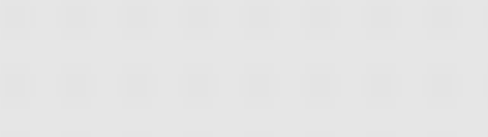</picture></a></td></tr>
</table>

**유지: 포털 타이밍, 입체 글자, 카메라 전진.** **교체: 제목, 부제, 3D 문구.**

[Motion.md](../library/skills/motion-design-remix/references/wireframe-portal-title/MOTION_DESIGN.md) · [Skill](../library/skills/motion-design-remix/SKILL.md) · [콘텐츠 프리셋](../library/skills/motion-design-remix/presets/wireframe-portal-title.json) · [MP4](../library/skills/motion-design-remix/previews/wireframe-portal-title.mp4)

### 나뭇잎 타이포그래피 · Understory → OpenMotion

<table>
<tr><th width="50%">참고 · 원본 내용</th><th width="50%">각색 · Skill 패키지 적용</th></tr>
<tr><td colspan="2"><a href="../library/skills/motion-design-remix/previews/canopy-part-title.mp4"><picture><source media="(prefers-reduced-motion: reduce)" srcset="../library/skills/motion-design-remix/previews/canopy-part-title.jpg"></picture></a></td></tr>
</table>

**유지: 나뭇잎 움직임, 깊이, 가림, 읽는 시간.** **교체: 브랜드 제목 2개.**

[Motion.md](../library/skills/motion-design-remix/references/canopy-part-title/MOTION_DESIGN.md) · [Skill](../library/skills/motion-design-remix/SKILL.md) · [콘텐츠 프리셋](../library/skills/motion-design-remix/presets/canopy-part-title.json) · [MP4](../library/skills/motion-design-remix/previews/canopy-part-title.mp4)

### UI 공개 · 제품 둘러보기 → AI 편집 이야기

<table>
<tr><th width="50%">참고 · 원본 내용</th><th width="50%">각색 · Skill 패키지 적용</th></tr>
<tr><td colspan="2"><a href="../library/skills/motion-design-remix/previews/ui-3d-reveal.mp4"><picture><source media="(prefers-reduced-motion: reduce)" srcset="../library/skills/motion-design-remix/previews/ui-3d-reveal.jpg">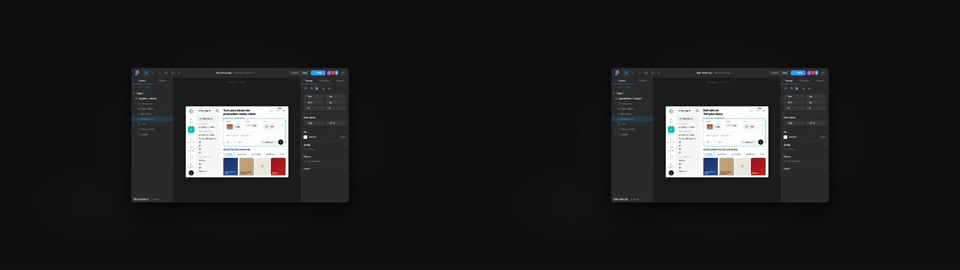</picture></a></td></tr>
</table>

**유지: 기울어진 캔버스, 깊이 계층, 연속 카메라.** **교체: 메인 제목, 문서, 커뮤니티 문구.**

[Motion.md](../library/skills/motion-design-remix/references/ui-3d-reveal/MOTION_DESIGN.md) · [Skill](../library/skills/motion-design-remix/SKILL.md) · [콘텐츠 프리셋](../library/skills/motion-design-remix/presets/ui-3d-reveal.json) · [MP4](../library/skills/motion-design-remix/previews/ui-3d-reveal.mp4)

### 입체 코드 · loadConfig() → cutVideo()

<table>
<tr><th width="50%">참고 · 원본 내용</th><th width="50%">각색 · Skill 패키지 적용</th></tr>
<tr><td colspan="2"><a href="../library/skills/motion-design-remix/previews/code-3d-extrude.mp4"><picture><source media="(prefers-reduced-motion: reduce)" srcset="../library/skills/motion-design-remix/previews/code-3d-extrude.jpg">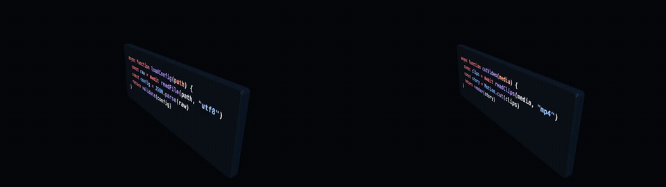</picture></a></td></tr>
</table>

**유지: 돌출된 판, 구문 색상, 카메라 움직임.** **교체: 함수, 변수, 표시되는 호출.**

[Motion.md](../library/skills/motion-design-remix/references/code-3d-extrude/MOTION_DESIGN.md) · [Skill](../library/skills/motion-design-remix/SKILL.md) · [콘텐츠 프리셋](../library/skills/motion-design-remix/presets/code-3d-extrude.json) · [MP4](../library/skills/motion-design-remix/previews/code-3d-extrude.mp4)

### 입자 조립 · parse / optimize / emit → select / trim / render

<table>
<tr><th width="50%">참고 · 원본 내용</th><th width="50%">각색 · Skill 패키지 적용</th></tr>
<tr><td colspan="2"><a href="../library/skills/motion-design-remix/previews/code-particle-assemble.mp4"><picture><source media="(prefers-reduced-motion: reduce)" srcset="../library/skills/motion-design-remix/previews/code-particle-assemble.jpg">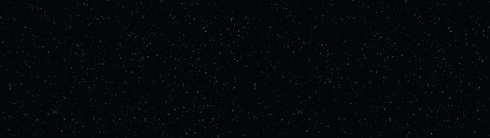</picture></a></td></tr>
</table>

**유지: 시드가 고정된 입자 움직임과 조립 리듬.** **교체: 파이프라인 이름과 단계.**

[Motion.md](../library/skills/motion-design-remix/references/code-particle-assemble/MOTION_DESIGN.md) · [Skill](../library/skills/motion-design-remix/SKILL.md) · [콘텐츠 프리셋](../library/skills/motion-design-remix/presets/code-particle-assemble.json) · [MP4](../library/skills/motion-design-remix/previews/code-particle-assemble.mp4)

### 유리 정보 카드 · 기기 위젯 → 크리에이터 작업 공간

<table>
<tr><th width="50%">참고 · 원본 내용</th><th width="50%">각색 · Skill 패키지 적용</th></tr>
<tr><td colspan="2"><a href="../library/skills/motion-design-remix/previews/liquid-glass-widgets.mp4"><picture><source media="(prefers-reduced-motion: reduce)" srcset="../library/skills/motion-design-remix/previews/liquid-glass-widgets.jpg">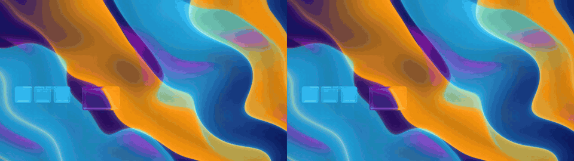</picture></a></td></tr>
</table>

**유지: 유리 질감, 카드 계층, 시차 등장, 계기.** **교체: 라벨, 단위, 기능 이야기.**

[Motion.md](../library/skills/motion-design-remix/references/liquid-glass-widgets/MOTION_DESIGN.md) · [Skill](../library/skills/motion-design-remix/SKILL.md) · [콘텐츠 프리셋](../library/skills/motion-design-remix/presets/liquid-glass-widgets.json) · [MP4](../library/skills/motion-design-remix/previews/liquid-glass-widgets.mp4)

영상만 있는 참고 자료는 별도의 [재구성 작업 흐름](../skills/motion-recreate/SKILL.md) 으로 재구성하고 비교합니다. 재현도는 선택한 참고 자료와 기획에 맞춰 검토합니다.

</details>

<a id="one-video-more-places-to-share"></a>
<a id="publish-to-every-platform"></a>

## 📤 모든 플랫폼에 게시 — 계획 중

**영상을 분석하고 브랜드 작품을 만들어 시청자에게 전달하세요.** 참고, 브랜드 제작, 멀티모달 생성, 편집, 렌더링, 배포를 연결하고 승인된 영상을 여러 채널에 함께 게시하는 것이 목표입니다.

**계획 중:** 게시 계정을 연결하고 플랫폼별 영상과 문구를 준비한 뒤 한곳에서 검토·게시·예약합니다. “모든 플랫폼”은 제품 방향이며 지원 대상은 커넥터 구현과 검증 후 발표됩니다.

### 플랫폼별 영상은 지금 만들 수 있습니다

승인된 영상을 채널별 버전으로 만드세요. 편집 가능한 프로젝트에서 브랜드와 모션을 유지하며 도입부, 길이, 레이아웃, 마무리 메시지를 바꿀 수 있습니다.

> “승인된 영상으로 9:16 숏폼, 16:9 제품 출시, 정사각형 피드 버전을 만드세요. 화면비에 맞춰 글자와 UI를 재배치하고 브랜드와 공개 방식을 유지하며 각 버전을 검토하게 해주세요.”

| 요청할 버전 | 조정할 것 |
| --- | --- |
| **세로 숏폼** — Reels, Shorts, TikTok, 샤오홍슈 등 | 도입부, 크고 읽기 쉬운 글자, 구도, 자막 위치 |
| **가로 영상** — 제품 페이지, 출시, YouTube | UI 세부, 넓은 구도, 설명할 시간 |
| **정사각형 피드** — 소셜 캠페인 | 간결한 구도, 제목, 명확한 마무리 |

이는 제작 기획 예시이며 내장 내보내기 프리셋이 아닙니다. 에이전트가 구도를 조정하고 각 결과를 대상 플랫폼의 현재 요구사항에 맞춰 검토해야 합니다.

**현재 가능:** 버전 제작, MP4 내보내기, 직접 게시하거나 예약 도구에 업로드. 게시는 별도 전달 단계이며 OpenMotion 내 계정 연결과 예약은 계획 중입니다.

### 게시 연동 — 계획 중

| 계획 중인 게시 단계 | 목표 경험 |
| --- | --- |
| **채널 연결** | 브랜드 계정과 게시 대상 선택 |
| **게시 준비** | 플랫폼별 영상, 표지, 자막, 게시 문구 제작 |
| **검토와 게시** | 완성 버전을 승인한 뒤 게시 또는 예약 |
| **결과에서 학습** | 성과를 실제 게시 버전과 연결해 다음 영상에 반영 |

```text
현재
분석 → 브랜드 적용 → 생성 → 편집 → 렌더링 → MP4
                                          ↓
                               수동 업로드 / 외부 예약 도구

계획 중 · 멀티플랫폼 게시
승인 버전 → 게시 연동 → 예약 → 성과 피드백
    ↑                              |
    +──────── 다음 영상 개선 ────────+
```

**아이디어부터 배포까지 하나의 제작 흐름으로.** 현재 제작 기능은 참고 재구성, 멀티모달 생성, 편집, 렌더링입니다. 앱 내 게시, 예약, 자동 리프레이밍, 분석 데이터 수집은 **계획 중**입니다. [현재 기능 범위](product/architecture.md) · [게시와 피드백 방향](product/studio-vision.md)

<a id="resources-to-start-from"></a>

## 🧩 890개 이상의 리소스에서 내 방향 찾기

**풀스택 크리에이터에게는 라이브러리가 필요합니다.** 참고 영상, 모션 장면, 코드 예제, 블록, 컴포넌트를 살펴보고 커뮤니티 Skills, 편집 가능한 템플릿, 디자인 시스템, Brandkit과 조합하세요.

현재 탐색 카탈로그는 **891개**입니다. **전체 참고 영상 42개**, **모션 장면 393개**, **블록 210개**, **컴포넌트 238개**, **예제 8개**를 포함합니다. 시청용 참고와 코드 리소스이며 바로 열 수 있는 Studio 프로젝트는 아래에 별도로 표시합니다. [리소스 색인](collections/README.md)

**다섯 종류의 리소스가 제작을 돕습니다.** Skills는 방법, 템플릿은 출발점, 컴포넌트는 재사용 모션, 디자인 시스템은 시각적 일관성, Brandkit은 브랜드를 담습니다. **핵심 제작 Skills 5종**, **네이티브 Studio 템플릿 3종**, **Presenter Tech**, **편집 가능한 모션 연구 6종**, **발표자 이야기 레시피 3종**에서 시작하고 배운 내용을 나누세요.

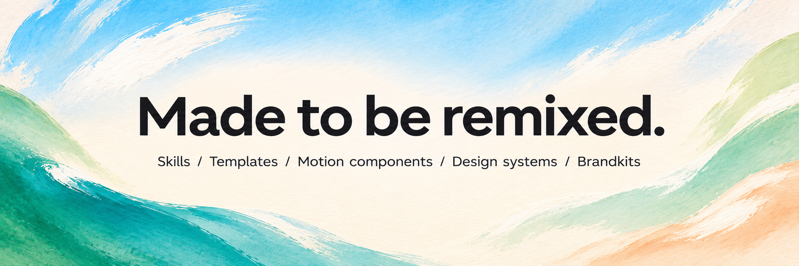

| 리소스 분류 | 시작하기 |
| --- | --- |
| **Skills** | [Brandkit, Motion Design Remix, Presenter Story](../library/skills) |
| **템플릿** | [네이티브 시작 프로젝트 3종](../library/templates/README.md) 와 [Presenter Tech 패키지](../library/templates/presenter-tech/README.md) |
| **모션 컴포넌트** | [제목, UI 공개 등 재사용 요소](../library/components/README.md) |
| **디자인 시스템** | [모션 규칙과 시각적 방향](../library/design-systems) |
| **Brandkit** | [브랜드 정체성, 사실, 승인된 소재](../library/brandkits) |

### 편집 가능한 시작 프로젝트 열기

| [Product Promo · 20초](../template-library/product-promo) | [NYT Graph · 15초](../template-library/nyt-graph) | [Decision Tree · 10초](../template-library/decision-tree) |
| --- | --- | --- |
|  | 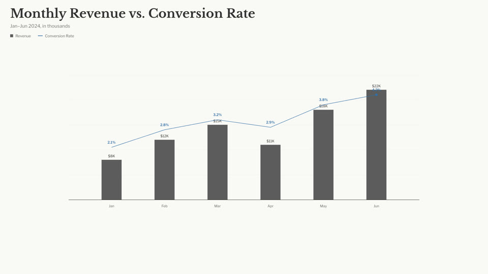 | 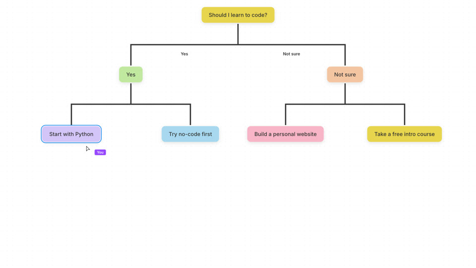 |
| 내 제목, 제품, 엔드 카드 | 내 수치, 단위, 비교 | 내 질문, 분기, 답 |

### 🎬 촬영본, 생성 캐릭터, 코드

좋은 영상은 여러 제작 방식을 섞을 수 있습니다. 외부 사례를 보며 무엇을 촬영하고 생성하고 코드로 표현할지 판단하세요.

<table>
<tr>
<td width="50%" valign="top" align="center">
<a href="readme/brand-showcase/rea-unboxing.mp4"><picture><source media="(prefers-reduced-motion: reduce)" srcset="readme/brand-showcase/rea-unboxing.jpg">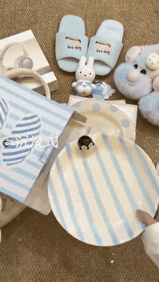</picture></a><br>
<strong>실제 제품, 촉감 있는 이야기</strong><br>
클로즈업, 손동작, 공개 방식을 분석하고 내 제품을 촬영하세요.<br>
<sub>실사 · 제품 언박싱</sub>
</td>
<td width="50%" valign="top" align="center">
<a href="readme/brand-showcase/rea-dual-role.mp4"><picture><source media="(prefers-reduced-motion: reduce)" srcset="readme/brand-showcase/rea-dual-role.jpg">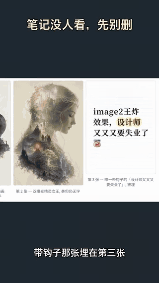</picture></a><br>
<strong>캐릭터와 UI의 만남</strong><br>
캐릭터 중심 도입부를 UI 모션, 화면 녹화와 조합하세요.<br>
<sub>AI 캐릭터 + 코드 + 화면 녹화</sub>
</td>
</tr>
</table>

[전체 제작 기능 보기](#full-video-creation-stack)

<a id="motion-gallery"></a>

### 카탈로그 작품 살펴보기

**움직이는 추천 18개에서 스타일을 찾으세요.** 출시 영상, 움직이는 글자, 유리와 빛, 공간 모션, 생성 비주얼을 살펴보세요. 클릭해 전체 영상을 보고 Studio에서 같은 제목을 찾아 에이전트에 전달하세요.

**리소스가 로컬에 있습니다.** 이 페이지와 예제 가이드의 전체 참고 영상, 전후 비교, GIF, 템플릿 소스, 브라우저 스크립트, 글꼴은 로컬에 수록되어 있습니다. [리소스 목록과 재사용](readme/RESOURCES.md).

**배우고, 각색하고, 기여할 수 있는 라이브러리.** 현재 **894개: 내장 편집 가능 템플릿 3개와 외부 참고·레지스트리 항목 891개**를 포함하며 확인 가능한 원작자와 출처를 유지합니다.

<table>
<tr><th colspan="3" align="left">📱 제품과 UI</th></tr>
<tr>
<td width="33%" valign="top">
<a href="readme/media/app-showcase.mp4"><picture><source media="(prefers-reduced-motion: reduce)" srcset="../web/catalog/covers/51a2d141e18e608cc11b9256.jpg"></picture></a><br>
<strong>App Showcase</strong><br>
<sub>컴포넌트 · <a href="../library/components/showcase/README.md">컴포넌트 보기</a></sub>
</td>
<td width="33%" valign="top">
<a href="readme/media/remix-firecrawl-reference.mp4"><picture><source media="(prefers-reduced-motion: reduce)" srcset="../web/catalog/covers/02f9ae975461fe6290062d7f.jpg"></picture></a><br>
<strong>Firecrawl Free Keyless</strong><br>
<sub>참고 · <a href="readme/media/remix-firecrawl-reference.mp4">@ericciarla</a></sub>
</td>
<td width="33%" valign="top">
<a href="../library/skills/motion-design-remix/assets/ui-3d-reveal/reference.mp4"><picture><source media="(prefers-reduced-motion: reduce)" srcset="../web/catalog/covers/c13d0082838675f088ecadcd.jpg"></picture></a><br>
<strong>3D UI Reveal</strong><br>
<sub>컴포넌트 · <a href="../library/skills/motion-design-remix/references/ui-3d-reveal/MOTION_DESIGN.md">컴포넌트 보기</a></sub>
</td>
</tr>
<tr><th colspan="3" align="left">🚀 브랜드와 출시 영상</th></tr>
<tr>
<td width="33%" valign="top">
<a href="readme/media/jake-pond-reference.mp4"><picture><source media="(prefers-reduced-motion: reduce)" srcset="../web/catalog/covers/66ac2f8b58e55670971ae70c.jpg"></picture></a><br>
<strong>Pond: a new Linux OS</strong><br>
<sub>참고 · <a href="readme/media/jake-pond-reference.mp4">@bflycomputer</a></sub>
</td>
<td width="33%" valign="top">
<a href="readme/media/remix-kimi-k3-reference.mp4"><picture><source media="(prefers-reduced-motion: reduce)" srcset="../web/catalog/covers/ac6e14a0fadb5893534e6438.jpg"></picture></a><br>
<strong>Kimi K3 teaser</strong><br>
<sub>참고 · <a href="readme/media/remix-kimi-k3-reference.mp4">@Kimi_Moonshot</a></sub>
</td>
<td width="33%" valign="top">
<a href="readme/media/remix-elevenlabs-reception-reference.mp4"><picture><source media="(prefers-reduced-motion: reduce)" srcset="../web/catalog/covers/bc4b8b4398d66159acd35890.jpg"></picture></a><br>
<strong>Reception by ElevenLabs</strong><br>
<sub>참고 · <a href="readme/media/remix-elevenlabs-reception-reference.mp4">@ElevenLabs</a></sub>
</td>
</tr>
<tr><th colspan="3" align="left">✍️ 움직이는 타이포그래피</th></tr>
<tr>
<td width="33%" valign="top">
<a href="readme/media/glass-shard-title.mp4"><picture><source media="(prefers-reduced-motion: reduce)" srcset="../web/catalog/covers/10cceacc02d415247d58f562.jpg"></picture></a><br>
<strong>Glass Shard Title</strong><br>
<sub>컴포넌트 · <a href="../library/components/showcase/README.md">컴포넌트 보기</a></sub>
</td>
<td width="33%" valign="top">
<a href="../library/skills/motion-design-remix/assets/canopy-part-title/reference.mp4"><picture><source media="(prefers-reduced-motion: reduce)" srcset="../web/catalog/covers/998dd6bb8358592c15f727d6.jpg"></picture></a><br>
<strong>Canopy Part Title</strong><br>
<sub>컴포넌트 · <a href="../library/skills/motion-design-remix/references/canopy-part-title/MOTION_DESIGN.md">컴포넌트 보기</a></sub>
</td>
<td width="33%" valign="top">
<a href="../library/skills/motion-design-remix/assets/wireframe-portal-title/reference.mp4"><picture><source media="(prefers-reduced-motion: reduce)" srcset="../web/catalog/covers/4d03231a69d147a38f993578.jpg"></picture></a><br>
<strong>Wireframe Portal Title</strong><br>
<sub>컴포넌트 · <a href="../library/skills/motion-design-remix/references/wireframe-portal-title/MOTION_DESIGN.md">컴포넌트 보기</a></sub>
</td>
</tr>
<tr><th colspan="3" align="left">💎 빛, 유리, 3D 세계</th></tr>
<tr>
<td width="33%" valign="top">
<a href="readme/media/remix-iskra-light-reference.mp4"><picture><source media="(prefers-reduced-motion: reduce)" srcset="../web/catalog/covers/75cfbe06267768838d145fa4.jpg"></picture></a><br>
<strong>Iskra Light</strong><br>
<sub>참고 · <a href="readme/media/remix-iskra-light-reference.mp4">@world_is_web</a></sub>
</td>
<td width="33%" valign="top">
<a href="../library/skills/motion-design-remix/assets/liquid-glass-widgets/reference.mp4"><picture><source media="(prefers-reduced-motion: reduce)" srcset="../web/catalog/covers/553a1464d8037293b7debca8.jpg"></picture></a><br>
<strong>Liquid Glass Widgets</strong><br>
<sub>컴포넌트 · <a href="../library/skills/motion-design-remix/references/liquid-glass-widgets/MOTION_DESIGN.md">컴포넌트 보기</a></sub>
</td>
<td width="33%" valign="top">
<a href="readme/media/remix-cyera-reference.mp4"><picture><source media="(prefers-reduced-motion: reduce)" srcset="../web/catalog/covers/8884a707a92d0cc52d3363b7.jpg"></picture></a><br>
<strong>Cyera brand video</strong><br>
<sub>참고 · <a href="readme/media/remix-cyera-reference.mp4">Cyera</a></sub>
</td>
</tr>
<tr><th colspan="3" align="left">🧭 깊이와 카메라 움직임</th></tr>
<tr>
<td width="33%" valign="top">
<a href="../library/skills/motion-design-remix/assets/code-3d-extrude/reference.mp4"><picture><source media="(prefers-reduced-motion: reduce)" srcset="../web/catalog/covers/0a5c7158bbecd6e47055bef9.jpg"></picture></a><br>
<strong>Code 3D Extrude</strong><br>
<sub>컴포넌트 · <a href="../library/skills/motion-design-remix/references/code-3d-extrude/MOTION_DESIGN.md">컴포넌트 보기</a></sub>
</td>
<td width="33%" valign="top">
<a href="readme/media/remix-glyph-reference.mp4"><picture><source media="(prefers-reduced-motion: reduce)" srcset="../web/catalog/covers/4bfe08db4d486970494eff3b.jpg"></picture></a><br>
<strong>Glyph: GPU typography for the web</strong><br>
<sub>참고 · <a href="readme/media/remix-glyph-reference.mp4">@pmndrs</a></sub>
</td>
<td width="33%" valign="top">
<a href="readme/media/nyc-paris-flight.mp4"><picture><source media="(prefers-reduced-motion: reduce)" srcset="../web/catalog/covers/aeafb2433c37f2f7d8c87619.jpg"></picture></a><br>
<strong>NYC Paris Flight</strong><br>
<sub>컴포넌트 · <a href="../library/components/showcase/README.md">컴포넌트 보기</a></sub>
</td>
</tr>
<tr><th colspan="3" align="left">✨ 생성 비주얼</th></tr>
<tr>
<td width="33%" valign="top">
<a href="readme/media/aurora.mp4"><picture><source media="(prefers-reduced-motion: reduce)" srcset="../web/catalog/covers/5aefe7c9a916a38777443b36.jpg"></picture></a><br>
<strong>Aurora</strong><br>
<sub>컴포넌트 · <a href="../library/components/showcase/README.md">컴포넌트 보기</a></sub>
</td>
<td width="33%" valign="top">
<a href="readme/media/remix-linear-loops-reference.mp4"><picture><source media="(prefers-reduced-motion: reduce)" srcset="../web/catalog/covers/17cf5075b3f4b49c7d3e9201.jpg"></picture></a><br>
<strong>Linear Loops</strong><br>
<sub>참고 · <a href="readme/media/remix-linear-loops-reference.mp4">@linear</a></sub>
</td>
<td width="33%" valign="top">
<a href="../library/skills/motion-design-remix/assets/code-particle-assemble/reference.mp4"><picture><source media="(prefers-reduced-motion: reduce)" srcset="../web/catalog/covers/8ff121deb9403f7a99ac52b3.jpg"></picture></a><br>
<strong>Code Particle Assemble</strong><br>
<sub>컴포넌트 · <a href="../library/skills/motion-design-remix/references/code-particle-assemble/MOTION_DESIGN.md">컴포넌트 보기</a></sub>
</td>
</tr>
</table>

카탈로그 원본 영상의 화면과 정상 재생 속도를 유지한 발췌입니다. 외부 참고와 컴포넌트이며 추가 내장 템플릿이 아닙니다. [출처와 발췌 기록](readme/ASSETS.md#catalog-preview-grid)

| 탐색 | 제공 내용 |
| --- | --- |
| [Motion 리소스 색인](collections/README.md) | 추천 영상, 출처, 편집 가능한 출발점. |
| [내장 템플릿](../template-library) | Product Promo, NYT Graph, Decision Tree. 각각 네이티브 소스와 미리보기 포함. |
| Studio 템플릿 라이브러리 | 검색, 미리보기, 템플릿 각색·참고 재구성 지침. |
| [Motion.md](motion-md.md) | 스타일을 만드는 창작 결정을 공유하는 방법. |

참고는 분석 대상이고 편집 가능한 템플릿에는 수정할 소스가 포함됩니다. 갤러리의 **원클릭 재구성**은 참고 자료와 에이전트 지침을 복사합니다. 내장 템플릿은 바로 열 수 있지만 외부 영상은 분석과 재구성이 필요합니다. [카탈로그 범위와 출처](template-catalog.md)

<a id="快速开始"></a>
<a id="quick-start"></a>

## 🚀 시작하기

### OpenMotion 실행하기

**무료 로컬 제작 환경에서 시작하세요.** 내 에이전트를 연결하고 내장 템플릿이나 촬영본을 사용해 로컬에서 렌더링합니다. 새 소재가 필요하면 Model Settings에 지원되는 미디어 키를 추가하세요.

Git, npm과 [CI](../.github/workflows/ci.yml)에 고정된 **Node.js 26.11.1**을 사용하세요. 소스 기반 미리보기와 내보내기에는 Chrome/Chromium, FFmpeg/FFprobe도 필요합니다. [실행 환경 설정](usage.md)

```sh
git clone --branch feature/motion https://github.com/nexu-io/html-anything.git openmotion
cd openmotion
npm ci
npm run build:studio
npm start
```

**http://localhost:4173**을 열고 **Templates → Ready to edit**에서 **Product Promo**를 선택한 뒤 **Connect Agent**로 연결하세요. 프로젝트와 인증 정보는 체크아웃 밖에 두세요. `MOTION_DATA_DIR` 로 작업 공간을 선택합니다.

### 에이전트에 연결하기

플러그인을 지원하는 Codex에서는 체크아웃에서 실행하세요:

```sh
bash scripts/install-motion.command
```

DeepSeek Harness, Claude Code 등은 [에이전트 어댑터 가이드](agent-adapters.md) 또는 [로컬 MCP + Skills 설치기](npm-installation.md)를 참고하세요. npm 패키지는 아직 공개 배포되지 않았으며 가이드는 로컬 빌드 산출물을 사용합니다. [Windows 테스트 패키지](test-packages.md)

먼저 내장 템플릿으로 시작하세요:

> OpenMotion으로 20초 Product Promo의 새 복사본을 Studio에서 열고 MP4로 내보내세요. 편집 가능한 프로젝트도 보관하세요.

이제 내 작품으로 바꾸세요:

> 구조와 애니메이션을 유지하고 로고, 스크린샷, 제목, 엔드 카드를 제공한 브랜드 소재로 교체하세요. 새 편집본을 보여주고 마지막 제목을 2초 더 유지하세요.

영상에서 시작하려면 참고 자료와 [재구성 기획](#reverse-engineer-a-video)을 전달하세요. 호스트가 대화 옆에 Studio를 열 수 없으면 반환된 로컬 프로젝트 링크를 사용하세요.

<details>
<summary>Skills, MCP, CLI</summary>

체크아웃에서 [Skills CLI](https://github.com/vercel-labs/skills)를 사용해 핵심 작업 흐름 5종을 확인하고 설치하세요:

```sh
npx skills add ./skills --list
npx skills add ./skills --skill motion-director motion-production motion-template-to-video motion-recreate motion-video-to-template
```

지침만 복사하며 런타임 설치나 MCP 등록은 하지 않습니다. 공유 문서를 사용할 수 있게 유지하고 앱을 별도로 연결하거나 위 통합 설치기를 사용하세요.

| Skill | 용도 |
| --- | --- |
| [motion-recreate](../skills/motion-recreate/SKILL.md) | 참고 영상 재구성과 결과 비교 |
| [motion-template-to-video](../skills/motion-template-to-video/SKILL.md) | 기존 편집 가능 템플릿 각색 |
| [motion-director](../skills/motion-director/SKILL.md) | 독창적 영상, 서사, 모션, 소리, 창작 검토 |
| [motion-video-to-template](../skills/motion-video-to-template/SKILL.md) | 이동 가능한 재사용 템플릿 제작 |
| [motion-production](../skills/motion-production/SKILL.md) | 범위가 정해진 수정, 미리보기, 검사, 문제 해결, 내보내기 |

**Connect Agent**로 작업 공간별 설정을 확인하세요. 로컬 stdio 클라이언트를 수동 설정할 때는 절대 경로를 사용합니다:

```json
{
  "mcpServers": {
    "openmotion": {
      "command": "/absolute/path/to/node",
      "args": ["--experimental-strip-types", "/absolute/openmotion/mcp.ts"],
      "env": { "MOTION_DATA_DIR": "/absolute/openmotion-data" }
    }
  }
}
```

**공개 MCP 도구 11개**가 템플릿 검색·상세 조회·프로젝트 생성·읽기·편집·미리보기·소재 가져오기·내보내기·버전 복원·취소를 담당합니다. 공유 작업 흐름과 엔진 가이드는 MCP resources에서 제공합니다. [도구 계약](mcp-phase1-tools.md)

Studio와 에이전트는 템플릿 카탈로그 캐시를 공유합니다. `motion_list_templates`는 로컬 JSONL 색인을 반환하고, `motion_get_template`은 상세 정보를 가져오며, `motion_create_project`는 편집 가능한 복사본을 만듭니다. 환경은 패키지에 저장되며 로컬 개발은 DEV, 정식 패키지는 프로덕션이 기본입니다. [템플릿 카탈로그](template-catalog.md)

앱은 `npm start` 로 실행하고 stdio는 `npm run mcp` 로 실행합니다. 셸 지원 에이전트는 런타임이 반환한 고정 버전 엔진 CLI로 검사·렌더링할 수 있으며 관리되는 수정에는 revision 검사를 유지합니다. [네이티브 제작](../skills/motion-production/references/native.md)

</details>

<a id="open-projects-reusable-knowledge"></a>
<a id="developer-architecture"></a>

## 🛠️ 크리에이터를 위해 만들고 개발자에게 열어 둡니다

**HTML은 편집 가능한 소스, MP4는 렌더링한 전달물입니다.** TypeScript 앱, React Studio, 에이전트 작업 흐름, 멀티모달 생성 어댑터, 브라우저 기반 합성·렌더링 엔진을 조합합니다. 프로젝트는 사람과 에이전트가 공유하는 작품입니다.

### 모듈의 협업 방식

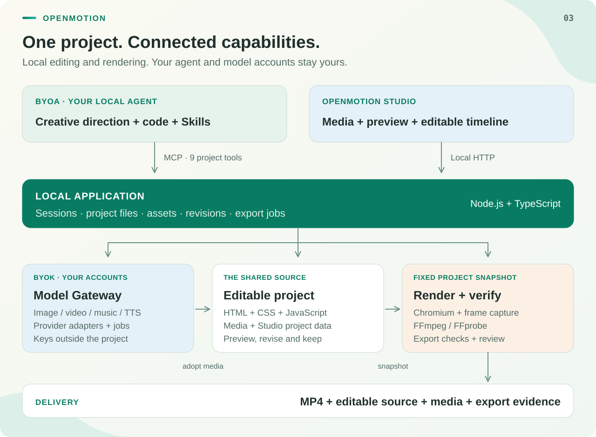

<details>
<summary>전체 아키텍처와 로드맵 텍스트 보기</summary>

```text
창작 입력
참고 영상 + 촬영본 + 대본 + 브랜드 소재
                    ↓
커뮤니티 지식
Motion.md + BRANDKIT.md + Skills + 템플릿 + 컴포넌트
                    ↓
BYOA: 로컬 에이전트                     OPENMOTION STUDIO
DeepSeek Harness / Codex / Claude Code  React 19 + TypeScript + Vite
다른 로컬 호스트, Skills, 분석 도구    Tailwind CSS + Zustand
                    |                  CodeMirror + Dockview
              stdio MCP                소재 / 미리보기 / 타임라인
              프로젝트 도구 9개             로컬 HTTP
                    └───────┬──────────┘
                            ↓
로컬 앱: Node.js + TypeScript + node:http
세션 / 프로젝트 파일 / 소재 / revision / 내보내기 작업
                    ↓                        ↓
BYOK: MODEL GATEWAY                    영상은 코드
내 키 / 계정 / 모델 라우팅             HTML 장면 + 소재 + Studio 데이터
탐색 / 생성 작업                      HTML + CSS + JavaScript + GSAP
                    ↓                        ↑
모델 어댑터                                  |
Codex Image / Atlas Cloud / fal.ai            |
이미지 / 영상 / 음악 / TTS                    |
                    ↓                        |
생성 후보 → 미리보기 / 선택 → 명시적 채택 ────┘
                            ↓
렌더링과 검증
고정 스냅샷 → HTML 엔진 + Chromium → FFmpeg / FFprobe
                            ↓
현재 전달물
MP4 + 편집 가능 소스 + 소재 + 버전 및 내보내기 근거
                            ↓
계획 중: 멀티플랫폼 게시
플랫폼 커넥터 → 게시 검토 → 예약 → 성과 피드백
                            ↓
계획 중: 지식 피드백
버전별 결과 → 팀 메모리 / RAG → 평가된 Skill 개선
```

</details>

BYOA는 기존 클라이언트를 사용하고 BYOK는 지원 모델 계정을 연결합니다. Studio와 로컬 서비스가 작품을 관리하며 인증 정보는 프로젝트 밖에 둡니다. 1단계 공개 MCP는 **프로젝트 도구 9개와 템플릿 카탈로그 도구 2개, 총 11개**입니다. 모델 생성은 Studio와 로컬 Gateway에서 사용하며 이 도식이 공개 MCP에 생성·게시 도구를 추가한다는 뜻은 아닙니다.

도식은 [의존성이 없는 작은 스크립트](readme/diagrams/generate.py)로 생성한 편집 가능한 SVG입니다.

### 기술 스택과 소스 안내

| 계층 | 기술 | 소스 안내 |
| --- | --- | --- |
| **Studio와 편집 UI** | React 19, TypeScript 5.9, Vite 6, Tailwind CSS 4, Zustand, CodeMirror, Dockview | [Studio 소스](../studio/src) · [Motion 앱](../studio/src/motion/MotionApp.tsx) · [편집기 개발](editor-fork.md) |
| **앱 런타임** | CI의 Node.js 26.11.1, 네이티브 HTTP, TypeScript 실행, 로컬 파일/JSON | [server.ts](../server.ts) · [workspace.ts](../workspace.ts) · [세션 아키텍처](session-architecture.md) |
| **에이전트 연동** | 로컬 stdio MCP, 핵심 Skills 5종, 생성한 호스트 어댑터 | [mcp.ts](../mcp.ts) · [phase1.ts](../phase1.ts) · [어댑터 생성](../scripts/export-adapters.ts) |
| **멀티모달 생성** | Codex 미디어 어댑터, Atlas Cloud predictions, fal.ai 큐 연동, 영구 저장 생성 작업 | [Gateway 서비스](../gateway/service.ts) · [제공업체 어댑터](../gateway/providers.ts) · [모델 카탈로그](../gateway/catalog.ts) |
| **합성과 모션** | HTML/CSS/JS, GSAP, 고정 버전 합성 엔진, 네이티브 타임라인/이력 | [엔진 연동](../hyperframes.ts) · [템플릿 소스](../template-library) · [버전 어댑터](../phase1-versions.ts) |
| **렌더링과 미디어** | Chromium, Puppeteer Core, FFmpeg, FFprobe | [렌더링 서비스](../server.ts) · [내보내기 검증기](../scripts/verify-export.ts) · [네이티브 런타임 잠금](../scripts/runtime-lock.json) |
| **창작 지식** | Markdown, 소스 패키지, 프리셋, 비교 근거 | [Motion.md](motion-md.md) · [핵심 Skills](../skills) · [커뮤니티 Library](../library/README.md) |
| **검증과 패키징** | Node 테스트, Vitest, Studio 검사, npm 잠금 파일, 명시적 배포 목록 | [테스트](../tests) · [Studio 테스트](../studio/tests) · [CI](../.github/workflows/ci.yml) · [배포](../scripts/distribution.ts) |
| **게시와 학습 — 계획 중** | 플랫폼 어댑터, 예약, 버전별 피드백과 검색. 구현 설계는 예정 | [Studio 비전](product/studio-vision.md) |

의존성 버전은 [package.json](../package.json), [package-lock.json](../package-lock.json) 과 [런타임 잠금 파일](../scripts/runtime-lock.json)에 있습니다. 모델과 타사 라이브러리는 각자의 조건을 유지하며 앱은 Apache-2.0입니다.

### 원하는 계층에서 함께 만들기

| 분야 | 기여할 수 있는 내용 | 시작점 |
| --- | --- | --- |
| **프런트엔드와 상호작용** | 타임라인, 미디어 생성 UI, 접근성, 미리보기 개선 | [Studio](../studio/src) · [미디어 생성기](../studio/src/motion/MediaGenerator.tsx) |
| **AI와 모델 인프라** | 공유 작업·미디어 흐름을 사용하는 제공업체 어댑터나 모델 프리셋 추가 | [Gateway 설계](product/media-generation-design.md) · [제공업체 어댑터](../gateway/providers.ts) |
| **에이전트와 개발 도구** | 호스트 어댑터, Skill, 리소스 가이드, 프로젝트 도구 흐름 개선 | [에이전트 어댑터](agent-adapters.md) · [MCP 계약](mcp-phase1-tools.md) |
| **모션과 크리에이티브 코딩** | 실제 각색이 있는 컴포넌트, 네이티브 템플릿, Motion.md 패키지 공유 | [컴포넌트](../library/components/README.md) · [등록 체크리스트](../library/ENTRY_TEMPLATE.md) |
| **영상과 렌더링** | 내보내기 신뢰성, 미디어 처리, 재현 가능한 검증 개선 | [엔진 설명](hyperframes.md) · [내보내기 검증기](../scripts/verify-export.ts) |
| **소셜 게시** | 계획 중인 커넥터 계층 설계: 계정 접근, 게시 검토, 예약, 버전 연결 | [게시 방향](product/studio-vision.md) · [제안 논의](https://github.com/nexu-io/html-anything/issues) |

[로컬 설정](#quick-start)에서 시작하고 계층을 골라 [CONTRIBUTING.md](../CONTRIBUTING.md) 와 [AGENTS.md](../AGENTS.md)를 따르세요. 프로젝트와 인증 정보는 체크아웃 밖에 두고 의존성 버전과 업스트림 라이선스를 유지하세요.

**아키텍처 원칙:** 사람과 에이전트가 같은 프로젝트를 사용하고 revision 검사로 오래된 상태의 수정을 막습니다. 생성 후보는 명시적으로 채택하며 고정 스냅샷으로 내보냅니다. 기술, 시각 품질, 소리, 실제 재생은 각각 검증합니다.

[제품 아키텍처](product/architecture.md) · [Studio 개발](../studio/README.md) · [Model Gateway](model-gateway.md) · [기여 가이드](../CONTRIBUTING.md)

<a id="super-motion-video-agent"></a>
<a id="status--roadmap"></a>
<a id="当前状态与路线图"></a>
<a id="roadmap"></a>

## 🗺️ 한 번의 각색에서 지속적인 창작으로

Studio의 큰 비전은 발견, 창작, 협업, 게시, 학습입니다. **Super Motion Video Agent**는 기획·도구·수정 사이에서 작업을 이어가는 개념입니다. 현재는 연결된 에이전트가 로컬 Skills, MCP, Studio를 사용하며 상시 자율 오케스트레이션은 계획 중입니다.

| 분야 | 현재 가능 | 향후 방향 |
| --- | --- | --- |
| **재구성과 편집** | 에이전트 주도 재구성, 템플릿 각색, 편집 가능 프로젝트, MP4 | 평가된 사례와 재현 가능한 비교 확대 |
| **브랜드와 지식** | 명시적 Brandkit, Motion.md, Skills, 소스 패키지 | 개인/팀 메모리, RAG, 평가된 Skill 개선 |
| **사람과 에이전트** | 같은 로컬 프로젝트 전달 | 타임라인 댓글, 공동 검토, 협업 편집 |
| **멀티모달 제작** | 이미지·영상·음악·TTS 연동, 생성, 후보 선택, 타임라인 채택 | 영상·이미지·음성·음악·Avatar 서비스 통합 검색 |
| **멀티플랫폼 게시 — 계획 중** | 화면비별 제작과 MP4 전달 | 커넥터, 게시 검토, 예약, 자동 리프레이밍, 소셜 프리셋 |
| **피드백** | 사람의 검토, 저장된 프로젝트 버전 | 버전별 성과 데이터, 정기 제작 작업 |

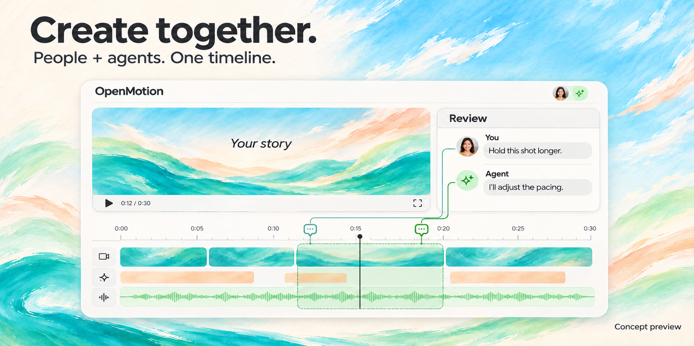

*계획 중인 협업 경험의 콘셉트이며 출시일은 발표되지 않았습니다.* [Studio 비전](product/studio-vision.md) · [지식과 피드백](product/studio-vision.md#knowledge-and-feedback)

<a id="社区共建"></a>
<a id="community"></a>

## 🤝 영상과 제작 방법을 함께 공유하세요

**참고 하나, 각색 하나, 재사용 가능한 모션 언어 하나를 가져오세요.** [Motion.md 커뮤니티](#motion-design-community) 에서 다음 크리에이터가 자기 작품을 만들 수 있도록 결정과 소스를 공유하세요.

| 기여 유형 | 포함할 내용 |
| --- | --- |
| **재구성 작품** | 참고와 제작자, 기획, 프로젝트, 미리보기, 비교, 남은 차이 |
| **템플릿 또는 컴포넌트** | 실행 가능한 소스, 편집 항목, 소재, 미리보기, 출처 |
| **Skill 또는 디자인 시스템** | 방법, 유지/변경 규칙, 실제 실행 예제 |
| **Brandkit** | 브랜드 정체성, 정확한 제품 사실, 공유 가능한 소재 |
| **에이전트 지원 또는 편집기 개선** | 범위가 명확한 변경과 재현 가능한 검증 |

[Library 등록 체크리스트](../library/ENTRY_TEMPLATE.md) · [기여 가이드](../CONTRIBUTING.md) · [저장소 지침](../AGENTS.md) · [전체 기여자](https://github.com/nexu-io/html-anything/graphs/contributors)

[Issue 열기](https://github.com/nexu-io/html-anything/issues) · [Discord 참여](https://discord.gg/mHAjSMV6gz) · [문서](README.md)

크리에이터와 미디어를 위해: 참고 자료, 제공한 브랜드, Studio 수정 과정, 실제 결과를 보여주세요. 렌더링 데모, 제품 콘셉트, 외부 참고를 구분하세요. [미디어 정보와 소재](media-kit.md)

[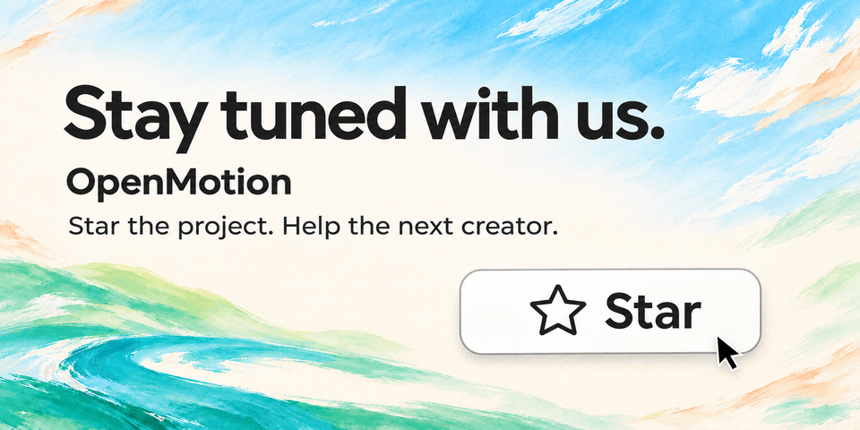](https://github.com/nexu-io/html-anything)

**OpenMotion에 Star를 누르고 분석할 영상을 찾아 다음 작품을 내 것으로 만드세요.**

<a id="acknowledgements"></a>

## 🙏 감사의 말 / Acknowledgements


OpenMotion은 [Apache-2.0](../LICENSE)라이선스를 사용합니다. 타사 코드, 템플릿, 미디어, 글꼴은 각자의 라이선스와 출처를 유지합니다.

| 출처 | 관련 내용 |
| --- | --- |
| [OpenDesign](https://github.com/nexu-io/open-design) | UI 출처, 리소스 구조, 브랜드 방향. [디자인 시스템](design-system.md) 과 [Motion 쇼케이스](https://open-design.ai/motion/) |
| [Hyperframes](https://github.com/heygen-com/hyperframes) | HTML 영상 합성, Studio, 렌더링 기반(0.9.7 고정). 크리에이터 참고, 외부 각색 데모, 컴포넌트 소스. [엔진 설명](hyperframes.md), [템플릿 고지](../template-library/NOTICE.md) 와 [카탈로그 출처](template-catalog.md) |
| [MotionGit](https://motiongit.com/) / adunext | Kinetic Tech 소스를 Presenter Tech로 패키징. [라이선스와 출처](../library/templates/presenter-tech/NOTICE.md) |
| [Hypit](https://github.com/hypit-ai/hypit) | 에이전트 주도 인기 영상 재구성과 편집 가능한 변형의 영감. 런타임 도입 없음 |
| [rea-video](https://github.com/JuneYaooo/rea-video) | 참고 분석과 사례 연구: [실사 언박싱](https://github.com/JuneYaooo/rea-video/blob/main/docs/cases/unboxing/report_en.md) 과 [캐릭터, 코드, 화면 녹화](https://github.com/JuneYaooo/rea-video/blob/main/docs/cases/dual_role/report_en.md). [쇼케이스 출처](readme/brand-showcase/README.md). 런타임 도입 없음 |
| [OpenAI · Codex Originals](https://openai.com/codex-originals/) | 외부 브랜드 영상 참고. 공식 캠페인 스틸과 외부 시청 링크 |
| [DeepSeek Harness](https://github.com/deepseek-ai/deepseek-harness) / [Super-agent 프로토타입](https://github.com/deepseek-ai/dsh-superagent-prototype) | 에이전트 확장성과 지속 작업의 참고. 프로토타입은 현재 OpenMotion 런타임과 별개 |
| Claude Motion / CapCut / [ChatCut](https://chatcut.io/docs/what-is-chatcut) / [OpenChatCut](https://github.com/0xsline/OpenChatCut) | 에이전트 제작, 쉬운 AI 편집, 지속 수정의 제품 참고 |
| [OpusClip](https://www.opus.pro/calendar) | 배포와 [외부 예약](https://www.opus.pro/tools/instagram-reels-scheduler)의 제품 참고. 내장 커넥터 없음 |
| [GSAP](https://github.com/greensock/GSAP) / [FFmpeg](https://ffmpeg.org/) | 애니메이션과 미디어 의존성. 버전은 [package.json](../package.json) 과 [런타임 잠금 파일](../scripts/runtime-lock.json) |

[소재 출처](readme/ASSETS.md) · [추가 쇼케이스 출처](readme/brand-showcase/README.md) · [표지와 프롬프트](readme/reverse-engineering-cover.md) · [글꼴 고지](../web/design-system/fonts/NOTICES.txt) · [Studio 라이선스](../studio/LICENSE)

기존 HTML Anything 앱은 [`legacy` 브랜치](https://github.com/nexu-io/html-anything/tree/legacy)에 보존되어 있습니다. 현재 브랜치와 배포 범위는 [저장소 이전 가이드](repository-migration.md) 를 참고하세요.
