<p align="center"></p>

<p align="center"><strong>拆解并复刻任何视频</strong></p>

<p align="center">
  <picture><source media="(max-width: 600px)" srcset="https://releases.open-design.ai/open-motion/media/sha256/45ee17734fb1315decef29c116fdd6794ee275fe83239328526b982a8ebe17ac.jpg"></picture>
</p>

<p align="center">
  <a href="https://github.com/nexu-io/openmotion"></a>
  <a href="../package.json"></a>
  <a href="../LICENSE">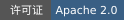</a>
  <a href="https://github.com/nexu-io/open-design"></a>
</p>

<p align="center">
  <a href="https://open-design.ai/motion/"></a>
  <a href="https://go.open-design.ai/?utm_source=github&amp;utm_medium=referral&amp;utm_campaign=openmotion&amp;utm_content=readme_zh"></a>
  <a href="https://discord.com/invite/M7NnHS9gNa"></a>
  <a href="https://applink.feishu.cn/client/chat/chatter/add_by_link?link_token=b6cs46dc-acb2-48ed-941d-c45642ead841"></a>
  <a href="https://x.com/OpenDesignHQ"></a>
  <a href="https://x.com/OpenDesignDevs"></a>
  <a href="https://www.youtube.com/channel/UChtshixMhvtgBWzoD9R_Qfg"></a>
</p>

<p align="center"><a href="#quick-start">立即安装</a> · <a href="#agent-wall">支持的 Agent</a> · <a href="#showcase">使用场景与复刻效果示例</a> · <a href="#features">为什么选择 OpenMotion</a> · <a href="#technical-guide">安装与技术文档</a> · <a href="#community">社区与贡献</a></p>

<div align="center">

[English](../README.md) · **简体中文** · [日本語](README.ja.md)

</div>

# OpenMotion

OpenMotion 是 **首个全栈 Agentic 视频生成器**。上传参考视频或粘贴社交平台上的视频链接，就能**用自己的品牌视觉规范和文案复刻原片**。

- 🎬 **全栈视频复刻。** Agent 拆解参考片，用 HTML 重建镜头和转场，并生成缺少的素材。你可以在同一工程里用 Studio 调整剪辑节奏，再渲染导出 MP4。
- 🔑 **BYOA（自带 Agent）与 BYOK（自带 API 密钥）。** OpenMotion 开源免费。直接在[常用的本地 Agent](#agent-wall) 里复刻视频，每一层都能用自己的 API 密钥。
- 🧩 OpenMotion 首次定义了 **Motion.md**，用 Markdown 记录镜头顺序、时长和转场。品牌宣传片的拆解可以随工程一起分享。
- 🎛️ **图片、视频、音乐和语音。** 用 Nano Banana 2 生成图片、Seedance 2.0 补镜头、Suno v4 配乐、Kokoro 加旁白，再放进同一条时间轴。[查看 7 个内置模型](#model-wall)

<a id="快速开始"></a> <a id="quick-start"></a>

<a id="start-in-codex"></a>

### 在 Agent 中安装

复制下面的指令，发给你的本地 Agent，即可从源码安装 OpenMotion：

```text
阅读 https://github.com/nexu-io/openmotion/blob/main/install.md，按照指南在当前 Agent 中安装并连接 OpenMotion。
```

安装完成后，Agent 会打开本地模板库并推荐一个模板，确认选择后再创建工程。[源码安装指南](../install.md)

### 克隆仓库并在本地启动

需要 Git、npm 和 Node.js 26.11.1：

```sh
git clone --depth 1 https://github.com/nexu-io/openmotion.git
cd openmotion
npm ci
npm run build:studio
npm start
```

打开启动时打印的实际 `studioUrl` 或 `previewUrl`，进入 **模板库**。Studio 和 MCP 读取此仓库中的模板。要让 Agent 连接同一份源码，请参阅 [源码接入与 MCP 配置](#agent-setup)。[仓库大小与可选素材](repository-storage.md)

### 在 Agent 中安装已发布版

此方式安装已发布的 npm 应用，使用其配置的在线模板目录。使用或贡献仓库模板，请选择上面的源码启动方式。

复制下面的指令，发给你的本地 Agent，即可开始安装：

```text
阅读 https://github.com/nexu-io/openmotion/blob/main/docs/install.md，按照指南在当前 Agent 中安装并连接 OpenMotion。
```

安装完成后，Agent 会推荐一个模板供你体验，确认选择后再创建工程。[安装与首次使用指南](install.md#installation-success-reply)

<a id="agent-wall"></a>

**22 个本地 Agent** · [选择你的 Agent](#choose-agent)

<p align="center"><a href="#choose-agent"><picture><source media="(max-width: 600px)" srcset="readme/agents/local-agents.mobile.png">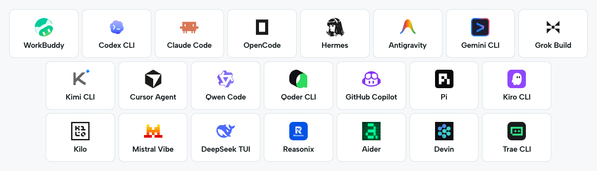</picture></a></p>

<a id="showcase"></a> <a id="brand-before-after"></a> <a id="用-openmotion-可以做什么"></a>
<a id="使用场景与复刻效果示例"></a>

## 🎞️ 使用场景与复刻效果示例

从产品演示、品牌宣传片、真人口播等场景寻找创作参考。下方预览展示参考视频。

**[浏览完整模板库 →](https://open-design.ai/templates/)** — 查找更多模板，获取完整视频、Motion.md 和复刻指令。

### AI 重剪与改稿

<table width="100%">
<tr>
<td width="50%" valign="top">
<picture><source media="(prefers-reduced-motion: reduce)" srcset="readme/live-templates/many-possible-futures.jpg"></picture><br>
<strong>OpenAI · 把多段画面串成故事</strong><br>
围绕同一条叙事主线连接不同画面，再展开为多场景蒙太奇。<br>
<a href="https://open-design.ai/templates/many-possible-futures-motion-design/">查看模板</a>
</td>
<td width="50%" valign="top">
<picture><source media="(prefers-reduced-motion: reduce)" srcset="readme/live-templates/making-of-window-collage.jpg"></picture><br>
<strong>Anthropic · 重剪创作过程拼贴</strong><br>
按顺序叠放片段与截图，让主标题始终清楚可读。<br>
<a href="https://open-design.ai/templates/making-of-window-collage-motion-design/">查看模板</a>
</td>
</tr>
</table>

### 产品发布与演示

<table width="100%">
<tr>
<td width="50%" valign="top">
<picture><source media="(prefers-reduced-motion: reduce)" srcset="readme/live-templates/notion-custom-agents.jpg"></picture><br>
<strong>Notion · 先展示问题，再呈现解决方案</strong><br>
从任务堆积过渡到有序协作，把前后变化换成自己的产品能力。<br>
<a href="https://open-design.ai/templates/notion-custom-agents-motion-design/">查看模板</a>
</td>
<td width="50%" valign="top">
<picture><source media="(prefers-reduced-motion: reduce)" srcset="https://releases.open-design.ai/open-motion/media/sha256/66bc3f14f916a58800562af5b2c8412b2f554f36a435da950faa39ef4b82da96.jpg"></picture><br>
<strong>OpenAI · 从用户需求引出产品发布</strong><br>
用层叠的需求积累节奏，再用一次清晰的揭示呈现产品。<br>
<a href="https://open-design.ai/templates/demand-becomes-a-desktop-release-motion-design/">查看模板</a>
</td>
</tr>
</table>

### 品牌宣传片与动效

<table width="100%">
<tr>
<td width="50%" valign="top">
<picture><source media="(prefers-reduced-motion: reduce)" srcset="readme/live-templates/a-world-connected-by-computational-fragments.jpg"></picture><br>
<strong>Kimi · 用动效连接不同世界</strong><br>
用代码条带、错位切片和转场串起一组品牌画面。<br>
<a href="https://open-design.ai/templates/a-world-connected-by-computational-fragments-motion-design/">查看模板</a>
</td>
<td width="50%" valign="top">
<picture><source media="(prefers-reduced-motion: reduce)" srcset="readme/live-templates/slack-slack.jpg"></picture><br>
<strong>Slack · 拆解并重组品牌标识</strong><br>
将标识拆成基础形状，用自己的配色与名称重新组合。<br>
<a href="https://open-design.ai/templates/slack-slack-motion-design/">查看模板</a>
</td>
</tr>
</table>

### 讲解与教程

<table width="100%">
<tr>
<td width="50%" valign="top">
<picture><source media="(prefers-reduced-motion: reduce)" srcset="https://releases.open-design.ai/open-motion/media/sha256/79e74122a92470f1cfe4ce39552b1eacad81bf316514605fef8d64f0c62eea4b.jpg"></picture><br>
<strong>Anthropic · 讲清跨工具工作流</strong><br>
沿着一个问题展示数据、操作与结果，让上下文始终连贯。<br>
<a href="https://open-design.ai/templates/connected-tools-evidence-chain-motion-design/">查看模板</a>
</td>
<td width="50%" valign="top">
<picture><source media="(prefers-reduced-motion: reduce)" srcset="readme/live-templates/an-agent-payment-with-human-approval.jpg"></picture><br>
<strong>Stripe · 逐步展示审批过程</strong><br>
把同一个请求从对话延续到手机确认，保持视觉线索一致。<br>
<a href="https://open-design.ai/templates/an-agent-payment-with-human-approval-motion-design/">查看模板</a>
</td>
</tr>
</table>

### 数据故事与图表

<table width="100%">
<tr>
<td width="50%" valign="top">
<picture><source media="(prefers-reduced-motion: reduce)" srcset="readme/live-templates/mathematics-as-evolving-geometry.jpg"></picture><br>
<strong>OpenAI · 用图形讲解复杂概念</strong><br>
通过共用的点与连线，让一个几何图形自然变成下一个。<br>
<a href="https://open-design.ai/templates/mathematics-as-evolving-geometry-motion-design/">查看模板</a>
</td>
<td width="50%" valign="top">
<picture><source media="(prefers-reduced-motion: reduce)" srcset="https://releases.open-design.ai/open-motion/media/sha256/be5fc241ac81b90d7e7ded0bf1c90040d2823e6c659420d636722b5935c6e452.jpg"></picture><br>
<strong>Anthropic · 逐层呈现结果</strong><br>
先给出总览，再展开单项发现，最后呈现每项结果对应的操作。<br>
<a href="https://open-design.ai/templates/scan-to-suggested-fix-motion-design/">查看模板</a>
</td>
</tr>
</table>

### 音乐与艺术视觉

<table width="100%">
<tr>
<td width="50%" valign="top">
<picture><source media="(prefers-reduced-motion: reduce)" srcset="readme/live-templates/controllable-song-composition.jpg"></picture><br>
<strong>ElevenLabs · 展示音乐逐步成形</strong><br>
把提示词、段落与节奏连接到波形和最终音乐。<br>
<a href="https://open-design.ai/templates/controllable-song-composition-motion-design/">查看模板</a>
</td>
<td width="50%" valign="top">
<picture><source media="(prefers-reduced-motion: reduce)" srcset="readme/live-templates/living-waveform-poster.jpg"></picture><br>
<strong>Deezer · 让音乐海报动起来</strong><br>
让标题保持稳定，用周围流动的波形表达节奏。<br>
<a href="https://open-design.ai/templates/living-waveform-poster-motion-design/">查看模板</a>
</td>
</tr>
</table>

<a id="creator-video-gallery"></a> <a id="presenter-motion"></a>

### AI 口播剪辑

以真人讲述为主线，用字幕、画面插入和关键词动画突出重点，为自己的录制内容找到合适的表达方式。

<table width="100%">
<tr><th colspan="3" align="left">🎓 教学与讲解</th></tr>
<tr>
<td width="33%" valign="top" align="center">
<picture><source media="(prefers-reduced-motion: reduce)" srcset="readme/people/careerwithriya.jpg"></picture><br>
<strong>改变职业生涯的 6 项关键技能</strong><br>
编号要点 + 动态关键词<br>
<sub>参考 · @careerwithriya</sub>
</td>
<td width="33%" valign="top" align="center">
<picture><source media="(prefers-reduced-motion: reduce)" srcset="readme/people/dan-martell-tools.jpg"></picture><br>
<strong>现在最好的 AI 工具是什么？</strong><br>
出镜讲解 + 悬浮工具卡片<br>
<sub>参考 · Dan Martell</sub>
</td>
<td width="33%" valign="top" align="center">
<picture><source media="(prefers-reduced-motion: reduce)" srcset="readme/people/harpercarrollai.jpg"></picture><br>
<strong>10 天 AI 基础，第 1 天</strong><br>
个人讲解 + 清晰字幕<br>
<sub>参考 · @harpercarrollai</sub>
</td>
</tr>
<tr><th colspan="3" align="left">🖥️ 展示工作流</th></tr>
<tr>
<td width="33%" valign="top" align="center">
<picture><source media="(prefers-reduced-motion: reduce)" srcset="readme/people/ali-abdaal-workflow.jpg"></picture><br>
<strong>我每天使用的 5 个工具</strong><br>
桌边讲述 + 工作流插画面<br>
<sub>参考 · Ali Abdaal</sub>
</td>
<td width="33%" valign="top" align="center">
<picture><source media="(prefers-reduced-motion: reduce)" srcset="readme/people/john-tagudin-capso.jpg"></picture><br>
<strong>带重点标注的工具演示</strong><br>
真人 + 屏幕 + 标注<br>
<sub>参考 · @john.tagudin</sub>
</td>
<td width="33%" valign="top" align="center">
<picture><source media="(prefers-reduced-motion: reduce)" srcset="readme/people/aiwithsachi.jpg"></picture><br>
<strong>值得安装的 5 个 Claude 插件</strong><br>
口述清单 + 说明截图<br>
<sub>参考 · @aiwithsachi</sub>
</td>
</tr>
<tr><th colspan="3" align="left">🎬 讲故事，展示产品</th></tr>
<tr>
<td width="33%" valign="top" align="center">
<picture><source media="(prefers-reduced-motion: reduce)" srcset="readme/people/khris-sheer-founder.jpg"></picture><br>
<strong>创始人实验，第 1 集</strong><br>
创始人日记 + 日常补充镜头<br>
<sub>参考 · @khris.sheer</sub>
</td>
<td width="33%" valign="top" align="center">
<picture><source media="(prefers-reduced-motion: reduce)" srcset="readme/people/ugc-rachelll.jpg"></picture><br>
<strong>AI 创作者与产品</strong><br>
产品故事 + 证据 + 画中画<br>
<sub>参考 · @ugc.rachelll</sub>
</td>
<td width="33%" valign="top" align="center">
<picture><source media="(prefers-reduced-motion: reduce)" srcset="readme/people/kevinstratvert.jpg"></picture><br>
<strong>别再为 5 个 AI 工具付费</strong><br>
产品教程 + 实际演示<br>
<sub>参考 · Kevin Stratvert</sub>
</td>
</tr>
</table>

<a id="features"></a>
<a id="为什么选择-openmotion"></a>

## ✨ 为什么选择 OpenMotion

<a id="what-is-openmotion"></a> <a id="openmotion-是什么"></a> <a id="video-is-code"></a>

### 1. 首个全栈 Agentic 视频生成器

**用 HTML 写视频。** OpenMotion 用 HTML、CSS、JavaScript 描述场景、字体、布局、转场和时间。实拍、生成片段、图片、音乐和旁白作为合成素材，同一工程可在 Studio 打开并渲染为 MP4。

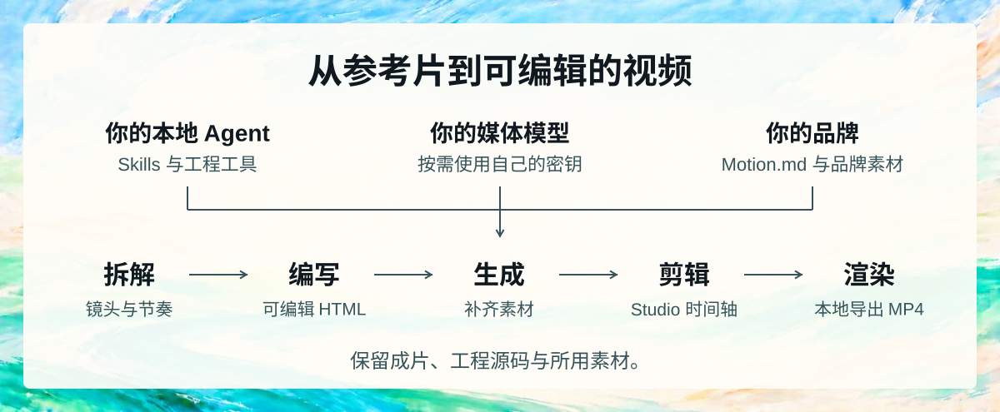

**编写、观看、修改、渲染。** 让 Agent 替换产品、精简开头、加入真人、修改字幕或尝试新结尾。它修改工程源码，你在可视化编辑器中审阅。本地 MCP 客户端使用工程工具，具备 shell 的 Agent 还可遵循 Skills 和固定版本 CLI 工作流。[Agent 配置](#agent-setup) · [原生合成指南](../skills/openmotion-production/references/native.md) · [HTML 示例工程](../template-library/product-promo/index.html)

<a id="studio-in-use"></a>


在同一个 Studio 工作区中预览视频、排列片段并导出成片。

#### 在 Studio 里可以改什么

| Studio 中 | 当前可以做什么 |
| --- | --- |
| **故事与时间轴** | 导入、排列素材，让 Agent 按脚本或确认的时间码精简、重排和改稿 |
| **动效与字幕** | 围绕内容编写动态文字、转场、标注、图表和字幕 |
| **素材与声音** | 导入素材，通过内置模型集成生成图片、视频、音乐和 TTS 旁白 |
| **图片修改** | 用支持参考图的模型生成候选，采用替换时保留时间和动画 |
| **预览与版本** | 在 Studio 审阅，手动或让 Agent 修改，保留工程供后续迭代 |
| **导出与源码** | 将固定版本渲染为 MP4，保留 HTML、CSS、JavaScript 和素材 |

> “保留已确认的揭示效果。中间场景换成这段屏幕录制，按这些时间码精简开头，最后的 CTA 多停留两秒。”

[工程与版本](project-workspace.md)

<a id="分享可编辑的复刻工程"></a>

#### 从参考片到可编辑的复刻工程

1. **拆解参考片。** 选一段想复刻的镜头，用 Motion.md 记下镜头顺序、转场和声音落点，标出要换成自己品牌的部分。
2. **重建镜头。** Agent 按你的品牌视觉规范，结合文案和产品画面重建 HTML 场景，在 Studio 里排成一条可编辑的时间轴。
3. **对照审片。** 在同一时间点比较原片与复刻结果，微调镜头时长、动作和声音，再播放整段确认节奏。
4. **导出和分享。** 渲染 MP4，保留 HTML 源码和素材。要让其他人改编，可以把 Motion.md、预览和可分享的素材随工程一起提交。[工程提交清单](../library/ENTRY_TEMPLATE.md)

<a id="bring-your-agent-and-keys"></a>

### 2. 完全开源免费，在本地 Agent 直接用，每一层都支持 BYOK

<a id="choose-agent"></a>

**选择你的 Agent。** WorkBuddy、Codex、Claude Code 和 DeepSeek Harness 可直接查看安装步骤。其他按钮打开通用的 MCP 和 CLI 接入说明。

<p>
  <a href="#workbuddy-setup"></a>
  <a href="#agent-setup"></a>
  <a href="#claude-setup">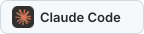</a>
  <a href="#local-agent-connection"></a>
  <a href="#local-agent-connection">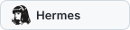</a>
  <a href="#local-agent-connection"></a>
  <a href="#local-agent-connection"></a>
  <a href="#local-agent-connection"></a>
  <a href="#local-agent-connection"></a>
  <a href="#local-agent-connection"></a>
  <a href="#local-agent-connection"></a>
  <a href="#local-agent-connection"></a>
  <a href="#local-agent-connection"></a>
  <a href="#local-agent-connection"></a>
  <a href="#local-agent-connection"></a>
  <a href="#local-agent-connection">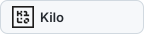</a>
  <a href="#local-agent-connection">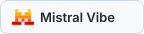</a>
  <a href="#deepseek-setup"></a>
  <a href="#local-agent-connection"></a>
  <a href="#local-agent-connection">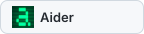</a>
  <a href="#local-agent-connection"></a>
  <a href="#local-agent-connection"></a>
</p>

| 自带什么 | 如何用于视频 |
| --- | --- |
| **🤖 Agent — BYOA** | 通过 Skills 和 MCP 连接现有本地 Agent，受支持时也可使用 CLI。保留惯用客户端、账号和工作上下文。 |
| **🔑 Key — BYOK** | 在 Model Settings 配置受支持的媒体 API 密钥，选择图片、视频、音乐和 TTS 模型；受支持的本地媒体集成可使用已有 Agent 登录。 |
| **🎨 品牌与素材** | 加入标志、字体、截图、实拍、脚本和音乐，在 Motion.md 的 Brand Kit 章节记录品牌信息和获准使用的素材。 |
| **🧩 起步资源** | 浏览参考、动效组件、模板和社区 Skills，选择方向，把源码或参考交给 Agent，做成自己的作品。 |

**OpenMotion 创作流程全部开源：Skills、工程工具、模型集成、Studio 和渲染。** 本地运行、检查实现、按需扩展。这条本地工作流不收软件订阅或单次渲染费，也可以只用自己的视频、图片和声音，不调用生成 API。

供应商凭据保存在工作区配置中。Agent 订阅和第三方模型调用按各自的规则计费。 [各 Agent 接入方式与验证状态](agent-adapters.md)

<a id="make-your-motion-language-reusable"></a> <a id="motion-design-community"></a>

### 3. 100 多份 Motion.md，让视频复刻有据可循

OpenMotion 首次定义了 **Motion.md**：用 Markdown 记录镜头顺序、时长、转场和可替换素材。线上模板库将参考视频与动效说明集中在同一个详情页。

Brand Kit 章节记录自己的 Logo、配色、字体、语气和已确认的产品信息。保留参考片的运动方式与节奏，同时让成片呈现自己的品牌。

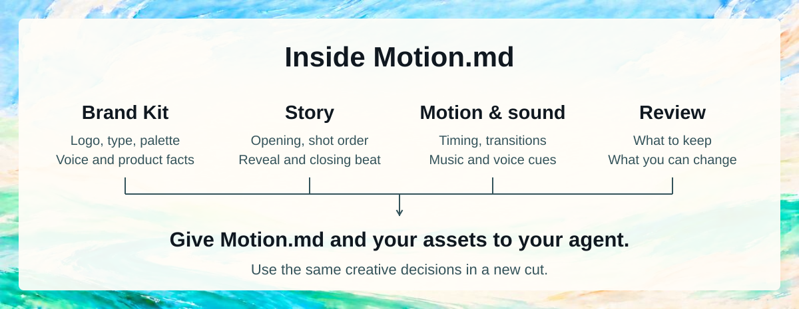

<a id="resources-to-start-from"></a> <a id="motion-gallery"></a>

#### 选好模板，再换成自己的内容

按**参考品牌、使用场景和视频类型**筛选，也可以直接搜索。模板详情页集中提供预览、风格描述、制作要点和 Motion.md 下载。在 Studio 点击**复刻模板**，即可复制指令交给 Agent。

仅有参考视频的条目会进入复刻流程；提供可编辑源码的条目可以直接交给 Agent 改编。


[浏览全部线上模板](https://open-design.ai/templates/)

<a id="all-in-one-studio"></a> <a id="full-video-creation-stack"></a>

<a id="model-wall"></a>

### 4. 多模态生成：图片、视频、音乐与语音

**BYOK 将你的多模态账号接入视频工作流。** 在 **Model Settings** 添加受支持的 Key、选择模型，通过 Studio 的 **Model Gateway** 生成图片、视频、音乐和语音。预览候选并采用到同一工程。受支持的本地图片路径可复用已有 Agent 登录。

<p>


</p>

| 视频所需素材 | 内置模型目录示例 | 如何用于影片 |
| --- | --- | --- |
| **🖼️ 图片** | Codex Image；Atlas Cloud 的 Nano Banana 2；fal.ai 的 FLUX Schnell | 品牌视觉、场景美术、辅助图片；受支持的 Codex 图片路径可基于参考图编辑 |
| **🎬 视频** | Atlas Cloud 的 Seedance 2.0；fal.ai 的 Wan 2.2 | 生成镜头和 B-roll，与实拍及动效组合 |
| **🎵 音乐** | Atlas Cloud 的 Suno v4 | 根据情绪和创作简报生成配乐 |
| **🎙️ TTS / 旁白** | fal.ai 的 Kokoro | 根据已确认脚本生成旁白，编排到画面和音乐中 |

> “使用 Motion.md 中的 Brand Kit 和已确认脚本，生成开场美术、插入视频、背景音乐和 TTS。把选中的结果加入重建工程，对齐声画，再展示完整剪辑。”

[内置模型目录](../gateway/catalog.ts) · [供应商配置与端点注册](model-gateway.md)

<a id="technical-guide"></a>
<a id="安装与技术文档"></a>

## 🛠️ 安装与技术文档

### 从源码安装

通过 Agent 安装，请使用[上方的安装指令](#quick-start)。如需从源码运行，使用下面的步骤。

Agent 安装成功后会直接打开编辑器的模板库，暂不创建项目。先浏览和预览，选好后点击“打开并编辑”，再创建独立工程。当前聊天尚未加载 MCP 时，可使用安装结果中的模板库直达链接；宿主不支持自动展示时会提供链接。

#### 运行 OpenMotion

**从免费本地创作全栈开始。** 连接自己的 Agent、打开内置模板或导入实拍，用本地应用渲染。需要生成新素材时，在 Model Settings 加入受支持的媒体 Key。

准备 Git、npm 和 **Node.js 26.11.1**。从源码预览和导出还需要 Chrome/Chromium 和 FFmpeg/FFprobe。[运行环境配置](usage.md)

```sh
git clone --depth 1 https://github.com/nexu-io/openmotion.git openmotion
cd openmotion
npm ci
npm run build:studio
npm start
```

在浏览器中打开 <http://localhost:4173>，进入**模板库**，选择模板并点击**复刻模板**，复制指令给你的 Agent。工程与凭据保存在代码仓库之外；用 `MOTION_DATA_DIR` 选择工作区。

<a id="agent-setup"></a>

#### 接入你的 Agent

支持插件的 Codex 可在 checkout 中运行：

```sh
bash scripts/install-motion.command
```

<a id="workbuddy-setup"></a>

**WorkBuddy** · 在 WorkBuddy 中导入 OpenMotion Connector，或将它提供的 `mcp.json` 添加为自定义 MCP，然后让 WorkBuddy 列出可用的视频模板。[WorkBuddy 接入说明](agent-adapters.md#workbuddy)

<a id="claude-setup"></a>

**Claude Code** · 在本机安装器中选择 `--host claude`，然后在 Claude Code 中运行 `/mcp` 检查 OpenMotion 是否已连接。[本地安装器](npm-installation.md)

<a id="deepseek-setup"></a>

**DeepSeek** · 在 DeepSeek TUI 中可从终端操作可编辑的 HTML 工程。使用 DeepSeek Harness 时，可通过 Cordis 配置连接 OpenMotion 的 MCP 工具。[DeepSeek Harness 配置](agent-adapters.md#deepseek-harness)

本地安装器使用本地构建的包。[Windows 测试包](test-packages.md)

先试一个线上模板：

> 用 OpenMotion 复刻这个模板详情页的视频，替换成我提供的 Brand Kit 和文案。保留动作与节奏，在 Studio 中打开可编辑结果供我检查。

要从视频开始，请提供参考并使用[复刻简报](#reverse-engineer-a-video)。宿主无法在对话旁打开 Studio 时，可使用返回的本地工程链接。

##### Skills、MCP 与 CLI

插件与 MCP 服务名称为 `openmotion`；Tools、Skills 与资源分别使用 `openmotion_*`、`openmotion-*` 和 `openmotion://`。旧 Tool 和资源名称保留兼容；旧 Skill 入口已移除，请使用 `openmotion-*`，升级后刷新宿主 Skill 列表。[命名与安装兼容说明](npm-installation.md#public-names-and-compatibility)

在 checkout 中发现并安装五个核心工作流，使用 [Skills CLI](https://github.com/vercel-labs/skills):

```sh
npx skills add ./skills --list
npx skills add ./skills --skill openmotion-director openmotion-production openmotion-template-to-video openmotion-recreate openmotion-video-to-template
```

这只复制指引，不安装运行时或注册 MCP。保持共享文档可用并单独连接应用，或使用上面的一体化本地安装器。

| Skill | 用途 |
| --- | --- |
| [openmotion-recreate](../skills/openmotion-recreate/SKILL.md) | 重建参考视频并对比结果 |
| [openmotion-template-to-video](../skills/openmotion-template-to-video/SKILL.md) | 改编已有可编辑模板 |
| [openmotion-director](../skills/openmotion-director/SKILL.md) | 原创影片、叙事、动作、声音与创作审片 |
| [openmotion-video-to-template](../skills/openmotion-video-to-template/SKILL.md) | 制作便携的可复用模板 |
| [openmotion-production](../skills/openmotion-production/SKILL.md) | 范围明确的修改、预览、检查、排错和导出 |

<a id="local-agent-connection"></a>

**连接其他本地 Agent** · 按照官方安装指南在客户端完成接入。支持 stdio MCP 的客户端可以使用下方配置。对于通过终端工作的 Agent，打开工程目录，用[本机引擎 CLI](../skills/openmotion-production/references/native.md) 预览和渲染 HTML 场景。

<a id="manual-mcp"></a>

```json
{
  "mcpServers": {
    "openmotion": {
      "command": "/absolute/path/to/node",
      "args": ["--experimental-strip-types", "/absolute/openmotion/mcp.ts"],
      "env": { "MOTION_DATA_DIR": "/absolute/openmotion-data" }
    }
  }
}
```

**十一个公开 MCP 工具**覆盖模板发现与详情、工程创建、读取、编辑、预览、媒体导入、导出、版本恢复与取消。共享工作流和引擎指引通过 MCP resources 提供。[工具契约](mcp-phase1-tools.md)

用 `openmotion_list_templates` 查找模板，`openmotion_get_template` 查看详情，再用 `openmotion_create_project` 创建可编辑副本。[模板目录](template-catalog.md)

使用 `npm start` 启动应用，使用 `npm run mcp` 启动 stdio。具备 shell 的 Agent 可使用运行时返回的固定版本引擎 CLI 检查和渲染；托管修改仍遵守工程 revision 校验。[原生创作](../skills/openmotion-production/references/native.md)

<a id="product-tour"></a> <a id="产品界面"></a> <a id="connect-your-agent"></a> <a id="use-from-your-agent"></a> <a id="从-agent-接入"></a> <a id="your-agent-your-studio"></a>

<a id="reverse-engineer-a-video"></a>

### 从参考视频到可编辑工程

| 研究参考 | 为你的故事重建 |
| --- | --- |
| **开头与叙事** — 先出现什么，如何铺垫，何时揭示 | 你的承诺、产品事实与行动号召 |
| **镜头结构** — 构图、镜头运动、图层与视觉层级 | 你的界面、实拍、标志和辅助图片 |
| **动效与节奏** — 入场、转场、缓动与阅读停留 | 按你的内容调整相同的运动意图 |
| **字体与身份** — 字体层级、配色与构图 | 你的字体、色板、文案和 Brandkit |
| **声音与节拍** — 语音时序、配乐提示与重音 | 你的声音、音乐素材与声音方向 |

如果 Agent 无法打开社媒链接，可以提供本地视频和时间码。只有原片时使用[参考片复刻流程](../skills/openmotion-recreate/SKILL.md)，手里已有可编辑源码时使用[模板流程](../skills/openmotion-template-to-video/SKILL.md)。

```text
用 OpenMotion 为我们的品牌重建附件参考视频。

研究：开头、镜头顺序、字体、转场和声音提示。
保留：选定片段的产品揭示方式与镜头节奏。
替换：用提供的素材替换标志、界面、主张、文案和片尾。
生成：遵循品牌与已确认脚本，通过已配置模型生成缺少的
图片、视频、背景音乐和 TTS 旁白。

创建可编辑工程，在 Studio 打开并对比参考的对应时刻。
解释剩余差异。审阅后导出 MP4，保留源码供后续修改。
```

<a id="ai-video-editing"></a> <a id="keep-editing-after-the-remake"></a>

#### 查看模板与 Motion.md

打开模板，查看参考视频、风格描述与制作要点。需要复用这份说明时，可以下载 Motion.md。

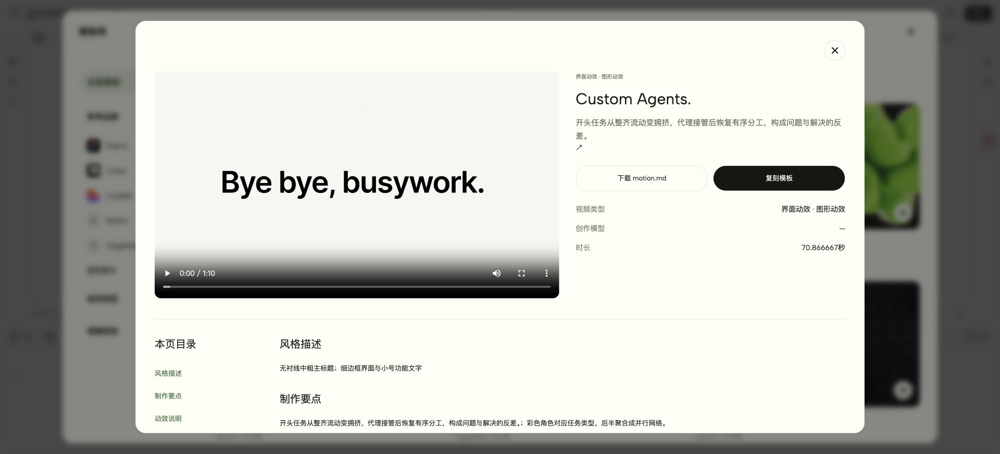

#### 把模板交给 Agent

点击**复刻模板**，复制指令，并补充自己的 Brand Kit、文案和创作要求。Agent 会在需要时安装或接入 OpenMotion，然后基于所选模板制作。打开生成的工程，在 Studio 检查节奏、继续编辑并导出。

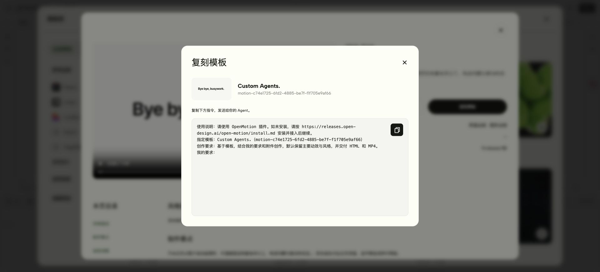

<a id="open-projects-reusable-knowledge"></a> <a id="developer-architecture"></a>

### 系统架构

在 Studio 调整时间轴，或让 Agent 修改镜头，编辑的都是同一份 HTML 工程。TypeScript 本地服务管理素材和版本，浏览器渲染引擎把选定版本导出为 MP4。

#### 各模块如何协同

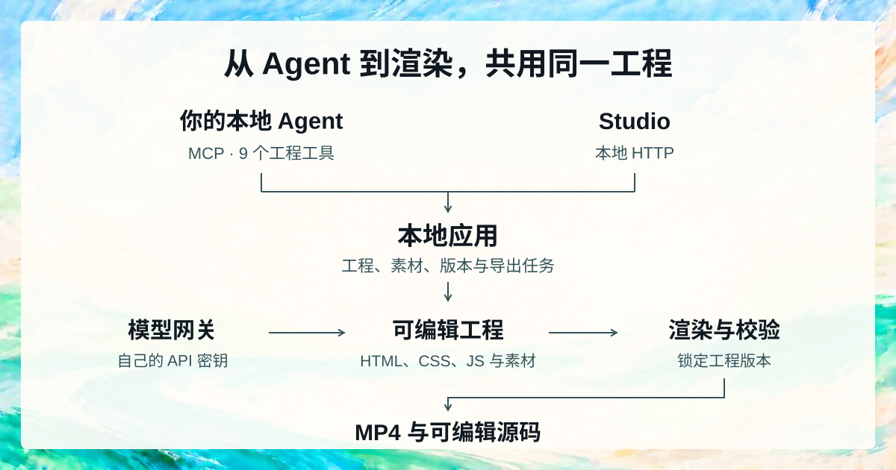

Agent 通过工程工具写入时会核对版本，避免旧请求覆盖刚完成的修改。生成的素材由你选定后加入工程。每次导出都使用发起导出时的版本，之后的编辑留给下一版。导出器检查文件规格，画面、声音和节奏可以通过播放成片确认。

<details>
<summary>查看完整架构与路线图文字说明</summary>

```text
创作输入
参考视频 + 实拍 + 脚本 + 品牌素材
                 ↓
社区知识
Motion.md + BRANDKIT.md + Skills + 模板 + 组件
                 ↓
BYOA：本地 Agent                       OPENMOTION STUDIO
DeepSeek Harness / Codex / Claude Code  React 19 + TypeScript + Vite
其他本地宿主、Skills 与宿主分析工具     Tailwind CSS + Zustand
                 |                     CodeMirror + Dockview
          stdio MCP                    素材 / 预览 / 时间轴
          9 个公开工程工具             本地 HTTP
                 └──────────┬──────────┘
                            ↓
本地应用：Node.js + TypeScript + node:http
会话 / 工程文件 / 素材 / revision / 导出任务
                 ↓                         ↓
BYOK：MODEL GATEWAY                    视频即代码
你的 Key / 账号 / 模型路由             HTML 场景 + 素材 + Studio 数据
发现 / 生成任务                       HTML + CSS + JavaScript + GSAP
                 ↓                         ↑
模型适配器                                 |
Codex Image / Atlas Cloud / fal.ai          |
图片 / 视频 / 音乐 / TTS                   |
                 ↓                         |
生成候选 → 预览 / 选择 → 显式采用到工程 ────┘
                            ↓
渲染与验证
选定的工程版本 → HTML 引擎 + Chromium → FFmpeg / FFprobe
                            ↓
当前交付
MP4 + 可编辑源码 + 素材 + 版本和导出证据
                            ↓
规划中：多平台发布
平台连接器 → 发布审阅 → 排期 → 表现反馈
                            ↓
规划中：知识反馈
版本关联结果 → 团队记忆 / RAG → 经评估的 Skill 改进
```

</details>

BYOA 让 Agent 留在已有客户端，BYOK 连接受支持的模型账号。Studio 与本地服务管理工程，供应商凭据独立保存。一期公开 MCP 包含**十一个工具：九个工程工具与两个模板目录工具**；模型生成经 Studio 和本地 Gateway 使用，架构图不意味着公开 MCP 新增了生成或发布工具。

#### 技术栈与源码索引

| 层次 | 技术 | 阅读入口 |
| --- | --- | --- |
| **Studio 与编辑器界面** | React 19、TypeScript 5.9、Vite 6、Tailwind CSS 4、Zustand、CodeMirror、Dockview | [Studio 源码](../studio/src) · [Motion 应用](../studio/src/motion/MotionApp.tsx) · [编辑器开发](editor-fork.md) |
| **应用运行时** | CI 固定 Node.js 26.11.1，原生 HTTP、TypeScript 执行和本地文件/JSON | [server.ts](../server.ts) · [workspace.ts](../workspace.ts) · [会话架构](session-architecture.md) |
| **Agent 接入** | 本地 stdio MCP、五个核心 Skills 和生成的宿主适配器 | [mcp.ts](../mcp.ts) · [phase1.ts](../phase1.ts) · [适配器生成](../scripts/export-adapters.ts) |
| **多模态生成** | Codex 媒体适配器、Atlas Cloud predictions、fal.ai 队列集成与持久化生成任务 | [Gateway 服务](../gateway/service.ts) · [供应商适配器](../gateway/providers.ts) · [模型目录](../gateway/catalog.ts) |
| **合成与动效** | HTML/CSS/JS、GSAP、固定版本合成引擎与原生时间轴/历史 | [引擎集成](../hyperframes.ts) · [模板源码](../template-library) · [版本适配器](../phase1-versions.ts) |
| **渲染与媒体** | Chromium、Puppeteer Core、FFmpeg、FFprobe | [渲染服务](../server.ts) · [导出校验器](../scripts/verify-export.ts) · [原生运行时锁定](../scripts/runtime-lock.json) |
| **创作知识** | Markdown、源码包、预设和对比证据 | [Motion.md](motion-md.zh-CN.md) · [核心 Skills](../skills) · [社区资源库](../library/README.zh-CN.md) |
| **验证与打包** | Node 测试运行器、Vitest、Studio 检查、npm 锁文件和显式分发清单 | [测试](../tests) · [Studio 测试](../studio/tests) · [CI](../.github/workflows/ci.yml) · [分发](../scripts/distribution.ts) |
| **发布与学习 — 规划中** | 平台适配器、排期、版本关联反馈与检索，实现仍待设计 | [Studio 蓝图](product/studio-vision.md) |

依赖锁定在 [package.json](../package.json)、[package-lock.json](../package-lock.json) 和[运行时锁文件](../scripts/runtime-lock.json)中。模型和第三方库保留各自条款；应用采用 Apache-2.0。

#### 选择一层，一起建设

| 你的方向 | 可贡献的内容 | 入口 |
| --- | --- | --- |
| **前端与交互** | 改进时间轴、媒体生成控件、无障碍或预览行为 | [Studio](../studio/src) · [媒体生成器](../studio/src/motion/MediaGenerator.tsx) |
| **AI 与模型基础设施** | 沿用共享任务与媒体流程，新增供应商适配器或模型预设 | [Gateway 设计](product/media-generation-design.md) · [供应商适配器](../gateway/providers.ts) |
| **Agent 与开发工具** | 改进宿主适配器、Skill、资源指引或工程工具流程 | [Agent 适配器](agent-adapters.md) · [MCP 契约](mcp-phase1-tools.md) |
| **动效与创意编程** | 分享组件、原生模板或带真实改编的 Motion.md 包 | [组件](../library/components/README.md) · [条目清单](../library/ENTRY_TEMPLATE.md) |
| **视频与渲染** | 改进导出可靠性、媒体处理或可复现验证 | [引擎说明](hyperframes.md) · [导出校验器](../scripts/verify-export.ts) |
| **社交发布** | 设计规划中的连接器层：账号访问、发布审阅、排期和版本映射 | [发布方向](product/studio-vision.md) · [讨论提案](https://github.com/nexu-io/openmotion/issues) |

从[本地安装](#quick-start)开始，选择一层，遵循 [CONTRIBUTING.md](../CONTRIBUTING.md) 和 [AGENTS.md](../AGENTS.md)。工程与凭据放在 checkout 外，保留依赖锁定与上游许可。

[产品架构](product/architecture.md) · [Studio 开发](../studio/README.md) · [Model Gateway](model-gateway.md) · [贡献指南](../CONTRIBUTING.md)

<a id="one-video-more-places-to-share"></a> <a id="publish-to-every-platform"></a>

<a id="super-motion-video-agent"></a> <a id="status--roadmap"></a> <a id="当前状态与路线图"></a> <a id="roadmap"></a>

### 多画幅交付与发布

为每种画幅调整构图，在 Studio 逐版审阅，再导出 MP4 上传到对应平台。

| 请求的版本 | 需要调整什么 |
| --- | --- |
| **竖屏短视频** — Reels、Shorts、TikTok、小红书等 | 开头、大号易读文字、构图和字幕位置 |
| **横屏影片** — 产品页、发布或 YouTube | 界面细节、更宽构图与解释时间 |
| **方形信息流** — 社交活动 | 紧凑构图、标题与清楚的结尾信息 |

渠道账号连接、定时发布和成片表现回流仍在规划中。

#### Studio 路线图与协作概念图

| 领域 | 当前可用 | 方向 |
| --- | --- | --- |
| **重建与剪辑** | Agent 引导重建、模板改编、可编辑工程和 MP4 导出 | 更多经评估的重建案例和可复现对比 |
| **品牌与知识** | 显式使用 Brandkit、Motion.md、Skills 和源码包 | 个人/团队记忆、RAG 和经评估的 Skill 改进 |
| **人与 Agent** | 同一本地工程交接 | 时间轴评论、共同审阅和协作编辑 |
| **多模态创作** | 内置图片、视频、音乐和 TTS 集成；生成、选候选、采用到时间轴 | 跨视频、图片、声音、音乐和 Avatar 服务的综合搜索 |
| **多平台发布 — 规划中** | 手动编排不同画幅，交付 MP4 | 平台连接器、发布审阅、排期、自动画幅重构与社交预设 |
| **反馈** | 人工审阅和保存工程版本 | 版本关联表现数据与周期制作任务 |


*协作概念图：在时间轴上标注“这个镜头多留一拍”，Agent 据此调整节奏。此功能仍在规划中。* [Studio 蓝图](product/studio-vision.md) · [知识与反馈](product/studio-vision.md#knowledge-and-feedback)

<a id="社区共建"></a> <a id="community"></a>

<a id="社区"></a>

## 🤝 分享作品与制作方法

欢迎分享你复刻的视频、可复用的模板，或记录镜头节奏的 Motion.md。把参考片和成片放在一起，附上可编辑工程，其他人就能沿用你的剪辑节奏，换上自己的素材。

| 贡献类型 | 应包含 |
| --- | --- |
| **复刻作品** | 参考与作者、简报、工程、预览、对比和剩余差异 |
| **模板或组件** | 可运行源码、可编辑项、素材、预览和署名 |
| **Skill 或设计体系** | 方法、保持/修改规则、实际执行示例 |
| **Brandkit** | 品牌身份、准确产品事实和可分享素材 |
| **Agent 支持或编辑器改进** | 范围聚焦且可复现验证的变更 |

[资源提交清单](../library/ENTRY_TEMPLATE.md) · [参与贡献](../CONTRIBUTING.md) · [反馈问题](https://github.com/nexu-io/openmotion/issues) · [贡献者](https://github.com/nexu-io/openmotion/graphs/contributors) · [媒体资料](media-kit.md)

OpenMotion 独立官网将上线于 `open-design.ai/openmotion`。

[OpenDesign 动效展示](https://open-design.ai/motion/) · [OpenDesign Go](https://go.open-design.ai/?utm_source=github&utm_medium=referral&utm_campaign=openmotion&utm_content=readme_zh) · [Discord](https://discord.com/invite/M7NnHS9gNa) · [飞书群](https://applink.feishu.cn/client/chat/chatter/add_by_link?link_token=b6cs46dc-acb2-48ed-941d-c45642ead841) · [X @OpenDesignDevs](https://x.com/OpenDesignDevs) · [X @OpenDesignHQ](https://x.com/OpenDesignHQ) · [YouTube](https://www.youtube.com/channel/UChtshixMhvtgBWzoD9R_Qfg)

[**在 GitHub 上给 OpenMotion 点个 Star**](https://github.com/nexu-io/openmotion)

[](https://github.com/nexu-io/openmotion)

<a id="acknowledgements"></a>

### 致谢

品牌原片的发布者及时间码见对照区。 [Agent 与模型标志](readme/models/README.md)

OpenMotion 采用 [Apache-2.0](../LICENSE)许可。第三方代码、模板、媒体和字体保留各自许可证和署名。

| 来源 | 关联 |
| --- | --- |
| [OpenDesign](https://github.com/nexu-io/open-design) | 界面来源、资源结构和品牌方向；[设计体系](design-system.md) 和 [Motion 展示](https://open-design.ai/motion/) |
| [Hyperframes](https://github.com/heygen-com/hyperframes) | HTML 视频合成、Studio 和渲染基础，固定为 0.9.7；创作者参考、外部改编演示与组件源码；[引擎说明](hyperframes.md)、[模板声明](../template-library/NOTICE.md) 和[目录来源](template-catalog.md) |
| [MotionGit](https://motiongit.com/) / adunext | Kinetic Tech 源码以 Presenter Tech 打包；[许可与署名](../library/templates/presenter-tech/NOTICE.md) |
| [Hypit](https://github.com/hypit-ai/hypit) | Agent 主导热门视频复刻与可编辑版本的灵感来源；未引入运行时 |
| [rea-video](https://github.com/JuneYaooo/rea-video) | 参考分析与案例研究：[实拍开箱](https://github.com/JuneYaooo/rea-video/blob/main/docs/cases/unboxing/report_en.md) 及[角色、代码和屏幕录制](https://github.com/JuneYaooo/rea-video/blob/main/docs/cases/dual_role/report_en.md)；[展示素材署名](readme/brand-showcase/README.md)，未引入运行时 |
| [OpenAI · Codex Originals](https://openai.com/codex-originals/) | 外部品牌影片参考；官方活动静帧与站外观看链接 |
| [DeepSeek Harness](https://github.com/deepseek-ai/deepseek-harness) / [Super-agent 原型](https://github.com/deepseek-ai/dsh-superagent-prototype) | Agent 可扩展性与持续任务的参考；该原型独立于 OpenMotion 当前运行时 |
| Claude Motion / CapCut / [ChatCut](https://chatcut.io/docs/what-is-chatcut) / [OpenChatCut](https://github.com/0xsline/OpenChatCut) | Agent 创作、易用 AI 剪辑与持续改稿的产品参考 |
| [OpusClip](https://www.opus.pro/calendar) | 分发与[外部排期](https://www.opus.pro/tools/instagram-reels-scheduler)的产品参考；无内置连接器 |
| [GSAP](https://github.com/greensock/GSAP) / [FFmpeg](https://ffmpeg.org/) | 动画与媒体依赖，版本保留在 [package.json](../package.json) 和[运行时锁文件](../scripts/runtime-lock.json) |

[素材来源](readme/ASSETS.md) · [其他展示素材来源](readme/brand-showcase/README.md) · [字体声明](../web/design-system/fonts/NOTICES.txt) · [Studio 许可证](../studio/LICENSE)

原 HTML Anything 应用保留在 [`legacy` 分支](https://github.com/nexu-io/openmotion/tree/legacy)。当前分支与分发边界参见[仓库迁移指南](repository-migration.md) 。
