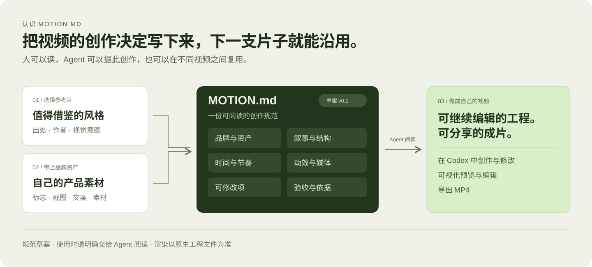

[English](../README.md) · **简体中文**

<h1> openmotion</h1>

**我们希望把 openmotion 做成最好的 Claude Motion 开源替代。** 在 Motion 资源站找到一支节奏适合自己的产品宣传片，用 **Motion MD** 写下值得保留的表达方式，再把自己的截图和文案交给 Codex。最后得到的是自己品牌的成片，以及下次发布还能继续改的工程。

**[阅读 Motion MD](motion-md.zh-CN.md)** · **[浏览 Motion 资源站与主题合集](collections/README.zh-CN.md)** · **[在 Codex 里开始](#在-codex-里开始)**


## Motion MD

**Motion MD 是 openmotion 首次提出的视频动效风格规范草案。** 一张海报能看出一支发布片的配色，却看不出产品在第几秒出现、镜头如何移动，以及标题停留多久才读得完。Motion MD 把这些决定写进 Markdown，方便人读，也方便 Agent 在下一支片子里沿用。

例如，改编一支 20 秒的产品发布片，可以把下面这段交给 Codex：

```markdown
## 节奏
0–3 秒呈现问题，3–8 秒揭示产品。
8–16 秒展示两个卖点，16–20 秒让结尾的行动提示停留在画面上。

## 保留与替换
保留连续画布，以及每次揭示之后的停顿。
替换为我们自己的 Logo、产品截图、卖点文案和结尾行动提示。
```

[阅读 v0.1 规范草案](motion-md.zh-CN.md) · [查看完整示例](examples/product-launch.MOTION.zh-CN.md)



**现在怎么用：** 把文件明确交给 Agent 阅读。草案描述创作意图；可编辑工程仍由 HTML、CSS、JavaScript 和素材组成。目前没有自动导入或校验 Motion MD 的接口。

## Motion 资源站与主题合集

**[打开资源索引 →](collections/README.zh-CN.md)** 先看片，再看作者与出处，选择要借鉴的参考或可以直接改的工程。可以从[产品发布片](../template-library/product-promo/)、[报刊风格的动态图表](../template-library/nyt-graph/)或[分支流程动画](../template-library/decision-tree/)开始。这三个模板都能在 Studio 里打开为独立工程。[OpenDesign 官网 Motion 展示页](https://open-design.ai/motion/)也有可观看的案例。

| 合集方向 | 可以从中找到什么 |
| --- | --- |
| **同一品牌，不同阶段的发布片** | 对比一家公司多次发布时，开场、动态排版和产品揭示方式如何变化。 |
| **同一科技榜单，不同公司的表达** | 例如围绕 a16z 消费 AI 榜单，比较上榜公司怎样讲各自的产品故事。 |
| **本月融资公司的发布片** | 按月收录 2026 年刚公布融资的科技公司，寻找有时效性的发布案例。 |

这三个方向用于后续**公开的主题集合站**。目前能用的是仓库内的资源索引和 Studio 目录。目录有 **894 条资源：3 个内置可编辑示例、891 条外部参考与 registry 资源**。视频有出处即可作为参考；要称为已验证模板，还需要可编辑工程、预览，以及成功改稿和渲染的记录。


## 从参考片做到自己的品牌片

| [产品宣传 · 20 秒](../template-library/product-promo/) | [数据叙事 · 15 秒](../template-library/nyt-graph/) | [流程讲解 · 10 秒](../template-library/decision-tree/) |
| --- | --- | --- |
|  |  |  |

这些画面来自随包提供的 [Hyperframes 示例](../template-library/NOTICE.md)。选好模板后，可以这样告诉 Codex：

> 保留开场和产品揭示的节奏，换成这个项目里的 Logo 和产品截图。第二张截图多停一会儿，让观众能读完新标题。给我可编辑工程和 MP4。

画廊里的**一键复刻**会复制对应的参考和指令。内置模板能直接打开；外部参考需要 Agent 分析并重建。随后可以在 Studio 里调整文字、时长、布局与素材，也可以继续在 Codex 里改。导入的视频仍是媒体片段。


## 在 Codex 里开始

克隆公开仓库的 `feature/motion` 分支，再用 Codex 打开项目目录。需要 Git、Node.js **22.18+**（含 npm）及支持插件的 Codex CLI。导出 MP4 另需 Chrome/Chromium 和 FFmpeg/FFprobe。Windows 见[测试包说明](test-packages.md)。

把下面这段发到 Codex 对话框：

```text
在当前仓库目录运行 bash scripts/install-motion.command 安装 openmotion。
安装成功后，问我是否体验 20 秒的 Product Promo 示例。
我确认后，打开一份独立的可编辑工程，并交付导出的 MP4。
```

确认体验后，Agent 会按[模板出片流程](../skills/motion-template-to-video/SKILL.md)执行。宿主不支持在对话旁打开编辑器时，可以打开返回的本地工程链接。[安装与首次体验手册](usage.md#使用) · [其他 Agent 接入](agent-adapters.md)

**需要更多素材时**，可以在 Studio 里通过已配置的模型网关请求图片、视频或音频，再选择放进工程的结果。模型调用使用自己的供应商账户，可能产生费用。[已验证能力](model-gateway.md) · [一期九个公开 MCP 工具](mcp-phase1-tools.md)

素材弹框贴近触发按钮或时间轴选区，并随滚动和可用空间调整。空轨道进入生成时隐藏起步引导，插入后保持隐藏；关闭且未插入、或撤销至空轨道时恢复。[编辑交互说明](product/media-generation-design.md#时间轴交互规则及原因)

## MCP 与轻量安装

[npm 轻量安装器](npm-installation.md) 可为 Codex、Claude Code、DeepSeek Harness、WorkBuddy 同装九个 MCP Tool 和五个 Skill，共用应用并按需准备经过校验的原生工具。运行 `npm run package:npm` 本地构建；npm 包尚未公开发布，完整 ZIP 保留备用。

五个入口为 [motion-production](../skills/motion-production/SKILL.md)、[motion-director](../skills/motion-director/SKILL.md)、[motion-template-to-video](../skills/motion-template-to-video/SKILL.md)、[motion-recreate](../skills/motion-recreate/SKILL.md)、[motion-video-to-template](../skills/motion-video-to-template/SKILL.md)。参考复刻已实现；产品 UI 沿用 [OpenDesign 视觉规范](design-system.md)，视频作品保留自身样式。

## 下一步

**Motion Benchmark / Arena** 拟用同一支参考片和同一套品牌资产比较复刻结果，观察节奏是否接近、品牌有没有走样、工程还能不能继续改。具体方法与公开榜单仍在讨论。

贡献一种风格时，请一并附上原片与作者、Motion MD、预览、可编辑源文件和素材授权说明。[贡献指南](../AGENTS.md) · [文档中心](README.md)

**致谢与发布状态。** openmotion 使用 [Hyperframes](https://github.com/heygen-com/hyperframes) 的原生合成、Studio 基础与渲染能力。上游[编辑器](../studio/LICENSE)与[内置示例](../template-library/LICENSE)保留 Apache-2.0 许可。本公开仓库采用 [Apache-2.0](../LICENSE) 许可，随包组件和字体保留各自声明。开发目标为 [`feature/motion`](https://github.com/nexu-io/html-anything/tree/feature/motion)；原 HTML Anything 应用仍在 `main`，并已留档到 [`legacy`](https://github.com/nexu-io/html-anything/tree/legacy)。当前不发布包；详见[仓库流程](repository-migration.md)。
