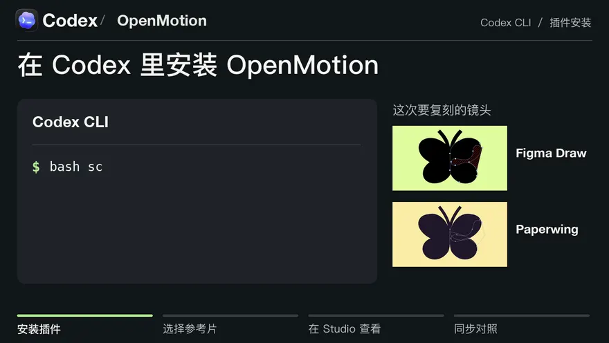
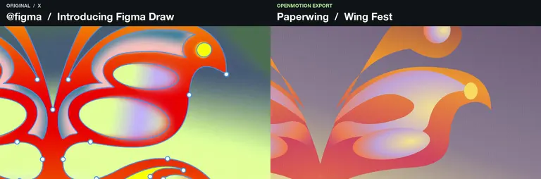
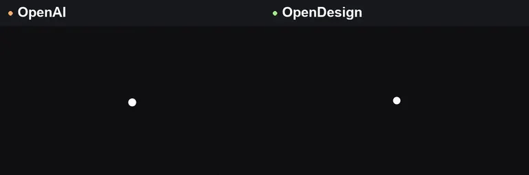
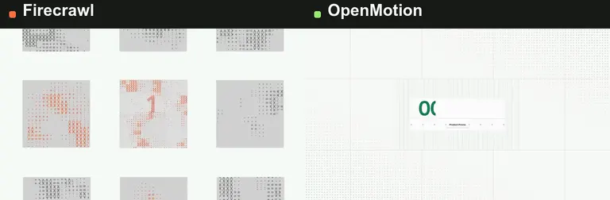
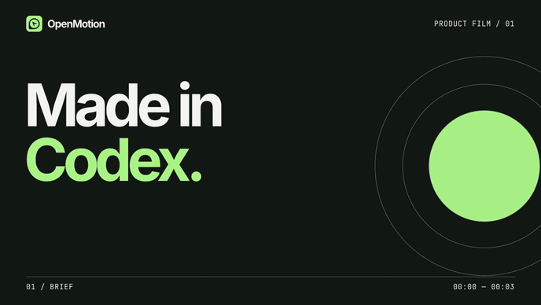
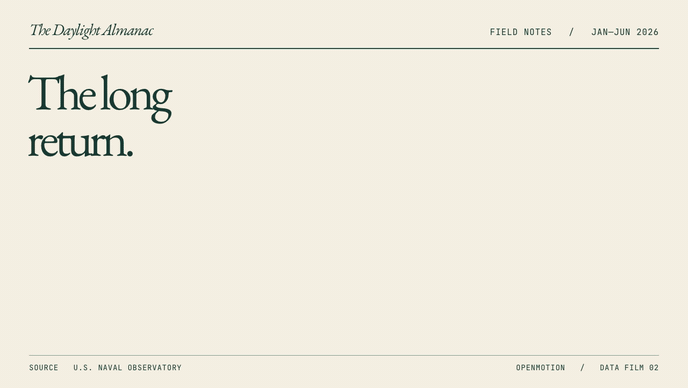
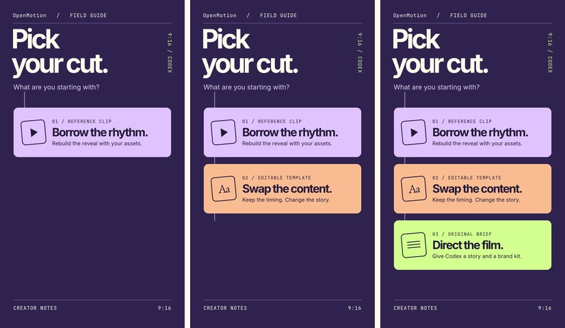
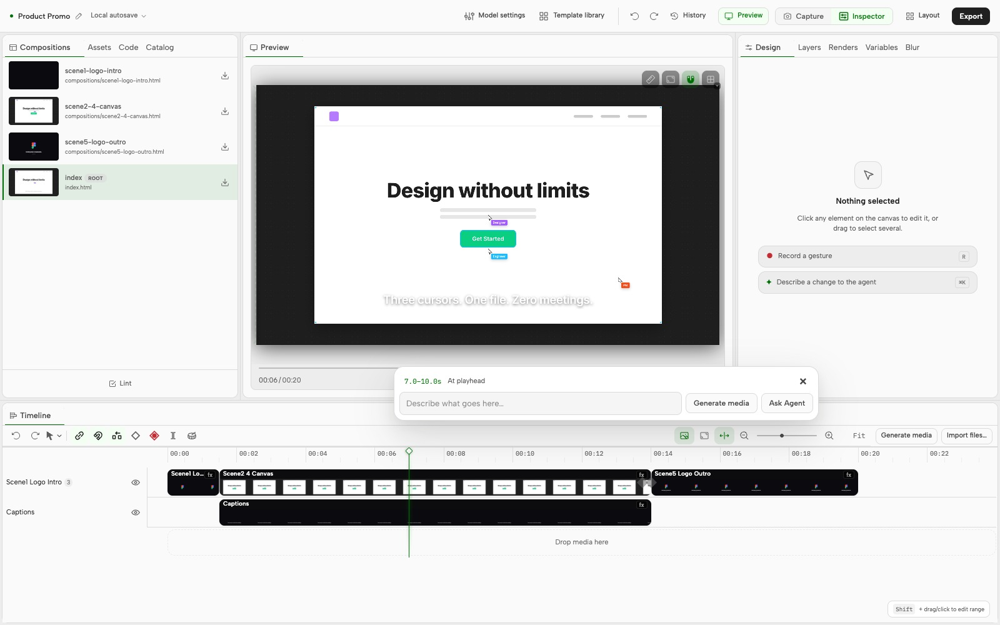
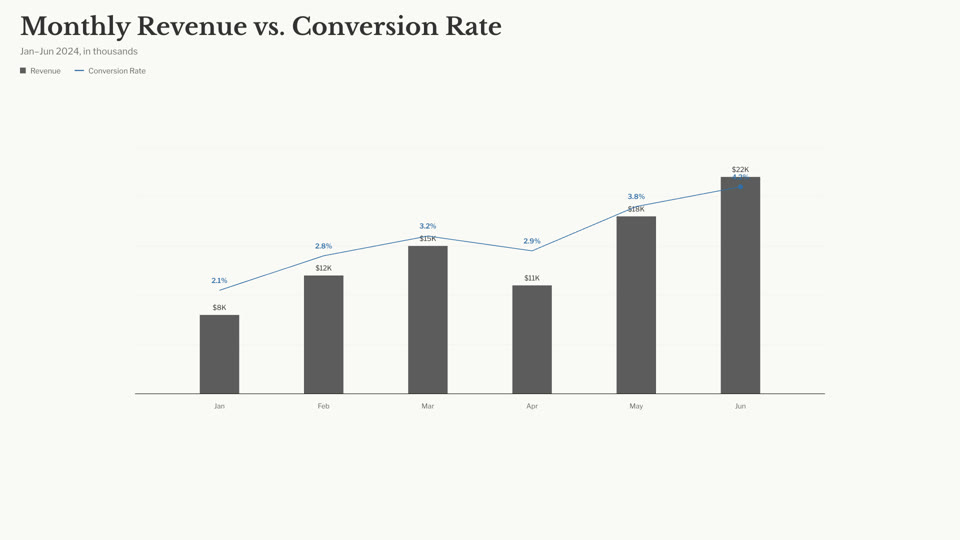
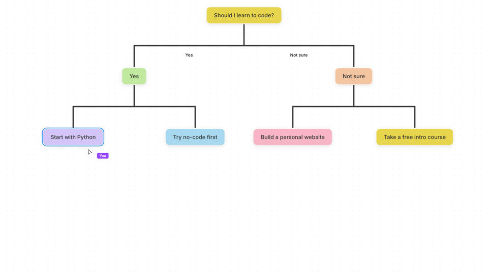

<h1 align="center">OpenMotion · 在 Codex 里逆向拆解视频<br />
为自己的品牌复刻动效</h1>

<p align="center">把喜欢的科技品牌片链接贴进 Codex，用自己的 Logo、产品截图和文案，复刻它的镜头节奏、文字动画和转场。导出 MP4 后，工程还能接着改。</p>

<p align="center"><strong><a href="readme/studio-tour.zh-CN.mp4">看 27 秒操作演示</a></strong> · <strong><a href="#在-codex-里开始">在 Codex 里试用</a></strong></p>

<p align="center"><a href="readme/studio-tour.zh-CN.mp4"><picture>
  <source media="(prefers-reduced-motion: reduce)" srcset="readme/codex-comparison.zh-CN.jpg" />
  
</picture></a></p>

<p align="center"><a href="#复用参考片的拍法">逐个看品牌复刻</a> · <a href="../examples/reference-reveal/MOTION.zh-CN.md">读 Motion MD 分镜拆解</a></p>

<p align="center"><a href="../README.md">English</a> · <a href="collections/README.zh-CN.md">找参考片</a> · <a href="https://github.com/nexu-io/html-anything/blob/legacy/README.zh-CN.md">原 HTML Anything 编辑器与安装说明</a></p>

OpenMotion 是一款开源的 Codex 动效设计插件，我们希望把它做成最好的 Claude Motion 开源替代。你可以从品牌形象片、产品演示或新品发布片开始。拆解一个镜头时，先看哪个元素动、产品在哪一拍出现、观众有多久读完标题。用我们提出的 Markdown 动效规范 **Motion MD** 记下这些决定，另一个团队就能带上自己的品牌素材复刻这套拍法。

## 复用参考片的拍法

左边是参考片，右边是 OpenMotion 从可编辑工程导出的版本。点开任一组，同一个播放器就能暂停两边。

### Figma Draw → Paperwing

<p><a href="../examples/wing-construction/comparison.mp4"><picture>
  <source media="(prefers-reduced-motion: reduce)" srcset="../examples/wing-construction/comparison.jpg" />
  
</picture></a></p>

四个圆点长成翅膀，右侧被切出一道弧口，镜头再推近触角。停在 **3.35 秒**，两边的弧口都已经打开。Paperwing 是本例设计的示例品牌，采用奶油黄和深紫配色。

[同步对照](../examples/wing-construction/comparison.mp4) · [复刻成片](../examples/wing-construction/film.mp4) · [可编辑源码](../examples/wing-construction/index.html) · [原片 @figma](https://x.com/figma/status/1920168282751185360)

### OpenAI → OpenDesign

<p><a href="../examples/wordmark-reveal/comparison.mp4"><picture>
  <source media="(prefers-reduced-motion: reduce)" srcset="../examples/wordmark-reveal/comparison.jpg" />
  
</picture></a></p>

彩色光点在 **1.25 秒**从深色背景切到白底打字。停在 **1.92 秒**，两边都已拼出品牌名。文字随后回删，分别收成 OpenAI 和 OpenDesign 自己的标志。

[同步对照](../examples/wordmark-reveal/comparison.mp4) · [复刻成片](../examples/wordmark-reveal/film.mp4) · [可编辑源码](../examples/wordmark-reveal/index.html) · [原片 @OpenAI](https://x.com/OpenAI/status/2084352161404920316)

### Firecrawl → OpenMotion

<p><a href="../examples/reference-reveal/comparison.mp4"><picture>
  <source media="(prefers-reduced-motion: reduce)" srcset="../examples/reference-reveal/comparison.jpg" />
  
</picture></a></p>

Firecrawl 用开发者人数开场，OpenMotion 换成内置示例的 20 秒时长。停在 **2.65 秒**，左侧公司标志环绕火焰，右侧工程素材环绕 OpenDesign 标志。

[同步对照](../examples/reference-reveal/comparison.mp4) · [复刻成片](../examples/reference-reveal/film.mp4) · [可编辑源码](../examples/reference-reveal/index.html) · [原片 @ericciarla](https://x.com/ericciarla/status/2093375835679977570)

**换个产品信息，还能保留这个节奏吗？** 我们在同一份工程里，把「00:00:20 · Product Promo」换成「00:00:15 · NYT Graph」，再导出了一版。两支片都长 5 秒。停在 0.8 秒能看到改过的数字和标题，停在 2.65 秒能看到卡片转到了相同位置。[看改稿后的第二版](../examples/reference-reveal/graph-cut.mp4)

装好插件后，在 Codex 里打开存放品牌 Logo 和文案的文件夹，粘贴这段话就能试这个镜头。

```text
用 OpenMotion 为我们的品牌复刻这段 5 秒揭晓镜头。
https://static.heygen.ai/hyperframes-oss/desktop/moments/v5/M945/clip.mp4
开场换成我们的标题，让我们的 Logo 在原片同一拍出现在画面中央。
保留可编辑工程，并导出 MP4。
```

## 用 OpenMotion 做出的三支片子

### Made in Codex · 12 秒产品发布片

[](../examples/launch-in-codex/film.mp4)

整支片只用了一张产品截图。前 3 秒用大字开场，接着把 Studio 的真实时间轴推到观众面前，最后由 OpenDesign 标志收尾。想做自己产品的版本，可以从仓库里挑一张截图，再从发布说明里挑一句标题。[观看 MP4](../examples/launch-in-codex/film.mp4) · [改镜头和节奏](../examples/launch-in-codex/index.html)

### The Long Return · 11 秒数据故事

[](../examples/longer-days/film.mp4)

2026 年 6 月 1 日，雷克雅未克的白昼比里斯本长多少？先用六组数据画出两座城市的日照变化，再揭晓答案：**5 小时 25 分钟**。柱和线共用同一条纵轴。换数据、改月份或调整揭晓时间，都在同一份源文件里。[观看 MP4](../examples/longer-days/film.mp4) · [改图表](../examples/longer-days/index.html) · [查看原始数据](../examples/README.md#the-long-return)

### Pick Your Cut · 9 秒竖屏讲解

[](../examples/pick-your-cut/film.mp4)

手头有参考片、现成模板，还是只有一句想法？三张卡片逐拍入场，结尾同时留在手机画面里，让人有时间读完。把问题和卡片换掉，就可以用同一个节奏讲清楚产品上手的三个步骤。[观看竖屏 MP4](../examples/pick-your-cut/film.mp4) · [改卡片和文案](../examples/pick-your-cut/index.html)

三支片均由插件实际导出，按静音观看设计。[查看工程素材、创作说明和本地复现步骤](../examples/README.md)

## 在 Codex 里开始

想复刻上面的镜头？安装后打开 Studio 的**模板库 → 视频复刻**，搜品牌或片段名称，点「一键复刻」。把复制的指令贴进 Codex，加上自己的 Logo、文案或配色。Codex 会在可编辑工程里制作，你可以在 Studio 时间轴预览、改稿，再导出 MP4。

第一次可以直接用内置的 **Product Promo**，素材已经备好。[模板出片流程](../skills/motion-template-to-video/SKILL.md)

macOS 或 Linux 需要 Git、Node.js 22.18+（含 npm）和支持插件的 Codex CLI。导出 MP4 还需要 Chrome 或 Chromium，以及含 FFprobe 的 FFmpeg。[Windows 安装说明](test-packages.md)

```sh
git clone --branch feature/motion --single-branch https://github.com/nexu-io/html-anything.git OpenMotion
cd OpenMotion && bash scripts/install-motion.command
```

安装后请保留这个目录。打开 Codex，对它说：

> 用 OpenMotion 在 Studio 里打开一份新的 20 秒 Product Promo 示例工程，并把它导出为 MP4。

拿到第一版后，可以试着说：**“结尾标题多停两秒，再导出一版。”** 你也可以自己在 Studio 里拖动片段边缘。两种方式改的是同一份工程。[安装与首次体验手册](usage.md#使用) · [其他 Agent 安装方式](npm-installation.md)



## 用自己的素材开工

项目里的 Logo 和截图可以直接用。需要另外生成图像、视频或声音素材时，可在 Studio「模型设置」中配置自己的 Atlas Cloud 或 fal.ai API Key，按媒体类型选择模型。[模型设置说明](model-gateway.md)

| 你手头有什么 | 可以怎样告诉 Codex | 第一版出来后怎么改 |
| --- | --- | --- |
| 一支参考片和品牌素材 | “保留从标题切到界面的那一拍，用我们的截图和字体。” | 把两支片并排看，微调产品亮相的时机。[复刻参考片](../skills/motion-recreate/SKILL.md) |
| 一份喜欢的模板 | “用 Product Promo 的节奏，换掉开场文案和片尾。” | 在模板副本里改，下一次活动还可以从原版开始。[套用模板](../skills/motion-template-to-video/SKILL.md) |
| 发布说明和一组截图 | “先说用户遇到的问题，再演示新功能，最后停在上线日期。” | 和 Codex 一起定镜头顺序，到 Studio 调整每个镜头的长度。[从创意做原片](../skills/motion-director/SKILL.md) |

## Motion MD

一份可复用的动效说明，要写清楚镜头为什么这样拍，也要告诉接手的人可以改哪里。上面这支 5 秒片用到了三个决定。

| 时段 | 保留的拍法 | 做自己品牌的视频时可以换什么 |
| --- | --- | --- |
| 0–1.5 秒 | 从左到右揭开大数字，在下方留出读标题的时间。 | 发布说明里确认过的数字，以及一句能解释它的短标题。 |
| 1.5–4 秒 | 中央标志落定，外围卡片继续旋转。 | 你的品牌标志，以及围绕它的素材、功能或产品。 |
| 4–5 秒 | 让同一个标志进入最后的交接镜头。 | 客户提供什么输入，最后得到什么结果。 |

把 Markdown 文件和工程一起交给 Codex。它可以按这份说明改稿，实际动画保存在 HTML、CSS、JavaScript 和素材文件里。[Motion MD v0.1 草案](motion-md.zh-CN.md) · [本片的说明与两次导出](../examples/reference-reveal/MOTION.zh-CN.md)

## Motion 资源库与主题合集

先挑你想借鉴的镜头。想看操作系统怎么亮相，可以看 Pond 的 12 秒短片；想看开发者工具怎么分配主张和演示的时间，可以看 Firecrawl Free Keyless 的 32 秒发布片。GitHub 资源索引里列有作者和出处。Studio 目录另收录 **891 条外部参考与 registry 资源**。在画廊卡片上点「一键复刻」会复制一条指令，把它和自己的品牌素材一起交给 Codex，就可以开始改编。[浏览参考片](collections/README.zh-CN.md) · [画廊使用说明](usage.md)

如果想从已经能打开的工程开始，Studio 还自带 **3 个可编辑模板**。

| [产品宣传 · 20 秒](../template-library/product-promo/) | [数据叙事 · 15 秒](../template-library/nyt-graph/) | [流程讲解 · 10 秒](../template-library/decision-tree/) |
| --- | --- | --- |
|  |  |  |
| 换上自己的标题和片尾。 | 换成自己的数据和标注。 | 改成自己的问题和分支。 |

后续计划按品牌、近期发布和科技榜单整理专题。现在就可以推荐一支片，附上作者、出处和最值得看的那一拍；做出了自己的版本，也可以把创作说明、可编辑工程和预览一起分享。[合集规划](collections/README.zh-CN.md) · [推荐参考片或提交作品](https://github.com/nexu-io/html-anything/issues/new)

### 怎样比较两次复刻

今天就能做的检查是把两支片停在同一个揭晓瞬间，看切换时机，再看画面里能不能认出自己的品牌，最后改一句标题重新导出。**Motion Benchmark / Arena** 提案希望用同一份参考和品牌素材，对不同工具重复这组比较。评分方法和上线时间仍待确定。[阅读评测提案](motion-md.zh-CN.md)

## 构建与贡献

OpenMotion 提供五个创作工作流和九个 MCP 工具。除了直接改模板和复刻参考片，还可以把视频做成可复用的模板目录。贡献一种风格时，请附上原片出处与作者、Motion MD、预览、可编辑工程和素材授权说明。[工作流](skills.md) · [MCP 工具](mcp-phase1-tools.md) · [贡献指南](../CONTRIBUTING.zh-CN.md)

可以从本分支安装，也可以[在本地构建 npm 安装器](npm-installation.md)。OpenMotion 采用 [Apache-2.0](../LICENSE) 许可，使用 [Hyperframes](https://github.com/heygen-com/hyperframes) 构建 Studio 和渲染视频。[内置示例](../template-library/NOTICE.md)、[编辑器](../studio/LICENSE)和[字体](../web/design-system/fonts/NOTICES.txt)附有各自的上游声明。
