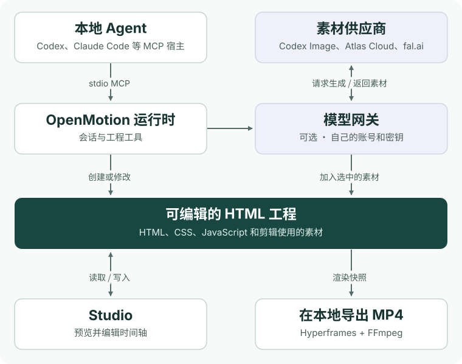

<h1 align="center"><a href="readme/studio-tour.zh-CN.mp4"><picture><source media="(max-width: 640px)" srcset="readme/cover.mobile.zh-CN.jpg" /></picture></a></h1>

<p align="center">用你的 Agent 复刻任意热门视频。上传视频或粘贴社媒链接，换成自己的品牌素材。</p>

<p align="center"><strong><a href="#接入你的-agent">开始使用</a></strong> · <a href="../README.md">English</a></p>

## 复用参考片的拍法

- **首个全栈 Agentic 视频生成器。** 我们的目标是把生成、编辑和渲染放进同一套工作流：用 HTML 编写镜头，在 Studio 里改画面和节奏，从这份工程直接渲染出 MP4。
- **在本地 Agent 里直接用，每一层都支持 BYOK。** 从 Agent 的语言模型到生成图片、视频和音乐的模型，都可以接入自己的服务，使用自己的 API Key。
- **首次开源 100+ 个品牌的 `MOTION.md`** 是首发合集的目标。我们定义了 [Motion MD](motion-md.zh-CN.md)，用 Markdown 记录分镜、节奏、转场和可替换的品牌素材。当前公开预览可读 [Firecrawl 五秒样例](../examples/reference-reveal/MOTION.zh-CN.md)。
- **多模态：图片 · 视频 · 音乐。** 生成或导入需要的素材，放到同一条时间轴上对齐镜头和节拍，再一起导出。[查看可选模型](#自带-agent-和模型密钥byok)

<p align="center"><a href="readme/studio-tour.zh-CN.mp4"><picture>
  <source media="(prefers-reduced-motion: reduce)" srcset="readme/codex-comparison.zh-CN.jpg" />
  
</picture></a></p>

从[Figma Draw 原片](https://x.com/figma/status/1920168282751185360)到 Wing Fest 蝴蝶海报。点开演示，看 Codex 如何复刻这段动效。

左边是品牌在 X 发布的原片，右边是用 OpenMotion 单独制作的可编辑工程。每组截取 5 秒，原速同步播放。点击画面可以暂停、拖动，检查两边的动作在哪一帧发生。

| 原片与时间段 | 5 秒同步对照 | 复刻工程 |
| --- | --- | --- |
| [Kimi](https://x.com/Kimi_Moonshot/status/2077521842080817296)<br />00:30.75–00:35.75 | <a href="../examples/brand-studies/kimi/comparison.mp4"><picture><source media="(prefers-reduced-motion: reduce)" srcset="../examples/brand-studies/kimi/comparison.jpg" /></picture></a> | 磁力线淡出，字符重组成品牌名<br />[MP4](../examples/brand-studies/kimi/film.mp4) · [源码](../examples/brand-studies/kimi/index.html) |
| [DeepSeek](https://x.com/DeepSeekHarness/status/2117256196227019194)<br />01:31.5–01:36.5 | <a href="../examples/brand-studies/deepseek/comparison.mp4"><picture><source media="(prefers-reduced-motion: reduce)" srcset="../examples/brand-studies/deepseek/comparison.jpg" /></picture></a> | 逐字打出标题，闪白切到片尾<br />[MP4](../examples/brand-studies/deepseek/film.mp4) · [源码](../examples/brand-studies/deepseek/index.html) |
| [OpenAI](https://x.com/OpenAI/status/2084352161404920316)<br />00:26.5–00:31.5 | <a href="../examples/motion-studies/comparison.mp4"><picture><source media="(prefers-reduced-motion: reduce)" srcset="../examples/motion-studies/comparison.jpg" /></picture></a> | 点阵收成光点，切到品牌片尾<br />[MP4](../examples/motion-studies/film.mp4) · [源码](../examples/motion-studies/index.html) |
| [Anthropic](https://x.com/ClaudeDevs/status/2091953609185657251)<br />00:00–00:05 | <a href="../examples/brand-studies/anthropic/comparison.mp4"><picture><source media="(prefers-reduced-motion: reduce)" srcset="../examples/brand-studies/anthropic/comparison.jpg" /></picture></a> | 点亮开关，手绘圈标出标题<br />[MP4](../examples/brand-studies/anthropic/film.mp4) · [源码](../examples/brand-studies/anthropic/index.html) |
| [ElevenLabs](https://x.com/ElevenLabs/status/2069111326987673761)<br />00:50–00:55 | <a href="../examples/brand-studies/elevenlabs/comparison.mp4"><picture><source media="(prefers-reduced-motion: reduce)" srcset="../examples/brand-studies/elevenlabs/comparison.jpg" /></picture></a> | 保留品牌词根，滚动替换后缀<br />[MP4](../examples/brand-studies/elevenlabs/film.mp4) · [源码](../examples/brand-studies/elevenlabs/index.html) |
| [Apple](https://x.com/tim_cook/status/1896589954517701057)<br />00:00.75–00:05.75 | <a href="../examples/brand-studies/apple/comparison.mp4"><picture><source media="(prefers-reduced-motion: reduce)" srcset="../examples/brand-studies/apple/comparison.jpg" /></picture></a> | 文字逐拍放大，字形折成丝带<br />[MP4](../examples/brand-studies/apple/film.mp4) · [源码](../examples/brand-studies/apple/index.html) |
| [Slack](https://x.com/SlackHQ/status/1085609385542459393)<br />00:00–00:05 | <a href="../examples/brand-studies/slack/comparison.mp4"><picture><source media="(prefers-reduced-motion: reduce)" srcset="../examples/brand-studies/slack/comparison.jpg" /></picture></a> | 四色线条散开，重新拼成品牌标记<br />[MP4](../examples/brand-studies/slack/film.mp4) · [源码](../examples/brand-studies/slack/index.html) |

[浏览 100+ 个可一键复刻的品牌视频参考](#motion-资源库与主题合集)

在 Agent 里试试 Apple 这一行。打开自己的品牌素材目录，再贴入这段指令。

```text
用 OpenMotion 复刻这支片子的 00:00.75–00:05.75：
https://x.com/tim_cook/status/1896589954517701057
沿用文字出现和折叠的节奏，把 AIR 换成 CUT。
在 Studio 中打开可编辑的 5 秒工程，导出 MP4。
```

### 真人口播加动效

[Kevin Stratvert 的工具演示](https://www.youtube.com/shorts/1fA5j5_5TRY)从真人出镜切到屏幕操作。做自己的版本时，可以把你的口播和录屏一起交给 Agent，让观众在听到功能名时就看到对应的操作。

> 保留我的原声。我说到「导出」时切到录屏，圈出导出按钮，再切回人像。把关键词做成可编辑的字幕。

这是参考片，你的录像、字幕和屏幕特写会保存在自己的工程里。

## 用 OpenMotion 做出的三支片子

### Made in Codex · 12 秒产品发布片

[](../examples/launch-in-codex/film.mp4)

整支片只用了一张产品截图。前 3 秒用大字开场，接着把 Studio 的真实时间轴推到观众面前，最后由 OpenDesign 标志收尾。想做自己产品的版本，可以从仓库里挑一张截图，再从发布说明里挑一句标题。[观看 MP4](../examples/launch-in-codex/film.mp4) · [改镜头和节奏](../examples/launch-in-codex/index.html)

### The Long Return · 11 秒数据故事

[](../examples/longer-days/film.mp4)

2026 年 6 月 1 日，雷克雅未克的白昼比里斯本长多少？先用六组数据画出两座城市的日照变化，再揭晓答案：**5 小时 25 分钟**。柱和线共用同一条纵轴。换数据、改月份或调整揭晓时间，都在同一份源文件里。[观看 MP4](../examples/longer-days/film.mp4) · [改图表](../examples/longer-days/index.html) · [查看原始数据](../examples/README.md#the-long-return)

### Pick Your Cut · 9 秒竖屏讲解

[](../examples/pick-your-cut/film.mp4)

手头有参考片、现成模板，还是只有一句想法？三张卡片逐拍入场，结尾同时留在手机画面里，让人有时间读完。把问题和卡片换掉，就可以用同一个节奏讲清楚产品上手的三个步骤。[观看竖屏 MP4](../examples/pick-your-cut/film.mp4) · [改卡片和文案](../examples/pick-your-cut/index.html)

三支片均由插件实际导出，按静音观看设计。[查看工程素材、创作说明和本地复现步骤](../examples/README.md)

## 接入你的 Agent

OpenMotion 是一款本地运行的开源动效设计插件。选择能通过 stdio 启动本地 MCP 服务的 Agent 接入，即可在同一个 Studio 里继续编辑工程。

| Agent | 怎么接入 |
| --- | --- |
| <a href="#在-codex-里开始"></a> | 安装插件，在 **Plugins → OpenDesign → Try now** 打开。[查看安装步骤](#在-codex-里开始) |
| <a href="agent-adapters.md#codex--claude-code"></a> | 给本地安装器加上 `--host claude`，注册 MCP 服务并安装 Skills。[本地插件接入方式](agent-adapters.md#codex--claude-code) |
| <a href="agent-adapters.md#deepseek-harness"></a> | 先为要使用的 profile 配好模型，再用 `--host deepseek` 接入。[Harness 配置说明](agent-adapters.md#deepseek-harness) |
| <a href="agent-adapters.md#workbuddy"></a> | 用 `--host workbuddy` 接入自定义 MCP 和 Skills。桌面端从导入到出片的完整流程仍待实机验证。[Connector 接入说明](agent-adapters.md#workbuddy) |

<details>
<summary>查看本地安装命令</summary>

克隆 [feature/motion 分支](https://github.com/nexu-io/html-anything/tree/feature/motion)，在仓库根目录用 Node.js 22.18+ 和 npm 运行以下命令。这里以 Claude Code 为例，其他 Agent 可换成表里对应的宿主参数。

```sh
npm ci
npm run package:npm
npx --yes --package "$PWD/dist/npm-local/openmotion-installer-0.6.2-local.1.tgz" \
  openmotion setup --host claude --manifest "$PWD/dist/npm-local/release.local.json"
```

[安装选项](npm-installation.md#构建与安装)

</details>

想复刻上面的镜头？安装后打开 Studio 的**模板库 → 视频复刻**，搜品牌或片段名称，点「一键复刻」。把复制的指令贴进 Agent，加上自己的 Logo、文案或配色。Agent 会生成可编辑工程，你可以在 Studio 时间轴预览、改稿，再导出 MP4。

第一次可以直接用内置的 **Product Promo**，素材已经备好。[模板出片流程](../skills/motion-template-to-video/SKILL.md)

### 在 Codex 里开始

macOS 或 Linux 需要 Git、Node.js 22.18+（含 npm）和支持插件的 Codex CLI。导出 MP4 还需要 Chrome 或 Chromium，以及含 FFprobe 的 FFmpeg。[Windows 安装说明](test-packages.md)

```sh
git clone --branch feature/motion --single-branch https://github.com/nexu-io/html-anything.git OpenMotion
cd OpenMotion && bash scripts/install-motion.command
```

请保留本地仓库目录。在 Codex 桌面端打开 **Plugins → OpenDesign → Try now**。当前 `motion` 插件显示为 OpenDesign。把参考片链接贴进输入框，也可以先试试自带的示例。

> 用 OpenMotion 在 Studio 里打开一份新的 20 秒 Product Promo 示例工程，并把它导出为 MP4。

拿到第一版后，可以试着说：**“结尾标题多停两秒，再导出一版。”** 你也可以自己在 Studio 里拖动片段边缘。两种方式改的是同一份工程。[安装与首次体验手册](usage.md#使用)


## 系统架构

Agent 通过本地 MCP 工具创建工程，用 HTML、CSS 和 JavaScript 编排镜头。想让标题多停半秒，可以让 Agent 改代码，也可以在 Studio 里拖长片段；渲染器读取这份工程的快照并导出 MP4。

[](readme/system-architecture.zh-CN.svg)

[查看原生动画工程](../examples/wing-construction/index.html) · [产品架构](product/architecture.md) · [渲染流程](hyperframes.md)

### 自带 Agent 和模型密钥（BYOK）

在自己的 Agent 里选择语言模型，沿用它的登录账号或 API Key。需要生成新素材时，在 Studio 的**模型设置**里填入自己的 Atlas Cloud 或 fal.ai Key，再按素材类型选模型。已有素材可以直接导入，本地编辑和渲染无需模型密钥。

| 素材 | 内置模型示例 | 可以怎样用 |
| --- | --- | --- |
| 图片 | Codex Image、Nano Banana 2、FLUX Schnell | 用品牌配色重做片头主视觉。 |
| 视频 | Seedance 2.0、Wan 2.2 | 生成一段过场，接到产品录屏前。 |
| 音乐 | Suno v4 | 为产品亮相生成一段配乐。 |
| 语音（TTS） | Kokoro | 为新文案配音，保留原来的剪辑节奏。 |

Codex Image 使用本地 Codex 登录。云模型的使用权限和费用取决于你自己的供应商账号。选中生成结果后，把它加入时间轴即可继续编辑。[模型设置](model-gateway.md) · [模型目录源码](../gateway/catalog.ts)

## Motion MD

Firecrawl 这支参考片的前五秒有三次变化。下面这份说明把镜头的节奏和可以替换的品牌内容写在一起。

| 时段 | 保留的拍法 | 做自己品牌的视频时可以换什么 |
| --- | --- | --- |
| 0–1.5 秒 | 从左到右揭开大数字，在下方留出读标题的时间。 | 发布说明里确认过的数字，以及一句能解释它的短标题。 |
| 1.5–4 秒 | 中央标志落定，外围卡片继续旋转。 | 你的品牌标志，以及围绕它的素材、功能或产品。 |
| 4–5 秒 | 让同一个标志进入最后的交接镜头。 | 客户提供什么输入，最后得到什么结果。 |

[同步播放这五秒的原片与复刻](../examples/reference-reveal/comparison.mp4)，可以直接对照表里的三个时间点。

把 Markdown 文件和工程一起交给 Agent。它可以按这份说明改稿，实际动画保存在 HTML、CSS、JavaScript 和素材文件里。[Motion MD v0.1 草案](motion-md.zh-CN.md) · [本片的说明与两次导出](../examples/reference-reveal/MOTION.zh-CN.md)

## Motion 资源库与主题合集

打开 Studio 的**模板库 → 视频复刻**。这里有 136 张参考卡片，同一原片的不同剪辑合并展示。可以先搜 **Kimi K3 teaser** 或 **Reception by ElevenLabs**。点卡片上的「一键复刻」，把复制的指令连同自己的品牌素材贴进 Agent。[浏览精选参考片](collections/README.zh-CN.md) · [查看模板库说明](template-catalog.md)


如果想从已经能打开的工程开始，Studio 还自带 **3 个可编辑模板**。

| [产品宣传 · 20 秒](../template-library/product-promo/) | [数据叙事 · 15 秒](../template-library/nyt-graph/) | [流程讲解 · 10 秒](../template-library/decision-tree/) |
| --- | --- | --- |
|  |  |  |
| 换上自己的标题和片尾。 | 换成自己的数据和标注。 | 改成自己的问题和分支。 |

后续计划按品牌、近期发布和科技榜单整理专题。现在就可以推荐一支片，附上作者、出处和最值得看的那一拍；做出了自己的版本，也可以把创作说明、可编辑工程和预览一起分享。[合集规划](collections/README.zh-CN.md) · [推荐参考片或提交作品](https://github.com/nexu-io/html-anything/issues/new)

### 怎样比较两次复刻

今天就能做的检查是把两支片停在同一个揭晓瞬间，看切换时机，再看画面里能不能认出自己的品牌，最后改一句标题重新导出。**Motion Benchmark / Arena** 提案希望用同一份参考和品牌素材，对不同工具重复这组比较。评分方法和上线时间仍待确定。[阅读评测提案](motion-md.zh-CN.md)

## 构建与贡献

<p align="center">
  <a href="https://github.com/nexu-io/html-anything/stargazers"></a>
  <a href="../package.json"></a>
  <a href="../LICENSE"></a>
</p>

我们的目标是把 OpenMotion 做成最好的 Claude Motion 开源替代。OpenMotion 提供五个创作工作流和九个 MCP 工具。除了直接改模板和复刻参考片，还可以把视频做成可复用的模板目录。贡献一种风格时，请附上原片出处与作者、Motion MD、预览、可编辑工程和素材授权说明。[工作流](skills.md) · [MCP 工具](mcp-phase1-tools.md) · [贡献指南](../CONTRIBUTING.zh-CN.md)

可以从本分支安装，也可以[在本地构建 npm 安装器](npm-installation.md)。OpenMotion 采用 [Apache-2.0](../LICENSE) 许可，使用 [Hyperframes](https://github.com/heygen-com/hyperframes) 构建 Studio 和渲染视频。[内置示例](../template-library/NOTICE.md)、[编辑器](../studio/LICENSE)和[字体](../web/design-system/fonts/NOTICES.txt)附有各自的上游声明。

## 社区

<p align="center">
  <a href="https://open-design.ai/openmotion?utm_source=github&amp;utm_medium=referral&amp;utm_campaign=openmotion&amp;utm_content=readme_zh"></a>
  <a href="https://go.open-design.ai/?utm_source=github&amp;utm_medium=referral&amp;utm_campaign=openmotion&amp;utm_content=readme_zh"></a>
  <a href="https://discord.gg/mHAjSMV6gz"></a>
  <a href="https://x.com/OpenDesignHQ"></a>
  <a href="https://x.com/OpenDesignDevs"></a>
  <a href="https://www.youtube.com/channel/UChtshixMhvtgBWzoD9R_Qfg"></a>
</p>

[原 HTML Anything 编辑器与安装说明](https://github.com/nexu-io/html-anything/blob/legacy/README.zh-CN.md)
