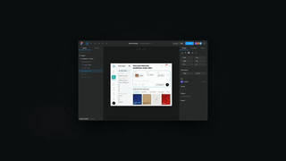
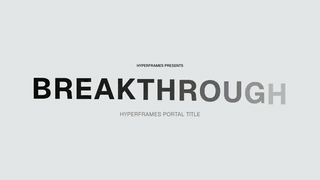
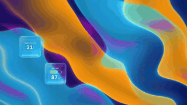
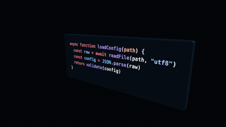
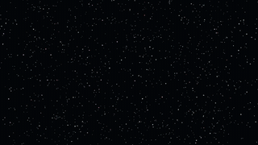

**English** · [简体中文](README.zh-CN.md) · [OpenMotion](../../README.md)

# Motion resource library & collections

For reusable Skills, templates, motion components, `MOTION_DESIGN.md` design systems and Brandkits, start in the [OpenMotion Library](../../library/README.md). This page curates viewing references and editable starting points.

Pick a film for the decision you want to borrow: how it opens, how it reveals a product, or how it explains a complex idea. Each entry below tells you whether you can **watch a reference** or **open an editable project**.

## Watch a launch reference

| Film or excerpt | Look at | Source |
| --- | --- | --- |
| [Pond: a new Linux OS · 12s](../readme/media/jake-pond-reference.mp4) | A short operating-system introduction. Where does the product first become recognizable? | @bflycomputer · Hyperframes reference `hf-reference-jake-pond` |
| [Firecrawl Free Keyless · 32s](../readme/media/remix-firecrawl-reference.mp4) | A developer-tool announcement. How much screen time goes to the promise versus the demonstration? | @ericciarla · Hyperframes reference `hf-reference-remix-firecrawl` |
| [Firecrawl integration reveal · 5s](../readme/media/M945-clip.mp4) | A single beat from a launch: a headline number gives way to the integration ecosystem. | [Original post by @ericciarla](https://x.com/ericciarla/status/2093375835679977570) · `hf-moment-M945` |

Study the shot timing and transitions, then use your own footage and credit the original creator. The [media index](../readme/RESOURCES.md) lists sources and reuse notes.

## Open an editable project

| Starting point | What to try first |
| --- | --- |
| [Product Promo · 20s](../../template-library/product-promo/) | Replace the headline and CTA. Check whether the original holds still give the new copy enough reading time. |
| [NYT Graph · 15s](../../template-library/nyt-graph/) | Replace the figures and labels; keep the relationship between the moving bars and their annotations. |
| [Decision Tree · 10s](../../template-library/decision-tree/) | Change the question and branch labels, then check the reveal order. |

Open these examples from **Studio → Templates → Ready to edit**. Their native source and [upstream notices](../../template-library/NOTICE.md) are included. For other styles, browse the Studio catalog or [watch OpenDesign's online examples](https://open-design.ai/motion/).

## Catalog picks

<table>
<tr><th colspan="3" align="left">📱 Product & interface</th></tr>
<tr>
<td width="33%" valign="top">
<a href="../readme/media/app-showcase.mp4"><picture><source media="(prefers-reduced-motion: reduce)" srcset="../../web/catalog/covers/51a2d141e18e608cc11b9256.jpg"></picture></a> 
<strong>App Showcase</strong> 
Component · <a href="../../library/components/showcase/README.md">View component</a>
</td>
<td width="33%" valign="top">
 
<strong>Product Promo</strong> 
Editable template · <a href="../../template-library/product-promo/index.html">HTML</a>
</td>
<td width="33%" valign="top">
<a href="../../library/skills/openmotion-design-remix/assets/ui-3d-reveal/reference.mp4"><picture><source media="(prefers-reduced-motion: reduce)" srcset="../../web/catalog/covers/c13d0082838675f088ecadcd.jpg"></picture></a> 
<strong>3D UI Reveal</strong> 
Component · <a href="../../library/skills/openmotion-design-remix/references/ui-3d-reveal/MOTION_DESIGN.md">View component</a>
</td>
</tr>
<tr><th colspan="3" align="left">🚀 Brand & launch films</th></tr>
<tr>
<td width="33%" valign="top">
<a href="../readme/media/jake-pond-reference.mp4"><picture><source media="(prefers-reduced-motion: reduce)" srcset="../../web/catalog/covers/66ac2f8b58e55670971ae70c.jpg"></picture></a> 
<strong>Pond: a new Linux OS</strong> 
Reference · @bflycomputer
</td>
<td width="33%" valign="top">
<a href="../readme/media/remix-kimi-k3-reference.mp4"><picture><source media="(prefers-reduced-motion: reduce)" srcset="../../web/catalog/covers/ac6e14a0fadb5893534e6438.jpg"></picture></a> 
<strong>Kimi K3 teaser</strong> 
Reference · @Kimi_Moonshot
</td>
<td width="33%" valign="top">
<a href="../readme/media/remix-elevenlabs-reception-reference.mp4"><picture><source media="(prefers-reduced-motion: reduce)" srcset="../../web/catalog/covers/bc4b8b4398d66159acd35890.jpg"></picture></a> 
<strong>Reception by ElevenLabs</strong> 
Reference · @ElevenLabs
</td>
</tr>
<tr><th colspan="3" align="left">✍️ Kinetic typography</th></tr>
<tr>
<td width="33%" valign="top">
<a href="../readme/media/glass-shard-title.mp4"><picture><source media="(prefers-reduced-motion: reduce)" srcset="../../web/catalog/covers/10cceacc02d415247d58f562.jpg"></picture></a> 
<strong>Glass Shard Title</strong> 
Component · <a href="../../library/components/showcase/README.md">View component</a>
</td>
<td width="33%" valign="top">
<a href="../../library/skills/openmotion-design-remix/assets/canopy-part-title/reference.mp4"><picture><source media="(prefers-reduced-motion: reduce)" srcset="../../web/catalog/covers/998dd6bb8358592c15f727d6.jpg"></picture></a> 
<strong>Canopy Part Title</strong> 
Component · <a href="../../library/skills/openmotion-design-remix/references/canopy-part-title/MOTION_DESIGN.md">View component</a>
</td>
<td width="33%" valign="top">
<a href="../../library/skills/openmotion-design-remix/assets/wireframe-portal-title/reference.mp4"><picture><source media="(prefers-reduced-motion: reduce)" srcset="../../web/catalog/covers/4d03231a69d147a38f993578.jpg"></picture></a> 
<strong>Wireframe Portal Title</strong> 
Component · <a href="../../library/skills/openmotion-design-remix/references/wireframe-portal-title/MOTION_DESIGN.md">View component</a>
</td>
</tr>
<tr><th colspan="3" align="left">💎 Light, glass & 3D worlds</th></tr>
<tr>
<td width="33%" valign="top">
<a href="../readme/media/remix-iskra-light-reference.mp4"><picture><source media="(prefers-reduced-motion: reduce)" srcset="../../web/catalog/covers/75cfbe06267768838d145fa4.jpg"></picture></a> 
<strong>Iskra Light</strong> 
Reference · @world_is_web
</td>
<td width="33%" valign="top">
<a href="../../library/skills/openmotion-design-remix/assets/liquid-glass-widgets/reference.mp4"><picture><source media="(prefers-reduced-motion: reduce)" srcset="../../web/catalog/covers/553a1464d8037293b7debca8.jpg"></picture></a> 
<strong>Liquid Glass Widgets</strong> 
Component · <a href="../../library/skills/openmotion-design-remix/references/liquid-glass-widgets/MOTION_DESIGN.md">View component</a>
</td>
<td width="33%" valign="top">
<a href="../readme/media/remix-cyera-reference.mp4"><picture><source media="(prefers-reduced-motion: reduce)" srcset="../../web/catalog/covers/8884a707a92d0cc52d3363b7.jpg"></picture></a> 
<strong>Cyera brand video</strong> 
Reference · Cyera
</td>
</tr>
<tr><th colspan="3" align="left">🧭 Depth & camera motion</th></tr>
<tr>
<td width="33%" valign="top">
<a href="../../library/skills/openmotion-design-remix/assets/code-3d-extrude/reference.mp4"><picture><source media="(prefers-reduced-motion: reduce)" srcset="../../web/catalog/covers/0a5c7158bbecd6e47055bef9.jpg"></picture></a> 
<strong>Code 3D Extrude</strong> 
Component · <a href="../../library/skills/openmotion-design-remix/references/code-3d-extrude/MOTION_DESIGN.md">View component</a>
</td>
<td width="33%" valign="top">
<a href="../readme/media/remix-glyph-reference.mp4"><picture><source media="(prefers-reduced-motion: reduce)" srcset="../../web/catalog/covers/4bfe08db4d486970494eff3b.jpg"></picture></a> 
<strong>Glyph: GPU typography for the web</strong> 
Reference · @pmndrs
</td>
<td width="33%" valign="top">
<a href="../readme/media/nyc-paris-flight.mp4"><picture><source media="(prefers-reduced-motion: reduce)" srcset="../../web/catalog/covers/aeafb2433c37f2f7d8c87619.jpg"></picture></a> 
<strong>NYC Paris Flight</strong> 
Component · <a href="../../library/components/showcase/README.md">View component</a>
</td>
</tr>
<tr><th colspan="3" align="left">✨ Generative visuals</th></tr>
<tr>
<td width="33%" valign="top">
<a href="../readme/media/aurora.mp4"><picture><source media="(prefers-reduced-motion: reduce)" srcset="../../web/catalog/covers/5aefe7c9a916a38777443b36.jpg"></picture></a> 
<strong>Aurora</strong> 
Component · <a href="../../library/components/showcase/README.md">View component</a>
</td>
<td width="33%" valign="top">
<a href="../readme/media/remix-linear-loops-reference.mp4"><picture><source media="(prefers-reduced-motion: reduce)" srcset="../../web/catalog/covers/17cf5075b3f4b49c7d3e9201.jpg"></picture></a> 
<strong>Linear Loops</strong> 
Reference · @linear
</td>
<td width="33%" valign="top">
<a href="../../library/skills/openmotion-design-remix/assets/code-particle-assemble/reference.mp4"><picture><source media="(prefers-reduced-motion: reduce)" srcset="../../web/catalog/covers/8ff121deb9403f7a99ac52b3.jpg"></picture></a> 
<strong>Code Particle Assemble</strong> 
Component · <a href="../../library/skills/openmotion-design-remix/references/code-particle-assemble/MOTION_DESIGN.md">View component</a>
</td>
</tr>
</table>

## What goes into a themed collection?

The planned public site groups films **by editorial theme → brand → video**. For example: one technology brand across several launches; companies on an a16z consumer AI list; or companies announcing funding in a particular month of 2026. A ranking selects companies, not the quality of their videos.

A useful entry pairs the original and its creator with a preview. Add a [Motion.md](../motion-md.md) when the style has been described. Add an editable template when someone has successfully opened, changed and rendered the project. This index is usable today; the public brand/ranking collections and Motion Arena are separate work in progress.
