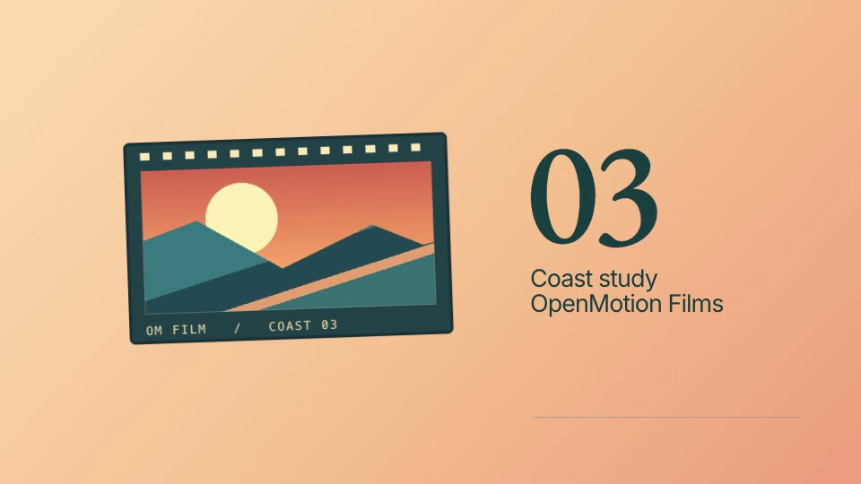
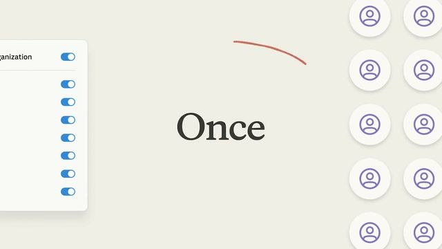
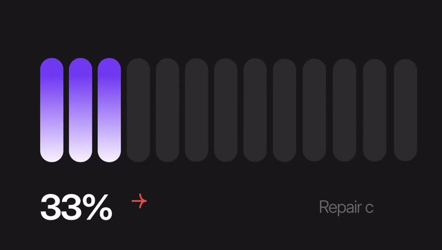

# Seven creative briefs for AI editing

[简体中文](examples.zh-CN.md) · [Back to the showcase](../README.md#showcase) · [Sources and assets](readme/ASSETS.md#creative-examples)

These briefs turn the seven README scenarios into concrete requests. The stills and GIFs are **external reference excerpts** from the resource catalog, not OpenMotion-made films or new bundled templates. Durations, aspect ratios and deliverables in the briefs are creative targets that require production and review.

## How to use a brief

1. [Start OpenMotion and connect your agent](../README.md#quick-start). Supply your own footage, brand assets and approved content.
2. Choose a brief and replace its subject. Give your agent the brief, exact catalog ID and source; you can also search the reference title in Studio’s library.
3. Have the agent inspect the reference before proposing a shot list and cut. Retrieval, transcription and audio analysis depend on host tools; missing media or timecodes must be supplied, not inferred from a description.
4. Review the actual project in Studio at normal speed, including text and sound, before exporting MP4. Keep the editable source for the next revision.

These are reference-led creative inputs, not new runtime tools, automatic platform adaptation or one-click generation guarantees. Existing editable templates use the [template reuse route](../skills/openmotion-template-to-video/SKILL.md); video reconstruction uses [openmotion-recreate](../skills/openmotion-recreate/SKILL.md). GIF previews are silent; voice, music and sound synchronization must be reviewed in the actual project.

<a id="talking-head"></a>

## 01 · AI talking-head edits

**Three minutes of footage. One sharp story.**

[Watch reference: Ali Abdaal · 5 tools I use every day](../library/skills/openmotion-presenter-story/assets/ali-abdaal-workflow-reference.mp4)


- **Input:** Your recording + transcript / timecodes
- **Creative focus:** A clear hook, tighter speech, captions and well-timed B-roll.
- **Catalog ID:** `hf-reference-aroll-ali-abdaal-workflow`

```text
Use OpenMotion. Creative reference: hf-reference-aroll-ali-abdaal-workflow
../library/skills/openmotion-presenter-story/assets/ali-abdaal-workflow-reference.mp4

Make a 30-second, 9:16 cut from my three-minute recording and timed
transcript. Lead with the strongest complete statement. Remove only the
repetitions and pauses confirmed in the transcript; keep my meaning and voice.
Add readable phrase-level captions and two supporting cutaways from my media.
Use the reference for the alternation between speaker, app cards and B-roll.
Show the proposed timecode selections before applying the cut. Keep speech
audible above music. Deliver an editable project and an MP4 after preview
approval.
```

<a id="story-recut"></a>

## 02 · AI recuts & revisions

**Scattered clips become a 100-day story.**

[100 days with stickers and photo cards · Hyperframes catalog](https://www.instagram.com/reel/Dd6vHlQgpok/) · [▶ Full reference](readme/media/hundred-days-story-reference.mp4)


- **Input:** Your clips, photos, voice-over and story outline
- **Creative focus:** A personal montage with photo cutouts, chapter beats and a new pace.
- **Catalog ID:** `hf-reference-aroll-hundred-days-story`

```text
Use OpenMotion. Creative reference: hf-reference-aroll-hundred-days-story
readme/media/hundred-days-story-reference.mp4

Build a 25-second, 9:16 story from my clips, photos and voice-over about [my
100-day project]. Organize it into the decision, the obstacle and what
changed. Borrow the reference’s cutout-photo, oversized-type and scrapbook
rhythm, using my own images and words. Place the strongest result near the
opening; let the quieter moment breathe. Keep every photo, title and clip
separately editable. After I review the first cut, propose a 15-second version
by changing the sequence and holds, not just speeding everything up.
```

<a id="product-launch"></a>

## 03 · Product launches & demos

**Make the feature the hero.**

[Stripe Treasury · 00:21.50–00:26.50](https://x.com/stripe/status/2049621560743608481) · [Editable Coast study](../examples/brand-studies/stripe/index.html)



- **Input:** Product screens + feature brief + Brandkit
- **Creative focus:** A feature reveal, a focused UI demonstration and a memorable finish.
- **Shot recipe:** [Stripe card flip](../examples/brand-studies/stripe/MOTION.md)

```text
Use OpenMotion. Creative reference: https://x.com/stripe/status/2049621560743608481 (00:21.50–00:26.50)

Create a 20-second, 16:9 launch film for [feature]. Use my real product
screenshots, screen recording and Brandkit. Follow a reveal → one useful
action → finished result → closing line structure. Take inspiration from the
reference’s transitions between graphic shapes, a close view of the UI and the
finished artwork. Keep interface labels accurate, use one camera move at a
Use my own colors, artwork and product name.
Deliver editable scenes and a reviewed MP4.
```

<a id="viral-remix"></a>

## 04 · Viral video recreation

**Remix the rhythm. Make it yours.**

[Watch reference: Lovable: Aesthetics Update · @lovable_dev](readme/media/jake-lovable-reference.mp4)


- **Input:** A reference + your copy, visuals and brand
- **Creative focus:** A new editable cut built around the hook, typography and visual rhythm.
- **Catalog ID:** `hf-reference-jake-lovable`

```text
Use OpenMotion. Creative reference: hf-reference-jake-lovable
readme/media/jake-lovable-reference.mp4

Study this reference and build a new 12-second, 16:9 film for [my product /
idea]. First break down its opening, type changes, visual contrasts and
transition timing. Propose a shot-by-shot adaptation using my copy, images and
Brandkit. Rebuild the motion as editable scenes; do not insert the reference
video as the finished composition. Preserve the rhythm while making the
content and identity mine. Preview at normal speed and compare the adaptation
with the agreed shot list before exporting.
```

<a id="explainer"></a>

## 05 · Explainers & tutorials

**One workflow. Three clear steps.**

[Watch reference: Authorize Once, Everyone Connected](readme/media/remix-authorize-once-reference.mp4)



- **Input:** Your workflow + script + accurate UI captures
- **Creative focus:** A guided sequence with one idea per scene and purposeful callouts.
- **Catalog ID:** `hf-reference-remix-authorize-once`

```text
Use OpenMotion. Creative reference: hf-reference-remix-authorize-once
readme/media/remix-authorize-once-reference.mp4

Explain [my workflow] in a 20-second, 16:9 film with three steps. Start with
the user’s problem, show the three actions, then show the outcome. Use the
reference’s calm spacing, connected objects and focused UI callouts as visual
inspiration. Use my actual interface and terminology; do not imply that the
reference’s integrations are part of my product. Highlight one object at a
time and keep text concise. Match each spoken instruction to the visible step.
Deliver an editable project for review before MP4 export.
```

<a id="data-story"></a>

## 06 · Data stories & charts

**Give every number a point.**

[Animated comparison bars · @Vintage_god](https://x.com/Vintage_god/status/2106817967967056165) · [▶ Full reference](readme/media/M1128-clip.mp4)



- **Input:** Your data, units, source and conclusion
- **Creative focus:** A legible chart reveal with animated values and one clear comparison.
- **Catalog ID:** `hf-moment-M1128`

```text
Use OpenMotion. Creative reference: hf-moment-M1128
readme/media/M1128-clip.mp4

Turn my supplied dataset into a 15-second, 16:9 data story. Establish the
baseline, reveal the change and finish with one supported conclusion. Use the
reference’s rounded bars, restrained motion and large values as inspiration.
Keep the scale, units, labels and source visible and accurate; animate to the
actual values without exaggerating the comparison. Do not reuse the
reference’s 40% or 30% claims. Make the dataset and chart labels easy to
change. Deliver the editable chart scene, a readable final frame and an MP4
after review.
```

<a id="music-visual"></a>

## 07 · Music & art visuals

**Give your track a visual identity.**

[Lyria 3 visual sequence · @GoogleAI](https://x.com/GoogleAI/status/2024154215182926027) · [▶ Full reference](readme/media/M1139-clip.mp4)


- **Input:** Your audio + mood + beat markers / cue points
- **Creative focus:** Layered color, kinetic type and a visual sequence timed to your track.
- **Catalog ID:** `hf-moment-M1139`

```text
Use OpenMotion. Creative reference: hf-moment-M1139
readme/media/M1139-clip.mp4

Create a 10-second, 16:9 visual passage for my audio track. Use the supplied
beat markers or propose cue points for confirmation first. Take the
reference’s translucent layers, spectral colors and depth changes as
inspiration. Build a restrained opening, a visual lift at the musical peak and
a clear closing frame with my title. Time the motion to confirmed cues; do not
claim automatic audio-reactive analysis. Keep the color palette, titles and
motion parameters editable. Review with sound, then export MP4.
```

## Review and provenance

Preview and export checks do not establish audience understanding, reach or human visual acceptance. Verify content accuracy, pacing against the brief, editability and actual file playback before recording the result of a new production. Third-party brands, people and business metrics in the references are not OpenMotion product claims.

The [original catalog](../web/catalog/hyperframes.json) retains each entry. The [excerpt manifest](readme/examples/manifest.json) records exact sources, time ranges and file hashes. Attribution follows the catalog; the two entries labeled Hyperframes catalog identify the collection, without inferring the original author.
