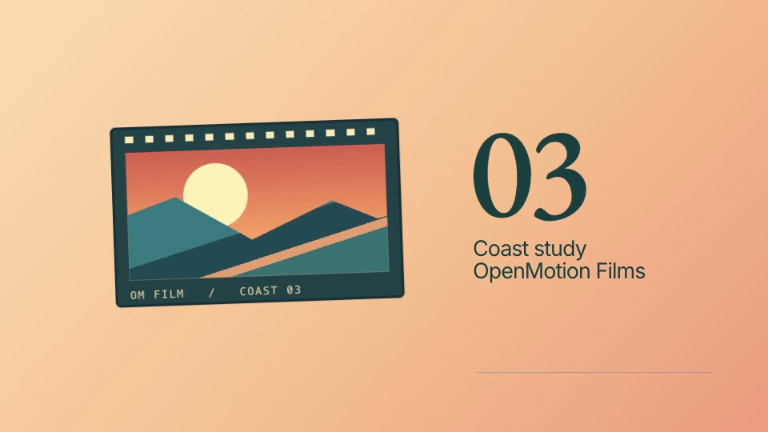
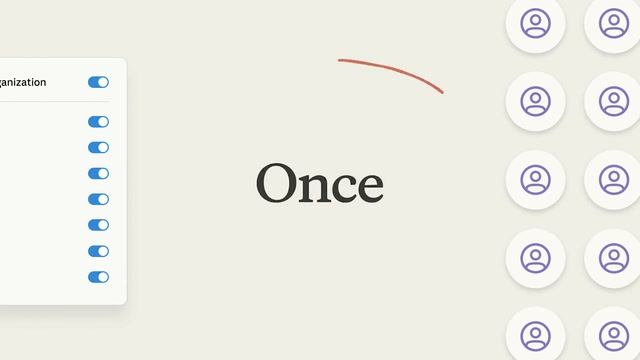
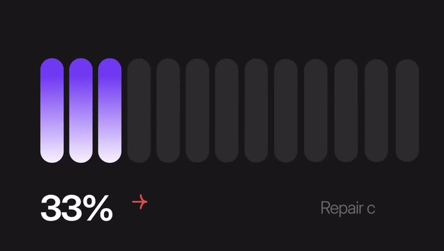

# 七个 AI editing 创作简报

[English](examples.md) · [返回中文介绍](README.zh-CN.md#showcase) · [来源与素材记录](readme/ASSETS.md#creative-examples)

这些简报把 README 的七类场景变成可执行的创作请求。图片和动图是资源库中的**外部参考片段**，不是 OpenMotion 制作的成片或新增内置模板。简报中的时长、画幅和结果是本次创作目标，需要实际制作与评审。

## 使用方法

1. [启动 OpenMotion 并连接 Agent](README.zh-CN.md#quick-start)，提供你自己的素材、品牌与已确认的内容。
2. 选择下方简报，替换其中的主题。将简报、精确参考 ID 和来源一起交给 Agent；也可以在 Studio 资源库搜索参考名称。
3. Agent 实际读取参考，再提出分镜与剪辑方案。网络获取、字幕和音轨分析依赖宿主工具；缺少素材或时间码时先补齐，不把描述当作已经完成的分析。
4. 制作后在 Studio 正常速度观看，检查画面、文字与声音，再导出 MP4。保留工程继续修改。

这里只记录参考驱动的创作输入；没有新增运行时工具、自动平台适配或一键生成保证。已有可编辑模板仍使用 [模板复用路线](../skills/motion-template-to-video/SKILL.md)；视频重建参考使用 [motion-recreate](../skills/motion-recreate/SKILL.md)。GIF 无声；所有配音、配乐和声音同步都需在实际工程中检查。

<a id="talking-head"></a>

## 01 · AI 口播精剪

**3 分钟口播，剪出 30 秒重点。**

[观看参考片：Ali Abdaal · 5 tools I use every day](../library/skills/presenter-story/assets/ali-abdaal-workflow-reference.mp4)


- **输入:** 你的录制素材＋字幕或时间码
- **观察重点:** 结论前置，精简重复，用字幕与 B-roll 接住重点。
- **目录 ID:** `hf-reference-aroll-ali-abdaal-workflow`

```text
使用 OpenMotion。创作参考: hf-reference-aroll-ali-abdaal-workflow
../library/skills/presenter-story/assets/ali-abdaal-workflow-reference.mp4

把我提供的 3 分钟口播和带时间码字幕，剪成 30 秒、9:16 的版本。
用最有力的完整结论开场，只删去字幕中确认的重复与停顿，保留我的意思和口吻。
增加按短句出现的字幕，并从我的素材中选两处补充画面。
参考视频里人物、应用卡片和 B-roll 的切换节奏。
先列出拟保留与删除的时间段，再应用剪辑；配乐不要盖过人声。
预览确认后交付可编辑工程与 MP4。
```

<a id="story-recut"></a>

## 02 · AI 素材重组与改稿

**把零散片段，剪成一段 100 天故事。**

[100 days with stickers and photo cards · Hyperframes catalog](https://www.instagram.com/reel/Dd6vHlQgpok/) · [▶ 完整参考](readme/media/hundred-days-story-reference.mp4)


- **输入:** 片段、照片、旁白与故事梗概
- **观察重点:** 用照片拼贴、章节和旁白重排故事，做出自己的叙事节奏。
- **目录 ID:** `hf-reference-aroll-hundred-days-story`

```text
使用 OpenMotion。创作参考: hf-reference-aroll-hundred-days-story
readme/media/hundred-days-story-reference.mp4

用我提供的片段、照片和旁白，为「我的 100 天计划」剪一支 25 秒、9:16 的故事。
结构是：决定开始、遇到阻碍、发生改变。
借鉴参考的照片抠图、大字和手账拼贴节奏，画面与文字全部使用我的内容。
把最有冲击力的结果放在前面，给安静的段落留呼吸。
照片、标题和片段保持独立可编辑。
首版评审后，再通过重排和调整停留时长做 15 秒版本，而不是整片加速。
```

<a id="product-launch"></a>

## 03 · 产品发布与功能演示

**让新功能，成为发布片的主角。**

[Stripe Treasury · 00:21.50–00:26.50](https://x.com/stripe/status/2049621560743608481) · [可编辑的海岸胶片](../examples/brand-studies/stripe/index.html)



- **输入:** 真实界面、功能简报与 Brandkit
- **观察重点:** 功能揭示、界面特写、成果展示，组成一支完整发布片。
- **逐镜规范：** [Stripe 翻卡](../examples/brand-studies/stripe/MOTION.md)

```text
使用 OpenMotion。创作参考: https://x.com/stripe/status/2049621560743608481 (00:21.50–00:26.50)

为「我的新功能」制作 20 秒、16:9 的发布片，使用我的真实产品截图、录屏与 Brandkit。
按照「揭示功能 → 一次关键操作 → 完成效果 → 结束语」组织。
参考图形元素、界面特写与最终作品之间的过渡方式。
界面标签保持准确，一次只安排一个镜头运动，完成效果停留到能看清。
用我的品牌色、产品画面和名称。
交付可编辑场景，评审后导出 MP4。
```

<a id="viral-remix"></a>

## 04 · Viral video 复刻

**复刻节奏与结构，换成你的表达。**

[观看参考片：Lovable: Aesthetics Update · @lovable_dev](readme/media/jake-lovable-reference.mp4)


- **输入:** 参考视频＋你的文案、画面与品牌
- **观察重点:** 拆解开场、动态排版与转场，再重建成可修改的个人版本。
- **目录 ID:** `hf-reference-jake-lovable`

```text
使用 OpenMotion。创作参考: hf-reference-jake-lovable
readme/media/jake-lovable-reference.mp4

分析这支参考，为「我的产品或观点」制作一支 12 秒、16:9 的新视频。
先拆解开场、字体变化、画面对比和转场时间，列出逐镜头方案，内容换成我的文案、图片与 Brandkit。
用可编辑场景重建动效，不把原视频整段塞进工程当作成片。
保留参考的节奏，做出自己的内容与身份。
按正常速度预览，对照确认的分镜评审后再导出。
```

<a id="explainer"></a>

## 05 · 讲解与教程

**一个复杂流程，讲成三个清楚步骤。**

[观看参考片：Authorize Once, Everyone Connected](readme/media/remix-authorize-once-reference.mp4)



- **输入:** 操作流程、脚本与准确的界面素材
- **观察重点:** 每个场景只讲一步，用标注、连线与界面变化引导理解。
- **目录 ID:** `hf-reference-remix-authorize-once`

```text
使用 OpenMotion。创作参考: hf-reference-remix-authorize-once
readme/media/remix-authorize-once-reference.mp4

把「我的操作流程」讲成 20 秒、16:9、三个步骤的视频。
先给出用户问题，再展示三次操作，最后展示结果。
参考画面的留白、对象连接和界面重点标注。
使用我的真实界面和术语，不把参考里的集成功能写成我的产品能力。
一次突出一个对象，文案简洁，让每句解说对应画面上的步骤。
先交付可编辑工程评审，再导出 MP4。
```

<a id="data-story"></a>

## 06 · 数据故事与动态图表

**让数字有重点，让变化被看见。**

[Animated comparison bars · @Vintage_god](https://x.com/Vintage_god/status/2106817967967056165) · [▶ 完整参考](readme/media/M1128-clip.mp4)



- **输入:** 你的数据、单位、出处与结论
- **观察重点:** 从基线到变化，再落到结论；用动态数值与图表突出对比。
- **目录 ID:** `hf-moment-M1128`

```text
使用 OpenMotion。创作参考: hf-moment-M1128
readme/media/M1128-clip.mp4

把我提供的数据做成 15 秒、16:9 的数据故事：先给基线，再展示变化，最后突出一个有数据支持的结论。
参考圆角条形、克制的运动与大号数值。
坐标比例、单位、标签和出处保持清楚准确，动画落到真实值，不夸大差距。
不沿用参考片的 40% 或 30% 主张。
让数据与图表标签方便修改。
交付可编辑图表场景和可读的结尾画面，评审后导出 MP4。
```

<a id="music-visual"></a>

## 07 · 音乐与艺术视觉

**让一段音乐，长出自己的视觉。**

[Lyria 3 visual sequence · @GoogleAI](https://x.com/GoogleAI/status/2024154215182926027) · [▶ 完整参考](readme/media/M1139-clip.mp4)


- **输入:** 音轨、情绪方向与节拍或提示点
- **观察重点:** 用色彩、层叠图形与动态排版，回应音乐中的关键时刻。
- **目录 ID:** `hf-moment-M1139`

```text
使用 OpenMotion。创作参考: hf-moment-M1139
readme/media/M1139-clip.mp4

为我的音轨制作一段 10 秒、16:9 的视觉片段。
使用我提供的节拍标记，或先提出提示点让我确认。
参考透明层叠、频谱色彩与空间纵深变化，设计克制的开场、音乐高潮处的视觉展开，以及带我作品标题的结束画面。
按确认的提示点对齐动作，不声称已经具备自动音频响应分析。
颜色、标题和动效参数保持可编辑，带声音评审后导出 MP4。
```

## 验收与来源

预览和导出检查不自动证明观众理解、传播效果或人工视觉认可。确认内容准确、节奏符合简报、工程可继续编辑、输出文件可播放后，再记录本次实际验收结果。参考中的第三方品牌、人物和业务指标不属于 OpenMotion 的产品主张。

[原始目录](../web/catalog/hyperframes.json)保留条目；[片段清单](readme/examples/manifest.json)记录准确来源、时间范围与文件校验信息。署名沿用目录；标为 Hyperframes catalog 的两条只表示收录来源，不推断原作者。
