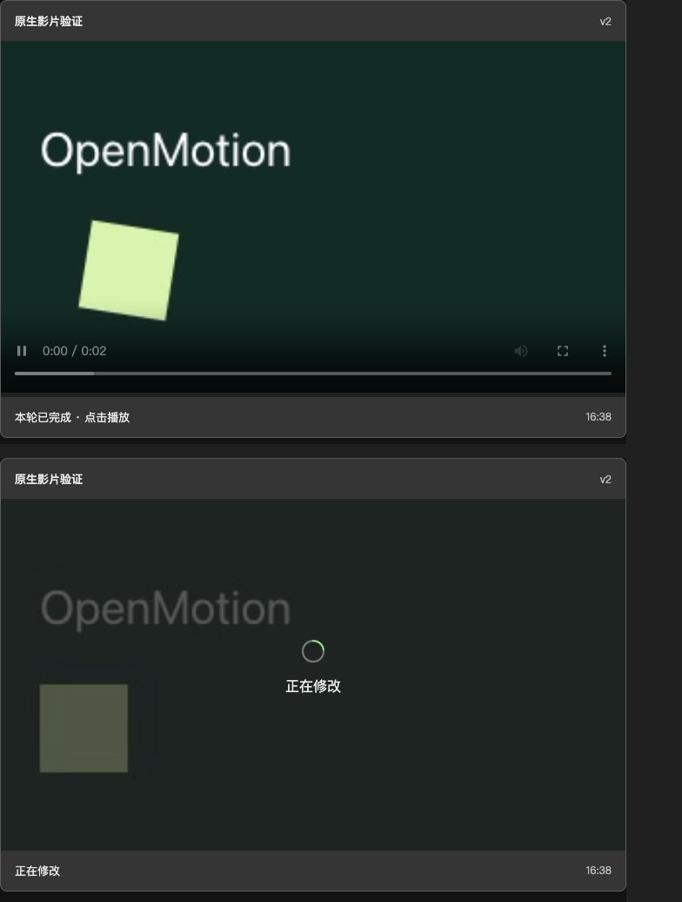
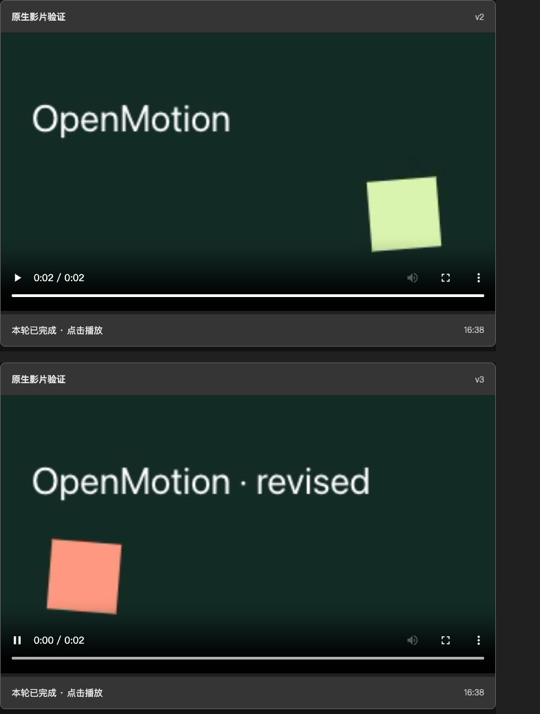

# Inline video progress and version playback

A supported MCP Apps host can show one video frame for each creation/edit round. The frame observes real work and export state, then offers manual playback of that round's verified MP4. It does not show partial video generation or autoplay.

## Contract

1. Explicitly create or read the intended project. For each actual video creation/content-edit turn in an MCP Apps host, call `openmotion_open_preview` with `action=begin`, `projectId`, stable `requestId` and `mode=create|modify` before authoring. This creates a work identity, not another project/version or render.
2. Carry `inlineWork.id` as `workId` in every `openmotion_edit_project` and the final `openmotion_export_request`. Existing revision/version guards and request deduplication apply. Intermediate saves do not complete the round or trigger exports.
3. The component calls `openmotion_get_project({projectId,workId,includeVideo:true})`. The result contains fixed version/job identity and state; MP4 and optional cover are returned only in tool-result `_meta.inlineVideo`, outside model-visible content.
4. A queued export freezes the round. Later edits require a new round. Old frames continue to query their own version/job after reopening the chat; they never follow the project's current version.

Existing public Tools and legacy aliases remain. Explicit editor-only requests, unchanged template browsing, review recording, display recording and existing-link requests retain their scope. A final inline playback preview is part of the video turn; a separate MP4-download request is not required. Hosts without MCP Apps retain their existing workflow. Video playback delivery supplements the existing editable Studio handoff and never substitutes for its visibility checks. Other clients may still use ordinary preview/export results without MCP Apps support.

## States and limits

- Authoring/modifying, saved, queued, checking, rendering and verifying come from persisted work/job records. Saving is not completion. No estimated percentage is invented.
- Work without a new event for two minutes becomes unconfirmed; transport failures show stale state and offer retry. Failed/cancelled rounds never enable playback.
- Playback requires a completed owned job, matching version/revision, a passed technical report, a regular local file and matching SHA-256. Missing, changed or oversized media remains unavailable.
- Media stays local and is embedded using explicitly declared `data:` resource origins. No cloud upload or loopback media request is needed. The current MP4 limit is 32 MiB; larger exports remain accessible through existing delivery paths. Base64 transfer increases payload size; long-film scalability is not established.
- There is no live video generation preview or automatic playback. Technical verification, actual playback and human audiovisual acceptance remain separate.

## Verification boundary

The development prototype was accepted in Codex desktop for two playable rounds, unchanged old media and playback after reopening the chat. That observation predates the public-main port and is not acceptance of this PR's exact runtime. This PR separately validates the public Tool contract, packaging and real native rendering; target-host validation of the integrated version remains a release check. Other hosts and platforms are unverified.

## Local component screenshots

These screenshots show the actual component in a local MCP Apps SDK test host, connected to real OpenMotion/Hyperframes renders. They are not screenshots of native Codex chat or a long-film quality assessment.

A new edit round shows its real modifying state while the first round remains playable:

Both finished rounds retain separate version labels and click-to-play controls:

