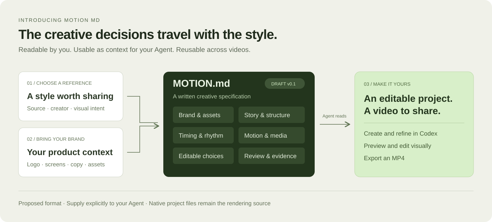

**English** · [简体中文](motion-md.zh-CN.md) · [openmotion](../README.md)

# Motion MD

**A shared language for motion styles, built for people and Agents.**

[Motion resource library](collections/README.md) · [Complete example](examples/product-launch.MOTION.md)

Motion MD is openmotion's proposed Markdown format for turning the creative decisions behind a video into a reusable specification. It connects a reference and a brand's assets to a video that can be generated, edited and reviewed.

**Status: initial v0.1 proposal.** The format, filename and sections are open for discussion. This document defines a creative specification, not a new rendering engine, executable configuration or implemented importer.

## What a Motion MD captures

| Section | What it records | Why it matters |
| --- | --- | --- |
| **Identity & provenance** | Name, version, reference link, author, analysis date, asset/source permissions and validation status. | A style can be traced back to the exact reference and its revision. |
| **Brand & assets** | Logo, type, palette, product screenshots, copy and an optional link to an existing brand/design document. | The result represents the user's product and preserves the constraints they care about. |
| **Story & composition** | Audience, central message, scene purpose, hierarchy and framing. | A template carries an understandable story as well as a look. |
| **Timing & movement** | Format, scene timing, entrances, exits, holds, easing and transitions. | An Agent has guidance about what happens, when and why. |
| **Media & sound** | Media sources, music/voice intent, sync points and fallbacks. | Assets and sound fit the story; missing files do not disappear silently. |
| **Editable choices** | What can change, what must stay, and where the editable source lives. | The same style can serve another product without rebuilding every decision. |
| **Review & evidence** | Readability, brand fidelity, reference intent, export requirements and observed results. | A readable description is distinguished from a verified template. |

Use ordinary Markdown headings, prose and tables. The sections above are a proposed authoring convention, not a machine-validated schema. Explicitly label decisions inferred from a reference and any creative changes; do not present them as facts extracted from the original.

## How to use it today

1. Choose a reference or an editable template, and gather the brand material you want to use.
2. Write a Motion MD using the [example](examples/product-launch.MOTION.md). Replace its illustrative content and record the real sources.
3. Give the file explicitly to your Agent with the project and a task such as:

   > Read this Motion MD and the attached brand assets. Use the specification to adapt our product-launch project. Keep the listed constraints and make the requested edits in the editable project.

4. The Agent follows the existing creation/template workflow and writes the native project. Preview and revise it in openmotion.
5. Review the final video and record the actual version and result. A file with a “Review” section is not automatically verified.

The runtime does **not** automatically read a file just because it is called `MOTION.md`. There is no Motion MD parser, validator, template-registry endpoint or guaranteed cross-Agent execution contract in the current release. An Agent reads it as supplied context.

## How it fits the project

| Artifact | Responsibility |
| --- | --- |
| **Motion MD** | The reusable creative specification: style, story, timing, constraints and review intent. |
| **Existing brand/design document** | The product's visual identity. Link to it rather than inventing a second palette or logo policy. |
| **Skill / workflow** | How an Agent plans, creates, edits and checks the work. |
| **`TEMPLATE.md`** | The current video-to-template workflow's single template handoff document, including usage and verification notes. |
| **HTML/CSS/JS + assets** | The editable, executable project consumed by the current Hyperframes-based runtime. |
| **Preview / exported MP4** | The rendered result from a specific project version. |

Motion MD does not replace the current `TEMPLATE.md` contract. Until the format is integrated, keep the production template workflow unchanged; a draft Motion MD may be supplied separately as creative input. Do not require a second metadata file in every existing template.

## From specification to resource to benchmark

**A proposed publishable style package** connects a Motion MD, editable source, a preview, instructions, source attribution and asset permissions. These parts let a visitor see the result, understand the style and try adapting it.

A catalog should distinguish:

- **Reference:** a discoverable original video with a source link.
- **Described style:** a reference with a written creative specification.
- **Verified template:** an editable project that has been opened, adapted and rendered, with a recorded version and result.

The planned **Motion Benchmark / Arena** would evaluate results against shared reference tasks. Candidate dimensions include reference-style fidelity, brand consistency, editability and successful delivery. These are discussion inputs, not a finalized scoring system. The evaluation method, competitors, samples, weights and public launch remain undecided; no results are claimed here.

## Help shape the format

Useful feedback includes an actual video/reference, the information an Agent needed but could not infer, an adaptation that worked or failed, and the corresponding project revision. Proposals should make the creative handoff easier without creating a second rendering format.

Motion MD shares the broader idea of readable design guidance with DESIGN.md-style documents and Hyperframes' existing authoring guidance. Its proposed focus is the link between **reference, reusable motion decisions, editable project and review evidence**. Compatibility must be demonstrated with real examples, not inferred from a filename.
