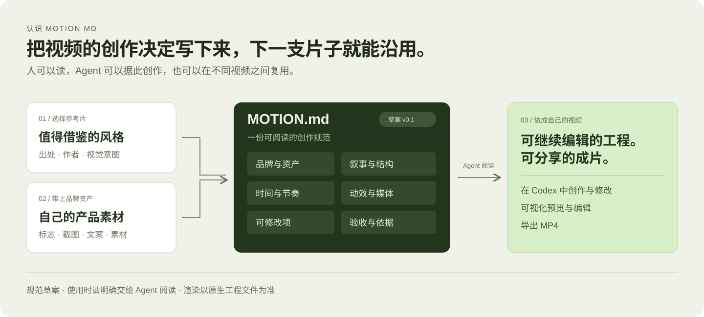

[English](motion-md.md) · **简体中文** · [openmotion](README.zh-CN.md)

# Motion MD

**Motion MD 是 openmotion 提出的视频风格描述格式。** 把参考片里的创作决定写成 Markdown：哪些属于品牌、故事在第几秒转折、运动如何引导注意力、什么可以替换、成片怎么验收。下一位创作者可以沿用这些决定，Agent 也可以据此制作。

**版本：v0.1 初始提案。** 章节、文件名和字段仍可讨论。这是一份创作规范，不是新的渲染引擎或自动导入格式。[查看完整示例](examples/product-launch.MOTION.zh-CN.md)

## 一份规范应记录什么

| 部分 | 建议内容 |
| --- | --- |
| 身份与出处 | 名称、版本、原片与作者、分析日期、素材权限，以及是否已验证。 |
| 品牌与资产 | Logo、字体、配色、产品截图和文案。已有品牌规范时直接引用。 |
| 故事与构图 | 目标受众、核心信息、各段目的、视线重点和取景范围。 |
| 时间与运动 | 画幅、镜头时长、进出场方式、停留、缓动与转场。 |
| 媒体与声音 | 素材来源、音乐或旁白意图、同步点、缺少素材时的替代方案。 |
| 可编辑项 | 换品牌时可以改什么、必须保留什么，到哪里改。 |
| 验收与证据 | 可读性、品牌一致性、导出规格、实测版本和结果。 |

普通 Markdown 的标题、段落和表格即可。把实测信息和根据参考作出的推断分开，避免把创作建议写成从原片提取的事实。

## 今天怎么用

1. 从[资源索引](collections/README.zh-CN.md)选出参考或模板，准备好自己的品牌素材。
2. 按[示例](examples/product-launch.MOTION.zh-CN.md)写出规范，填入真实来源和本次要保留的约束。
3. 把文件、素材和需求明确交给 Agent，例如：“读取这份 Motion MD，用我们自己的产品截图改编发布片。保留每次揭示后的停顿，交付可编辑工程和 MP4。”
4. 在 openmotion 中预览、改稿并导出。完成后记录工程版本和实际观看结果。

当前没有自动发现、解析、校验或注册 Motion MD 的接口。文件名本身不会触发工作流。

## 它与工程中其他文件的关系

| 文件或产物 | 职责 |
| --- | --- |
| Motion MD | 记录参考、风格、故事、节奏、品牌约束与验收意图。 |
| 既有品牌文档 | 定义品牌视觉身份。引用已有规范，避免维护两套冲突的配色或 Logo 要求。 |
| Skill | 指导 Agent 如何制作、修改和检查作品。 |
| `TEMPLATE.md` | 视频转模板工作流的交付说明，包含使用方式与验证记录。 |
| HTML/CSS/JS 与媒体 | 当前运行时真正编辑和渲染的工程。 |
| 预览与 MP4 | 某个具体版本的输出，用于观看、比对和交付。 |

Motion MD 可独立作为创作输入，不替换现有模板中的 `TEMPLATE.md`，也不要求改造已有模板。

## 从资源到评测

资源可以分成三个层次：有出处的**参考片**、附 Motion MD 的**风格拆解**、经过打开、修改和导出验证的**可编辑模板**。未来的 Motion Benchmark / Arena 拟用共同的参考任务比较复刻效果、品牌一致性和可编辑性；样本、方法、权重和公开排期仍待确定。

欢迎用具体案例提意见：Agent 缺了哪条信息、哪次改编成功或失败，以及当时的工程版本。Motion MD 借鉴可读设计规范的表达方式，关注从原片到风格描述、可编辑工程和验收记录的关系；与其他格式的兼容性需要通过实例验证。
