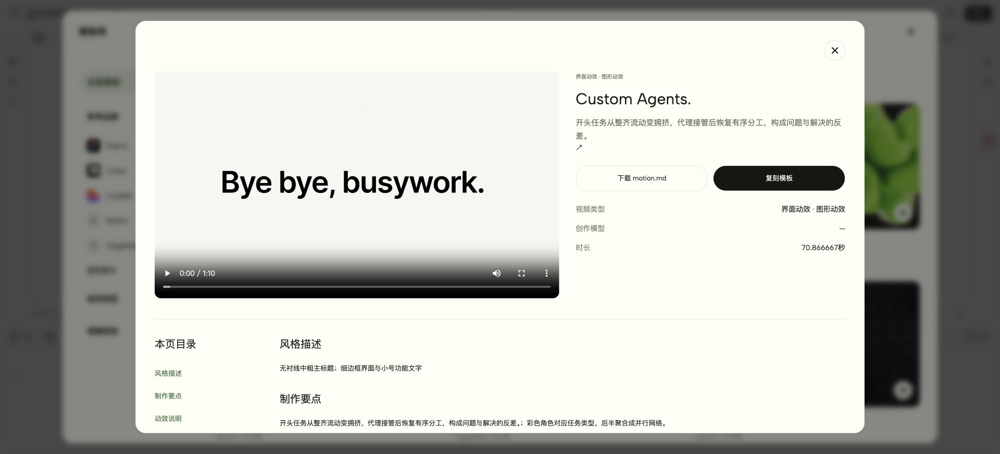
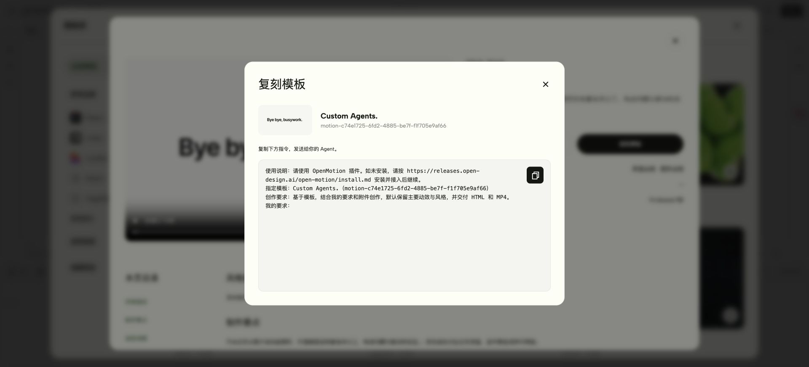

# 从线上模板到可编辑视频

OpenMotion 的模板库把视频参考、Motion.md 和复刻指令放在同一个入口。挑选参考后，将自己的 Brand Kit、文案与素材一起交给 Agent，在 Studio 中检查和调整结果。

## 1. 选择模板

打开 **模板库**，按参考品牌、使用场景或视频类型筛选，也可以搜索模板名称。线上目录见 [模板库](https://open-design.ai/templates/)。

## 2. 查看参考与 Motion.md

打开模板详情，播放完整参考视频，查看视觉风格与制作注意事项。点击 **下载 motion.md** 可以保存这份指南。

## 3. 交给 Agent 复刻

点击 **复刻模板**，复制包含准确模板名称和 ID 的指令，粘贴到自己的 Agent，再补充品牌规范、文案与素材。尚未安装时，指令会引导 Agent 阅读官方安装指南。

> 保留这个参考的镜头顺序、转场与节奏，把品牌、文案和产品画面换成我提供的材料。先在 Studio 中打开可编辑结果，确认后导出 MP4。

## 4. 编辑并导出

Agent 创建工程后，打开返回的 Studio 链接。检查镜头、字幕和声音，在时间轴中调整，再导出成片。参考视频与 Motion.md 提供创作指导；只有带可编辑源码的模板才可以直接创建源码副本。

[安装指南](https://github.com/nexu-io/openmotion/blob/main/docs/install.md) · [Agent 接入](agent-adapters.md)
