# OpenMotion 产品架构

本文描述仓库根目录的独立 Motion 运行时；它与 OD 主应用的会话、账号和部署整合尚未包含在本次源码迁移中。参见[迁移边界](../repository-migration.md)。

Updated: 2026-11-09. 实现基线：0.6.2；状态：下文标记为“当前”的能力已在仓库实现。公开范围为本机创作、编辑、MCP 和独立安装分发。

## 产品定位与目标

**对外主张是 Reverse engineering for any video：让用户的本地 Agent 成为全栈视频创作者。** 以参考视频和用户品牌为起点，研究叙事、镜头、动效与声音，用 HTML/CSS/JavaScript 重建可编辑工程，补齐素材并在同一 Studio 继续剪辑、预览和渲染。产品形态仍为 **All-in-One AI-native Studio for AI editing & Motion**；真人口播、原创制作、模板改编和局部改稿继续使用各自入口，参考重建不替代其他创作流程。

The MVP opens directly into the Motion editor with a searchable project sidebar, including `embed=1`. Home, conversation, browser tabs and integration settings are not exposed in this editor. Media providers settings are available in the project drawer footer for fal.ai, Atlas Cloud and WaveSpeedAI BYOK. OpenDesign Cloud setup is temporarily hidden; its saved configuration and service adapter remain available. Users can create a blank project from the sidebar, create through the external Agent workflow, or use the editor's template library. The initial project remains in the sidebar; first opening initializes the bundled default example when its sources are absent, including after Agent-first creation. Existing sources and legacy migration safeguards are retained. The underlying session, mode and Artifact model is retained, with Motion as the only executable mode and Hyperframes owning editing and export.

会话的 Agent 推理与工具编排由用户已有的 MCP 客户端执行；本地网页保存需求、接收调用方写回的真实回复、管理产物与继续编辑，不包含内置聊天 Agent 运行器。自有 Agent、Codex 和其他 MCP 客户端共用先创建会话、后生成产物的生命周期。

Model Gateway remains a shared media-generation backend for MCP, using local Codex and cloud providers. The MVP exposes BYOK configuration without a model catalogue. Agents follow the provider Skill references to query supplier models and request generation through openmotion_media_use; existing internal interfaces remain compatible. The Gateway does not orchestrate conversations. 创作模式、媒体模态与供应商模型分别定义产物、素材类型和执行能力，详见[会话架构的分层说明](../session-architecture.md#会话编排与媒体生成的分层)。

已确认的体验原则：

- Agent 与用户操作同一份工程，修改能在工作室继续编辑。
- The project sidebar opens as a modal drawer over the editor at every viewport size. It starts closed, leaves the editor dimensions unchanged, and closes via its button, outside click or Escape. The header toggle remains mounted for focus restoration; media providers, privacy, theme and language settings live in the drawer footer. Error and empty-session views retain a drawer toggle so users can select an existing project or create one. Project rows show names without dates; the heading offers a New project button instead of a count. Creation uses the existing save and revision guards before opening the blank project.
- An empty, loaded root composition shows a centered import/drop prompt over the mounted preview and hides transport controls, including the placeholder duration. The empty state requires both no timeline clips and no authored preview content; loading, failed previews and nested compositions retain their existing states. Import uses the existing timeline gateway and file-drop pipeline. The empty timeline retains its drop target and ruler, with a muted dashed track sketch instead of a duplicate import prompt or button. Empty timelines disable zoom controls. A confirmed empty composition blocks new exports at both the settings button and the shared editor render-start handler, while existing export history remains available. Properties distinguish no content from no selection and show guidance when a selected layer has no available controls. Composition reference hosts resolve to their parent source file, while their internal layers resolve to the referenced file; small panel empty states share muted text and icon sizing. Preview zoom percentage and Fit sit in the MVP preview header, outside the picture. Clicking the percentage opens 50%, 75%, 100%, 150% and 200% presets in a compact opaque menu. The MVP hides the corner position navigator; existing zoom gestures and Fit remain available. Browser fullscreen is unavailable in the MVP, including its playback button and keyboard entry; workspace preview expansion remains available. Playback controls respond to their own container width: secondary-button gaps narrow below 420px, and speed/loop controls hide below 420px so timecode, play/pause and volume remain on one row. Preview and track volume use upward floating vertical sliders, opened by hover or keyboard focus; clicking the speaker still toggles mute. Editor controls share one neutral hover background for both ordinary and selected states, including visible keyboard focus and highlighted menu items. Primary Export actions retain their dark action hover surface. Disabled controls share one foreground token without per-control opacity, and never gain hover feedback. Official animation-library controls use shared semantic theme roles; template artwork and timeline clip bodies retain their content presentation. The enabled play/pause icon uses the same action-color token as the header Export background, including hover.
- The composition list places the full video first, preserves the remaining clip order, and marks the live preview target. Queued, loading, missing and failed covers share a muted gray OD placeholder without failure text; decoded covers replace it automatically. A confirmed empty root is omitted from this list using the same loaded-preview content check; when no clips remain, the panel shows a brief empty state. The MVP omits the duplicate preview breadcrumb; composition switching and existing return shortcuts remain available.
- The editor header keeps the OpenDesign logo, drawer toggle and template library on the left (the English entry is Template; Chinese remains 模板库), centers the editable project name, and places undo/redo and export on the right. Clearing the title and committing with blur or Enter saves the localized Untitled default; Escape cancels. A community link and a GitHub star badge sit before Export and open the public Discord community and OpenMotion repository in every interface language; external links open separately from the editor. Undo, redo and version history form one visual group with 4px internal gaps; the history group and community retain a 16px button gap. Community, the repository star badge and Export share the trailing header action group with consistent spacing. A decorative 1px by 16px divider in the shared border color sits between history and community without moving the buttons; it hides with the history group on narrow screens. Transient save/error status remains available. Workspace and export failures show concise causes and available next steps, with raw diagnostics behind expandable, copyable details. Workspace connection failures use a persistent single-line feedback toast at the top center with a Reconnecting status and no buttons or diagnostic details. The Reconnecting ellipsis animates without changing the toast width; reduced-motion preferences keep it static. Automatic polling waits 1.8 seconds after each completed attempt and removes the toast on recovery; it has no overall retry limit or explicit per-request timeout and does not start a stopped service. Other notice dismissal does not bypass write guards. Editor toasts stack at the top center; editor, connection and template-copy feedback share a top-layer host above native dialogs and ordinary overlays, without taking focus. Template-copy feedback uses the shared top-center placement and three-second lifetime; identical notices replace their previous instance. Error toasts use the compact neutral feedback surface and concise recognized causes, with a dismiss button and no details icon or expandable diagnostics. Detailed error panels retain their diagnostic controls. Informational toasts disappear after three seconds without a close control; actionable error notices remain dismissible and do not auto-expire. Save-queue pauses use a brief, localized feedback toast without paths, diagnostics or a retry action; it expires after three seconds without clearing the write guard or claiming that failed edits were saved.
- The template library fills the current browser viewport with a single immersive video gallery, an introductory random-discovery action, persistent search, horizontal video-purpose categories, industry browsing, shared design-system radio menus for sorting and an icon-only, right-aligned multi-facet dropdown beside sorting. The TOP 100 brands capsule immediately after All filters the gallery to templates with published brand metadata without opening a menu. It shares the existing capsule surfaces and uses the design system’s bold serif collection title, green-to-theme-foreground text gradient and semibold brand label, with the full label set in italics. It switches directly with All and the video-purpose capsules; search and other facets still narrow the results. Purpose labels emphasize product launches, company introductions, fundraising, demos and campaigns. Localized catalog use cases normalize to stable discovery labels; reviewed funding entries retain a distinct purpose across locales. Published industry metadata takes precedence over a conservative brand-based browsing map; unknown brands remain unclassified. These discovery groupings do not rewrite source catalog metadata. It does not duplicate featured entries. Cards retain author avatars and reveal title, creator, duration and editability on hover or keyboard focus. One intersection observer budgets at most eight visible, muted looping previews (four on narrow screens); offscreen cards, hidden tabs and open detail dialogs release media sources. Autoplay has no toolbar toggle. Reduced-motion preferences disable gallery autoplay; data-saving connections require deliberate hover or focus. Surprise me samples the current results without consecutive repeats when alternatives exist. Published brand metadata supplies catalog logos in both repository and CMS modes, with bundled legacy fallbacks and an initial when a logo fails. Repository metadata drives the source-checkout list; published CMS metadata and cache updates drive installations without the source catalog. The catalog selects the editor locale from a shared multilingual publication, falling back to English and then the Resource default; template-copy prompts support the same eleven UI languages. Previews, author/source links and editable-project opening remain available. Filters use non-modal shared dropdown menus with immediate results and individually removable condition chips; selecting multiple values keeps the menu open and leaves gallery playback active. A full-window detail dialog places a large video over a blurred poster backdrop beside an independently scrolling information panel; narrow screens stack these regions. It includes author/source, duration, template instructions, clickable metadata, related templates and previous/next navigation within the current result order. Related entries are ranked by shared brand, styles, use cases and tags. The motion.md download action (`motionDocumentUrl`) remains above the collapsible guide content (`styleDescription`, `reviewFocus`, `motionGuideUrl`), with the guide iframe mounted only on expansion. Readable HTML guides adopt shared light/dark chrome inside the opaque-origin sandbox; nested demo artwork remains unchanged. Relative resources resolve against the final response URL and any authored base URL. Hosts that disallow CORS retain the original remote iframe. Template instructions remain separate from authored guidance. Recreate copies its Agent brief directly and reports success through the shared floating Toast viewport without changing detail layout; clipboard failure exposes selectable text in the same detail panel and a floating failure notice. A quieter Recreate and submit action copies a contribution brief for the exact selected template. A highlighted Submit video link opens the existing GitHub contribution guide. Every detail links to its repository source directory when registered, and the gallery and editor headers share a GitHub badge. Star counts come from the public repository API through a single in-flight request, a one-hour persisted cache and a one-minute failure cooldown; unavailable counts retain a known cached value or the bundled, dated GitHub-verified snapshot. The snapshot also prevents an empty badge while the first request loads. No action uploads media or creates a PR automatically. Gallery surfaces, controls, borders and frosted media surroundings use the shared design system in both light and dark editor themes. Shared semantic skeleton tokens reserve catalog, poster and instruction geometry while content loads; failed posters keep a title fallback, and failed detail video or instruction loads offer inline retry. Video duration stays in metadata without a duplicate stage badge. Catalog metadata is not represented as an original author prompt or publication date when those fields are absent.
- The asset panel shows only the current project, with compact search/import controls, type filters, and a dedicated scrollable list. User-uploaded audio rows in My assets show full filenames with their original extensions and wrap long names within the panel; the generic Audio label is omitted, while duration and specific BGM/SFX/Voice labels remain when available. Official library sources are unchanged. Official animation-library cards reuse the composition list’s muted gray OD placeholder when preview media is absent or all available preview media fail; healthy posters and videos retain their existing behavior, and catalog entries remain available. Assets referenced by the current composition carry an In use badge (已使用 in Chinese); unused assets have no badge. MVP My assets deletion invokes the existing file-deletion handler directly from the menu, without a second confirmation; the full editor retains its confirmation. This does not introduce a new undo mechanism or alter official catalog assets. Usage filtering is omitted; used assets still sort first within each type. In both My assets and the official animation library, hover plays only the card thumbnail, while clicking opens a centered modal preview over a gray full-editor backdrop. The modal reuses Studio-styled playback, volume and speed controls; its play button stays centered, and speed/loop controls hide below 420px to avoid overlap. Volume and loop icons are 16px inside 28px buttons, and playback speed text is 12px; closing it restores access to the paused composition; previewing media does not add it to the project. The global cache view remains in source but has no editor entry in the MVP.
- All supported content-insertion drops share persistent timeline feedback, including project images/video/audio, the composition list, official catalog items dropped on the timeline or preview, and local files dropped on the timeline or editor shell. Accepted drops immediately show a transient loading clip, including in an empty timeline; it remains until the saved clip appears, and failures remain dismissible at the placement. A local-file batch shows an upload placeholder immediately, then hands off without an empty frame to separate placeholders for the accepted uploaded paths; rejected files retain the upload handler's existing error feedback. Uploads retain the existing single multipart request. Catalog insertion buttons and overlays use the same state instead of progress toasts. Feedback starts at the requested time, reserves space between pending drops, and settles to the saved host identity, duration and placement once metadata and native collision resolution finish. Repeated drops remain independent. Composition insertions and catalog installs queue their writes; switching composition or project invalidates queued insertions and old selection changes. Known drag metadata bypasses duration probing, and concurrent requests for the same project asset share one in-flight probe without coalescing insertions. Unreadable durations fail visibly instead of inserting a five-second clip. Placeholders never enter project source or undo history. Drops on the Assets panel import files without inserting timeline content and retain that panel's importing state.
- Panel positions are fixed. Export settings and render history live in a compact popover below the header Export button, outside the right panel. Both side groups can temporarily collapse into 48px vertical icon rails, giving their width to preview; the rail toggle restores the previous width and tab, while a module icon opens that module. Collapse does not remove panels or remount the player. Opening the MVP starts both sides collapsed and the timeline at 30% of the available dock height (subject to minimum sizes); users can then drag the divider to enlarge or reduce it. The fixed layout reserves at least 360px for preview, 260px for each expanded side panel. Side availability retains the existing conservative breakpoints, independently of the resizable minimums: below 740px both side groups and rails hide; from 740px to 1011px only one side can expand; wider hosts allow both only when their requested widths leave the preview floor intact. Opening a side through a toggle, module shortcut or programmatic activation uses the same fit check and closes the opposite side when necessary. Shrinking the host collapses expanded sides when they no longer fit; widening restores collapsed rails without automatically reopening panels. At widths smaller than the preview floor, preview uses the available workspace. Remembered expanded side widths remain available when reopening a side. Divider hover and drag change only the thin line to green. Divider resizing and per-project expanded-size persistence remain; panel movement, closing and layout presets are absent. Preview alone can temporarily expand within the editor workspace, keeping the host chat visible and the player mounted. Its header button or Escape restores the previous layout and playback position; expansion is not persisted across reloads.
- The MVP official animation library exposes Use in the lower-right corner of each card cover on hover or keyboard focus, without a separate action row; touch devices keep it visible. Pending and result states remain visible. Media previews use the same short action label in the upper-right header immediately before Close, without a separate footer action row. Clicking inserts at the composition playhead, on a new top visual track or the top of the audio section. Preview playback remains independent. Add actions show pending/failure feedback and use the existing serialized save and undo path; drag placement keeps the chosen drop position.
- MVP controls share a locally bundled Remix Icon 4.9.1 set with the reference design system. Menu selections consistently use check icons, and the language menu is 180px wide. Expanded side-panel tabs remain text-only; collapsed rails use the corresponding panel icons. Brand artwork and timeline geometry are separate from control icons.
- The editor startup shell and project/editor loading boundaries share a centered, theme-aware OD symbol without adding a minimum loading delay. Below 700px of workspace content width, the editor header stays on one row: undo/redo and version history hide, the template library becomes icon-only, the project title truncates, and Export stays at the right edge.
- MVP audio-bearing tracks expose a single speaker button before visibility in the track header: click toggles mute, while hover or keyboard focus opens a compact volume slider, writing every audio/video clip in that row through native saves and undo. Video visibility remains separate, and preview-monitor volume remains a playback preference. Clip-count badges are omitted to make room for these controls. The audio-meter toolbar toggle, meter display and audio FX entry points (track presets, group effects and inspector rack) are omitted in the MVP. The media inspector exposes speed, media start, loop and Fit; Fit uses the same shared menu surface as font controls. It omits the source-path row, Position, path-copy, cutout controls, gain/volume automation, speed automation/presets, audio fades, mute and audio-track toggles. Color fields retain their selected preview until an asynchronous save settles, and roll back on rejection. Existing authored media/audio values remain intact, with track mute and volume available in the timeline. Track audio controls use cached source audio-track detection independently of mute and gain; unknown video sources retain controls until confirmed silent. Track volume sliders cover 0–100% and show effective zero output while muted, retaining the saved volume for unmute.
- The MVP timeline uses a 200px track-label column with a 32px gutter; ruler, clips, playhead clipping and drag-scroll bounds share that origin. Long track names truncate with their full value available on hover, while speaker and visibility controls retain their size. The full editor retains its 232px label column. MVP timeline clips omit visible name bands, giving their space to thumbnails or waveforms. Videos with embedded audio show video frames only; independent audio clips retain waveforms. MVP fade handles are hidden while authored effects and trimming remain intact. The MVP also omits clip peak warnings, their red waveform marks and warning tooltips; waveform previews, audio controls and export audio processing remain available. Ruler text counter-scales during zoom animation so glyphs keep their width. Track headers, hover titles, accessible clip names, the FX badge and track visibility controls remain available. Volume badges are omitted in the MVP; the track speaker retains the volume readout.
- Missing audio sources remain on the timeline and show a localized Media unavailable notice (素材已失效 in Chinese) when their waveform or source request returns 404/410. Other waveform failures retain the separate waveform-unavailable message; loading is not treated as failure. Both notices use a readable single-line badge with truncation and a hover tooltip. This presentation does not remove clips or change asset deletion, playback or export policy.
- Export history shows the filename and relative export time, without render-duration metadata. Filenames use 12px medium text, dates use 11px text with 4px top spacing, and the text block reserves an additional 8px before download/delete actions; long filenames truncate with the full value available on hover. Export offers native MP4, MOV, WebM and GIF. MVP GIF exports always loop indefinitely and omit the loop-count setting; the full editor retains custom loop counts. GIF retains its 30 fps limit. MOV uses a short format name; ProRes appears in the MOV format help. WebP is omitted from the format menu because its encoding backend is not implemented.
- The MVP omits the standalone timeline title strip to give its space to tracks, retaining the tool row and ruler.
- The MVP shows Select and Split as adjacent timeline tools. Split at playhead remains available by keyboard shortcut, without a duplicate toolbar button. Tooltips add a short explanation for less familiar controls while simple actions retain a name-only hint. Overlay surfaces share subtle entrance motion; Base UI popovers and media-preview dialogs also retain their surfaces through a short exit. Tooltip hover delay is 200ms, with instant keyboard-focus hints. Reduced-motion preferences disable overlay transitions; dock expansion keeps its separate animation.
- The MVP does not open an Agent prompt or media-action popover from clip selection, time-range selection or ruler clicks.
- 模板先展示真实成片效果；作者、出处、内容种类和有来源的热度帮助选择。
- Template copy uses the public environment-specific installation guide, the exact template title/ID, the requested HTML/MP4 deliverables and an empty requirements section. Local connection guides remain available for workspace setup.
- 导出成功需要真实产物与验证证据；技术检查与画面、声音、播放器检查分别记录。

## 对外主张与 Motion.md 方向

The public product name is **OpenMotion**. README pages place the centered logo above the cover and retain a plain-text OpenMotion heading before the introduction. The cover and footer share the same identity. OpenMotion is on `main` in `nexu-io/openmotion`; daily development branches from the latest `origin/main` and PRs target `main`, following the [shared branch rules](../../AGENTS.md#repository-collaboration-instructions); the `motion` plugin identifier and environment variables remain compatible. The public workflow is reference → analysis and reconstruction → brand adaptation → multimodal generation → editing and rendering. It emphasizes editable HTML video, BYOA / BYOK, presenter stories, editable projects and the Motion.md community. English, Simplified Chinese and Japanese READMEs share examples, media and stable section anchors. README localization is maintained independently of the Studio interface, which currently supports eleven languages.

Codex plugin metadata and generated adapters provide the existing brand symbol in light/dark variants. Direct MCP initialization advertises the same embedded icons with protocol `2025-11-25`, without a remote asset fetch; earlier protocol revisions omit icons. Host rendering and refresh remain separate from package and protocol validation; see [adapter metadata](../agent-adapters.md#codex--claude-code).

“任何视频”是工作流的创作范围表述，不保证任意输入的获取、解析、还原度或传播结果。参考获取与媒体分析依赖宿主工具和用户材料，生成效果依赖模型配置，成片需按参考、简报与实际视听结果审阅。README 的发布部分明确区分当前 MP4 手动交接与规划中的平台连接、排期和反馈。外部产品来源和比较统一放在 README 最后的 Acknowledgements，技术依赖与具体出处仍保留在专题和源文件中。

AI 剪辑的当前路径是：用户提供素材、脚本或确认的时间码，外部 Agent 根据选段、删改、排序、字幕、声画与节奏要求修改真实工程，用户在 Studio 预览并继续调整；自动语音理解仍取决于宿主工具与输入材料。对外介绍以 OpenMotion 本身与创作者的完整工作流为主，Hyperframes 作为技术来源在文末致谢，具体依赖继续在技术专题中准确记录。独立应用是首要产品身份，外部 Agent 通过 Skills、MCP 和固定版本 CLI 操作同一份本地工程；应用可连接多种客户端，当前不内置聊天 Agent 运行器。核心原则是人和 Agent 共用作品、经验沉淀为规范和模板、源文件可检查与可延续。仓库已采用 [Apache-2.0](../../LICENSE)，保留上游组件与字体声明；这取代此前“统一许可证待确认”的过时状态，依据见 2026-11-06 的公开记录。

README 正文先展示场景与复刻效果，再介绍核心特性，最后说明安装与技术架构。创作流程仍是 **Input → Process → Output**：本地视频/录音/图片、在线参考、文本和 SRT/VTT → Agent 按脚本或已确认时间码剪辑、设计动效、通过 Studio 采用声音与媒体 → 固定版本 MP4 与可编辑工程。在线获取和语音分析依赖宿主能力或用户提供的素材/字幕；原生文本存储不等于字幕自动导入器。通过修改工程画幅可制作竖屏、横屏、方形版本；当前没有各社交平台的专用导出预设或直接发布，公开导出容器仍为 MP4。

[媒体事实包](../media-kit.md) 是面向报道、演示与内容 Agent 的可引用入口，区分可验证能力、产品方向和待验证主张。现有资料不能证明“99% 还原”或“覆盖 Claude Motion 几乎全部核心模板”；资源数量与来源仍以目录快照及逐条出处为准。

[Motion.md](../motion-md.md) 是 **v0.1 格式提案**，约定文件名 `MOTION_DESIGN.md`，保留现有 `MOTION.md` 示例；它描述来源、品牌、叙事、节奏、运动、素材、可修改项与验收信息。当前仅供用户显式交给 Agent 作为创作上下文；没有自动发现、解析、校验或注册接口。它不改变 HTML/CSS/JS 原生工程，也不替换现有 openmotion-video-to-template 的单份 `TEMPLATE.md` 交付约定。

Motion.md 是统一的创作设计规范，**Brand Kit 属于它内部的品牌章节**：身份、产品事实、Logo、配色、字体、语气和已确认素材与叙事、动效、声音、审阅规则共同组织。已有 `BRANDKIT.md` 可以作为该章节引用的材料，不要求另建并列的品牌规范。此处明确的是文档和创作上下文的层级，不新增自动解析器或迁移已有工程文件。

### Motion Design Skill 包：从参考到可复用资产

Motion Design 的资源单位进一步明确为“创作规则 + Agent 方法 + 可编辑实现 + 替换输入 + 对比证据”。`MOTION_DESIGN.md` 记录保持项和运动意图，`SKILL.md` 记录使用方法，源码执行动画，preset 记录本次内容；真实 reference/remix 对照记录结果。参考片缺少源码时仍先走 `openmotion-recreate`；已有源码复用走模板路径；用户明确需要可复用模板时继续使用 `openmotion-video-to-template` 和其 `TEMPLATE.md` 交付，不新增核心路由。

[`openmotion-design-remix`](../../library/skills/openmotion-design-remix/SKILL.md) 是可选 Library Skill，包含六个已经收录为 registry 资源的上游动效源码 profile、各自的 Motion.md、可执行内容替换脚本与实际并排渲染示例。它固定上游源码版本、校验替换次数、拒绝覆盖已有输出，不解释 Markdown、不自动分析视频、不接入模板注册表；对托管工程的修改仍遵守现有 revision 契约。六个 profile 不改变三个内置模板和五个核心制作 Skill 的数量。

[`openmotion-presenter-story`](../../library/skills/openmotion-presenter-story/SKILL.md) 补充知识口播、工作流演示和产品讲解三份 Motion.md 设计配方，采用“真人语音主线 + 源片段到输出时间的映射 + 字幕 / 画中画 / 动效叠层”的构造。它没有人物素材或可执行模板，展示的三组真人前后对比为目录已有的上游演示，不是新 Skill 的验证结果。README 还展示九条真人视频参考。

[实例说明](../motion-design-examples.zh-CN.md) 区分已有源码的改编与任意原片的重建；帧采样渲染证据不替代 Studio 导出、声音、目标机器或用户视觉验收。包内保留源码许可和字体声明。工作副本将 CDN / 字体替换为已收录的本地资源，原始源码与哈希保留；浏览器、Node、FFmpeg 等执行工具仍另行安装，不声称任意跨引擎可执行。借鉴 [MotionGit](https://motiongit.com/spec) 的内容、运行时、分发分层，并不构成 `.motion` 格式兼容。社区可以通过普通文件与 Git 分享、Fork、改进和评审；自动 marketplace 入库、数据回流学习与 RAG 仍为方向。

[Motion 资源索引](../collections/README.zh-CN.md) 已可使用，区分可观看参考与可编辑模板；OpenDesign 官网展示案例，公开的品牌／榜单专题集合站仍在规划。Motion Benchmark／Arena 为待讨论规划，无已发布榜单、排名或确定日期。

### Presenter Tech 本地模板包

[`library/templates/presenter-tech/`](../../library/templates/presenter-tech/README.md) 收入可再分发的固定版本源码包，提供本地 `.motion` ZIP、参数 / 运行器 / 字体 / 声音配方、Motion.md、制作指南与来源记录。公开展示名为 Presenter Tech，原始 Kinetic Tech 身份、MIT 版权与第三方条款保留在包内及 NOTICE；不主张上游模板为 OpenMotion 原创。

此条目使用包内 `adapter.py` 的 plan → prepare → preview → render 路线，依赖安装和输出均在 checkout 外的独立目录。它不是直接写入 Hyperframes 原生时间轴的模板，也没有新增 Studio `.motion` 解析、MCP Tool 或核心 Skill。Library 多一个本地模板包，Studio 原生模板仍为三个、目录计数仍为 894。源码完整性、本地 runner 验证与用户真人成片验收分开记录，见 [verification.json](../../library/templates/presenter-tech/verification.json)。

### README 与示例资源闭环

[本地资源契约](../readme/RESOURCES.md)覆盖英文、简体中文和日文 README（共四个文件）及其场景、对比、精选集合页中的完整视频、GIF、封面和贡献者头像，以及六个 Motion Design 工程、四个展示组件、三个 Studio 原生模板和 Presenter Tech 包需要的素材、浏览器脚本与字体。README artwork and optional Library previews above 100 KB use immutable public R2 URLs registered in `repository-media.json`; small artwork, catalog assets and browser dependencies remain ordinary Git files. Full reference/demo videos and the optional Presenter Tech archive retain their paths and exact identities in Git LFS, with downloads excluded by default and scoped pulls documented in [repository storage](../repository-storage.md). Complete bundles hydrate those resources explicitly and reject unresolved pointers; selected Library handoffs require downloaded media. Materialized editable compositions retain local browser dependencies after hydration. Public README display URLs require internet access, even when optional local originals have been restored. Shallow clones avoid old history; this migration does not rewrite it. Transferred optional media is registered in `repository-media.json` and can be fetched by scope with `media:pull`; existing LFS media retains its original paths and identities. External official campaigns remain explicitly linked.品牌案例的来源与校验值另见 [展示清单](../readme/brand-showcase/manifest.json)，架构图的封面同款视觉、创作流程与 Motion.md 内部品牌层级见[图示及生成记录](../readme/diagrams/ARTWORK.md)；文字架构继续保留可检索的模块职责与边界。Resource checks validate local references, registered public URLs and original hashes; composition capture blocks non-loopback asset requests.所有分发格式继续使用正向清单。894 条发现目录仍是索引，不能把精选资源闭环写成整个目录已镜像；工具初次安装、云模型与原作者网站也不属于离线资源承诺。

### 创作资源与贡献架构

[`library/`](../../library/README.zh-CN.md) 是源码中的统一创作资源入口，按 Skills、模板、Motion 组件、动效设计体系和 Brandkits 五类组织。当前包含可选 Brandkit 整理 Skill、六种 profile 的 Motion Design Remix Skill、三份真人叙事配方的 Presenter Story Skill、三个现有模板的索引、标题揭示配方、Ink & Water `MOTION_DESIGN.md` 与 OpenMotion `BRANDKIT.md`。模板源码继续单份维护于 `template-library/`，索引不增加内置模板数量。

资源库由人或 Agent 明确选择文件使用；尚无自动导入、自动注册、远端 marketplace 或新增 MCP API。这些 Library 资源不改变核心制作 Skills、workflow registry 和十一 Tool 契约。Library 内的 Brandkit、Presenter Story 与 Motion Design Remix Skill 可分别选择使用，服务品牌整理、真人叙事设计或具体源码改编，不增加核心制作路线。 Canonical Library folders own the only resource copy. The standalone installer and complete ZIPs include only canonical Library entries. The helper removes a retired forwarding folder only when its complete file hashes match the shipped original; customized folders, additional files and symlinks are preserved and reported for manual review.

`MOTION_DESIGN.md` 统一维护创作设计，其中 Brand Kit 章节维护身份、事实与资产，其他章节维护叙事、视觉、节奏、声音与审阅规则；组件描述局部可复用行为；模板包含实现；Skill 描述方法。资源目录仍可独立存放可复用的品牌资料，供 Motion.md 引用，不代表两套并列的创作规范。贡献按[条目清单](../../library/ENTRY_TEMPLATE.md)记录来源、许可、编辑项、状态与实际验证，新增分发文件仍逐项进入正向清单。参考片、配方和经过验证的可编辑作品分开标注。

README 参考 OpenDesign 的产品导览和 HTML Anything 的贡献、来源表格与文字架构图。对外视觉采用统一蓝绿水墨肌理、奶油白留白与深色字体，详见 [Brandkit](../../library/brandkits/openmotion/BRANDKIT.md)；真实产品截图和参考作品保留原貌。该美术方向不改应用 UI tokens、工程格式、模型行为或价格。

### AI 原生时间轴：当前能力与产品方向

核心产品是围绕时间轴持续改稿的 AI 剪辑应用。素材、叙事、图片替换、动效、声音与导出都归属同一份可编辑工程；Agent 执行剪辑意图，Studio 保留人工调整入口，导出使用固定版本。参考 [OpenChatCut](https://github.com/0xsline/OpenChatCut) 的连续编辑理念组织公开说明，本次未引入其代码或移植其能力。

| 产品主线 | 当前已实现路径 | 已确认方向，尚未实现为通用能力 |
| --- | --- | --- |
| 智能剪辑与组织 | 导入、排列素材，Agent 根据脚本/时间码落实选段删改与节奏要求，用户在时间轴调整 | 自动理解并选择内容、去除无关段落、按发布目标自动适配画幅 |
| 素材生成与搜索 | 配置 Model Gateway 后生成图片、视频、音乐和语音；参考图编辑、候选入库与显式替换保留时长和动画 | 跨媒体、配音、音乐与 Avatar 服务的资源搜索和统一选用 |
| 多平台输入与输出 | 支持的本地媒体、宿主获取的参考与文本输入；改编构图，固定版本导出 MP4 并保留源工程 | 更广的平台解析/导入、自动格式适配与平台导出预设 |

图片编辑的现有实现仅承诺支持参考图的模型路径，不将图片替换泛化为任意视频、音频或人物替换。模型配置与真实生成效果分别验证；搜索目录、Avatar、语音分析和发布平台能力以后按独立需求落地。

### 人与 Agent 协作创作空间 — is coming

已确认方向是在同一视频项目中支持人和 Agent 共同进行 AI 剪辑与 Motion 创作，并把评论、讨论、协作和评审关联到时间轴的具体时刻或范围，形成“反馈 → 修改 → 评审 → 继续迭代”的空间。README 的水墨协作图为生成式概念预览，保留 **Concept preview** 标记，正文明确其规划状态；它不是当前界面截图。

当前人和 Agent 可以先后修改同一份本地工程，沿用 revision 保护；时间轴评论、协作评审与多人同步编辑尚未实现。评论归属、修订关联、并发合并和协作状态的具体技术契约仍待设计，不能从概念图推导为已交付能力，也未承诺发布日期。

### 两个 Agent 接入方向

[README 产品演示](../../README.md#product-tour) 展示当前模板库、单模板详情和复刻指令，连接线上参考、Motion.md 与用户自己的 Agent。真实截图及使用步骤见[产品演示说明](../product-tour.md)。

- **从应用连接 Agent：** 用户先在 OpenMotion 打开工程，再通过 Connect Agent 为当前工作区配置 Codex、Claude Code 等客户端，将工程上下文和要求交给客户端执行，回到 Studio 审阅并继续改稿。
- **从 Agent 使用 OpenMotion：** 用户先在已有客户端安装 Skills、连接 MCP，按需使用 CLI；由 Agent 创建或读取工程、剪辑、预览与导出，随时打开同一 Studio。

这两种入口共用工程与服务契约，不创建两套项目状态，也不表示 Studio 已内置聊天 Agent。需要人工与 Agent 协作时，必须指向同一工作区和明确工程；写入前读取当前 revision，沿用冲突保护。宿主接入与能力边界见 [适配器说明](../agent-adapters.md)。

## 目标场景与交付

| 场景 | 用户输入 | 期望交付 | 当前支持方式 |
| --- | --- | --- | --- |
| AI 口播剪辑与素材重组 | 录制素材、脚本/时间码与剪辑目标 | 精简、重排、配合字幕和声画的可编辑短片 | 外部 Agent 依据输入修改工程，Studio 预览与时间轴细调；媒体理解依赖宿主能力 |
| 产品演示与发布 | 产品事实、页面/素材、参考视频 | 可编辑的宣传或功能演示视频 | Agent 写原生工程，Studio 调整，后台导出 |
| 模板复刻 | 选定参考、模板 ID、主题替换要求 | 复用结构与风格的可编辑工程 | 模板清单、短指令、画廊/指引和 `openmotion_create_project` |
| 动态图形与信息表达 | 数据、文字、品牌元素 | 图表、流程、字幕和动画片段 | 原生 HTML compositions、GSAP 与素材 |
| 后续修改 | 已有工程、具体修改要求 | 保留工程上下文的局部更新 | 共享 edit 流程、当前源文件与 revision、保持项及后续延续检查 |

外部参考的复刻由 Agent 分析视频或源码后制作，目录条目本身不是已经生成的可编辑工程。三个内置原生模板和 Prism 发布的可编辑模板可直接创建工程副本。具体目录规模、封面覆盖与热度数据由 [模板专题](../template-catalog.md) 维护，架构文档不复制易变化的数量。

## 核心用户流程

1. The user creates a blank project or opens an existing one from the sidebar, asks an external Agent to create a project, or chooses a template in the editor. Bundled templates create independent project copies; external references require Agent reconstruction.
2. Successful Agent-led installation opens the editor template library in the current conversation without creating a project. Codex plugin setup invokes a packaged onboarding Skill through `extensions.com.openai.onboardingSkill`; that entry reads the same installation-success contract as npm/source setup, opens the calling chat’s right panel and uses the welcome copy matching the observed library/cards. The onboarding entry lives outside the five production Skills and does not change their discovery or routing. `openmotion_open_preview({target:"templates"})` returns a project-free page handoff; when the current chat has not loaded MCP, setup's `onboarding.preview` provides the same page URL and handoff after preparing the headless local service. The host presents and observes the library, or provides the actual link when browser/panel capability is unavailable. The library prepares the current saved project's scoped editor behind its modal; closing the library removes the templates query in place and reveals the same editor without document navigation or remounting. The legacy first-run placeholder defers native initialization until dismissal, so browsing alone still does not create a project. Preparation does not switch the workspace's active project or download template project source. Only the user's Open and edit action or explicit Agent creation request selects an exact template and creates an independent copy; Agent continuation reuses a GUI-created project. Preview startup failure does not undo successful registration or create fallback work. Registration and a prepared/queued URL do not prove active-chat loading or visible presentation. No invitation telemetry/state service is introduced. See [installation replies](../install.md#installation-success-reply) and [first-run defaults](../../skills/openmotion-production/references/templates.md#first-run-experience-defaults). When native discovery is missing or stale, setup returns direct installed MCP commands that let the same chat continue without a new chat or restart. The client reads the selected host configuration and enforces ownership, enabled/tool policy, version and workspace before public calls; it preserves request deduplication and revision/version guards and does not claim to reload native discovery. User recovery instructions appear only when permitted access paths fail.
For catalog discovery requests (browse, compare or recommend), the template route prepares `openmotion_open_preview({target: "templates"})` and follows its page handoff in the same turn, respecting explicit text-only/no-opening preferences. The host must verify the visible library; prepared/queued URLs are not display success. Browsing preserves project content and selection and does not authorize template-source downloads, creation or export. Candidate recommendations use the current connection's catalog. Only a request to use a selected template enters creation. See the shared [browsing policy](../../skills/openmotion-production/references/templates.md#browsing-and-recommendations).
   Native MCP Apps connections can additionally present three approved builtin template previews with the optional read-only `openmotion_show_template_recommendations` adapter extension. It is available only after explicit per-connection MIME negotiation and local resource verification; the domain API and non-UI discovery remain exactly twelve tools. Cards use bundled complete MP4s, muted looping playback and an immutable content-hashed resource with a Blob-only media policy, without a shared-backend call, template download or render. Cards remain in a compact three-column layout. The Agent passes the latest user request’s language (or explicit output-language preference) as `language`; a single seven-language dictionary covers the welcome, descriptions, controls and unsent brief, overriding host locale while preserving canonical template identities and media. An explicit `onboarding: true` presentation mode includes the persistent welcome above the cards; ordinary calls omit the flag. This keeps onboarding content outside host-collapsed Agent progress messages. The component omits duplicated template descriptions and the Agent adds no trailing verification/status paragraph after a successful onboarding presentation. The Recreate template action appends the exact template title/ID and an editable brief to the active composer using the negotiated OpenAI message extension with send=false. It does not submit a task; unsupported hosts show a copyable prompt. Only the user-sent brief enters the existing template Skill and request-deduplicated creation/export path, honoring user requirements and attachments instead of legacy frozen sample defaults. Presentation never creates/selects a project, and redisplaying cards never authorizes a duplicate copy. When the current chat has not natively discovered the extension, the library and text path above remains usable; CLI direct access cannot substitute for native UI mounting. Host menus and display timing are outside the component's control.

3. `openmotion_open_preview({projectId})` opens the project directly. Project switching waits for pending saves and reloads the document to release the previous edit session. Opening a bookmark warms only its scoped native context without switching other editor tabs. Rendering and write conflicts continue to block unsafe switches. Original creation, reference recreation and template production automatically open the saved project before delivery; the open editor is the deliverable, and video files are handed over only when requested (video-to-template still delivers its template ZIP). Continued edits and restores return a project/revision/version-bound previewHandoff. Reuse the native project tab: present it when the calling chat is active, otherwise queue it without switching chats and resolve the latest version when the user returns. Only this turn's explicit `presentation=now` request permits switching back; explicit background requests suppress presentation. Codex IAB synchronizes visibility within the calling chat. A queued acknowledgment does not establish chat inactivity: hidden/unavailable panels retain presentation recovery, and only host-confirmed inactive-chat deferral waits for return. First delivery uses the same visibility checks; hidden automation playback, markDeliverable and export success do not complete editor delivery. A queued acknowledgment is separate from observed visibility and live-content freshness; `record_display` rejects stale content identities, and stored previewDisplay remains historical host-reported evidence. The shared [editable preview handoff](../../skills/openmotion-production/references/native.md#editable-preview-handoff) defines readiness, host checks and capability limitations.
4. Agent 根据本轮目标直接选择 Skill：openmotion-director 负责原创、局部/整体叙事动作声音重新设计和创作审片；openmotion-template-to-video 负责已有模板出片；openmotion-recreate 负责参考作品重建（已接入实际流程、独立参考与测量脚本）；openmotion-video-to-template 负责可复用模板生产；openmotion-production 承接既定决定下的工程操作、预览、技术检查、排错和导出。共享规则同源引用，已有 production/start 保留导航，无需前置总路由。项目来源与画面锁定不固定入口；保持项和已完成操作继续有效。
5. The Agent imports or generates media through the existing backend. In the editor, the user imports assets, edits text/solid color/opacity, previews, and edits clips on the timeline. Element, clip, time-range and official animation-library Ask Agent entry points are hidden in the MVP; users can continue requesting edits through their external Agent. Text controls include headings with explicit line breaks and preserve those breaks when edited. The MVP omits the layer-count heading and Add text field controls. Unselected off-canvas elements have no dashed markers in the MVP preview; selecting an element, including from Layers, retains its selection boundary. Text selections omit the separate Style group and background-fill control; element opacity remains in Text. For opacity-animated elements, the MVP opacity control saves an independent CSS filter multiplier, retaining the authored fade and existing static filters rather than writing over the animated opacity channel. The multiplier is part of project source, so preview and export use the same value. Other element types retain their Style controls. Generation, image replacement, advanced style/animation controls, code and inspector Layout settings are hidden without rewriting existing source content or removing Agent capabilities.
6. 完成画面、文案、声音检查后，按用户要求导出固定 revision 的快照，等待真实产物并验证。

后续需求应注明改变了哪一步、影响哪些角色，以及用户能观察到的完成条件。

Asset selection, acquisition and replacement use the shared [material policy](../../skills/openmotion-production/references/materials.md) across all five production routes. Source priority is a host-Agent decision within existing workflow scope and user constraints; this does not add a search/generation backend or trigger acquisition for preview/export-only work.

## 职责分层与依赖方向

产品由“创作决策、素材执行、原生编辑、成片交付”串成完整流程。Agent 和人都可以提出修改，但媒体模型、编辑器与渲染器各自只承担本层工作。新增能力应先明确落在哪一层，再确定入口；不能因增加一个按钮就建立另一套工程或任务状态。

| 层次 | 当前负责的决定 / 工作 | 对下一层的交付 | 设计边界 |
| --- | --- | --- | --- |
| 创作与意图 | 用户或外部 Agent 明确目标、参考、分镜、文案及是否采用结果 | 可执行的素材描述、模型选择或工程修改 | Gateway 不负责判断影片主题与分镜是否正确；创作宿主的聊天模型与媒体模型分别配置 |
| 产品交互与接入 | Studio 捕获选区、属性和工程；MCP 暴露同一业务能力；skill 提供制作与验收顺序 | 带工程/上下文的生成请求，或带 revision 的源文件操作 | UI 可提供参数预设，凭据与远端媒体请求集中在 Gateway；MCP 和界面不是两套产品后端 |
| 能力与素材执行 | Router 选模型，Gateway 检查状态、排队、调用适配器并入库 | 发起工程内可用的图片、视频或音频文件 | 一次素材任务不自动修改合成，不代替完整影片编排；目录、可请求与真实成功分别表达 |
| 原生工程与编辑 | Hyperframes 管理片段、时段、布局、动画、声音、预览、保存和历史 | 可以继续编辑的原生工程 | 素材采用通过现有写入链；不新增平行时间轴或将生成界面状态当作工程真源 |
| 渲染与交付 | 固定 revision 快照、后台渲染、技术检查与视听/播放器验收 | 对应该快照的真实 MP4 和证据 | 模型产物、编辑成功和最终影片完成是三个不同完成条件 |

能力发现回答“有哪些可以尝试的执行方式”，素材执行回答“这次拿到了什么文件”，编辑回答“文件怎样用于作品”，验收回答“交付物是否符合任务”。这些边界使用户既能单独通过 MCP 生图/生视频，也能把多个素材组合成完整 motion 视频，而无需为每一种使用方式重新实现供应商调用。

### 应保持的架构约束

1. **两类入口共用领域能力。** Studio 与 MCP 使用同一 Gateway 合约和持久化数据。macOS 的 stdio 适配器按数据目录连接唯一后台，共用网关、任务与工程能力；每条连接绑定自己的工程。Windows / Linux 保留原生命周期。唯一后台依赖系统文件锁与私有身份验证，不以固定端口或 PID 文件作为唯一依据，见 [共享编辑器](../shared-editor.md)。

   Public phase-one MCP calls negotiate a stable API protocol and supported Tool independently of the editor version/build. Compatible plugin updates across release channels preserve existing stdio connections, workspace/project bindings and active exports; they do not restart the authority or replay mutations. Private authority identity and protocol checks remain strict, and internal legacy calls retain exact version/build checks. This boundary does not refresh host discovery metadata or revive a transport the host already closed; see [API compatibility](../mcp-phase1-tools.md#phase-one-api-compatibility).
2. **作品与执行配置分开。** 原生工程包含作品源文件与媒体；供应商凭据、模型默认路由和生成任务属于工作区。项目包可以交给别人继续编辑，使用者无需继承原作者的 Key。
3. **素材成功不自动成为编辑成功。** 生成任务产生候选文件，采用结果才触发原生放置/替换。撤销作品修改不删除候选文件，也不撤销已经发生的供应商调用或费用。
4. **上下文不能随等待漂移。** 提交时固定生成工程和参考输入，采用时验证编辑目标；切换工程、合成、删除或改换原素材引用后，旧回调不得覆盖新目标。
5. **成本选择显式可见。** 明确模型优先于默认路由；已配置路由不可用时报错，不隐式换成另一个付费来源。不用“已连接”替代账户权限、额度或本次成功证据。
6. **原生保存链是编辑边界。** Studio 修改保留文件队列、写入前校验与历史；Agent 文件工具遵守 revision。两者仍可能并发冲突，当前没有跨进程、多文件、供应商请求共同参与的事务。
7. **验证证据有范围。** 安装检测、协议测试、单机实际调用、工程检查、成片解码、视觉和播放器检查分别记录；任何一项成功都不能代替其余项，更不能证明用户留存或付费意愿。

多模态模块的对象、交互、关键取舍、故障语义和扩展准入条件详见 [素材生成设计与架构决策](media-generation-design.md)。这份设计文档解释理由，[模型网关](../model-gateway.md) 维护当前接口与运行限制，验收应按当前提交独立执行。

## Shared interface design system

`packages/design-system` owns the application design system: one token source generates scoped browser variables and Studio/Tailwind aliases; shared controls, feedback, materials, loading, icons, fonts and brand resources use those roles. Studio, connection surfaces, template browsing and the component catalog consume the package. The template browser's semantic palette follows the shared light/dark theme. Feature modules retain layout, interactions and measured geometry; project iframes, user media, template artwork and export styles remain independent.

The root remains one standalone npm application, with dependency locks kept at the root and no workspace-only package. The server serves an explicit package asset list at `/design-system/` and retains old `/web/design-system/` URLs as aliases. Distribution includes the required assets, metadata and licenses; source-only adapters compile into Studio. Stable documentation/plugin asset paths are generated mirrors checked against their package sources. Library Brandkit/art-direction entries link to the package's maintained documents. See [design system integration](../../packages/design-system/README.md) and the mandatory [Agent rules](../../AGENTS.md#shared-design-system--required-for-every-agent).

The visual design-system workbench is a separate authoring surface entirely inside the package. Its Node-built-in loopback service runs with `npm run design:dev`, or from a standalone package copy, without starting/importing Studio, project services, MCP or business modules. The page edits existing shared/theme token values and component token bindings, previews drafts, reviews changes and saves the same `tokens.json` that Agents edit. Package-owned generation updates shared CSS and consumer aliases; consumers use their normal reload/build path. Source hash checks and explicit conflict resolution protect workbench drafts from concurrent UI saves; arbitrary file editors still require coordination at the final write boundary. Polling refreshes clean previews and repairs stale generated outputs after Agent edits. The application-hosted catalog remains static/read-only, and distribution excludes the source-write server and tests. Adding tokens, restructuring component CSS and replacing assets remain Agent/source tasks.

## Inline video delivery

In supported MCP Apps hosts, actual video creation/content-edit turns default to one persisted work round per creation/edit turn. `phase1.ts` binds that round to the actual saved content version and final export; `inline-video.ts` derives status and verifies local media identity. The self-contained `web/inline-video` component polls through the existing project Tool, receives media privately in MCP metadata and supports manual playback after verification. Old frames retain their own version/job when the chat reopens. Explicit editor-only, unchanged template browsing and review flows keep their existing scope; inline playback does not replace editable Studio handoff. Media is embedded locally with a 32 MiB limit; failures, stale state and missing/changed media remain explicit. See [the contract and verification boundary](../inline-video.md).

## 能力与模块

一期公开 MCP 已按[12 Tool 契约](../mcp-phase1-tools.md) 实现本地适配与构建过滤，默认 phase1。发布清单同时控制发现/调用、HTTP 接入元数据及各分发包，原28项内部兼容实现和 Studio 服务保留。phase1.ts 负责明确项目、请求去重、批量素材/保存、具名任务与审阅；phase1-versions.ts 复用原生 history、补稳定 vN 和原生未留存媒体及保存恢复日志。恢复历史创建新版本并保留后续历史，区别于内容哈希和单文件保存。导出继续委托原渲染器并自动完整技术验证；取消区分受理和进程退出。Production Skills and MCP resource guidance share the same contract; BYOK references belong to the existing production workflow.此为本地实现，未据此宣布部署/平台/宿主业务验收。

MCP version availability is derived from readable, hash-verified native or retained blobs at query time. Restore repeats this check and stages verified contents before entering the existing write transaction. Missing or corrupt historical resources report project-relative paths with `VERSION_NOT_RESTORABLE` and `applied=false`, preserving current project contents and version identity. Availability can change between calls; Studio's native GUI history retains its own restoration semantics.

MCP restore refusals also reach the owning editor through its existing project-status polling and shared error toast. Toasts summarize the unavailable historical files without exposing paths or diagnostic controls, and remain dismissible; repeated polls do not repeat a request's notice. The latest refusal is transient backend state, cleared on successful restoration or restart, and is separate from project source and history. Native history panel action failures reuse the same toast.

Preview/export preflight and the bundled OpenMotion lint command use the pinned native linter's Studio policy in an isolated, cancellable process. A structurally invalid project is rejected before editor opening or rendering; non-blocking warnings remain warnings. The npm CLI's `diagnose` command reads the installed host configuration and probes initialization, tool discovery and the expected workspace through an independent MCP process. It does not mutate configuration, create projects or prove active-chat connectivity. The direct installed client can continue the task without refreshing native discovery; native host reconnection and a subsequent host read remain separate proof of native loading; see [connection diagnosis](../npm-installation.md#missing-mcp-tools-or-a-failed-connection).

| 能力 | 负责模块 | 当前边界 |
| --- | --- | --- |
| MVP editor and project navigation | `MotionApp.tsx`、`WorkspaceFrame.tsx`、`MotionHome.tsx`、`useWorkspace.ts`（位于 `studio/src/motion/`） | Root and project URLs open the editor directly; /?templates=1 without a project/session opens the project-free library. Closing this installation entry replaces it with the root editor URL while preserving embedding preferences; closing a library opened inside a project keeps that editor mounted. Pending or failed status reads disable project creation without blocking library dismissal or displaying creation progress; actual creation and editor write guards still block dismissal. The sidebar lists projects; switching retains native save guards. Home/session UI modules remain unmounted. |
| 项目创作会话 | `MotionSessionFrame.tsx`、`ProjectConversation.tsx`、`shared/session.ts` | Session identities, requirements and artifacts remain backend data. Conversation and Artifact browser UI are not mounted in the MVP. |
| 会话内网页浏览 | `browser.ts`、`WebBrowser.tsx`、`shared/browser.ts` | Retained browser runtime; no webpage/browser-tab entry in the MVP editor. See [browser runtime](../browser-runtime.md). |
| 编辑器与工作区交互 | `studio/src/`，尤其 `studio/src/motion/` | 完整 Hyperframes 0.9.7 Studio 前端源码；宿主通过插槽适配品牌和入口，预览使用独立 iframe |
| 面板与布局恢复 | `studio/src/components/dock/`、`MotionLayoutControls.tsx` | MVP allows only preview, timeline, compositions, assets, catalog, design and layers. Export settings and render history open in a compact popover below the header Export button; closing it does not cancel rendering. Fixed positions, resizable dividers, separate per-project `motion.mvp.dock.v1` preferences. |
| 撤销、版本保留与恢复 | `MotionHistoryPanel.tsx`、原生历史 API | Header undo/redo remains, alongside a version-history button that opens a popover below the trigger for viewing and restoring versions. The MVP hides version-pinning controls, filters and badges; the underlying pin API and existing data remain available. New layer-style edits replace the existing single-line history title with the target, localized property names and saved values; older generic labels remain unchanged when details are unavailable. The version list scrolls above a restore-only footer without file-change details; history does not occupy the right dock. Timeline history buttons remain hidden; native history and MCP restore continue to preserve later records. |
| Editor interface language | `studio/src/i18n/`、`web/i18n.ts` | Eleven languages, Chinese by default; editor and embedded dialog labels update without remounting. Phase-one controls, export guidance, common edit-history descriptions and import/split failure messages have localized additions in all eleven languages. Retained advanced-editor controls outside the MVP may still fall back to English. Authored project content and existing instructions retain their source language; newly generated template-copy prompts use the current UI locale, and guide/download URLs come from that locale’s catalog; native-speaker review remains separate. |
| 多 Agent 薄适配器 | `scripts/export-adapters.ts`、`shared/integration.ts` | Codex、Claude、DSH、WorkBuddy Connector 共用外置运行时；本机生成，WorkBuddy 桌面待验收，详见 [适配器](../agent-adapters.md) |
| MCP 接入与指引 | `mcp.ts`、`mcp-tools.ts`、`shared/integration.ts`、`web/connect.*` | 本机 stdio；macOS 业务由共享后台执行，ChatGPT 云端远程 MCP 尚未提供 |
| Native template recommendation cards | `shared/mcp-template-recommendations.ts`, `mcp-ui/template-recommendations/`, `mcp.ts` | Optional connection-local presentation extension; fixed three builtin MP4s, immutable resources and existing Agent creation workflow. No project state, HTTP domain API, renderer or online catalog changes. |
| Codex 安装 | `install.sh`、`scripts/install-motion.command` | 远端源码下载、依赖安装与编辑器构建、本地插件注册和 MCP 握手；需预装 Git、Node/npm 与支持插件的 Codex CLI，保留安装目录，遇到已有目录停止；the source installation entry is available on main |
| Template discovery and reuse | `prism-templates.ts`, `shared/repository-template-catalog.ts`, `shared/catalog.ts`, `studio/src/motion/TemplateLibraryDialog.tsx`, `web/template-gallery.*` | One reader supplies repository-backed Studio and MCP, with a configured CMS source for distributions; exact IDs are retained |
| 空白工程与模板副本 | `workspace.ts`、`template-library.ts`、`template-library/` | 新建空白原生工程或创建模板独立副本，保留之前工程 |
| 封面、来源与热度 | `web/catalog/`、`scripts/*template*.ts` | 本地资源/快照；热度不代表实时查询 |
| 工程状态与素材 | `workspace.ts` | 本地目录、内容 revision、当前工程选择与插件写入锁 |
| 模型路由与素材生成 | `gateway/`、`shared/gateway.ts`、`studio/src/motion/Media*` | Local Codex remains an internal compatible capability. The MVP exposes fal.ai / Atlas Cloud / WaveSpeedAI BYOK settings; OpenDesign Cloud setup is temporarily hidden while retaining its saved configuration and adapter; openmotion_media_use exposes provider guides, discovery, generation/status/cancel over the existing persisted task and import service. Keys stay outside project files; saving a key enables the provider. Cloud requires a user-configured public HTTPS gateway origin, pinned into each job. Generation does not edit a composition. |
| 产品服务与代理 | `server.ts`、`editor-server.ts` | 通用会话 API `/design-api/`、兼容 `/motion-api/`，原生 API `/api/` |
| 引擎与生命周期 | `hyperframes.ts`、`preview.ts`、`editor-runtime.ts`、`shared/owned-studio.mjs` | 锁定 Hyperframes；macOS 共享后台与 Studio 守卫，校验身份/版本/目录并管理崩溃清理 |
| 导出与质量验证 | `server.ts`、`scripts/verify-export.ts`、制作 skills | 独立快照、后台渲染、技术验证；视觉审阅另行完成 |
| Skill 路由与文档读取 | `skills/`、`shared/workflow.ts`、`mcp.ts` | production 通用工程入口 + 可直达 director + openmotion-template-to-video + openmotion-recreate 实际流程 + openmotion-video-to-template（五个入口均分发）；shared edit/materials and BYOK provider references are exposed through workflow resources and portable hosts，具有 canonical ID/哈希/引用映射，按需读取，不自动执行或强制编排；见 [调用契约](../skills.md) |
| 动态叙事指导 | `skills/openmotion-director/` | v1.5.5 guides concrete visual events, material/motion design, representative prototypes and actual audiovisual phases; shared edit/verification preserve locked content and evidence scope. Five creative routes and editor-first handoff remain unchanged; the BYOK extension adds a twelfth public Tool and separate temporary debugging guidance. Cross-task reliability and native model audiovisual review remain unverified; see [director guidance](../openmotion-director.md). |

源码位置的详细映射见 [编辑器开发指南](../editor-fork.md)，引擎适配见 [Hyperframes 集成](../hyperframes.md)。

```mermaid
flowchart LR
  User[用户] --> Studio[Motion MVP editor and project sidebar]
  Studio --> Viewer[Native project editing]
  Studio --> Session[Internal session and artifact ownership]
  User --> Host[Codex / Claude Code / DeepSeek Harness]
  Host --> MCP[本机 stdio MCP]
  Studio --> Hub[Template library]
  Hub --> Catalog[模板 / 封面 / 原帖热度快照]
  Hub --> Guide[短指令与参数化指引]
  Guide --> Host
  Studio --> API[产品服务与原生 API 代理]
  API --> Native[Hyperframes Studio 服务]
  MCP --> Shared[macOS 共享后台]
  Shared --> API
  Shared --> Workspace[本地工程与 revision]
  Shared --> Gateway[Model Router / Gateway]
  MCP -. Windows / Linux 原路径 .-> Workspace
  MCP -. Windows / Linux 原路径 .-> Gateway
  API --> Gateway
  Gateway --> Providers[本地 Codex / Atlas Cloud / fal / OpenDesign Cloud / WaveSpeedAI]
  Providers --> Assets[原工程 assets/generated]
  Assets --> Workspace
  Native <--> Workspace
  Workspace --> Snapshot[固定版本快照]
  Snapshot --> Render[lint / render]
  Render --> Output[MP4：自检，用户要求时交付]
  Output --> Review[技术验证与实际视听检查]
```

## Repository template contribution boundary

The public motion guidance catalog has unpacked text source, local images at most 100 KB, existing CMS rendition links for larger images, stable IDs and eleven-locale metadata in `library/templates/catalog/`. Reference videos and duplicate ZIP downloads remain in the existing CMS. Contributors open HTML examples directly and refresh source manifest hashes after edits; viewing linked images requires internet access. Original large-image identities and CMS rendition identities remain distinct in metadata. New video/audio and large images/fonts can use Git LFS under each template's `source/assets/lfs/`, without CMS credentials or a required imported archive identity; optional `localMedia` provides local preview/poster paths. Pointer identities and staged LFS attributes are checked without downloading media, with 50 MiB per-file and 150 MiB per-template media limits. Clones can skip media and pull one template; local serving rejects unresolved pointers with a scoped pull command and verifies downloaded media hashes. Existing small imported assets remain ordinary Git. Remote LFS availability and independent external-account acceptance are separate checks. The policy job validates the final merge tree, metadata, archive identity, manifest hashes, size budgets, the 100 KB local image/font limit and remote asset identities after confirming Squash-only repository settings. A maintainer-started Prepare PR media Action runs trusted main code, reads PR blobs as data, uploads final changed media to immutable public R2 keys and hash-verifies public downloads before appending a cleanup commit to the original PR. Fork edits require a maintainer user token and contributor permission; the default CI token is insufficient. Source manifests retain original identities, guide links become public URLs and Studio/MCP share these remote-media records. Upload failures or PR changes stop the write; the Action never approves or merges the PR. CI and required review run on the cleanup commit before ordinary Squash merge. This replaces repeated draft uploads with a final-review preparation; no automatic upload is triggered by contributor pushes. Workflow registration, token setup and a real fork/R2 activation check remain necessary before operational use. A CMS-compatible metadata exporter produces review files without upload credentials. Source checkouts default to this repository catalog. Studio and MCP use the same reader; local template Tools return a JSONL index, actual Markdown content and absolute source paths without starting a backend. Studio serves allowed guide files and small assets through local read-only routes. The source is resolved from the loaded plugin, not the caller working directory, and local edits are read on the next request. Explicit CMS mode and installations without catalog files retain publication caching. Catalog payloads and developer tools remain excluded from application distribution; website builds and installed releases continue to consume CMS publications. Reference guidance remains distinct from verified editable projects. See [the contribution/publication boundary](../template-repository.md).

## 数据与边界

Local asset import through phase-one MCP and internal legacy tools allows at most 500 MB (500000000 bytes) per file, using a shared byte check before and after copying. The OpenMotion workspace host enforces the same decimal threshold before forwarding Studio uploads to the pinned engine, counting each complete multipart request including all files and form overhead; it rejects oversized requests before saving files, including streamed uploads without Content-Length. Existing project media and historical restoration are not re-imports.

The font picker offers detected local fonts, imported project fonts and fonts declared by the current composition, retaining the selected family even when it is unavailable. It does not suggest remote catalogs or uninstalled presets. Studio preloads the installed-font list when the project connection is ready and shares it for the page session. The picker keeps a stable height, shows a localized loading status and placeholders while discovery is pending, and offers an explicit retry on failure without removing known project/current fonts. List preparation still waits for input to become idle. Installed-font discovery reads actual family/weight metadata from the engine's system font directories; selecting a family copies its nearest upright regular face into project assets. TTC faces are extracted with their original glyph and shaping tables. Imports use the same metadata and collection preparation, then require successful browser decoding before upload and application. Project listings retain font metadata across reopening, and composition fonts are discovered from the preview document rather than Studio chrome. Reads and preparation retain the shared 500 MB cap and no-follow file guard; original imported collections and authored declarations are not rewritten automatically.

| 数据范围 | 当前内容 | 可移交 / 恢复语义 |
| --- | --- | --- |
| 原生工程 | HTML/CSS/JS、媒体、字体、Studio manifest | 是继续编辑与渲染的输入；按工程打包，不依赖生成供应商的临时输出 URL |
| 会话与网页浏览 | 会话/产物索引、消息与本地 Tabs 偏好；网页 Chromium Context | 会话数据持久化；浏览历史/登录态临时，关闭 Tab 不删除产物 |
| 工作区执行配置 | Provider Key、启停、默认模型、目录、生成任务 | Studio/MCP 共用；凭据不随作品导出。任务保留输入与原始输出路径，尚无跨工程全局素材注册表 |
| 本地临时执行 | Codex 工作目录、参考图副本、下载暂存 | 服务完成/失败/取消后清理；中断运行任务不自动再次请求供应商 |
| 编辑会话 | 当前选区、目标元素、待放置时段、生成面板状态 | 辅助当前操作；与作品文件、持久化任务区分。当前没有完整生成表单的跨会话恢复 |
| 导出快照与验证 | 固定 revision、预期规格、真实 MP4、校验报告 | 证明该次导出的结果；后续编辑不能沿用旧文件的验证结论 |

- **工程真源：** HTML、CSS、JS、媒体和 Studio manifest 位于各自工程目录。新会话 ID、产物 ID 和工程 ID 分离；`projects.json` 原子保存两个索引、产物归属和当前选择。旧工程按原 ID 兼容为会话，需求继续在 `sessions/<sessionId>.json`，通过会话 HTTP 接口及一期 `openmotion_get_project` 暴露（旧 openmotion_get_session 为内部兼容），独立于视频内容 revision。Agent 每次写入前读取当前工程与 revision。一个原生服务进程按 projectId 分发多个工程；页面固定自己的工程，其他会话的打开操作不会替换它。工程状态请求也携带 projectId；未知工程和冲突身份拒绝处理。
- **History authority:** Native Studio history owns file revisions, checkpoints, pins and restores; the host does not create a parallel Studio history store. The workspace host only offers undo/redo steps whose required contents are readable and whose recorded files have no known later conflict. Unavailable steps disable the matching toolbar button and do not dispatch a shortcut mutation. Native execution still validates current files before writing, since files can change after the availability check. Restores wait for pending saves and create a checkpoint before reloading the editing session; subsequent history remains available subject to native retention and content availability.
- **UI state:** The MVP project drawer has transient open state; fixed Dock sizes persist per project under a separate key, so old free-layout preferences cannot reopen excluded panels. Theme and `motion.studio.locale` remain independent of project source files. Embedded Studio (`embed=1`) follows the host browser’s `prefers-color-scheme` before first paint and on live changes; Codex supplies its selected scheme through that media preference. Embedded mode hides the manual theme toggle and does not overwrite standalone theme preferences; standalone Studio retains its saved light/dark choice. Legacy browser preferences are retained but unused by the MVP route.
- **参考数据：** 模板原始目录、封面和热度快照与用户工程分开。热度按模板 ID、视频地址和原帖身份匹配；同源片段不累加查看量。
- **导出输入：** 后台任务使用不可变快照并记录期望规格；后续编辑不改变该任务的本地输入。远程媒体需要稳定复现时先导入本地。
- **后台与编辑器启动：** 仅导出启动后台服务，不初始化或补写当前工程；冷启动套模板直接创建选中的模板工程。Studio starts when the Agent calls preview for an existing project, including the automatic handoff after production HTML is ready; the existing background service is reused. 健康检查区分服务 `ready` 与 `editorReady`，不靠自动替换 expectedRevision 消除冲突。
- **服务边界：** 当前在本机回环地址运行。Model Gateway 使用本机 Codex 登录或用户自有 Atlas/fal/Cloud/WaveSpeed Key 发起媒体生成，接口共用本地任务与素材入库；不托管聊天 Agent、团队协作或计费。当前使用用户自有账户接入，详见 [模型网关](../model-gateway.md)。
- **Editor URLs:** OpenMotion and its native engine listen on separate loopback endpoints. `npm start` invokes the existing `preview.ts` launcher used by MCP: compatible services for the same workspace are reused, macOS selects a port dynamically, and other platforms try `PORT` (default 4173) and the next nine ports. The launcher reports the actual address and exits while the service remains in the background. Application launchers, preview and project/template/session responses hand off the OpenMotion origin through `previewUrl` and `studioUrl`; project links retain their explicit identity. The native address is diagnostic `nativeStudioUrl` in health responses, while upstream child-process readiness fields remain internal. Preview clients reconstruct application links from verified discovery even when reusing an older compatible backend; this does not hot-reload that backend's HTTP handlers or frontend. See the [engine boundary](../hyperframes.md).
- **模型与凭据：** 配置和任务独立于工程，Key 不通过 API 返回。安装、配置、允许请求、生成成功是不同状态；任务固定发起工程，失败不静默重试。完成后的素材参与工程 revision 与导出快照。
- **并发边界：** macOS 同目录多个 MCP 连接共用后台，各自绑定工程；工作区使用一个原生 Studio 服务进程，按需保留多个工程的原生上下文；后台仍只有一个等待/运行的导出。导出固定工程与快照，重启将中断任务持久化为失败且不重放。文件锁和 revision 保护工具写入；人工与 Agent 同时编辑同一文件仍需协调，不能当作跨工具数据库事务。
- **数据归属：** 产品文档描述数据类别与流程，不复制用户的私有工程、访问凭据或个人机器配置。

### Local diagnostic export

Test and stable distributions share `scripts/diagnostics.mjs`, its browser-safe redaction helper and the existing dependency-free ZIP writer. Studio Privacy settings and the crash screen download the same local diagnostic archive through a same-origin POST route; `openmotion diagnostics` and the standalone script can collect without a running editor/MCP or native executables. Collection does not launch probes, replay operations, change projects or upload data.

The collector uses an explicit file/field allowlist, bounded log tails and job sampling, excludes links/non-files and records missing or truncated inputs. New local failure records cover installer, phase-one MCP, export and browser errors, with current/previous log rotation. Browser errors and selected workspace/native request breadcrumbs are redacted before bounded in-memory retention and batched local persistence/delivery; collection applies redaction again. Errors retain a separate budget from activity. Healthy polling, playback/selection updates and asset reads are not logged; fixed route categories, page-local request IDs, statuses and header-response timing exclude user content. A five-second pending-only timer, per-page rate limits, duplicate suppression, single-flight delivery and a three-second delivery deadline keep logging off the user-operation completion path. Archive receipt and browser download dispatch are distinct diagnostic-export stages, with dispatch not asserting file-save completion; a subsequent archive or CLI log can contain those stages. UI archives include loss counters, and process termination can lose buffered records. Logging is independent of usage analytics. Existing engine/service log retention is unchanged. Full project/media/conversation/provider/host data is excluded, while arbitrary private text in old logs still requires user review. HTTP export has a single-collection guard and cooldown, never accepts source/output paths, and streams no persistent server-side ZIP. See [diagnostic export and limits](../npm-installation.md#export-a-local-diagnostic-zip).

## 成功标准与验证

Canvas selection checks distinguish missing source files, denied access, failed reads/connections, unmatched source targets and unsupported element namespaces. A negative native probe reads the named source once per batch to explain the refusal; an absent target alone never establishes script generation. Unverified targets stay blocked, temporary failures retry on selection, and existing source-write, conflict and undo paths remain authoritative. Static SVG visual editing is still unsupported.

当前交付标准：连接可验证、模板可定位、工程可继续编辑、预览与源文件一致、导出存在真实文件、检查结果有证据。相关实现由 `tests/`、`npm run test:studio` 的原生单元/DOM 与宿主回归、类型检查、设计检查和按需浏览器验证覆盖；没有执行的检查不能记为通过。

The runtime includes an explicit-event tracking package shared by MCP and Studio. All application environments and versions collect by default, including stable releases and test/prerelease/local builds. Application version and environment remain event properties rather than collection gates. Shared-backend discovery relies on API capabilities without an additional release-channel tracking policy. A persistent user preference can stop collection for the whole installation and resume new reports when enabled again; discarded events are not replayed. Environment force-off controls still take priority. Studio submits allowlisted events to the local service; Node adds a random installation identity before asynchronous ingestion into the existing OpenDesign PostHog project. OM events carry product=openmotion; queries must distinguish products. An OM-only transformation preserves coarse country/region/timezone and removes raw IP and precise location after the existing GeoIP transformation, without changing other OpenDesign events or global project settings. The implementation covers tool results, selected domain operations, current project/template interactions and all 78 retained Studio event names through an explicit safe-field adapter. Hidden feature and SDK gates remain unchanged; a registered event is not proof that its feature is visible or that indexed data exists. The adapter removes private messages, paths, source identities and feedback text before queueing, retaining numeric/category summaries. It does not establish a product analytics baseline or implement every proposed event.

Host Agent metadata is captured from the declared MCP client per connection/request, with bounded launch-environment fallback when no declaration exists. The immutable context follows domain results and export jobs. Editor handoffs carry a stable opaque metadata token associated with their opener by the local service; project navigation preserves it. A bounded, 24-hour in-memory map prevents shared-backend callers from reassigning other pages to the last-used Agent. A manual, missing, expired or restarted context is unknown. These self-declared analytics properties are not authentication, installation detection or model-provider identity. Upstream engine telemetry and automatic experiments remain disabled. See [tracking configuration, privacy and coverage](../../tracking/README.md).

The following product measures still require agreed observation windows and validated evidence:

| 指标 | 建议定义 | 用途 |
| --- | --- | --- |
| 激活 | 首次接入后创建或打开工程，并完成一次可见修改及预览 | 连接是否转化为可体验的价值 |
| 首支可用作品时间 | 从明确需求到用户确认可用作品的用时 | 判断制作摩擦与返工成本 |
| 复刻完成率 | 选定参考的任务中，交付可编辑工程并通过约定检查的比例 | 判断模板链路价值，复制按钮点击不算完成 |
| 复用 | 在约定观察窗口内完成第二个工程或实质性修改 | 判断需求是否持续 |
| 交付可靠性 | 导出成功率、返工次数与失败原因 | 决定可靠性投入优先级 |

开始采集前需记录事件定义、观察窗口、样本来源和隐私边界。人物、商业和指标实验的证据写回对应文档，不能用开源仓库热度或模板原帖播放量替代。

## Application npm distribution

Native template recommendation assets are required core presentation files on the same positive distribution list: the manifest, browser bundle/CSS, three complete MP4s, posters and notices. The browser App SDK is an exact build dependency; the installed runtime serves prebuilt bytes and keeps existing production/native dependency identities. Asset/source fingerprints are verified without Git. Source packaging also verifies a stable build identity over browser TypeScript/CSS/types/configuration, the build script, the exact SDK/Vite identities and generated JS/CSS hashes; direct package calls reject stale or missing output before producing artifacts. Installed MCP reads prebuilt resources and does not require those development source files or import Vite. The final resource response has a 1.5 MiB build budget. Missing UI assets during source development disable only optional presentation; distributable packages require the complete validated asset set. Release metadata lists the UI extension separately from the twelve domain tools. `OPENMOTION_TEMPLATE_CARDS=0` disables it for new connections without restarting the authority, changing user data or stopping active exports. Existing mounted cards and old connections retain their immutable bytes. Native discovery, real playback and a usable display latency remain separate acceptance gates.

The `@openmotion/app` npm tgz contains installer scripts, the prebuilt application archive and its pinned default manifest. Setup needs only that tgz, stages the checked application into a managed writable directory, installs production npm dependencies from its lock and registers the selected host's MCP Tools and production Skills. The application server and projects never run in the npx cache. Node/Agent remain user-provided. After successful setup, a detached worker prepares pinned FFmpeg, ffprobe and browser assets concurrently. MCP and the local editor backend start without waiting for native downloads. Installers and running apps share platform/hash cache locks and atomic component status; Studio polls readiness and displays measured download bytes, percentage and a remaining-time estimate when transfer size and speed are available inside the Export panel. Retry stays available during preparation. Downloads use a five-minute inactivity timeout and retry transient failures up to three attempts before reporting the cause; completed components remain reusable. The header Export action opens that panel while dependencies are unavailable; readiness updates without reloading. Media import checks the media components before applying work; automated capture and export require the full local runtime because captured compositions may contain media. Selected Studio imports are retained in memory for explicit retry in the same project; preparation does not create or replay exports. Explicit prepare remains a blocking wait/retry, completed assets are reused across app versions sharing the cache, and interrupted transfers restart only the incomplete asset. Existing plugin and complete platform ZIP channels remain available.

Explicit test/DEV and stable/prod builds produce publishable artifact metadata with candidate/stage defaults; source manifests, unversioned builds and channel/environment mismatches stay private. New public test versions use DEV template routing; catalog access still depends on service network/authentication. No private catalog payloads or credentials are bundled. Existing versions retain their original defaults. Packaging does not publish, update users, move main or rename the repository. DEV packages embed their template source, default to a separate installation home and refuse cross-environment reuse. Application, project data, host configuration and dependency cache retain distinct ownership. See [installation](../npm-installation.md) and [test/stable acceptance](../release-guide.md).

Mac arm64 installation and complete-bundle startup impose no additional macOS version floor. Platform/CPU matching and native executable checks still apply; the target machine must run its Node.js and pinned browser/media tools. Build/test OS versions are evidence for those runs, not installation minimums or acceptance of every older macOS version. Windows x64 retains its Windows 11 requirement.

## 演进约束

The application npm format is the default; complete platform ZIPs are backups. PR CI scans tracked source without publication credentials for every change. Only explicitly allowlisted presentation documents with unchanged installation sections and code blocks use link/media-reference checks instead of Studio, rendering and package validation; Skills, installation guides, examples, assets and unknown paths retain the full gate, including both npm archive scans. Rendering package downloads are reused by runner image version, with a weekly fallback when image-version metadata is unavailable. Code and configuration changes also receive maintainability analysis. Separate manual candidate-build and npm-publication entries implement build → local testing → manual publish. New candidate builds, npm publication and snapshot recovery run only from main in nexu-io/openmotion. Frozen receipts from the former repository name and feature/motion producer runs remain readable with their original run/hash identity. The build freezes the selected dispatch commit (or an explicitly integrated source SHA). Test builds use DEV; an empty test version uses the next source patch plus short test.N from the workflow counter and historical offset, without rewriting the source baseline. Reruns add an attempt suffix. Stable builds require an explicit new version and prod configuration. Each immutable candidate includes candidate-install.md and an identity-filled acceptance checklist. Publication resolves a unique unexpired artifact from a successful registered build, checks official ZIP/file hashes and source integration, then records the actual operator. No acceptance checkbox or independent approval environment is enabled; the receipt is not proof of private tests or review.

Test publishes the same tgz under npm candidate, promotes test in an npm-OIDC-only job with bounded propagation retries, then archives and advances the DEV guide. Mac/Windows cold installs follow as non-blocking checks with visible warnings. Stable uses the same trusted workflow filename and publicly stages the exact prod tgz under stage. Both matching Mac/Windows installation reports must pass before latest advances; test is preserved, prod snapshots follow, and the stable guide advances last. Stage is public. A separate read-only installation workflow can recheck an exact public test or stable version using the shared registry-download retries. npm and R2 are not atomic; storage failure can leave the guide on the earlier version. Builds can continue during acceptance; publication serialization, version checks and ETag writes prevent an older completion from regressing the guide. Snapshot-only recovery requires an identical existing npm version and never moves tags or the default. No private template contents or credentials are bundled. npm trusted-publisher configuration must name the renamed repository and remains a separate activation prerequisite. Live prod templates, real Agent creation and human playback remain release acceptance responsibilities, separate from build and native-install evidence. See [release workflows](../release-workflows.md) and [package checks](../test-packages.md).

Downstream publication jobs consume immutable producer artifact IDs retained across partial retries; native Mac and Windows jobs expose separate report identities. OIDC authenticates publication, but automatic npm provenance is disabled for prebuilt candidates because the publication workflow SHA differs from the application source. Candidate/manifest/hash records provide traceability without claiming a signed build attestation. Test and stable share source/hash/scanning and retry controls; stable release records additionally retain both matching native reports. Skills marketplace/platform publication is not implemented. The bundled Skills are installed into local hosts only.

已确认方向是继续支持多 Agent 接入、可编辑工程与一个工作区内的发现/制作闭环。

每次变更整体审视本文，判断产品定位、核心流程、模块职责、依赖、数据与接口边界、当前能力和限制是否仍准确一致。确有变化时按需修订相关章节，保持全文一致并保留必要的决策理由；架构仍准确时无需修改文档或新增变更记录。

通用会话 API、模式工厂、Viewer 注册与嵌入参数的技术细节见 [会话技术架构](../session-architecture.md)。

## 视频转模板与模板出片扩展边界

本分支的两条 Skill 是按需使用的扩展，不覆盖上述团队通用流程、模板目录或编辑器。工程直接交付、直接读取；旧自定义本机入库接口退出默认服务。可选比较工具仅输出诊断证据，视觉由用户验收。Public plugin/server names use `openmotion`, Tools use `openmotion_*`, Skills use `openmotion-*`, and workflow/engine URIs use `openmotion://`. Old Tool/resource names remain compatibility aliases outside default Tool/resource discovery; retired Skill entries are removed. The dispatch boundary preserves internal request/telemetry identities and unchanged engine/data contracts. Installation replaces owned bundles and removes obsolete flat Skills for the same host/home, with rollback on registration failure; user-owned configurations and unrelated installations are preserved. Saved Skill invocations must use canonical names, and hosts must refresh Skill discovery after upgrade. 安装、数据目录和端口沿用团队底座，详见 [扩展范围](../motion-extension-scope.md)。

### README 与线上模板资源（2026-11-12）

README sections retain examples, four product capabilities, technical documentation and community. Presenter references have no online template entry; Motion cards link once to their current public detail at `https://open-design.ai/templates/`. Large previews use registered public R2 media, with original bytes available through scoped `media:pull`. A reference preview establishes neither an OpenMotion recreation result nor editable source. Legacy Library source remains separate from the current online catalog.

模板库、详情和复刻指令截图使用已安装的 0.6.5 运行时、隔离演示工作区和生产模板目录，分别记录中、英、日三种语言。全栈工作流部分另保留用户提供的真实 Studio 使用截图，其来源单独记录，不据此推断运行时版本。Screenshot and preview provenance and SHA-256 remain in `docs/readme/live-product/manifest.json` and `docs/readme/live-templates/manifest.json`. Complete bundles restore registered optional originals before hash verification; normal clones do not download those media.
