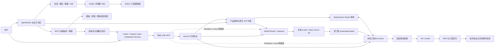

# OpenMotion 产品架构

本文描述仓库根目录的独立 Motion 运行时；它与 OD 主应用的会话、账号和部署整合尚未包含在本次源码迁移中。参见[迁移边界](../repository-migration.md)。

更新：2026-11-09（AI editing 定位、Motion Design Skill 包与对比证据；产品版本 V0.1.0）。实现基线：0.1.0；状态：下文标记为“当前”的能力已在仓库实现。公开范围为本机创作、编辑、MCP 和独立安装分发。应用、插件与本地 npm 安装器共用该版本；第三方引擎和原生工具保留各自锁定版本，版本重设不改变已实现能力或表示已经发布。

## 产品定位与目标

**对外产品形态是 All-in-One AI-native Studio for AI editing & Motion。** 核心体验为 AI 原生 CapCut：人和 Agent 围绕可编辑时间轴完成叙事、剪辑与动效。长期产品范围延伸到发现、素材协作、发布运营、任务自动化、数据回收和知识复用；**Super Motion Video Agent** 是贯穿该生命周期的编排概念。当前实现与未来方向的完整映射见 [Studio 产品蓝图](studio-vision.md)。本页继续记录实际运行时，发布管理、常驻任务、RAG 和自动 Skill 学习尚未上线。

OpenMotion 的底层组织是通用 Agent 会话：会话拥有模式、需求与多个 Artifact，模式选择模板目录和 skill，Artifact Viewer 负责打开可编辑产物。完整与嵌入视图使用同一产物；`embed=1` 可只显示 Viewer，供 Codex 等宿主打开。当前一期只有 Motion 模式，制作与导出仍使用原生 Hyperframes。其他模式是已确认方向，未作为可执行模式上线。通用会话组织保留既有技术决策，对外名称统一为 OpenMotion；历史取舍见 [变更记录](changes.md)。

会话的 Agent 推理与工具编排由用户已有的 MCP 客户端执行；本地网页保存需求、接收调用方写回的真实回复、管理产物与继续编辑，不包含内置聊天 Agent 运行器。自有 Agent、Codex 和其他 MCP 客户端共用先创建会话、后生成产物的生命周期。

Model Gateway 是共用的素材生成服务，可由 Motion Viewer 或 MCP 调用本地 Codex 与云供应商；它不接管会话编排。创作模式、媒体模态与供应商模型分别定义产物、素材类型和执行能力，详见[会话架构的分层说明](../session-architecture.md#会话编排与媒体生成的分层)。

已确认的体验原则：

- Agent 与用户操作同一份工程，修改能在工作室继续编辑。
- 全部页面共享左侧会话列表，一个会话可拥有多个工程。左侧会话和右侧浏览器顶格并列，工程工具与编辑器完整从属于浏览器 Tab；两侧可独立收起、恢复。移除全局顶栏，设置收纳在侧栏；列表可从会话顶部完全折叠，隐藏会话时由浏览器顶部恢复。
- MCP 接入、模板发现、预览和复制指令在一个弹框里完成，保留编辑器上下文。
- 模板先展示真实成片效果；作者、出处、内容种类和有来源的热度帮助选择。
- 交给 Agent 的复刻指令保持简短；详细配置、模板 ID 和流程由参数化指引链接承载。
- 导出成功需要真实产物与验证证据；技术检查与画面、声音、播放器检查分别记录。

## 对外主张与 Motion MD 方向

产品对外名称统一为 **OpenMotion**（O 和 M 大写），README 使用 OpenMotion 字标，上游 OpenDesign 标志仅作为已署名素材保留；现有 `open-motion` 仓库路径、`motion` 插件标识与环境变量保留兼容。对外叙事以 **AI 剪辑 / AI editing** 为中心，主张 **Edit with AI. Everyone can be a creator.** 总体定位为 **All-in-One AI-native Studio**，核心体验为以可编辑时间轴为中心的 **AI 原生 CapCut**，并保留 Motion 创作参照：**AI-native、开源 CapCut 替代**承载日常剪辑与改稿，**The open-source Claude Motion alternative** 承载 Motion 创作、动态图形与可复用模板；参照名称按用户确认写为 **Claude Motion**。使命是“人人都是 AI 剪辑师，人人都是自媒体”：让个人创作者、讲师与小团队通过表达剪辑意图、预览和反复改稿，把已有素材变成自己的内容。这里明确的是服务方向，不构成用户研究、流量保证、功能完全对等或源码相似度结论。

AI 剪辑的当前路径是：用户提供素材、脚本或确认的时间码，外部 Agent 根据选段、删改、排序、字幕、声画与节奏要求修改真实工程，用户在 Studio 预览并继续调整；自动语音理解仍取决于宿主工具与输入材料。对外介绍以 OpenMotion 本身与创作者的完整工作流为主，Hyperframes 作为技术来源在文末致谢，具体依赖继续在技术专题中准确记录。独立应用是首要产品身份，外部 Agent 通过 Skills、MCP 和固定版本 CLI 操作同一份本地工程；应用可连接多种客户端，当前不内置聊天 Agent 运行器。核心原则是人和 Agent 共用作品、经验沉淀为规范和模板、源文件可检查与可延续。仓库已采用 [Apache-2.0](../../LICENSE)，保留上游组件与字体声明；这取代此前“统一许可证待确认”的过时状态，依据见 2026-11-06 的公开记录。

公开介绍以 **Input → Process → Output** 组织：本地视频/录音/图片、在线参考、文本和 SRT/VTT → Agent 按脚本或已确认时间码剪辑、设计动效、通过 Studio 采用声音与媒体 → 固定版本 MP4 与可编辑工程。在线获取和语音分析依赖宿主能力或用户提供的素材/字幕；原生文本存储不等于字幕自动导入器。通过修改工程画幅可制作竖屏、横屏、方形版本；当前没有各社交平台的专用导出预设或直接发布，公开导出容器仍为 MP4。

[媒体事实包](../media-kit.md) 是面向报道、演示与内容 Agent 的可引用入口，区分可验证能力、产品方向和待验证主张。现有资料不能证明“99% 还原”或“覆盖 Claude Motion 几乎全部核心模板”；资源数量与来源仍以目录快照及逐条出处为准。

[Motion Design MD（简称 Motion MD）](../motion-md.md) 是 **v0.1 格式提案**，约定文件名 `MOTION_DESIGN.md`，保留现有 `MOTION.md` 示例；它描述来源、品牌、叙事、节奏、运动、素材、可修改项与验收信息。当前仅供用户显式交给 Agent 作为创作上下文；没有自动发现、解析、校验或注册接口。它不改变 HTML/CSS/JS 原生工程，也不替换现有 motion-video-to-template 的单份 `TEMPLATE.md` 交付约定。

### Motion Design Skill 包：从参考到可复用资产

Motion Design 的资源单位进一步明确为“创作规则 + Agent 方法 + 可编辑实现 + 替换输入 + 对比证据”。`MOTION_DESIGN.md` 记录保持项和运动意图，`SKILL.md` 记录使用方法，源码执行动画，preset 记录本次内容；真实 reference/remix 对照记录结果。参考片缺少源码时仍先走 `motion-recreate`；已有源码复用走模板路径；用户明确需要可复用模板时继续使用 `motion-video-to-template` 和其 `TEMPLATE.md` 交付，不新增核心路由。

[`motion-design-remix`](../../library/skills/motion-design-remix/SKILL.md) 是可选 Library Skill，包含六个已经收录为 registry 资源的上游动效源码 profile、各自的 Motion MD、可执行内容替换脚本与实际并排渲染示例。它固定上游源码版本、校验替换次数、拒绝覆盖已有输出，不解释 Markdown、不自动分析视频、不接入模板注册表；对托管工程的修改仍遵守现有 revision 契约。六个 profile 不改变三个内置模板和五个核心制作 Skill 的数量。

[`presenter-story`](../../library/skills/presenter-story/SKILL.md) 补充知识口播、工作流演示和产品讲解三份 Motion MD 设计配方，采用“真人语音主线 + 源片段到输出时间的映射 + 字幕 / 画中画 / 动效叠层”的构造。它没有人物素材或可执行模板，展示的三组真人前后对比为目录已有的上游演示，不是新 Skill 的验证结果。另展示九条现有真人参考与 Presenter Tech 模板演示；目录与 Studio 原生模板计数不变。

[实例说明](../motion-design-examples.zh-CN.md) 区分已有源码的改编与任意原片的重建；帧采样渲染证据不替代 Studio 导出、声音、目标机器或用户视觉验收。包内保留源码许可和字体声明，记录 CDN / 字体网络依赖，不声称完全离线或任意跨引擎可执行。借鉴 [MotionGit](https://motiongit.com/spec) 的内容、运行时、分发分层，并不构成 `.motion` 格式兼容。社区可以通过普通文件与 Git 分享、Fork、改进和评审；自动 marketplace 入库、数据回流学习与 RAG 仍为方向。

[Motion 资源索引](../collections/README.zh-CN.md) 已可使用，区分可观看参考与可编辑模板；OpenDesign 官网展示案例，公开的品牌／榜单专题集合站仍在规划。Motion Benchmark／Arena 为待讨论规划，无已发布榜单、排名或确定日期。

### Presenter Tech 本地模板包

[`library/templates/presenter-tech/`](../../library/templates/presenter-tech/README.md) 收入可再分发的固定版本源码包，提供本地 `.motion` ZIP、参数 / 运行器 / 字体 / 声音配方、Motion MD、制作指南与来源记录。公开展示名为 Presenter Tech，原始 Kinetic Tech 身份、MIT 版权与第三方条款保留在包内及 NOTICE；不主张上游模板为 OpenMotion 原创。

此条目使用包内 `adapter.py` 的 plan → prepare → preview → render 路线，依赖安装和输出均在 checkout 外的独立目录。它不是直接写入 Hyperframes 原生时间轴的模板，也没有新增 Studio `.motion` 解析、MCP Tool 或核心 Skill。Library 多一个本地模板包，Studio 原生模板仍为三个、目录计数仍为 894。源码完整性、本地 runner 验证与用户真人成片验收分开记录，见 [verification.json](../../library/templates/presenter-tech/verification.json)。

### 创作资源与贡献架构

[`library/`](../../library/README.zh-CN.md) 是源码中的统一创作资源入口，按 Skills、模板、Motion 组件、动效设计体系和 Brandkits 五类组织。当前包含可选 Brandkit 整理 Skill、六种 profile 的 Motion Design Remix Skill、三份真人叙事配方的 Presenter Story Skill、三个现有模板的索引、标题揭示配方、Ink & Water `MOTION_DESIGN.md` 与 OpenMotion `BRANDKIT.md`。模板源码继续单份维护于 `template-library/`，索引不增加内置模板数量。

资源库由人或 Agent 明确选择文件使用；尚无自动导入、自动注册、远端 marketplace 或新增 MCP API。核心制作 Skills、workflow registry 和九 Tool 契约保持不变。Library 内的 Brandkit、Presenter Story 与 Motion Design Remix Skill 可分别选择使用，服务品牌整理、真人叙事设计或具体源码改编，不增加核心制作路线。

Brandkit 维护身份、事实与资产；`MOTION_DESIGN.md` 维护视觉、节奏与声音意图；组件描述局部可复用行为；模板包含实现；Skill 描述方法。贡献按[条目清单](../../library/ENTRY_TEMPLATE.md)记录来源、许可、编辑项、状态与实际验证，新增分发文件仍逐项进入正向清单。参考片、配方和经过验证的可编辑作品分开标注。

README 参考 OpenDesign 的产品导览和 HTML Anything 的贡献、来源表格与文字架构图。对外视觉采用统一蓝绿水墨肌理、奶油白留白与深色字体，详见 [Brandkit](../../library/brandkits/openmotion/BRANDKIT.md)；真实产品截图和参考作品保留原貌。该美术方向不改应用 UI tokens、工程格式、模型行为或价格。

### AI 原生时间轴：当前能力与产品方向

核心产品是围绕时间轴持续改稿的 AI 剪辑应用。素材、叙事、图片替换、动效、声音与导出都归属同一份可编辑工程；Agent 执行剪辑意图，Studio 保留人工调整入口，导出使用固定版本。参考 [OpenChatCut](https://github.com/0xsline/OpenChatCut) 的连续编辑理念组织公开说明，本次未引入其代码或移植其能力。

| 产品主线 | 当前已实现路径 | 已确认方向，尚未实现为通用能力 |
| --- | --- | --- |
| 智能剪辑与组织 | 导入、排列素材，Agent 根据脚本/时间码落实选段删改与节奏要求，用户在时间轴调整 | 自动理解并选择内容、去除无关段落、按发布目标自动适配画幅 |
| 素材生成与搜索 | 配置 Model Gateway 后生成图片、视频、音乐和语音；参考图编辑、候选入库与显式替换保留时长和动画 | 跨媒体、配音、音乐与 Avatar 服务的资源搜索和统一选用 |
| 多平台输入与输出 | 支持的本地媒体、宿主获取的参考与文本输入；改编构图，固定版本导出 MP4 并保留源工程 | 更广的平台解析/导入、自动格式适配与平台导出预设 |

图片编辑的现有实现仅承诺支持参考图的模型路径，不将图片替换泛化为任意视频、音频或人物替换。模型配置与真实生成效果分别验证；搜索目录、Avatar、语音分析和发布平台能力以后按独立需求落地。

### 人与 Agent 协作创作空间 — is coming

已确认方向是在同一视频项目中支持人和 Agent 共同进行 AI 剪辑与 Motion 创作，并把评论、讨论、协作和评审关联到时间轴的具体时刻或范围，形成“反馈 → 修改 → 评审 → 继续迭代”的空间。README 的水墨协作图为生成式概念预览，标识 **is coming**，不是当前界面截图。

当前人和 Agent 可以先后修改同一份本地工程，沿用 revision 保护；时间轴评论、协作评审与多人同步编辑尚未实现。评论归属、修订关联、并发合并和协作状态的具体技术契约仍待设计，不能从概念图推导为已交付能力，也未承诺发布日期。

### 两个 Agent 接入方向

[README 产品演示](../../README.md#product-tour) 将这两种接入方向展示为 Codex 嵌入编辑器、独立 Studio、Claude Code / CLI 三种使用入口，并串起 Connect Agent 与单模板精确指令；它们共用现有工程与工具契约，未新增运行模式。截图及复现范围见[产品演示说明](../product-tour.md)。

- **从应用连接 Agent：** 用户先在 OpenMotion 打开工程，再通过 Connect Agent 为当前工作区配置 Codex、Claude Code 等客户端，将工程上下文和要求交给客户端执行，回到 Studio 审阅并继续改稿。
- **从 Agent 使用 OpenMotion：** 用户先在已有客户端安装 Skills、连接 MCP，按需使用 CLI；由 Agent 创建或读取工程、剪辑、预览与导出，随时打开同一 Studio。

这两种入口共用工程与服务契约，不创建两套项目状态，也不表示 Studio 已内置聊天 Agent。需要人工与 Agent 协作时，必须指向同一工作区和明确工程；写入前读取当前 revision，沿用冲突保护。宿主接入与能力边界见 [适配器说明](../agent-adapters.md)。

## 目标场景与交付

| 场景 | 用户输入 | 期望交付 | 当前支持方式 |
| --- | --- | --- | --- |
| AI 口播剪辑与素材重组 | 录制素材、脚本/时间码与剪辑目标 | 精简、重排、配合字幕和声画的可编辑短片 | 外部 Agent 依据输入修改工程，Studio 预览与时间轴细调；媒体理解依赖宿主能力 |
| 产品演示与发布 | 产品事实、页面/素材、参考视频 | 可编辑的宣传或功能演示视频 | Agent 写原生工程，Studio 调整，后台导出 |
| 模板复刻 | 选定参考、模板 ID、主题替换要求 | 复用结构与风格的可编辑工程 | 模板清单、短指令、画廊/指引和 `motion_create_project` |
| 动态图形与信息表达 | 数据、文字、品牌元素 | 图表、流程、字幕和动画片段 | 原生 HTML compositions、GSAP 与素材 |
| 后续修改 | 已有工程、具体修改要求 | 保留工程上下文的局部更新 | 共享 edit 流程、当前源文件与 revision、保持项及后续延续检查 |

外部参考的复刻由 Agent 分析视频或源码后制作，目录条目本身不是已经生成的可编辑工程。三个内置原生模板可直接创建工程副本。具体目录规模、封面覆盖与热度数据由 [模板专题](../template-catalog.md) 维护，架构文档不复制易变化的数量。

## 核心用户流程

1. 用户在首页切到 Motion 模式，选择 Motion 模板并提交需求创建会话；也可直接新建空白创作，或打开左侧已有会话。内置模板复制为该会话的工程，外部参考由 Agent 制作。
2. 需要 Agent 时选择 Codex、Claude Code、DeepSeek Harness 或通用 stdio 客户端。接入配置绑定当前工作区；Agent 验证工具和数据目录，读取当前工程与制作规范。 安装后先介绍能力、邀请并等待选择；接受首次体验即确认 `product-promo` 示例内容、独立 20 秒工程、MP4 导出及右侧可编辑页面。Agent 不再问素材/模板/导出确认，实际打开宿主面板，等待并验证成片，最终回复交付 MP4 与简短说明。宿主没有面板能力时明确提供链接作为降级，不能冒称已打开；实际行为按客户端验证。
3. 用户在会话补充需求并复制给外部 Agent。一期 Agent 用 `motion_get_project` 读取明确工程及其 sessionId、需求、来源与版本，按本轮意图选择入口或直接继续已选范围；编辑前校验工程归属，仅需编辑器时用 `motion_open_preview({projectId})` 打开。旧 design_* handler 仅留内部兼容。
4. Agent 根据本轮目标直接选择 Skill：motion-director 负责原创、局部/整体叙事动作声音重新设计和创作审片；motion-template-to-video 负责已有模板出片；motion-recreate 负责参考作品重建（已接入实际流程、独立参考与测量脚本）；motion-video-to-template 负责可复用模板生产；motion-production 承接既定决定下的工程操作、预览、技术检查、排错和导出。共享规则同源引用，已有 production/start 保留导航，无需前置总路由。项目来源与画面锁定不固定入口；保持项和已完成操作继续有效。
5. Agent 导入素材或通过 Model Gateway 生成图片/视频/音频，完成后写入原生工程。用户在右侧浏览器 Tab 的 Motion Artifact Viewer 预览与编辑，可从空时间轴、素材面板或时间轴选区生成并放入指定时段；选中图片可交给 Codex 参考修改，确认后只替换素材引用并保留原生撤销。也可新增同会话的另一个工程，关闭浏览器继续会话、收起会话沉浸浏览。发生 revision 冲突时重新读取并合并。 按共享 context 补齐缺少的正文并先返回模型再执行；修改按共享 edit 核对保持项、相邻关系与后续延续。
6. 完成画面、文案、声音检查后，按用户要求导出固定 revision 的快照，等待真实产物并验证。

后续需求应注明改变了哪一步、影响哪些角色，以及用户能观察到的完成条件。

## 职责分层与依赖方向

产品由“创作决策、素材执行、原生编辑、成片交付”串成完整流程。Agent 和人都可以提出修改，但媒体模型、编辑器与渲染器各自只承担本层工作。新增能力应先明确落在哪一层，再确定入口；不能因增加一个按钮就建立另一套工程或任务状态。

| 层次 | 当前负责的决定 / 工作 | 对下一层的交付 | 设计边界 |
| --- | --- | --- | --- |
| 创作与意图 | 用户或外部 Agent 明确目标、参考、分镜、文案及是否采用结果 | 可执行的素材描述、模型选择或工程修改 | Gateway 不负责判断影片主题与分镜是否正确；创作宿主的聊天模型与媒体模型分别配置 |
| 产品交互与接入 | Studio 捕获选区、属性和工程；MCP 暴露同一业务能力；skill 提供制作与验收顺序 | 带工程/上下文的生成请求，或带 revision 的源文件操作 | UI 可提供参数预设，凭据与远端媒体请求集中在 Gateway；MCP 和界面不是两套产品后端 |
| 能力与素材执行 | Router 选模型，Gateway 检查状态、排队、调用适配器并入库 | 发起工程内可用的图片、视频或音频文件 | 一次素材任务不自动修改合成，不代替完整影片编排；目录、可请求与真实成功分别表达 |
| 原生工程与编辑 | Hyperframes 管理片段、时段、布局、动画、声音、预览、保存和历史 | 可以继续编辑的原生工程 | 素材采用通过现有写入链；不新增平行时间轴或将生成界面状态当作工程真源 |
| 渲染与交付 | 固定 revision 快照、后台渲染、技术检查与视听/播放器验收 | 对应该快照的真实 MP4 和证据 | 模型产物、编辑成功和最终影片完成是三个不同完成条件 |

能力发现回答“有哪些可以尝试的执行方式”，素材执行回答“这次拿到了什么文件”，编辑回答“文件怎样用于作品”，验收回答“交付物是否符合任务”。这些边界使用户既能单独通过 MCP 生图/生视频，也能把多个素材组合成完整 motion 视频，而无需为每一种使用方式重新实现供应商调用。

### 应保持的架构约束

1. **两类入口共用领域能力。** Studio 与 MCP 使用同一 Gateway 合约和持久化数据。macOS 的 stdio 适配器按数据目录连接唯一后台，共用网关、任务与工程能力；每条连接绑定自己的工程。Windows / Linux 保留原生命周期。唯一后台依赖系统文件锁与私有身份验证，不以固定端口或 PID 文件作为唯一依据，见 [共享编辑器](../shared-editor.md)。
2. **作品与执行配置分开。** 原生工程包含作品源文件与媒体；供应商凭据、模型默认路由和生成任务属于工作区。项目包可以交给别人继续编辑，使用者无需继承原作者的 Key。
3. **素材成功不自动成为编辑成功。** 生成任务产生候选文件，采用结果才触发原生放置/替换。撤销作品修改不删除候选文件，也不撤销已经发生的供应商调用或费用。
4. **上下文不能随等待漂移。** 提交时固定生成工程和参考输入，采用时验证编辑目标；切换工程、合成、删除或改换原素材引用后，旧回调不得覆盖新目标。
5. **成本选择显式可见。** 明确模型优先于默认路由；已配置路由不可用时报错，不隐式换成另一个付费来源。不用“已连接”替代账户权限、额度或本次成功证据。
6. **原生保存链是编辑边界。** Studio 修改保留文件队列、写入前校验与历史；Agent 文件工具遵守 revision。两者仍可能并发冲突，当前没有跨进程、多文件、供应商请求共同参与的事务。
7. **验证证据有范围。** 安装检测、协议测试、单机实际调用、工程检查、成片解码、视觉和播放器检查分别记录；任何一项成功都不能代替其余项，更不能证明用户留存或付费意愿。

多模态模块的对象、交互、关键取舍、故障语义和扩展准入条件详见 [素材生成设计与架构决策](media-generation-design.md)。这份设计文档解释理由，[模型网关](../model-gateway.md) 维护当前接口与运行限制，验收应按当前提交独立执行。

## 能力与模块

一期公开 MCP 已按[9 Tool 契约](../mcp-phase1-tools.md) 实现本地适配与构建过滤，默认 phase1。发布清单同时控制发现/调用、HTTP 接入元数据及各分发包，原28项内部兼容实现和 Studio 服务保留。phase1.ts 负责明确项目、请求去重、批量素材/保存、具名任务与审阅；phase1-versions.ts 复用原生 history、补稳定 vN 和原生未留存媒体及保存恢复日志。恢复历史创建新版本并保留后续历史，区别于内容哈希和单文件保存。导出继续委托原渲染器并自动完整技术验证；取消区分受理和进程退出。5个随包 Skill 与 MCP resources 指引同步新契约。此为本地实现，未据此宣布部署/平台/宿主业务验收。

| 能力 | 负责模块 | 当前边界 |
| --- | --- | --- |
| 首页与项目会话 | `MotionApp.tsx`、`WorkspaceFrame.tsx`、`MotionHome.tsx`、`useWorkspace.ts`（位于 `studio/src/motion/`） | 根地址显示首页，左侧会话共享工程目录；切换前保存、切换后整页重建；详见 [项目专题](../project-workspace.md) |
| 项目创作会话 | `MotionSessionFrame.tsx`、`ProjectConversation.tsx`、`shared/session.ts` | 独立会话身份、模式、需求与多个产物；`artifactBrowser.ts` 管理 Tabs / 面板恢复；会话 Agent 执行由外部客户端负责 |
| 会话内网页浏览 | `browser.ts`、`WebBrowser.tsx`、`shared/browser.ts` | 独立 Chromium，支持真实网址、输入、历史与刷新；按会话隔离，详见 [浏览器运行架构](../browser-runtime.md) |
| 编辑器与工作区交互 | `studio/src/`，尤其 `studio/src/motion/` | 完整 Hyperframes 0.9.7 Studio 前端源码；宿主通过插槽适配品牌和入口，预览使用独立 iframe |
| 面板与布局恢复 | `studio/src/components/dock/`、`MotionLayoutControls.tsx` | 原生 Dock 持久化；常驻预览入口、面板开关及布局预设 |
| 撤销、版本保留与恢复 | `MotionHistoryPanel.tsx`、原生历史 API | 顶栏/时间轴撤销重做；新增历史 UI 复用原生存储，恢复保留后续记录 |
| 编辑器语言 | `studio/src/i18n/` | 简体中文/英文，不重挂载编辑器；统一接入弹框内部仍以中文为主 |
| 多 Agent 薄适配器 | `scripts/export-adapters.ts`、`shared/integration.ts` | Codex、Claude、DSH、WorkBuddy Connector 共用外置运行时；本机生成，WorkBuddy 桌面待验收，详见 [适配器](../agent-adapters.md) |
| MCP 接入与指引 | `mcp.ts`、`mcp-tools.ts`、`shared/integration.ts`、`web/connect.*` | 本机 stdio；macOS 业务由共享后台执行，ChatGPT 云端远程 MCP 尚未提供 |
| Codex 安装 | `install.sh`、`scripts/install-motion.command` | 远端源码下载、依赖安装与编辑器构建、本地插件注册和 MCP 握手；需预装 Git、Node/npm 与支持插件的 Codex CLI，保留安装目录，遇到已有目录停止；远端一行入口待发布到 main |
| 模板发现与复刻入口 | `template-catalog.ts`、`shared/catalog.ts`、`web/template-gallery.*` | 完整目录与视觉画廊分开筛选，精确 ID 保留 |
| 空白工程与模板副本 | `workspace.ts`、`template-library.ts`、`template-library/` | 新建空白原生工程或创建模板独立副本，保留之前工程 |
| 封面、来源与热度 | `web/catalog/`、`scripts/*template*.ts` | 本地资源/快照；热度不代表实时查询 |
| 工程状态与素材 | `workspace.ts` | 本地目录、内容 revision、当前工程选择与插件写入锁 |
| 模型路由与素材生成 | `gateway/`、`shared/gateway.ts`、`studio/src/motion/Media*` | 本地 Codex 生图、Atlas/fal 适配器、BYOK、目录与持久化任务；Studio 和 MCP 共用 |
| 产品服务与代理 | `server.ts`、`editor-server.ts` | 通用会话 API `/design-api/`、兼容 `/motion-api/`，原生 API `/api/` |
| 引擎与生命周期 | `hyperframes.ts`、`preview.ts`、`editor-runtime.ts`、`shared/owned-studio.mjs` | 锁定 Hyperframes；macOS 共享后台与 Studio 守卫，校验身份/版本/目录并管理崩溃清理 |
| 导出与质量验证 | `server.ts`、`scripts/verify-export.ts`、制作 skills | 独立快照、后台渲染、技术验证；视觉审阅另行完成 |
| Skill 路由与文档读取 | `skills/`、`shared/workflow.ts`、`mcp.ts` | production 通用工程入口 + 可直达 director + motion-template-to-video + motion-recreate 实际流程 + motion-video-to-template（五个入口均分发）；26 份唯一文档含共享 edit（27 个 workflow/section 地址，portable 共享），具有 canonical ID/哈希/引用映射，按需读取，不自动执行或强制编排；见 [调用契约](../skills.md) |
| 动态叙事指导 | `skills/motion-director/` | v1.4.5 明确原创与局部创作、声音重新设计和创作审片职责；沿用原创路线与七份 v1.4 质量参考，模板/复刻按需复用；效果边界见 [说明](../motion-director.md) |

源码位置的详细映射见 [编辑器开发指南](../editor-fork.md)，引擎适配见 [Hyperframes 集成](../hyperframes.md)。

## 数据与边界

| 数据范围 | 当前内容 | 可移交 / 恢复语义 |
| --- | --- | --- |
| 原生工程 | HTML/CSS/JS、媒体、字体、Studio manifest | 是继续编辑与渲染的输入；按工程打包，不依赖生成供应商的临时输出 URL |
| 会话与网页浏览 | 会话/产物索引、消息与本地 Tabs 偏好；网页 Chromium Context | 会话数据持久化；浏览历史/登录态临时，关闭 Tab 不删除产物 |
| 工作区执行配置 | Provider Key、启停、默认模型、目录、生成任务 | Studio/MCP 共用；凭据不随作品导出。任务保留输入与原始输出路径，尚无跨工程全局素材注册表 |
| 本地临时执行 | Codex 工作目录、参考图副本、下载暂存 | 服务完成/失败/取消后清理；中断运行任务不自动再次请求供应商 |
| 编辑会话 | 当前选区、目标元素、待放置时段、生成面板状态 | 辅助当前操作；与作品文件、持久化任务区分。当前没有完整生成表单的跨会话恢复 |
| 导出快照与验证 | 固定 revision、预期规格、真实 MP4、校验报告 | 证明该次导出的结果；后续编辑不能沿用旧文件的验证结论 |

- **工程真源：** HTML、CSS、JS、媒体和 Studio manifest 位于各自工程目录。新会话 ID、产物 ID 和工程 ID 分离；`projects.json` 原子保存两个索引、产物归属和当前选择。旧工程按原 ID 兼容为会话，需求继续在 `sessions/<sessionId>.json`，通过会话 HTTP 接口及一期 `motion_get_project` 暴露（旧 design_get_session 为内部兼容），独立于视频内容 revision。Agent 每次写入前读取当前工程与 revision。单服务只打开一个原生工程，旧项目请求由代理拒绝，避免跨标签页误写。
- **历史真源：** Studio 原生历史服务记录版本、checkpoint、pin 与 restore，宿主只呈现 UI，不另建版本库。恢复前等待保存并创建 checkpoint，完成后重新加载编辑会话；后续历史保留，恢复操作可以撤销。
- **界面状态：** 浏览器 Tabs、左右面板与宽度按会话保存；关闭 Tab 不删除产物。原生 Dock 按工程保存，主题沿用 Studio 偏好；语言单独保存为 `motion.studio.locale`，均不写入影片源文件。
- **参考数据：** 模板原始目录、封面和热度快照与用户工程分开。热度按模板 ID、视频地址和原帖身份匹配；同源片段不累加查看量。
- **导出输入：** 后台任务使用不可变快照并记录期望规格；后续编辑不改变该任务的本地输入。远程媒体需要稳定复现时先导入本地。
- **后台与编辑器启动：** 仅导出启动后台服务，不初始化或补写当前工程；冷启动套模板直接创建选中的模板工程。显式打开预览时才初始化空工程或启动 Studio，已有后台服务原地升级。健康检查区分服务 `ready` 与 `editorReady`，不靠自动替换 expectedRevision 消除冲突。
- **服务边界：** 当前在本机回环地址运行。Model Gateway 使用本机 Codex 登录或用户自有 Atlas/fal Key 发起媒体生成，接口共用本地任务与素材入库；不托管聊天 Agent、团队协作或计费。当前使用用户自有账户接入，详见 [模型网关](../model-gateway.md)。
- **模型与凭据：** 配置和任务独立于工程，Key 不通过 API 返回。安装、配置、允许请求、生成成功是不同状态；任务固定发起工程，失败不静默重试。完成后的素材参与工程 revision 与导出快照。
- **并发边界：** macOS 同目录多个 MCP 连接共用后台，各自绑定工程；工作区仍只有一个活动原生 Studio、一个等待/运行的导出。导出固定工程与快照，重启将中断任务持久化为失败且不重放。文件锁和 revision 保护工具写入；人工与 Agent 同时编辑同一文件仍需协调，不能当作跨工具数据库事务。
- **数据归属：** 产品文档描述数据类别与流程，不复制用户的私有工程、访问凭据或个人机器配置。

## 成功标准与验证

当前交付标准：连接可验证、模板可定位、工程可继续编辑、预览与源文件一致、导出存在真实文件、检查结果有证据。相关实现由 `tests/`、`npm run test:studio` 的原生单元/DOM 与宿主回归、类型检查、设计检查和按需浏览器验证覆盖；没有执行的检查不能记为通过。

以下是待建立的产品衡量口径，尚无仓库内用户分析系统或统计基线：

| 指标 | 建议定义 | 用途 |
| --- | --- | --- |
| 激活 | 首次接入后创建或打开工程，并完成一次可见修改及预览 | 连接是否转化为可体验的价值 |
| 首支可用作品时间 | 从明确需求到用户确认可用作品的用时 | 判断制作摩擦与返工成本 |
| 复刻完成率 | 选定参考的任务中，交付可编辑工程并通过约定检查的比例 | 判断模板链路价值，复制按钮点击不算完成 |
| 复用 | 在约定观察窗口内完成第二个工程或实质性修改 | 判断需求是否持续 |
| 交付可靠性 | 导出成功率、返工次数与失败原因 | 决定可靠性投入优先级 |

开始采集前需记录事件定义、观察窗口、样本来源和隐私边界。人物、商业和指标实验的证据写回对应文档，不能用开源仓库热度或模板原帖播放量替代。

## npm 本地安装渠道

当前分支增加独立于插件的 npm 轻量安装入口（本地 / Actions 测试制品，不发布 npm）：按宿主安装 Codex、Claude Code、DeepSeek Harness、WorkBuddy 的 一期 9 Tool MCP 与 production/director/template/recreate/video-to-template 五个 Skills，共用应用、工程目录和依赖缓存；固定原生依赖首次使用时下载到用户缓存。应用不从临时 npx 缓存运行，作品与应用/依赖目录分开；已有插件和完整测试包保留。下载来源、版本和校验值共用运行时清单；Mac FFmpeg/ffprobe 使用独立的公开 9.0.2 ZIP 并自动安装，原生依赖无需公司仓库凭据，尚未发布 npm。实现与验证边界见 [npm 安装](../npm-installation.md)。

## 演进约束

本地测试包按 mac-arm64 / win-x64 准备固定公开原生依赖。npm 为默认轻量格式，完整 ZIP 为备用；平台安装和真实出片必须独立验收。工程保留在包外，当前 CI 只构建与校验，不上传或发布。见 [测试包说明](../test-packages.md)。

已确认方向是继续支持多 Agent 接入、可编辑工程与一个工作区内的发现/制作闭环。

每次变更整体审视本文，判断产品定位、核心流程、模块职责、依赖、数据与接口边界、当前能力和限制是否仍准确一致。确有变化时按需修订相关章节，保持全文一致并保留必要的决策理由；架构仍准确时无需修改文档或新增变更记录。

通用会话 API、模式工厂、Viewer 注册与嵌入参数的技术细节见 [会话技术架构](../session-architecture.md)。

## 视频转模板与模板出片扩展边界

本分支的两条 Skill 是按需使用的扩展，不覆盖上述团队通用流程、模板目录或编辑器。工程直接交付、直接读取；旧自定义本机入库接口退出默认服务。可选比较工具仅输出诊断证据，视觉由用户验收。插件名、安装、数据目录和端口沿用团队底座，详见 [扩展范围](../motion-extension-scope.md)。
