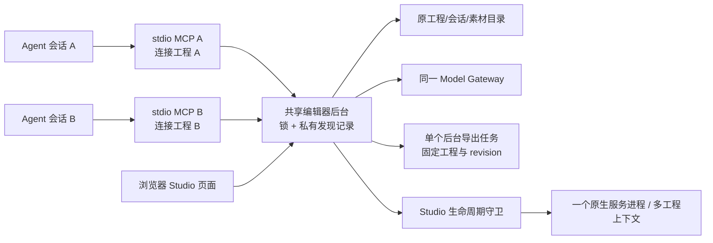
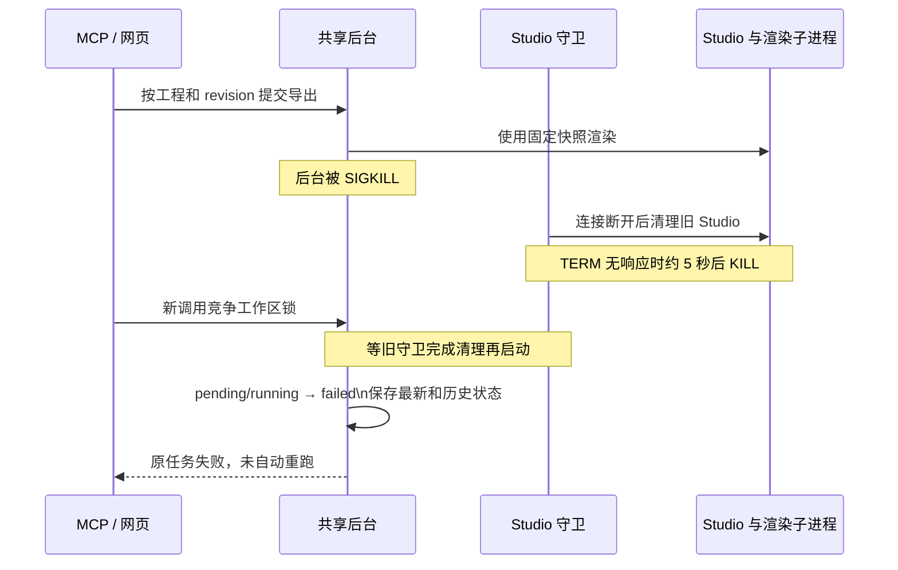

# 多个 Agent 共用本地编辑器

**当前分支在 macOS 上让同一数据目录中的所有 MCP 连接共用一个后台。** 每个 Agent 仍有自己的轻量 stdio 进程，工程目录、任务队列、Model Gateway 和网页服务由共享后台管理。原生 Studio 按需启动，一个服务进程与端口可以保留多个工程的原生上下文。每个页面固定自己的工程；后台仍同时运行一个视频导出。

与当前主干合并后，28 个 MCP 工具全部保留（原有 27 个加视频对比）；Skill 的 workflow/section 路由与文档身份沿用主干。仅导出和冷启动套模板使用后台服务入口，不先打开 Studio 或改写调用方的源文件；随后显式打开预览才按需启动编辑器。

这里的“一个”以规范化后的 `MOTION_DATA_DIR` 为单位。不同目录表示独立工作区，会启动不同后台。Windows / Linux 沿用原入口和生命周期，本次不声称这两个平台已经支持共享后台。

## 为什么需要它

宿主通常为每个会话或 Agent 单独启动 stdio MCP。原来每个适配器都能启动编辑器，插件缓存目录也可能各不相同，因而会重复创建服务和运行状态。只按端口探测不能解决同时启动的竞争，PID 文件也不能证明进程仍属于这个工作区。

推荐并已集成的方案是：**保留标准 stdio 接入，把有状态的业务集中到每个工作区唯一的后台。** 系统文件锁负责唯一性；带身份验证的本机接口负责复用。无需常驻系统服务安装，也没有新增 npm 依赖。



## 启动、复用与退出

| 时机 | 当前行为 |
| --- | --- |
| MCP initialize、列工具、读制作流程或模板目录 | 不启动后台，不创建影片 |
| 第一次工程、会话、网关等业务调用 | 检查已有后台身份；没有可用后台时竞争同一系统锁，只有获胜者启动 |
| 多个连接同时启动 | 其余启动器退出，适配器等待并连接获胜后台 |
| 读取工程 | 保留工程不存在的状态，不隐式套用默认影片 |
| 显式打开预览 | 按需启动或复用原生 Studio；返回已有完整/嵌入链接契约 |
| 全部 MCP 会话退出 | 后台继续服务网页与导出；不会因某个 Agent 退出取消其他人的工作 |
| 用户停止后台 | 私有停止接口拒绝正在执行的 MCP、视频导出或素材任务；空闲时关闭子服务并退出 |
| Compatible plugin/backend version or build change | Existing phase-one connections continue through the same workspace authority when it advertises the same MCP API protocol and requested Tool; keep running exports and request IDs intact. |
| Incompatible authority/API protocol, missing Tool or legacy version/build mismatch | Refuse before dispatch with expected/actual identity. Never automatically kill or launch a competing backend. |
| A live MCP client's plugin directory was replaced or removed | Phase-one calls keep their stdio connection and reuse a compatible live backend. Internal legacy connections return `MCP_RUNTIME_RELOAD_REQUIRED`. A transport already closed by the host cannot be revived by the plugin. |
| 同目录已有旧版预览服务 | 拒绝另外启动共享后台；退出旧服务后重试 |

macOS 使用系统 `/usr/bin/perl` 取得 `flock` 后直接 exec Node；Perl 不常驻。锁描述符同时由后台和 Studio 守卫持有。后台死亡后，守卫先清理旧 Studio，再释放锁，新后台才能启动。锁文件保留不等于锁仍被占用；不通过删除锁文件来恢复。

Phase-one compatibility is independent of the editor's implementation build and release channel. Authenticated private health and public preview health advertise `mcp.protocol` and `mcp.tools`; forwarding retains service, workspace, instance and authority-protocol validation. Compatible updates reuse the current authority without restarting it or replaying mutations. If an idle authority is separately replaced, the next call discovers or starts the same workspace's compatible replacement using the existing stdio connection. This does not hot-reload the UI, refresh host Tool metadata or automatically install updates. See the [API compatibility contract](mcp-phase1-tools.md#phase-one-api-compatibility).

显式停止（必须指定同一个数据目录）：

```sh
MOTION_DATA_DIR=/path/to/workspace node --experimental-strip-types editor-runtime.ts --stop
```

## 数据目录与旧数据

| 情况 | 使用目录 |
| --- | --- |
| 显式设置 `MOTION_DATA_DIR` | 原样沿用，真实路径相同的符号链接别名共用后台 |
| macOS，新安装且包内无旧 `.motion-data` | `~/Library/Application Support/OpenDesign`，跨插件缓存副本稳定 |
| macOS，包内已有旧 `.motion-data` | 继续使用旧目录，不自动搬迁、合并或覆盖 |
| Windows / Linux | 原默认目录与旧启动行为 |

`projects.json`、`project/`、`projects/`、`sessions/`、`exports/` 与 Model Gateway 数据格式保留。新增 `.editor-runtime/` 保存私有发现记录、系统锁和诊断日志；目录权限 0700，发现记录 0600，只属于当前本机用户。已有目录分散在多个旧插件缓存中的用户，需显式选择同一 `MOTION_DATA_DIR` 才能合用后台，本次不自动迁移这些目录。

## 多个 Agent 怎样避免写错工程

每条 stdio 连接保存自己的工程/会话选择。首次读取使用当时工作区选择；读取、创建或打开产物后绑定返回的真实身份。其他 Agent 或网页切换全局工程，不改变已有连接绑定。

工程工具可显式传 `projectId`：打开预览、读工程、读文件、写文件、导入素材、检查工程、请求导出、查询导出、验证导出。批量或恢复任务推荐保存并传入返回的 `projectId`。空会话没有产物时，写文件、导入、检查、导出和读文件会拒绝，避免落到上一个会话的工程。创建/打开产物使用现有会话和产物 ID。

写入仍需要读取到的 `expectedRevision`。同工程同时修改只接受匹配版本，冲突返回工具错误及 `REVISION_CONFLICT`；Agent 必须重读，不自动重放写入。工程目录受现有路径校验保护，不接受目录穿越。

MCP 调用在共享后台内串行执行，HTTP 页面继续走原有保存与工程切换门禁。原生请求按路径中的 projectId 定位目录，状态与文件通知按工程绑定；打开另一个工程不会关闭原服务或导航其他页面。无工程路径的事件、渲染和媒体任务请求携带 projectId；多工程下缺少身份的请求拒绝处理，不猜测最近工程。这不是 UI 与 MCP 跨多文件的数据库事务，也不合并两位编辑者的文本。

冷启动的 `/#project/<id>` 书签由前端解析、校验归属后，按明确工程启动原生上下文；没有工程参数的页面请求不预先打开最近工程，避免给其他工程写入节点标识并改变 revision。原生工程打开请求最多等待 30 秒，直接启动与 macOS 守卫保持相同超时；超时释放调用队列，服务恢复后可重试，不自动重放修改。

## 导出与后台强杀后的恢复

导出创建时固定 `projectId`、revision、快照与预期规格；网页后来切换工程不会改变任务归属。工作区仍只有一个等待/运行中的导出，第二个任务会明确拒绝。新增 `jobs/<jobId>/job.json` 保留任务状态历史；`export.json` 继续作为兼容的最新任务记录。一期 `openmotion_get_project` 传 projectId 和 exportJobId 查询旧任务；完成文件的下载、校验也按稳定任务 ID 查找。



中断任务只有在新后台启动后才持久化为失败；后台尚未重启时，磁盘上可暂留旧 `running` 状态。重启会清除旧 worker PID 和任务凭据，不将半成品标为完成，不自动重新渲染或重新请求付费素材。用户可以基于最新工程明确发起一次新导出。

## 安全与支持边界

私有 `/editor-api/*` 仅监听 127.0.0.1，要求随机 bearer、正确本机 Host/端口并拒绝 Origin，阻止网页跨站调用。内部按工程转发也验证同一凭据。公开网页 API 保留同源修改校验。MCP 响应和诊断启动记录不包含 bearer。凭据只隔离普通网页及其他系统用户，不隔离同一用户下已能读取工作区文件的进程。

| 范围 | 本次状态 |
| --- | --- |
| macOS 标准 stdio 多连接、启动竞争、工程绑定、冲突、重连 | 有确定性回归 |
| 真实 Chrome 捕帧、FFmpeg 编码中后台 SIGKILL；Studio 无响应后强杀升级 | 有独立真实故障注入脚本，结果见验收记录 |
| 原宿主自然语言到可编辑工程、真实导出及校验 | 单独记录实际宿主、命令和成片证据 |
| Windows / Linux 共享后台 | 未实现，保留旧行为 |
| 所有宿主、系统重启、断电、守卫与后台同时被杀、启动中途强杀 | 未验证 |
| 原生网页浏览器 Chrome 在后台 SIGKILL 后的生命周期 | 本次故障对象为 Studio 和视频渲染 Chrome，未覆盖独立网页浏览器 |
| UI/MCP 同时多文件写入的完整事务、并行后台导出 | 未实现 |
| 长时间压力、自动升级、旧数据自动迁移、正式安装包目标机验收 | 未验证 |

运行本项目检查使用 `npm test`、`npm run check`、`npm run typecheck:studio`、`npm run test:studio`。真实 Chrome 检查包括故障脚本 `tests/shared-editor-crash.mjs` 和媒体脚本 `tests/shared-editor-media.mjs`。验收结论只覆盖实际执行命令，实际结果以当前提交的测试及 CI 为准。

## 多工程宿主的依赖与恢复边界

`shared/workspace-studio.ts` 在一个进程内按需复用锁定 Hyperframes 0.9.7 的原生宿主，保留每个工程自己的历史、预览缓存、媒体配置、文件监听和渲染任务上下文。当前完整宿主只由 CLI 打包模块导出；启动时检查版本、模块唯一性和工厂入口，不兼容时明确失败，不静默降级或重写工程。升级依赖需重新验证该入口及独立分发包。

已打开工程的上下文保留到服务退出；退出关闭所有监听、历史与子任务。不同页面编辑同一工程仍使用原生 If-Match 和工具 revision/version 冲突保护，不提供多人文本合并；工程 ID 也不代表同工程两个页面的独立选区身份。

验证入口：`tests/multi-project.test.ts` 覆盖同进程双工程、文件/预览/历史/通知和重启；`tests/multi-project-browser.mjs` 使用两个真实 MCP 客户端和浏览器页面。公开 MCP Tool、冷启动导出、原生媒体和守卫强杀仍单独回归。
