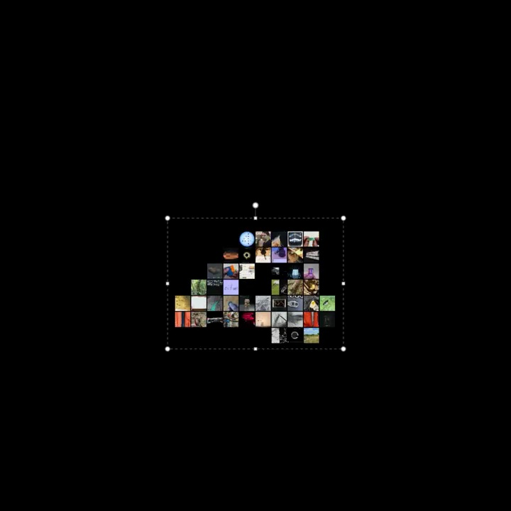

# Gemini｜照片汇聚成数字 4

用照片块组成一个数字，再通过编辑边界展示它的可塑性。所有变化都发生在同一整体上。

```motion-demo
{
  "id": "sequence",
  "title": "整体编排",
  "src": "demos/sequence.html",
  "duration": 10.033333,
  "status": "authored",
  "description": "动作与构图示意",
  "initialTime": 2.3,
  "params": [
    {
      "key": "title",
      "label": "示例主文案",
      "type": "text",
      "value": "4",
      "maxLength": 60
    },
    {
      "key": "accent",
      "label": "强调色",
      "type": "color",
      "value": "#5d9cb8"
    }
  ],
  "presets": [
    {
      "label": "默认内容",
      "values": {
        "title": "4",
        "accent": "#5d9cb8"
      }
    },
    {
      "label": "OpenDesign 改编",
      "values": {
        "title": "OpenDesign",
        "accent": "#7050da"
      }
    }
  ]
}
```

## 先让数字轮廓成立

黑色背景衬托照片马赛克，图块色彩可以多样，但整体边缘要清楚。数字采用厚实、留白充足的字形；控制框和锚点用细白线。



## 宽高变化时，内部也一起变化

整体依次放大、横向压扁、纵向拉长，再回到原比例。图块、包围框和控制点共用同一变换，避免边框与内容脱离。

复位后再缩小退出，让观众看清这是同一个对象经历的一轮编辑。

## 换成新的图形符号

适合单个数字或粗短字母。替换图形符号与图片集合时，先保证缩小后仍能读出外轮廓，再调整图块密度。

## 配色与字形

黑底照片马赛克数字、变换边框与锚点。

#000000 · #ffffff · #5d9cb8 · #b39153 · #7d8879

## 元素与制作规则

照片矩阵 / 数字轮廓 / 包围盒 / 控制锚点

- 照片块共同组成数字，整体非均匀缩放改变宽高比，内部图块随父变换。
- 控制边框与锚点随轮廓变化，强调可编辑性。
- 恢复原形后缩小退出，形成一轮展示。

## 内容替换

- 替换数字与图片集合；保留整体形变和可编辑边界。
- 适合单字符，长文本需重新设计网格。

## 制作参数

[视觉与对象](style.json) · [段落时序](timeline.json) · [位置数据](tracks.json) · [文件清单](manifest.json)

此规范根据参考视频整理。HTML 为可编辑的编排示例；具体数据的来源、精度与有效区间随文件标注。

```motion-board
{
  "version": 1,
  "brand": "Google",
  "id": "V019",
  "palette": [
    "#000000",
    "#ffffff",
    "#5d9cb8",
    "#b39153",
    "#7d8879"
  ],
  "typography": "黑底照片马赛克数字、变换边框与锚点",
  "sample": "4",
  "objects": [
    "照片矩阵",
    "数字轮廓",
    "包围盒",
    "控制锚点"
  ],
  "frames": [
    {
      "path": "assets/reference-1.jpg",
      "timeSeconds": 0.0,
      "frameId": "K0001",
      "role": "reference-evidence",
      "status": "measured"
    },
    {
      "path": "assets/reference-2.jpg",
      "timeSeconds": 0.9,
      "frameId": "K0003",
      "role": "reference-evidence",
      "status": "measured"
    },
    {
      "path": "https://r.open-design.ai/files/f39af7d86db37c1cac59b8ded59d0a19dc675a55f0b05f1ec60f08880edd9f50",
      "timeSeconds": 2.0,
      "frameId": "K0008",
      "role": "reference-evidence",
      "status": "measured"
    },
    {
      "path": "assets/reference-4.jpg",
      "timeSeconds": 6.533333333333333,
      "frameId": "K0022",
      "role": "reference-evidence",
      "status": "measured"
    },
    {
      "path": "assets/reference-5.jpg",
      "timeSeconds": 8.6,
      "frameId": "K0030",
      "role": "reference-evidence",
      "status": "measured"
    },
    {
      "path": "assets/reference-6.jpg",
      "timeSeconds": 9.6,
      "frameId": "K0034",
      "role": "reference-evidence",
      "status": "measured"
    }
  ],
  "stages": [
    {
      "start": 0,
      "label": "小比例出现",
      "end": 0.8,
      "status": "inferred",
      "basis": "Representative-frame review; approximate boundaries"
    },
    {
      "start": 0.8,
      "label": "数字放大",
      "end": 2,
      "status": "inferred",
      "basis": "Representative-frame review; approximate boundaries"
    },
    {
      "start": 2,
      "label": "完整马赛克",
      "end": 4,
      "status": "inferred",
      "basis": "Representative-frame review; approximate boundaries"
    },
    {
      "start": 4,
      "label": "压扁变形",
      "end": 6.5,
      "status": "inferred",
      "basis": "Representative-frame review; approximate boundaries"
    },
    {
      "start": 6.5,
      "label": "恢复并变窄",
      "end": 8.5,
      "status": "inferred",
      "basis": "Representative-frame review; approximate boundaries"
    },
    {
      "start": 8.5,
      "label": "恢复原形",
      "end": 9.6,
      "status": "inferred",
      "basis": "Representative-frame review; approximate boundaries"
    },
    {
      "start": 9.6,
      "label": "缩小退出",
      "end": 10.033333,
      "status": "inferred",
      "basis": "Representative-frame review; approximate boundaries"
    }
  ],
  "duration": 10.033333,
  "fontFamily": "Arial, sans-serif"
}
```
