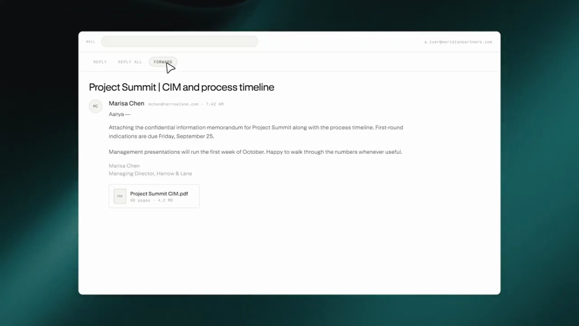

# Perplexity Computer now works in email

把邮件作为任务入口，也作为结果出口。一次发送开启工作，一次回复带回可打开的文件。

```motion-demo
{
  "id": "sequence",
  "title": "整体编排",
  "src": "demos/sequence.html",
  "duration": 41.508133,
  "status": "authored",
  "description": "动作与构图示意",
  "initialTime": 8,
  "params": [
    {
      "key": "title",
      "label": "示例主文案",
      "type": "text",
      "value": "Computer works wherever you do",
      "maxLength": 60
    },
    {
      "key": "accent",
      "label": "强调色",
      "type": "color",
      "value": "#63a89d"
    }
  ],
  "presets": [
    {
      "label": "默认内容",
      "values": {
        "title": "Computer works wherever you do",
        "accent": "#63a89d"
      }
    },
    {
      "label": "OpenDesign 改编",
      "values": {
        "title": "OpenDesign",
        "accent": "#7050da"
      }
    }
  ]
}
```

## 草稿里交代任务和附件

邮箱先建立使用场景，再打开新邮件。请求文字与附件同时可见，发送按钮靠近当前焦点；邮件主题和附件名要能直接解释任务。



## 发送后让出处理时间

点击发送后收起草稿，再出现处理附件与执行状态。不要在发送前展示已完成的产物；处理段可以短，但至少给一次状态变化。

```motion-demo
{
  "id": "clip-2",
  "title": "发送后让出处理时间",
  "src": "demos/clip-2.html",
  "duration": 11,
  "status": "authored",
  "description": "11–22 秒 · 动作示意",
  "initialTime": 0.6
}
```

## 回复带回同一条任务链

用邮件回复承接执行结果，随后打开交付文件，再回到工作区。回复主题、文件名与开头附件保持可辨联系，避免像跳到了另一段不相关演示。

| 时间 | 段落 |
|---|---|
| 0.00–4.00s | 主张 |
| 4.00–8.00s | 邮箱 |
| 8.00–11.00s | 新邮件 |
| 11.00–15.00s | 输入请求 |
| 15.00–18.00s | 发送 |
| 18.00–22.00s | 处理附件 |
| 22.00–29.00s | 邮件回复 |
| 29.00–33.00s | 打开产物 |
| 33.00–37.00s | 回到工作区 |
| 37.00–41.51s | 品牌 |

## 深绿背景衬托熟悉的邮箱

外层用深绿与浅色字，邮件正文维持明亮、紧凑的工具布局。品牌主张可用衬线，邮件标题、地址和正文用无衬线；强调色只用于发送、状态和结果入口。

## 替换整封邮件，而不只换标题

更换收件人、任务请求、输入附件和回传文件。预算表、设计检查或数据清理都适合这个流程；邮件必须真正说明为什么会得到后面的产物。

## 配色与字形

衬线主张标题搭配无衬线界面文字；大留白、细边框。

#08332e · #ecf4ed · #63a89d · #154943 · #ffffff

## 元素与制作规则

邮箱窗口 / 邮件草稿 / 附件 / 执行步骤 / 回复 / 表格产物

- 通过邮件触发任务，结果回到同一邮件线程；附件是输入依赖。
- 发送动作后才显示处理，回复后才能打开产物。

## 内容替换

- 可换邮件任务和交付文件；保留发送→执行→回复链。

## 制作参数

[视觉与对象](style.json) · [段落时序](timeline.json) · [位置数据](tracks.json) · [文件清单](manifest.json)

此规范根据参考视频整理。HTML 为可编辑的编排示例；具体数据的来源、精度与有效区间随文件标注。

```motion-board
{
  "version": 1,
  "brand": "Perplexity",
  "id": "V259",
  "palette": [
    "#08332e",
    "#ecf4ed",
    "#63a89d",
    "#154943",
    "#ffffff"
  ],
  "typography": "衬线主张标题搭配无衬线界面文字；大留白、细边框",
  "sample": "Computer works wherever you do",
  "objects": [
    "邮箱窗口",
    "邮件草稿",
    "附件",
    "执行步骤",
    "回复",
    "表格产物"
  ],
  "frames": [
    {
      "path": "assets/reference-1.jpg",
      "timeSeconds": 0.0,
      "frameId": "K0001",
      "role": "reference-evidence",
      "status": "measured"
    },
    {
      "path": "assets/reference-2.jpg",
      "timeSeconds": 8.008000000000001,
      "frameId": "K0016",
      "role": "reference-evidence",
      "status": "measured"
    },
    {
      "path": "assets/reference-3.jpg",
      "timeSeconds": 15.015,
      "frameId": "K0029",
      "role": "reference-evidence",
      "status": "measured"
    },
    {
      "path": "assets/reference-4.jpg",
      "timeSeconds": 18.018,
      "frameId": "K0035",
      "role": "reference-evidence",
      "status": "measured"
    },
    {
      "path": "assets/reference-5.jpg",
      "timeSeconds": 29.029,
      "frameId": "K0054",
      "role": "reference-evidence",
      "status": "measured"
    },
    {
      "path": "assets/reference-6.jpg",
      "timeSeconds": 37.037,
      "frameId": "K0074",
      "role": "reference-evidence",
      "status": "measured"
    }
  ],
  "stages": [
    {
      "start": 0,
      "label": "主张",
      "end": 4,
      "status": "inferred",
      "basis": "Representative-frame review; approximate boundaries"
    },
    {
      "start": 4,
      "label": "邮箱",
      "end": 8,
      "status": "inferred",
      "basis": "Representative-frame review; approximate boundaries"
    },
    {
      "start": 8,
      "label": "新邮件",
      "end": 11,
      "status": "inferred",
      "basis": "Representative-frame review; approximate boundaries"
    },
    {
      "start": 11,
      "label": "输入请求",
      "end": 15,
      "status": "inferred",
      "basis": "Representative-frame review; approximate boundaries"
    },
    {
      "start": 15,
      "label": "发送",
      "end": 18,
      "status": "inferred",
      "basis": "Representative-frame review; approximate boundaries"
    },
    {
      "start": 18,
      "label": "处理附件",
      "end": 22,
      "status": "inferred",
      "basis": "Representative-frame review; approximate boundaries"
    },
    {
      "start": 22,
      "label": "邮件回复",
      "end": 29,
      "status": "inferred",
      "basis": "Representative-frame review; approximate boundaries"
    },
    {
      "start": 29,
      "label": "打开产物",
      "end": 33,
      "status": "inferred",
      "basis": "Representative-frame review; approximate boundaries"
    },
    {
      "start": 33,
      "label": "回到工作区",
      "end": 37,
      "status": "inferred",
      "basis": "Representative-frame review; approximate boundaries"
    },
    {
      "start": 37,
      "label": "品牌",
      "end": 41.508133,
      "status": "inferred",
      "basis": "Representative-frame review; approximate boundaries"
    }
  ],
  "duration": 41.508133,
  "fontFamily": "Georgia, serif"
}
```
