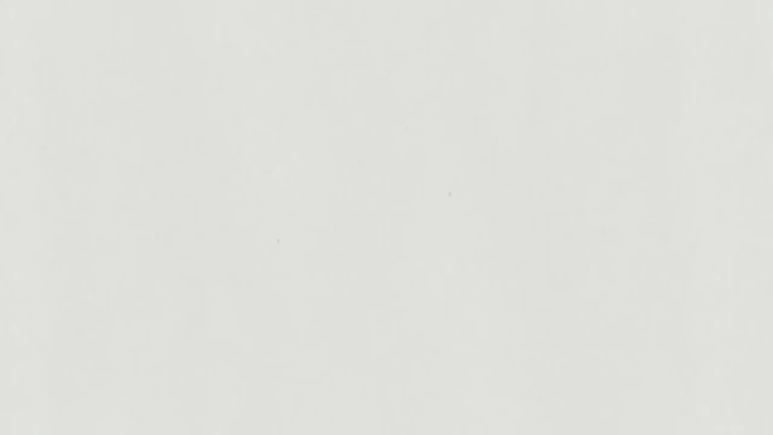
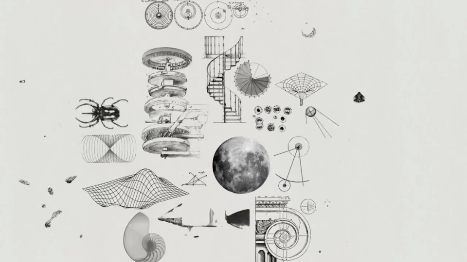

# K3｜开放权重预告

从一个墨字出发，拆成粒子，再递增为多个网络结构和知识图集。数量与材质的变化一起推动叙事。

```motion-demo
{
  "id": "sequence",
  "title": "整体编排",
  "src": "demos/sequence.html",
  "duration": 15.033333,
  "status": "authored",
  "description": "动作与构图示意",
  "initialTime": 3.3,
  "params": [
    {
      "key": "title",
      "label": "示例主文案",
      "type": "text",
      "value": "Kimi K3",
      "maxLength": 60
    },
    {
      "key": "accent",
      "label": "强调色",
      "type": "color",
      "value": "#70766c"
    }
  ],
  "presets": [
    {
      "label": "默认内容",
      "values": {
        "title": "Kimi K3",
        "accent": "#70766c"
      }
    },
    {
      "label": "OpenDesign 改编",
      "values": {
        "title": "OpenDesign",
        "accent": "#7050da"
      }
    }
  ]
}
```

## 纸面上只保留必要的黑色结构

浅灰纸感底承托书写笔触，黑墨与细点线形成粗细对照。主字居中，少量索引退到边角；收尾短句可用稳重衬线，和技术小字区分。



## 笔画散开后，保留数量关系

完整字形先停住，再把笔画拆成离散点。点群依次构成一、二、三的结构，增加数量时保持排列方向，让递进容易理解。

```motion-demo
{
  "id": "clip-2",
  "title": "笔画散开后，保留数量关系",
  "src": "demos/clip-2.html",
  "duration": 5.8,
  "status": "authored",
  "description": "2–7.8 秒 · 动作示意",
  "initialTime": 0.6
}
```

## 从几组结构展开为图集

多个网络先形成独立对象，再加入球体与科学图版。镜头拉远，给越来越多的图形腾出位置，保留统一细线和纸面材质。



## 铺满以后，清场给产品说明

图集到达最大密度后整体撤去，产品名与一条发布信息单独停留。前面越复杂，结尾越需要简洁。

## 换一个“由简到繁”的主题

可替换起始字符、图形体系与最终说明。先设计数量递增的骨架，再安排对应材质；新字符的笔画需支持拆分和重组。

## 配色与字形

浅灰纸感、黑墨字、粒子网络与百科式图集。

#e4e5df · #151714 · #70766c · #c4c8c0 · #a4aaa0

## 元素与制作规则

墨字 / 粒子 / 横画 / 三柱网络 / 球体 / 科学图集 / 品牌

- 由书写笔画变成离散点，再组成多份网络结构，延伸到知识图集。
- 一、二、三的数量递增是节奏骨架，末段汇入更丰富的对象。
- 图集铺满后清场，给产品说明留读。

## 内容替换

- 可迁移为由简单规则到复杂系统的主题；保留数量递增与材质连续。
- 原书法字形需作为独立素材输入。

## 制作参数

[视觉与对象](style.json) · [段落时序](timeline.json) · [位置数据](tracks.json) · [文件清单](manifest.json)

此规范根据参考视频整理。HTML 为可编辑的编排示例；具体数据的来源、精度与有效区间随文件标注。

```motion-board
{
  "version": 1,
  "brand": "Kimi",
  "id": "V033",
  "palette": [
    "#e4e5df",
    "#151714",
    "#70766c",
    "#c4c8c0",
    "#a4aaa0"
  ],
  "typography": "浅灰纸感、黑墨字、粒子网络与百科式图集",
  "sample": "Kimi K3",
  "objects": [
    "墨字",
    "粒子",
    "横画",
    "三柱网络",
    "球体",
    "科学图集",
    "品牌"
  ],
  "frames": [
    {
      "path": "assets/reference-1.jpg",
      "timeSeconds": 0.0,
      "frameId": "K0001",
      "role": "reference-evidence",
      "status": "measured"
    },
    {
      "path": "assets/reference-2.jpg",
      "timeSeconds": 3.0,
      "frameId": "K0012",
      "role": "reference-evidence",
      "status": "measured"
    },
    {
      "path": "assets/reference-3.jpg",
      "timeSeconds": 5.566666666666666,
      "frameId": "K0022",
      "role": "reference-evidence",
      "status": "measured"
    },
    {
      "path": "assets/reference-4.jpg",
      "timeSeconds": 7.0,
      "frameId": "K0028",
      "role": "reference-evidence",
      "status": "measured"
    },
    {
      "path": "assets/reference-5.jpg",
      "timeSeconds": 10.0,
      "frameId": "K0040",
      "role": "reference-evidence",
      "status": "measured"
    },
    {
      "path": "assets/reference-6.jpg",
      "timeSeconds": 13.266666666666667,
      "frameId": "K0051",
      "role": "reference-evidence",
      "status": "measured"
    }
  ],
  "stages": [
    {
      "start": 0,
      "label": "墨字生成",
      "end": 2,
      "status": "inferred",
      "basis": "Representative-frame review; approximate boundaries"
    },
    {
      "start": 2,
      "label": "道字稳定",
      "end": 3,
      "status": "inferred",
      "basis": "Representative-frame review; approximate boundaries"
    },
    {
      "start": 3,
      "label": "笔画散为点",
      "end": 4,
      "status": "inferred",
      "basis": "Representative-frame review; approximate boundaries"
    },
    {
      "start": 4,
      "label": "一二三结构",
      "end": 5.5,
      "status": "inferred",
      "basis": "Representative-frame review; approximate boundaries"
    },
    {
      "start": 5.5,
      "label": "三柱网络",
      "end": 7,
      "status": "inferred",
      "basis": "Representative-frame review; approximate boundaries"
    },
    {
      "start": 7,
      "label": "三组图形",
      "end": 9,
      "status": "inferred",
      "basis": "Representative-frame review; approximate boundaries"
    },
    {
      "start": 9,
      "label": "球体",
      "end": 10,
      "status": "inferred",
      "basis": "Representative-frame review; approximate boundaries"
    },
    {
      "start": 10,
      "label": "科学图集展开",
      "end": 12,
      "status": "inferred",
      "basis": "Representative-frame review; approximate boundaries"
    },
    {
      "start": 12,
      "label": "品牌",
      "end": 13.5,
      "status": "inferred",
      "basis": "Representative-frame review; approximate boundaries"
    },
    {
      "start": 13.5,
      "label": "开放权重短句",
      "end": 15.033333,
      "status": "inferred",
      "basis": "Representative-frame review; approximate boundaries"
    }
  ],
  "duration": 15.033333,
  "fontFamily": "Arial, sans-serif"
}
```
