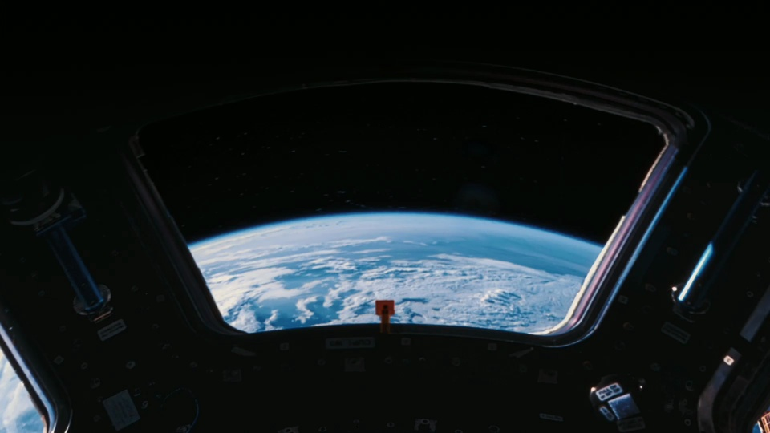
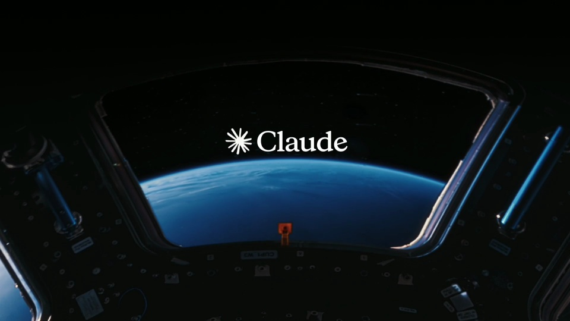

# Sonnet 5.5 · 微距剪辑

围绕弧线、刻度和周期运动挑选微距素材。短镜头连续切换，结尾回到舷窗，用较长停留承载产品名。

```motion-demo
{
  "id": "sequence",
  "title": "整体编排",
  "src": "demos/sequence.html",
  "duration": 13.28,
  "status": "authored",
  "description": "动作与构图示意",
  "initialTime": 9,
  "params": [
    {
      "key": "title",
      "label": "示例主文案",
      "type": "text",
      "value": "Sonnet 5.5",
      "maxLength": 60
    },
    {
      "key": "accent",
      "label": "强调色",
      "type": "color",
      "value": "#bd8042"
    }
  ],
  "presets": [
    {
      "label": "默认内容",
      "values": {
        "title": "Sonnet 5.5",
        "accent": "#bd8042"
      }
    },
    {
      "label": "OpenDesign 改编",
      "values": {
        "title": "OpenDesign",
        "accent": "#7050da"
      }
    }
  ]
}
```

## 按形状选镜头

挑选弧线、刻度、圆形窗口与周期运动。让相邻镜头拥有可对接的几何形状，材质可以完全不同。

低照度实拍微距；金属、纸张与暖色仪表；少量居中衬线字。



## 短切推进，长停落版

通过弧线、圆环、指针等相似几何跨镜头匹配；它们是不同素材，不建立同一物体轨迹。

前中段短镜头密集切换，末段舷窗显著延长，给产品名阅读空间。

镜头动作由素材内部运动与取景共同形成，不能仅靠位置缩放重现光照和材质。

```motion-demo
{
  "id": "clip-2",
  "title": "短切推进，长停落版",
  "src": "demos/clip-2.html",
  "duration": 10.8,
  "status": "authored",
  "description": "0–10.8 秒 · 动作示意",
  "initialTime": 0.6
}
```

| 时间 | 段落 |
|---|---|
| 0.00–1.10s | 舷窗与地球 |
| 1.10–1.60s | 指针表盘 |
| 1.60–2.30s | 节拍器 |
| 2.30–3.10s | 画弧与圆规 |
| 3.10–4.00s | 金属弧面 |
| 4.00–5.70s | 旋钮与色环 |
| 5.70–6.50s | 群体与流体 |
| 6.50–8.60s | 火焰与刻度 |
| 8.60–10.80s | 返回舷窗并显示产品名 |
| 10.80–13.28s | 品牌收尾 |

## 把产品名留给舷窗

可迁移的是形状匹配剪辑与短镜头→长落版的节奏。

换主题需要重新选择含相似弧形、刻度或周期动作的素材；不只替换最后标题。



## 配色与字形

低照度实拍微距；金属、纸张与暖色仪表；少量居中衬线字。

#101310 · #ded2bc · #bd8042 · #4d86b5 · #a68971

## 元素与制作规则

微距镜头组 / 重复弧形／刻度 / 画面运动方向 / 产品标题 / 舷窗首尾锚点

- 通过弧线、圆环、指针等相似几何跨镜头匹配；它们是不同素材，不建立同一物体轨迹。
- 前中段短镜头密集切换，末段舷窗显著延长，给产品名阅读空间。
- 镜头动作由素材内部运动与取景共同形成，不能仅靠位置缩放重现光照和材质。

## 内容替换

- 可迁移的是形状匹配剪辑与短镜头→长落版的节奏。
- 换主题需要重新选择含相似弧形、刻度或周期动作的素材；不只替换最后标题。

## 制作参数

[视觉与对象](style.json) · [段落时序](timeline.json) · [位置数据](tracks.json) · [文件清单](manifest.json)

此规范根据参考视频整理。HTML 为可编辑的编排示例；具体数据的来源、精度与有效区间随文件标注。

```motion-board
{
  "version": 1,
  "brand": "Anthropic",
  "id": "V006",
  "palette": [
    "#101310",
    "#ded2bc",
    "#bd8042",
    "#4d86b5",
    "#a68971"
  ],
  "typography": "低照度实拍微距；金属、纸张与暖色仪表；少量居中衬线字",
  "sample": "Sonnet 5.5",
  "objects": [
    "微距镜头组",
    "重复弧形／刻度",
    "画面运动方向",
    "产品标题",
    "舷窗首尾锚点"
  ],
  "frames": [
    {
      "path": "assets/reference-1.jpg",
      "timeSeconds": 0.0,
      "frameId": "K0001",
      "role": "reference-evidence",
      "status": "measured"
    },
    {
      "path": "assets/reference-2.jpg",
      "timeSeconds": 1.6,
      "frameId": "K0009",
      "role": "reference-evidence",
      "status": "measured"
    },
    {
      "path": "assets/reference-3.jpg",
      "timeSeconds": 3.04,
      "frameId": "K0021",
      "role": "reference-evidence",
      "status": "measured"
    },
    {
      "path": "assets/reference-4.jpg",
      "timeSeconds": 4.0,
      "frameId": "K0028",
      "role": "reference-evidence",
      "status": "measured"
    },
    {
      "path": "assets/reference-5.jpg",
      "timeSeconds": 6.56,
      "frameId": "K0044",
      "role": "reference-evidence",
      "status": "measured"
    },
    {
      "path": "assets/reference-6.jpg",
      "timeSeconds": 10.84,
      "frameId": "K0061",
      "role": "reference-evidence",
      "status": "measured"
    }
  ],
  "stages": [
    {
      "start": 0,
      "label": "舷窗与地球",
      "end": 1.1,
      "status": "inferred",
      "basis": "Representative-frame review; approximate boundaries"
    },
    {
      "start": 1.1,
      "label": "指针表盘",
      "end": 1.6,
      "status": "inferred",
      "basis": "Representative-frame review; approximate boundaries"
    },
    {
      "start": 1.6,
      "label": "节拍器",
      "end": 2.3,
      "status": "inferred",
      "basis": "Representative-frame review; approximate boundaries"
    },
    {
      "start": 2.3,
      "label": "画弧与圆规",
      "end": 3.1,
      "status": "inferred",
      "basis": "Representative-frame review; approximate boundaries"
    },
    {
      "start": 3.1,
      "label": "金属弧面",
      "end": 4,
      "status": "inferred",
      "basis": "Representative-frame review; approximate boundaries"
    },
    {
      "start": 4,
      "label": "旋钮与色环",
      "end": 5.7,
      "status": "inferred",
      "basis": "Representative-frame review; approximate boundaries"
    },
    {
      "start": 5.7,
      "label": "群体与流体",
      "end": 6.5,
      "status": "inferred",
      "basis": "Representative-frame review; approximate boundaries"
    },
    {
      "start": 6.5,
      "label": "火焰与刻度",
      "end": 8.6,
      "status": "inferred",
      "basis": "Representative-frame review; approximate boundaries"
    },
    {
      "start": 8.6,
      "label": "返回舷窗并显示产品名",
      "end": 10.8,
      "status": "inferred",
      "basis": "Representative-frame review; approximate boundaries"
    },
    {
      "start": 10.8,
      "label": "品牌收尾",
      "end": 13.28,
      "status": "inferred",
      "basis": "Representative-frame review; approximate boundaries"
    }
  ],
  "duration": 13.28,
  "fontFamily": "Georgia, serif"
}
```
