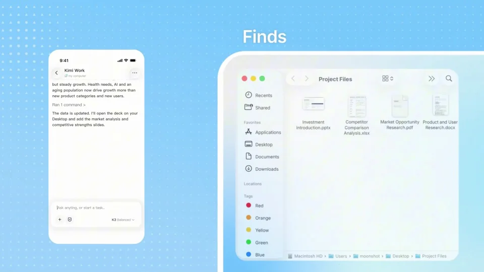

# Kimi Work — remote control from your phone

让手机提出同一个任务，电脑依次查找、修改并发送文件。两个设备始终拥有明确分工。

```motion-demo
{
  "id": "sequence",
  "title": "整体编排",
  "src": "demos/sequence.html",
  "duration": 37.933333,
  "status": "authored",
  "description": "动作与构图示意",
  "initialTime": 8.3,
  "params": [
    {
      "key": "title",
      "label": "示例主文案",
      "type": "text",
      "value": "Work anywhere",
      "maxLength": 60
    },
    {
      "key": "accent",
      "label": "强调色",
      "type": "color",
      "value": "#4da2cc"
    }
  ],
  "presets": [
    {
      "label": "默认内容",
      "values": {
        "title": "Work anywhere",
        "accent": "#4da2cc"
      }
    },
    {
      "label": "OpenDesign 改编",
      "values": {
        "title": "OpenDesign",
        "accent": "#7050da"
      }
    }
  ]
}
```

## 手机是控制端，电脑是执行端

天蓝点阵背景上，手机放左侧，电脑窗口占右侧较大面积。连线连接任务与执行位置，短无衬线标签放在电脑窗口上方。

## 连接设备后再发出工作指令

先显示设备选择与连接，再由手机输入完整任务。请求包含文件、要更新的内容和接收方，为后续各环节提供共同依据。

```motion-demo
{
  "id": "clip-2",
  "title": "连接设备后再发出工作指令",
  "src": "demos/clip-2.html",
  "duration": 13,
  "status": "authored",
  "description": "0–13 秒 · 动作示意",
  "initialTime": 0.6
}
```

## 同一文件穿过不同应用

浏览器找到资料后，转到本地文件和幻灯片。保留文件名和主题，选中相关页后再写入新内容，沿用原文档的排版。



## 邮件里能找到刚才的成果

发送界面附上已更新的文件，收件人与最初请求一致。最后回到手机或任务总结，给整个跨设备链条一个明确结束。

| 时间 | 段落 |
|---|---|
| 0.00–4.00s | 远程控制标题 |
| 4.00–8.00s | 连接设备 |
| 8.00–10.00s | 收到工作请求 |
| 10.00–13.00s | 输入任务 |
| 13.00–20.00s | 电脑搜索与提取 |
| 20.00–24.00s | 查找本地文件 |
| 24.00–28.00s | 更新幻灯片 |
| 28.00–35.00s | 邮件发送 |
| 35.00–37.93s | 品牌 |

## 换一个跨设备任务

可替换资料来源、编辑应用和交付渠道。保持控制端与执行端的位置分工；每个执行画面只说明当前一个动作。

## 配色与字形

天蓝点阵背景、手机在左桌面在右、细连线。

#80c9ee · #16232a · #4da2cc · #ffffff · #bddeeb

## 元素与制作规则

手机 / 设备列表 / 任务气泡 / 电脑浏览器 / 演示文稿 / 邮件窗口 / 连接线

- 手机发出同一个任务，桌面逐步搜索、找到本地文档、编辑并发送。
- 保持手机为控制端、电脑为执行端，连线表达关系。
- 每个电脑动作有短标签，最终邮件对应最初任务。

## 内容替换

- 迁移到其他跨设备工具时保留控制端→执行端→交付。
- 不要把两个设备画成互不相关的页面。

## 制作参数

[视觉与对象](style.json) · [段落时序](timeline.json) · [位置数据](tracks.json) · [文件清单](manifest.json)

此规范根据参考视频整理。HTML 为可编辑的编排示例；具体数据的来源、精度与有效区间随文件标注。

```motion-board
{
  "version": 1,
  "brand": "Kimi",
  "id": "V029",
  "palette": [
    "#80c9ee",
    "#16232a",
    "#4da2cc",
    "#ffffff",
    "#bddeeb"
  ],
  "typography": "天蓝点阵背景、手机在左桌面在右、细连线",
  "sample": "Work anywhere",
  "objects": [
    "手机",
    "设备列表",
    "任务气泡",
    "电脑浏览器",
    "演示文稿",
    "邮件窗口",
    "连接线"
  ],
  "frames": [
    {
      "path": "assets/reference-1.webp",
      "timeSeconds": 0.0,
      "frameId": "K0001",
      "role": "reference-evidence",
      "status": "measured"
    },
    {
      "path": "assets/reference-2.webp",
      "timeSeconds": 8.0,
      "frameId": "K0018",
      "role": "reference-evidence",
      "status": "measured"
    },
    {
      "path": "https://r.open-design.ai/files/9498d60c1dcc5fe319c04ef968b64e8fb9c9b086ea9eca657f60b0b76ec0660d",
      "timeSeconds": 10.0,
      "frameId": "K0026",
      "role": "reference-evidence",
      "status": "measured"
    },
    {
      "path": "assets/reference-4.webp",
      "timeSeconds": 20.0,
      "frameId": "K0059",
      "role": "reference-evidence",
      "status": "measured"
    },
    {
      "path": "https://r.open-design.ai/files/ff1e5ba3b976fdc73838f4c8265786e0c942a7f98e83cfb8eeb8928251085db9",
      "timeSeconds": 24.0,
      "frameId": "K0070",
      "role": "reference-evidence",
      "status": "measured"
    },
    {
      "path": "assets/reference-6.webp",
      "timeSeconds": 35.0,
      "frameId": "K0098",
      "role": "reference-evidence",
      "status": "measured"
    }
  ],
  "stages": [
    {
      "start": 0,
      "label": "远程控制标题",
      "end": 4,
      "status": "inferred",
      "basis": "Representative-frame review; approximate boundaries"
    },
    {
      "start": 4,
      "label": "连接设备",
      "end": 8,
      "status": "inferred",
      "basis": "Representative-frame review; approximate boundaries"
    },
    {
      "start": 8,
      "label": "收到工作请求",
      "end": 10,
      "status": "inferred",
      "basis": "Representative-frame review; approximate boundaries"
    },
    {
      "start": 10,
      "label": "输入任务",
      "end": 13,
      "status": "inferred",
      "basis": "Representative-frame review; approximate boundaries"
    },
    {
      "start": 13,
      "label": "电脑搜索与提取",
      "end": 20,
      "status": "inferred",
      "basis": "Representative-frame review; approximate boundaries"
    },
    {
      "start": 20,
      "label": "查找本地文件",
      "end": 24,
      "status": "inferred",
      "basis": "Representative-frame review; approximate boundaries"
    },
    {
      "start": 24,
      "label": "更新幻灯片",
      "end": 28,
      "status": "inferred",
      "basis": "Representative-frame review; approximate boundaries"
    },
    {
      "start": 28,
      "label": "邮件发送",
      "end": 35,
      "status": "inferred",
      "basis": "Representative-frame review; approximate boundaries"
    },
    {
      "start": 35,
      "label": "品牌",
      "end": 37.933333,
      "status": "inferred",
      "basis": "Representative-frame review; approximate boundaries"
    }
  ],
  "duration": 37.933333,
  "fontFamily": "Arial, sans-serif"
}
```
