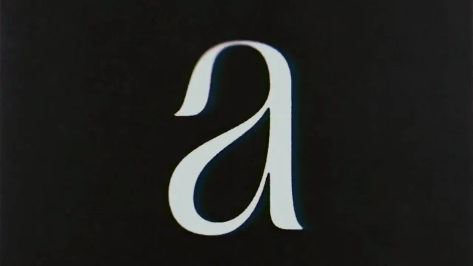

# Aesthetics

先用作品建立审美期待，再用具体修改说明这种设计如何产生。前半段大胆展示视觉差异，后半段把焦点交给选择与编辑。

```motion-demo
{
  "id": "sequence",
  "title": "整体编排",
  "src": "demos/sequence.html",
  "duration": 54.2542,
  "status": "authored",
  "description": "动作与构图示意",
  "initialTime": 11.2,
  "params": [
    {
      "key": "title",
      "label": "示例主文案",
      "type": "text",
      "value": "DESIGN PARTNER",
      "maxLength": 60
    },
    {
      "key": "accent",
      "label": "强调色",
      "type": "color",
      "value": "#ed3b99"
    }
  ],
  "presets": [
    {
      "label": "默认内容",
      "values": {
        "title": "DESIGN PARTNER",
        "accent": "#ed3b99"
      }
    },
    {
      "label": "OpenDesign 改编",
      "values": {
        "title": "OpenDesign",
        "accent": "#7050da"
      }
    }
  ]
}
```

## 先给视觉密度，再给清晰操作

开场快速切过色彩、材质、字形和版式，让每个片段只承担一个视觉重点。进入产品后放慢，展示请求、方向选择、批注与改稿，观众应能读懂一次改变。

| 时间 | 段落 |
|---|---|
| 0.00–3.00s | 黑场主张 |
| 3.00–10.00s | 材质与色彩快切 |
| 10.00–14.00s | 字形与图像层 |
| 14.00–17.00s | 发光按钮 |
| 17.00–20.00s | 产品定位 |
| 20.00–24.00s | 网页作品 |
| 24.00–30.00s | 请求与选方向 |
| 30.00–38.00s | 批注修改 |
| 38.00–45.00s | 新建商店 |
| 45.00–49.00s | 成品页面 |
| 49.00–54.25s | 首尾主张回接 |

## 黑底承托高饱和作品

背景保持深色，粉、蓝、橙用于作品与柔光区域。展示型标题可大胆改变字重、宽度与尺度，操作界面的字体则保持统一、克制。

材质特写可铺满画面；作品卡片保留完整边缘；输入与批注尺寸更小，但必须落在清晰的前景层。



## 方向选择必须带来不同设计

提出设计请求后，先出现可区分的方向，再显示选择动作。颜色修改、字体修改和页面结构修改各用相应的变化回应；不要用同一张作品不断换标题充当迭代。

```motion-demo
{
  "id": "clip-3",
  "title": "方向选择必须带来不同设计",
  "src": "demos/clip-3.html",
  "duration": 18,
  "status": "authored",
  "description": "20–38 秒 · 动作示意",
  "initialTime": 0.6
}
```

## 让结尾回到开场的主张

最后展示完整网站与商店页面，再回到开场有关设计时间的文字。结尾的说服力来自刚经历的制作过程。

换主题时同时准备新的作品案例、设计请求与修改结果。保持审美展示到操作证据的递进，品牌标记只负责最后署名。

## 配色与字形

无衬线界面文字与清晰大小层级。

#101013 · #ffffff · #ed3b99 · #778df2 · #fb6740

## 元素与制作规则

大标题 / 材质片段 / 网页卡片 / 输入框 / 选项组 / 批注

- 前段用不同设计维度建立审美期待，后段用实际操作说明产生方式
- 作品大图和小型输入卡交替，操作发生后才出现对应改稿
- 结尾回接开头关于时间的主张形成反差

## 内容替换

- 换品牌需替换作品、提示词与改稿结果，保留美感展示→操作证据结构
- 只换末尾logo不足以迁移整个叙事

## 制作参数

[视觉与对象](style.json) · [段落时序](timeline.json) · [位置数据](tracks.json) · [文件清单](manifest.json)

此规范根据参考视频整理。HTML 为可编辑的编排示例；具体数据的来源、精度与有效区间随文件标注。

```motion-board
{
  "version": 1,
  "brand": "Lovable",
  "id": "V039",
  "palette": [
    "#101013",
    "#ffffff",
    "#ed3b99",
    "#778df2",
    "#fb6740"
  ],
  "typography": "无衬线界面文字与清晰大小层级",
  "sample": "DESIGN PARTNER",
  "objects": [
    "大标题",
    "材质片段",
    "网页卡片",
    "输入框",
    "选项组",
    "批注"
  ],
  "frames": [
    {
      "path": "assets/reference-1.webp",
      "timeSeconds": 0.0,
      "frameId": "K0001",
      "role": "reference-evidence",
      "status": "measured"
    },
    {
      "path": "assets/reference-2.webp",
      "timeSeconds": 10.01,
      "frameId": "K0054",
      "role": "reference-evidence",
      "status": "measured"
    },
    {
      "path": "assets/reference-3.webp",
      "timeSeconds": 17.017,
      "frameId": "K0090",
      "role": "reference-evidence",
      "status": "measured"
    },
    {
      "path": "https://r.open-design.ai/files/a511c716dbde92eb390ac5539e7fd7afe8b5f773c0e67ac1a70bf2abc7039932",
      "timeSeconds": 24.024,
      "frameId": "K0128",
      "role": "reference-evidence",
      "status": "measured"
    },
    {
      "path": "https://r.open-design.ai/files/98c4357b8c4031b84edb55bb2ae8db37e467d771969ad5b07218401b4bb04520",
      "timeSeconds": 38.038000000000004,
      "frameId": "K0183",
      "role": "reference-evidence",
      "status": "measured"
    },
    {
      "path": "assets/reference-6.webp",
      "timeSeconds": 49.049,
      "frameId": "K0235",
      "role": "reference-evidence",
      "status": "measured"
    }
  ],
  "stages": [
    {
      "start": 0.0,
      "label": "黑场主张",
      "end": 3.0,
      "status": "inferred",
      "basis": "Representative-frame review; approximate boundaries"
    },
    {
      "start": 3.0,
      "label": "材质与色彩快切",
      "end": 10.0,
      "status": "inferred",
      "basis": "Representative-frame review; approximate boundaries"
    },
    {
      "start": 10.0,
      "label": "字形与图像层",
      "end": 14.0,
      "status": "inferred",
      "basis": "Representative-frame review; approximate boundaries"
    },
    {
      "start": 14.0,
      "label": "发光按钮",
      "end": 17.0,
      "status": "inferred",
      "basis": "Representative-frame review; approximate boundaries"
    },
    {
      "start": 17.0,
      "label": "产品定位",
      "end": 20.0,
      "status": "inferred",
      "basis": "Representative-frame review; approximate boundaries"
    },
    {
      "start": 20.0,
      "label": "网页作品",
      "end": 24.0,
      "status": "inferred",
      "basis": "Representative-frame review; approximate boundaries"
    },
    {
      "start": 24.0,
      "label": "请求与选方向",
      "end": 30.0,
      "status": "inferred",
      "basis": "Representative-frame review; approximate boundaries"
    },
    {
      "start": 30.0,
      "label": "批注修改",
      "end": 38.0,
      "status": "inferred",
      "basis": "Representative-frame review; approximate boundaries"
    },
    {
      "start": 38.0,
      "label": "新建商店",
      "end": 45.0,
      "status": "inferred",
      "basis": "Representative-frame review; approximate boundaries"
    },
    {
      "start": 45.0,
      "label": "成品页面",
      "end": 49.0,
      "status": "inferred",
      "basis": "Representative-frame review; approximate boundaries"
    },
    {
      "start": 49.0,
      "label": "首尾主张回接",
      "end": 54.2542,
      "status": "inferred",
      "basis": "Representative-frame review; approximate boundaries"
    }
  ],
  "duration": 54.2542,
  "fontFamily": "Arial, sans-serif"
}
```
