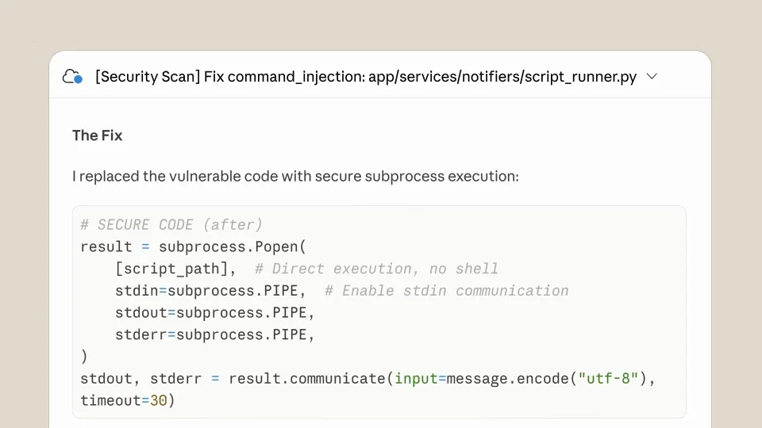

# Claude Code Security — vulnerability scans and patches

沿着扫描、发现、详情、修复和提交推进。每次深入都靠近相关内容，让问题与解决方案保持可追溯的对应。

```motion-demo
{
  "id": "sequence",
  "title": "整体编排",
  "src": "demos/sequence.html",
  "duration": 50.0,
  "status": "authored",
  "description": "动作与构图示意",
  "initialTime": 21.27,
  "params": [
    {
      "key": "title",
      "label": "示例主文案",
      "type": "text",
      "value": "Claude Code Security",
      "maxLength": 60
    },
    {
      "key": "accent",
      "label": "强调色",
      "type": "color",
      "value": "#c27b64"
    }
  ],
  "presets": [
    {
      "label": "默认内容",
      "values": {
        "title": "Claude Code Security",
        "accent": "#c27b64"
      }
    },
    {
      "label": "OpenDesign 改编",
      "values": {
        "title": "OpenDesign",
        "accent": "#7050da"
      }
    }
  ]
}
```

## 按信息层级展开卡片

砂色底、手绘黑线图标、白色扫描卡片与衬线功能短句。

入口→扫描→问题→修复→PR 顺序必须完整，结果层级随深入而展开。



## 详情展开后，再触发修复

长代码用局部推近展示关键行，不能把列表与详情都当作整体静态截图。

红色标签表示问题等级，绿色差异表示修复结果；状态色有语义。

```motion-demo
{
  "id": "clip-2",
  "title": "详情展开后，再触发修复",
  "src": "demos/clip-2.html",
  "duration": 12,
  "status": "authored",
  "description": "19–31 秒 · 动作示意",
  "initialTime": 0.6
}
```

## 操作与结果交替出现

扫描先给总览，展开后看问题细节，修复再给补丁。每一层都等待当前信息读完，再进入下一层。

| 时间 | 段落 |
|---|---|
| 0.00–6.00s | 手绘安全图标 |
| 6.00–10.00s | 扫描入口 |
| 10.00–12.00s | 开始扫描 |
| 12.00–15.50s | 发现列表 |
| 15.50–19.00s | 能力短句 |
| 19.00–24.00s | 展开单项问题 |
| 24.00–27.00s | 建议修复 |
| 27.00–30.00s | 查看修复主张 |
| 30.00–35.00s | 生成补丁 |
| 35.00–39.00s | 补丁说明 |
| 39.00–41.00s | 创建 PR |
| 41.00–50.00s | 研究预览与品牌 |

## 替换检查任务

可换成设计检查：项目→扫描→问题→建议→修改稿；保留检查与解决的对应关系。

风险等级、代码内容和结果数字可替换，但状态色语义不得对调。

## 配色与字形

砂色底、手绘黑线图标、白色扫描卡片与衬线功能短句。

#e1d9ca · #1e211d · #c27b64 · #76915e · #ffffff

## 元素与制作规则

扫描容器 / 仓库行 / 结果列表 / 问题详情 / 修复按钮 / 补丁卡片 / 指针

- 入口→扫描→问题→修复→PR 顺序必须完整，结果层级随深入而展开。
- 长代码用局部推近展示关键行，不能把列表与详情都当作整体静态截图。
- 红色标签表示问题等级，绿色差异表示修复结果；状态色有语义。

## 内容替换

- 可换成设计检查：项目→扫描→问题→建议→修改稿；保留检查与解决的对应关系。
- 风险等级、代码内容和结果数字可替换，但状态色语义不得对调。

## 制作参数

[视觉与对象](style.json) · [段落时序](timeline.json) · [位置数据](tracks.json) · [文件清单](manifest.json)

此规范根据参考视频整理。HTML 为可编辑的编排示例；具体数据的来源、精度与有效区间随文件标注。

```motion-board
{
  "version": 1,
  "brand": "Anthropic",
  "id": "V237",
  "palette": [
    "#e1d9ca",
    "#1e211d",
    "#c27b64",
    "#76915e",
    "#ffffff"
  ],
  "typography": "砂色底、手绘黑线图标、白色扫描卡片与衬线功能短句",
  "sample": "Claude Code Security",
  "objects": [
    "扫描容器",
    "仓库行",
    "结果列表",
    "问题详情",
    "修复按钮",
    "补丁卡片",
    "指针"
  ],
  "frames": [
    {
      "path": "assets/reference-1.webp",
      "timeSeconds": 0.0,
      "frameId": "K0001",
      "role": "reference-evidence",
      "status": "measured"
    },
    {
      "path": "assets/reference-2.webp",
      "timeSeconds": 10.0,
      "frameId": "K0024",
      "role": "reference-evidence",
      "status": "measured"
    },
    {
      "path": "assets/reference-3.webp",
      "timeSeconds": 15.266666666666667,
      "frameId": "K0039",
      "role": "reference-evidence",
      "status": "measured"
    },
    {
      "path": "assets/reference-4.webp",
      "timeSeconds": 27.0,
      "frameId": "K0068",
      "role": "reference-evidence",
      "status": "measured"
    },
    {
      "path": "assets/reference-5.webp",
      "timeSeconds": 35.0,
      "frameId": "K0083",
      "role": "reference-evidence",
      "status": "measured"
    },
    {
      "path": "assets/reference-6.webp",
      "timeSeconds": 41.0,
      "frameId": "K0102",
      "role": "reference-evidence",
      "status": "measured"
    }
  ],
  "stages": [
    {
      "start": 0,
      "label": "手绘安全图标",
      "end": 6,
      "status": "inferred",
      "basis": "Representative-frame review; approximate boundaries"
    },
    {
      "start": 6,
      "label": "扫描入口",
      "end": 10,
      "status": "inferred",
      "basis": "Representative-frame review; approximate boundaries"
    },
    {
      "start": 10,
      "label": "开始扫描",
      "end": 12,
      "status": "inferred",
      "basis": "Representative-frame review; approximate boundaries"
    },
    {
      "start": 12,
      "label": "发现列表",
      "end": 15.5,
      "status": "inferred",
      "basis": "Representative-frame review; approximate boundaries"
    },
    {
      "start": 15.5,
      "label": "能力短句",
      "end": 19,
      "status": "inferred",
      "basis": "Representative-frame review; approximate boundaries"
    },
    {
      "start": 19,
      "label": "展开单项问题",
      "end": 24,
      "status": "inferred",
      "basis": "Representative-frame review; approximate boundaries"
    },
    {
      "start": 24,
      "label": "建议修复",
      "end": 27,
      "status": "inferred",
      "basis": "Representative-frame review; approximate boundaries"
    },
    {
      "start": 27,
      "label": "查看修复主张",
      "end": 30,
      "status": "inferred",
      "basis": "Representative-frame review; approximate boundaries"
    },
    {
      "start": 30,
      "label": "生成补丁",
      "end": 35,
      "status": "inferred",
      "basis": "Representative-frame review; approximate boundaries"
    },
    {
      "start": 35,
      "label": "补丁说明",
      "end": 39,
      "status": "inferred",
      "basis": "Representative-frame review; approximate boundaries"
    },
    {
      "start": 39,
      "label": "创建 PR",
      "end": 41,
      "status": "inferred",
      "basis": "Representative-frame review; approximate boundaries"
    },
    {
      "start": 41,
      "label": "研究预览与品牌",
      "end": 50.0,
      "status": "inferred",
      "basis": "Representative-frame review; approximate boundaries"
    }
  ],
  "duration": 50.0,
  "fontFamily": "Georgia, serif"
}
```
