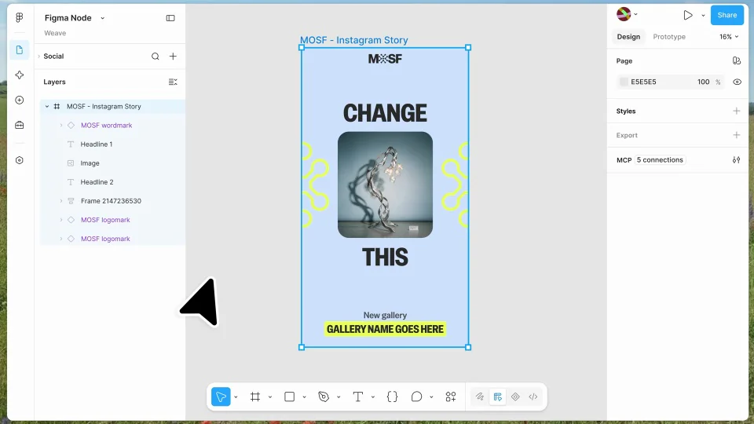

# Figma node — connect frames into Weave workflows

把设计帧变成工作流节点，再接入文字、图像与样式，分出多个结果。端口和连线是核心视觉语言。

```motion-demo
{
  "id": "sequence",
  "title": "整体编排",
  "src": "demos/sequence.html",
  "duration": 31.333333,
  "status": "authored",
  "description": "动作与构图示意",
  "initialTime": 8,
  "params": [
    {
      "key": "title",
      "label": "示例主文案",
      "type": "text",
      "value": "Figma in Weave",
      "maxLength": 60
    },
    {
      "key": "accent",
      "label": "强调色",
      "type": "color",
      "value": "#bc92ce"
    }
  ],
  "presets": [
    {
      "label": "默认内容",
      "values": {
        "title": "Figma in Weave",
        "accent": "#bc92ce"
      }
    },
    {
      "label": "OpenDesign 改编",
      "values": {
        "title": "OpenDesign",
        "accent": "#7050da"
      }
    }
  ]
}
```

## 先确定设计源，再让它成为节点

从应用场景进入复制设计，用过渡把熟悉的设计帧带到节点画布。源节点保留设计缩略图或名称，避免观众以为它变成了另一份素材。



## 输入与输出朝向明确

图像、文字和样式分别进入对应端口，中心设计节点接收输入，结果从另一侧分叉。连线随连接动作出现，落点固定在端口，完成后保持稳定。

## 每条线都说明一个数据关系

输入节点名称与目标槽位对应，多输出分支体现同一设计的不同使用方式。不要通过随机连线增加复杂感；需要新增参数时，先给它独立标签和清楚位置。

| 区域 | 排布方式 |
| --- | --- |
| 输入 | 按参数类型排列 |
| 设计节点 | 保留源设计身份 |
| 输出 | 分支对应不同产物 |
| 联名结束页 | 用简洁连接回应工作流关系 |

## 暗画布上保留轻量节点

深灰底、浅色文字、淡紫主节点与青绿辅助强调形成层级。节点标签用无衬线字，端口文字避免过小；连线比节点弱，选择态比普通关系亮。

## 换工作流时先定义接口

可以更换设计工具和自动化平台。先列可输入的字段与可输出的产物，再替换节点名称、缩略图和品牌；所有连线都要有明确的起点职责与终点用途。

## 配色与字形

无衬线中粗主标题；细边框界面与小号功能文字。

#171819 · #f4f4f3 · #bc92ce · #68c6a4 · #bda1df

## 元素与制作规则

设计源帧 / 节点容器 / 输入端口 / 文本节点 / 图像节点 / 产物分支

- 设计帧变成可连接节点，文本与图像分别连到槽位，输出再分叉到不同使用场景。
- 连线须落在正确端口，不能装饰性随机相连。

## 内容替换

- 替换设计和工作流工具；保留源→参数→多输出。

## 制作参数

[视觉与对象](style.json) · [段落时序](timeline.json) · [位置数据](tracks.json) · [文件清单](manifest.json)

此规范根据参考视频整理。HTML 为可编辑的编排示例；具体数据的来源、精度与有效区间随文件标注。

```motion-board
{
  "version": 1,
  "brand": "Figma",
  "id": "V270",
  "palette": [
    "#171819",
    "#f4f4f3",
    "#bc92ce",
    "#68c6a4",
    "#bda1df"
  ],
  "typography": "无衬线中粗主标题；细边框界面与小号功能文字",
  "sample": "Figma in Weave",
  "objects": [
    "设计源帧",
    "节点容器",
    "输入端口",
    "文本节点",
    "图像节点",
    "产物分支"
  ],
  "frames": [
    {
      "path": "https://r.open-design.ai/files/01de939eca868c5aba87cda5f633d4875528615f6cf5f65357c648ed6732254d",
      "timeSeconds": 0.0,
      "frameId": "K0001",
      "role": "reference-evidence",
      "status": "measured"
    },
    {
      "path": "assets/reference-2.webp",
      "timeSeconds": 3.0,
      "frameId": "K0013",
      "role": "reference-evidence",
      "status": "measured"
    },
    {
      "path": "assets/reference-3.webp",
      "timeSeconds": 11.0,
      "frameId": "K0045",
      "role": "reference-evidence",
      "status": "measured"
    },
    {
      "path": "assets/reference-4.webp",
      "timeSeconds": 14.0,
      "frameId": "K0057",
      "role": "reference-evidence",
      "status": "measured"
    },
    {
      "path": "assets/reference-5.webp",
      "timeSeconds": 22.0,
      "frameId": "K0086",
      "role": "reference-evidence",
      "status": "measured"
    },
    {
      "path": "https://r.open-design.ai/files/4021e0720c2ad7ea0ceeb85fd485e5a9c70bdaf3d08445f5df252813f27fd03a",
      "timeSeconds": 27.0,
      "frameId": "K0105",
      "role": "reference-evidence",
      "status": "measured"
    }
  ],
  "stages": [
    {
      "start": 0,
      "label": "应用场景",
      "end": 3,
      "status": "inferred",
      "basis": "Representative-frame review; approximate boundaries"
    },
    {
      "start": 3,
      "label": "复制设计",
      "end": 8,
      "status": "inferred",
      "basis": "Representative-frame review; approximate boundaries"
    },
    {
      "start": 8,
      "label": "波浪字过渡",
      "end": 11,
      "status": "inferred",
      "basis": "Representative-frame review; approximate boundaries"
    },
    {
      "start": 11,
      "label": "节点画布",
      "end": 14,
      "status": "inferred",
      "basis": "Representative-frame review; approximate boundaries"
    },
    {
      "start": 14,
      "label": "连接属性",
      "end": 18,
      "status": "inferred",
      "basis": "Representative-frame review; approximate boundaries"
    },
    {
      "start": 18,
      "label": "文本与图像输入",
      "end": 22,
      "status": "inferred",
      "basis": "Representative-frame review; approximate boundaries"
    },
    {
      "start": 22,
      "label": "多输出",
      "end": 27,
      "status": "inferred",
      "basis": "Representative-frame review; approximate boundaries"
    },
    {
      "start": 27,
      "label": "双品牌连线",
      "end": 31.333333,
      "status": "inferred",
      "basis": "Representative-frame review; approximate boundaries"
    }
  ],
  "duration": 31.333333,
  "fontFamily": "Arial, sans-serif"
}
```
