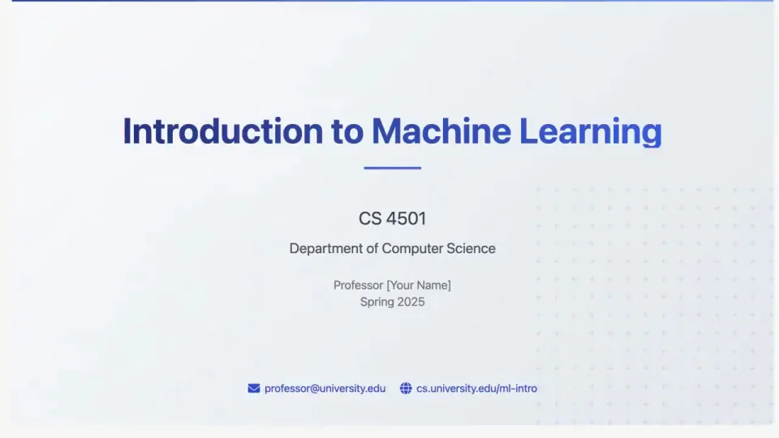

# Manus Slides｜演示文稿发布

把演示文稿从一条请求展开为一整套有结构的页面。用少量重点页说明层级，再用合集展示变化和规模。

```motion-demo
{
  "id": "sequence",
  "title": "整体编排",
  "src": "demos/sequence.html",
  "duration": 39.633333,
  "status": "authored",
  "description": "动作与构图示意",
  "initialTime": 7.8,
  "params": [
    {
      "key": "title",
      "label": "示例主文案",
      "type": "text",
      "value": "Manus slides",
      "maxLength": 60
    },
    {
      "key": "accent",
      "label": "强调色",
      "type": "color",
      "value": "#538cbe"
    }
  ],
  "presets": [
    {
      "label": "默认内容",
      "values": {
        "title": "Manus slides",
        "accent": "#538cbe"
      }
    },
    {
      "label": "OpenDesign 改编",
      "values": {
        "title": "OpenDesign",
        "accent": "#7050da"
      }
    }
  ]
}
```

## 先说明要做哪一份演示

输入里交代主题、对象与用途，随后进入创建过程。第一页应能回应请求，例如课程题目、议程或核心结论；不要直接跳到与任务无关的漂亮页面。

## 页面的主次比过场更重要

标题页用大字和留白，目录页用清楚的章节关系，内容页让图表与正文各有空间。无衬线字体承担信息，摄影型页面可用更有表现力的标题字，但正文保持易读。

浅色课程页、深色展示页与摄影页可以形成不同设计方向；每套内部的背景、强调色和标题层级要一致。



## 翻页、推近和合集各有用途

翻页用来说明前后内容，推近用来读重点，页面条带或叠放用来展示整套规模。连续快速翻页之后安排一张可完整阅读的页面，不让所有内容都一闪而过。

| 时间 | 段落 |
|---|---|
| 0.00–5.00s | 标题与长页 |
| 5.00–7.00s | 输入课程要求 |
| 7.00–9.00s | 制作过程 |
| 9.00–11.00s | 结果多页 |
| 11.00–24.00s | 翻页与图表 |
| 24.00–28.00s | 深色方案 |
| 28.00–32.00s | 图片方案 |
| 32.00–36.00s | 导出 |
| 36.00–39.63s | 三组页面收束 |

## 换主题时先重排内容

先确定新主题的封面、章节、图表与结束页，再替换字体、配色和图片。保留一份演示的内容层级与几张关键页，页数可以按实际内容调整；最后交代导出或交付位置。

## 配色与字形

无衬线界面文字与清晰大小层级。

#f7f8f6 · #222522 · #538cbe · #b6cbb9 · #ffffff

## 元素与制作规则

要求文本 / 制作面板 / 幻灯片页 / 翻页遮罩 / 长页队列

- 先给明确课程要求，结果用目录、图表、练习页证明完整性
- 平面阅读与三维式翻页交替，重要信息落到正面停留
- 末尾三种风格并列形成能力覆盖

## 内容替换

- 替换主题时保持内容类型完整：目录、解释、实例、总结
- 页面数量可变，翻页动作不能挤掉必要阅读时间

## 制作参数

[视觉与对象](style.json) · [段落时序](timeline.json) · [位置数据](tracks.json) · [文件清单](manifest.json)

此规范根据参考视频整理。HTML 为可编辑的编排示例；具体数据的来源、精度与有效区间随文件标注。

```motion-board
{
  "version": 1,
  "brand": "Manus",
  "id": "V231",
  "palette": [
    "#f7f8f6",
    "#222522",
    "#538cbe",
    "#b6cbb9",
    "#ffffff"
  ],
  "typography": "无衬线界面文字与清晰大小层级",
  "sample": "Manus slides",
  "objects": [
    "要求文本",
    "制作面板",
    "幻灯片页",
    "翻页遮罩",
    "长页队列"
  ],
  "frames": [
    {
      "path": "assets/reference-1.webp",
      "timeSeconds": 0.0,
      "frameId": "K0001",
      "role": "reference-evidence",
      "status": "measured"
    },
    {
      "path": "https://r.open-design.ai/files/ebf80677f3c90c83b931aa7a1de4a9445114a86a630b937f61cad2644579c954",
      "timeSeconds": 7.0,
      "frameId": "K0024",
      "role": "reference-evidence",
      "status": "measured"
    },
    {
      "path": "assets/reference-3.webp",
      "timeSeconds": 9.0,
      "frameId": "K0031",
      "role": "reference-evidence",
      "status": "measured"
    },
    {
      "path": "https://r.open-design.ai/files/104101ca5631633403d45b507ceee206e182a8aaca5c0b1e495cf1c6105d6bf0",
      "timeSeconds": 24.0,
      "frameId": "K0075",
      "role": "reference-evidence",
      "status": "measured"
    },
    {
      "path": "https://r.open-design.ai/files/a3be49a5da15c23a34540ed499c7d51962ba1b2c97f2c25b466d68abdd9b1c4e",
      "timeSeconds": 28.0,
      "frameId": "K0091",
      "role": "reference-evidence",
      "status": "measured"
    },
    {
      "path": "assets/reference-6.webp",
      "timeSeconds": 36.0,
      "frameId": "K0116",
      "role": "reference-evidence",
      "status": "measured"
    }
  ],
  "stages": [
    {
      "start": 0.0,
      "label": "标题与长页",
      "end": 5.0,
      "status": "inferred",
      "basis": "Representative-frame review; approximate boundaries"
    },
    {
      "start": 5.0,
      "label": "输入课程要求",
      "end": 7.0,
      "status": "inferred",
      "basis": "Representative-frame review; approximate boundaries"
    },
    {
      "start": 7.0,
      "label": "制作过程",
      "end": 9.0,
      "status": "inferred",
      "basis": "Representative-frame review; approximate boundaries"
    },
    {
      "start": 9.0,
      "label": "结果多页",
      "end": 11.0,
      "status": "inferred",
      "basis": "Representative-frame review; approximate boundaries"
    },
    {
      "start": 11.0,
      "label": "翻页与图表",
      "end": 24.0,
      "status": "inferred",
      "basis": "Representative-frame review; approximate boundaries"
    },
    {
      "start": 24.0,
      "label": "深色方案",
      "end": 28.0,
      "status": "inferred",
      "basis": "Representative-frame review; approximate boundaries"
    },
    {
      "start": 28.0,
      "label": "图片方案",
      "end": 32.0,
      "status": "inferred",
      "basis": "Representative-frame review; approximate boundaries"
    },
    {
      "start": 32.0,
      "label": "导出",
      "end": 36.0,
      "status": "inferred",
      "basis": "Representative-frame review; approximate boundaries"
    },
    {
      "start": 36.0,
      "label": "三组页面收束",
      "end": 39.633333,
      "status": "inferred",
      "basis": "Representative-frame review; approximate boundaries"
    }
  ],
  "duration": 39.633333,
  "fontFamily": "Arial, sans-serif"
}
```
