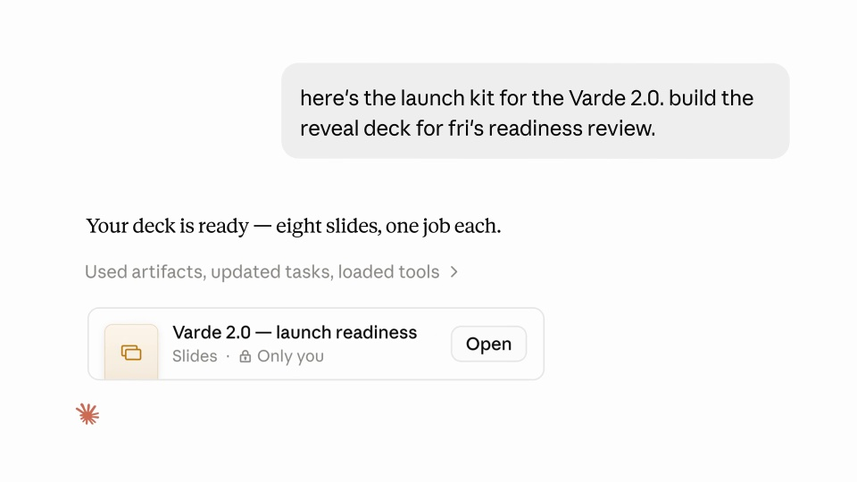
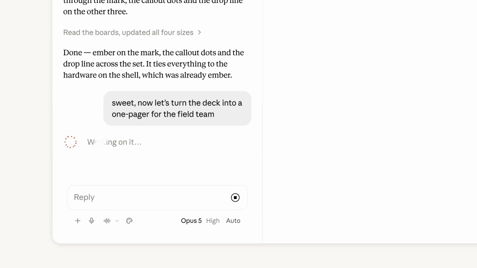

# Claude — decks, docs, and designs in chat

选定一个产品主题，让同一批内容依次成为幻灯片、不同画幅的海报和文档。

```motion-demo
{
  "id": "sequence",
  "title": "整体编排",
  "src": "demos/sequence.html",
  "duration": 94.625,
  "status": "authored",
  "description": "动作与构图示意",
  "initialTime": 17.3,
  "params": [
    {
      "key": "title",
      "label": "示例主文案",
      "type": "text",
      "value": "Create docs",
      "maxLength": 60
    },
    {
      "key": "accent",
      "label": "强调色",
      "type": "color",
      "value": "#c57d63"
    }
  ],
  "presets": [
    {
      "label": "默认内容",
      "values": {
        "title": "Create docs",
        "accent": "#c57d63"
      }
    },
    {
      "label": "OpenDesign 改编",
      "values": {
        "title": "OpenDesign",
        "accent": "#7050da"
      }
    }
  ]
}
```

## 先确定跨格式共用的内容

产品图、主标题和主题色贯穿全部成果。暖白界面作为容器，深青设计稿承担视觉重点；说明文字用衬线，编辑控件用清楚的无衬线。



## 从资料走到第一份幻灯片

先放请求和资料，再打开生成的幻灯片。镜头靠近当前编辑区，选中文字后才出现工具条，让修改发生在明确对象上。

```motion-demo
{
  "id": "clip-2",
  "title": "从资料走到第一份幻灯片",
  "src": "demos/clip-2.html",
  "duration": 29,
  "status": "authored",
  "description": "4–33 秒 · 动作示意",
  "initialTime": 0.6
}
```

## 用评论提出下一种格式

把评论锚在当前设计上，提出派生要求后展开多个尺寸。竖版、方版和横版重新安排文案与图片，保持同一主题的轮廓与配色。

```motion-demo
{
  "id": "clip-3",
  "title": "用评论提出下一种格式",
  "src": "demos/clip-3.html",
  "duration": 26,
  "status": "authored",
  "description": "33–59 秒 · 动作示意",
  "initialTime": 0.6
}
```

## 转成文档后，改变阅读方式

进入文档时降低画面装饰，增加正文和数据图的篇幅。图表承接前面的产品内容，分享入口放在成果完整之后。



## 整条片子的格式递进

每个格式先给全貌，再看局部修改，最后回到成果集。让观众先认出“是什么”，再看“改了哪里”。

| 时间 | 段落 |
|---|---|
| 0.00–4.00s | 创作文档主张 |
| 4.00–17.00s | 输入与文件 |
| 17.00–21.00s | 生成幻灯片 |
| 21.00–33.00s | 文字与主题编辑 |
| 33.00–46.00s | 评论要求派生素材 |
| 46.00–59.00s | 多尺寸海报 |
| 59.00–70.00s | 转为文档 |
| 70.00–82.00s | 数据图与正文 |
| 82.00–94.62s | 分享与品牌 |

## 换主题需要准备什么

提供一套产品素材、主文案和核心数据。可以更换品牌与图形语言；派生版的标题、重点信息和产品身份要保持一致。

## 配色与字形

暖白工具界面、深青设计稿、衬线旁白。

#f8f7f1 · #202421 · #c57d63 · #1d545a · #e2e2d8

## 元素与制作规则

对话输入 / 原始资料 / 幻灯片 / 评论锚点 / 多画幅海报 / 文档

- 同一夹克主题从幻灯片派生多尺寸设计，再转为文档，内容身份跨格式保留。
- 先点击选中文字再出现工具条，评论绑定局部目标。
- 各格式展示由全局到局部再返回成果集。

## 内容替换

- 替换产品与素材，保持一个主题跨多格式的复用关系。
- 派生版保持同一重点文案、素材与配色，画幅变化要重新排版。

## 制作参数

[视觉与对象](style.json) · [段落时序](timeline.json) · [位置数据](tracks.json) · [文件清单](manifest.json)

此规范根据参考视频整理。HTML 为可编辑的编排示例；具体数据的来源、精度与有效区间随文件标注。

```motion-board
{
  "version": 1,
  "brand": "Anthropic",
  "id": "V268",
  "palette": [
    "#f8f7f1",
    "#202421",
    "#c57d63",
    "#1d545a",
    "#e2e2d8"
  ],
  "typography": "暖白工具界面、深青设计稿、衬线旁白",
  "sample": "Create docs",
  "objects": [
    "对话输入",
    "原始资料",
    "幻灯片",
    "评论锚点",
    "多画幅海报",
    "文档"
  ],
  "frames": [
    {
      "path": "assets/reference-1.jpg",
      "timeSeconds": 0.0,
      "frameId": "K0001",
      "role": "reference-evidence",
      "status": "measured"
    },
    {
      "path": "assets/reference-2.jpg",
      "timeSeconds": 17.0,
      "frameId": "K0036",
      "role": "reference-evidence",
      "status": "measured"
    },
    {
      "path": "assets/reference-3.jpg",
      "timeSeconds": 21.0,
      "frameId": "K0050",
      "role": "reference-evidence",
      "status": "measured"
    },
    {
      "path": "assets/reference-4.jpg",
      "timeSeconds": 46.0,
      "frameId": "K0147",
      "role": "reference-evidence",
      "status": "measured"
    },
    {
      "path": "assets/reference-5.jpg",
      "timeSeconds": 59.0,
      "frameId": "K0202",
      "role": "reference-evidence",
      "status": "measured"
    },
    {
      "path": "assets/reference-6.jpg",
      "timeSeconds": 82.0,
      "frameId": "K0267",
      "role": "reference-evidence",
      "status": "measured"
    }
  ],
  "stages": [
    {
      "start": 0,
      "label": "创作文档主张",
      "end": 4,
      "status": "inferred",
      "basis": "Representative-frame review; approximate boundaries"
    },
    {
      "start": 4,
      "label": "输入与文件",
      "end": 17,
      "status": "inferred",
      "basis": "Representative-frame review; approximate boundaries"
    },
    {
      "start": 17,
      "label": "生成幻灯片",
      "end": 21,
      "status": "inferred",
      "basis": "Representative-frame review; approximate boundaries"
    },
    {
      "start": 21,
      "label": "文字与主题编辑",
      "end": 33,
      "status": "inferred",
      "basis": "Representative-frame review; approximate boundaries"
    },
    {
      "start": 33,
      "label": "评论要求派生素材",
      "end": 46,
      "status": "inferred",
      "basis": "Representative-frame review; approximate boundaries"
    },
    {
      "start": 46,
      "label": "多尺寸海报",
      "end": 59,
      "status": "inferred",
      "basis": "Representative-frame review; approximate boundaries"
    },
    {
      "start": 59,
      "label": "转为文档",
      "end": 70,
      "status": "inferred",
      "basis": "Representative-frame review; approximate boundaries"
    },
    {
      "start": 70,
      "label": "数据图与正文",
      "end": 82,
      "status": "inferred",
      "basis": "Representative-frame review; approximate boundaries"
    },
    {
      "start": 82,
      "label": "分享与品牌",
      "end": 94.625,
      "status": "inferred",
      "basis": "Representative-frame review; approximate boundaries"
    }
  ],
  "duration": 94.625,
  "fontFamily": "Georgia, serif"
}
```
