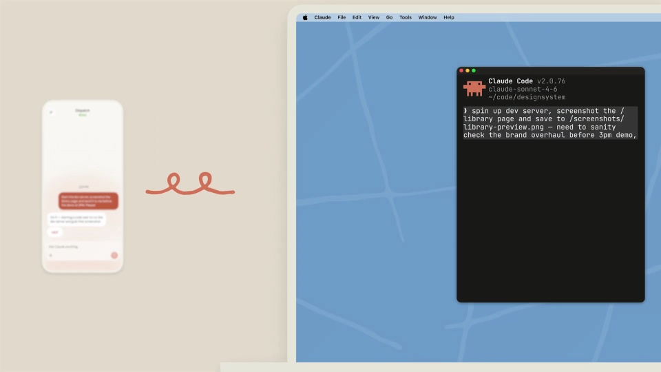

# Claude — computer use in Cowork and Claude Code

手机负责提出任务，桌面负责执行，结果最终回到手机。每个回合保持相同方向，让不同任务沿用同一套表达。

```motion-demo
{
  "id": "sequence",
  "title": "整体编排",
  "src": "demos/sequence.html",
  "duration": 73.333333,
  "status": "authored",
  "description": "动作与构图示意",
  "initialTime": 22,
  "params": [
    {
      "key": "title",
      "label": "示例主文案",
      "type": "text",
      "value": "Reach your desktop",
      "maxLength": 60
    },
    {
      "key": "accent",
      "label": "强调色",
      "type": "color",
      "value": "#ba5d44"
    }
  ],
  "presets": [
    {
      "label": "默认内容",
      "values": {
        "title": "Reach your desktop",
        "accent": "#ba5d44"
      }
    },
    {
      "label": "OpenDesign 改编",
      "values": {
        "title": "OpenDesign",
        "accent": "#7050da"
      }
    }
  ]
}
```

## 固定两个端点的角色

砂色底、白色手机与桌面设备、砖红请求气泡、细线连接。

每个任务按手机请求→桌面执行→手机确认闭环，三次重复同一语法但内容递进。



## 先聚焦请求，再展开执行端

设备并置时手机在左、执行环境在右；细连接线强调因果而非装饰轨迹。

镜头先聚焦输入，再拉开显示两个端点，最后推近回传结果。

```motion-demo
{
  "id": "clip-2",
  "title": "先聚焦请求，再展开执行端",
  "src": "demos/clip-2.html",
  "duration": 10,
  "status": "authored",
  "description": "6–16 秒 · 动作示意",
  "initialTime": 0.6
}
```

## 重复闭环，逐次更换任务

每轮都从手机发起，切到电脑执行，再回到手机查看结果。三个任务逐次替换内容，保留同一方向与设备位置。

| 时间 | 段落 |
|---|---|
| 0.00–6.00s | 任务情境短句 |
| 6.00–12.00s | 手机请求 |
| 12.00–14.00s | 手机与电脑并置 |
| 14.00–20.00s | 导出文档 |
| 20.00–25.00s | 添加日历附件 |
| 25.00–28.00s | 结果回传 |
| 28.00–34.00s | 第二个请求 |
| 34.00–43.00s | 运行与截图 |
| 43.00–47.00s | 手机收到截图 |
| 47.00–53.00s | 第三个请求 |
| 53.00–65.00s | 批量处理图片 |
| 65.00–70.00s | 导出结果 |
| 70.00–73.33s | 品牌收尾 |

## 替换跨设备任务

换为创作工具时可演示远程发起→桌面生成→手机审阅；保持端点角色一致。

可换任务数量，单次任务须有起因、过程和结果，不能只替换设备上的静态图。

## 配色与字形

砂色底、白色手机与桌面设备、砖红请求气泡、细线连接。

#e1d9ca · #20211d · #ba5d44 · #c5d5cb · #ffffff

## 元素与制作规则

手机请求端 / 桌面执行端 / 连接线 / 请求气泡 / 操作窗口 / 回传卡片

- 每个任务按手机请求→桌面执行→手机确认闭环，三次重复同一语法但内容递进。
- 设备并置时手机在左、执行环境在右；细连接线强调因果而非装饰轨迹。
- 镜头先聚焦输入，再拉开显示两个端点，最后推近回传结果。

## 内容替换

- 换为创作工具时可演示远程发起→桌面生成→手机审阅；保持端点角色一致。
- 可换任务数量，单次任务须有起因、过程和结果，不能只替换设备上的静态图。

## 制作参数

[视觉与对象](style.json) · [段落时序](timeline.json) · [位置数据](tracks.json) · [文件清单](manifest.json)

此规范根据参考视频整理。HTML 为可编辑的编排示例；具体数据的来源、精度与有效区间随文件标注。

```motion-board
{
  "version": 1,
  "brand": "Anthropic",
  "id": "V238",
  "palette": [
    "#e1d9ca",
    "#20211d",
    "#ba5d44",
    "#c5d5cb",
    "#ffffff"
  ],
  "typography": "砂色底、白色手机与桌面设备、砖红请求气泡、细线连接",
  "sample": "Reach your desktop",
  "objects": [
    "手机请求端",
    "桌面执行端",
    "连接线",
    "请求气泡",
    "操作窗口",
    "回传卡片"
  ],
  "frames": [
    {
      "path": "assets/reference-1.jpg",
      "timeSeconds": 0.0,
      "frameId": "K0001",
      "role": "reference-evidence",
      "status": "measured"
    },
    {
      "path": "assets/reference-2.jpg",
      "timeSeconds": 12.0,
      "frameId": "K0024",
      "role": "reference-evidence",
      "status": "measured"
    },
    {
      "path": "assets/reference-3.jpg",
      "timeSeconds": 25.0,
      "frameId": "K0055",
      "role": "reference-evidence",
      "status": "measured"
    },
    {
      "path": "assets/reference-4.jpg",
      "timeSeconds": 34.0,
      "frameId": "K0075",
      "role": "reference-evidence",
      "status": "measured"
    },
    {
      "path": "assets/reference-5.jpg",
      "timeSeconds": 53.0,
      "frameId": "K0123",
      "role": "reference-evidence",
      "status": "measured"
    },
    {
      "path": "assets/reference-6.jpg",
      "timeSeconds": 70.0,
      "frameId": "K0175",
      "role": "reference-evidence",
      "status": "measured"
    }
  ],
  "stages": [
    {
      "start": 0,
      "label": "任务情境短句",
      "end": 6,
      "status": "inferred",
      "basis": "Representative-frame review; approximate boundaries"
    },
    {
      "start": 6,
      "label": "手机请求",
      "end": 12,
      "status": "inferred",
      "basis": "Representative-frame review; approximate boundaries"
    },
    {
      "start": 12,
      "label": "手机与电脑并置",
      "end": 14,
      "status": "inferred",
      "basis": "Representative-frame review; approximate boundaries"
    },
    {
      "start": 14,
      "label": "导出文档",
      "end": 20,
      "status": "inferred",
      "basis": "Representative-frame review; approximate boundaries"
    },
    {
      "start": 20,
      "label": "添加日历附件",
      "end": 25,
      "status": "inferred",
      "basis": "Representative-frame review; approximate boundaries"
    },
    {
      "start": 25,
      "label": "结果回传",
      "end": 28,
      "status": "inferred",
      "basis": "Representative-frame review; approximate boundaries"
    },
    {
      "start": 28,
      "label": "第二个请求",
      "end": 34,
      "status": "inferred",
      "basis": "Representative-frame review; approximate boundaries"
    },
    {
      "start": 34,
      "label": "运行与截图",
      "end": 43,
      "status": "inferred",
      "basis": "Representative-frame review; approximate boundaries"
    },
    {
      "start": 43,
      "label": "手机收到截图",
      "end": 47,
      "status": "inferred",
      "basis": "Representative-frame review; approximate boundaries"
    },
    {
      "start": 47,
      "label": "第三个请求",
      "end": 53,
      "status": "inferred",
      "basis": "Representative-frame review; approximate boundaries"
    },
    {
      "start": 53,
      "label": "批量处理图片",
      "end": 65,
      "status": "inferred",
      "basis": "Representative-frame review; approximate boundaries"
    },
    {
      "start": 65,
      "label": "导出结果",
      "end": 70,
      "status": "inferred",
      "basis": "Representative-frame review; approximate boundaries"
    },
    {
      "start": 70,
      "label": "品牌收尾",
      "end": 73.333333,
      "status": "inferred",
      "basis": "Representative-frame review; approximate boundaries"
    }
  ],
  "duration": 73.333333,
  "fontFamily": "Arial, sans-serif"
}
```
