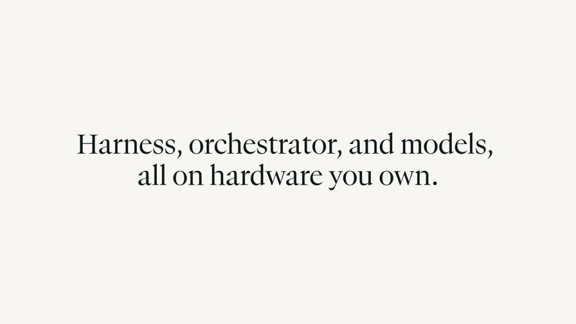

# Perplexity — Portable Computer on NVIDIA DGX Spark

先用任务说明本地设备能做什么，再用架构图说明它如何连接工具和云端。具体成果与抽象关系交替出现。

```motion-demo
{
  "id": "sequence",
  "title": "整体编排",
  "src": "demos/sequence.html",
  "duration": 97.0,
  "status": "authored",
  "description": "动作与构图示意",
  "initialTime": 17,
  "params": [
    {
      "key": "title",
      "label": "示例主文案",
      "type": "text",
      "value": "Portable Computer",
      "maxLength": 60
    },
    {
      "key": "accent",
      "label": "强调色",
      "type": "color",
      "value": "#2c8587"
    }
  ],
  "presets": [
    {
      "label": "默认内容",
      "values": {
        "title": "Portable Computer",
        "accent": "#2c8587"
      }
    },
    {
      "label": "OpenDesign 改编",
      "values": {
        "title": "OpenDesign",
        "accent": "#7050da"
      }
    }
  ]
}
```

## 设备与任务先建立联系

设备标题后进入本地选择与任务输入。浅暖画布中保持设备或本地标记，主张使用衬线字，界面字段用无衬线；青绿用于执行焦点，灰色工具节点作为辅助。



## 本地工具围绕设备排布

把工具、模型、环境与执行能力围绕本地节点放置。连线汇向同一中心，节点间距足够容纳名称；当前动作沿相关连线推进，其余关系保持安静。

```motion-demo
{
  "id": "clip-2",
  "title": "本地工具围绕设备排布",
  "src": "demos/clip-2.html",
  "duration": 9,
  "status": "authored",
  "description": "34–43 秒 · 动作示意",
  "initialTime": 0.6
}
```

## 云端作为另一层加入

云端节点在本地网络之外出现，通过一条明确连接加入工作。云审查回传后，再让本地任务继续；不要让云节点与本地工具混成同一圈。

```motion-demo
{
  "id": "clip-3",
  "title": "云端作为另一层加入",
  "src": "demos/clip-3.html",
  "duration": 18,
  "status": "authored",
  "description": "59–77 秒 · 动作示意",
  "initialTime": 0.6
}
```

## 三个任务穿插两次架构说明

用第一个任务建立产品印象，第二个任务解释云协作，第三个任务展示团队结果。每次架构段结束都接一个具体输出，把拓扑关系落回工作成果。

| 时间 | 段落 |
|---|---|
| 0.00–8.00s | 设备标题 |
| 8.00–17.00s | 本地选择 |
| 17.00–27.00s | 输入任务 |
| 27.00–34.00s | 端到端主张 |
| 34.00–43.00s | 本地环形拓扑 |
| 43.00–51.00s | 报告 |
| 51.00–59.00s | 第二任务 |
| 59.00–68.00s | 云模型层 |
| 68.00–77.00s | 云审查回传 |
| 77.00–85.00s | 第三任务 |
| 85.00–93.00s | 团队结果 |
| 93.00–97.00s | 品牌 |

## 迁移时保留本地与云的分工

可换设备、工具和业务任务。先为每个节点写清职责，再决定哪些动作留在本地、哪些交给外部协作；结果页与对应执行节点使用一致命名。

## 配色与字形

衬线主张标题搭配无衬线界面文字；大留白、细边框。

#fafaf7 · #171917 · #2c8587 · #dbe4df · #ffffff

## 元素与制作规则

本地设备 / 工具环 / 云模型 / 任务框 / 报告 / 团队消息

- 本地工具围绕设备成环，云模型另置一层；连线表示按需提升而非数据默认外传。
- 任务示例穿插架构图，避免只有抽象拓扑。

## 内容替换

- 可换设备和工具，保留本地执行与按需云协同边界。

## 制作参数

[视觉与对象](style.json) · [段落时序](timeline.json) · [位置数据](tracks.json) · [文件清单](manifest.json)

此规范根据参考视频整理。HTML 为可编辑的编排示例；具体数据的来源、精度与有效区间随文件标注。

```motion-board
{
  "version": 1,
  "brand": "Perplexity",
  "id": "V261",
  "palette": [
    "#fafaf7",
    "#171917",
    "#2c8587",
    "#dbe4df",
    "#ffffff"
  ],
  "typography": "衬线主张标题搭配无衬线界面文字；大留白、细边框",
  "sample": "Portable Computer",
  "objects": [
    "本地设备",
    "工具环",
    "云模型",
    "任务框",
    "报告",
    "团队消息"
  ],
  "frames": [
    {
      "path": "assets/reference-1.jpg",
      "timeSeconds": 0.0,
      "frameId": "K0001",
      "role": "reference-evidence",
      "status": "measured"
    },
    {
      "path": "assets/reference-2.jpg",
      "timeSeconds": 17.0,
      "frameId": "K0048",
      "role": "reference-evidence",
      "status": "measured"
    },
    {
      "path": "assets/reference-3.jpg",
      "timeSeconds": 34.0,
      "frameId": "K0075",
      "role": "reference-evidence",
      "status": "measured"
    },
    {
      "path": "assets/reference-4.jpg",
      "timeSeconds": 59.0,
      "frameId": "K0130",
      "role": "reference-evidence",
      "status": "measured"
    },
    {
      "path": "assets/reference-5.jpg",
      "timeSeconds": 77.0,
      "frameId": "K0170",
      "role": "reference-evidence",
      "status": "measured"
    },
    {
      "path": "assets/reference-6.jpg",
      "timeSeconds": 93.0,
      "frameId": "K0192",
      "role": "reference-evidence",
      "status": "measured"
    }
  ],
  "stages": [
    {
      "start": 0,
      "label": "设备标题",
      "end": 8,
      "status": "inferred",
      "basis": "Representative-frame review; approximate boundaries"
    },
    {
      "start": 8,
      "label": "本地选择",
      "end": 17,
      "status": "inferred",
      "basis": "Representative-frame review; approximate boundaries"
    },
    {
      "start": 17,
      "label": "输入任务",
      "end": 27,
      "status": "inferred",
      "basis": "Representative-frame review; approximate boundaries"
    },
    {
      "start": 27,
      "label": "端到端主张",
      "end": 34,
      "status": "inferred",
      "basis": "Representative-frame review; approximate boundaries"
    },
    {
      "start": 34,
      "label": "本地环形拓扑",
      "end": 43,
      "status": "inferred",
      "basis": "Representative-frame review; approximate boundaries"
    },
    {
      "start": 43,
      "label": "报告",
      "end": 51,
      "status": "inferred",
      "basis": "Representative-frame review; approximate boundaries"
    },
    {
      "start": 51,
      "label": "第二任务",
      "end": 59,
      "status": "inferred",
      "basis": "Representative-frame review; approximate boundaries"
    },
    {
      "start": 59,
      "label": "云模型层",
      "end": 68,
      "status": "inferred",
      "basis": "Representative-frame review; approximate boundaries"
    },
    {
      "start": 68,
      "label": "云审查回传",
      "end": 77,
      "status": "inferred",
      "basis": "Representative-frame review; approximate boundaries"
    },
    {
      "start": 77,
      "label": "第三任务",
      "end": 85,
      "status": "inferred",
      "basis": "Representative-frame review; approximate boundaries"
    },
    {
      "start": 85,
      "label": "团队结果",
      "end": 93,
      "status": "inferred",
      "basis": "Representative-frame review; approximate boundaries"
    },
    {
      "start": 93,
      "label": "品牌",
      "end": 97.0,
      "status": "inferred",
      "basis": "Representative-frame review; approximate boundaries"
    }
  ],
  "duration": 97.0,
  "fontFamily": "Georgia, serif"
}
```
