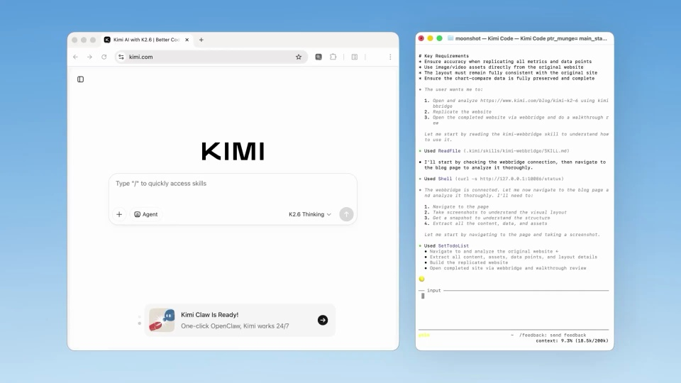

# Kimi Web Bridge - Kimi's browser extension.

把浏览器操作和代理反馈并排展示，让输入、执行与结果始终能互相对上。

```motion-demo
{
  "id": "sequence",
  "title": "整体编排",
  "src": "demos/sequence.html",
  "duration": 63.333333,
  "status": "authored",
  "description": "动作与构图示意",
  "initialTime": 13.3,
  "params": [
    {
      "key": "title",
      "label": "示例主文案",
      "type": "text",
      "value": "Kimi WebBridge",
      "maxLength": 60
    },
    {
      "key": "accent",
      "label": "强调色",
      "type": "color",
      "value": "#c3e4f1"
    }
  ],
  "presets": [
    {
      "label": "默认内容",
      "values": {
        "title": "Kimi WebBridge",
        "accent": "#c3e4f1"
      }
    },
    {
      "label": "OpenDesign 改编",
      "values": {
        "title": "OpenDesign",
        "accent": "#7050da"
      }
    }
  ]
}
```

## 固定双视图，减少来回找位置

深浅蓝渐变作为外层，左边浏览器更宽，右边终端保持连续。页面使用无衬线，终端使用等宽字；章节标题只在任务之间短暂占满画面。

## 从检索结果走到表格

命令先进入终端，再打开多个来源页面。重点内容用局部高亮表示，收集完成后切到表格，表格条目承接刚才的来源。

```motion-demo
{
  "id": "clip-2",
  "title": "从检索结果走到表格",
  "src": "demos/clip-2.html",
  "duration": 24,
  "status": "authored",
  "description": "6–30 秒 · 动作示意",
  "initialTime": 0.6
}
```

## 表单任务用字段增长说明过程

第二个任务从短请求开始，页面依次出现标题、问题和选项。终端给当前状态，浏览器展示新增内容，两边保持同一任务名。

## 网页任务要展示成品与浏览

输入目标后先浏览页面，再出现生成后的页面。末段滚动查看主要区块，终端用对应条目总结结果，让观众知道任务落在哪里。



## 三组任务，各自有开头和结束

用章节短句切开检索、表单和网页三个案例。每组先看请求，再看动作和产物，完成一组后再换下一组。

| 时间 | 段落 |
|---|---|
| 0.00–6.00s | 功能与扩展定位 |
| 6.00–13.00s | 命令输入 |
| 13.00–23.00s | 浏览多个网站 |
| 23.00–30.00s | 写入表格 |
| 30.00–40.00s | 生成调查问卷 |
| 40.00–45.00s | 复刻网页任务 |
| 45.00–51.00s | 读取与重建 |
| 51.00–58.00s | 验证报告 |
| 58.00–63.33s | 品牌 |

## 替换工具与站点

可换浏览器助手、目标网站和任务。保持双视图分工，结果类型随任务改变，避免所有案例都以命令滚动结束。

## 配色与字形

深浅蓝渐变、左浏览器右终端、章节大字。

#62a4d5 · #ffffff · #c3e4f1 · #263557 · #e6eff8

## 元素与制作规则

浏览器 / 终端 / 命令 / 网页高亮 / 表格 / 调查表单 / 验证报告

- 浏览器操作和终端反馈并排，体现代理计划与页面结果的对应。
- 三组任务各有输入、执行、结果，章节标题短暂打断录屏。
- 最后报告对应网页检查，不能只有滚动命令。

## 内容替换

- 适用于浏览器自动化展示；替换任务站点和结果，保留双视图因果。
- 真实联网执行与复刻准确率不由示例证明。

## 制作参数

[视觉与对象](style.json) · [段落时序](timeline.json) · [位置数据](tracks.json) · [文件清单](manifest.json)

此规范根据参考视频整理。HTML 为可编辑的编排示例；具体数据的来源、精度与有效区间随文件标注。

```motion-board
{
  "version": 1,
  "brand": "Kimi",
  "id": "V246",
  "palette": [
    "#62a4d5",
    "#ffffff",
    "#c3e4f1",
    "#263557",
    "#e6eff8"
  ],
  "typography": "深浅蓝渐变、左浏览器右终端、章节大字",
  "sample": "Kimi WebBridge",
  "objects": [
    "浏览器",
    "终端",
    "命令",
    "网页高亮",
    "表格",
    "调查表单",
    "验证报告"
  ],
  "frames": [
    {
      "path": "assets/reference-1.jpg",
      "timeSeconds": 0.0,
      "frameId": "K0001",
      "role": "reference-evidence",
      "status": "measured"
    },
    {
      "path": "assets/reference-2.jpg",
      "timeSeconds": 13.0,
      "frameId": "K0032",
      "role": "reference-evidence",
      "status": "measured"
    },
    {
      "path": "https://r.open-design.ai/files/4c47c092ccf5fe6a58a3951ef69d662a38ccdb1d9e65ce52808bcd4e6873fc9b",
      "timeSeconds": 23.0,
      "frameId": "K0069",
      "role": "reference-evidence",
      "status": "measured"
    },
    {
      "path": "assets/reference-4.jpg",
      "timeSeconds": 40.0,
      "frameId": "K0113",
      "role": "reference-evidence",
      "status": "measured"
    },
    {
      "path": "assets/reference-5.jpg",
      "timeSeconds": 45.0,
      "frameId": "K0130",
      "role": "reference-evidence",
      "status": "measured"
    },
    {
      "path": "https://r.open-design.ai/files/4938c8c4c8e6ae9bc1dd0cbc50208e3ba34aa3c9a17111beed4a5fcea488ba1b",
      "timeSeconds": 58.0,
      "frameId": "K0186",
      "role": "reference-evidence",
      "status": "measured"
    }
  ],
  "stages": [
    {
      "start": 0,
      "label": "功能与扩展定位",
      "end": 6,
      "status": "inferred",
      "basis": "Representative-frame review; approximate boundaries"
    },
    {
      "start": 6,
      "label": "命令输入",
      "end": 13,
      "status": "inferred",
      "basis": "Representative-frame review; approximate boundaries"
    },
    {
      "start": 13,
      "label": "浏览多个网站",
      "end": 23,
      "status": "inferred",
      "basis": "Representative-frame review; approximate boundaries"
    },
    {
      "start": 23,
      "label": "写入表格",
      "end": 30,
      "status": "inferred",
      "basis": "Representative-frame review; approximate boundaries"
    },
    {
      "start": 30,
      "label": "生成调查问卷",
      "end": 40,
      "status": "inferred",
      "basis": "Representative-frame review; approximate boundaries"
    },
    {
      "start": 40,
      "label": "复刻网页任务",
      "end": 45,
      "status": "inferred",
      "basis": "Representative-frame review; approximate boundaries"
    },
    {
      "start": 45,
      "label": "读取与重建",
      "end": 51,
      "status": "inferred",
      "basis": "Representative-frame review; approximate boundaries"
    },
    {
      "start": 51,
      "label": "验证报告",
      "end": 58,
      "status": "inferred",
      "basis": "Representative-frame review; approximate boundaries"
    },
    {
      "start": 58,
      "label": "品牌",
      "end": 63.333333,
      "status": "inferred",
      "basis": "Representative-frame review; approximate boundaries"
    }
  ],
  "duration": 63.333333,
  "fontFamily": "Arial, sans-serif"
}
```
