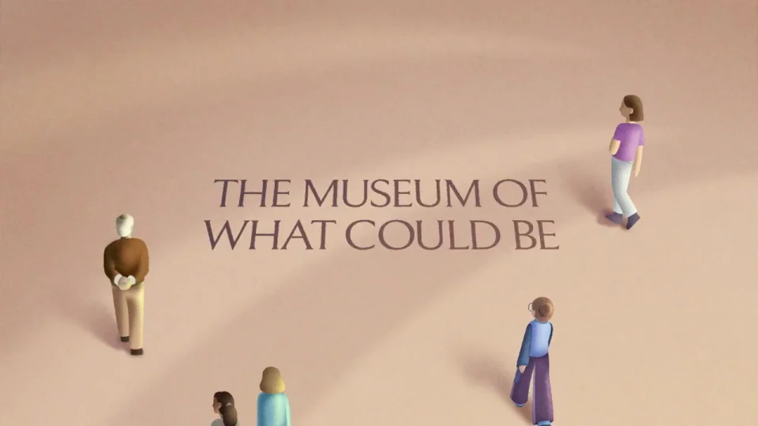

# There are many futures｜品牌片

让一个人写下的愿景变成周围的世界，再把镜头交给更多创作者。整片从个人选择走向多种未来。

```motion-demo
{
  "id": "sequence",
  "title": "整体编排",
  "src": "demos/sequence.html",
  "duration": 76.916667,
  "status": "authored",
  "description": "动作与构图示意",
  "initialTime": 18.3,
  "params": [
    {
      "key": "title",
      "label": "示例主文案",
      "type": "text",
      "value": "There are many futures",
      "maxLength": 60
    },
    {
      "key": "accent",
      "label": "强调色",
      "type": "color",
      "value": "#a6bc65"
    }
  ],
  "presets": [
    {
      "label": "默认内容",
      "values": {
        "title": "There are many futures",
        "accent": "#a6bc65"
      }
    },
    {
      "label": "OpenDesign 改编",
      "values": {
        "title": "OpenDesign",
        "accent": "#7050da"
      }
    }
  ]
}
```

## 从一张桌面和一个人开始

人物、桌面和纸张构成开场的小空间。采用柔和的黏土感体积、低对比粉彩和简洁字形，保留手部动作与视线方向。



## 让书写触发空间变化

先出现书写动作，再从纸面展开建筑或场景。新环境围绕人物生长，镜头缓慢推进，人物始终是变化的发起者。

```motion-demo
{
  "id": "clip-2",
  "title": "让书写触发空间变化",
  "src": "demos/clip-2.html",
  "duration": 26,
  "status": "authored",
  "description": "6–32 秒 · 动作示意",
  "initialTime": 0.6
}
```

## 给“理想未来”一个停顿

进入暗场后减少装饰和移动，用更长的停留承载反思。重新打开空间时改变场景方向和人物关系，而非只换背景颜色。

## 把创作权交给更多人

后段增加人物数量，每个人对应不同作品。镜头拉远，让局部世界组成开放群像；结尾文案以提问收束，给观众留下选择。

| 时间 | 段落 |
|---|---|
| 0.00–6.00s | 可能性博物馆 |
| 6.00–18.00s | 人物书写愿景 |
| 18.00–32.00s | 纸面世界展开 |
| 32.00–42.00s | 理想问题与暗场 |
| 42.00–51.00s | 重新定义未来 |
| 51.00–67.00s | 多人共同创造 |
| 67.00–76.92s | 开放世界与落版 |

## 迁移时先确定愿景的分歧

可替换人物、建筑和未来想象。新版本需要准备一个初始愿望、一个转折和多种不同答案，让场景差异承担内容。

## 配色与字形

柔和三维黏土感人物、粉彩建筑与发光文字。

#dec3ae · #292c45 · #a6bc65 · #758bd2 · #f5d9b5

## 元素与制作规则

主角 / 书写台 / 纸面世界 / 发光文字 / 其他创作者 / 空间路径

- 先以个体书写触发世界变化，再从单一理想转向多人的多种未来。
- 空间从局促台面扩大到环绕场景、暗场反思、开放群像。
- 人物视线与镜头推进共同引导关注，不仅是背景换色。

## 内容替换

- 复用愿望→试验→反思→共同创造的路径。
- 换主题须重写冲突和回报，不只替换品牌。

## 制作参数

[视觉与对象](style.json) · [段落时序](timeline.json) · [位置数据](tracks.json) · [文件清单](manifest.json)

此规范根据参考视频整理。HTML 为可编辑的编排示例；具体数据的来源、精度与有效区间随文件标注。

```motion-board
{
  "version": 1,
  "brand": "OpenAI",
  "id": "V015",
  "palette": [
    "#dec3ae",
    "#292c45",
    "#a6bc65",
    "#758bd2",
    "#f5d9b5"
  ],
  "typography": "柔和三维黏土感人物、粉彩建筑与发光文字",
  "sample": "There are many futures",
  "objects": [
    "主角",
    "书写台",
    "纸面世界",
    "发光文字",
    "其他创作者",
    "空间路径"
  ],
  "frames": [
    {
      "path": "assets/reference-1.webp",
      "timeSeconds": 0.0,
      "frameId": "K0001",
      "role": "reference-evidence",
      "status": "measured"
    },
    {
      "path": "https://r.open-design.ai/files/5d52fb9645a83fd417b38503a0545b38c8f14f48b77c46cfd14ffd6f194e2100",
      "timeSeconds": 6.0,
      "frameId": "K0027",
      "role": "reference-evidence",
      "status": "measured"
    },
    {
      "path": "assets/reference-3.webp",
      "timeSeconds": 18.0,
      "frameId": "K0076",
      "role": "reference-evidence",
      "status": "measured"
    },
    {
      "path": "assets/reference-4.webp",
      "timeSeconds": 42.0,
      "frameId": "K0171",
      "role": "reference-evidence",
      "status": "measured"
    },
    {
      "path": "https://r.open-design.ai/files/47ab672b6c0ee2f9e58486c70138bf7ee371ce6f8f9347c99b627623e924bf8d",
      "timeSeconds": 51.0,
      "frameId": "K0204",
      "role": "reference-evidence",
      "status": "measured"
    },
    {
      "path": "https://r.open-design.ai/files/4238ef66505422ab267dc01ffa293e1b84f9991f067e404e29cafb04645c1966",
      "timeSeconds": 67.0,
      "frameId": "K0271",
      "role": "reference-evidence",
      "status": "measured"
    }
  ],
  "stages": [
    {
      "start": 0,
      "label": "可能性博物馆",
      "end": 6,
      "status": "inferred",
      "basis": "Representative-frame review; approximate boundaries"
    },
    {
      "start": 6,
      "label": "人物书写愿景",
      "end": 18,
      "status": "inferred",
      "basis": "Representative-frame review; approximate boundaries"
    },
    {
      "start": 18,
      "label": "纸面世界展开",
      "end": 32,
      "status": "inferred",
      "basis": "Representative-frame review; approximate boundaries"
    },
    {
      "start": 32,
      "label": "理想问题与暗场",
      "end": 42,
      "status": "inferred",
      "basis": "Representative-frame review; approximate boundaries"
    },
    {
      "start": 42,
      "label": "重新定义未来",
      "end": 51,
      "status": "inferred",
      "basis": "Representative-frame review; approximate boundaries"
    },
    {
      "start": 51,
      "label": "多人共同创造",
      "end": 67,
      "status": "inferred",
      "basis": "Representative-frame review; approximate boundaries"
    },
    {
      "start": 67,
      "label": "开放世界与落版",
      "end": 76.916667,
      "status": "inferred",
      "basis": "Representative-frame review; approximate boundaries"
    }
  ],
  "duration": 76.916667,
  "fontFamily": "Arial, sans-serif"
}
```
