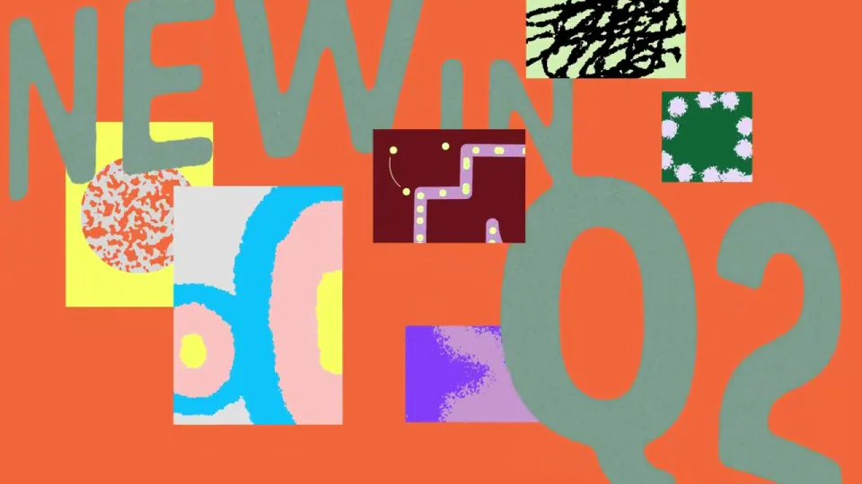

# 季度业绩｜2026 Q2 回顾

前半展示产品能力，后半用指标海报总结季度。复杂功能逐渐收束成少量大数字，再落到品牌。

```motion-demo
{
  "id": "sequence",
  "title": "整体编排",
  "src": "demos/sequence.html",
  "duration": 46.0,
  "status": "authored",
  "description": "动作与构图示意",
  "initialTime": 8,
  "params": [
    {
      "key": "title",
      "label": "示例主文案",
      "type": "text",
      "value": "Q2 Highlights",
      "maxLength": 60
    },
    {
      "key": "accent",
      "label": "强调色",
      "type": "color",
      "value": "#f47b45"
    }
  ],
  "presets": [
    {
      "label": "默认内容",
      "values": {
        "title": "Q2 Highlights",
        "accent": "#f47b45"
      }
    },
    {
      "label": "OpenDesign 改编",
      "values": {
        "title": "OpenDesign",
        "accent": "#7050da"
      }
    }
  ]
}
```

## 巨字做背景，功能窗口做前景

背景文字作为纹理铺满画面，前景窗口保留边界和清楚内容。窗口之间串联时沿用相近的观看尺度，不让背景巨字抢过操作区域。



## 先看做了什么，再看取得什么结果

功能与协作段落结束后，转入收入、增长和留存。切换到数据段时减少同时运动的对象，给每个指标一个稳定停留；最后再将图形密度压缩到品牌。

| 时间 | 段落 |
|---|---|
| 0.00–5.00s | 超大文字底板 |
| 5.00–8.00s | 素材块 |
| 8.00–20.00s | 功能窗口串联 |
| 20.00–27.00s | 协作示例 |
| 27.00–32.00s | 收入 |
| 32.00–36.00s | 增长 |
| 36.00–40.00s | 留存 |
| 40.00–46.00s | 粒子化品牌 |

## 功能窗口与指标海报用两套密度

功能段允许较多图案、界面和协作元素，数据段让一项数字占主导。尾段粒子化或聚合动作沿用前面颜色，把散布材料收回一个中心。

## 暗青底与高亮块形成季度风格

暗青、橙、亮绿、淡紫构成主配色，标题和数字使用有力度的无衬线。背景巨字可以裁切，前景内容与数字单位要完整；关键指标采用同一字重和基线规则。

## 迁移到业务回顾

先准备产品证据，再选与证据相关的业绩指标。更新功能窗口、数值、季度和品牌；保留“能力回顾→业绩总结”的顺序，别让数据与前半成果脱节。

## 配色与字形

无衬线中粗主标题；细边框界面与小号功能文字。

#153d46 · #efeadf · #f47b45 · #5adb4c · #b4a1d6

## 元素与制作规则

背景巨字 / 功能窗口 / 指标数字 / 图案块 / 品牌粒子

- 功能窗口在前景、巨字纹理在背景，两者层次不能合并。
- 前半能力回顾，后半指标海报；末尾密度降低至品牌。

## 内容替换

- 可换业务回顾；维持产品证据先于业绩指标。

## 制作参数

[视觉与对象](style.json) · [段落时序](timeline.json) · [位置数据](tracks.json) · [文件清单](manifest.json)

此规范根据参考视频整理。HTML 为可编辑的编排示例；具体数据的来源、精度与有效区间随文件标注。

```motion-board
{
  "version": 1,
  "brand": "Figma",
  "id": "V102",
  "palette": [
    "#153d46",
    "#efeadf",
    "#f47b45",
    "#5adb4c",
    "#b4a1d6"
  ],
  "typography": "无衬线中粗主标题；细边框界面与小号功能文字",
  "sample": "Q2 Highlights",
  "objects": [
    "背景巨字",
    "功能窗口",
    "指标数字",
    "图案块",
    "品牌粒子"
  ],
  "frames": [
    {
      "path": "assets/reference-1.webp",
      "timeSeconds": 0.0,
      "frameId": "K0001",
      "role": "reference-evidence",
      "status": "measured"
    },
    {
      "path": "assets/reference-2.webp",
      "timeSeconds": 5.0,
      "frameId": "K0013",
      "role": "reference-evidence",
      "status": "measured"
    },
    {
      "path": "https://r.open-design.ai/files/8ad936ecf5e7953b24a8c696712077e65d3b9731461f1e0b5c4010e7990dab1b",
      "timeSeconds": 20.0,
      "frameId": "K0071",
      "role": "reference-evidence",
      "status": "measured"
    },
    {
      "path": "https://r.open-design.ai/files/448617948496ee855204cad667194dd1630a06e6376b5c03bc66b993b2771de8",
      "timeSeconds": 27.0,
      "frameId": "K0097",
      "role": "reference-evidence",
      "status": "measured"
    },
    {
      "path": "assets/reference-5.webp",
      "timeSeconds": 36.0,
      "frameId": "K0133",
      "role": "reference-evidence",
      "status": "measured"
    },
    {
      "path": "https://r.open-design.ai/files/aa6b7c585ee6405359dc2cb5b51ebec80d46fcd8b59c847ac55d6c08ba5fe96c",
      "timeSeconds": 40.0,
      "frameId": "K0149",
      "role": "reference-evidence",
      "status": "measured"
    }
  ],
  "stages": [
    {
      "start": 0,
      "label": "超大文字底板",
      "end": 5,
      "status": "inferred",
      "basis": "Representative-frame review; approximate boundaries"
    },
    {
      "start": 5,
      "label": "素材块",
      "end": 8,
      "status": "inferred",
      "basis": "Representative-frame review; approximate boundaries"
    },
    {
      "start": 8,
      "label": "功能窗口串联",
      "end": 20,
      "status": "inferred",
      "basis": "Representative-frame review; approximate boundaries"
    },
    {
      "start": 20,
      "label": "协作示例",
      "end": 27,
      "status": "inferred",
      "basis": "Representative-frame review; approximate boundaries"
    },
    {
      "start": 27,
      "label": "收入",
      "end": 32,
      "status": "inferred",
      "basis": "Representative-frame review; approximate boundaries"
    },
    {
      "start": 32,
      "label": "增长",
      "end": 36,
      "status": "inferred",
      "basis": "Representative-frame review; approximate boundaries"
    },
    {
      "start": 36,
      "label": "留存",
      "end": 40,
      "status": "inferred",
      "basis": "Representative-frame review; approximate boundaries"
    },
    {
      "start": 40,
      "label": "粒子化品牌",
      "end": 46.0,
      "status": "inferred",
      "basis": "Representative-frame review; approximate boundaries"
    }
  ],
  "duration": 46.0,
  "fontFamily": "Arial, sans-serif"
}
```
