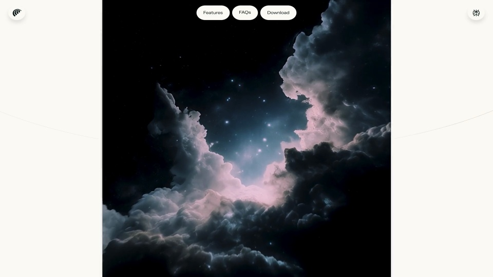

# Comet｜星云窗口

用一个可展开的窄窗承接大幅影像：页面保持安静，视觉变化集中在窗口边界和内部空间。

```motion-demo
{
  "id": "sequence",
  "title": "整体编排",
  "src": "demos/sequence.html",
  "duration": 12.1,
  "status": "authored",
  "description": "动作与构图示意",
  "initialTime": 3.4,
  "params": [
    {
      "key": "title",
      "label": "示例主文案",
      "type": "text",
      "value": "Comet",
      "maxLength": 60
    },
    {
      "key": "accent",
      "label": "强调色",
      "type": "color",
      "value": "#c4a7cf"
    }
  ],
  "presets": [
    {
      "label": "默认内容",
      "values": {
        "title": "Comet",
        "accent": "#c4a7cf"
      }
    },
    {
      "label": "OpenDesign 改编",
      "values": {
        "title": "OpenDesign",
        "accent": "#7050da"
      }
    }
  ]
}
```

## 从窄窗进入全幅画面

初始胶囊位于画面中心，周围留出完整的页面空白。展开时先拉长窗口，再扩大横向占幅；顶部导航始终维持原有位置。

## 影像铺底，文字留在页面层

使用浅暖底色、深色细字和低饱和紫蓝影像。标题可用衬线字体，导航用轻量无衬线；文字不跟随影像缩放。内部素材需覆盖最大窗口，放大过程中保持连续，避免露出边缘。



## 展开、停留、收回

扩张段将注意力交给影像，满幅段留出观看时间，收缩段沿同一路径回到入口。圆角随窗口尺寸过渡；遮罩和内部纹理分别控制，不能把整张页面一起放大。

| 段落 | 制作约束 |
| --- | --- |
| 0–3.4 秒 | 窄窗打开，遮罩边界连续变化 |
| 3.4–8.5 秒 | 保持满幅，内部影像继续缓慢运动 |
| 8.5 秒之后 | 收回中央窄窗，接回起始构图 |

## 换内容时保留窗口逻辑

可以换成空间、材质、产品特写或环境影像。先选能承受大幅裁切的素材，再确定窄窗中的取景点；品牌名和导航可替换，中心入口、固定导航和展开回收的关系保持一致。

## 配色与字形

衬线主张标题搭配无衬线界面文字；大留白、细边框。

#f8f7f1 · #171a22 · #c4a7cf · #263e53 · #ffffff

## 元素与制作规则

页面导航 / 胶囊遮罩 / 星云纹理

- 导航保持顶部锚定，只有中心遮罩扩大；内部影像与容器尺寸分开。
- 展开到满幅后停留，再按相反路径收回，构成循环。

## 内容替换

- 可换成任意沉浸主题纹理；保留小入口→大世界→小入口。
- 星云本身不是几何测量结果，替换素材须覆盖放大裁切。

## 制作参数

[视觉与对象](style.json) · [段落时序](timeline.json) · [位置数据](tracks.json) · [文件清单](manifest.json)

此规范根据参考视频整理。HTML 为可编辑的编排示例；具体数据的来源、精度与有效区间随文件标注。

```motion-board
{
  "version": 1,
  "brand": "Perplexity",
  "id": "V078",
  "palette": [
    "#f8f7f1",
    "#171a22",
    "#c4a7cf",
    "#263e53",
    "#ffffff"
  ],
  "typography": "衬线主张标题搭配无衬线界面文字；大留白、细边框",
  "sample": "Comet",
  "objects": [
    "页面导航",
    "胶囊遮罩",
    "星云纹理"
  ],
  "frames": [
    {
      "path": "assets/reference-1.jpg",
      "timeSeconds": 0.0,
      "frameId": "K0001",
      "role": "reference-evidence",
      "status": "measured"
    },
    {
      "path": "assets/reference-2.jpg",
      "timeSeconds": 1.5,
      "frameId": "K0003",
      "role": "reference-evidence",
      "status": "measured"
    },
    {
      "path": "assets/reference-3.jpg",
      "timeSeconds": 3.2666666666666666,
      "frameId": "K0010",
      "role": "reference-evidence",
      "status": "measured"
    },
    {
      "path": "assets/reference-4.jpg",
      "timeSeconds": 8.533333333333333,
      "frameId": "K0030",
      "role": "reference-evidence",
      "status": "measured"
    },
    {
      "path": "assets/reference-5.jpg",
      "timeSeconds": 10.533333333333333,
      "frameId": "K0038",
      "role": "reference-evidence",
      "status": "measured"
    }
  ],
  "stages": [
    {
      "start": 0,
      "label": "窄窗",
      "end": 1.5,
      "status": "inferred",
      "basis": "Representative-frame review; approximate boundaries"
    },
    {
      "start": 1.5,
      "label": "窗口纵向扩张",
      "end": 3.4,
      "status": "inferred",
      "basis": "Representative-frame review; approximate boundaries"
    },
    {
      "start": 3.4,
      "label": "铺满星云",
      "end": 8.5,
      "status": "inferred",
      "basis": "Representative-frame review; approximate boundaries"
    },
    {
      "start": 8.5,
      "label": "窗口收缩",
      "end": 10.5,
      "status": "inferred",
      "basis": "Representative-frame review; approximate boundaries"
    },
    {
      "start": 10.5,
      "label": "返回窄窗",
      "end": 12.1,
      "status": "inferred",
      "basis": "Representative-frame review; approximate boundaries"
    }
  ],
  "duration": 12.1,
  "fontFamily": "Georgia, serif"
}
```
