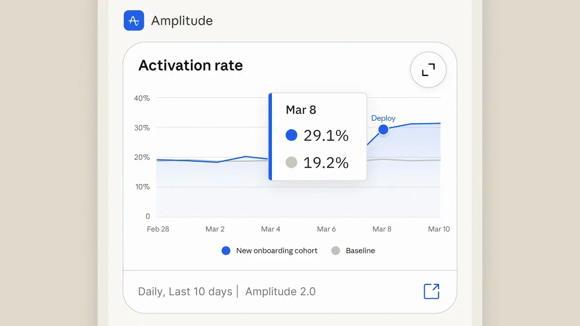

# Claude 手机工具连接

从通知提出问题，用图表说明变化、流程解释原因，再把结论整理成可分享的材料。每张卡片承担不同的信息任务。

```motion-demo
{
  "id": "sequence",
  "title": "整体编排",
  "src": "demos/sequence.html",
  "duration": 52.25,
  "status": "authored",
  "description": "动作与构图示意",
  "initialTime": 27.25,
  "params": [
    {
      "key": "title",
      "label": "示例主文案",
      "type": "text",
      "value": "Connected tools",
      "maxLength": 60
    },
    {
      "key": "accent",
      "label": "强调色",
      "type": "color",
      "value": "#be6d57"
    }
  ],
  "presets": [
    {
      "label": "默认内容",
      "values": {
        "title": "Connected tools",
        "accent": "#be6d57"
      }
    },
    {
      "label": "OpenDesign 改编",
      "values": {
        "title": "OpenDesign",
        "accent": "#7050da"
      }
    }
  ]
}
```

## 图表、流程与页面各有分工

暖灰米色背景、轻边框手机、数据图与流程卡片、衬线说明。

以业务问题贯穿多工具调用：数据说明发生什么，流程说明为何，幻灯片负责分享。



## 卡片展开查看，再回到对话

工具结果先以内嵌卡出现，再放大查看细节，关闭后回到同一对话。

卡片视觉类型随信息任务变化：曲线→流程→页面，不能全换成同类结果卡。

```motion-demo
{
  "id": "clip-2",
  "title": "卡片展开查看，再回到对话",
  "src": "demos/clip-2.html",
  "duration": 10,
  "status": "authored",
  "description": "14–24 秒 · 动作示意",
  "initialTime": 0.6
}
```

## 让下一次提问承接已有结论

通知引出问题，图表说明变化，流程解释原因，最后把结论转成分享材料。每次新提问都承接前一张卡片。

| 时间 | 段落 |
|---|---|
| 0.00–5.00s | 连接节点图标 |
| 5.00–8.00s | 通知引入问题 |
| 8.00–14.00s | 用户提问 |
| 14.00–20.00s | 分析工具图表 |
| 20.00–24.00s | 图表局部查看 |
| 24.00–27.00s | 追问原因 |
| 27.00–34.00s | 设计流程对照 |
| 34.00–38.00s | 请求制作分享材料 |
| 38.00–41.00s | 幻灯片大纲 |
| 41.00–46.00s | 生成设计 |
| 46.00–52.25s | 品牌收尾 |

## 换工具与内容，保留证据链

可迁移为设计评审：反馈数据→原因分析→方案对照→汇报材料。

更换品牌时也要替换工具内容，并保留证据到结论的因果链。

## 配色与字形

暖灰米色背景、轻边框手机、数据图与流程卡片、衬线说明。

#e1d9ca · #25251f · #be6d57 · #779b83 · #ffffff

## 元素与制作规则

手机对话容器 / 外部通知 / 分析图表卡 / 设计流程卡 / 幻灯片结果卡 / 用户追问

- 以业务问题贯穿多工具调用：数据说明发生什么，流程说明为何，幻灯片负责分享。
- 工具结果先以内嵌卡出现，再放大查看细节，关闭后回到同一对话。
- 卡片视觉类型随信息任务变化：曲线→流程→页面，不能全换成同类结果卡。

## 内容替换

- 可迁移为设计评审：反馈数据→原因分析→方案对照→汇报材料。
- 更换品牌时也要替换工具内容，并保留证据到结论的因果链。

## 制作参数

[视觉与对象](style.json) · [段落时序](timeline.json) · [位置数据](tracks.json) · [文件清单](manifest.json)

此规范根据参考视频整理。HTML 为可编辑的编排示例；具体数据的来源、精度与有效区间随文件标注。

```motion-board
{
  "version": 1,
  "brand": "Anthropic",
  "id": "V241",
  "palette": [
    "#e1d9ca",
    "#25251f",
    "#be6d57",
    "#779b83",
    "#ffffff"
  ],
  "typography": "暖灰米色背景、轻边框手机、数据图与流程卡片、衬线说明",
  "sample": "Connected tools",
  "objects": [
    "手机对话容器",
    "外部通知",
    "分析图表卡",
    "设计流程卡",
    "幻灯片结果卡",
    "用户追问"
  ],
  "frames": [
    {
      "path": "assets/reference-1.webp",
      "timeSeconds": 0.0,
      "frameId": "K0001",
      "role": "reference-evidence",
      "status": "measured"
    },
    {
      "path": "assets/reference-2.webp",
      "timeSeconds": 8.0,
      "frameId": "K0027",
      "role": "reference-evidence",
      "status": "measured"
    },
    {
      "path": "assets/reference-3.webp",
      "timeSeconds": 20.0,
      "frameId": "K0060",
      "role": "reference-evidence",
      "status": "measured"
    },
    {
      "path": "assets/reference-4.webp",
      "timeSeconds": 27.0,
      "frameId": "K0079",
      "role": "reference-evidence",
      "status": "measured"
    },
    {
      "path": "assets/reference-5.webp",
      "timeSeconds": 38.0,
      "frameId": "K0109",
      "role": "reference-evidence",
      "status": "measured"
    },
    {
      "path": "assets/reference-6.webp",
      "timeSeconds": 46.0,
      "frameId": "K0133",
      "role": "reference-evidence",
      "status": "measured"
    }
  ],
  "stages": [
    {
      "start": 0,
      "label": "连接节点图标",
      "end": 5,
      "status": "inferred",
      "basis": "Representative-frame review; approximate boundaries"
    },
    {
      "start": 5,
      "label": "通知引入问题",
      "end": 8,
      "status": "inferred",
      "basis": "Representative-frame review; approximate boundaries"
    },
    {
      "start": 8,
      "label": "用户提问",
      "end": 14,
      "status": "inferred",
      "basis": "Representative-frame review; approximate boundaries"
    },
    {
      "start": 14,
      "label": "分析工具图表",
      "end": 20,
      "status": "inferred",
      "basis": "Representative-frame review; approximate boundaries"
    },
    {
      "start": 20,
      "label": "图表局部查看",
      "end": 24,
      "status": "inferred",
      "basis": "Representative-frame review; approximate boundaries"
    },
    {
      "start": 24,
      "label": "追问原因",
      "end": 27,
      "status": "inferred",
      "basis": "Representative-frame review; approximate boundaries"
    },
    {
      "start": 27,
      "label": "设计流程对照",
      "end": 34,
      "status": "inferred",
      "basis": "Representative-frame review; approximate boundaries"
    },
    {
      "start": 34,
      "label": "请求制作分享材料",
      "end": 38,
      "status": "inferred",
      "basis": "Representative-frame review; approximate boundaries"
    },
    {
      "start": 38,
      "label": "幻灯片大纲",
      "end": 41,
      "status": "inferred",
      "basis": "Representative-frame review; approximate boundaries"
    },
    {
      "start": 41,
      "label": "生成设计",
      "end": 46,
      "status": "inferred",
      "basis": "Representative-frame review; approximate boundaries"
    },
    {
      "start": 46,
      "label": "品牌收尾",
      "end": 52.25,
      "status": "inferred",
      "basis": "Representative-frame review; approximate boundaries"
    }
  ],
  "duration": 52.25,
  "fontFamily": "Georgia, serif"
}
```
