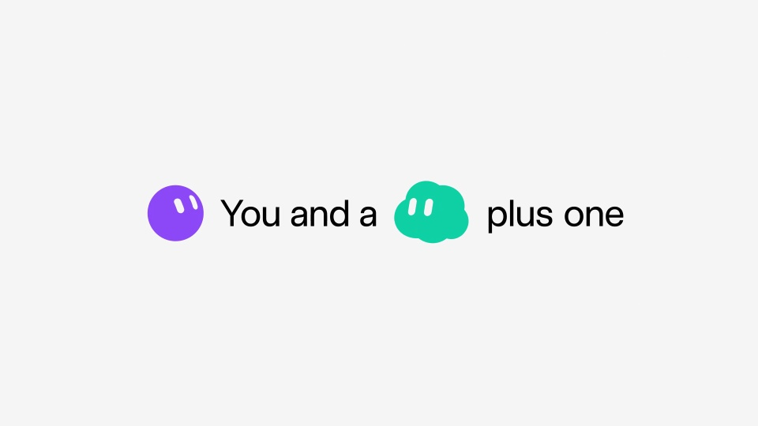

# Grok Bot · Starship 邀请活动

用奖励吸引注意，再把参与动作说清。角色贯穿邀请、同行者和用户作品，让活动拥有连续的视觉身份。

```motion-demo
{
  "id": "sequence",
  "title": "整体编排",
  "src": "demos/sequence.html",
  "duration": 26.7,
  "status": "authored",
  "description": "动作与构图示意",
  "initialTime": 5.3,
  "params": [
    {
      "key": "title",
      "label": "示例主文案",
      "type": "text",
      "value": "Share your bot",
      "maxLength": 60
    },
    {
      "key": "accent",
      "label": "强调色",
      "type": "color",
      "value": "#f19b4f"
    }
  ],
  "presets": [
    {
      "label": "默认内容",
      "values": {
        "title": "Share your bot",
        "accent": "#f19b4f"
      }
    },
    {
      "label": "OpenDesign 改编",
      "values": {
        "title": "OpenDesign",
        "accent": "#7050da"
      }
    }
  ]
}
```

## 开场先给一个有吸引力的问题

白底、大黑字和几枚彩色角色围绕奖品提问。随后用奖励现场的镜头承接期待；无衬线标题保持简短，现场画面让位给主体。



## 角色数量跟着参与关系变化

单个角色提出问题，两个角色说明“你与同行者”，更多角色组成参与者集合。每次增加人数都重新留出间距，不把新增角色挤进旧布局。

## 给出能照着做的参与示例

参与短句之后展示几份模板作品，卡片保留名称和作者。最后回到奖励场景，再给截止日期。

| 时间 | 段落 |
|---|---|
| 0.00–2.00s | 角色特写 |
| 2.00–5.00s | 奖品提问 |
| 5.00–6.00s | 你与同行者 |
| 6.00–11.00s | 发射现场 |
| 11.00–15.00s | 参与动作 |
| 15.00–18.00s | 角色集合 |
| 18.00–21.00s | 用户作品 |
| 21.00–23.00s | 奖品回扣 |
| 23.00–26.70s | 截止日期 |

## 为新活动准备四组素材

更换奖品、现场画面、用户作品和期限。角色与品牌可以重设计，奖励和证明它的素材必须一起变化；截止日期保持单独一屏。

## 配色与字形

白底彩色角色、黑大字与火箭实拍切换。

#fffdf8 · #161616 · #f19b4f · #5e9b6b · #e4564b

## 元素与制作规则

角色群 / 奖品标题 / 双人角色 / 火箭镜头 / 模板实例 / 截止日期

- 以奖励吸引注意，马上用现场画面解释奖励，再给出参与动作和实例。
- 角色由单个到成对再到群体，呼应参与人数。
- 截止日期置于收尾，前段不堆报名细则。

## 内容替换

- 更换奖励时同时换实证素材，保留奖励→参与→实例→期限。
- 火箭实拍需要外部素材，不把矢量火箭示例称原片复刻。

## 制作参数

[视觉与对象](style.json) · [段落时序](timeline.json) · [位置数据](tracks.json) · [文件清单](manifest.json)

此规范根据参考视频整理。HTML 为可编辑的编排示例；具体数据的来源、精度与有效区间随文件标注。

```motion-board
{
  "version": 1,
  "brand": "xAI / Grok",
  "id": "V024",
  "palette": [
    "#fffdf8",
    "#161616",
    "#f19b4f",
    "#5e9b6b",
    "#e4564b"
  ],
  "typography": "白底彩色角色、黑大字与火箭实拍切换",
  "sample": "Share your bot",
  "objects": [
    "角色群",
    "奖品标题",
    "双人角色",
    "火箭镜头",
    "模板实例",
    "截止日期"
  ],
  "frames": [
    {
      "path": "assets/reference-1.jpg",
      "timeSeconds": 0.0,
      "frameId": "K0001",
      "role": "reference-evidence",
      "status": "measured"
    },
    {
      "path": "assets/reference-2.jpg",
      "timeSeconds": 5.0,
      "frameId": "K0018",
      "role": "reference-evidence",
      "status": "measured"
    },
    {
      "path": "https://r.open-design.ai/files/8f57701478d3ecb08a2c55638020a14afded6f3594105b2f84bbb9237431165f",
      "timeSeconds": 6.0,
      "frameId": "K0023",
      "role": "reference-evidence",
      "status": "measured"
    },
    {
      "path": "assets/reference-4.jpg",
      "timeSeconds": 15.0,
      "frameId": "K0061",
      "role": "reference-evidence",
      "status": "measured"
    },
    {
      "path": "assets/reference-5.jpg",
      "timeSeconds": 18.0,
      "frameId": "K0073",
      "role": "reference-evidence",
      "status": "measured"
    },
    {
      "path": "assets/reference-6.jpg",
      "timeSeconds": 23.0,
      "frameId": "K0094",
      "role": "reference-evidence",
      "status": "measured"
    }
  ],
  "stages": [
    {
      "start": 0,
      "label": "角色特写",
      "end": 2,
      "status": "inferred",
      "basis": "Representative-frame review; approximate boundaries"
    },
    {
      "start": 2,
      "label": "奖品提问",
      "end": 5,
      "status": "inferred",
      "basis": "Representative-frame review; approximate boundaries"
    },
    {
      "start": 5,
      "label": "你与同行者",
      "end": 6,
      "status": "inferred",
      "basis": "Representative-frame review; approximate boundaries"
    },
    {
      "start": 6,
      "label": "发射现场",
      "end": 11,
      "status": "inferred",
      "basis": "Representative-frame review; approximate boundaries"
    },
    {
      "start": 11,
      "label": "参与动作",
      "end": 15,
      "status": "inferred",
      "basis": "Representative-frame review; approximate boundaries"
    },
    {
      "start": 15,
      "label": "角色集合",
      "end": 18,
      "status": "inferred",
      "basis": "Representative-frame review; approximate boundaries"
    },
    {
      "start": 18,
      "label": "用户作品",
      "end": 21,
      "status": "inferred",
      "basis": "Representative-frame review; approximate boundaries"
    },
    {
      "start": 21,
      "label": "奖品回扣",
      "end": 23,
      "status": "inferred",
      "basis": "Representative-frame review; approximate boundaries"
    },
    {
      "start": 23,
      "label": "截止日期",
      "end": 26.7,
      "status": "inferred",
      "basis": "Representative-frame review; approximate boundaries"
    }
  ],
  "duration": 26.7,
  "fontFamily": "Arial, sans-serif"
}
```
