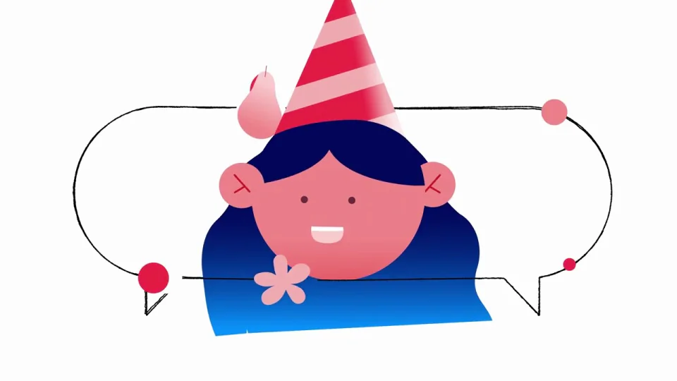

# Twilio｜客户互动平台 MG 介绍

让品牌圆点进入人物和生活场景，通过相同的连线、红色物件与位置接力串起多个客户故事。

```motion-demo
{
  "id": "sequence",
  "title": "整体编排",
  "src": "demos/sequence.html",
  "duration": 100.966667,
  "status": "authored",
  "description": "动作与构图示意",
  "initialTime": 29,
  "params": [
    {
      "key": "title",
      "label": "示例主文案",
      "type": "text",
      "value": "twilio",
      "maxLength": 60
    },
    {
      "key": "accent",
      "label": "强调色",
      "type": "color",
      "value": "#e4174d"
    }
  ],
  "presets": [
    {
      "label": "默认内容",
      "values": {
        "title": "twilio",
        "accent": "#e4174d"
      }
    },
    {
      "label": "OpenDesign 改编",
      "values": {
        "title": "OpenDesign",
        "accent": "#7050da"
      }
    }
  ]
}
```

## 用同一组形状贯穿品牌与情境

四个圆点、细弧线、气泡和圆角块构成基础词汇。它们既是片头标识，也能变成消息、服务与数据连接。

白底留出运动空间；红粉物件保持高对比，人物以蓝色主体和暖色面部区分。

```motion-demo
{
  "id": "clip-1",
  "title": "用同一组形状贯穿品牌与情境",
  "src": "demos/clip-1.html",
  "duration": 12,
  "status": "authored",
  "description": "0–12 秒 · 动作示意",
  "initialTime": 0.6
}
```

## 以人物为中心组织一个交互

先建立人物，再让相关手机、购物或服务物件进入。物件围绕人物形成关系，下一镜从其中一个物件继续。



## 镜头通过共享对象交接

可以沿弧线运动、拉近物件或绕人物转场；每次交接至少保留一个形状或位置关系，让多个行业仍属于同一个系统。

```motion-demo
{
  "id": "clip-3",
  "title": "镜头通过共享对象交接",
  "src": "demos/clip-3.html",
  "duration": 10,
  "status": "authored",
  "description": "25–35 秒 · 动作示意",
  "initialTime": 0.6
}
```

## 用重复结构容纳多个行业

每轮只替换人物与关键物件，保持相同的进入、交互和退出逻辑。末段逐步撤掉道具，把关注点交还给品牌。

| 时间 | 段落 |
|---|---|
| 0.00–5.00s | 圆点组成品牌 |
| 5.00–10.00s | 信号连线 |
| 10.00–14.00s | 通信图标 |
| 14.00–25.00s | 人物出现 |
| 25.00–35.00s | 人物与物件关系 |
| 35.00–52.00s | 购物与服务场景 |
| 52.00–66.00s | 场景间循环衔接 |
| 66.00–84.00s | 消息和生活场景 |
| 84.00–96.00s | 回到信号与人物 |
| 96.00–100.97s | 品牌收束 |

## 配色与字形

少量无衬线品牌字；白底、红粉信号图形、蓝色人物与柔和体积阴影。

#fcfcfc · #122e64 · #e4174d · #f6c9d3 · #36a5de

## 元素与制作规则

四个品牌圆点 / 弧线连接 / 通信气泡 / 人物 / 生活物件 / 设备与消息

- 红色圆点先形成品牌，再变成连接人物和物件的信号；同一套几何词汇贯穿整段。
- 每段以人物为中心，手机、消息或物件围绕其展开；用位置接力把下一场景引入。
- 平面人物和立体信号物件共存，红粉承担连接与强调，蓝色承担人物轮廓。

## 内容替换

- 替换行业物件和人物角色，保留信号→人物情境→交互→更多情境→品牌的组织关系。
- 每个小场景保持一位主体、一个交互目标和少量连接元素；不要把所有道具同时堆上屏。

## 制作参数

[视觉与对象](style.json) · [段落时序](timeline.json) · [位置数据](tracks.json) · [文件清单](manifest.json)

此规范根据参考视频整理。HTML 为可编辑的编排示例；具体数据的来源、精度与有效区间随文件标注。

```motion-board
{
  "version": 1,
  "brand": "Twilio",
  "id": "V395",
  "palette": [
    "#fcfcfc",
    "#122e64",
    "#e4174d",
    "#f6c9d3",
    "#36a5de"
  ],
  "typography": "少量无衬线品牌字；白底、红粉信号图形、蓝色人物与柔和体积阴影",
  "sample": "twilio",
  "objects": [
    "四个品牌圆点",
    "弧线连接",
    "通信气泡",
    "人物",
    "生活物件",
    "设备与消息"
  ],
  "frames": [
    {
      "path": "assets/reference-1.webp",
      "timeSeconds": 0.0,
      "frameId": "K0001",
      "role": "reference-evidence",
      "status": "measured"
    },
    {
      "path": "assets/reference-2.webp",
      "timeSeconds": 9.99340151765094,
      "frameId": "K0037",
      "role": "reference-evidence",
      "status": "measured"
    },
    {
      "path": "assets/reference-3.webp",
      "timeSeconds": 24.983503794127348,
      "frameId": "K0093",
      "role": "reference-evidence",
      "status": "measured"
    },
    {
      "path": "assets/reference-4.webp",
      "timeSeconds": 34.97690531177829,
      "frameId": "K0135",
      "role": "reference-evidence",
      "status": "measured"
    },
    {
      "path": "assets/reference-5.webp",
      "timeSeconds": 65.9564500164962,
      "frameId": "K0259",
      "role": "reference-evidence",
      "status": "measured"
    },
    {
      "path": "assets/reference-6.webp",
      "timeSeconds": 95.93665456944902,
      "frameId": "K0380",
      "role": "reference-evidence",
      "status": "measured"
    }
  ],
  "stages": [
    {
      "start": 0,
      "label": "圆点组成品牌",
      "end": 5,
      "status": "inferred",
      "basis": "Representative-frame review; approximate boundaries"
    },
    {
      "start": 5,
      "label": "信号连线",
      "end": 10,
      "status": "inferred",
      "basis": "Representative-frame review; approximate boundaries"
    },
    {
      "start": 10,
      "label": "通信图标",
      "end": 14,
      "status": "inferred",
      "basis": "Representative-frame review; approximate boundaries"
    },
    {
      "start": 14,
      "label": "人物出现",
      "end": 25,
      "status": "inferred",
      "basis": "Representative-frame review; approximate boundaries"
    },
    {
      "start": 25,
      "label": "人物与物件关系",
      "end": 35,
      "status": "inferred",
      "basis": "Representative-frame review; approximate boundaries"
    },
    {
      "start": 35,
      "label": "购物与服务场景",
      "end": 52,
      "status": "inferred",
      "basis": "Representative-frame review; approximate boundaries"
    },
    {
      "start": 52,
      "label": "场景间循环衔接",
      "end": 66,
      "status": "inferred",
      "basis": "Representative-frame review; approximate boundaries"
    },
    {
      "start": 66,
      "label": "消息和生活场景",
      "end": 84,
      "status": "inferred",
      "basis": "Representative-frame review; approximate boundaries"
    },
    {
      "start": 84,
      "label": "回到信号与人物",
      "end": 96,
      "status": "inferred",
      "basis": "Representative-frame review; approximate boundaries"
    },
    {
      "start": 96,
      "label": "品牌收束",
      "end": 100.966667,
      "status": "inferred",
      "basis": "Representative-frame review; approximate boundaries"
    }
  ],
  "duration": 100.966667,
  "fontFamily": "Arial, sans-serif"
}
```
