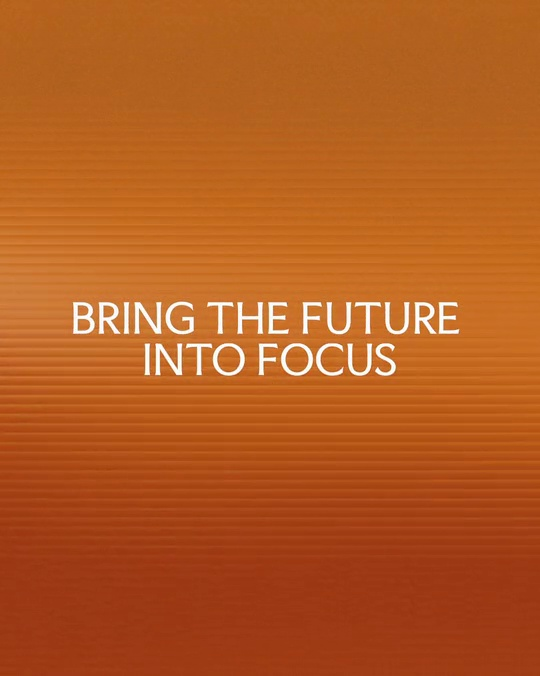

# Faculty｜渐变文字品牌主张

用缓慢流动的色域承载三句主张，只在换句时短暂打散字形。

```motion-demo
{
  "id": "sequence",
  "title": "整体编排",
  "src": "demos/sequence.html",
  "duration": 15.04,
  "status": "authored",
  "description": "动作与构图示意",
  "initialTime": 5.5,
  "params": [
    {
      "key": "title",
      "label": "示例主文案",
      "type": "text",
      "value": "DECODE YOUR DECISION MAKING",
      "maxLength": 60
    },
    {
      "key": "accent",
      "label": "强调色",
      "type": "color",
      "value": "#63734b"
    }
  ],
  "presets": [
    {
      "label": "默认内容",
      "values": {
        "title": "DECODE YOUR DECISION MAKING",
        "accent": "#63734b"
      }
    },
    {
      "label": "OpenDesign 改编",
      "values": {
        "title": "OpenDesign",
        "accent": "#7050da"
      }
    }
  ]
}
```

## 让色域承担段落区别

绿、橙、蓝紫分别承载一句话。渐变亮部缓慢移动，细横纹贯穿背景；避免使用互不相关的装饰图形。



## 切片只用于句子交接

文字保持双行居中，交接时按水平条带短暂错位，再合拢成完整新句。颜色在同一窗口过渡。

```motion-demo
{
  "id": "clip-2",
  "title": "切片只用于句子交接",
  "src": "demos/clip-2.html",
  "duration": 1.5999999999999996,
  "status": "authored",
  "description": "3.2–4.8 秒 · 动作示意",
  "initialTime": 0.6
}
```

## 把阅读停留放在动作之后

句子稳定时不要继续扭曲字形；让背景的轻微流动维持画面。三句结束后自然回接开场。

| 时间 | 段落 |
|---|---|
| 0.00–3.60s | 绿色主张 |
| 3.60–4.20s | 文字切片交接 |
| 4.20–8.30s | 橙色主张 |
| 8.30–9.00s | 切换第三句 |
| 9.00–13.70s | 蓝紫主张 |
| 13.70–15.04s | 回到绿色 |

## 配色与字形

细到中等无衬线双行全大写；绿、橙、蓝紫渐变和细横向扫描纹理。

#63734b · #ffffff · #63734b · #ce6c19 · #474c72

## 元素与制作规则

连续渐变背景 / 横向细纹 / 双行主张 / 文字条带遮罩

- 背景缓慢明暗流动，文字保持中轴与相近字宽；每组主张对应一个色域。
- 切换时文字短暂分条错位，然后重新拼成完整句子；断裂只发生在交接处。
- 阅读停留明显长于切换过程，不用持续抖字破坏品牌表达。

## 内容替换

- 替换三组双行短主张和对应色域；每句保持相近字数与视觉宽度。
- 保留渐变缓流、短切片过渡和较长静读三层节奏。

## 制作参数

[视觉与对象](style.json) · [段落时序](timeline.json) · [位置数据](tracks.json) · [文件清单](manifest.json)

此规范根据参考视频整理。HTML 为可编辑的编排示例；具体数据的来源、精度与有效区间随文件标注。

```motion-board
{
  "version": 1,
  "brand": "Faculty",
  "id": "V398",
  "palette": [
    "#63734b",
    "#ffffff",
    "#63734b",
    "#ce6c19",
    "#474c72"
  ],
  "typography": "细到中等无衬线双行全大写；绿、橙、蓝紫渐变和细横向扫描纹理",
  "sample": "DECODE YOUR DECISION MAKING",
  "objects": [
    "连续渐变背景",
    "横向细纹",
    "双行主张",
    "文字条带遮罩"
  ],
  "frames": [
    {
      "path": "assets/reference-1.jpg",
      "timeSeconds": 0.0,
      "frameId": "K0001",
      "role": "reference-evidence",
      "status": "measured"
    },
    {
      "path": "assets/reference-2.jpg",
      "timeSeconds": 4.0,
      "frameId": "K0007",
      "role": "reference-evidence",
      "status": "measured"
    },
    {
      "path": "assets/reference-3.jpg",
      "timeSeconds": 4.36,
      "frameId": "K0008",
      "role": "reference-evidence",
      "status": "measured"
    },
    {
      "path": "assets/reference-4.jpg",
      "timeSeconds": 8.6,
      "frameId": "K0014",
      "role": "reference-evidence",
      "status": "measured"
    },
    {
      "path": "assets/reference-5.jpg",
      "timeSeconds": 9.0,
      "frameId": "K0015",
      "role": "reference-evidence",
      "status": "measured"
    },
    {
      "path": "assets/reference-6.jpg",
      "timeSeconds": 14.0,
      "frameId": "K0027",
      "role": "reference-evidence",
      "status": "measured"
    }
  ],
  "stages": [
    {
      "start": 0,
      "label": "绿色主张",
      "end": 3.6,
      "status": "inferred",
      "basis": "Representative-frame review; approximate boundaries"
    },
    {
      "start": 3.6,
      "label": "文字切片交接",
      "end": 4.2,
      "status": "inferred",
      "basis": "Representative-frame review; approximate boundaries"
    },
    {
      "start": 4.2,
      "label": "橙色主张",
      "end": 8.3,
      "status": "inferred",
      "basis": "Representative-frame review; approximate boundaries"
    },
    {
      "start": 8.3,
      "label": "切换第三句",
      "end": 9,
      "status": "inferred",
      "basis": "Representative-frame review; approximate boundaries"
    },
    {
      "start": 9,
      "label": "蓝紫主张",
      "end": 13.7,
      "status": "inferred",
      "basis": "Representative-frame review; approximate boundaries"
    },
    {
      "start": 13.7,
      "label": "回到绿色",
      "end": 15.04,
      "status": "inferred",
      "basis": "Representative-frame review; approximate boundaries"
    }
  ],
  "duration": 15.04,
  "fontFamily": "Arial, sans-serif"
}
```
